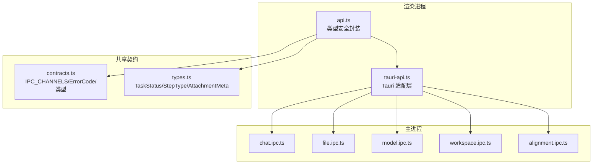
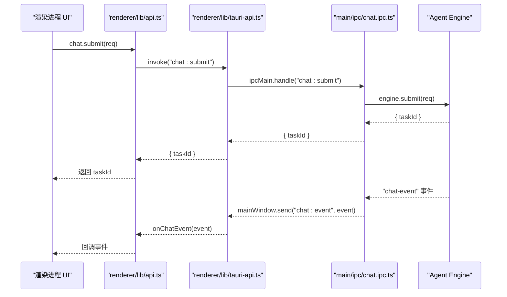
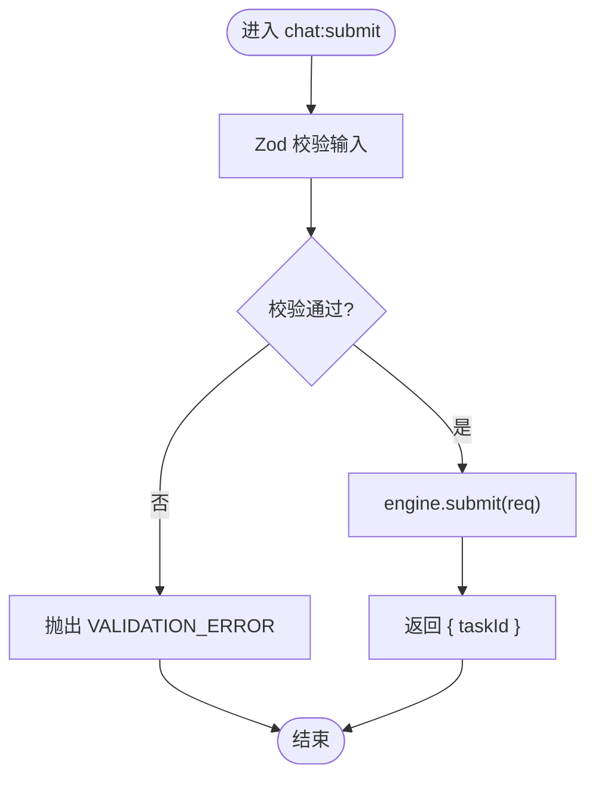
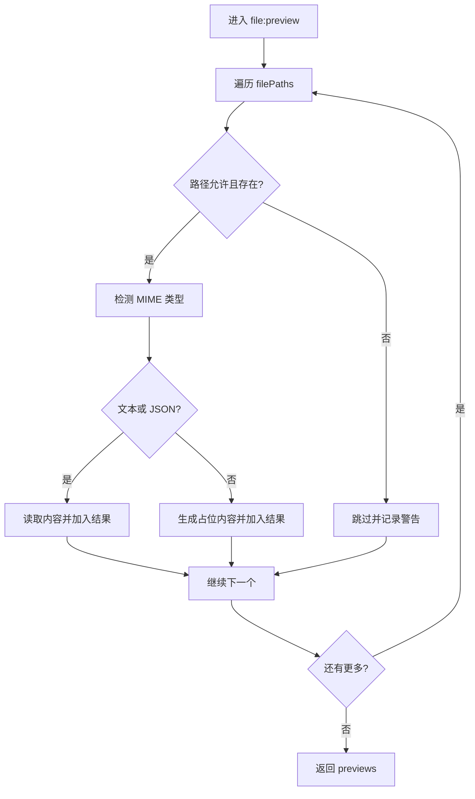
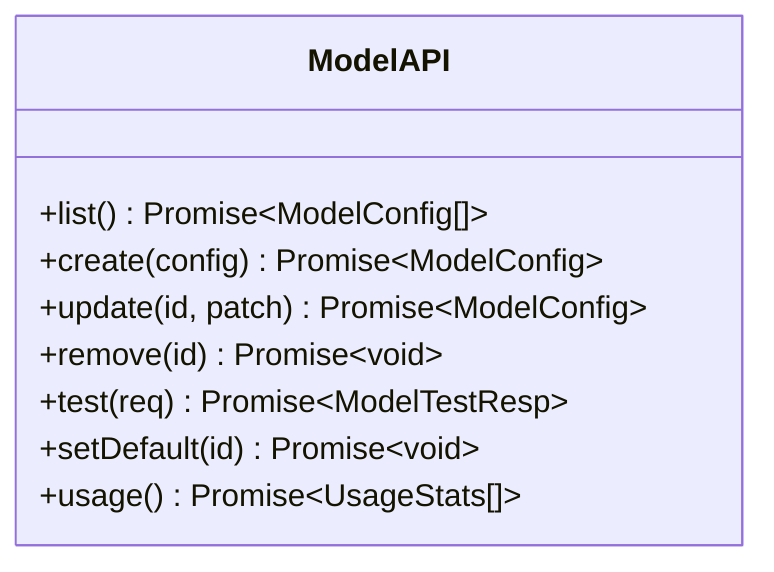
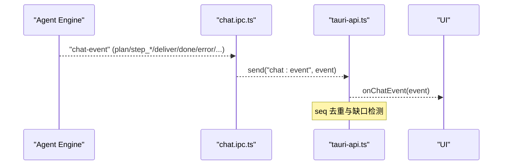
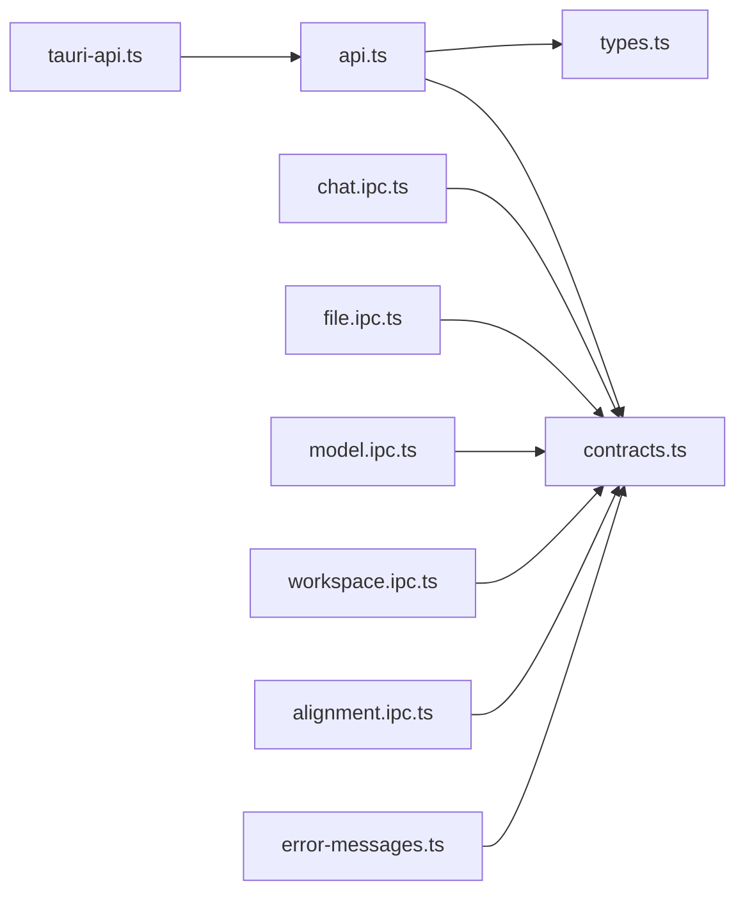

# API 参考

<cite>
**本文引用的文件**
- [contracts.ts](file://tongtian-tauri/src/shared/contracts.ts)
- [types.ts](file://tongtian-tauri/src/shared/types.ts)
- [chat.ipc.ts](file://tongtian-tauri/src/main/ipc/chat.ipc.ts)
- [file.ipc.ts](file://tongtian-tauri/src/main/ipc/file.ipc.ts)
- [model.ipc.ts](file://tongtian-tauri/src/main/ipc/model.ipc.ts)
- [workspace.ipc.ts](file://tongtian-tauri/src/main/ipc/workspace.ipc.ts)
- [alignment.ipc.ts](file://tongtian-tauri/src/main/ipc/alignment.ipc.ts)
- [tauri-api.ts](file://tongtian-tauri/src/renderer/lib/tauri-api.ts)
- [api.ts](file://tongtian-tauri/src/renderer/lib/api.ts)
- [error-messages.ts](file://tongtian-tauri/src/shared/error-messages.ts)
- [package.json](file://tongtian-tauri/package.json)
</cite>

## 目录
1. [简介](#简介)
2. [项目结构](#项目结构)
3. [核心组件](#核心组件)
4. [架构总览](#架构总览)
5. [详细组件分析](#详细组件分析)
6. [依赖关系分析](#依赖关系分析)
7. [性能考虑](#性能考虑)
8. [故障排查指南](#故障排查指南)
9. [结论](#结论)
10. [附录](#附录)

## 简介
本 API 参考文档面向通天办公（Tauri 版）的 IPC 接口，覆盖聊天任务、模型管理、文件操作、工作区与对齐能力等。文档包含：
- 所有 IPC 命令接口的请求参数、响应格式、错误码与使用示例
- 事件协议（agent://event / chat-event）与数据类型定义、消息格式规范
- 调用示例、错误处理模式与最佳实践
- API 版本兼容性与迁移指南

## 项目结构
本项目采用“共享契约 + 主进程 IPC + 渲染进程适配”的分层设计：
- shared/contracts.ts：统一的 IPC 通道名、错误码、请求/响应类型
- shared/types.ts：扩展类型（任务状态、步骤类型、附件元数据等）
- main/ipc/*：各模块 IPC 处理器（Chat、File、Model、Workspace、Alignment）
- renderer/lib/*：渲染进程 API 封装与 Tauri 适配层
- package.json：应用版本与依赖信息

**图表来源**
- [contracts.ts:480-584](file://tongtian-tauri/src/shared/contracts.ts#L480-L584)
- [types.ts:1-120](file://tongtian-tauri/src/shared/types.ts#L1-L120)
- [chat.ipc.ts:122-189](file://tongtian-tauri/src/main/ipc/chat.ipc.ts#L122-L189)
- [file.ipc.ts:100-247](file://tongtian-tauri/src/main/ipc/file.ipc.ts#L100-L247)
- [model.ipc.ts:105-219](file://tongtian-tauri/src/main/ipc/model.ipc.ts#L105-L219)
- [workspace.ipc.ts:55-145](file://tongtian-tauri/src/main/ipc/workspace.ipc.ts#L55-L145)
- [alignment.ipc.ts:62-258](file://tongtian-tauri/src/main/ipc/alignment.ipc.ts#L62-L258)

**章节来源**
- [contracts.ts:480-584](file://tongtian-tauri/src/shared/contracts.ts#L480-L584)
- [types.ts:1-120](file://tongtian-tauri/src/shared/types.ts#L1-L120)

## 核心组件
- Chat IPC：提交对话、审阅计划、控制任务、历史查询、事件转发
- File IPC：浏览目录、读取文件、批量预览、格式转换
- Model IPC：模型列表、创建/更新/删除、健康测试、默认设置、用量统计
- Workspace IPC：工作区创建/列表/切换/销毁/挂起/恢复
- Alignment IPC：设置、Hook、Awareness、Connector、归档、电脑操控策略

**章节来源**
- [chat.ipc.ts:122-189](file://tongtian-tauri/src/main/ipc/chat.ipc.ts#L122-L189)
- [file.ipc.ts:100-247](file://tongtian-tauri/src/main/ipc/file.ipc.ts#L100-L247)
- [model.ipc.ts:105-219](file://tongtian-tauri/src/main/ipc/model.ipc.ts#L105-L219)
- [workspace.ipc.ts:55-145](file://tongtian-tauri/src/main/ipc/workspace.ipc.ts#L55-L145)
- [alignment.ipc.ts:62-258](file://tongtian-tauri/src/main/ipc/alignment.ipc.ts#L62-L258)

## 架构总览
下图展示了从渲染进程到主进程 IPC 的调用路径与事件流。

**图表来源**
- [api.ts:33-69](file://tongtian-tauri/src/renderer/lib/api.ts#L33-L69)
- [tauri-api.ts:91-115](file://tongtian-tauri/src/renderer/lib/tauri-api.ts#L91-L115)
- [chat.ipc.ts:127-189](file://tongtian-tauri/src/main/ipc/chat.ipc.ts#L127-L189)

## 详细组件分析

### Chat IPC（聊天任务）
- 通道名
  - chat:submit
  - chat:review
  - chat:control
  - chat:history
  - chat:event（事件）
- 请求/响应与校验
  - chat:submit
    - 请求体：ChatSubmitReq（goal 必填，可选 taskId、modelBinding、attachments）
    - 响应：{ taskId }
    - 校验：Zod 校验 goal 长度与必填
  - chat:review
    - 请求体：ChatReviewReq（planId 必填，action 枚举 approve/reject/modify，可选 patch）
    - 响应：{ ok, status? }
  - chat:control
    - 请求体：ChatControlReq（taskId 必填，action 枚举 pause/resume/rollback_to，可选 stepId）
    - 响应：{ ok, status? }
  - chat:history
    - 请求体：{ limit?: number }
    - 响应：TaskSummary[]
- 事件协议
  - 通道：chat:event
  - 事件类型：plan、step_start、step_progress、step_done、step_failed、deliver、done、error、status_change、quota_warning、heartbeat
  - 字段 seq/taskId 为可选（向后兼容），用于去重与重放
- 错误处理
  - 结构化错误：{ code, message, details? }
  - 常见错误码：VALIDATION_ERROR、INTERNAL_ERROR、TASK_*、MODEL_*、FILE_* 等
- 使用示例（伪代码）
  - 提交任务：调用 chat.submit({ goal, modelBinding?, attachments? })
  - 审阅计划：调用 chat.review(taskId, { action, patch? })
  - 控制任务：调用 chat.control({ taskId, action, stepId? })
  - 订阅事件：onChatEvent(e => { ... })

**图表来源**
- [chat.ipc.ts:47-58](file://tongtian-tauri/src/main/ipc/chat.ipc.ts#L47-L58)
- [chat.ipc.ts:127-136](file://tongtian-tauri/src/main/ipc/chat.ipc.ts#L127-L136)

**章节来源**
- [chat.ipc.ts:122-189](file://tongtian-tauri/src/main/ipc/chat.ipc.ts#L122-L189)
- [contracts.ts:121-158](file://tongtian-tauri/src/shared/contracts.ts#L121-L158)
- [types.ts:270-315](file://tongtian-tauri/src/shared/types.ts#L270-L315)

### File IPC（文件操作）
- 通道名
  - file:browse
  - file:read
  - file:preview
  - file:convert
- 请求/响应与校验
  - file:browse
    - 请求体：{ dirPath }
    - 响应：FileInfo[]（name/path/isDirectory/size/modifiedAt）
    - 校验：路径白名单（禁止 ..）、绝对路径检查
  - file:read
    - 请求体：{ filePath }
    - 响应：{ content }
    - 校验：存在性检查
  - file:preview
    - 请求体：{ filePaths }
    - 响应：FilePreview[]（path/content/mimeType）
    - 文本类直接读取内容；二进制返回占位提示
  - file:convert
    - 请求体：{ inputPath, outputPath, inputFormat, outputFormat }
    - 响应：{ outputPath, durationMs }
    - 支持 docx/xlsx/pdf/csv/txt/md 互转
- 错误处理
  - PATH_NOT_ALLOWED、DIRECTORY_NOT_FOUND、FILE_NOT_FOUND、CONVERSION_FAILED
- 使用示例（伪代码）
  - 列出目录：file.list(dirPath, workspaceId?)
  - 读取文件：file.read(filePath, workspaceId?)
  - 批量预览：file.preview(filePaths, workspaceId?)
  - 格式转换：调用 file:convert（内部实现）

**图表来源**
- [file.ipc.ts:158-202](file://tongtian-tauri/src/main/ipc/file.ipc.ts#L158-L202)

**章节来源**
- [file.ipc.ts:100-247](file://tongtian-tauri/src/main/ipc/file.ipc.ts#L100-L247)
- [contracts.ts:323-335](file://tongtian-tauri/src/shared/contracts.ts#L323-L335)

### Model IPC（模型管理）
- 通道名
  - model:list
  - model:create
  - model:update
  - model:delete
  - model:test
  - model:setDefault
  - model:usage
- 请求/响应与校验
  - model:list → ModelConfig[]
  - model:create → ModelConfig（name/source/baseUrl/apiKey/modelName/contextWindow?/agentBinding?/forceLocal?）
  - model:update → ModelConfig（id 必填，其余可选）
  - model:delete → { ok }
  - model:test → ModelTestResp（ok/latencyMs/model/error?/availableModels?）
  - model:setDefault → ModelConfig
  - model:usage → UsageStats[]（period: day/week/month）
- 错误处理
  - VALIDATION_ERROR、INTERNAL_ERROR、MODEL_* 系列错误码
- 使用示例（伪代码）
  - 获取列表：model.list()
  - 新增模型：model.create(config)
  - 测试连通性：model.test({ baseUrl, apiKey, modelName, contextWindow })
  - 设置默认：model.setDefault(id)
  - 用量统计：model.usage()

**图表来源**
- [api.ts:73-108](file://tongtian-tauri/src/renderer/lib/api.ts#L73-L108)
- [model.ipc.ts:105-219](file://tongtian-tauri/src/main/ipc/model.ipc.ts#L105-L219)

**章节来源**
- [model.ipc.ts:105-219](file://tongtian-tauri/src/main/ipc/model.ipc.ts#L105-L219)
- [contracts.ts:169-182](file://tongtian-tauri/src/shared/contracts.ts#L169-L182)
- [types.ts:217-232](file://tongtian-tauri/src/shared/types.ts#L217-L232)

### Workspace IPC（工作区）
- 通道名
  - workspace:create
  - workspace:list
  - workspace:update（切换）
  - workspace:delete
  - workspace:suspend
  - workspace:resume
- 请求/响应与校验
  - workspace:create → WorkspaceCreateReq（name/agentConfig.modelBinding?/skillIds?/mcpServerIds?）
  - workspace:list → Workspace[]
  - workspace:update → 切换成功
  - workspace:delete → { ok }
  - workspace:suspend/resume → 状态变更
- 错误处理
  - WORKSPACE_* 系列错误码
- 使用示例（伪代码）
  - 创建工作区：workspace.create({ name, agentConfig, modelBinding?, skillIds?, mcpServerIds? })
  - 切换工作区：workspace.update({ workspaceId })
  - 销毁工作区：workspace.delete({ workspaceId })

**章节来源**
- [workspace.ipc.ts:55-145](file://tongtian-tauri/src/main/ipc/workspace.ipc.ts#L55-L145)
- [contracts.ts:186-208](file://tongtian-tauri/src/shared/contracts.ts#L186-L208)

### Alignment IPC（对齐能力）
- 通道名
  - settings:get/set
  - hooks:get/set/test
  - awareness:get/update/memories/memoryAdd/memoryDelete
  - connector:list/authorize/revoke
  - task:archive/unarchive/archiveDelete/archiveList/archiveClear
  - computerUse:getPolicy/setPolicy
- 请求/响应与校验
  - settings/get/set → AppSettingsData
  - hooks/get/set/test → HookConfigStore/HookAggregate
  - awareness/* → AwarenessProfile/MemoryEntry
  - connector/* → ConnectorState
  - archive/* → ArchiveRecord
  - computerUse/* → ComputerUsePolicy
- 错误处理
  - 结构化错误，统一日志记录
- 使用示例（伪代码）
  - 获取设置：settings.get()
  - 设置 Hook：hooks.set({ hooks })
  - 授权连接器：connector.authorize({ connectorId, category? })
  - 归档任务：task.archive({ taskId, workspaceId? })

**章节来源**
- [alignment.ipc.ts:62-258](file://tongtian-tauri/src/main/ipc/alignment.ipc.ts#L62-L258)
- [contracts.ts:371-476](file://tongtian-tauri/src/shared/contracts.ts#L371-L476)

### 事件协议（agent://event / chat-event）
- 事件通道：chat:event（主进程 → 渲染进程）
- 事件类型与字段
  - plan：{ type:'plan', planId, steps[], seq?, taskId? }
  - step_start：{ type:'step_start', stepId, stepType, description, seq?, taskId? }
  - step_progress：{ type:'step_progress', stepId, progress, message, seq?, taskId? }
  - step_done：{ type:'step_done', stepId, output, usage?, seq?, taskId? }
  - step_failed：{ type:'step_failed', stepId, error, seq?, taskId? }
  - deliver：{ type:'deliver', taskId, summary, artifacts[], seq? }
  - done：{ type:'done', taskId, seq? }
  - error：{ type:'error', code, message, seq?, taskId? }
  - status_change：{ type:'status_change', taskId, status, waitReason?, statusReasonCode?, queuePosition?, seq? }
  - quota_warning：{ type:'quota_warning', level, action, usedTokens, quotaTokens, seq? }
  - heartbeat：{ type:'heartbeat', seq? }
- 事件守卫
  - 渲染侧 EventStreamGuard 负责 seq 去重与缺口检测，必要时触发 eventReplay

**图表来源**
- [chat.ipc.ts:93-112](file://tongtian-tauri/src/main/ipc/chat.ipc.ts#L93-L112)
- [tauri-api.ts:146-165](file://tongtian-tauri/src/renderer/lib/tauri-api.ts#L146-L165)

**章节来源**
- [contracts.ts:146-158](file://tongtian-tauri/src/shared/contracts.ts#L146-L158)
- [types.ts:291-303](file://tongtian-tauri/src/shared/types.ts#L291-L303)

## 依赖关系分析
- 渲染进程 api.ts 依赖 shared/contracts.ts 的 IPC_CHANNELS 与类型定义
- tauri-api.ts 将 Rust command 映射为统一 tongtianAPI 方法
- 主进程各 IPC 模块通过 Zod 校验输入，调用后端服务（Engine/Hub/Manager）
- 错误码集中定义于 contracts.ts，UI 文案映射于 error-messages.ts

**图表来源**
- [api.ts:1-207](file://tongtian-tauri/src/renderer/lib/api.ts#L1-L207)
- [tauri-api.ts:1-186](file://tongtian-tauri/src/renderer/lib/tauri-api.ts#L1-L186)
- [contracts.ts:1-120](file://tongtian-tauri/src/shared/contracts.ts#L1-L120)
- [types.ts:1-120](file://tongtian-tauri/src/shared/types.ts#L1-L120)
- [error-messages.ts:1-37](file://tongtian-tauri/src/shared/error-messages.ts#L1-L37)

**章节来源**
- [api.ts:1-207](file://tongtian-tauri/src/renderer/lib/api.ts#L1-L207)
- [tauri-api.ts:1-186](file://tongtian-tauri/src/renderer/lib/tauri-api.ts#L1-L186)
- [contracts.ts:1-120](file://tongtian-tauri/src/shared/contracts.ts#L1-L120)
- [types.ts:1-120](file://tongtian-tauri/src/shared/types.ts#L1-L120)
- [error-messages.ts:1-37](file://tongtian-tauri/src/shared/error-messages.ts#L1-L37)

## 性能考虑
- 事件流优化：使用 seq 去重与缺口检测，避免重复渲染与丢失事件
- 文件预览：文本直读，二进制占位，减少不必要的大文件传输
- 模型测试：异步健康检查，延迟与可用模型列表返回，便于前端快速反馈
- 配额与租约：四档预警与租约视图，降低资源争用与抢占冲突

[本节为通用指导，不直接分析具体文件]

## 故障排查指南
- 错误码与文案
  - 错误码集中定义于 ErrorCode，UI 文案由 errorMessageOf 映射
  - 未知错误码降级展示原始码，避免白屏
- 常见问题定位
  - 校验失败：检查 Zod 校验规则与字段必填项
  - 路径问题：确保绝对路径且不包含 ..
  - 模型连接失败：检查 baseUrl、apiKey、modelName 与上下文窗口
  - 事件缺失：检查 chat-event 订阅与 seq 守卫
- 建议
  - 在开发环境打印结构化错误日志
  - 对关键路径增加重试与超时保护
  - 对大文件与高并发场景进行限流与分页

**章节来源**
- [error-messages.ts:1-37](file://tongtian-tauri/src/shared/error-messages.ts#L1-L37)
- [chat.ipc.ts:63-83](file://tongtian-tauri/src/main/ipc/chat.ipc.ts#L63-L83)
- [file.ipc.ts:44-57](file://tongtian-tauri/src/main/ipc/file.ipc.ts#L44-L57)
- [model.ipc.ts:82-101](file://tongtian-tauri/src/main/ipc/model.ipc.ts#L82-L101)

## 结论
本 API 参考覆盖了聊天、文件、模型、工作区与对齐能力的完整 IPC 接口，明确了请求/响应、错误码与事件协议。通过类型安全封装与 Tauri 适配层，渲染进程可稳定调用主进程能力。建议在集成时遵循校验、错误处理与事件守卫的最佳实践，确保系统健壮性与用户体验。

[本节为总结，不直接分析具体文件]

## 附录

### API 版本与兼容性
- 应用版本：0.1.0（package.json）
- 依赖版本：@tauri-apps/api ^2.5.0、zod ^3.23.8、react ^18.3.1
- 兼容性说明
  - ChatEvent 的 seq/taskId 为可选字段，保持向后兼容
  - TaskStatus 新增 QUEUED/BUDGET_PAUSED/RETRY_PENDING/CANCELLED/ARCHIVED，老调用方零感知
  - P0 能力（取消/任务状态/配额/租约/重放）以代理方式接入，未实现时返回空数组或默认值

**章节来源**
- [package.json:1-45](file://tongtian-tauri/package.json#L1-L45)
- [types.ts:3-25](file://tongtian-tauri/src/shared/types.ts#L3-L25)
- [api.ts:159-196](file://tongtian-tauri/src/renderer/lib/api.ts#L159-L196)

### 迁移指南
- 从 Electron 到 Tauri
  - 使用 tauri-api.ts 的 invoke/listen 替代 Electron 的 ipcMain/ipcRenderer
  - 通道名保持一致（IPC_CHANNELS），无需修改上层业务逻辑
- 事件协议演进
  - 新增 status_change/quota_warning/heartbeat 事件，客户端需兼容处理
  - 使用 EventStreamGuard 保证 seq 去重与缺口检测
- 错误处理升级
  - 统一 ErrorCode，UI 文案通过 errorMessageOf 映射
  - 对未知错误码提供中性文案，避免白屏

**章节来源**
- [tauri-api.ts:1-186](file://tongtian-tauri/src/renderer/lib/tauri-api.ts#L1-L186)
- [contracts.ts:15-109](file://tongtian-tauri/src/shared/contracts.ts#L15-L109)
- [error-messages.ts:1-37](file://tongtian-tauri/src/shared/error-messages.ts#L1-L37)