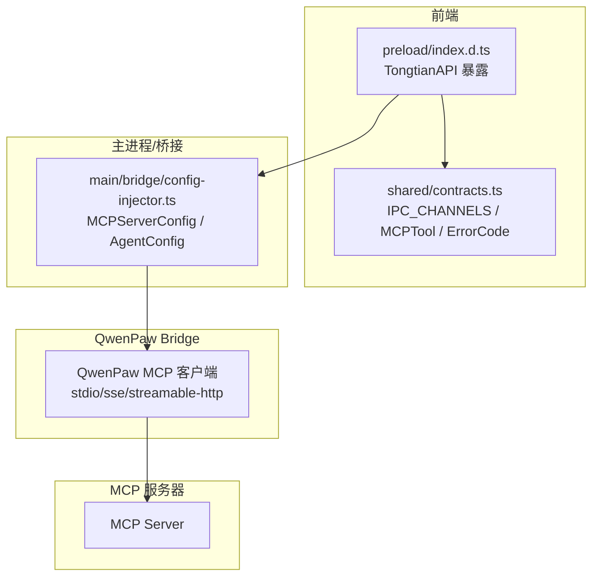
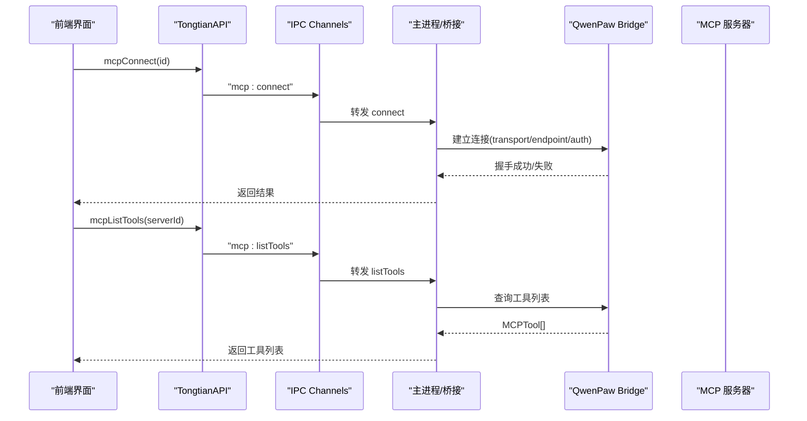
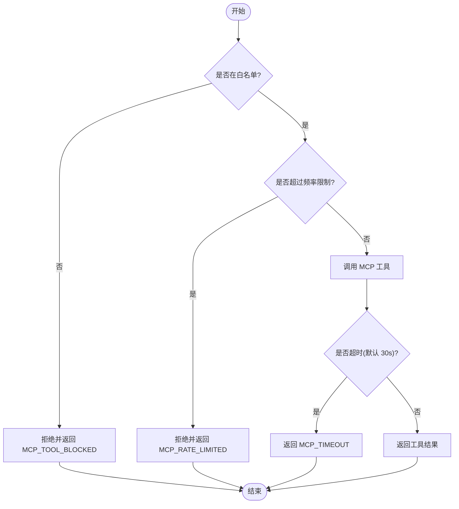
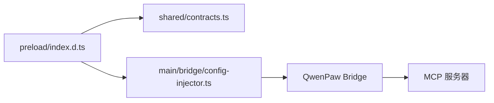

# MCP 客户端 API

<cite>
**本文引用的文件**   
- [mcp-integration/spec.md](file://docs/changes/qwenpaw-integration/specs/mcp-integration/spec.md)
- [preload/index.d.ts](file://tongtian-tauri/src/preload/index.d.ts)
- [shared/contracts.ts](file://tongtian-tauri/src/shared/contracts.ts)
- [main/bridge/config-injector.ts](file://tongtian-tauri/src/main/bridge/config-injector.ts)
- [shared/types.ts](file://tongtian-tauri/src/shared/types.ts)
</cite>

## 目录
1. [简介](#简介)
2. [项目结构](#项目结构)
3. [核心组件](#核心组件)
4. [架构总览](#架构总览)
5. [详细组件分析](#详细组件分析)
6. [依赖分析](#依赖分析)
7. [性能与可靠性](#性能与可靠性)
8. [故障排查指南](#故障排查指南)
9. [结论](#结论)
10. [附录：MCP 服务器集成与工具开发指南](#附录mcp-服务器集成与工具开发指南)

## 简介
本文件面向 MCP（Model Context Protocol）客户端的 API 文档，覆盖以下能力：
- 服务器管理：mcp_listServers、mcp_addServer、mcp_removeServer
- 连接管理：mcp_connect、mcp_disconnect
- 工具发现与调用：mcp_listTools
- 数据模型：MCPTool 及 MCP 服务器配置
- 安全与治理：认证处理、白名单/黑名单、频率限制、超时控制与错误重试
- 集成示例：如何在应用侧使用 MCP 客户端 API 完成连接、发现与调用

说明：
- 本仓库通过 QwenPaw Bridge 复用其 MCP 客户端能力（支持 stdio/sse/streamable-http 三种传输），通天办公侧提供 UI、安全策略与编排。
- IPC Channel 定义集中在共享契约文件中，前端通过类型安全的封装方法调用。

## 项目结构
与 MCP 相关的代码主要分布在以下位置：
- 规范与需求：docs/changes/qwenpaw-integration/specs/mcp-integration/spec.md
- 前端类型与 API 暴露：tongtian-tauri/src/preload/index.d.ts
- IPC 通道与错误码、MCPTool 定义：tongtian-tauri/src/shared/contracts.ts
- Agent 配置注入（含 MCPServerConfig）：tongtian-tauri/src/main/bridge/config-injector.ts
- 通用类型（StepType 等）：tongtian-tauri/src/shared/types.ts

图表来源
- [preload/index.d.ts:109-116](file://tongtian-tauri/src/preload/index.d.ts#L109-L116)
- [shared/contracts.ts:480-584](file://tongtian-tauri/src/shared/contracts.ts#L480-L584)
- [main/bridge/config-injector.ts:33-40](file://tongtian-tauri/src/main/bridge/config-injector.ts#L33-L40)

章节来源
- [mcp-integration/spec.md:1-97](file://docs/changes/qwenpaw-integration/specs/mcp-integration/spec.md#L1-L97)
- [preload/index.d.ts:109-116](file://tongtian-tauri/src/preload/index.d.ts#L109-L116)
- [shared/contracts.ts:480-584](file://tongtian-tauri/src/shared/contracts.ts#L480-L584)
- [main/bridge/config-injector.ts:33-40](file://tongtian-tauri/src/main/bridge/config-injector.ts#L33-L40)

## 核心组件
- 前端 API 封装（TongtianAPI）
  - mcpListServers(): Promise<MCPServer[]>
  - mcpAddServer(config): Promise<MCPServer>
  - mcpRemoveServer(id): Promise<void>
  - mcpConnect(id): Promise<void>
  - mcpDisconnect(id): Promise<void>
  - mcpListTools(serverId): Promise<MCPTool[]>
- IPC 通道常量
  - mcp:listServers, mcp:addServer, mcp:removeServer, mcp:connect, mcp:disconnect, mcp:listTools
- 错误码（MCP 相关）
  - MCP_CONNECTION_FAILED, MCP_TOOL_NOT_FOUND, MCP_TOOL_BLOCKED, MCP_AUTH_FAILED, MCP_TIMEOUT
- 数据模型
  - MCPTool{name, description, inputSchema}
  - MCPServerConfig{name, transport, endpoint, authType, authConfig}
  - AgentConfig.mcp_servers（用于注入到 Agent）

章节来源
- [preload/index.d.ts:109-116](file://tongtian-tauri/src/preload/index.d.ts#L109-L116)
- [shared/contracts.ts:520-527](file://tongtian-tauri/src/shared/contracts.ts#L520-L527)
- [shared/contracts.ts:57-62](file://tongtian-tauri/src/shared/contracts.ts#L57-L62)
- [shared/contracts.ts:250-254](file://tongtian-tauri/src/shared/contracts.ts#L250-L254)
- [main/bridge/config-injector.ts:33-40](file://tongtian-tauri/src/main/bridge/config-injector.ts#L33-L40)
- [main/bridge/config-injector.ts:67-81](file://tongtian-tauri/src/main/bridge/config-injector.ts#L67-L81)

## 架构总览
整体流程：
- 前端通过 TongtianAPI 调用 MCP 相关方法，内部基于 IPC_CHANNELS 发送请求至主进程。
- 主进程将 MCP 服务器配置注入到 Agent（AgentConfig.mcp_servers）。
- QwenPaw Bridge 负责实际的 MCP 连接管理与工具调用（支持 stdio/sse/streamable-http）。
- 工具发现通过 mcp:listTools 获取 MCPTool 列表；工具调用由 Agent 在 StepType=mcp_tool 的步骤中执行。

图表来源
- [preload/index.d.ts:113-115](file://tongtian-tauri/src/preload/index.d.ts#L113-L115)
- [shared/contracts.ts:520-527](file://tongtian-tauri/src/shared/contracts.ts#L520-L527)
- [mcp-integration/spec.md:82-85](file://docs/changes/qwenpaw-integration/specs/mcp-integration/spec.md#L82-L85)

## 详细组件分析

### 服务器管理 API
- mcp_listServers
  - 用途：列出已配置的 MCP 服务器
  - 请求：无参数
  - 响应：MCPServer[]
- mcp_addServer
  - 用途：新增 MCP 服务器配置（名称、传输方式、端点、认证方式）
  - 请求：Partial<MCPServer>
  - 响应：MCPServer
- mcp_removeServer
  - 用途：删除指定 serverId 的配置
  - 请求：serverId
  - 响应：void

章节来源
- [preload/index.d.ts:110-112](file://tongtian-tauri/src/preload/index.d.ts#L110-L112)
- [shared/contracts.ts:520-527](file://tongtian-tauri/src/shared/contracts.ts#L520-L527)

### 连接管理 API
- mcp_connect
  - 用途：根据 serverId 建立 MCP 连接（stdio/sse/streamable-http）
  - 请求：serverId
  - 响应：void
  - 行为：协议握手成功后更新状态为 connected
- mcp_disconnect
  - 用途：优雅断开指定 serverId 的连接
  - 请求：serverId
  - 响应：void
  - 行为：断开后更新状态为 disconnected

章节来源
- [preload/index.d.ts:113-114](file://tongtian-tauri/src/preload/index.d.ts#L113-L114)
- [mcp-integration/spec.md:22-32](file://docs/changes/qwenpaw-integration/specs/mcp-integration/spec.md#L22-L32)

### 工具发现与调用
- mcp_listTools
  - 用途：获取某 MCP 服务器的工具清单
  - 请求：serverId
  - 响应：MCPTool[]
- 工具调用机制
  - Agent 在执行过程中以 StepType=mcp_tool 的方式调用 MCP 工具
  - 调用路径：Bridge -> QwenPaw -> MCP 服务器
  - 结果写入 Step.result

图表来源
- [shared/types.ts:92](file://tongtian-tauri/src/shared/types.ts#L92)
- [mcp-integration/spec.md:38-44](file://docs/changes/qwenpaw-integration/specs/mcp-integration/spec.md#L38-L44)

章节来源
- [preload/index.d.ts:115](file://tongtian-tauri/src/preload/index.d.ts#L115)
- [shared/contracts.ts:250-254](file://tongtian-tauri/src/shared/contracts.ts#L250-L254)
- [shared/types.ts:92](file://tongtian-tauri/src/shared/types.ts#L92)
- [mcp-integration/spec.md:34-44](file://docs/changes/qwenpaw-integration/specs/mcp-integration/spec.md#L34-L44)

### 数据模型与配置
- MCPTool
  - name: string
  - description: string
  - inputSchema: Record<string, unknown>
- MCPServerConfig（用于注入 Agent）
  - name: string
  - transport: 'stdio' | 'sse' | 'streamable-http'
  - endpoint: string
  - authType?: 'none' | 'oauth2' | 'api_key'
  - authConfig?: Record<string, unknown>
- AgentConfig.mcp_servers
  - 数组项包含 name、transport、endpoint、auth_type、auth_config

章节来源
- [shared/contracts.ts:250-254](file://tongtian-tauri/src/shared/contracts.ts#L250-L254)
- [main/bridge/config-injector.ts:33-40](file://tongtian-tauri/src/main/bridge/config-injector.ts#L33-L40)
- [main/bridge/config-injector.ts:67-81](file://tongtian-tauri/src/main/bridge/config-injector.ts#L67-L81)

## 依赖分析
- 前端依赖
  - preload/index.d.ts 暴露 TongtianAPI 方法
  - shared/contracts.ts 定义 IPC_CHANNELS 与错误码
- 主进程/桥接依赖
  - main/bridge/config-injector.ts 生成 AgentConfig（含 mcp_servers）
- 运行时依赖
  - QwenPaw Bridge 实现 MCP 客户端（stdio/sse/streamable-http）
- 外部依赖
  - MCP 服务器（遵循 MCP 协议）

图表来源
- [preload/index.d.ts:109-116](file://tongtian-tauri/src/preload/index.d.ts#L109-L116)
- [shared/contracts.ts:520-527](file://tongtian-tauri/src/shared/contracts.ts#L520-L527)
- [main/bridge/config-injector.ts:33-40](file://tongtian-tauri/src/main/bridge/config-injector.ts#L33-L40)

章节来源
- [preload/index.d.ts:109-116](file://tongtian-tauri/src/preload/index.d.ts#L109-L116)
- [shared/contracts.ts:520-527](file://tongtian-tauri/src/shared/contracts.ts#L520-L527)
- [main/bridge/config-injector.ts:33-40](file://tongtian-tauri/src/main/bridge/config-injector.ts#L33-L40)

## 性能与可靠性
- 超时控制
  - 工具调用默认超时 30s，超时返回 MCP_TIMEOUT
- 错误重试
  - 连接异常自动重连（指数退避，最多 3 次）
- 频率限制
  - 默认 60 次/分钟，超限返回 MCP_RATE_LIMITED
- 安全校验
  - per-workspace 工具白名单/黑名单，不在白名单返回 MCP_TOOL_BLOCKED

章节来源
- [mcp-integration/spec.md:30-44](file://docs/changes/qwenpaw-integration/specs/mcp-integration/spec.md#L30-L44)
- [shared/contracts.ts:57-62](file://tongtian-tauri/src/shared/contracts.ts#L57-L62)

## 故障排查指南
常见错误码与处理建议：
- MCP_CONNECTION_FAILED
  - 检查 endpoint、transport、authType/authConfig
  - 确认 QwenPaw Bridge 可访问目标服务器
- MCP_AUTH_FAILED
  - 校验 OAuth2/API Key 配置是否正确
- MCP_TOOL_NOT_FOUND
  - 确认 serverId 正确且工具名存在
- MCP_TOOL_BLOCKED
  - 检查工作区白名单策略
- MCP_TIMEOUT
  - 增加超时阈值或优化服务端响应

章节来源
- [shared/contracts.ts:57-62](file://tongtian-tauri/src/shared/contracts.ts#L57-L62)
- [mcp-integration/spec.md:30-44](file://docs/changes/qwenpaw-integration/specs/mcp-integration/spec.md#L30-L44)

## 结论
本 MCP 客户端 API 通过统一的 IPC 通道和类型安全的前端封装，结合 QwenPaw Bridge 的 MCP 能力，实现了稳定的连接管理、工具发现与调用。配合安全策略（白名单/频率限制）与可靠性机制（超时/重试），可在多传输模式下可靠地集成各类 MCP 服务器。

## 附录：MCP 服务器集成与工具开发指南
- 服务器集成要点
  - 选择传输方式：stdio/sse/streamable-http
  - 配置认证：none/oauth2/api_key，并在 authConfig 中填写必要参数
  - 确保工具元数据（name/description/inputSchema）符合 MCPTool 定义
- 工具开发要点
  - 工具输入需遵循 inputSchema 描述
  - 工具输出应简洁明确，便于上层解析
  - 注意超时与限流策略，避免阻塞上游调用
- 集成示例（步骤）
  - 添加服务器：调用 mcp_addServer 保存配置
  - 连接服务器：调用 mcp_connect 建立连接
  - 发现工具：调用 mcp_listTools 获取工具列表
  - 调用工具：在 Agent 中以 StepType=mcp_tool 执行

章节来源
- [mcp-integration/spec.md:66-73](file://docs/changes/qwenpaw-integration/specs/mcp-integration/spec.md#L66-L73)
- [shared/contracts.ts:250-254](file://tongtian-tauri/src/shared/contracts.ts#L250-L254)
- [main/bridge/config-injector.ts:33-40](file://tongtian-tauri/src/main/bridge/config-injector.ts#L33-L40)