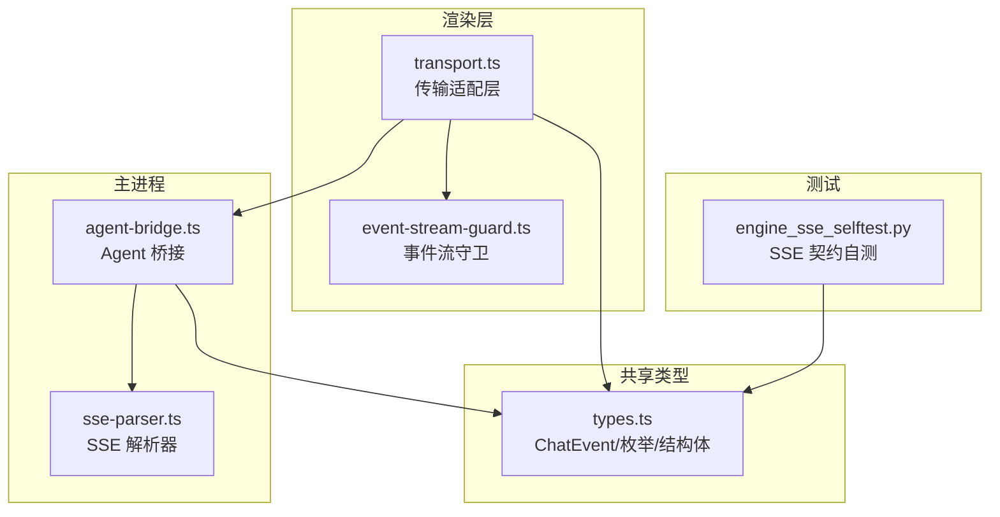
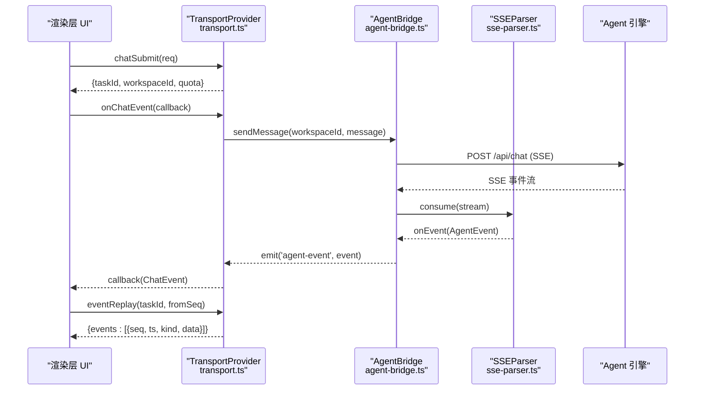
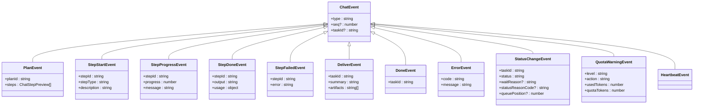
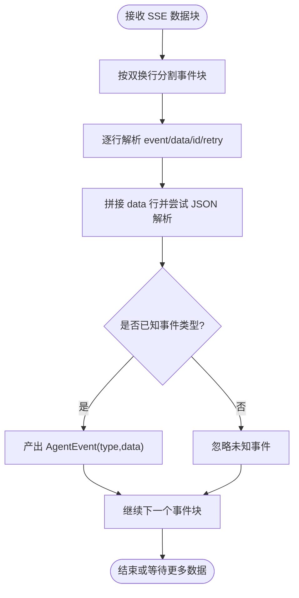
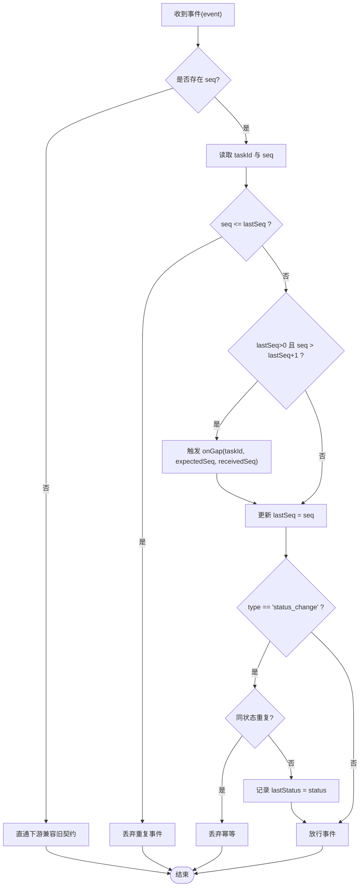
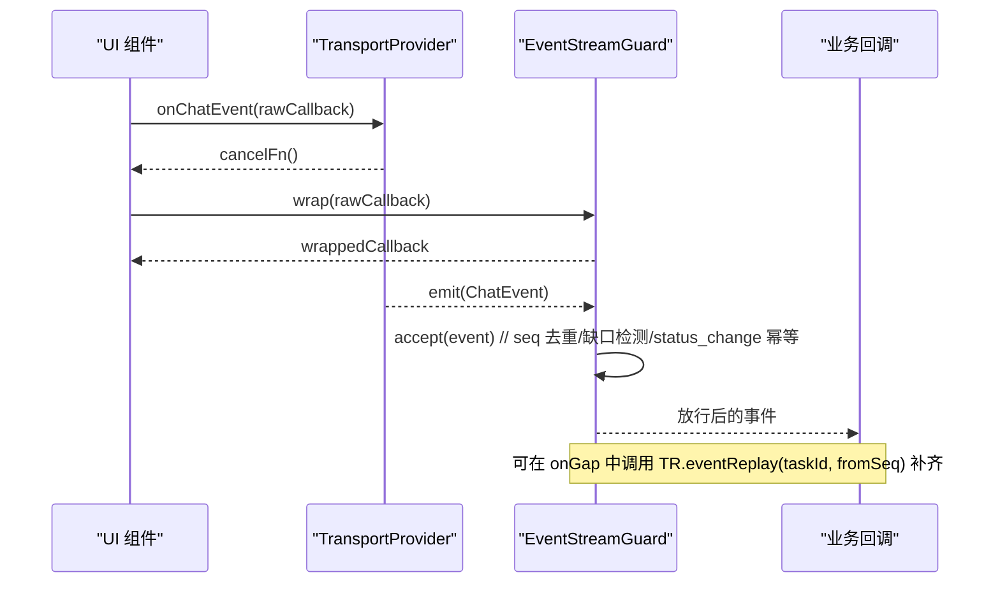
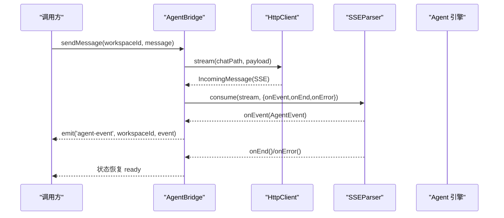
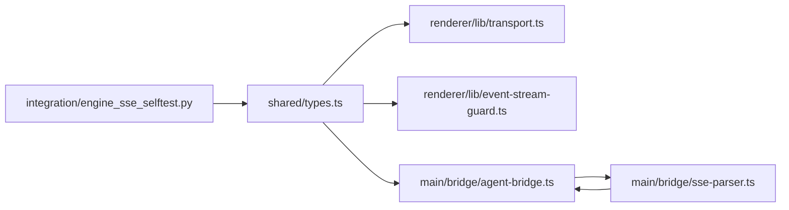

# 事件协议规范

<cite>
**本文引用的文件**
- [src/shared/types.ts](file://tongtian-tauri/src/shared/types.ts)
- [src/main/bridge/sse-parser.ts](file://tongtian-tauri/src/main/bridge/sse-parser.ts)
- [src/renderer/lib/event-stream-guard.ts](file://tongtian-tauri/src/renderer/lib/event-stream-guard.ts)
- [src/renderer/lib/transport.ts](file://tongtian-tauri/src/renderer/lib/transport.ts)
- [src/main/bridge/agent-bridge.ts](file://tongtian-tauri/src/main/bridge/agent-bridge.ts)
- [tests/integration/engine_sse_selftest.py](file://tongtian-tauri/tests/integration/engine_sse_selftest.py)
</cite>

## 目录
1. [简介](#简介)
2. [项目结构](#项目结构)
3. [核心组件](#核心组件)
4. [架构总览](#架构总览)
5. [详细组件分析](#详细组件分析)
6. [依赖关系分析](#依赖关系分析)
7. [性能考虑](#性能考虑)
8. [故障排查指南](#故障排查指南)
9. [结论](#结论)
10. [附录](#附录)

## 简介
本规范定义基于 SSE（Server-Sent Events）的事件通信机制与消息格式，覆盖 ChatEvent 的所有事件类型、事件序列号（seq）机制、断线重连与事件重放能力，并提供事件监听、过滤与处理的客户端实现示例。该协议用于前端渲染层与后端 Agent 引擎之间的实时事件流传输，确保在弱网或进程重启等异常场景下的可靠消费与幂等处理。

## 项目结构
围绕事件协议的关键代码分布在以下模块：
- 共享类型定义：ChatEvent、TaskStatus、StepType 等
- SSE 解析器：将原始 SSE 文本流解析为结构化事件
- 事件流守卫：按 seq 去重、缺口检测、status_change 幂等
- 传输适配层：统一 onChatEvent、eventReplay 等接口
- Agent 桥接：发起 HTTP 请求并消费 SSE 流
- 集成自测：验证 SSE 契约（seq、id、replay、cancel 等）

**图表来源**
- [src/renderer/lib/transport.ts](file://tongtian-tauri/src/renderer/lib/transport.ts)
- [src/renderer/lib/event-stream-guard.ts](file://tongtian-tauri/src/renderer/lib/event-stream-guard.ts)
- [src/main/bridge/agent-bridge.ts](file://tongtian-tauri/src/main/bridge/agent-bridge.ts)
- [src/main/bridge/sse-parser.ts](file://tongtian-tauri/src/main/bridge/sse-parser.ts)
- [src/shared/types.ts](file://tongtian-tauri/src/shared/types.ts)
- [tests/integration/engine_sse_selftest.py](file://tongtian-tauri/tests/integration/engine_sse_selftest.py)

**章节来源**
- [src/shared/types.ts:291-303](file://tongtian-tauri/src/shared/types.ts#L291-L303)
- [src/main/bridge/sse-parser.ts:10-23](file://tongtian-tauri/src/main/bridge/sse-parser.ts#L10-L23)
- [src/renderer/lib/event-stream-guard.ts:24-96](file://tongtian-tauri/src/renderer/lib/event-stream-guard.ts#L24-L96)
- [src/renderer/lib/transport.ts:34-53](file://tongtian-tauri/src/renderer/lib/transport.ts#L34-L53)
- [src/main/bridge/agent-bridge.ts:304-346](file://tongtian-tauri/src/main/bridge/agent-bridge.ts#L304-L346)
- [tests/integration/engine_sse_selftest.py:62-100](file://tongtian-tauri/tests/integration/engine_sse_selftest.py#L62-L100)

## 核心组件
- ChatEvent 事件模型：定义 plan、step_start、step_progress、step_done、step_failed、deliver、done、error、status_change、quota_warning、heartbeat 等事件类型及其字段，包含可选的 seq 与 taskId。
- SSE 解析器：按标准 SSE 格式（event/data/id/retry）解析流，支持多行 data 与未知事件忽略。
- 事件流守卫：维护 per-task 游标 lastSeq，丢弃重复事件、触发缺口回调、对 status_change 做同状态幂等。
- 传输适配层：提供统一的 onChatEvent 订阅与 eventReplay 回放接口，屏蔽 Tauri/Mock/BFF 差异。
- Agent 桥接：负责启动子进程、健康检查、发送聊天消息并消费 SSE 流，向上抛出 agent-event。

**章节来源**
- [src/shared/types.ts:291-303](file://tongtian-tauri/src/shared/types.ts#L291-L303)
- [src/main/bridge/sse-parser.ts:145-188](file://tongtian-tauri/src/main/bridge/sse-parser.ts#L145-L188)
- [src/renderer/lib/event-stream-guard.ts:46-78](file://tongtian-tauri/src/renderer/lib/event-stream-guard.ts#L46-L78)
- [src/renderer/lib/transport.ts:46-53](file://tongtian-tauri/src/renderer/lib/transport.ts#L46-L53)
- [src/main/bridge/agent-bridge.ts:304-346](file://tongtian-tauri/src/main/bridge/agent-bridge.ts#L304-L346)

## 架构总览
下图展示从前端到后端的完整事件流路径，包括 SSE 解析、事件守卫、传输适配与重放能力。

**图表来源**
- [src/renderer/lib/transport.ts:34-53](file://tongtian-tauri/src/renderer/lib/transport.ts#L34-L53)
- [src/main/bridge/agent-bridge.ts:304-346](file://tongtian-tauri/src/main/bridge/agent-bridge.ts#L304-L346)
- [src/main/bridge/sse-parser.ts:50-85](file://tongtian-tauri/src/main/bridge/sse-parser.ts#L50-L85)
- [tests/integration/engine_sse_selftest.py:62-100](file://tongtian-tauri/tests/integration/engine_sse_selftest.py#L62-L100)

## 详细组件分析

### ChatEvent 事件类型与数据结构
- plan：计划生成事件，包含 planId 与 steps 预览数组。
- step_start：步骤开始，包含 stepId、stepType、description。
- step_progress：步骤进度，包含 stepId、progress（数值）、message（中间输出）。
- step_done：步骤完成，包含 stepId、output、usage（token 用量）。
- step_failed：步骤失败，包含 stepId、error。
- deliver：交付事件，包含 taskId、summary、artifacts。
- done：任务结束，包含 taskId。
- error：错误事件，包含 code、message。
- status_change：状态变更，包含 taskId、status、waitReason、statusReasonCode、queuePosition。
- quota_warning：配额告警，包含 level、action、usedTokens、quotaTokens。
- heartbeat：心跳事件，无业务数据。

所有事件均支持可选字段 seq（单调递增序号）与 taskId（任务标识），便于跨端一致性与重放定位。

**图表来源**
- [src/shared/types.ts:291-303](file://tongtian-tauri/src/shared/types.ts#L291-L303)

**章节来源**
- [src/shared/types.ts:291-303](file://tongtian-tauri/src/shared/types.ts#L291-L303)

### SSE 通信机制与消息格式
- 基本格式：每事件由 event/data/id/retry 等行组成，事件间以空行分隔。
- 事件映射：server 侧 event 名称映射到内部 AgentEvent.type（plan、step_start、...、error）。
- 数据解析：data 行可为多行拼接，优先 JSON 解析，失败回退为 raw 字符串。
- id 行：建议采用 {task_id}:{seq} 格式，配合 Last-Event-ID 实现断线重连。
- 重放窗口：服务端暴露 /api/events/replay?task_id=...&from_seq=...，返回 seq > from_seq 的事件列表。

**图表来源**
- [src/main/bridge/sse-parser.ts:128-188](file://tongtian-tauri/src/main/bridge/sse-parser.ts#L128-L188)
- [tests/integration/engine_sse_selftest.py:40-59](file://tongtian-tauri/tests/integration/engine_sse_selftest.py#L40-L59)

**章节来源**
- [src/main/bridge/sse-parser.ts:145-188](file://tongtian-tauri/src/main/bridge/sse-parser.ts#L145-L188)
- [tests/integration/engine_sse_selftest.py:62-100](file://tongtian-tauri/tests/integration/engine_sse_selftest.py#L62-L100)

### 事件序列号（seq）机制与断线重连
- 单调性：每个任务的 seq 严格单调递增；若出现 seq ≤ lastSeq 则视为重复事件丢弃。
- 缺口检测：当 lastSeq > 0 且收到 seq > lastSeq+1 时，触发 onGap 回调，可据此发起 event:replay 补齐缺失事件。
- 重放接口：通过 TransportProvider.eventReplay(taskId, fromSeq) 获取从 fromSeq 之后的事件，结合 Last-Event-ID 恢复连接。
- 幂等策略：status_change 同状态重复推送仅保留首次，避免 UI 抖动。

**图表来源**
- [src/renderer/lib/event-stream-guard.ts:46-78](file://tongtian-tauri/src/renderer/lib/event-stream-guard.ts#L46-L78)
- [src/renderer/lib/transport.ts:46-53](file://tongtian-tauri/src/renderer/lib/transport.ts#L46-L53)
- [tests/integration/engine_sse_selftest.py:77-90](file://tongtian-tauri/tests/integration/engine_sse_selftest.py#L77-L90)

**章节来源**
- [src/renderer/lib/event-stream-guard.ts:46-78](file://tongtian-tauri/src/renderer/lib/event-stream-guard.ts#L46-L78)
- [src/renderer/lib/transport.ts:46-53](file://tongtian-tauri/src/renderer/lib/transport.ts#L46-L53)
- [tests/integration/engine_sse_selftest.py:77-90](file://tongtian-tauri/tests/integration/engine_sse_selftest.py#L77-L90)

### 事件监听、过滤与处理的客户端实现示例
- 监听订阅：使用 TransportProvider.onChatEvent(callback) 注册事件回调。
- 过滤包装：通过 EventStreamGuard.wrap(callback) 包装回调，自动执行 seq 去重与缺口检测。
- 重放补齐：在 onGap 回调中调用 TransportProvider.eventReplay(taskId, fromSeq)，将回放事件再次经守卫处理。
- 生命周期管理：任务终态后调用 dispose(taskId) 清理游标，防止内存泄漏。

**图表来源**
- [src/renderer/lib/transport.ts:46-53](file://tongtian-tauri/src/renderer/lib/transport.ts#L46-L53)
- [src/renderer/lib/event-stream-guard.ts:80-91](file://tongtian-tauri/src/renderer/lib/event-stream-guard.ts#L80-L91)

**章节来源**
- [src/renderer/lib/transport.ts:46-53](file://tongtian-tauri/src/renderer/lib/transport.ts#L46-L53)
- [src/renderer/lib/event-stream-guard.ts:80-91](file://tongtian-tauri/src/renderer/lib/event-stream-guard.ts#L80-L91)

### Agent 桥接与 SSE 消费流程
- 发送消息：sendMessage(workspaceId, message) 发起 HTTP 请求并返回 SSE 流。
- 解析事件：SSEParser.consume(stream, options) 解析事件并通过 onEvent 回调上报。
- 状态管理：流结束或错误时将实例状态从 busy 恢复到 ready。
- 事件转发：将 AgentEvent 通过 EventEmitter('agent-event') 转发给上层。

**图表来源**
- [src/main/bridge/agent-bridge.ts:304-346](file://tongtian-tauri/src/main/bridge/agent-bridge.ts#L304-L346)
- [src/main/bridge/sse-parser.ts:50-85](file://tongtian-tauri/src/main/bridge/sse-parser.ts#L50-L85)

**章节来源**
- [src/main/bridge/agent-bridge.ts:304-346](file://tongtian-tauri/src/main/bridge/agent-bridge.ts#L304-L346)
- [src/main/bridge/sse-parser.ts:50-85](file://tongtian-tauri/src/main/bridge/sse-parser.ts#L50-L85)

## 依赖关系分析
- 类型依赖：ChatEvent 定义位于 shared/types.ts，被 transport.ts、event-stream-guard.ts、agent-bridge.ts 共同引用。
- 解析依赖：sse-parser.ts 依赖 Logger，输出解析日志与错误信息。
- 运行时依赖：agent-bridge.ts 依赖 HttpClient、VersionAdapter、ConfigInjector 等。
- 测试依赖：engine_sse_selftest.py 直接依赖 engine/server 模块，验证 SSE 契约。

**图表来源**
- [src/shared/types.ts:291-303](file://tongtian-tauri/src/shared/types.ts#L291-L303)
- [src/renderer/lib/transport.ts:34-53](file://tongtian-tauri/src/renderer/lib/transport.ts#L34-L53)
- [src/renderer/lib/event-stream-guard.ts:24-96](file://tongtian-tauri/src/renderer/lib/event-stream-guard.ts#L24-L96)
- [src/main/bridge/agent-bridge.ts:304-346](file://tongtian-tauri/src/main/bridge/agent-bridge.ts#L304-L346)
- [src/main/bridge/sse-parser.ts:10-23](file://tongtian-tauri/src/main/bridge/sse-parser.ts#L10-L23)
- [tests/integration/engine_sse_selftest.py:62-100](file://tongtian-tauri/tests/integration/engine_sse_selftest.py#L62-L100)

**章节来源**
- [src/shared/types.ts:291-303](file://tongtian-tauri/src/shared/types.ts#L291-L303)
- [src/main/bridge/sse-parser.ts:10-23](file://tongtian-tauri/src/main/bridge/sse-parser.ts#L10-L23)
- [src/main/bridge/agent-bridge.ts:304-346](file://tongtian-tauri/src/main/bridge/agent-bridge.ts#L304-L346)
- [tests/integration/engine_sse_selftest.py:62-100](file://tongtian-tauri/tests/integration/engine_sse_selftest.py#L62-L100)

## 性能考虑
- 事件去重与幂等：通过 lastSeq 与 status_change 幂等减少重复渲染与状态抖动。
- 缓冲与队列：SSEParser 使用缓冲区与事件队列，避免频繁解析开销。
- 健康检查与超时：AgentBridge 的健康检查与优雅关闭降低资源占用与僵尸进程风险。
- 重放窗口：合理设置 fromSeq 与 windowExpired，避免全量回放导致卡顿。

[本节为通用指导，不直接分析具体文件]

## 故障排查指南
- 事件丢失：检查 onGap 回调是否触发，确认 eventReplay(fromSeq) 是否正确调用。
- 重复事件：确认 lastSeq 更新逻辑与重复丢弃分支是否生效。
- 状态抖动：确认 status_change 幂等逻辑是否阻止了同状态重复推送。
- SSE 解析失败：查看 sse-parser 的错误日志，确认 data 行是否为合法 JSON。
- 进程异常：关注 AgentBridge 的 instance-error 与 healthCheck 失败计数。

**章节来源**
- [src/renderer/lib/event-stream-guard.ts:46-78](file://tongtian-tauri/src/renderer/lib/event-stream-guard.ts#L46-L78)
- [src/main/bridge/sse-parser.ts:165-178](file://tongtian-tauri/src/main/bridge/sse-parser.ts#L165-L178)
- [src/main/bridge/agent-bridge.ts:481-522](file://tongtian-tauri/src/main/bridge/agent-bridge.ts#L481-L522)

## 结论
本规范明确了基于 SSE 的事件协议与实现细节，涵盖 ChatEvent 事件模型、seq 单调性与重放、status_change 幂等、以及客户端监听与过滤的最佳实践。通过分层架构（传输适配、事件守卫、SSE 解析、Agent 桥接），系统在弱网与异常场景下具备高可靠性与可扩展性。

[本节为总结性内容，不直接分析具体文件]

## 附录
- 事件类型速查：
  - plan：计划生成
  - step_start/step_progress/step_done/step_failed：步骤生命周期
  - deliver/done：任务交付与结束
  - error：错误通知
  - status_change：状态变更（含排队、预算暂停、重试等待等）
  - quota_warning：配额告警（阈值与动作）
  - heartbeat：心跳保活

[本节为补充说明，不直接分析具体文件]