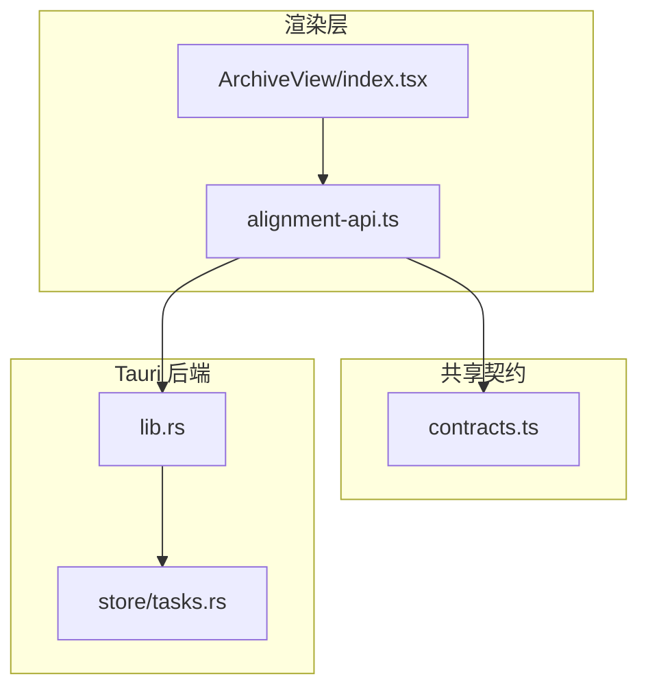
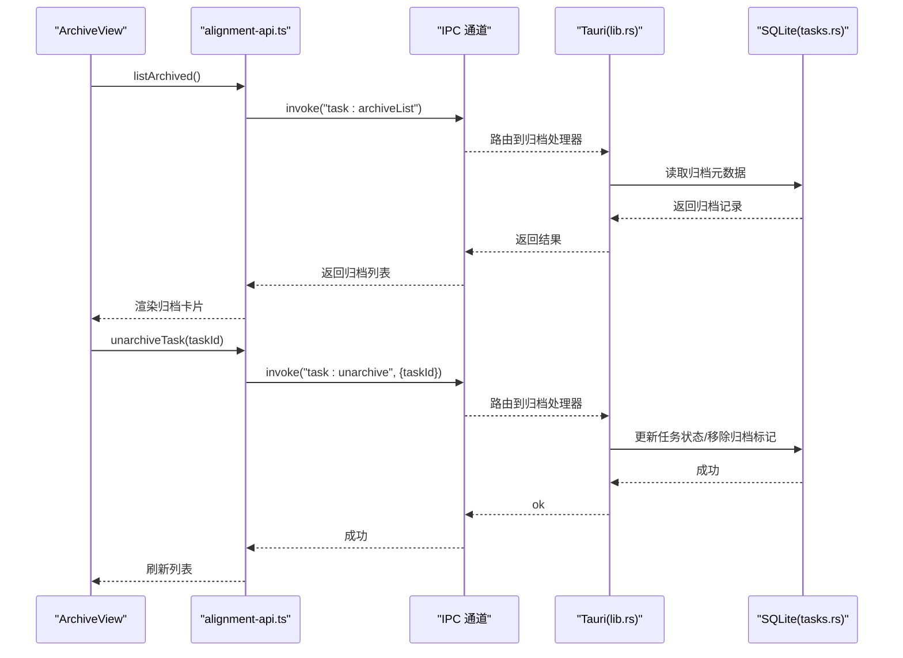
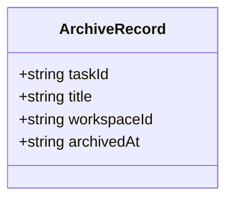
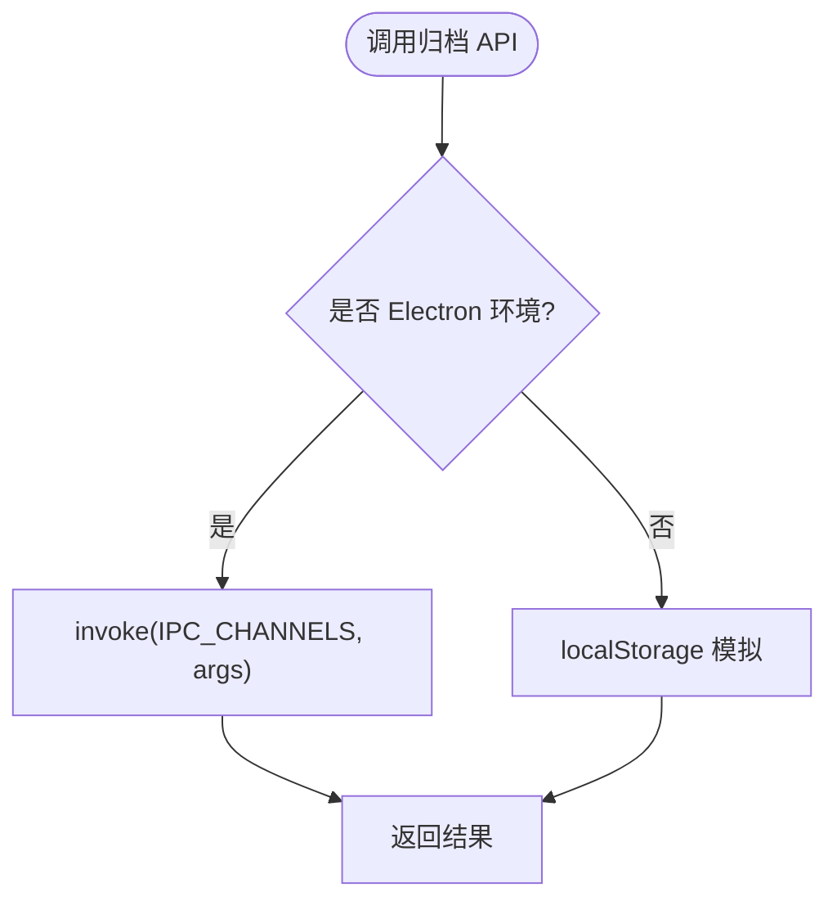
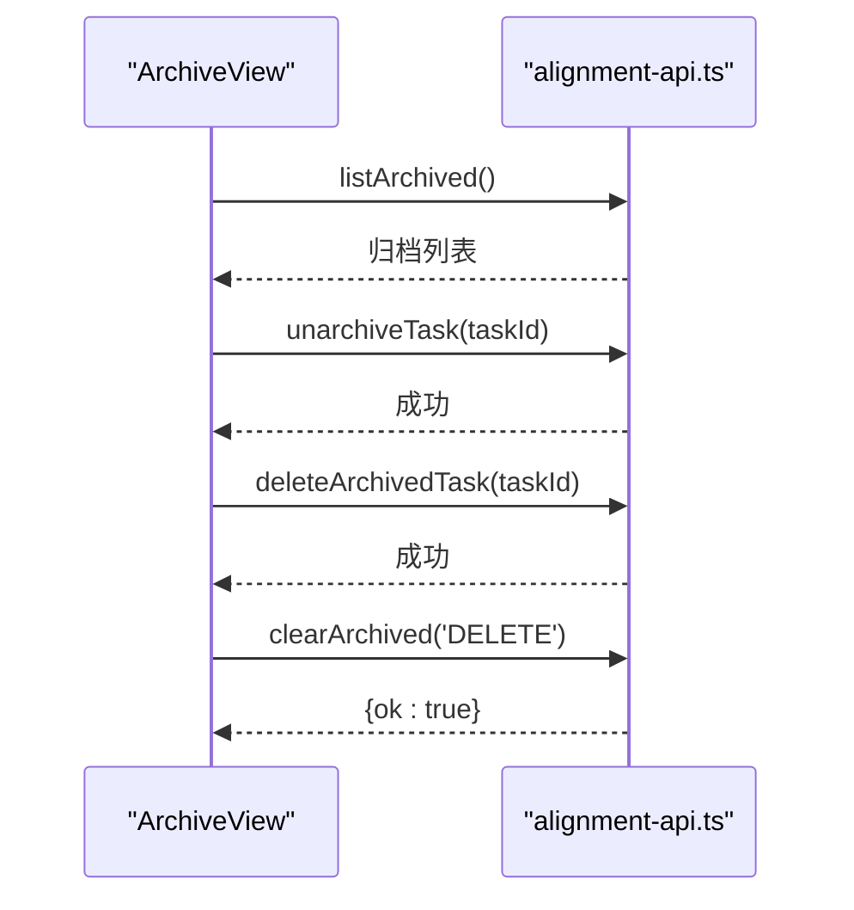
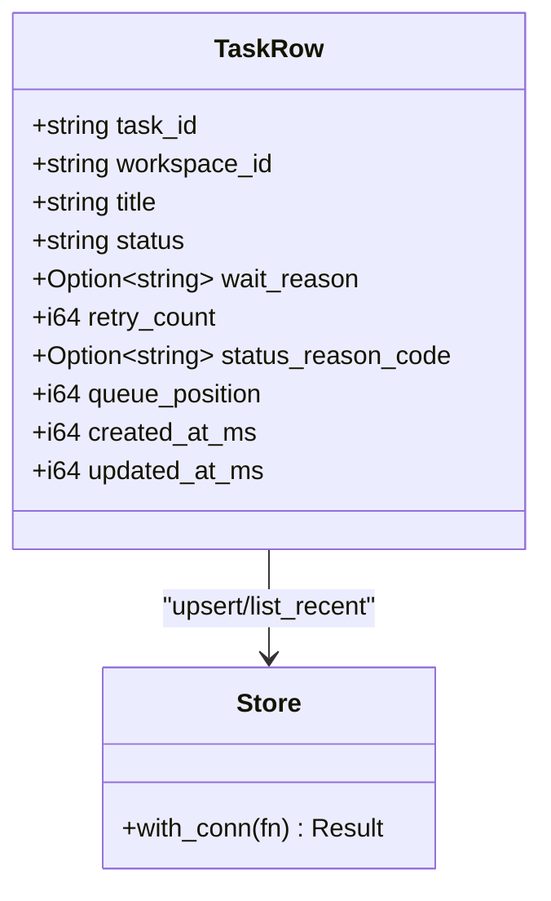
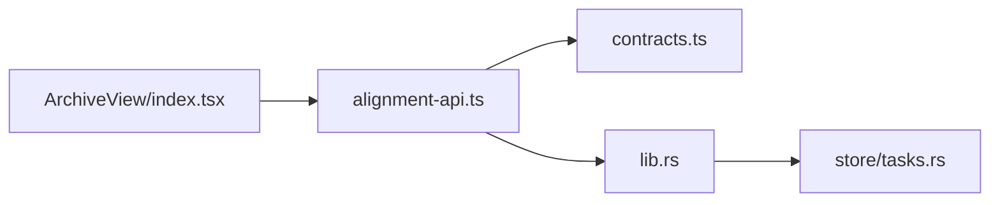

# 任务归档 API

<cite>
**本文引用的文件**   
- [contracts.ts](file://tongtian-tauri/src/shared/contracts.ts)
- [alignment-api.ts](file://tongtian-tauri/src/renderer/lib/alignment-api.ts)
- [ArchiveView/index.tsx](file://tongtian-tauri/src/renderer/pages/ArchiveView/index.tsx)
- [lib.rs](file://tongtian-tauri/src-tauri/src/lib.rs)
- [tasks.rs](file://tongtian-tauri/src-tauri/src/store/tasks.rs)
</cite>

## 目录
1. [简介](#简介)
2. [项目结构](#项目结构)
3. [核心组件](#核心组件)
4. [架构总览](#架构总览)
5. [详细组件分析](#详细组件分析)
6. [依赖分析](#依赖分析)
7. [性能考虑](#性能考虑)
8. [故障排查指南](#故障排查指南)
9. [结论](#结论)
10. [附录](#附录)

## 简介
本文件面向“任务归档”能力，系统化说明以下命令接口与数据契约：task_archive、task_unarchive、task_archiveDelete、task_archiveList、task_archiveClear。文档覆盖 ArchiveRecord 数据结构、归档策略、历史数据的压缩存储与检索优化、完整性校验与恢复机制，以及任务生命周期管理与数据清理的最佳实践。读者可据此完成前端调用、后端实现与运维治理。

## 项目结构
归档功能贯穿渲染层（React）、IPC 封装（TypeScript）与 Tauri 后端（Rust），并通过共享契约类型统一前后端数据结构。关键路径如下：
- 渲染层页面：ArchiveView/index.tsx 负责 UI 交互与调用对齐 API
- 渲染层 API 封装：alignment-api.ts 暴露 listArchived/unarchiveTask/deleteArchivedTask/clearArchived 等方法
- 共享契约：contracts.ts 定义 IPC_CHANNELS 与 ArchiveRecord 等类型
- Tauri 后端入口：lib.rs 注册命令并编排服务
- 持久化：store/tasks.rs 提供任务摘要的 SQLite 存取

**图表来源** 
- [ArchiveView/index.tsx:1-209](file://tongtian-tauri/src/renderer/pages/ArchiveView/index.tsx#L1-L209)
- [alignment-api.ts:239-286](file://tongtian-tauri/src/renderer/lib/alignment-api.ts#L239-L286)
- [contracts.ts:439-444](file://tongtian-tauri/src/shared/contracts.ts#L439-L444)
- [lib.rs:794-824](file://tongtian-tauri/src-tauri/src/lib.rs#L794-L824)
- [tasks.rs:1-168](file://tongtian-tauri/src-tauri/src/store/tasks.rs#L1-L168)

**章节来源**
- [ArchiveView/index.tsx:1-209](file://tongtian-tauri/src/renderer/pages/ArchiveView/index.tsx#L1-L209)
- [alignment-api.ts:239-286](file://tongtian-tauri/src/renderer/lib/alignment-api.ts#L239-L286)
- [contracts.ts:439-444](file://tongtian-tauri/src/shared/contracts.ts#L439-L444)
- [lib.rs:794-824](file://tongtian-tauri/src-tauri/src/lib.rs#L794-L824)
- [tasks.rs:1-168](file://tongtian-tauri/src-tauri/src/store/tasks.rs#L1-L168)

## 核心组件
- 共享契约类型
  - ArchiveRecord：包含 taskId、title、workspaceId、archivedAt，用于归档列表展示与操作定位
  - IPC_CHANNELS：集中声明 task:archive、task:unarchive、task:archiveDelete、task:archiveList、task:archiveClear 等通道名
- 渲染层 API 封装
  - listArchived：获取归档列表
  - unarchiveTask：从归档恢复任务
  - deleteArchivedTask：彻底删除归档任务（同时删除任务本体）
  - clearArchived：清空全部归档（需强确认）
- 渲染层页面
  - ArchiveView：加载归档列表、单条恢复/删除、批量清空（输入 DELETE 强确认）
- Tauri 后端
  - lib.rs：注册命令、编排服务（当前未直接实现归档命令，但已具备任务状态与持久化基础设施）
  - store/tasks.rs：任务摘要 upsert/list_recent，为归档元数据落库提供基础

**章节来源**
- [contracts.ts:439-444](file://tongtian-tauri/src/shared/contracts.ts#L439-L444)
- [contracts.ts:569-574](file://tongtian-tauri/src/shared/contracts.ts#L569-L574)
- [alignment-api.ts:248-286](file://tongtian-tauri/src/renderer/lib/alignment-api.ts#L248-L286)
- [ArchiveView/index.tsx:24-72](file://tongtian-tauri/src/renderer/pages/ArchiveView/index.tsx#L24-L72)
- [tasks.rs:27-95](file://tongtian-tauri/src-tauri/src/store/tasks.rs#L27-L95)

## 架构总览
归档流程涉及三层：渲染层发起请求 → IPC 通道转发 → 后端处理并落库。下图展示了典型“归档列表查询”和“归档恢复”的调用序列。

**图表来源** 
- [ArchiveView/index.tsx:40-53](file://tongtian-tauri/src/renderer/pages/ArchiveView/index.tsx#L40-L53)
- [alignment-api.ts:248-263](file://tongtian-tauri/src/renderer/lib/alignment-api.ts#L248-L263)
- [contracts.ts:569-574](file://tongtian-tauri/src/shared/contracts.ts#L569-L574)
- [lib.rs:794-824](file://tongtian-tauri/src-tauri/src/lib.rs#L794-L824)
- [tasks.rs:61-95](file://tongtian-tauri/src-tauri/src/store/tasks.rs#L61-L95)

## 详细组件分析

### 数据结构：ArchiveRecord
- 字段
  - taskId：任务唯一标识
  - title：任务标题
  - workspaceId：所属工作区标识
  - archivedAt：归档时间（ISO 字符串）
- 用途
  - 列表展示、恢复/删除定位、审计与统计

**图表来源** 
- [contracts.ts:439-444](file://tongtian-tauri/src/shared/contracts.ts#L439-L444)

**章节来源**
- [contracts.ts:439-444](file://tongtian-tauri/src/shared/contracts.ts#L439-L444)

### 渲染层 API 封装（alignment-api.ts）
- listArchived：通过 TASK_ARCHIVE_LIST 通道获取归档列表；浏览器模式回退 localStorage
- unarchiveTask：通过 TASK_UNARCHIVE 通道执行恢复；本地模拟仅过滤数组
- deleteArchivedTask：通过 TASK_ARCHIVE_DELETE 通道执行彻底删除；本地模拟仅过滤数组
- clearArchived：通过 TASK_ARCHIVE_CLEAR 通道执行清空；需传入 confirm（如 'DELETE'）

**图表来源** 
- [alignment-api.ts:248-286](file://tongtian-tauri/src/renderer/lib/alignment-api.ts#L248-L286)

**章节来源**
- [alignment-api.ts:248-286](file://tongtian-tauri/src/renderer/lib/alignment-api.ts#L248-L286)

### 渲染层页面（ArchiveView/index.tsx）
- 初始化时调用 listArchived 拉取归档列表并映射为本地展示模型
- 单条恢复：调用 unarchiveTask，成功后从列表移除
- 单条删除：二次确认后调用 deleteArchivedTask，成功后从列表移除
- 全部删除：弹窗要求输入 DELETE，通过后调用 clearArchived，成功后清空列表

**图表来源** 
- [ArchiveView/index.tsx:40-72](file://tongtian-tauri/src/renderer/pages/ArchiveView/index.tsx#L40-L72)
- [alignment-api.ts:248-286](file://tongtian-tauri/src/renderer/lib/alignment-api.ts#L248-L286)

**章节来源**
- [ArchiveView/index.tsx:40-72](file://tongtian-tauri/src/renderer/pages/ArchiveView/index.tsx#L40-L72)

### Tauri 后端与持久化（lib.rs / tasks.rs）
- lib.rs 中集中注册命令，当前已具备 chat_history、task_state、settings_get/set 等命令，为归档元数据持久化提供基础设施
- tasks.rs 提供 TaskRow 结构与 upsert/list_recent，支持按更新时间倒序查询，便于后续扩展归档元数据表或复用现有表结构

**图表来源** 
- [tasks.rs:10-25](file://tongtian-tauri/src-tauri/src/store/tasks.rs#L10-L25)
- [tasks.rs:27-95](file://tongtian-tauri/src-tauri/src/store/tasks.rs#L27-L95)

**章节来源**
- [lib.rs:794-824](file://tongtian-tauri/src-tauri/src/lib.rs#L794-L824)
- [tasks.rs:27-95](file://tongtian-tauri/src-tauri/src/store/tasks.rs#L27-L95)

## 依赖分析
- 渲染层依赖 contracts.ts 中的 IPC_CHANNELS 与 ArchiveRecord
- alignment-api.ts 依赖 IPC_CHANNELS 进行通道调用，并在非 Electron 环境降级到 localStorage
- ArchiveView 依赖 alignment-api.ts 提供的归档方法
- Tauri 后端通过 lib.rs 暴露命令，持久化依赖 store/tasks.rs

**图表来源** 
- [ArchiveView/index.tsx:24-72](file://tongtian-tauri/src/renderer/pages/ArchiveView/index.tsx#L24-L72)
- [alignment-api.ts:248-286](file://tongtian-tauri/src/renderer/lib/alignment-api.ts#L248-L286)
- [contracts.ts:569-574](file://tongtian-tauri/src/shared/contracts.ts#L569-L574)
- [lib.rs:794-824](file://tongtian-tauri/src-tauri/src/lib.rs#L794-L824)
- [tasks.rs:27-95](file://tongtian-tauri/src-tauri/src/store/tasks.rs#L27-L95)

**章节来源**
- [contracts.ts:569-574](file://tongtian-tauri/src/shared/contracts.ts#L569-L574)
- [alignment-api.ts:248-286](file://tongtian-tauri/src/renderer/lib/alignment-api.ts#L248-L286)
- [lib.rs:794-824](file://tongtian-tauri/src-tauri/src/lib.rs#L794-L824)
- [tasks.rs:27-95](file://tongtian-tauri/src-tauri/src/store/tasks.rs#L27-L95)

## 性能考虑
- 列表分页与限制：建议在后端对归档列表查询增加 limit/offset，避免一次性加载大量历史数据
- 索引优化：对 archivedAt、workspaceId、taskId 建立索引，提升查询与过滤性能
- 压缩存储：对归档内容（如对话事件、附件元数据）采用压缩格式（如 gzip/zstd）落盘，减少磁盘占用
- 异步写入：归档操作采用异步批处理写入，降低 UI 阻塞
- 缓存策略：对频繁访问的归档元数据在内存中进行短期缓存，设置 TTL 与失效策略

[本节为通用指导，不直接分析具体文件]

## 故障排查指南
- 常见问题
  - 列表为空：检查 listArchived 是否正确调用，确认后端是否实现归档查询命令
  - 恢复失败：确认 unarchiveTask 参数 taskId 正确，后端状态机允许从归档恢复
  - 删除失败：确认 deleteArchivedTask 权限与事务一致性，确保归档与任务本体同步删除
  - 清空失败：确认 clearArchived 的 confirm 参数是否为 'DELETE'
- 错误码与日志
  - 使用 ErrorCode 枚举中的相关错误码（如 VALIDATION_ERROR、INTERNAL_ERROR）统一上报
  - 在后端关键路径打印日志，便于定位问题
- 数据一致性
  - 归档与任务状态变更应处于同一事务，保证原子性
  - 恢复后及时清理归档记录，避免重复恢复

**章节来源**
- [contracts.ts:15-109](file://tongtian-tauri/src/shared/contracts.ts#L15-L109)
- [alignment-api.ts:248-286](file://tongtian-tauri/src/renderer/lib/alignment-api.ts#L248-L286)

## 结论
归档能力通过清晰的契约与分层架构实现：渲染层负责交互与调用，IPC 通道负责跨进程通信，后端负责业务逻辑与持久化。建议在后续迭代中完善后端归档命令实现，引入压缩存储与索引优化，并加强完整性校验与恢复机制，以提升系统稳定性与可维护性。

[本节为总结性内容，不直接分析具体文件]

## 附录

### 归档策略建议
- 归档时机：任务进入终态（done/failed/cancelled）后自动归档，或用户手动触发归档
- 保留周期：根据合规与存储成本设定保留期，到期自动清理
- 分级归档：高频访问归档保留更久，低频归档尽快压缩与迁移至冷存储
- 幂等性：归档/恢复/删除操作需幂等，避免重复执行导致不一致

[本节为通用指导，不直接分析具体文件]

### 完整性校验与恢复机制
- 校验方式：对归档数据计算哈希（如 SHA-256），落盘时保存校验值，读取时比对
- 恢复流程：校验失败则尝试从备份恢复，若仍失败则告警并回滚
- 版本控制：归档数据支持版本化，便于回滚到指定版本

[本节为通用指导，不直接分析具体文件]

### 任务生命周期管理与数据清理最佳实践
- 生命周期：创建→排队→计划→审阅→执行→完成/失败/取消→归档
- 状态机约束：严格遵循状态转移规则，非法转移拒绝并记录
- 数据清理：归档过期后安全删除，确保无外部引用；清理前通知相关方

[本节为通用指导，不直接分析具体文件]