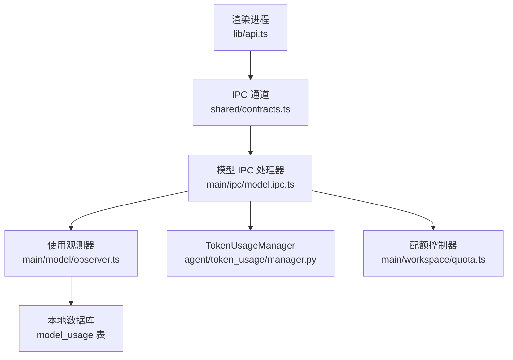
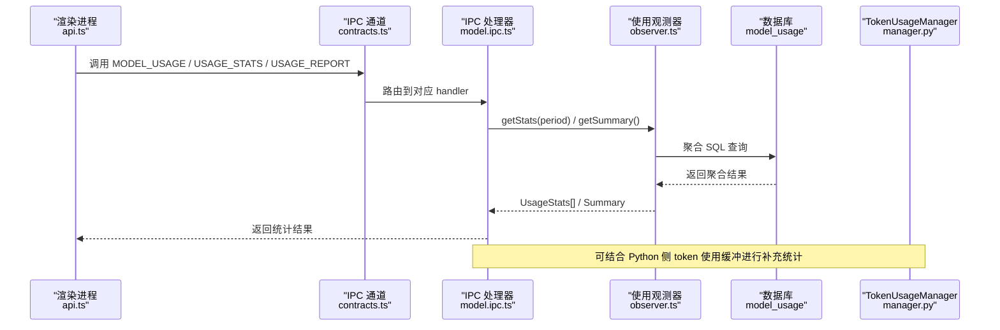
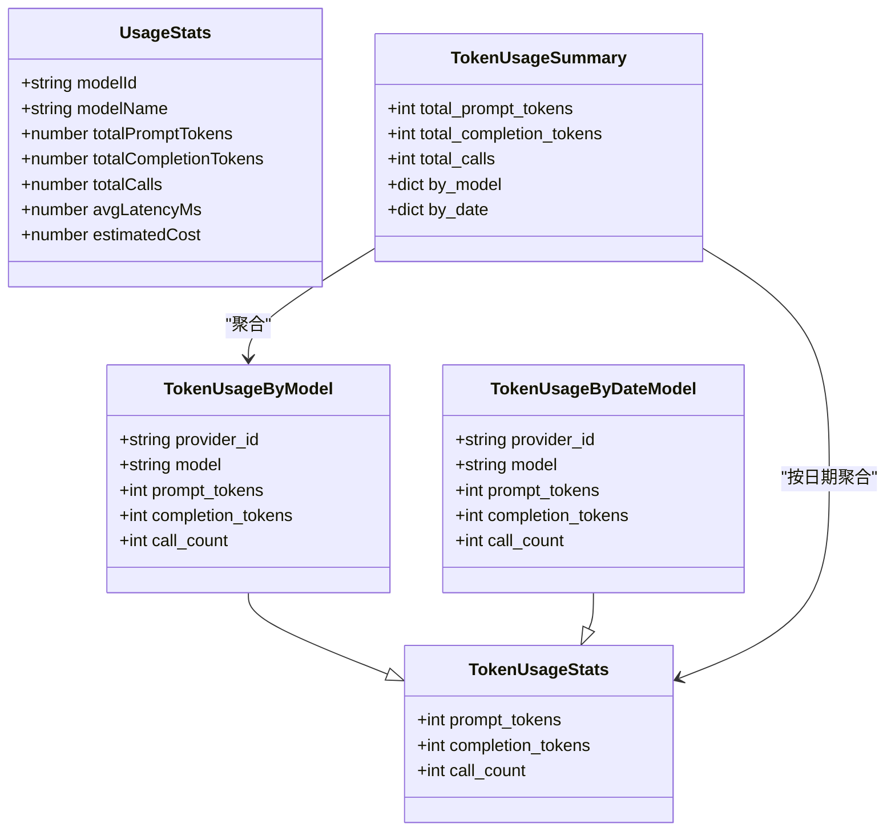
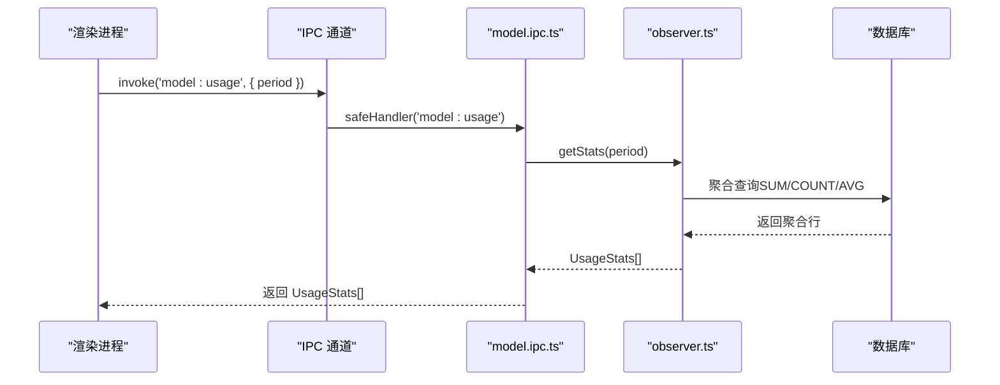
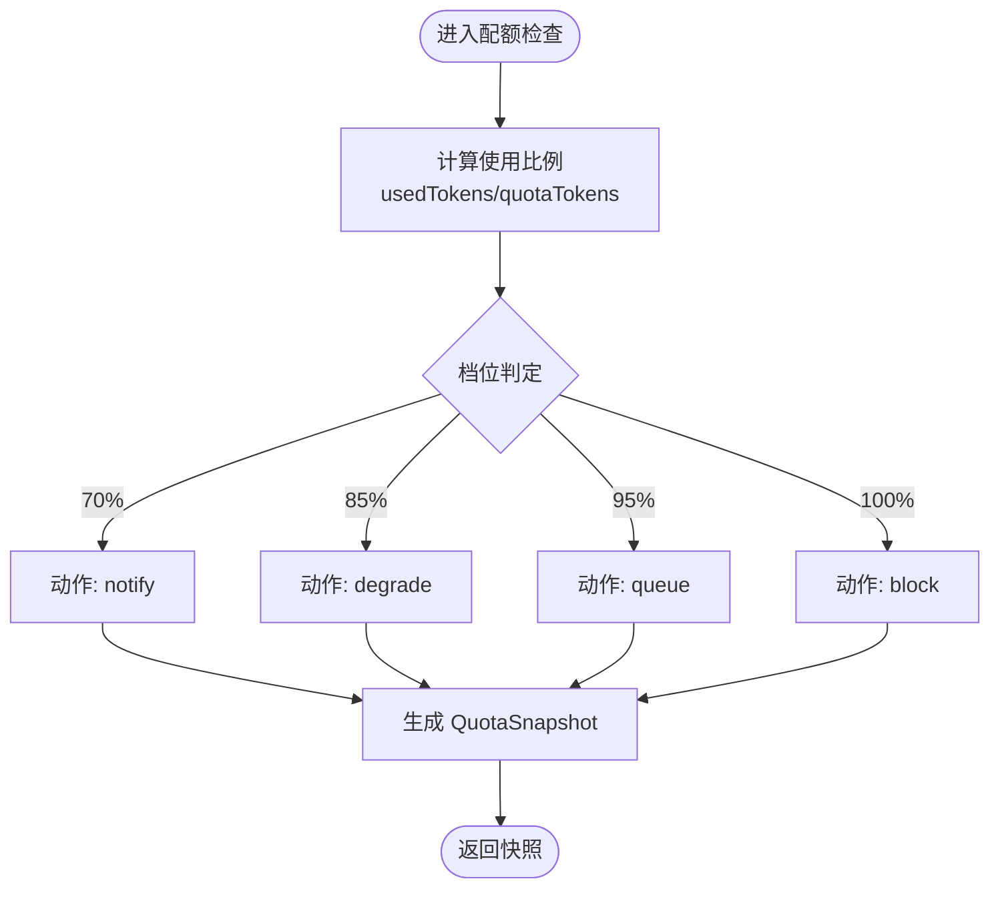
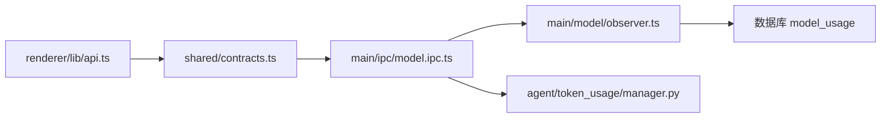

# 使用统计 API

<cite>
**本文引用的文件**   
- [manager.py](file://tongtian-tauri/src/agent/token_usage/manager.py)
- [contracts.ts](file://tongtian-tauri/src/shared/contracts.ts)
- [observer.ts](file://tongtian-tauri/src/main/model/observer.ts)
- [model.ipc.ts](file://tongtian-tauri/src/main/ipc/model.ipc.ts)
- [api.ts](file://tongtian-tauri/src/renderer/lib/api.ts)
- [quota.ts](file://tongtian-tauri/src/main/workspace/quota.ts)
</cite>

## 目录
1. [简介](#简介)
2. [项目结构](#项目结构)
3. [核心组件](#核心组件)
4. [架构总览](#架构总览)
5. [详细组件分析](#详细组件分析)
6. [依赖关系分析](#依赖关系分析)
7. [性能考量](#性能考量)
8. [故障排查指南](#故障排查指南)
9. [结论](#结论)
10. [附录](#附录)

## 简介
本文件面向“使用统计”相关能力，系统化说明 usage_stats、usage_report 等命令接口与数据模型，覆盖 UsageStats 数据结构（token 使用量、调用次数、延迟统计与成本估算）、配额管理机制（QuotaStatus、QuotaSnapshot）以及资源监控指标（ResourceReport）。同时给出用量分析与成本控制的最佳实践建议。

## 项目结构
围绕使用统计的链路涉及渲染进程、IPC 层、主进程服务与持久化存储：
- 渲染进程通过类型安全的 API 封装调用 IPC 通道
- 主进程注册并处理 model:usage、usage:stats、usage:report 等通道
- 观测器负责记录与聚合模型调用统计（token、延迟、成功率、成本估算）
- Python 侧 TokenUsageManager 提供 token 使用量的缓冲写入与汇总查询
- 工作区配额控制器提供 QuotaStatus 与资源限制检查

图表来源
- [api.ts:1-207](file://tongtian-tauri/src/renderer/lib/api.ts#L1-L207)
- [contracts.ts:478-587](file://tongtian-tauri/src/shared/contracts.ts#L478-L587)
- [model.ipc.ts:1-220](file://tongtian-tauri/src/main/ipc/model.ipc.ts#L1-L220)
- [observer.ts:1-260](file://tongtian-tauri/src/main/model/observer.ts#L1-L260)
- [manager.py:1-313](file://tongtian-tauri/src/agent/token_usage/manager.py#L1-L313)
- [quota.ts:1-265](file://tongtian-tauri/src/main/workspace/quota.ts#L1-L265)

章节来源
- [contracts.ts:478-587](file://tongtian-tauri/src/shared/contracts.ts#L478-L587)
- [model.ipc.ts:186-196](file://tongtian-tauri/src/main/ipc/model.ipc.ts#L186-L196)
- [observer.ts:135-172](file://tongtian-tauri/src/main/model/observer.ts#L135-L172)
- [api.ts:104-108](file://tongtian-tauri/src/renderer/lib/api.ts#L104-L108)
- [manager.py:19-63](file://tongtian-tauri/src/agent/token_usage/manager.py#L19-L63)
- [quota.ts:23-30](file://tongtian-tauri/src/main/workspace/quota.ts#L23-L30)

## 核心组件
- UsageStats：模型维度的使用统计，包含模型标识、名称、提示与补全 token 总量、调用次数、平均延迟与估算成本。
- TokenUsageStats：Python 侧 token 使用统计基础结构，包含 prompt_tokens、completion_tokens、call_count。
- QuotaStatus：配额状态，包含已用/总额度/剩余额度与重置时间；另有工作区级 QuotaStatus（limits/usage/warnings）。
- QuotaSnapshot：四档预警快照（70/85/95/100%），含档位与动作（notify/degrade/queue/block）。
- ResourceReport：系统资源报告，包含 CPU、内存、磁盘写入速率、活跃任务与 MCP 连接数。

章节来源
- [contracts.ts:258-266](file://tongtian-tauri/src/shared/contracts.ts#L258-L266)
- [contracts.ts:345-359](file://tongtian-tauri/src/shared/contracts.ts#L345-L359)
- [contracts.ts:312-321](file://tongtian-tauri/src/shared/contracts.ts#L312-L321)
- [manager.py:19-25](file://tongtian-tauri/src/agent/token_usage/manager.py#L19-L25)

## 架构总览
下图展示从渲染进程到主进程再到观测器与数据库的完整调用链，以及 Python 侧 token 使用记录的汇聚点。

图表来源
- [api.ts:104-108](file://tongtian-tauri/src/renderer/lib/api.ts#L104-L108)
- [contracts.ts:495-549](file://tongtian-tauri/src/shared/contracts.ts#L495-L549)
- [model.ipc.ts:186-196](file://tongtian-tauri/src/main/ipc/model.ipc.ts#L186-L196)
- [observer.ts:135-172](file://tongtian-tauri/src/main/model/observer.ts#L135-L172)
- [manager.py:177-263](file://tongtian-tauri/src/agent/token_usage/manager.py#L177-L263)

## 详细组件分析

### 使用统计数据结构
- UsageStats（TypeScript）
  - 字段：modelId、modelName、totalPromptTokens、totalCompletionTokens、totalCalls、avgLatencyMs、estimatedCost
  - 用途：按模型维度聚合展示 token 用量、调用次数、平均延迟与估算成本
- TokenUsageStats（Python）
  - 字段：prompt_tokens、completion_tokens、call_count
  - 用途：Python 侧 token 使用统计基础结构，用于缓冲与汇总

图表来源
- [contracts.ts:258-266](file://tongtian-tauri/src/shared/contracts.ts#L258-L266)
- [manager.py:19-63](file://tongtian-tauri/src/agent/token_usage/manager.py#L19-L63)

章节来源
- [contracts.ts:258-266](file://tongtian-tauri/src/shared/contracts.ts#L258-L266)
- [manager.py:19-63](file://tongtian-tauri/src/agent/token_usage/manager.py#L19-L63)

### 使用统计 API：model:usage
- 通道名：MODEL_USAGE（'model:usage'）
- 请求参数：period（'day' | 'week' | 'month'）
- 响应：UsageStats[]，按模型聚合的统计列表
- 处理流程：渲染进程调用 → IPC 校验 → 观测器聚合 SQL → 返回统计

图表来源
- [contracts.ts:495-495](file://tongtian-tauri/src/shared/contracts.ts#L495-L495)
- [model.ipc.ts:186-196](file://tongtian-tauri/src/main/ipc/model.ipc.ts#L186-L196)
- [observer.ts:135-172](file://tongtian-tauri/src/main/model/observer.ts#L135-L172)

章节来源
- [contracts.ts:495-495](file://tongtian-tauri/src/shared/contracts.ts#L495-L495)
- [model.ipc.ts:186-196](file://tongtian-tauri/src/main/ipc/model.ipc.ts#L186-L196)
- [observer.ts:135-172](file://tongtian-tauri/src/main/model/observer.ts#L135-L172)
- [api.ts:104-108](file://tongtian-tauri/src/renderer/lib/api.ts#L104-L108)

### 使用统计 API：usage:stats 与 usage:report
- 通道名：USAGE_STATS（'usage:stats'）、USAGE_REPORT（'usage:report'）
- 语义说明：
  - usage:stats：通常返回按周期或维度的统计摘要（如 UsageStats[]）
  - usage:report：通常返回更详细的报告（可能包含资源报告 ResourceReport、配额快照 QuotaSnapshot 等）
- 当前实现现状：
  - 通道常量已定义，但未见具体 handler 注册代码
  - 建议在 main/ipc 中新增对应 handler，复用 observer.ts 的聚合能力与 quota.ts 的配额信息

章节来源
- [contracts.ts:548-549](file://tongtian-tauri/src/shared/contracts.ts#L548-L549)

### 配额管理与快照
- QuotaStatus（TypeScript）
  - 字段：modelId、usedTokens、quotaTokens、remainingTokens、resetAt
  - 用途：模型级配额状态查询
- QuotaSnapshot（TypeScript）
  - 字段：usedTokens、quotaTokens、tier（'70'|'85'|'95'|'100'）、action（'notify'|'degrade'|'queue'|'block'）、updatedAt
  - 用途：四档预警快照，驱动降级/排队/阻断策略
- 工作区级 QuotaStatus（TypeScript）
  - 字段：workspaceId、limits、usage、canAcceptNewStep、canAcceptNewTask、warnings
  - 用途：工作区资源限额与告警

图表来源
- [contracts.ts:312-321](file://tongtian-tauri/src/shared/contracts.ts#L312-L321)
- [contracts.ts:345-351](file://tongtian-tauri/src/shared/contracts.ts#L345-L351)
- [quota.ts:23-30](file://tongtian-tauri/src/main/workspace/quota.ts#L23-L30)

章节来源
- [contracts.ts:312-321](file://tongtian-tauri/src/shared/contracts.ts#L312-L321)
- [contracts.ts:345-351](file://tongtian-tauri/src/shared/contracts.ts#L345-L351)
- [quota.ts:23-30](file://tongtian-tauri/src/main/workspace/quota.ts#L23-L30)

### 资源监控指标：ResourceReport
- 字段：cpuPercent、memoryUsedMb、diskWriteMbps、activeTasks、activeMcpConnections
- 用途：系统资源使用概览，配合 usage:report 输出整体健康与负载情况

章节来源
- [contracts.ts:353-359](file://tongtian-tauri/src/shared/contracts.ts#L353-L359)

### Python 侧 TokenUsageManager
- 功能：异步记录 token 使用（enqueue/record）、后台缓冲写入、按日期/模型聚合（get_summary/get_details）
- 关键结构：TokenUsageStats、TokenUsageByModel、TokenUsageByDateModel、TokenUsageSummary
- 适用场景：与 TypeScript 侧 UsageObserver 互补，提供更细粒度的 token 使用明细与聚合

章节来源
- [manager.py:19-63](file://tongtian-tauri/src/agent/token_usage/manager.py#L19-L63)
- [manager.py:177-263](file://tongtian-tauri/src/agent/token_usage/manager.py#L177-L263)

## 依赖关系分析
- 渲染进程 api.ts 依赖 shared/contracts.ts 定义的 IPC_CHANNELS 与类型
- main/ipc/model.ipc.ts 依赖 contracts.ts 的通道常量与错误码，依赖 observer.ts 的聚合能力
- observer.ts 依赖数据库（SQLite）进行聚合查询，并内置成本估算逻辑
- manager.py 提供 Python 侧 token 使用统计，可与主进程统计互补

图表来源
- [api.ts:1-207](file://tongtian-tauri/src/renderer/lib/api.ts#L1-L207)
- [contracts.ts:478-587](file://tongtian-tauri/src/shared/contracts.ts#L478-L587)
- [model.ipc.ts:1-220](file://tongtian-tauri/src/main/ipc/model.ipc.ts#L1-L220)
- [observer.ts:1-260](file://tongtian-tauri/src/main/model/observer.ts#L1-L260)
- [manager.py:1-313](file://tongtian-tauri/src/agent/token_usage/manager.py#L1-L313)

章节来源
- [api.ts:1-207](file://tongtian-tauri/src/renderer/lib/api.ts#L1-L207)
- [contracts.ts:478-587](file://tongtian-tauri/src/shared/contracts.ts#L478-L587)
- [model.ipc.ts:1-220](file://tongtian-tauri/src/main/ipc/model.ipc.ts#L1-L220)
- [observer.ts:1-260](file://tongtian-tauri/src/main/model/observer.ts#L1-L260)
- [manager.py:1-313](file://tongtian-tauri/src/agent/token_usage/manager.py#L1-L313)

## 性能考量
- 聚合查询优化：在 observer.ts 中使用 GROUP BY 与索引（建议对 created_at、model_id 建立索引）提升查询性能
- 批量写入：Python 侧 TokenUsageBuffer 支持后台定时刷新，降低高频写入开销
- 成本估算：基于固定单价估算，避免频繁外部定价查询；如需精确成本，可引入缓存或配置表
- 限流与背压：在高并发场景下，确保 IPC 处理器与数据库连接池合理配置，避免阻塞

[本节为通用指导，不直接分析具体文件]

## 故障排查指南
- 验证失败：IPC 处理器使用 Zod 校验，失败时返回 VALIDATION_ERROR，检查请求结构与枚举值
- 内部错误：safeHandler 捕获异常并包装为 INTERNAL_ERROR，查看日志定位问题
- 数据库问题：确认 model_usage 表结构与索引，检查 SQL 执行是否成功
- 配额告警：检查工作区 limits 与 usage 映射，确认 canAcceptNewStep/canAcceptNewTask 判断逻辑

章节来源
- [model.ipc.ts:67-101](file://tongtian-tauri/src/main/ipc/model.ipc.ts#L67-L101)
- [observer.ts:135-172](file://tongtian-tauri/src/main/model/observer.ts#L135-L172)
- [quota.ts:206-236](file://tongtian-tauri/src/main/workspace/quota.ts#L206-L236)

## 结论
本文件系统化梳理了使用统计相关的 API 与数据结构，包括 UsageStats、QuotaStatus、QuotaSnapshot、ResourceReport 等，并给出了 usage:stats 与 usage:report 的接口设计与实现建议。通过 TypeScript 与 Python 双端协作，可实现全面的 token 使用统计、延迟与成本估算、配额控制与资源监控。建议后续补齐 usage:stats 与 usage:report 的 handler 实现，以完善端到端的统计与报告能力。

[本节为总结性内容，不直接分析具体文件]

## 附录
- 最佳实践
  - 用量分析：按模型与日期维度聚合，识别高消耗模型与时段，优化模型选择与批处理策略
  - 成本控制：设置合理的 cost_per_1k_tokens 配置，结合 QuotaSnapshot 的四档动作进行动态降级或排队
  - 性能优化：启用数据库索引、使用缓冲写入、限制查询范围（day/week/month）
  - 监控告警：结合 ResourceReport 与 QuotaStatus，建立阈值告警与自动恢复机制

[本节为通用指导，不直接分析具体文件]