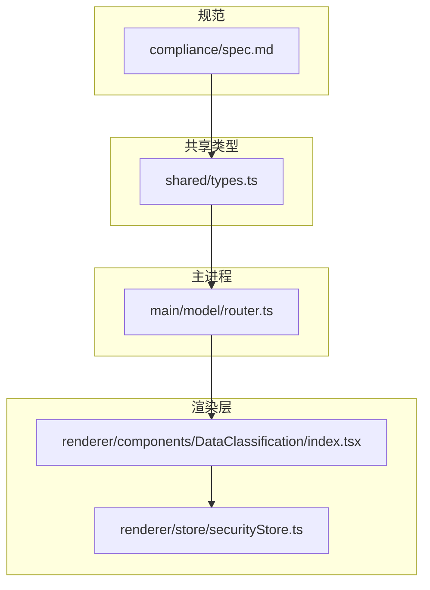
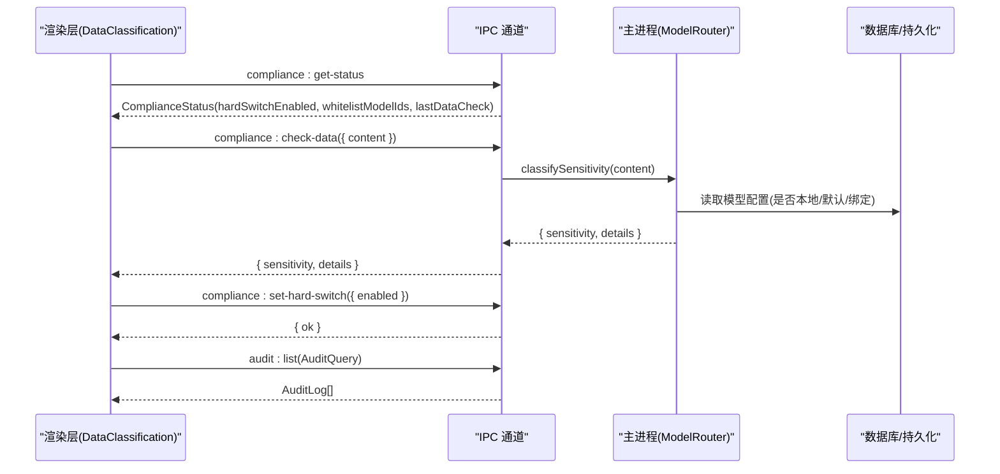
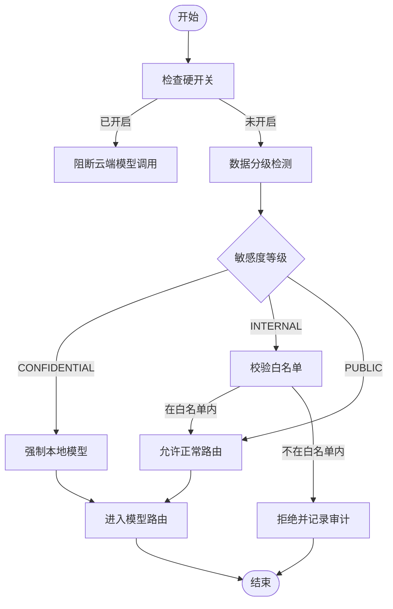
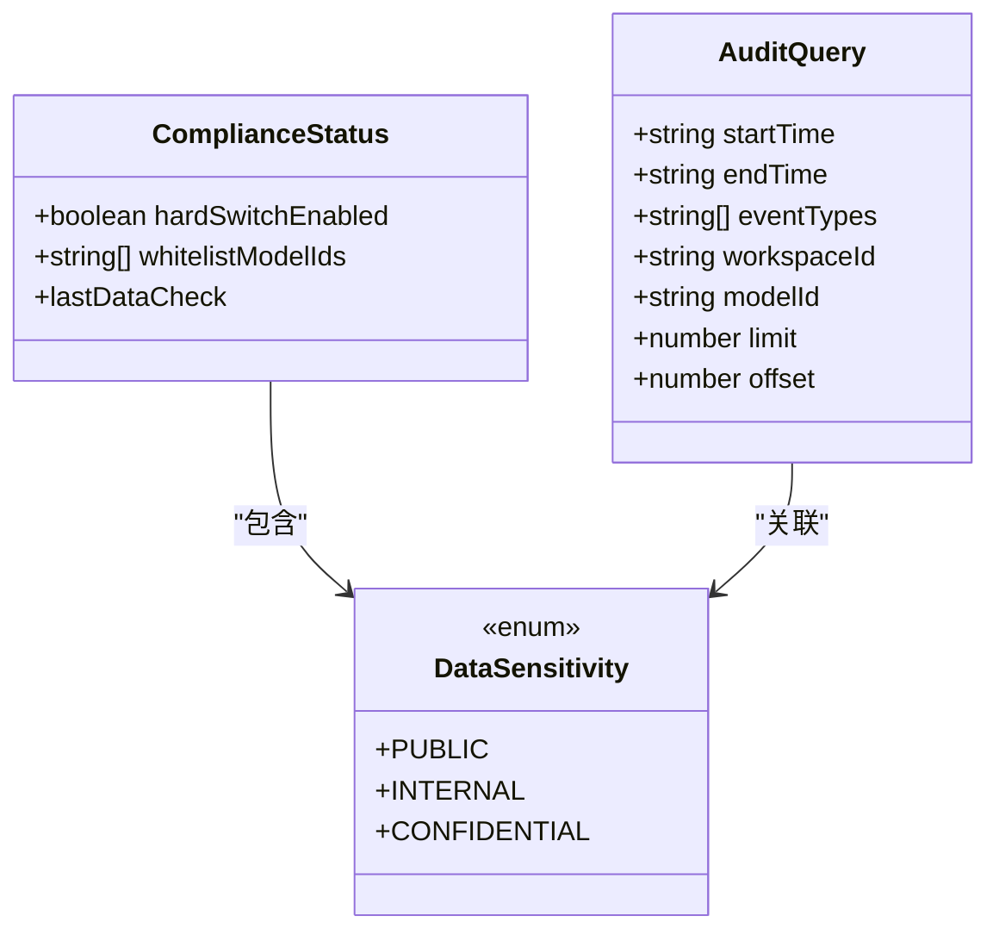
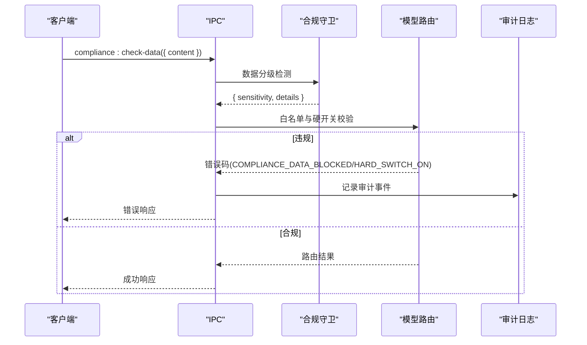
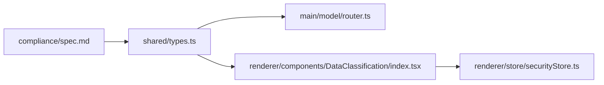

# 合规控制 API

<cite>
**本文引用的文件**   
- [spec.md](file://docs/changes/qwenpaw-integration/specs/compliance/spec.md)
- [types.ts](file://tongtian-tauri/src/shared/types.ts)
- [router.ts](file://tongtian-tauri/src/main/model/router.ts)
- [index.tsx](file://tongtian-tauri/src/renderer/components/DataClassification/index.tsx)
- [securityStore.ts](file://tongtian-tauri/src/renderer/store/securityStore.ts)
</cite>

## 目录
1. [简介](#简介)
2. [项目结构](#项目结构)
3. [核心组件](#核心组件)
4. [架构总览](#架构总览)
5. [详细组件分析](#详细组件分析)
6. [依赖关系分析](#依赖关系分析)
7. [性能考虑](#性能考虑)
8. [故障排查指南](#故障排查指南)
9. [结论](#结论)
10. [附录：企业级配置与安全策略示例](#附录企业级配置与安全策略示例)

## 简介
本文件面向企业级“合规控制”能力，围绕数据分级保护、提示词注入防护与模型白名单机制，提供统一的 IPC 接口规范与实现要点说明。重点覆盖以下能力：
- 数据分级检测（PUBLIC / INTERNAL / CONFIDENTIAL）
- 出域白名单（仅允许白名单模型接收 INTERNAL 及以上级别数据）
- 硬开关（一键禁用外部云端模型，仅允许本地模型）
- 合规告知（首次外发数据需用户确认）
- 全量审计日志（记录模型调用、数据流向、token 用量、配置变更等）

## 项目结构
合规相关能力横跨文档规范、前端类型定义、主进程路由与渲染层展示：
- 规范定义：compliance/spec.md 定义了 IPC Channel、DTO、错误码与审计事件扩展
- 类型定义：shared/types.ts 定义了 DataSensitivity 枚举及审计日志结构
- 主进程路由：main/model/router.ts 实现了敏感数据强制本地模型的三层路由策略
- 渲染层展示：DataClassification 组件与安全存储 store 用于展示与规则管理

图表来源 
- [spec.md:80-131](file://docs/changes/qwenpaw-integration/specs/compliance/spec.md#L80-L131)
- [types.ts:131-136](file://tongtian-tauri/src/shared/types.ts#L131-L136)
- [router.ts:92-146](file://tongtian-tauri/src/main/model/router.ts#L92-L146)
- [index.tsx:72-85](file://tongtian-tauri/src/renderer/components/DataClassification/index.tsx#L72-L85)
- [securityStore.ts:1-10](file://tongtian-tauri/src/renderer/store/securityStore.ts#L1-L10)

章节来源
- [spec.md:80-131](file://docs/changes/qwenpaw-integration/specs/compliance/spec.md#L80-L131)
- [types.ts:131-136](file://tongtian-tauri/src/shared/types.ts#L131-L136)
- [router.ts:92-146](file://tongtian-tauri/src/main/model/router.ts#L92-L146)
- [index.tsx:72-85](file://tongtian-tauri/src/renderer/components/DataClassification/index.tsx#L72-L85)
- [securityStore.ts:1-10](file://tongtian-tauri/src/renderer/store/securityStore.ts#L1-L10)

## 核心组件
- ComplianceStatus 数据结构
  - hardSwitchEnabled：全局硬开关状态，开启后禁止所有外部（云端）模型调用
  - whitelistModelIds：允许的模型 ID 列表，INTERNAL 及以上数据仅可发送至该列表中的模型
  - lastDataCheck：最近一次数据分级检测结果（含敏感度与时间戳）
- 数据分级枚举 DataSensitivity
  - PUBLIC：公开数据，无限制
  - INTERNAL：内部数据，需白名单模型
  - CONFIDENTIAL：机密数据，强制本地模型
- 审计查询 AuditQuery
  - 支持按时间范围、事件类型、工作区、模型、分页参数进行查询与导出

章节来源
- [spec.md:94-112](file://docs/changes/qwenpaw-integration/specs/compliance/spec.md#L94-L112)
- [types.ts:131-136](file://tongtian-tauri/src/shared/types.ts#L131-L136)
- [types.ts:234-254](file://tongtian-tauri/src/shared/types.ts#L234-L254)

## 架构总览
合规控制通过 IPC 通道暴露能力，主进程 ModelRouter 负责敏感数据识别与模型选择，渲染层负责展示与交互。

图表来源 
- [spec.md:82-92](file://docs/changes/qwenpaw-integration/specs/compliance/spec.md#L82-L92)
- [router.ts:139-166](file://tongtian-tauri/src/main/model/router.ts#L139-L166)
- [types.ts:131-136](file://tongtian-tauri/src/shared/types.ts#L131-L136)

## 详细组件分析

### 接口定义与行为说明
- compliance:get-status
  - 方向：请求→响应
  - 作用：获取当前合规状态（硬开关、白名单、最近一次数据检查结果）
  - 返回：ComplianceStatus
- compliance:set-hard-switch
  - 方向：请求→响应
  - 作用：设置全局硬开关（启用/禁用外部模型）
  - 入参：{ enabled: boolean }
  - 返回：{ ok: boolean }
- compliance:get-whitelist
  - 方向：请求→响应
  - 作用：获取模型出域白名单
  - 返回：string[]
- compliance:set-whitelist
  - 方向：请求→响应
  - 作用：设置模型出域白名单
  - 入参：string[]
  - 返回：{ ok: boolean }
- compliance:check-data
  - 方向：请求→响应
  - 作用：对输入内容进行数据分级检测
  - 入参：{ content: string }
  - 返回：{ sensitivity: DataSensitivity; details: string[] }
- audit:list
  - 方向：请求→响应
  - 作用：查询审计日志
  - 入参：AuditQuery
  - 返回：AuditLog[]
- audit:export
  - 方向：请求→响应
  - 作用：导出审计日志为文件
  - 入参：AuditQuery
  - 返回：{ filePath: string }

章节来源
- [spec.md:82-92](file://docs/changes/qwenpaw-integration/specs/compliance/spec.md#L82-L92)
- [spec.md:94-112](file://docs/changes/qwenpaw-integration/specs/compliance/spec.md#L94-L112)
- [types.ts:234-254](file://tongtian-tauri/src/shared/types.ts#L234-L254)

### 数据分级与提示词注入防护
- 数据分级检测
  - 在发送前对内容进行分析，标记为 PUBLIC / INTERNAL / CONFIDENTIAL
  - 当检测到 CONFIDENTIAL 时，强制使用本地模型；INTERNAL 需白名单模型
- 提示词注入防护
  - 通过安全扫描器与规则集（如 prompt_injection.yaml）对输入进行模式匹配与风险评估
  - 结合白名单与硬开关，阻断高风险路径

图表来源 
- [router.ts:147-166](file://tongtian-tauri/src/main/model/router.ts#L147-L166)
- [spec.md:18-41](file://docs/changes/qwenpaw-integration/specs/compliance/spec.md#L18-L41)

章节来源
- [router.ts:147-166](file://tongtian-tauri/src/main/model/router.ts#L147-L166)
- [spec.md:18-41](file://docs/changes/qwenpaw-integration/specs/compliance/spec.md#L18-L41)

### 模型白名单机制
- 白名单维护
  - 通过 compliance:get-whitelist / compliance:set-whitelist 接口维护
  - INTERNAL 及以上数据仅允许发送至白名单内的模型
- 违规处理
  - 非白名单模型被拒绝，返回 COMPLIANCE_DATA_BLOCKED 错误，并记录审计日志

图表来源 
- [spec.md:94-112](file://docs/changes/qwenpaw-integration/specs/compliance/spec.md#L94-L112)
- [types.ts:131-136](file://tongtian-tauri/src/shared/types.ts#L131-L136)
- [types.ts:234-254](file://tongtian-tauri/src/shared/types.ts#L234-L254)

章节来源
- [spec.md:94-112](file://docs/changes/qwenpaw-integration/specs/compliance/spec.md#L94-L112)
- [types.ts:131-136](file://tongtian-tauri/src/shared/types.ts#L131-L136)
- [types.ts:234-254](file://tongtian-tauri/src/shared/types.ts#L234-L254)

### 合规检查流程与违规处理策略
- 合规检查流程
  - 获取状态 → 数据分级检测 → 白名单校验 → 硬开关判定 → 路由决策
- 违规处理策略
  - 触发 COMPLIANCE_DATA_BLOCKED 或 COMPLIANCE_HARD_SWITCH_ON 错误码
  - 记录审计日志，支持查询与导出

图表来源 
- [spec.md:114-120](file://docs/changes/qwenpaw-integration/specs/compliance/spec.md#L114-L120)
- [router.ts:139-166](file://tongtian-tauri/src/main/model/router.ts#L139-L166)

章节来源
- [spec.md:114-120](file://docs/changes/qwenpaw-integration/specs/compliance/spec.md#L114-L120)
- [router.ts:139-166](file://tongtian-tauri/src/main/model/router.ts#L139-L166)

### 渲染层展示与规则管理
- DataClassification 组件
  - 根据 DataSensitivity 显示不同颜色与标签（公开/内部/机密）
  - 在 CONFIDENTIAL 场景下给出风险提示
- securityStore
  - 管理敏感度规则（pattern、level、description）
  - 与后端联动更新分类策略

章节来源
- [index.tsx:72-85](file://tongtian-tauri/src/renderer/components/DataClassification/index.tsx#L72-L85)
- [securityStore.ts:1-10](file://tongtian-tauri/src/renderer/store/securityStore.ts#L1-L10)

## 依赖关系分析
- 规范驱动类型与实现
  - spec.md 定义 IPC 契约与 DTO，驱动 shared/types.ts 的枚举与结构
  - router.ts 基于 DataSensitivity 实现敏感数据强制本地模型的路由逻辑
- 渲染层依赖类型与状态
  - DataClassification 组件依赖 DataSensitivity 枚举进行展示
  - securityStore 管理敏感度规则并与后端同步

图表来源 
- [spec.md:82-112](file://docs/changes/qwenpaw-integration/specs/compliance/spec.md#L82-L112)
- [types.ts:131-136](file://tongtian-tauri/src/shared/types.ts#L131-L136)
- [router.ts:139-166](file://tongtian-tauri/src/main/model/router.ts#L139-L166)
- [index.tsx:72-85](file://tongtian-tauri/src/renderer/components/DataClassification/index.tsx#L72-L85)
- [securityStore.ts:1-10](file://tongtian-tauri/src/renderer/store/securityStore.ts#L1-L10)

章节来源
- [spec.md:82-112](file://docs/changes/qwenpaw-integration/specs/compliance/spec.md#L82-L112)
- [types.ts:131-136](file://tongtian-tauri/src/shared/types.ts#L131-L136)
- [router.ts:139-166](file://tongtian-tauri/src/main/model/router.ts#L139-L166)
- [index.tsx:72-85](file://tongtian-tauri/src/renderer/components/DataClassification/index.tsx#L72-L85)
- [securityStore.ts:1-10](file://tongtian-tauri/src/renderer/store/securityStore.ts#L1-L10)

## 性能考虑
- 数据分级检测应轻量高效，避免阻塞主流程；建议缓存最近一次检测结果
- 白名单校验应为 O(1) 查找（哈希集合），减少延迟
- 审计日志写入采用异步落盘，避免影响用户体验
- 硬开关切换应即时生效，无需重启服务

[本节为通用指导，不直接分析具体文件]

## 故障排查指南
- 常见错误码
  - COMPLIANCE_DATA_BLOCKED：数据被合规策略阻断（非白名单模型或敏感数据）
  - COMPLIANCE_HARD_SWITCH_ON：硬开关已开启，外部 API 被禁用
- 排查步骤
  - 检查 compliance:get-status 返回的 hardSwitchEnabled 与 whitelistModelIds
  - 使用 compliance:check-data 验证敏感度检测结果
  - 查看 audit:list 审计日志，定位违规事件与原因
  - 若出现 ALL_MODELS_UNAVAILABLE，检查本地模型配置与默认模型设置

章节来源
- [spec.md:114-120](file://docs/changes/qwenpaw-integration/specs/compliance/spec.md#L114-L120)
- [router.ts:306-310](file://tongtian-tauri/src/main/model/router.ts#L306-L310)

## 结论
合规控制通过数据分级、白名单与硬开关三大机制，确保企业数据不外泄、模型调用可追溯。配合全量审计日志与合规告知，形成完整的企业级安全闭环。建议在部署时结合组织策略定制扫描规则与白名单，确保业务连续性与安全性平衡。

[本节为总结性内容，不直接分析具体文件]

## 附录：企业级配置与安全策略示例
- 企业级合规配置
  - 启用硬开关：compliance:set-hard-switch({ enabled: true })
  - 设置白名单：compliance:set-whitelist([modelId1, modelId2])
  - 数据分级规则：在 securityStore 中新增 pattern 与 level 映射
- 安全策略定制
  - 针对提示词注入：在规则集中添加 prompt_injection 签名与阈值
  - 针对数据外泄：在扫描策略中强化 data_exfiltration 检测
  - 审计导出：使用 audit:export 导出指定时间范围的日志文件

[本节为概念性指导，不直接分析具体文件]