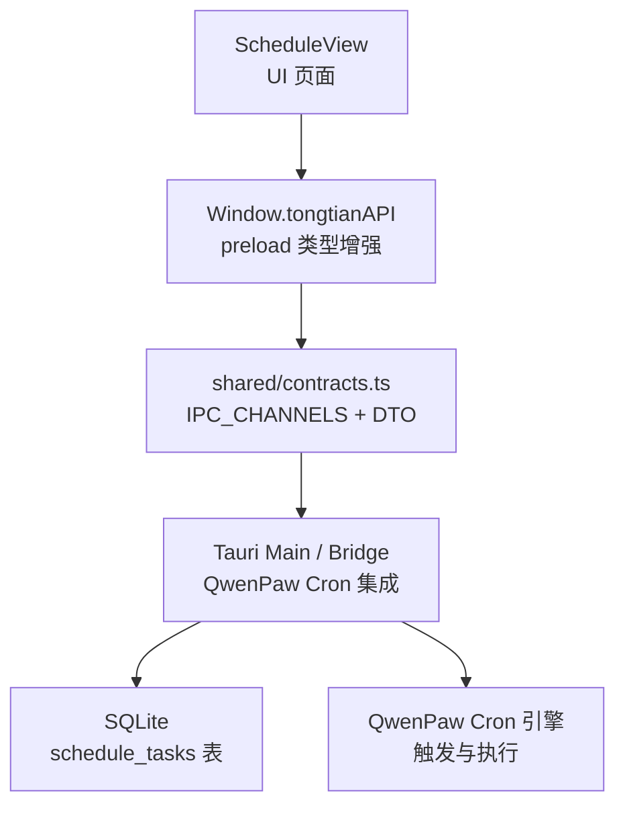
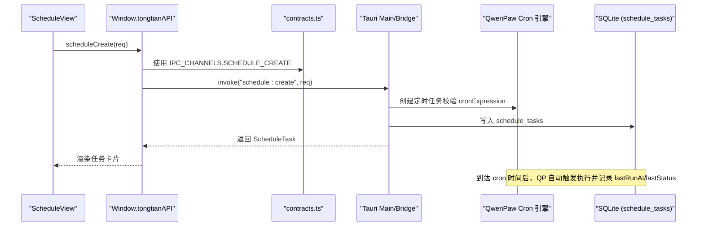
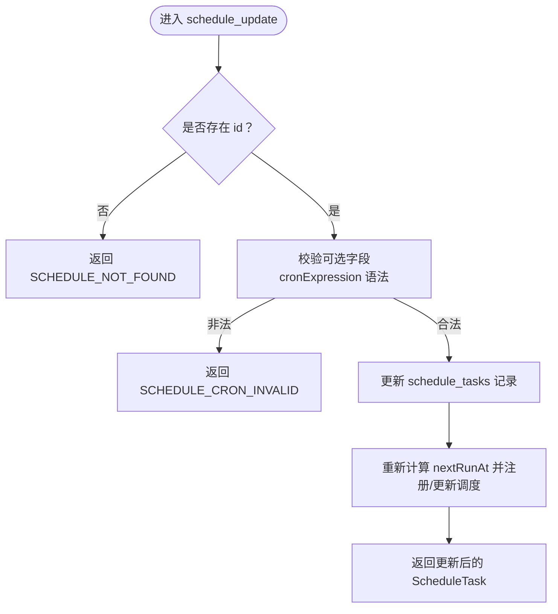
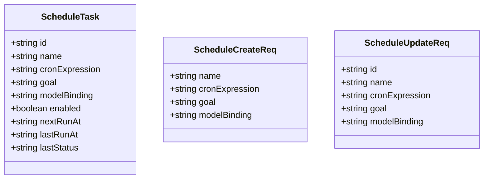
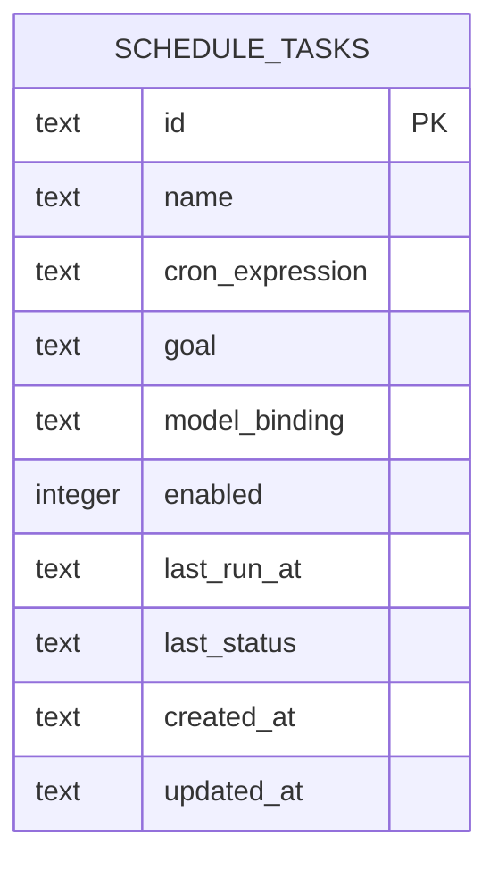
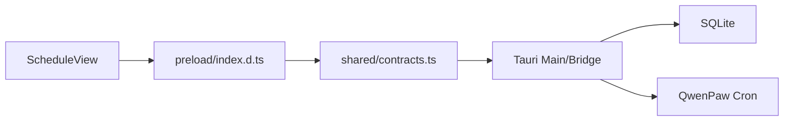

# 定时任务 API

<cite>
**本文引用的文件**
- [spec.md](file://docs/changes/qwenpaw-integration/specs/schedule-cron/spec.md)
- [contracts.ts](file://tongtian-tauri/src/shared/contracts.ts)
- [index.d.ts](file://tongtian-tauri/src/preload/index.d.ts)
- [types.ts](file://tongtian-tauri/src/shared/types.ts)
- [ScheduleView/index.tsx](file://tongtian-tauri/src/renderer/pages/ScheduleView/index.tsx)
</cite>

## 目录
1. [简介](#简介)
2. [项目结构](#项目结构)
3. [核心组件](#核心组件)
4. [架构总览](#架构总览)
5. [详细组件分析](#详细组件分析)
6. [依赖关系分析](#依赖关系分析)
7. [性能与并发控制](#性能与并发控制)
8. [故障排查指南](#故障排查指南)
9. [结论](#结论)
10. [附录：Cron 表达式与编排模式](#附录cron-表达式与编排模式)

## 简介
本文件面向“定时任务”能力，提供完整的 API 文档与实现说明。系统通过 QwenPaw Bridge 复用其 Cron + 日程能力，通天办公侧新增 ScheduleView UI 页面，并通过 IPC Channel 暴露 schedule_list、schedule_create、schedule_update、schedule_delete、schedule_toggle 等命令接口。调度机制由 QwenPaw 引擎驱动，执行状态与错误码在本地持久化并可通过事件或查询接口获取。

## 项目结构
- 规范定义位于 docs/changes/qwenpaw-integration/specs/schedule-cron/spec.md，明确 IPC Channel、DTO、数据模型与场景。
- 类型与常量集中在 tongtian-tauri/src/shared/contracts.ts，包含 ErrorCode、IPC_CHANNELS 以及 ScheduleCreateReq/ScheduleUpdateReq 等契约。
- 前端类型增强在 tongtian-tauri/src/preload/index.d.ts，为 Window.tongtianAPI 提供 scheduleList/scheduleCreate/scheduleUpdate/scheduleDelete/scheduleToggle 等方法签名。
- 共享类型（如 TaskStatus）在 tongtian-tauri/src/shared/types.ts 中定义，便于跨层一致。
- 前端页面占位在 tongtian-tauri/src/renderer/pages/ScheduleView/index.tsx，后续将承载列表/日历视图与操作入口。

**图表来源**
- [index.d.ts:125-131](file://tongtian-tauri/src/preload/index.d.ts#L125-L131)
- [contracts.ts:536-541](file://tongtian-tauri/src/shared/contracts.ts#L536-L541)
- [spec.md:54-85](file://docs/changes/qwenpaw-integration/specs/schedule-cron/spec.md#L54-L85)

**章节来源**
- [spec.md:10-50](file://docs/changes/qwenpaw-integration/specs/schedule-cron/spec.md#L10-L50)
- [contracts.ts:536-541](file://tongtian-tauri/src/shared/contracts.ts#L536-L541)
- [index.d.ts:125-131](file://tongtian-tauri/src/preload/index.d.ts#L125-L131)

## 核心组件
- IPC Channel 集合：统一声明 schedule:list、schedule:create、schedule:update、schedule:delete、schedule:toggle。
- DTO 契约：
  - ScheduleTask：任务实体（id、name、cronExpression、goal、modelBinding、enabled、nextRunAt、lastRunAt、lastStatus）。
  - ScheduleCreateReq：创建请求（name、cronExpression、goal、modelBinding 可选）。
  - ScheduleUpdateReq：更新请求（id 必填，其余字段可选）。
- 错误码：SCHEDULE_NOT_FOUND、SCHEDULE_CRON_INVALID、SCHEDULE_EXECUTION_FAILED 等。
- 持久化：schedule_tasks 表及索引。

**章节来源**
- [spec.md:54-108](file://docs/changes/qwenpaw-integration/specs/schedule-cron/spec.md#L54-L108)
- [contracts.ts:233-246](file://tongtian-tauri/src/shared/contracts.ts#L233-L246)
- [contracts.ts:82-84](file://tongtian-tauri/src/shared/contracts.ts#L82-L84)
- [contracts.ts:536-541](file://tongtian-tauri/src/shared/contracts.ts#L536-L541)

## 架构总览
下图展示从 UI 到后端再到 QwenPaw 的调用链路与数据落盘路径。

**图表来源**
- [index.d.ts:125-131](file://tongtian-tauri/src/preload/index.d.ts#L125-L131)
- [contracts.ts:536-541](file://tongtian-tauri/src/shared/contracts.ts#L536-L541)
- [spec.md:22-33](file://docs/changes/qwenpaw-integration/specs/schedule-cron/spec.md#L22-L33)

## 详细组件分析

### 接口定义与行为
- schedule_list
  - 通道：schedule:list
  - 请求：无
  - 响应：ScheduleTask[]
  - 用途：列出所有定时任务，用于列表/日历视图渲染
- schedule_create
  - 通道：schedule:create
  - 请求：ScheduleCreateReq
  - 响应：ScheduleTask
  - 行为：校验 cronExpression；若合法则创建任务并持久化；返回 nextRunAt
- schedule_update
  - 通道：schedule:update
  - 请求：ScheduleUpdateReq
  - 响应：ScheduleTask
  - 行为：按 id 更新 name/cronExpression/goal/modelBinding；重新计算下次执行时间
- schedule_delete
  - 通道：schedule:delete
  - 请求：{ id }
  - 响应：{ ok }
  - 行为：删除任务并清理调度器中的条目
- schedule_toggle
  - 通道：schedule:toggle
  - 请求：{ id; enabled }
  - 响应：{ ok }
  - 行为：启用/禁用任务，影响是否参与调度

**图表来源**
- [contracts.ts:240-246](file://tongtian-tauri/src/shared/contracts.ts#L240-L246)
- [contracts.ts:82-84](file://tongtian-tauri/src/shared/contracts.ts#L82-L84)

**章节来源**
- [spec.md:54-85](file://docs/changes/qwenpaw-integration/specs/schedule-cron/spec.md#L54-L85)
- [contracts.ts:536-541](file://tongtian-tauri/src/shared/contracts.ts#L536-L541)

### 数据结构
- ScheduleTask
  - 字段：id、name、cronExpression、goal、modelBinding、enabled、nextRunAt、lastRunAt、lastStatus
  - 用途：描述一个定时任务的元信息与最近执行状态
- ScheduleCreateReq
  - 字段：name、cronExpression、goal、modelBinding（可选）
  - 用途：创建新任务时提交的最小必要信息
- ScheduleUpdateReq
  - 字段：id（必填）、name/cronExpression/goal/modelBinding（可选）
  - 用途：增量更新任务配置

**图表来源**
- [spec.md:67-85](file://docs/changes/qwenpaw-integration/specs/schedule-cron/spec.md#L67-L85)
- [contracts.ts:233-246](file://tongtian-tauri/src/shared/contracts.ts#L233-L246)

**章节来源**
- [spec.md:67-85](file://docs/changes/qwenpaw-integration/specs/schedule-cron/spec.md#L67-L85)
- [contracts.ts:233-246](file://tongtian-tauri/src/shared/contracts.ts#L233-L246)

### 数据模型与持久化
- 表名：schedule_tasks
- 关键字段：id、name、cron_expression、goal、model_binding、enabled、last_run_at、last_status、created_at、updated_at
- 索引：idx_schedule_enabled（加速按 enabled 筛选）

**图表来源**
- [spec.md:92-107](file://docs/changes/qwenpaw-integration/specs/schedule-cron/spec.md#L92-L107)

**章节来源**
- [spec.md:92-107](file://docs/changes/qwenpaw-integration/specs/schedule-cron/spec.md#L92-L107)

### 错误处理
- 错误码
  - SCHEDULE_NOT_FOUND：任务不存在
  - SCHEDULE_CRON_INVALID：Cron 表达式非法
  - SCHEDULE_EXECUTION_FAILED：任务执行失败
- 建议处理策略
  - 客户端根据 code 提示用户或重试
  - 对 SCHEDULE_CRON_INVALID 做前端即时校验
  - 对 SCHEDULE_EXECUTION_FAILED 记录日志并提供重试入口

**章节来源**
- [contracts.ts:82-84](file://tongtian-tauri/src/shared/contracts.ts#L82-L84)

### 前端集成要点
- 通过 Window.tongtianAPI 提供的 scheduleList/scheduleCreate/scheduleUpdate/scheduleDelete/scheduleToggle 方法调用 IPC。
- ScheduleView 页面预留容器，后续接入列表/日历视图与操作按钮。

**章节来源**
- [index.d.ts:125-131](file://tongtian-tauri/src/preload/index.d.ts#L125-L131)
- [ScheduleView/index.tsx:14-42](file://tongtian-tauri/src/renderer/pages/ScheduleView/index.tsx#L14-L42)

## 依赖关系分析
- 前端类型依赖 shared/contracts.ts 中的 IPC_CHANNELS 与 DTO。
- preload/index.d.ts 扩展 Window.tongtianAPI，确保 TS 类型安全。
- 后端（Tauri Main/Bridge）负责校验、持久化与桥接到 QwenPaw Cron 引擎。
- SQLite 存储任务元数据与执行历史。

**图表来源**
- [index.d.ts:125-131](file://tongtian-tauri/src/preload/index.d.ts#L125-L131)
- [contracts.ts:536-541](file://tongtian-tauri/src/shared/contracts.ts#L536-L541)

**章节来源**
- [contracts.ts:536-541](file://tongtian-tauri/src/shared/contracts.ts#L536-L541)
- [index.d.ts:125-131](file://tongtian-tauri/src/preload/index.d.ts#L125-L131)

## 性能与并发控制
- 调度机制
  - 由 QwenPaw Cron 引擎解析表达式并触发执行，避免主进程阻塞。
  - 每次更新 cronExpression 需重新计算 nextRunAt 并更新调度器。
- 冲突检测
  - 建议在创建/更新时对相同 name 或高度重叠的 cronExpression 进行冲突提示（例如同一分钟多次触发）。
  - 可引入唯一约束或业务键（如 name + workspaceId）防止重复。
- 并发控制
  - 单任务串行：同一任务实例在同一时刻仅允许一次运行，避免重复执行。
  - 全局限流：结合模型配额与资源限制，避免瞬时高峰导致过载。
  - 幂等性：对执行结果采用去重键（如任务 id + 触发批次），保证重试不产生副作用。
- 监控与观测
  - 通过 lastRunAt、lastStatus 观察最近执行情况。
  - 可扩展事件流上报（如 status_change、error）以便前端实时刷新。

[本节为通用指导，无需代码引用]

## 故障排查指南
- 常见问题
  - Cron 表达式非法：检查秒/分/时/日/月/周格式与取值范围。
  - 任务未触发：确认 enabled 为真且 nextRunAt 已正确计算。
  - 执行失败：查看 lastStatus 与错误码 SCHEDULE_EXECUTION_FAILED，定位下游依赖。
- 定位步骤
  - 使用 schedule:list 拉取任务列表，核对 enabled 与 nextRunAt。
  - 检查 SQLite 中 schedule_tasks 记录是否被更新。
  - 查看 QwenPaw 引擎日志，确认触发与执行链路。
- 恢复策略
  - 修正 cronExpression 后重新保存。
  - 对失败任务手动重试或调整执行窗口。

**章节来源**
- [contracts.ts:82-84](file://tongtian-tauri/src/shared/contracts.ts#L82-L84)
- [spec.md:22-33](file://docs/changes/qwenpaw-integration/specs/schedule-cron/spec.md#L22-L33)

## 结论
本项目通过 QwenPaw 的 Cron 能力实现了稳定可靠的定时任务调度，并在通天办公侧以清晰的 IPC 契约与类型体系暴露 CRUD 与启停接口。配合 SQLite 持久化与错误码体系，可满足日常自动化工作流的编排与监控需求。后续可在冲突检测、并发控制与事件流方面进一步增强。

[本节为总结性内容，无需代码引用]

## 附录：Cron 表达式与编排模式
- Cron 表达式语法（标准 6 字段）
  - 字段顺序：秒、分、时、日、月、周
  - 支持 *、数值、区间（1-5）、步长（*/10）、逗号分隔（1,3,5）
  - 示例
    - 每分钟执行：0 * * * * *
    - 每小时第 5 分钟执行：5 * * * * *
    - 工作日 9:00 执行：0 0 9 * * 1-5
    - 每月最后一天 23:30 执行：30 23 L * * *
- 编排模式
  - 周期巡检：每日固定时间检查系统健康并生成报告
  - 数据同步：每 10 分钟拉取远端数据并入库
  - 提醒与通知：工作日早会前发送提醒
  - 批量作业：凌晨低峰期执行批处理任务
- 最佳实践
  - 尽量使用最小粒度（秒级仅在必要时开启）
  - 合理设置 enabled 开关，避免误触发
  - 对关键任务增加重试与告警

[本节为概念性内容，无需代码引用]