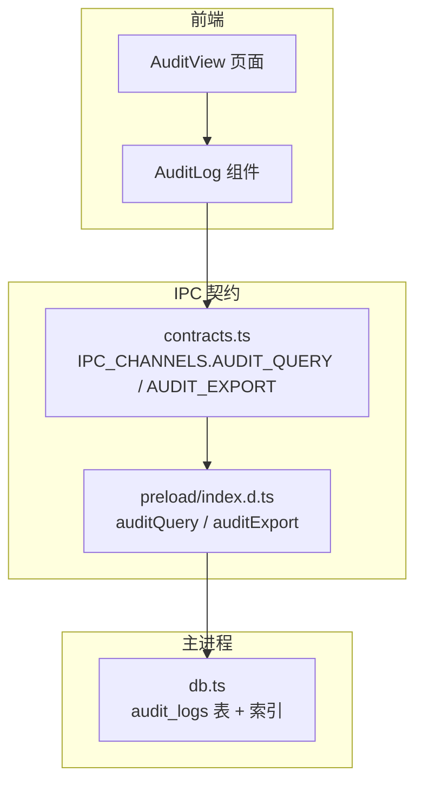
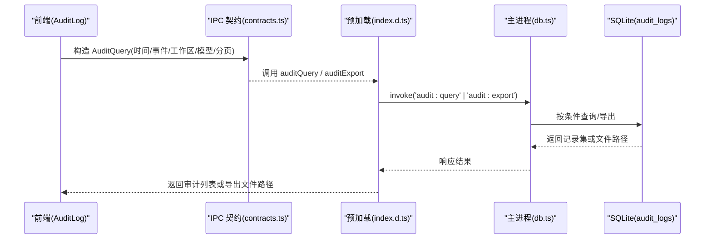
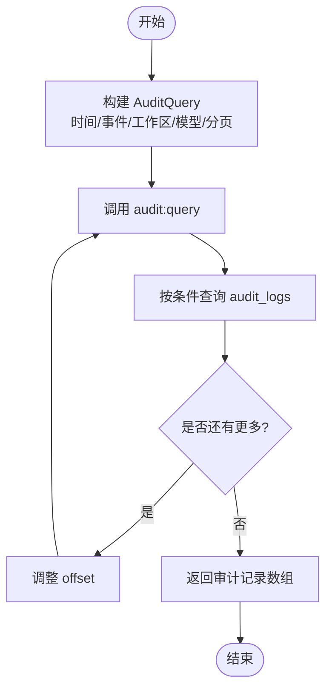
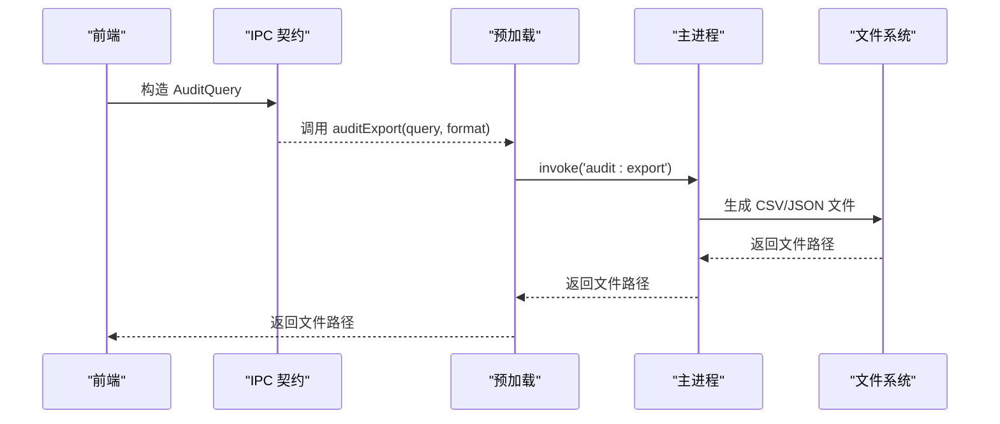
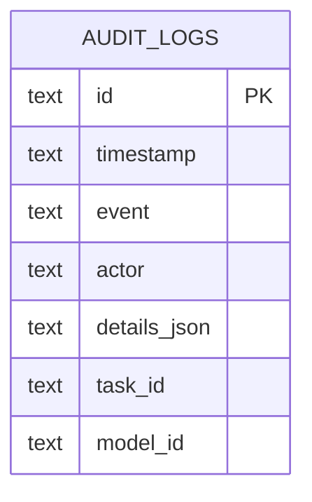
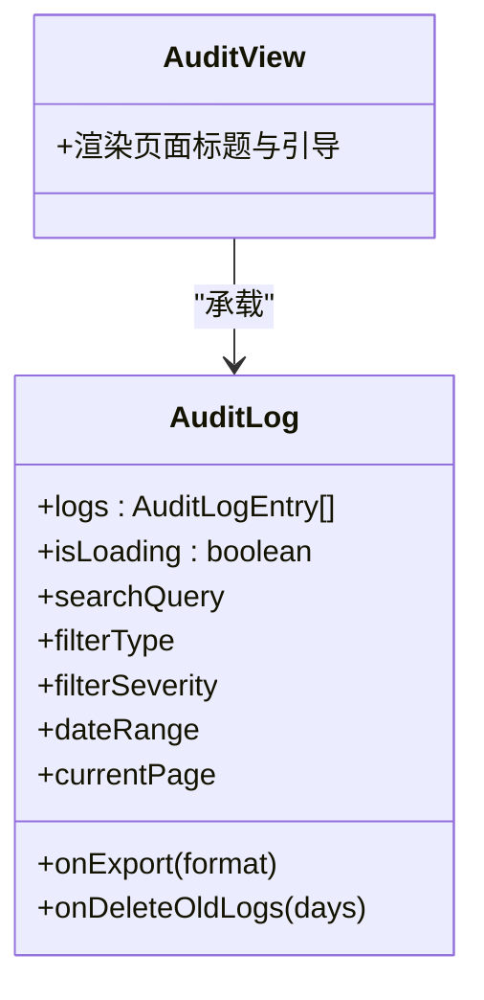
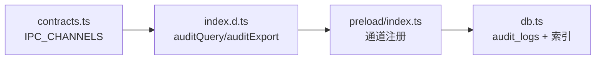

# 审计日志 API

<cite>
**本文引用的文件**   
- [审计日志规范 spec.md](file://docs/changes/qwenpaw-integration/specs/audit-logging/spec.md)
- [合规规范 spec.md](file://docs/changes/qwenpaw-integration/specs/compliance/spec.md)
- [IPC 契约与类型 contracts.ts](file://tongtian-tauri/src/shared/contracts.ts)
- [预加载类型声明 index.d.ts](file://tongtian-tauri/src/preload/index.d.ts)
- [共享类型 types.ts](file://tongtian-tauri/src/shared/types.ts)
- [数据库表结构与索引 db.ts](file://tongtian-tauri/src/main/store/db.ts)
- [预加载通道注册 index.ts](file://tongtian-tauri/src/preload/index.ts)
- [审计页面占位 AuditView/index.tsx](file://tongtian-tauri/src/renderer/pages/AuditView/index.tsx)
- [审计日志组件 AuditLog/index.tsx](file://tongtian-tauri/src/renderer/components/AuditLog/index.tsx)
</cite>

## 目录
1. [简介](#简介)
2. [项目结构](#项目结构)
3. [核心组件](#核心组件)
4. [架构总览](#架构总览)
5. [详细组件分析](#详细组件分析)
6. [依赖关系分析](#依赖关系分析)
7. [性能考量](#性能考量)
8. [故障排查指南](#故障排查指南)
9. [结论](#结论)
10. [附录](#附录)

## 简介
本文件面向“审计日志”能力，系统化说明审计查询与导出相关的 API、数据模型、事件格式与使用方式。重点覆盖：
- audit_query（查询）、audit_export（导出）等命令接口
- AuditQuery 查询参数使用方法（时间范围过滤、事件类型筛选、工作空间与模型过滤）
- 审计事件的字段含义与记录规范
- 日志导出与合规性报告生成流程
- 审计数据分析与安全事件排查示例思路

## 项目结构
审计日志能力贯穿前端 UI、IPC 契约、主进程存储与规范文档：
- 规范层：定义 IPC Channel、AuditQuery、审计事件采集与脱敏策略
- 契约层：统一前后端类型与 IPC 通道名
- 前端层：审计页面与组件提供筛选、分页、导出入口
- 主进程层：SQLite 表结构与索引保障查询性能

**图表来源** 
- [审计日志规范 spec.md:68-89](file://docs/changes/qwenpaw-integration/specs/audit-logging/spec.md#L68-L89)
- [IPC 契约与类型 contracts.ts:532-535](file://tongtian-tauri/src/shared/contracts.ts#L532-L535)
- [预加载类型声明 index.d.ts:121-124](file://tongtian-tauri/src/preload/index.d.ts#L121-L124)
- [数据库表结构与索引 db.ts:128-136, 266-269:128-136](file://tongtian-tauri/src/main/store/db.ts#L128-L136)

**章节来源**
- [审计日志规范 spec.md:1-89](file://docs/changes/qwenpaw-integration/specs/audit-logging/spec.md#L1-L89)
- [IPC 契约与类型 contracts.ts:219-229, 532-535:219-229](file://tongtian-tauri/src/shared/contracts.ts#L219-L229)
- [预加载类型声明 index.d.ts:121-124](file://tongtian-tauri/src/preload/index.d.ts#L121-L124)
- [数据库表结构与索引 db.ts:128-136, 266-269:128-136](file://tongtian-tauri/src/main/store/db.ts#L128-L136)

## 核心组件
- IPC 通道与请求响应
  - audit:list（规范中列出），audit:export（规范中列出），audit:count（规范中列出）
  - 实际契约中定义了 audit:query 与 audit:export 两个通道名
- 查询参数
  - AuditQuery：包含 startTime、endTime、eventTypes[]、workspaceId、modelId、limit、offset
- 前端暴露方法
  - auditQuery(query): Promise<unknown[]>
  - auditExport(query, format): Promise<string>（返回文件路径）
- 数据存储
  - audit_logs 表：id、timestamp、event、actor、details_json、task_id、model_id
  - 索引：idx_audit_timestamp、idx_audit_event、idx_audit_workspace(task_id)、idx_audit_model(model_id)

**章节来源**
- [审计日志规范 spec.md:70-77](file://docs/changes/qwenpaw-integration/specs/audit-logging/spec.md#L70-L77)
- [IPC 契约与类型 contracts.ts:221-229, 532-535:221-229](file://tongtian-tauri/src/shared/contracts.ts#L221-L229)
- [预加载类型声明 index.d.ts:121-124](file://tongtian-tauri/src/preload/index.d.ts#L121-L124)
- [数据库表结构与索引 db.ts:128-136, 266-269:128-136](file://tongtian-tauri/src/main/store/db.ts#L128-L136)

## 架构总览
审计日志的调用链路从前端发起，经 IPC 契约路由到主进程，最终读写 SQLite 并返回结果或导出文件路径。

**图表来源** 
- [IPC 契约与类型 contracts.ts:532-535](file://tongtian-tauri/src/shared/contracts.ts#L532-L535)
- [预加载类型声明 index.d.ts:121-124](file://tongtian-tauri/src/preload/index.d.ts#L121-L124)
- [数据库表结构与索引 db.ts:128-136, 266-269:128-136](file://tongtian-tauri/src/main/store/db.ts#L128-L136)

## 详细组件分析

### 审计查询（audit_query）
- 通道名
  - 契约中定义为 audit:query（同时规范中列出 audit:list）
- 请求体
  - AuditQuery：startTime、endTime、eventTypes[]、workspaceId、modelId、limit、offset
- 响应
  - 数组形式（规范为 AuditLog[]；契约方法返回 unknown[]，由上层适配）
- 使用要点
  - 时间范围过滤：startTime、endTime 为 ISO 字符串
  - 事件类型筛选：eventTypes 为字符串数组，如 model_call、file_write、config_change 等
  - 工作空间过滤：workspaceId 对应 task_id（通过 idx_audit_workspace 加速）
  - 模型过滤：modelId 对应 model_id（通过 idx_audit_model 加速）
  - 分页：limit、offset 控制返回条数与偏移

**图表来源** 
- [IPC 契约与类型 contracts.ts:221-229, 532-535:221-229](file://tongtian-tauri/src/shared/contracts.ts#L221-L229)
- [预加载类型声明 index.d.ts:121-124](file://tongtian-tauri/src/preload/index.d.ts#L121-L124)
- [数据库表结构与索引 db.ts:266-269](file://tongtian-tauri/src/main/store/db.ts#L266-L269)

**章节来源**
- [审计日志规范 spec.md:70-77](file://docs/changes/qwenpaw-integration/specs/audit-logging/spec.md#L70-L77)
- [IPC 契约与类型 contracts.ts:221-229, 532-535:221-229](file://tongtian-tauri/src/shared/contracts.ts#L221-L229)
- [预加载类型声明 index.d.ts:121-124](file://tongtian-tauri/src/preload/index.d.ts#L121-L124)
- [数据库表结构与索引 db.ts:266-269](file://tongtian-tauri/src/main/store/db.ts#L266-L269)

### 审计导出（audit_export）
- 通道名
  - 契约中定义为 audit:export
- 请求体
  - AuditQuery：同查询参数
- 响应
  - 返回文件路径字符串（CSV/JSON 等）
- 使用要点
  - 建议先通过 audit:query 确认结果集大小，再选择合适导出格式
  - 大结果集建议分批导出或使用服务端流式导出（当前契约返回路径）

**图表来源** 
- [IPC 契约与类型 contracts.ts:532-535](file://tongtian-tauri/src/shared/contracts.ts#L532-L535)
- [预加载类型声明 index.d.ts:121-124](file://tongtian-tauri/src/preload/index.d.ts#L121-L124)

**章节来源**
- [审计日志规范 spec.md:70-77](file://docs/changes/qwenpaw-integration/specs/audit-logging/spec.md#L70-L77)
- [IPC 契约与类型 contracts.ts:532-535](file://tongtian-tauri/src/shared/contracts.ts#L532-L535)
- [预加载类型声明 index.d.ts:121-124](file://tongtian-tauri/src/preload/index.d.ts#L121-L124)

### 审计计数（audit_count）
- 通道名
  - 规范中列出 audit:count
- 请求体
  - AuditQuery：同查询参数
- 响应
  - { total: number }
- 用途
  - 用于分页统计、导出预估、UI 提示

**章节来源**
- [审计日志规范 spec.md:70-77](file://docs/changes/qwenpaw-integration/specs/audit-logging/spec.md#L70-L77)

### 审计事件格式与字段含义
- 存储模型（audit_logs 表）
  - id：主键
  - timestamp：时间戳（ISO 字符串）
  - event：事件类型（如 model.call、file.write、config.change、compliance.*）
  - actor：操作者标识
  - details_json：详情 JSON（敏感信息需脱敏）
  - task_id：任务 ID（关联工作空间）
  - model_id：模型 ID
- UI 展示模型（AuditLogEntry）
  - id、timestamp、action、severity、user、resource、details、read
- 事件类型示例
  - model_call、file_write、file_read、route_switch、config_change、user_login、user_logout、skill_install、mcp_connect、sandbox_violation

**图表来源** 
- [数据库表结构与索引 db.ts:128-136](file://tongtian-tauri/src/main/store/db.ts#L128-L136)
- [共享类型 types.ts:234-254](file://tongtian-tauri/src/shared/types.ts#L234-L254)

**章节来源**
- [审计日志规范 spec.md:18-36](file://docs/changes/qwenpaw-integration/specs/audit-logging/spec.md#L18-L36)
- [共享类型 types.ts:234-254](file://tongtian-tauri/src/shared/types.ts#L234-L254)
- [数据库表结构与索引 db.ts:128-136](file://tongtian-tauri/src/main/store/db.ts#L128-L136)

### 前端组件与交互
- AuditView：审计页面占位，标题与引导文案
- AuditLog：表格展示、筛选（时间范围、事件类型、严重程度、关键词搜索）、分页、导出（CSV/JSON）

**图表来源** 
- [审计页面占位 AuditView/index.tsx:1-45](file://tongtian-tauri/src/renderer/pages/AuditView/index.tsx#L1-L45)
- [审计日志组件 AuditLog/index.tsx:1-397](file://tongtian-tauri/src/renderer/components/AuditLog/index.tsx#L1-L397)

**章节来源**
- [审计页面占位 AuditView/index.tsx:1-45](file://tongtian-tauri/src/renderer/pages/AuditView/index.tsx#L1-L45)
- [审计日志组件 AuditLog/index.tsx:1-397](file://tongtian-tauri/src/renderer/components/AuditLog/index.tsx#L1-L397)

## 依赖关系分析
- 契约与通道
  - contracts.ts 定义 IPC_CHANNELS.AUDIT_QUERY、AUDIT_EXPORT
  - preload/index.d.ts 暴露 auditQuery、auditExport 方法
  - preload/index.ts 注册通道映射
- 数据与索引
  - db.ts 定义 audit_logs 表及多个索引，支撑时间、事件、工作区、模型维度查询

**图表来源** 
- [IPC 契约与类型 contracts.ts:532-535](file://tongtian-tauri/src/shared/contracts.ts#L532-L535)
- [预加载类型声明 index.d.ts:121-124](file://tongtian-tauri/src/preload/index.d.ts#L121-L124)
- [预加载通道注册 index.ts:48-49](file://tongtian-tauri/src/preload/index.ts#L48-L49)
- [数据库表结构与索引 db.ts:128-136, 266-269:128-136](file://tongtian-tauri/src/main/store/db.ts#L128-L136)

**章节来源**
- [IPC 契约与类型 contracts.ts:532-535](file://tongtian-tauri/src/shared/contracts.ts#L532-L535)
- [预加载类型声明 index.d.ts:121-124](file://tongtian-tauri/src/preload/index.d.ts#L121-L124)
- [预加载通道注册 index.ts:48-49](file://tongtian-tauri/src/preload/index.ts#L48-L49)
- [数据库表结构与索引 db.ts:128-136, 266-269:128-136](file://tongtian-tauri/src/main/store/db.ts#L128-L136)

## 性能考量
- 索引优化
  - idx_audit_timestamp：时间范围过滤
  - idx_audit_event：事件类型筛选
  - idx_audit_workspace(task_id)：工作空间过滤
  - idx_audit_model(model_id)：模型过滤
- 分页与限流
  - 合理设置 limit/offset，避免一次性拉取大量数据
  - 导出前可先调用 audit:count 评估规模
- WAL 模式
  - 数据库启用 WAL，提升并发读性能

**章节来源**
- [数据库表结构与索引 db.ts:266-269](file://tongtian-tauri/src/main/store/db.ts#L266-L269)

## 故障排查指南
- 常见问题定位
  - 无数据：检查 startTime/endTime 是否正确、eventTypes 是否匹配、workspaceId/modelId 是否存在
  - 导出为空：确认查询结果非空，或尝试缩小时间范围
  - 性能问题：检查是否缺少必要索引、是否未分页导致全表扫描
- 脱敏与合规
  - 确保 details_json 中的敏感信息已脱敏（如 API Key、用户名）
  - 合规事件（compliance.*）应完整记录，便于审计回溯

**章节来源**
- [审计日志规范 spec.md:54-65](file://docs/changes/qwenpaw-integration/specs/audit-logging/spec.md#L54-L65)
- [数据库表结构与索引 db.ts:266-269](file://tongtian-tauri/src/main/store/db.ts#L266-L269)

## 结论
审计日志能力通过规范的 IPC 通道、统一的类型契约与完善的数据库索引，提供了高效、可扩展的查询与导出能力。结合前端筛选与分页，可满足企业级审计与合规需求。建议在后续迭代中补充 audit:count 的实现与更丰富的导出选项，以提升用户体验与运维效率。

## 附录

### AuditQuery 参数说明
- startTime：起始时间（ISO 字符串）
- endTime：结束时间（ISO 字符串）
- eventTypes：事件类型数组（如 model_call、file_write、config_change 等）
- workspaceId：工作空间 ID（映射到 task_id）
- modelId：模型 ID（映射到 model_id）
- limit：每页数量
- offset：偏移量

**章节来源**
- [IPC 契约与类型 contracts.ts:221-229](file://tongtian-tauri/src/shared/contracts.ts#L221-L229)

### 审计事件类型参考
- model_call：模型调用
- file_write/file_read：文件写入/读取
- route_switch：路由切换
- config_change：配置变更
- user_login/user_logout：用户登录/登出
- skill_install：技能安装
- mcp_connect：MCP 连接
- sandbox_violation：沙箱违规

**章节来源**
- [审计日志组件 AuditLog/index.tsx:125-139](file://tongtian-tauri/src/renderer/components/AuditLog/index.tsx#L125-L139)

### 合规性报告生成
- 基于 audit:export 导出 CSV/JSON 后，可在本地进行聚合分析（如按事件类型、严重级别、用户、工作空间统计）
- 结合 compliance:* 事件，生成合规事件清单与趋势分析

**章节来源**
- [合规规范 spec.md:91-103](file://docs/changes/qwenpaw-integration/specs/compliance/spec.md#L91-L103)

### 安全事件排查示例思路
- 步骤一：使用 AuditQuery 限定时间范围与事件类型（如 sandbox_violation）
- 步骤二：根据 workspaceId/modelId 进一步缩小范围
- 步骤三：导出 CSV/JSON 进行离线分析（频次、影响面、根因定位）
- 步骤四：结合 details_json 中的上下文信息，还原事件链

[本节为概念性指导，不直接分析具体文件]