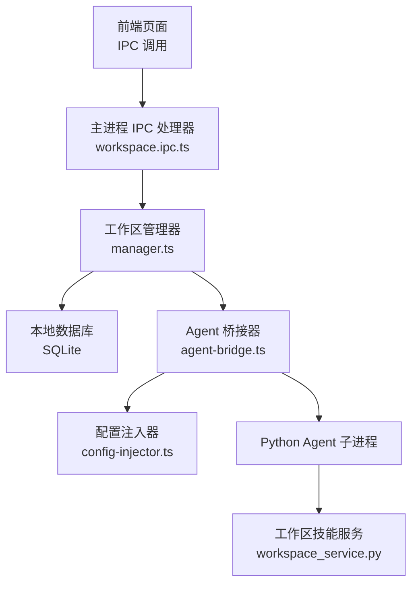
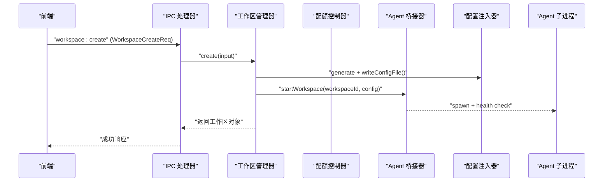
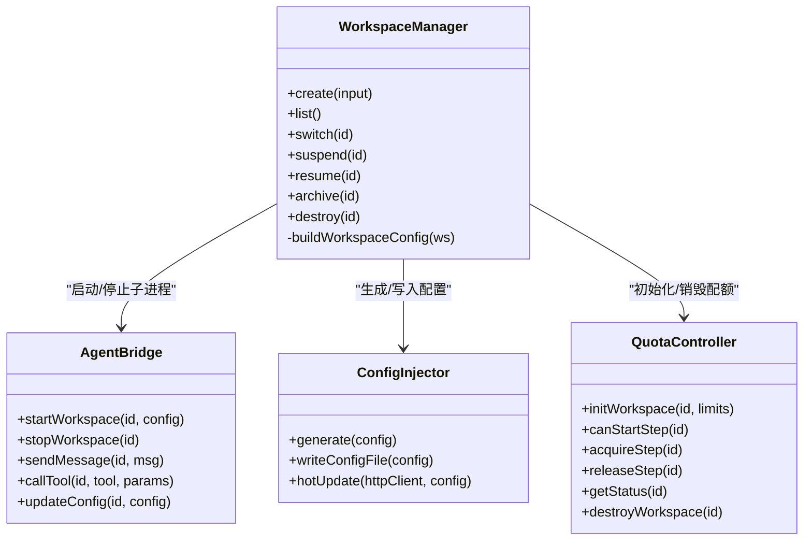
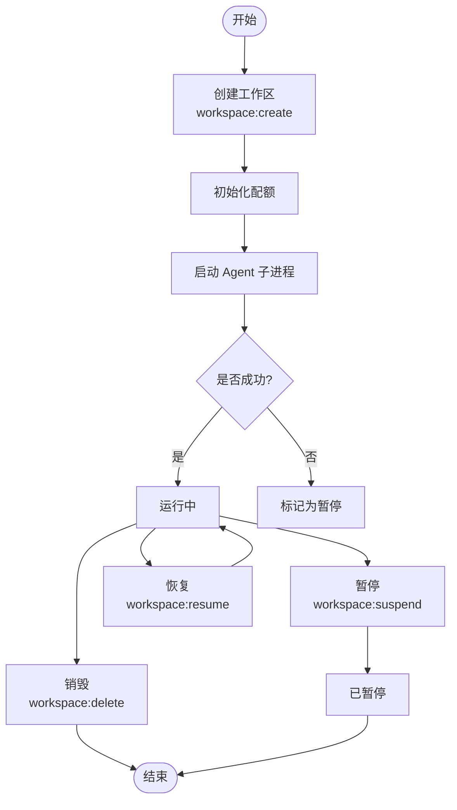

# 工作空间 API

<cite>
**本文引用的文件**   
- [workspace.ipc.ts](file://tongtian-tauri/src/main/ipc/workspace.ipc.ts)
- [manager.ts](file://tongtian-tauri/src/main/workspace/manager.ts)
- [quota.ts](file://tongtian-tauri/src/main/workspace/quota.ts)
- [contracts.ts](file://tongtian-tauri/src/shared/contracts.ts)
- [types.ts](file://tongtian-tauri/src/shared/types.ts)
- [agent-bridge.ts](file://tongtian-tauri/src/main/bridge/agent-bridge.ts)
- [config-injector.ts](file://tongtian-tauri/src/main/bridge/config-injector.ts)
- [workspace_service.py](file://tongtian-tauri/src/agent/agents/skill_system/workspace_service.py)
</cite>

## 目录
1. [简介](#简介)
2. [项目结构](#项目结构)
3. [核心组件](#核心组件)
4. [架构总览](#架构总览)
5. [详细组件分析](#详细组件分析)
6. [依赖关系分析](#依赖关系分析)
7. [性能与配额](#性能与配额)
8. [故障排查指南](#故障排查指南)
9. [结论](#结论)
10. [附录：多租户与工作空间生命周期示例](#附录多租户与工作空间生命周期示例)

## 简介
本文件面向开发者，系统化梳理“工作空间”相关 API，覆盖以下 IPC 通道：workspace_list、workspace_create、workspace_update（切换）、workspace_delete、workspace_suspend、workspace_resume、workspace_delegate。文档同时说明 WorkspaceCreateReq 与 AgentDelegateReq 的数据结构，包括 agentConfig、skillIds、mcpServerIds 等配置项；阐述工作空间的隔离机制、权限控制与代理委托能力；并提供工作空间生命周期管理与多租户场景的使用示例。

## 项目结构
工作空间功能由前端渲染层通过 Electron IPC 调用主进程处理器，主进程通过 WorkspaceManager 管理数据库与子进程实例，AgentBridge 负责 Python Agent 子进程的启动、健康检查与通信，ConfigInjector 生成并注入工作空间配置。Python 侧的 SkillService 提供工作空间内技能的生命周期管理。

图表来源 
- [workspace.ipc.ts](file://tongtian-tauri/src/main/ipc/workspace.ipc.ts)
- [manager.ts](file://tongtian-tauri/src/main/workspace/manager.ts)
- [agent-bridge.ts](file://tongtian-tauri/src/main/bridge/agent-bridge.ts)
- [config-injector.ts](file://tongtian-tauri/src/main/bridge/config-injector.ts)
- [workspace_service.py](file://tongtian-tauri/src/agent/agents/skill_system/workspace_service.py)

章节来源
- [workspace.ipc.ts](file://tongtian-tauri/src/main/ipc/workspace.ipc.ts)
- [manager.ts](file://tongtian-tauri/src/main/workspace/manager.ts)
- [agent-bridge.ts](file://tongtian-tauri/src/main/bridge/agent-bridge.ts)
- [config-injector.ts](file://tongtian-tauri/src/main/bridge/config-injector.ts)
- [workspace_service.py](file://tongtian-tauri/src/agent/agents/skill_system/workspace_service.py)

## 核心组件
- IPC 处理器（workspace.ipc.ts）
  - 定义并注册 workspace:* 系列 IPC 通道，使用 Zod 校验请求参数，调用 WorkspaceManager 与 QuotaController。
- 工作区管理器（manager.ts）
  - 负责工作区的创建、列表、切换、暂停、恢复、归档、销毁；维护运行期实例映射；持久化元数据到数据库；协调 Agent 子进程启停。
- Agent 桥接器（agent-bridge.ts）
  - 管理每个工作区的独立 Agent 子进程，分配端口、健康检查、SSE 事件流转发、工具调用、热更新配置。
- 配置注入器（config-injector.ts）
  - 将工作区配置转换为 Agent 可识别的 JSON 结构，支持启动时写入文件与运行时热更新。
- 配额控制器（quota.ts）
  - 为每个工作区维护并发步骤、内存、模型调用、队列深度等配额，提供获取状态与动态调整能力。
- 技能服务（workspace_service.py）
  - 工作区内技能的创建、导入、启用/禁用、通道与标签设置、删除与文件读取，保障工作区内的技能隔离与一致性。

章节来源
- [workspace.ipc.ts](file://tongtian-tauri/src/main/ipc/workspace.ipc.ts)
- [manager.ts](file://tongtian-tauri/src/main/workspace/manager.ts)
- [agent-bridge.ts](file://tongtian-tauri/src/main/bridge/agent-bridge.ts)
- [config-injector.ts](file://tongtian-tauri/src/main/bridge/config-injector.ts)
- [quota.ts](file://tongtian-tauri/src/main/workspace/quota.ts)
- [workspace_service.py](file://tongtian-tauri/src/agent/agents/skill_system/workspace_service.py)

## 架构总览
工作空间 API 采用“前端 → IPC → 管理器 → 桥接器 → Agent 子进程”的分层架构。IPC 层负责契约校验与路由；管理器负责状态与资源编排；桥接器负责进程与通信；配置注入器确保各工作区配置隔离；配额控制器限制资源使用；Python 技能服务保证工作区内技能的可控性。

图表来源 
- [workspace.ipc.ts](file://tongtian-tauri/src/main/ipc/workspace.ipc.ts)
- [manager.ts](file://tongtian-tauri/src/main/workspace/manager.ts)
- [agent-bridge.ts](file://tongtian-tauri/src/main/bridge/agent-bridge.ts)
- [config-injector.ts](file://tongtian-tauri/src/main/bridge/config-injector.ts)

## 详细组件分析

### IPC 处理器（workspace.ipc.ts）
- 支持的通道与职责
  - workspace:list：列出所有工作区。
  - workspace:create：创建工作区，校验 WorkspaceCreateReq，初始化配额。
  - workspace:update：切换当前工作区（内部复用 UPDATE 通道）。
  - workspace:delete：销毁工作区，清理配额。
  - workspace:suspend：暂停工作区（停止 Agent 子进程，标记状态）。
  - workspace:resume：恢复工作区（重启 Agent 子进程）。
  - workspace:delegate：预留通道用于跨工作区消息委托（当前未实现处理器）。
- 输入校验
  - 使用 Zod 对 create 请求进行强类型校验，确保 name、agentConfig.role/systemPrompt、可选的 modelBinding、skillIds、mcpServerIds。
- 错误处理
  - 统一包装 safeHandler，捕获异常并记录日志后抛出。

章节来源
- [workspace.ipc.ts](file://tongtian-tauri/src/main/ipc/workspace.ipc.ts)

### 工作区管理器（manager.ts）
- 关键方法
  - create：生成唯一 ID，持久化元数据，构建配置并启动 Agent 子进程；失败时将状态置为 Suspended。
  - list/getById：查询工作区列表与按 ID 获取。
  - switch：切换活跃工作区，仅允许 Active 状态。
  - suspend/resume：优雅停止或重启 Agent 子进程，更新状态。
  - archive：打包元数据至归档目录，更新状态。
  - destroy：停止子进程、删除数据库记录、清理归档目录。
- 运行期管理
  - 维护 runtimes Map，跟踪工作区实例的配置与启动时间。
- 配置构建
  - buildWorkspaceConfig：从持久化的 JSON 字段解析 agentConfig、skillIds、mcpServerIds，注入 workDir 与 workspaceId。

章节来源
- [manager.ts](file://tongtian-tauri/src/main/workspace/manager.ts)

### Agent 桥接器（agent-bridge.ts）
- 子进程生命周期
  - startWorkspace：分配端口、确保工作目录、写入配置文件、启动 Python Agent 子进程、健康检查、版本适配。
  - stopWorkspace：SIGTERM 优雅关闭，超时则 SIGKILL，释放端口。
  - sendMessage/callTool：通过 HTTP/SSE 与 Agent 通信，转发事件与工具调用结果。
  - updateConfig：运行时热更新配置。
- 健康检查
  - 周期性轮询，连续失败超过阈值标记 error 并上报事件。

章节来源
- [agent-bridge.ts](file://tongtian-tauri/src/main/bridge/agent-bridge.ts)

### 配置注入器（config-injector.ts）
- 生成 Agent 配置
  - generate：将 WorkspaceConfig 转为 Agent 可识别的 AgentConfig，包含 workspace_id、work_dir、agent、model、skills、mcp_servers、sandbox。
- 文件与热更新
  - writeConfigFile：在工作区目录下写入 agent_config.json。
  - hotUpdate：POST /api/config 动态更新运行中 Agent 的配置。

章节来源
- [config-injector.ts](file://tongtian-tauri/src/main/bridge/config-injector.ts)

### 配额控制器（quota.ts）
- 默认配额
  - 最大并发步骤、内存上限、最大并发模型调用、队列深度。
- 操作接口
  - canStartStep/canAcceptTask/canStartModelCall：判断是否可接受新任务/步骤/模型调用。
  - acquire/release：获取/释放配额。
  - enqueue/dequeue：入队/出队任务。
  - updateMemoryUsage：更新内存使用量并触发告警。
  - getStatus/updateLimits：查询状态与动态调整限额。
  - destroyWorkspace：销毁配额记录。

章节来源
- [quota.ts](file://tongtian-tauri/src/main/workspace/quota.ts)

### 工作区技能服务（workspace_service.py）
- 能力概览
  - 列出可用/全部技能、创建/保存/重命名/删除技能、ZIP 导入、启用/禁用、设置通道与标签、受限文件读取。
- 隔离与一致性
  - 以 <workspace>/skills 为内容源，<workspace>/skill.json 为运行时状态源；变更通过 staged 目录与 mutate_json 原子更新，失败自动回滚。

章节来源
- [workspace_service.py](file://tongtian-tauri/src/agent/agents/skill_system/workspace_service.py)

## 依赖关系分析
- IPC 处理器依赖 contracts.ts 中的 IPC_CHANNELS 与 WorkspaceCreateReq。
- 管理器依赖 Database、AgentBridge、WorkspaceStatus 与 Workspace 类型。
- 桥接器依赖 HttpClient、SSEParser、VersionAdapter、ConfigInjector、python-env。
- 配置注入器输出 AgentConfig 供 Agent 子进程消费。
- 配额控制器独立于其他模块，仅在创建/销毁工作区时联动。

图表来源 
- [manager.ts](file://tongtian-tauri/src/main/workspace/manager.ts)
- [agent-bridge.ts](file://tongtian-tauri/src/main/bridge/agent-bridge.ts)
- [config-injector.ts](file://tongtian-tauri/src/main/bridge/config-injector.ts)
- [quota.ts](file://tongtian-tauri/src/main/workspace/quota.ts)

## 性能与配额
- 进程隔离
  - 每个工作区拥有独立的 Agent 子进程与端口，避免相互干扰。
- 健康检查
  - 周期性健康检查与失败计数，防止僵尸进程占用资源。
- 配额策略
  - 并发步骤、内存、模型调用、队列深度四维度限制，支持运行时调整与告警。
- SSE 事件流
  - 长连接事件推送，减少轮询开销，提升交互体验。

章节来源
- [agent-bridge.ts](file://tongtian-tauri/src/main/bridge/agent-bridge.ts)
- [quota.ts](file://tongtian-tauri/src/main/workspace/quota.ts)

## 故障排查指南
- 常见错误码
  - WORKSPACE_NOT_FOUND：工作区不存在。
  - WORKSPACE_SUSPENDED：工作区已暂停或归档，无法执行某些操作。
  - WORKSPACE_CREATION_FAILED：创建工作区失败（如子进程启动失败）。
  - WORKSPACE_DELEGATE_FAILED：代理委托失败（预留通道尚未实现）。
- 排查建议
  - 检查 IPC 通道是否正确注册与调用。
  - 确认 Agent 子进程健康检查是否通过。
  - 查看配额是否超限（并发步骤/内存/队列深度）。
  - 验证配置文件是否写入成功且格式正确。
  - 若涉及技能，检查 skill.json 与 skills 目录一致性。

章节来源
- [contracts.ts](file://tongtian-tauri/src/shared/contracts.ts)
- [manager.ts](file://tongtian-tauri/src/main/workspace/manager.ts)
- [agent-bridge.ts](file://tongtian-tauri/src/main/bridge/agent-bridge.ts)
- [quota.ts](file://tongtian-tauri/src/main/workspace/quota.ts)

## 结论
工作空间 API 通过清晰的层次划分与严格的配置注入、配额控制与进程隔离，提供了稳定、可扩展的多租户能力。IPC 层保证契约安全，管理器负责状态与资源编排，桥接器与配置注入器确保 Agent 子进程的正确运行，Python 技能服务强化工作区内的可控性与一致性。未来可在 workspace:delegate 通道上完善跨工作区委托流程，增强多租户协作能力。

## 附录：多租户与工作空间生命周期示例

### 数据结构定义
- WorkspaceCreateReq
  - name：工作区名称（必填）。
  - agentConfig：包含 role 与 systemPrompt（必填）。
  - modelBinding：可选，绑定模型信息。
  - skillIds：可选，技能标识数组。
  - mcpServerIds：可选，MCP 服务器标识数组。
- AgentDelegateReq
  - fromWorkspaceId：源工作区 ID。
  - toWorkspaceId：目标工作区 ID。
  - messageType：消息类型。
  - payload：委托负载（任意键值对）。

章节来源
- [contracts.ts](file://tongtian-tauri/src/shared/contracts.ts)

### 工作空间生命周期流程图

图表来源 
- [workspace.ipc.ts](file://tongtian-tauri/src/main/ipc/workspace.ipc.ts)
- [manager.ts](file://tongtian-tauri/src/main/workspace/manager.ts)
- [quota.ts](file://tongtian-tauri/src/main/workspace/quota.ts)

### 多租户使用示例（文本描述）
- 租户 A
  - 创建工作区 A1，配置角色为“数据分析助手”，启用技能 ["data_cleaner", "report_gen"]，绑定 MCP 服务器 ["db_mcp"]。
  - 提交任务，系统根据配额限制并发步骤与模型调用。
  - 暂停 A1 释放资源，需要时再恢复。
- 租户 B
  - 创建工作区 B1，配置角色为“代码审查助手”，启用技能 ["lint_check", "diff_review"]。
  - 通过 workspace:delegate 将某类任务委托给 B1（预留通道，待实现）。
- 管理员
  - 定期归档历史工作区，销毁不再使用的实例，清理配额与归档目录。

章节来源
- [contracts.ts](file://tongtian-tauri/src/shared/contracts.ts)
- [manager.ts](file://tongtian-tauri/src/main/workspace/manager.ts)
- [agent-bridge.ts](file://tongtian-tauri/src/main/bridge/agent-bridge.ts)
- [quota.ts](file://tongtian-tauri/src/main/workspace/quota.ts)