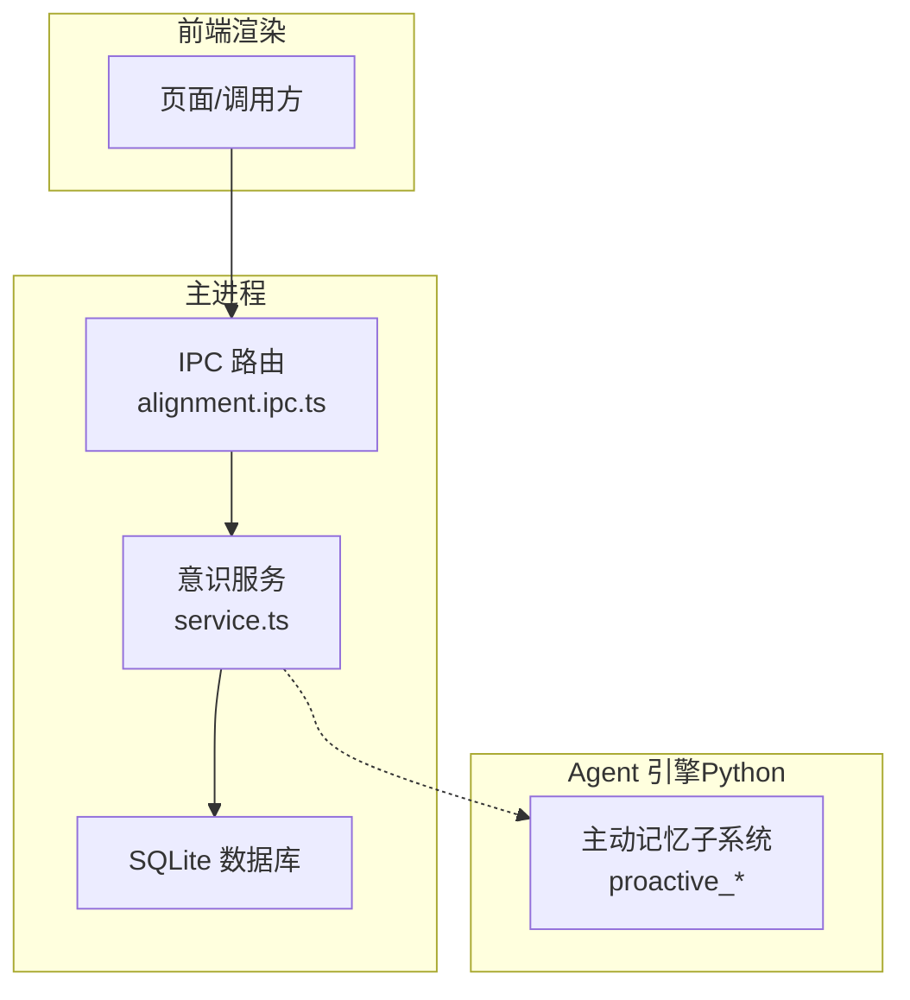
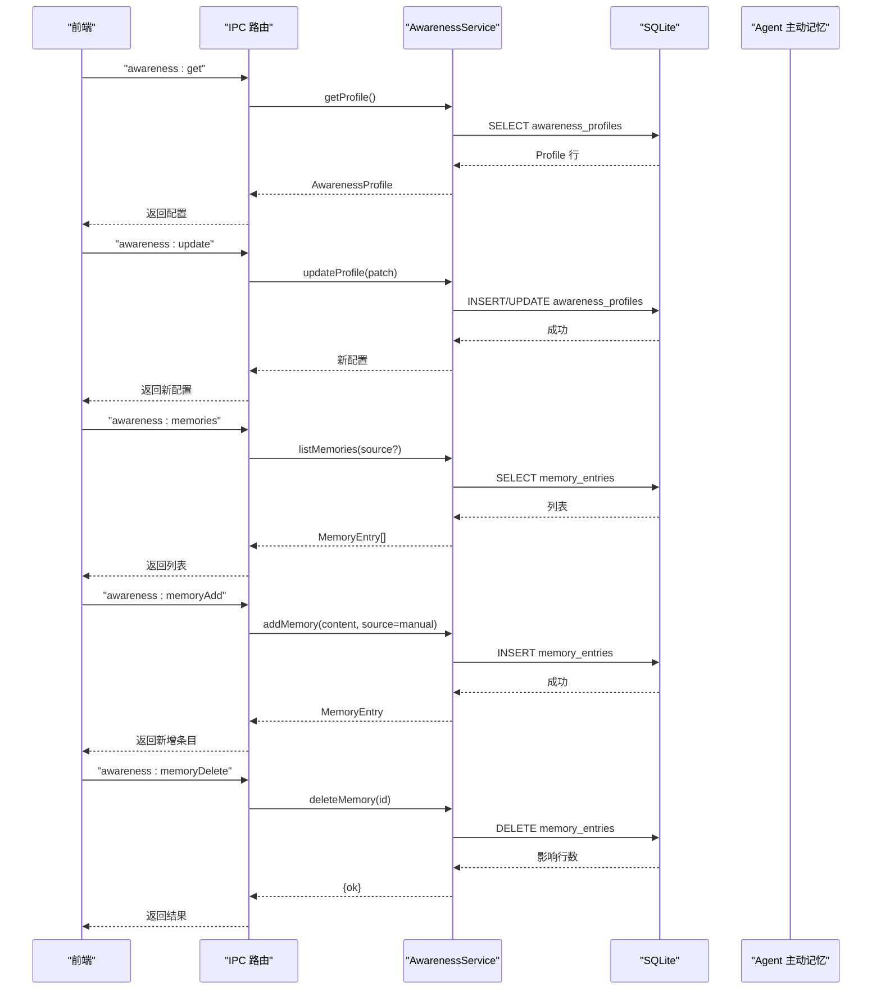
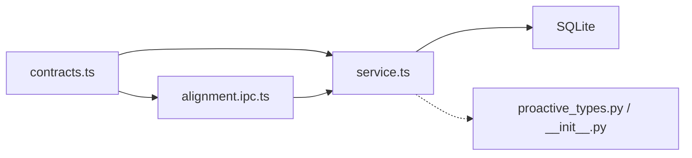
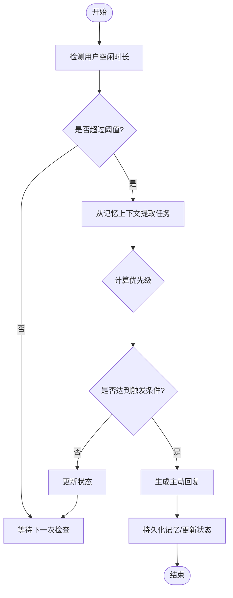

# 意识管理 API

<cite>
**本文引用的文件**   
- [service.ts](file://tongtian-tauri/src/main/awareness/service.ts)
- [contracts.ts](file://tongtian-tauri/src/shared/contracts.ts)
- [alignment.ipc.ts](file://tongtian-tauri/src/main/ipc/alignment.ipc.ts)
- [index.ts](file://tongtian-tauri/src/main/index.ts)
- [proactive_types.py](file://tongtian-tauri/src/agent/agents/memory/proactive/proactive_types.py)
- [__init__.py（主动记忆子模块）](file://tongtian-tauri/src/agent/agents/memory/proactive/__init__.py)
</cite>

## 目录
1. [简介](#简介)
2. [项目结构](#项目结构)
3. [核心组件](#核心组件)
4. [架构总览](#架构总览)
5. [详细组件分析](#详细组件分析)
6. [依赖关系分析](#依赖关系分析)
7. [性能考量](#性能考量)
8. [故障排查指南](#故障排查指南)
9. [结论](#结论)
10. [附录](#附录)

## 简介
本文件面向“意识管理”能力，提供完整的 API 文档与实现说明。涵盖以下命令接口：
- awareness_get：获取意识配置（协作风格、工作手册、自动记忆开关等）
- awareness_update：更新意识配置
- awareness_memories：列出记忆条目（支持按来源过滤）
- awareness_memoryAdd：新增记忆条目
- awareness_memoryDelete：删除记忆条目

同时说明数据结构 AwarenessProfile 与 MemoryEntry，解释记忆存储与检索机制，并介绍主动记忆系统与上下文感知功能，包括记忆聚合、去重与过期策略建议，以及个性化交互风格与工作习惯学习的配置示例。

## 项目结构
意识管理相关代码主要分布在以下位置：
- 主进程服务层：src/main/awareness/service.ts（数据持久化、业务逻辑）
- IPC 路由层：src/main/ipc/alignment.ipc.ts（命令注册与参数校验）
- 共享类型定义：src/shared/contracts.ts（AwarenessProfile、MemoryEntry、IPC 通道名）
- 主入口注册：src/main/index.ts（初始化对齐能力 IPC）
- 主动记忆子系统（Python）：src/agent/agents/memory/proactive/*（触发器、任务、响应生成）

图表来源 
- [alignment.ipc.ts:109-137](file://tongtian-tauri/src/main/ipc/alignment.ipc.ts#L109-L137)
- [service.ts:21-125](file://tongtian-tauri/src/main/awareness/service.ts#L21-L125)
- [contracts.ts:413-428](file://tongtian-tauri/src/shared/contracts.ts#L413-L428)

章节来源
- [index.ts:159](file://tongtian-tauri/src/main/index.ts#L159)
- [contracts.ts:413-428](file://tongtian-tauri/src/shared/contracts.ts#L413-L428)
- [contracts.ts:561-565](file://tongtian-tauri/src/shared/contracts.ts#L561-L565)

## 核心组件
- AwarenessService：单例服务，负责读取/更新意识配置、构造 system prompt 前置层、记忆条目的增删查。
- IPC 处理器：将前端请求映射到 AwarenessService 方法，并进行参数校验。
- 数据类型：AwarenessProfile、MemoryEntry 在共享合约中统一定义，保证前后端一致。
- 主动记忆子系统：基于 Python 的触发器与任务模型，用于会话级主动提醒与记忆提取。

章节来源
- [service.ts:21-125](file://tongtian-tauri/src/main/awareness/service.ts#L21-L125)
- [alignment.ipc.ts:109-137](file://tongtian-tauri/src/main/ipc/alignment.ipc.ts#L109-L137)
- [contracts.ts:413-428](file://tongtian-tauri/src/shared/contracts.ts#L413-L428)

## 架构总览
意识管理采用“前端 → IPC → 服务层 → 数据库”的分层架构，配合 Agent 引擎的主动记忆子系统形成闭环。

图表来源 
- [alignment.ipc.ts:109-137](file://tongtian-tauri/src/main/ipc/alignment.ipc.ts#L109-L137)
- [service.ts:31-125](file://tongtian-tauri/src/main/awareness/service.ts#L31-L125)

## 详细组件分析

### 数据结构定义
- AwarenessProfile
  - mode: boolean，是否启用意识模式
  - autoMemory: boolean，是否开启自动记忆
  - style: 'professional' | 'friendly' | 'concise' | 'custom'，协作风格
  - customPrompt: string，自定义提示词（当 style 为 custom 时生效）
  - workManual: string，工作手册内容
  - updatedAt: string，更新时间戳
- MemoryEntry
  - id: string，唯一标识
  - content: string，记忆内容
  - source: 'auto' | 'manual' | 'reflection'，来源（自动/手动/反思）
  - sessionId?: string，关联会话 ID
  - createdAt: string，创建时间

章节来源
- [contracts.ts:413-428](file://tongtian-tauri/src/shared/contracts.ts#L413-L428)

### 命令接口规范

#### awareness_get
- 通道名：awareness:get
- 入参：无
- 出参：AwarenessProfile
- 行为：从数据库加载全局配置，若不存在则返回默认值；异常时回退默认值并记录错误日志

章节来源
- [contracts.ts:561](file://tongtian-tauri/src/shared/contracts.ts#L561)
- [alignment.ipc.ts:109](file://tongtian-tauri/src/main/ipc/alignment.ipc.ts#L109)
- [service.ts:31-48](file://tongtian-tauri/src/main/awareness/service.ts#L31-L48)

#### awareness_update
- 通道名：awareness:update
- 入参：Partial<AwarenessProfile>（字段可选）
- 出参：AwarenessProfile
- 行为：合并当前配置与 patch，写入数据库（UPSERT），返回最新配置；参数通过 Zod 校验

章节来源
- [contracts.ts:562](file://tongtian-tauri/src/shared/contracts.ts#L562)
- [alignment.ipc.ts:111-122](file://tongtian-tauri/src/main/ipc/alignment.ipc.ts#L111-L122)
- [service.ts:50-64](file://tongtian-tauri/src/main/awareness/service.ts#L50-L64)

#### awareness_memories
- 通道名：awareness:memories
- 入参：{ source?: string }
- 出参：MemoryEntry[]
- 行为：按 source 过滤或全量查询，按 created_at 倒序返回

章节来源
- [contracts.ts:563](file://tongtian-tauri/src/shared/contracts.ts#L563)
- [alignment.ipc.ts:124-127](file://tongtian-tauri/src/main/ipc/alignment.ipc.ts#L124-L127)
- [service.ts:84-101](file://tongtian-tauri/src/main/awareness/service.ts#L84-L101)

#### awareness_memoryAdd
- 通道名：awareness:memoryAdd
- 入参：{ content: string }（长度限制 1..2000）
- 出参：MemoryEntry
- 行为：生成唯一 id，插入 memory_entries，source 固定为 manual，返回新增条目

章节来源
- [contracts.ts:564](file://tongtian-tauri/src/shared/contracts.ts#L564)
- [alignment.ipc.ts:129-132](file://tongtian-tauri/src/main/ipc/alignment.ipc.ts#L129-L132)
- [service.ts:103-118](file://tongtian-tauri/src/main/awareness/service.ts#L103-L118)

#### awareness_memoryDelete
- 通道名：awareness:memoryDelete
- 入参：{ id: string }
- 出参：{ ok: boolean }
- 行为：根据 id 删除条目，返回是否成功

章节来源
- [contracts.ts:565](file://tongtian-tauri/src/shared/contracts.ts#L565)
- [alignment.ipc.ts:134-137](file://tongtian-tauri/src/main/ipc/alignment.ipc.ts#L134-L137)
- [service.ts:120-124](file://tongtian-tauri/src/main/awareness/service.ts#L120-L124)

### 记忆存储与检索机制
- 存储介质：SQLite 数据库
- 表结构（概念性）：
  - awareness_profiles：id='global' 的单行配置，包含 mode、auto_memory、style、custom_prompt、work_manual、updated_at
  - memory_entries：id、content、source、session_id、created_at
- 检索策略：
  - 列表查询按 created_at 降序
  - 支持按 source 过滤（如 'auto'、'manual'、'reflection'）
- 写入策略：
  - 配置 UPSERT（INSERT ... ON CONFLICT DO UPDATE）
  - 记忆条目直接 INSERT

章节来源
- [service.ts:31-64](file://tongtian-tauri/src/main/awareness/service.ts#L31-L64)
- [service.ts:84-118](file://tongtian-tauri/src/main/awareness/service.ts#L84-L118)

### 主动记忆系统与上下文感知
- 触发器与任务：
  - ProactiveConfig：控制是否启用、空闲阈值、运行中的任务 ID、模式启用时间等
  - ProactiveTask：从记忆上下文中提取的任务（task、query、priority、reason）
  - ProactiveQueryResult：执行主动查询的结果（success、data、error）
- 生命周期：
  - enable_proactive_for_session：为会话启用主动记忆
  - proactive_trigger_loop：周期性触发检查
  - generate_proactive_response：基于上下文生成主动回复
- 集成点：
  - AwarenessService.buildPromptLayer：根据 profile 注入协作风格与工作手册，作为 system prompt 的前置层

章节来源
- [proactive_types.py:10-38](file://tongtian-tauri/src/agent/agents/memory/proactive/proactive_types.py#L10-L38)
- [__init__.py（主动记忆子模块）:1-29](file://tongtian-tauri/src/agent/agents/memory/proactive/__init__.py#L1-L29)
- [service.ts:66-80](file://tongtian-tauri/src/main/awareness/service.ts#L66-L80)

### 记忆聚合、去重与过期策略（建议）
- 聚合：
  - 按 session_id 或 source 维度进行分组聚合，便于展示与分析
  - 对相似内容进行语义相似度聚类（可结合向量检索）
- 去重：
  - 基于内容哈希或语义指纹去重，避免重复记忆
  - 同一会话内短周期内的重复内容合并
- 过期：
  - 基于 created_at 与活跃度评分进行软删除或归档
  - 支持按策略清理低优先级或长时间未访问的记忆

[本节为通用设计建议，不直接引用具体文件]

### 个性化交互风格与工作习惯学习（配置示例）
- 协作风格：
  - professional：专业严谨、结构化输出
  - friendly：轻松友好、自然对话
  - concise：简洁高效、直奔主题
  - custom：使用自定义提示词
- 工作手册：
  - 通过 workManual 注入领域规则与流程约束
- 自动记忆：
  - autoMemory=true 时，系统可在合适时机自动抽取记忆（需与 Agent 侧联动）

章节来源
- [service.ts:66-80](file://tongtian-tauri/src/main/awareness/service.ts#L66-L80)
- [contracts.ts:413-420](file://tongtian-tauri/src/shared/contracts.ts#L413-L420)

## 依赖关系分析
- IPC 路由依赖 AwarenessService
- AwarenessService 依赖 Database（SQLite）
- 共享类型 contracts 被 service 与 IPC 共同引用
- 主动记忆子系统通过服务层构建的 prompt 层与 Agent 引擎协同

图表来源 
- [contracts.ts:413-428](file://tongtian-tauri/src/shared/contracts.ts#L413-L428)
- [contracts.ts:561-565](file://tongtian-tauri/src/shared/contracts.ts#L561-L565)
- [alignment.ipc.ts:109-137](file://tongtian-tauri/src/main/ipc/alignment.ipc.ts#L109-L137)
- [service.ts:21-125](file://tongtian-tauri/src/main/awareness/service.ts#L21-L125)
- [proactive_types.py:10-38](file://tongtian-tauri/src/agent/agents/memory/proactive/proactive_types.py#L10-L38)

章节来源
- [index.ts:159](file://tongtian-tauri/src/main/index.ts#L159)

## 性能考量
- 数据库操作：
  - 列表查询已按 created_at 排序，建议在 memory_entries.created_at 上建立索引以提升性能
  - 大规模记忆条目建议分页或增量拉取
- 参数校验：
  - IPC 层使用 Zod 校验，减少无效请求进入服务层
- 日志与监控：
  - 关键路径记录日志（profile 加载失败、记忆新增/删除），便于定位问题

[本节为通用优化建议，不直接引用具体文件]

## 故障排查指南
- 常见问题：
  - 配置文件缺失：getProfile 会返回默认值并记录错误日志
  - 记忆列表为空：检查 memory_entries 表是否有数据或 source 过滤条件是否正确
  - 新增失败：检查 content 长度是否在 1..2000 范围内
- 排查步骤：
  - 查看 IPC 层日志与参数校验结果
  - 检查数据库表结构与数据一致性
  - 确认 AwarenessService 的异常捕获与日志输出

章节来源
- [service.ts:31-48](file://tongtian-tauri/src/main/awareness/service.ts#L31-L48)
- [service.ts:84-101](file://tongtian-tauri/src/main/awareness/service.ts#L84-L101)
- [alignment.ipc.ts:111-137](file://tongtian-tauri/src/main/ipc/alignment.ipc.ts#L111-L137)

## 结论
意识管理 API 提供了清晰的配置管理与记忆管理能力，并通过 IPC 与服务层解耦，具备良好的扩展性与可维护性。结合主动记忆子系统，可实现更智能的上下文感知与个性化交互体验。建议在生产环境中完善索引、分页、去重与过期策略，以保障性能与数据质量。

## 附录
- 主动记忆流程图（概念）

[本图为概念流程，不直接映射具体文件]