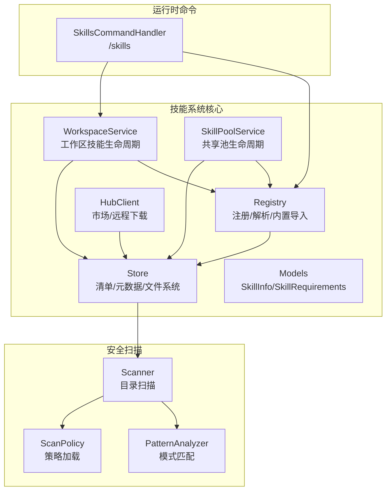
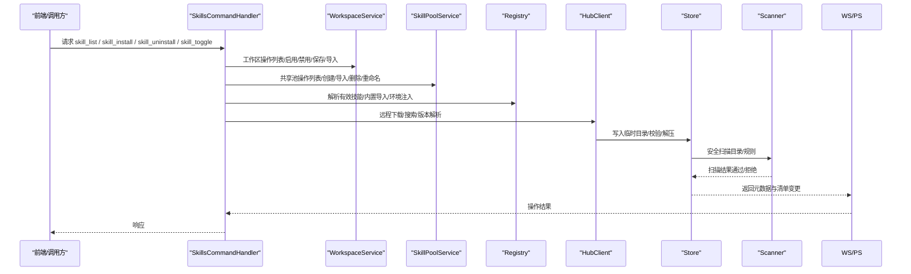
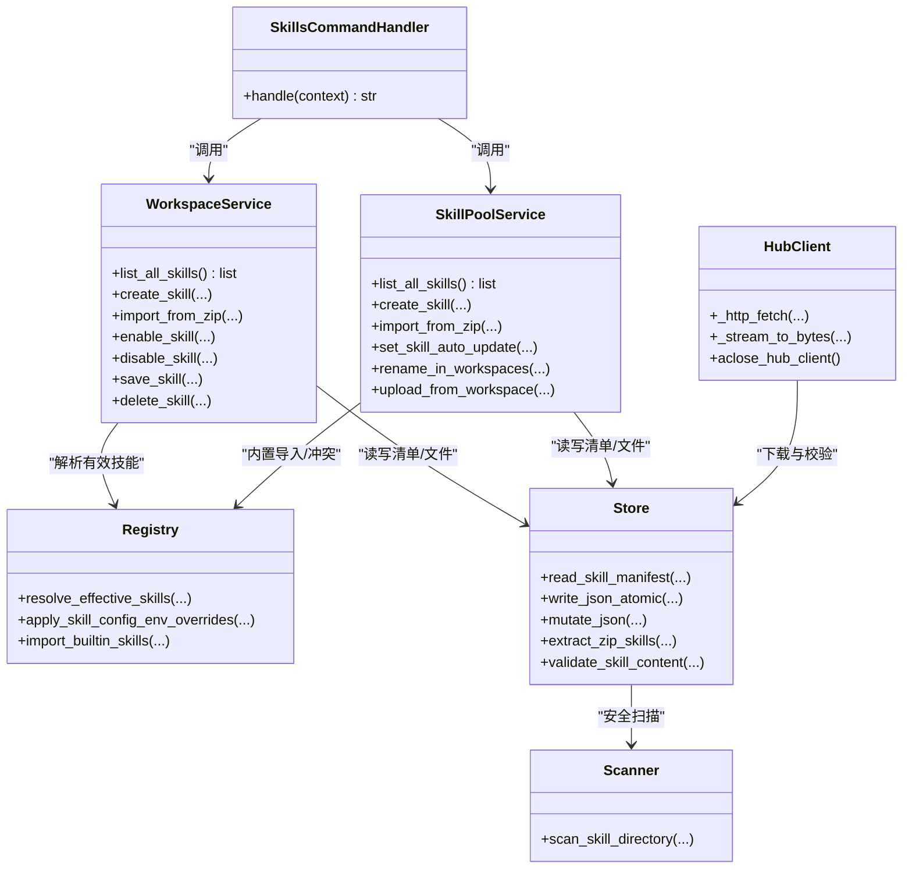

# 技能系统 API

<cite>
**本文引用的文件**   
- [skills_handler.py](file://tongtian-tauri/src/agent/runtime/commands/control/skills_handler.py)
- [__init__.py](file://tongtian-tauri/src/agent/agents/skill_system/__init__.py)
- [hub.py](file://tongtian-tauri/src/agent/agents/skill_system/hub.py)
- [models.py](file://tongtian-tauri/src/agent/agents/skill_system/models.py)
- [registry.py](file://tongtian-tauri/src/agent/agents/skill_system/registry.py)
- [pool_service.py](file://tongtian-tauri/src/agent/agents/skill_system/pool_service.py)
- [store.py](file://tongtian-tauri/src/agent/agents/skill_system/store.py)
- [workspace_service.py](file://tongtian-tauri/src/agent/agents/skill_system/workspace_service.py)
- [scanner.py](file://tongtian-tauri/src/agent/security/skill_scanner/scanner.py)
- [scan_policy.py](file://tongtian-tauri/src/agent/security/skill_scanner/scan_policy.py)
- [pattern_analyzer.py](file://tongtian-tauri/src/agent/security/skill_scanner/analyzers/pattern_analyzer.py)
</cite>

## 目录
1. [简介](#简介)
2. [项目结构](#项目结构)
3. [核心组件](#核心组件)
4. [架构总览](#架构总览)
5. [详细组件分析](#详细组件分析)
6. [依赖关系分析](#依赖关系分析)
7. [性能考虑](#性能考虑)
8. [故障排查指南](#故障排查指南)
9. [结论](#结论)
10. [附录](#附录)

## 简介
本文件为“技能系统”的 API 文档，覆盖以下能力：
- 命令接口：skill_list、skill_install、skill_uninstall、skill_toggle（启用/禁用）
- 数据结构：SkillInstallReq（支持 marketplace、local、url 三种安装源）
- 注册机制：工作区与共享池双清单管理、内置技能导入与语言版本选择
- 依赖管理与版本控制：SKILL.md frontmatter 元数据、manifest 版本化、自动更新目标
- 安全扫描与兼容性验证：目录扫描、规则匹配、路径安全校验
- 自定义技能开发指南与集成示例
- 权限控制与沙箱执行环境说明

## 项目结构
技能系统由 Python 模块组成，主要分布在 agents/skill_system 与 runtime/commands/control 下，并依赖 security/skill_scanner 进行安全检查。

图表来源
- [skills_handler.py:1-101](file://tongtian-tauri/src/agent/runtime/commands/control/skills_handler.py#L1-L101)
- [workspace_service.py:1-782](file://tongtian-tauri/src/agent/agents/skill_system/workspace_service.py#L1-L782)
- [pool_service.py:1-800](file://tongtian-tauri/src/agent/agents/skill_system/pool_service.py#L1-L800)
- [registry.py:1-800](file://tongtian-tauri/src/agent/agents/skill_system/registry.py#L1-L800)
- [hub.py:1-800](file://tongtian-tauri/src/agent/agents/skill_system/hub.py#L1-L800)
- [store.py:1-800](file://tongtian-tauri/src/agent/agents/skill_system/store.py#L1-L800)
- [scanner.py](file://tongtian-tauri/src/agent/security/skill_scanner/scanner.py)
- [scan_policy.py](file://tongtian-tauri/src/agent/security/skill_scanner/scan_policy.py)
- [pattern_analyzer.py](file://tongtian-tauri/src/agent/security/skill_scanner/analyzers/pattern_analyzer.py)

章节来源
- [__init__.py:1-46](file://tongtian-tauri/src/agent/agents/skill_system/__init__.py#L1-L46)
- [skills_handler.py:1-101](file://tongtian-tauri/src/agent/runtime/commands/control/skills_handler.py#L1-L101)

## 核心组件
- WorkspaceService：工作区维度的技能创建、保存、导入、启用/禁用、通道路由、配置持久化与文件访问
- SkillPoolService：共享池维度的技能创建、ZIP 导入、删除、标签与自动更新管理、重命名与工作区迁移
- Registry：内置技能发现、语言偏好、导入候选构建、冲突检测、环境注入与有效技能解析
- HubClient：市场/远程下载、重试退避、缓存、取消钩子、流式下载与大小限制
- Store：清单读写、原子写入、跨进程锁、路径安全、frontmatter 读取、元数据构建、ZIP 解压与安全校验
- Models：SkillInfo、SkillRequirements 等数据模型
- Scanner/Policy/PatternAnalyzer：安全扫描、策略与规则匹配

章节来源
- [workspace_service.py:1-782](file://tongtian-tauri/src/agent/agents/skill_system/workspace_service.py#L1-L782)
- [pool_service.py:1-800](file://tongtian-tauri/src/agent/agents/skill_system/pool_service.py#L1-L800)
- [registry.py:1-800](file://tongtian-tauri/src/agent/agents/skill_system/registry.py#L1-L800)
- [hub.py:1-800](file://tongtian-tauri/src/agent/agents/skill_system/hub.py#L1-L800)
- [store.py:1-800](file://tongtian-tauri/src/agent/agents/skill_system/store.py#L1-L800)
- [models.py:1-81](file://tongtian-tauri/src/agent/agents/skill_system/models.py#L1-L81)

## 架构总览
技能系统采用“工作区 + 共享池 + 市场/远程”三层结构：
- 工作区（Workspace）：用户可编辑的技能集合，清单位于 <workspace>/skill.json，源码位于 <workspace>/skills
- 共享池（Pool）：跨工作区复用与内置技能管理，清单位于 WORKING_DIR/skill_pool/skill.json
- 市场/远程（Hub）：从 marketplace、github、lobehub、qwenpaw、modelscope、aliyun、skillsmp、clawhub、url、zip 等来源获取技能包

图表来源
- [skills_handler.py:1-101](file://tongtian-tauri/src/agent/runtime/commands/control/skills_handler.py#L1-L101)
- [workspace_service.py:1-782](file://tongtian-tauri/src/agent/agents/skill_system/workspace_service.py#L1-L782)
- [pool_service.py:1-800](file://tongtian-tauri/src/agent/agents/skill_system/pool_service.py#L1-L800)
- [registry.py:1-800](file://tongtian-tauri/src/agent/agents/skill_system/registry.py#L1-L800)
- [hub.py:1-800](file://tongtian-tauri/src/agent/agents/skill_system/hub.py#L1-L800)
- [store.py:1-800](file://tongtian-tauri/src/agent/agents/skill_system/store.py#L1-L800)
- [scanner.py](file://tongtian-tauri/src/agent/security/skill_scanner/scanner.py)

## 详细组件分析

### 命令接口定义
- skill_list
  - 功能：列出当前渠道启用的技能，展示名称与描述摘要
  - 输入：无（基于当前渠道上下文）
  - 输出：文本列表，包含可用技能与简要说明
  - 实现要点：读取工作区清单，按 enabled 与 channels 过滤，读取 SKILL.md frontmatter 显示描述
  - 参考路径：[skills_handler.py:1-101](file://tongtian-tauri/src/agent/runtime/commands/control/skills_handler.py#L1-L101)

- skill_install
  - 功能：安装技能到工作区或共享池，支持多种来源
  - 输入：SkillInstallReq（见下文）
  - 输出：安装结果（成功/冲突/跳过），可能包含建议的重命名
  - 实现要点：根据 source 类型分发至 workspace_service.import_from_zip 或 hub 下载后导入；统一安全扫描与清单更新
  - 参考路径：
    - [workspace_service.py:444-553](file://tongtian-tauri/src/agent/agents/skill_system/workspace_service.py#L444-L553)
    - [pool_service.py:237-352](file://tongtian-tauri/src/agent/agents/skill_system/pool_service.py#L237-L352)
    - [hub.py:1-800](file://tongtian-tauri/src/agent/agents/skill_system/hub.py#L1-L800)

- skill_uninstall
  - 功能：卸载工作区或共享池中的技能
  - 输入：技能名、作用域（工作区/共享池）
  - 输出：是否成功
  - 实现要点：删除目录并更新对应清单；工作区仅允许删除未启用的技能
  - 参考路径：
    - [workspace_service.py:709-749](file://tongtian-tauri/src/agent/agents/skill_system/workspace_service.py#L709-L749)
    - [pool_service.py:353-391](file://tongtian-tauri/src/agent/agents/skill_system/pool_service.py#L353-L391)

- skill_toggle（启用/禁用）
  - 功能：切换技能的启用状态与通道范围
  - 输入：技能名、enabled 布尔值、channels 列表
  - 输出：更新的工作区列表与失败原因
  - 实现要点：重新扫描 SKILL.md 与目录，确保合规后再更新清单；支持多工作区批量更新
  - 参考路径：
    - [workspace_service.py:554-652](file://tongtian-tauri/src/agent/agents/skill_system/workspace_service.py#L554-L652)

章节来源
- [skills_handler.py:1-101](file://tongtian-tauri/src/agent/runtime/commands/control/skills_handler.py#L1-L101)
- [workspace_service.py:145-228](file://tongtian-tauri/src/agent/agents/skill_system/workspace_service.py#L145-L228)
- [pool_service.py:162-236](file://tongtian-tauri/src/agent/agents/skill_system/pool_service.py#L162-L236)

### 数据结构：SkillInstallReq
- 字段
  - name: 技能名（用于目录名与清单键）
  - content: SKILL.md 内容（当 source=local 时必填）
  - references: 引用文件树（可选）
  - scripts: 脚本文件树（可选）
  - extra_files: 其他附加文件（可选）
  - config: 技能配置（可选）
  - installed_from: 安装来源标记（如 zip/url/marketplace）
  - source: 安装源类型，取值包括 marketplace、local、url、zip 等
  - target_name: 目标名（ZIP 单技能导入时可指定）
  - rename_map: ZIP 内多技能重映射（可选）
  - enable: 安装后是否启用（工作区）
  - overwrite: 是否允许覆盖冲突（共享池/工作区重命名场景）
- 约束
  - name 必须合法（非空、不含分隔符与 NUL）
  - content 需通过 validate_skill_content
  - ZIP 解压受大小限制与路径安全校验
- 参考路径：
  - [workspace_service.py:145-228](file://tongtian-tauri/src/agent/agents/skill_system/workspace_service.py#L145-L228)
  - [pool_service.py:237-352](file://tongtian-tauri/src/agent/agents/skill_system/pool_service.py#L237-L352)
  - [store.py:482-503](file://tongtian-tauri/src/agent/agents/skill_system/store.py#L482-L503)

章节来源
- [workspace_service.py:145-228](file://tongtian-tauri/src/agent/agents/skill_system/workspace_service.py#L145-L228)
- [pool_service.py:237-352](file://tongtian-tauri/src/agent/agents/skill_system/pool_service.py#L237-L352)
- [store.py:482-503](file://tongtian-tauri/src/agent/agents/skill_system/store.py#L482-L503)

### 注册机制与版本控制
- 清单与元数据
  - 工作区清单：<workspace>/skill.json，记录 enabled、channels、source、config、metadata、requirements、updated_at
  - 共享池清单：<WORKING_DIR>/skill_pool/skill.json，记录 skills、builtin_skill_names、auto_update 相关字段
  - 元数据来源于 SKILL.md frontmatter，提取 version_text、description、requires 等
- 内置技能
  - 支持多语言变体（en/zh），按语言偏好选择
  - 导入候选构建与冲突检测，支持覆盖冲突与语言切换
- 版本控制
  - manifest.version 自增，updated_at 时间戳
  - auto_update 与 targets 支持自动同步到多个工作区
- 参考路径：
  - [store.py:402-416](file://tongtian-tauri/src/agent/agents/skill_system/store.py#L402-L416)
  - [store.py:636-661](file://tongtian-tauri/src/agent/agents/skill_system/store.py#L636-L661)
  - [registry.py:559-800](file://tongtian-tauri/src/agent/agents/skill_system/registry.py#L559-L800)
  - [pool_service.py:417-459](file://tongtian-tauri/src/agent/agents/skill_system/pool_service.py#L417-L459)

章节来源
- [store.py:402-416](file://tongtian-tauri/src/agent/agents/skill_system/store.py#L402-L416)
- [store.py:636-661](file://tongtian-tauri/src/agent/agents/skill_system/store.py#L636-L661)
- [registry.py:559-800](file://tongtian-tauri/src/agent/agents/skill_system/registry.py#L559-L800)
- [pool_service.py:417-459](file://tongtian-tauri/src/agent/agents/skill_system/pool_service.py#L417-L459)

### 依赖管理与环境注入
- 依赖声明
  - SKILL.md metadata.requires.bins 与 requires.env
  - 解析为 SkillRequirements 并在清单中持久化
- 环境变量注入
  - 在单次 agent turn 期间，将匹配的 require_envs 注入为环境变量
  - 同时提供 QWENPAW_SKILL_CONFIG_<SKILL_NAME> 完整 JSON 配置
- 参考路径：
  - [store.py:594-634](file://tongtian-tauri/src/agent/agents/skill_system/store.py#L594-L634)
  - [registry.py:248-392](file://tongtian-tauri/src/agent/agents/skill_system/registry.py#L248-L392)

章节来源
- [store.py:594-634](file://tongtian-tauri/src/agent/agents/skill_system/store.py#L594-L634)
- [registry.py:248-392](file://tongtian-tauri/src/agent/agents/skill_system/registry.py#L248-L392)

### 安全扫描与兼容性验证流程
- 扫描入口
  - scan_skill_dir_or_raise：对 SKILL.md 与目录进行安全扫描
  - scanner.scan_skill_directory：调用策略与规则匹配
- 策略与规则
  - scan_policy：加载默认策略与签名规则（命令注入、数据泄露、硬编码密钥、混淆、提示注入、社会工程、供应链、未授权工具使用等）
  - pattern_analyzer：基于模式的静态分析
- 兼容性与路径安全
  - normalize_skill_dir_name、safe_skill_dir：防止路径穿越与非法字符
  - extract_zip_skills：限制 ZIP 大小、禁止符号链接、校验相对路径
- 参考路径：
  - [store.py:482-503](file://tongtian-tauri/src/agent/agents/skill_system/store.py#L482-L503)
  - [store.py:526-557](file://tongtian-tauri/src/agent/agents/skill_system/store.py#L526-L557)
  - [scanner.py](file://tongtian-tauri/src/agent/security/skill_scanner/scanner.py)
  - [scan_policy.py](file://tongtian-tauri/src/agent/security/skill_scanner/scan_policy.py)
  - [pattern_analyzer.py](file://tongtian-tauri/src/agent/security/skill_scanner/analyzers/pattern_analyzer.py)

章节来源
- [store.py:482-503](file://tongtian-tauri/src/agent/agents/skill_system/store.py#L482-L503)
- [store.py:526-557](file://tongtian-tauri/src/agent/agents/skill_system/store.py#L526-L557)
- [scanner.py](file://tongtian-tauri/src/agent/security/skill_scanner/scanner.py)
- [scan_policy.py](file://tongtian-tauri/src/agent/security/skill_scanner/scan_policy.py)
- [pattern_analyzer.py](file://tongtian-tauri/src/agent/security/skill_scanner/analyzers/pattern_analyzer.py)

### 自定义技能开发指南与集成示例
- 目录结构
  - 根目录 SKILL.md（frontmatter 包含 name、description、version、metadata.requires）
  - references/ 与 scripts/ 子目录存放引用与脚本
- 清单字段
  - enabled：是否启用
  - channels：渠道白名单（all 或具体渠道）
  - config：技能配置（将被注入环境变量）
  - tags：用户标签
- 开发步骤
  - 在工作区 skills 目录下创建技能文件夹，编写 SKILL.md 与必要资源
  - 使用 skill_install 的 local 或 zip 方式导入
  - 通过 skill_toggle 启用并设置 channels
  - 使用 skill_list 查看已启用技能
- 集成示例（概念流程）
  - 前端/调用方构造 SkillInstallReq（source=local 或 url）
  - 后端调用 WorkspaceService.create_skill/import_from_zip
  - Store 写入清单与文件，Scanner 完成安全扫描
  - Registry 解析有效技能与环境变量注入
  - 返回结果给前端

章节来源
- [workspace_service.py:145-228](file://tongtian-tauri/src/agent/agents/skill_system/workspace_service.py#L145-L228)
- [store.py:719-730](file://tongtian-tauri/src/agent/agents/skill_system/store.py#L719-L730)
- [skills_handler.py:1-101](file://tongtian-tauri/src/agent/runtime/commands/control/skills_handler.py#L1-L101)

### 权限控制与沙箱执行环境
- 权限控制
  - 清单字段 channels 限定渠道可见性
  - enabled 控制是否参与运行期解析
  - 共享池与内置技能受保护标识（protected）
- 沙箱执行环境
  - 系统提供 Linux/macOS/Windows 多平台沙箱实现（bubblewrap_sandbox、macos_sandbox、windows_sandbox 等）
  - 结合 tool_guard 与 execution_level 进行细粒度权限控制
- 参考路径：
  - [workspace_service.py:107-110](file://tongtian-tauri/src/agent/agents/skill_system/workspace_service.py#L107-L110)
  - [pool_service.py:121-145](file://tongtian-tauri/src/agent/agents/skill_system/pool_service.py#L121-L145)
  - [store.py:429-436](file://tongtian-tauri/src/agent/agents/skill_system/store.py#L429-L436)

章节来源
- [workspace_service.py:107-110](file://tongtian-tauri/src/agent/agents/skill_system/workspace_service.py#L107-L110)
- [pool_service.py:121-145](file://tongtian-tauri/src/agent/agents/skill_system/pool_service.py#L121-L145)
- [store.py:429-436](file://tongtian-tauri/src/agent/agents/skill_system/store.py#L429-L436)

## 依赖关系分析

图表来源
- [skills_handler.py:1-101](file://tongtian-tauri/src/agent/runtime/commands/control/skills_handler.py#L1-L101)
- [workspace_service.py:1-782](file://tongtian-tauri/src/agent/agents/skill_system/workspace_service.py#L1-L782)
- [pool_service.py:1-800](file://tongtian-tauri/src/agent/agents/skill_system/pool_service.py#L1-L800)
- [registry.py:1-800](file://tongtian-tauri/src/agent/agents/skill_system/registry.py#L1-L800)
- [hub.py:1-800](file://tongtian-tauri/src/agent/agents/skill_system/hub.py#L1-L800)
- [store.py:1-800](file://tongtian-tauri/src/agent/agents/skill_system/store.py#L1-L800)
- [scanner.py](file://tongtian-tauri/src/agent/security/skill_scanner/scanner.py)

章节来源
- [__init__.py:1-46](file://tongtian-tauri/src/agent/agents/skill_system/__init__.py#L1-L46)

## 性能考虑
- HTTP 客户端与重试
  - 共享 httpx.AsyncClient，连接池与超时配置
  - 指数退避重试与取消钩子，避免雪崩
- 缓存
  - GitHub 响应 LRU 缓存（TTL 与最大条目数）
  - JSON 清单 mtime 缓存与原子写入
- 并发与锁
  - 跨进程文件锁（fcntl/msvcrt）保证清单一致性
  - 异步锁保护缓存键竞争
- 流式下载与大小限制
  - 分块读取与 Content-Length 校验，防止过大响应

章节来源
- [hub.py:351-408](file://tongtian-tauri/src/agent/agents/skill_system/hub.py#L351-L408)
- [hub.py:413-639](file://tongtian-tauri/src/agent/agents/skill_system/hub.py#L413-L639)
- [store.py:320-395](file://tongtian-tauri/src/agent/agents/skill_system/store.py#L320-L395)
- [store.py:760-776](file://tongtian-tauri/src/agent/agents/skill_system/store.py#L760-L776)

## 故障排查指南
- 常见错误
  - 名称冲突：返回 suggested_name，建议使用唯一后缀
  - ZIP 过大或路径不安全：检查压缩包内容与路径
  - 扫描失败：查看规则匹配结果与策略配置
  - 清单更新失败：确认文件锁与磁盘空间
- 定位方法
  - 查看日志（logger.warning/error）
  - 检查清单文件（skill.json）与 SKILL.md 内容
  - 使用 skill_list 确认启用状态与渠道范围
- 参考路径：
  - [store.py:384-395](file://tongtian-tauri/src/agent/agents/skill_system/store.py#L384-L395)
  - [pool_service.py:210-235](file://tongtian-tauri/src/agent/agents/skill_system/pool_service.py#L210-L235)
  - [workspace_service.py:193-227](file://tongtian-tauri/src/agent/agents/skill_system/workspace_service.py#L193-L227)

章节来源
- [store.py:384-395](file://tongtian-tauri/src/agent/agents/skill_system/store.py#L384-L395)
- [pool_service.py:210-235](file://tongtian-tauri/src/agent/agents/skill_system/pool_service.py#L210-L235)
- [workspace_service.py:193-227](file://tongtian-tauri/src/agent/agents/skill_system/workspace_service.py#L193-L227)

## 结论
技能系统通过清晰的分层与严格的校验机制，实现了跨来源、跨工作区的技能管理与安全执行。API 设计围绕工作区与共享池两大维度，配合 Hub 客户端与扫描器，形成完整的安装、注册、依赖、版本与安全闭环。开发者可依据本文档快速集成与扩展技能生态。

## 附录
- 渠道常量：ALL_SKILL_ROUTING_CHANNELS（console、discord、telegram、dingtalk、feishu、imessage、qq、mattermost、wecom、mqtt）
- 安装源枚举：InstallOrigin（skills-sh、github、lobehub、qwenpaw、modelscope、aliyun、skillsmp、clawhub、url、zip）
- 参考路径：
  - [models.py:15-26](file://tongtian-tauri/src/agent/agents/skill_system/models.py#L15-L26)
  - [hub.py:42-54](file://tongtian-tauri/src/agent/agents/skill_system/hub.py#L42-L54)