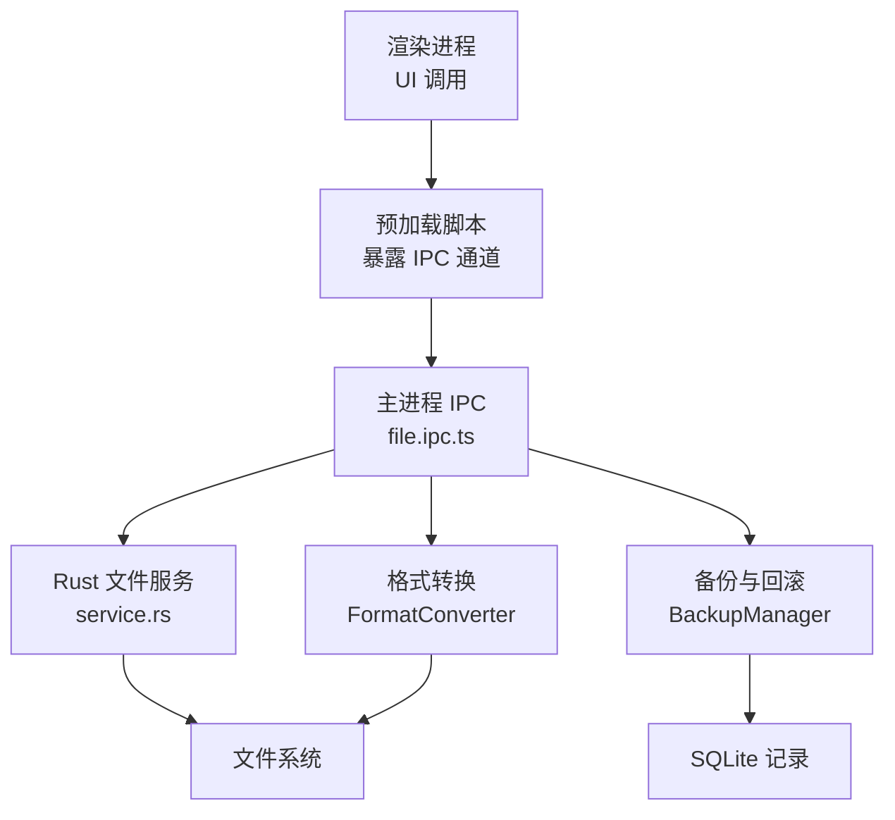
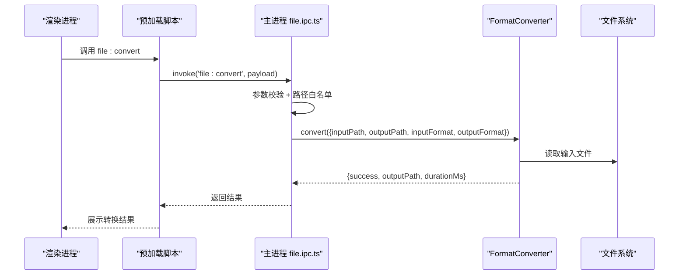
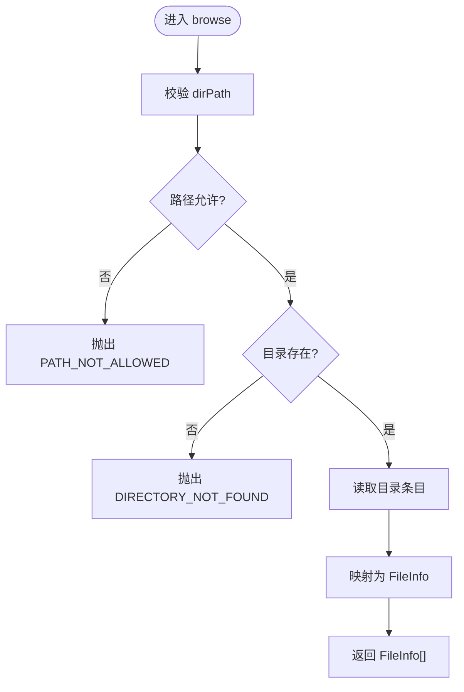
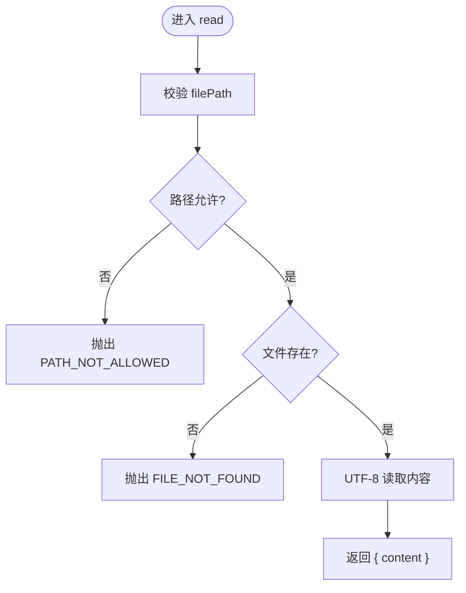
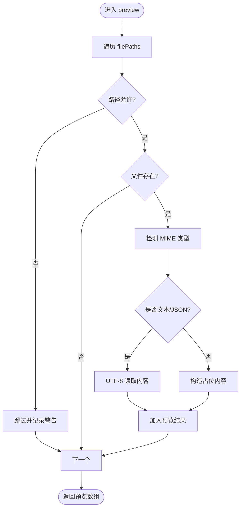
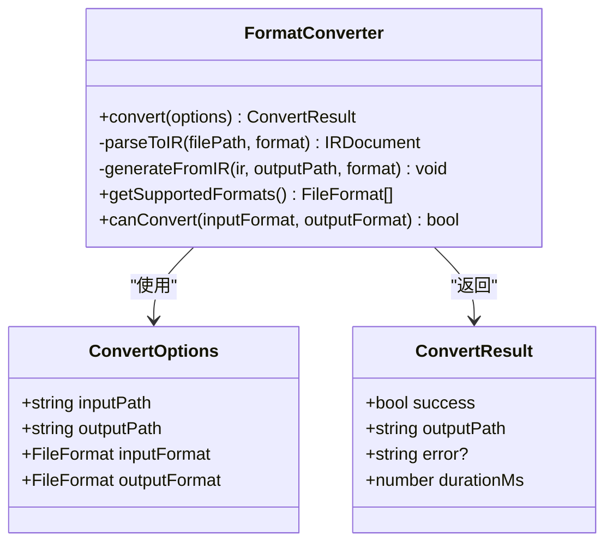
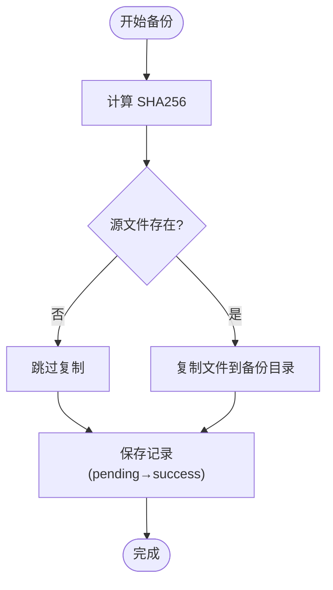
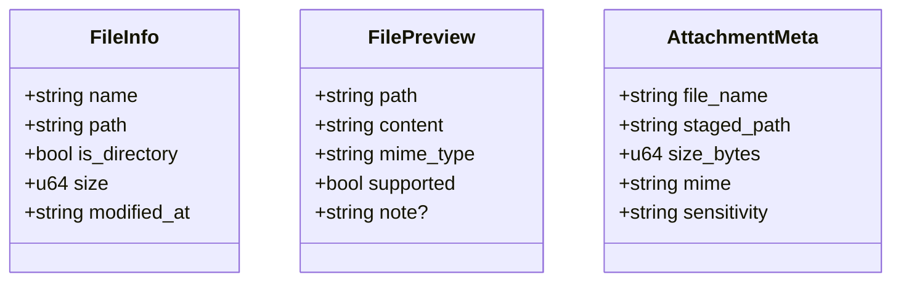
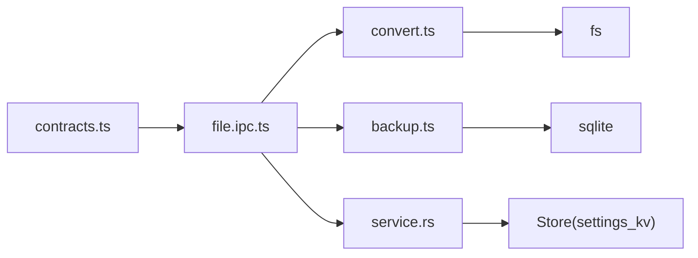

# 文件操作 API

<cite>
**本文引用的文件**   
- [file.ipc.ts](file://tongtian-tauri/src/main/ipc/file.ipc.ts)
- [convert.ts](file://tongtian-tauri/src/main/file/convert.ts)
- [backup.ts](file://tongtian-tauri/src/main/file/backup.ts)
- [contracts.ts](file://tongtian-tauri/src/shared/contracts.ts)
- [service.rs](file://tongtian-tauri/src-tauri/src/file/service.rs)
</cite>

## 目录
1. [简介](#简介)
2. [项目结构](#项目结构)
3. [核心组件](#核心组件)
4. [架构总览](#架构总览)
5. [详细组件分析](#详细组件分析)
6. [依赖关系分析](#依赖关系分析)
7. [性能与限制](#性能与限制)
8. [故障排查指南](#故障排查指南)
9. [结论](#结论)
10. [附录：示例与最佳实践](#附录示例与最佳实践)

## 简介
本文件操作 API 文档围绕以下命令接口展开：file_browse、file_preview、file_read、file_write、file_convert、file_organize。文档涵盖数据结构（FileInfo、FilePreview）、支持的文件格式转换（PDF、Word、Excel、图片等）及转换选项，并说明文件备份恢复机制与安全访问控制。同时提供预览、读取与批量操作的实现要点与错误处理策略，以及文件大小限制与编码处理方式。

## 项目结构
- 主进程 IPC 层负责接收前端请求、参数校验、路径安全校验，并调用具体服务或转换器。
- 文件格式转换由 FormatConverter 统一编排，采用“输入解析 → 中间表示(IR) → 输出生成”的管道模式。
- 备份与回滚由 BackupManager 管理，基于任务/步骤维度进行快照与清理。
- Rust 侧文件服务提供白名单访问控制、大小上限、预览与附件暂存能力，并与 Electron 主进程协同。

**图示来源** 
- [file.ipc.ts:100-246](file://tongtian-tauri/src/main/ipc/file.ipc.ts#L100-L246)
- [convert.ts:76-153](file://tongtian-tauri/src/main/file/convert.ts#L76-L153)
- [backup.ts:39-142](file://tongtian-tauri/src/main/file/backup.ts#L39-L142)
- [service.rs:136-256](file://tongtian-tauri/src-tauri/src/file/service.rs#L136-L256)

**章节来源**
- [file.ipc.ts:1-250](file://tongtian-tauri/src/main/ipc/file.ipc.ts#L1-L250)
- [contracts.ts:498-504](file://tongtian-tauri/src/shared/contracts.ts#L498-L504)

## 核心组件
- 文件浏览(file:browse)：列出目录内容，返回 FileInfo 列表。
- 文件读取(file:read)：以 UTF-8 读取文本文件内容。
- 文件预览(file:preview)：批量预览，文本类直接读取，二进制类返回占位信息。
- 文件转换(file:convert)：通过 FormatConverter 将一种格式转换为另一种格式。
- 文件写入(file:write)：当前未在主进程注册处理器；Rust 侧提供读/预览/附件暂存能力。
- 文件整理(file:organize)：当前未在主进程注册处理器；可在上层扩展。

数据结构定义：
- FileInfo：name、path、isDirectory、size、modifiedAt。
- FilePreview：path、content、mimeType（Rust 侧还包含 supported、note）。

支持的转换格式（声明式）：docx、xlsx、pdf、csv、txt、md。实际可实现的解析/生成能力随实现逐步完善。

**章节来源**
- [file.ipc.ts:17-34](file://tongtian-tauri/src/main/ipc/file.ipc.ts#L17-L34)
- [file.ipc.ts:105-235](file://tongtian-tauri/src/main/ipc/file.ipc.ts#L105-L235)
- [contracts.ts:323-335](file://tongtian-tauri/src/shared/contracts.ts#L323-L335)
- [service.rs:21-52](file://tongtian-tauri/src-tauri/src/file/service.rs#L21-L52)
- [convert.ts:11-25](file://tongtian-tauri/src/main/file/convert.ts#L11-L25)

## 架构总览
文件操作在三层之间协作：
- 渲染进程通过预加载脚本调用 IPC 通道。
- 主进程 IPC 处理器负责参数校验、路径白名单检查、日志记录与异常包装。
- 业务逻辑由 FormatConverter（转换）与 BackupManager（备份/回滚）承担；Rust 侧提供强约束的文件访问控制与预览能力。

**图示来源** 
- [file.ipc.ts:209-235](file://tongtian-tauri/src/main/ipc/file.ipc.ts#L209-L235)
- [convert.ts:93-153](file://tongtian-tauri/src/main/file/convert.ts#L93-L153)

## 详细组件分析

### file:browse（文件浏览）
- 功能：列出指定目录下的条目，返回 FileInfo 数组。
- 参数：dirPath（字符串）。
- 返回：FileInfo[]。
- 安全：路径白名单校验（禁止 ..），仅允许绝对路径。
- 错误：PATH_NOT_ALLOWED、DIRECTORY_NOT_FOUND。

**图示来源** 
- [file.ipc.ts:105-134](file://tongtian-tauri/src/main/ipc/file.ipc.ts#L105-L134)

**章节来源**
- [file.ipc.ts:17-19](file://tongtian-tauri/src/main/ipc/file.ipc.ts#L17-L19)
- [file.ipc.ts:65-76](file://tongtian-tauri/src/main/ipc/file.ipc.ts#L65-L76)
- [file.ipc.ts:105-134](file://tongtian-tauri/src/main/ipc/file.ipc.ts#L105-L134)

### file:read（文件读取）
- 功能：以 UTF-8 读取文本文件内容。
- 参数：filePath（字符串）。
- 返回：{ content: string }。
- 安全：路径白名单校验。
- 错误：PATH_NOT_ALLOWED、FILE_NOT_FOUND。

**图示来源** 
- [file.ipc.ts:138-154](file://tongtian-tauri/src/main/ipc/file.ipc.ts#L138-L154)

**章节来源**
- [file.ipc.ts:21-23](file://tongtian-tauri/src/main/ipc/file.ipc.ts#L21-L23)
- [file.ipc.ts:138-154](file://tongtian-tauri/src/main/ipc/file.ipc.ts#L138-L154)

### file:preview（文件预览）
- 功能：批量预览文件。文本类（text/* 与 application/json）直接读取内容；二进制类返回占位内容。
- 参数：filePaths（字符串数组）。
- 返回：FilePreview[]（path、content、mimeType）。
- 安全：逐条路径白名单校验，失败跳过并记录警告。
- 错误：单个文件预览失败不影响其他文件。

**图示来源** 
- [file.ipc.ts:158-205](file://tongtian-tauri/src/main/ipc/file.ipc.ts#L158-L205)

**章节来源**
- [file.ipc.ts:25-27](file://tongtian-tauri/src/main/ipc/file.ipc.ts#L25-L27)
- [file.ipc.ts:78-96](file://tongtian-tauri/src/main/ipc/file.ipc.ts#L78-L96)
- [file.ipc.ts:158-205](file://tongtian-tauri/src/main/ipc/file.ipc.ts#L158-L205)

### file:convert（文件转换）
- 功能：将输入文件从一种格式转换为另一种格式。
- 参数：inputPath、outputPath、inputFormat、outputFormat（枚举：docx/xlsx/pdf/csv/txt/md）。
- 返回：{ outputPath, durationMs }。
- 流程：参数校验 → 路径白名单 → FormatConverter.convert → 成功/失败封装。
- 错误：PATH_NOT_ALLOWED、CONVERSION_FAILED（内部错误消息透传）。

**图示来源** 
- [convert.ts:76-153](file://tongtian-tauri/src/main/file/convert.ts#L76-L153)
- [convert.ts:13-25](file://tongtian-tauri/src/main/file/convert.ts#L13-L25)

**章节来源**
- [file.ipc.ts:29-34](file://tongtian-tauri/src/main/ipc/file.ipc.ts#L29-L34)
- [file.ipc.ts:209-235](file://tongtian-tauri/src/main/ipc/file.ipc.ts#L209-L235)
- [convert.ts:93-153](file://tongtian-tauri/src/main/file/convert.ts#L93-L153)

### file:write（文件写入）
- 状态：当前未在 IPC 层注册处理器。如需实现，建议遵循与 read/preview 一致的路径白名单与权限控制策略，并考虑写入原子性与幂等性。

[本节不直接分析具体代码文件]

### file:organize（文件整理）
- 状态：当前未在 IPC 层注册处理器。可扩展为批量重命名、移动、归档等操作，需结合备份机制确保可回滚。

[本节不直接分析具体代码文件]

### 备份与回滚（BackupManager）
- 功能：按任务/步骤维度创建文件备份，支持查询、标记失败、过期清理与回滚。
- 关键方法：
  - backup(options): 计算 SHA256、复制文件、持久化记录。
  - rollback(backupId): 根据记录恢复或删除文件，更新状态。
  - cleanupExpiredBackups(): 定时清理超过保留期的备份。
- 存储：SQLite 表 file_backups，字段包括 id、task_id、step_id、file_path、sha256、backup_path、status、created_at。

**图示来源** 
- [backup.ts:86-142](file://tongtian-tauri/src/main/file/backup.ts#L86-L142)

**章节来源**
- [backup.ts:14-29](file://tongtian-tauri/src/main/file/backup.ts#L14-L29)
- [backup.ts:232-280](file://tongtian-tauri/src/main/file/backup.ts#L232-L280)

### Rust 侧文件服务（service.rs）
- 能力：list_dir、read_file、preview、stage_attachment。
- 安全：工作区白名单 + SandboxPolicy.file_allowlist；越界访问返回 FILE_ACCESS_DENIED。
- 大小限制：读取上限 2MB；附件上限 50MB。
- 预览：文本类直读；二进制类返回 supported=false 与 note 提示。
- 附件暂存：复制到 attachments/{task_id}/，并进行敏感度抽样检测。

**图示来源** 
- [service.rs:21-52](file://tongtian-tauri/src-tauri/src/file/service.rs#L21-L52)

**章节来源**
- [service.rs:136-171](file://tongtian-tauri/src-tauri/src/file/service.rs#L136-L171)
- [service.rs:174-197](file://tongtian-tauri/src-tauri/src/file/service.rs#L174-L197)
- [service.rs:212-256](file://tongtian-tauri/src-tauri/src/file/service.rs#L212-L256)
- [service.rs:270-345](file://tongtian-tauri/src-tauri/src/file/service.rs#L270-L345)

## 依赖关系分析
- IPC 层依赖 contracts.ts 中的 IPC_CHANNELS 与类型定义。
- 转换模块依赖 Logger 与文件系统；未来可扩展 SheetJS、mammoth、pdf-parse 等库。
- 备份模块依赖 SQLite（Database）与 Electron app.getPath('userData')。
- Rust 服务依赖 Store（settings_kv）用于沙箱白名单配置。

**图示来源** 
- [contracts.ts:498-504](file://tongtian-tauri/src/shared/contracts.ts#L498-L504)
- [file.ipc.ts:1-14](file://tongtian-tauri/src/main/ipc/file.ipc.ts#L1-L14)
- [convert.ts:1-8](file://tongtian-tauri/src/main/file/convert.ts#L1-L8)
- [backup.ts:1-11](file://tongtian-tauri/src/main/file/backup.ts#L1-L11)
- [service.rs:10-15](file://tongtian-tauri/src-tauri/src/file/service.rs#L10-L15)

**章节来源**
- [contracts.ts:498-504](file://tongtian-tauri/src/shared/contracts.ts#L498-L504)
- [file.ipc.ts:1-14](file://tongtian-tauri/src/main/ipc/file.ipc.ts#L1-L14)

## 性能与限制
- 文件大小限制：
  - Rust 侧读取上限 2MB（MAX_READ_BYTES），超出返回 FILE_TOO_LARGE。
  - 附件暂存上限 50MB（MAX_ATTACHMENT_BYTES），超出返回 FILE_REJECTED。
- 编码处理：
  - 文本读取与预览统一使用 UTF-8；二进制文件不尝试解码。
- 转换性能：
  - 相同格式短路拷贝，避免重复解析/生成。
  - 解析与生成阶段均记录耗时，便于监控。
- I/O 与并发：
  - 预览批量处理，单文件失败不影响整体；IPC 层记录警告与错误日志。

**章节来源**
- [service.rs:16-19](file://tongtian-tauri/src-tauri/src/file/service.rs#L16-L19)
- [service.rs:174-197](file://tongtian-tauri/src-tauri/src/file/service.rs#L174-L197)
- [service.rs:270-345](file://tongtian-tauri/src-tauri/src/file/service.rs#L270-L345)
- [convert.ts:111-119](file://tongtian-tauri/src/main/file/convert.ts#L111-L119)
- [file.ipc.ts:158-205](file://tongtian-tauri/src/main/ipc/file.ipc.ts#L158-L205)

## 故障排查指南
- 常见错误码（部分）：
  - FILE_NOT_FOUND：文件或目录不存在。
  - FILE_ACCESS_DENIED：路径不在白名单内。
  - FILE_TOO_LARGE：读取或附件大小超限。
  - FILE_CONVERSION_FAILED：转换失败（内部错误消息）。
  - FILE_BACKUP_FAILED：备份/回滚失败。
- 定位方法：
  - 查看 IPC 层日志（module: 'ipc/file'）。
  - 检查转换模块日志（module: 'convert'）。
  - 检查备份模块日志（module: 'backup'）。
  - 确认 Rust 侧白名单配置（sandbox.file_allowlist.{workspace_id}）。

**章节来源**
- [contracts.ts:24-31](file://tongtian-tauri/src/shared/contracts.ts#L24-L31)
- [file.ipc.ts:44-57](file://tongtian-tauri/src/main/ipc/file.ipc.ts#L44-L57)
- [convert.ts:139-152](file://tongtian-tauri/src/main/file/convert.ts#L139-L152)
- [backup.ts:132-141](file://tongtian-tauri/src/main/file/backup.ts#L132-L141)

## 结论
文件操作 API 通过 IPC 层统一入口，结合 Rust 侧严格的安全白名单与大小限制，提供了安全的浏览、读取与预览能力；转换模块采用中间表示(IR)管道，便于扩展更多格式；备份与回滚机制保障操作的可逆性与数据一致性。后续可补充 file:write 与 file:organize 的实现，并完善 xlsx/docx/pdf 的解析与生成能力。

[本节不直接分析具体代码文件]

## 附录：示例与最佳实践
- 文件浏览示例：
  - 调用 file:browse，传入目标目录路径，获取 FileInfo 列表用于渲染文件面板。
- 文件读取示例：
  - 调用 file:read，传入文件路径，获取 UTF-8 文本内容用于编辑器或预览。
- 文件预览示例：
  - 调用 file:preview，传入多个文件路径，批量获取预览结果；对二进制文件显示占位信息。
- 文件转换示例：
  - 调用 file:convert，指定输入/输出路径与格式，等待转换完成并处理 durationMs 与输出路径。
- 备份与回滚示例：
  - 在执行可能修改文件的步骤前调用 BackupManager.backup，失败时调用 rollback 恢复。
- 安全与限制最佳实践：
  - 始终校验路径白名单，避免路径穿越攻击。
  - 对大文件进行分块或流式处理（如未来扩展）。
  - 统一使用 UTF-8 编码处理文本，避免乱码。
  - 捕获并上报错误码，便于前端友好提示与审计。

[本节不直接分析具体代码文件]