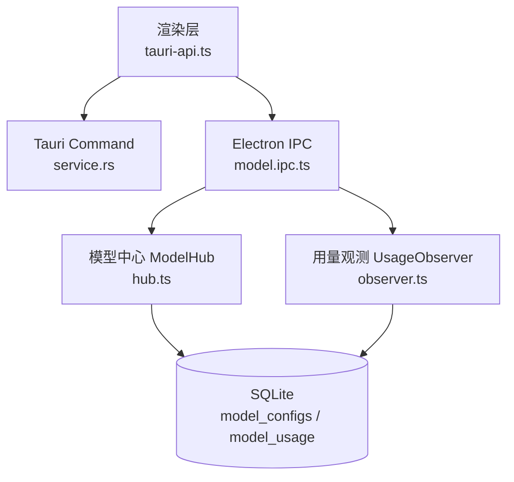
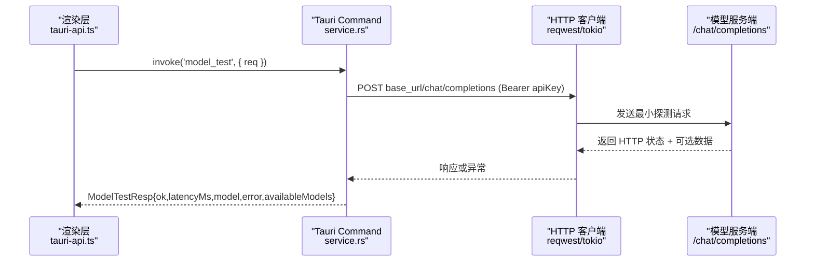
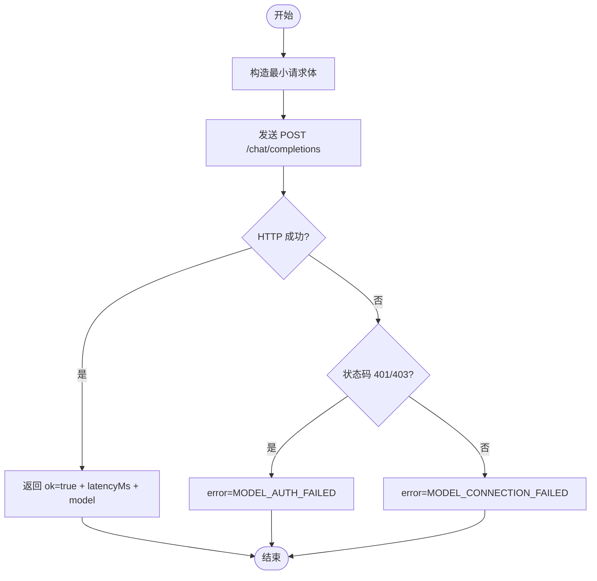
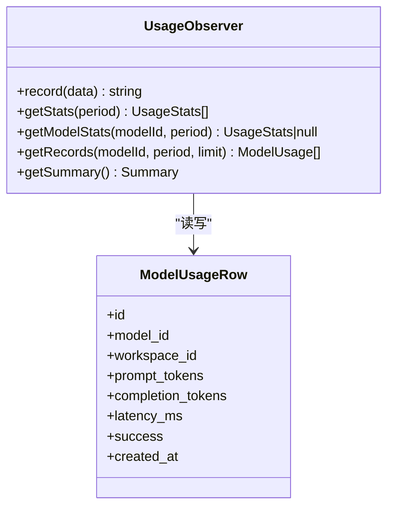
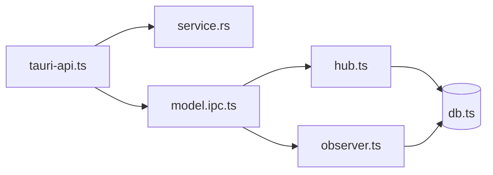

# 模型管理 API

<cite>
**本文引用的文件**   
- [model.ipc.ts](file://tongtian-tauri/src/main/ipc/model.ipc.ts)
- [hub.ts](file://tongtian-tauri/src/main/model/hub.ts)
- [observer.ts](file://tongtian-tauri/src/main/model/observer.ts)
- [service.rs](file://tongtian-tauri/src-tauri/src/model/service.rs)
- [contracts.ts](file://tongtian-tauri/src/shared/contracts.ts)
- [types.ts](file://tongtian-tauri/src/shared/types.ts)
- [tauri-api.ts](file://tongtian-tauri/src/renderer/lib/tauri-api.ts)
- [db.ts](file://tongtian-tauri/src/main/store/db.ts)
</cite>

## 目录
1. [简介](#简介)
2. [项目结构](#项目结构)
3. [核心组件](#核心组件)
4. [架构总览](#架构总览)
5. [详细组件分析](#详细组件分析)
6. [依赖关系分析](#依赖关系分析)
7. [性能与可用性](#性能与可用性)
8. [故障排查指南](#故障排查指南)
9. [结论](#结论)
10. [附录：配置示例与连通性测试](#附录配置示例与连通性测试)

## 简介
本文件面向“模型管理”相关的前后端接口，覆盖以下命令：model_list、model_create、model_update、model_delete、model_test、model_setDefault、model_usage。文档包含请求/响应数据结构（ModelTestReq、ModelTestResp）、连通性测试流程、结果处理策略，以及不同模型提供商（OpenAI、Ollama、Anthropic 等）的配置要点与连接测试方法。同时给出模型使用统计与配额管理的 API 说明。

## 项目结构
模型管理在 Electron/Tauri 三层中实现：
- 渲染层（renderer）通过 tauri-api.ts 调用 Tauri command；
- Rust 侧 service.rs 提供 model_list/add/update/delete/test/set_default 等能力；
- Electron 主进程 IPC（model.ipc.ts）暴露 model:list/create/update/delete/test/setDefault/usage 通道；
- Hub（hub.ts）负责持久化与密钥安全存储（Vault），并封装健康检查；
- Observer（observer.ts）记录模型使用量与延迟，并提供按周期聚合统计；
- 数据库（db.ts）维护 model_configs 与 model_usage 表。

图表来源 
- [tauri-api.ts:69-80](file://tongtian-tauri/src/renderer/lib/tauri-api.ts#L69-L80)
- [service.rs:126-345](file://tongtian-tauri/src-tauri/src/model/service.rs#L126-L345)
- [model.ipc.ts:108-196](file://tongtian-tauri/src/main/ipc/model.ipc.ts#L108-L196)
- [hub.ts:109-266](file://tongtian-tauri/src/main/model/hub.ts#L109-L266)
- [observer.ts:101-172](file://tongtian-tauri/src/main/model/observer.ts#L101-L172)
- [db.ts:204-276](file://tongtian-tauri/src/main/store/db.ts#L204-L276)

章节来源
- [tauri-api.ts:69-80](file://tongtian-tauri/src/renderer/lib/tauri-api.ts#L69-L80)
- [model.ipc.ts:108-196](file://tongtian-tauri/src/main/ipc/model.ipc.ts#L108-L196)
- [service.rs:126-345](file://tongtian-tauri/src-tauri/src/model/service.rs#L126-L345)
- [hub.ts:109-266](file://tongtian-tauri/src/main/model/hub.ts#L109-L266)
- [observer.ts:101-172](file://tongtian-tauri/src/main/model/observer.ts#L101-L172)
- [db.ts:204-276](file://tongtian-tauri/src/main/store/db.ts#L204-L276)

## 核心组件
- 模型中心（ModelHub）：负责模型配置的增删改查、默认模型设置、API Key 加密存储与健康检查。
- 用量观测（UsageObserver）：记录每次调用的 token 用量、延迟、成功状态，并按日/周/月聚合统计。
- IPC 路由（model.ipc.ts）：将前端 channel 映射到具体服务方法，统一参数校验与错误包装。
- Tauri 适配（tauri-api.ts）：将前端调用桥接到 Tauri command（Rust）。
- Rust 服务（service.rs）：实现 model_list/add/update/delete/test/set_default 等命令。

章节来源
- [hub.ts:85-266](file://tongtian-tauri/src/main/model/hub.ts#L85-L266)
- [observer.ts:77-172](file://tongtian-tauri/src/main/model/observer.ts#L77-L172)
- [model.ipc.ts:108-196](file://tongtian-tauri/src/main/ipc/model.ipc.ts#L108-L196)
- [tauri-api.ts:69-80](file://tongtian-tauri/src/renderer/lib/tauri-api.ts#L69-L80)
- [service.rs:126-345](file://tongtian-tauri/src-tauri/src/model/service.rs#L126-L345)

## 架构总览
下图展示一次“模型连通性测试”的完整调用链：渲染层发起 → Tauri command → Rust 服务发送 HTTP 探测 → 返回测试结果。

图表来源 
- [tauri-api.ts:76](file://tongtian-tauri/src/renderer/lib/tauri-api.ts#L76)
- [service.rs:348-421](file://tongtian-tauri/src-tauri/src/model/service.rs#L348-L421)

章节来源
- [tauri-api.ts:76](file://tongtian-tauri/src/renderer/lib/tauri-api.ts#L76)
- [service.rs:348-421](file://tongtian-tauri/src-tauri/src/model/service.rs#L348-L421)

## 详细组件分析

### 命令接口一览
- model_list
  - 通道：model:list
  - 功能：列出所有模型配置（含是否已配置密钥标记）
  - 返回：ModelConfig[]
- model_create
  - 通道：model:create
  - 功能：新增模型配置（apiKey 入 Vault 加密存储）
  - 输入：name、source、baseUrl、apiKey、modelName、contextWindow、agentBinding、forceLocal
  - 返回：ModelConfig
- model_update
  - 通道：model:update
  - 功能：更新模型配置（可选字段更新；空字符串表示清除密钥）
  - 输入：id 及可选项
  - 返回：ModelConfig
- model_delete
  - 通道：model:delete
  - 功能：删除模型配置并清理密钥
  - 输入：id
  - 返回：{ ok: boolean }
- model_test
  - 通道：model:test
  - 功能：对 baseUrl + modelName + apiKey 进行连通性自测（POST /chat/completions）
  - 输入：ModelTestReq
  - 返回：ModelTestResp
- model_setDefault
  - 通道：model:setDefault
  - 功能：设置默认模型（清空其他默认位）
  - 输入：id
  - 返回：ModelConfig
- model_usage
  - 通道：model:usage
  - 功能：获取指定周期的用量统计（day/week/month）
  - 输入：{ period }
  - 返回：UsageStats[]

章节来源
- [model.ipc.ts:108-196](file://tongtian-tauri/src/main/ipc/model.ipc.ts#L108-L196)
- [service.rs:126-345](file://tongtian-tauri/src-tauri/src/model/service.rs#L126-L345)
- [contracts.ts:480-495](file://tongtian-tauri/src/shared/contracts.ts#L480-L495)

### 数据结构定义
- ModelTestReq
  - baseUrl：string（必填）
  - apiKey：string（必填）
  - modelName：string（必填）
  - contextWindow：number（必填）
  - id：string（可选，用于从 keyring/Vault 补齐密钥的场景）
- ModelTestResp
  - ok：boolean
  - latencyMs：number
  - model：string
  - error：string（可选）
  - availableModels：string[]（可选）

章节来源
- [contracts.ts:169-182](file://tongtian-tauri/src/shared/contracts.ts#L169-L182)
- [types.ts:217-232](file://tongtian-tauri/src/shared/types.ts#L217-L232)
- [service.rs:76-100](file://tongtian-tauri/src-tauri/src/model/service.rs#L76-L100)

### 连通性测试流程与结果处理
- 流程要点
  - 构造最小请求体（model、messages、max_tokens=1，stream=false）
  - 超时保护（10s）
  - 成功路径：返回 ok=true、latencyMs、model，并尝试拉取可用模型列表（失败不影响主结果）
  - 失败路径：根据 HTTP 状态区分认证失败（401/403）与连接失败，返回 error 信息
- 结果处理建议
  - ok=true：提示“连通成功”，展示 latencyMs 与 availableModels（若有）
  - ok=false：根据 error 前缀提示用户（如 MODEL_AUTH_FAILED 需检查 apiKey；MODEL_CONNECTION_FAILED 检查 baseUrl/网络）

图表来源 
- [service.rs:348-421](file://tongtian-tauri/src-tauri/src/model/service.rs#L348-L421)

章节来源
- [service.rs:348-421](file://tongtian-tauri/src-tauri/src/model/service.rs#L348-L421)

### 用量统计与配额管理
- UsageObserver
  - record(data)：写入 model_usage 表（model_id、prompt_tokens、completion_tokens、latency_ms、success、created_at）
  - getStats(period)：按 day/week/month 聚合，返回 totalPromptTokens、totalCompletionTokens、totalCalls、avgLatencyMs、estimatedCost
  - getModelStats(modelId, period)：单模型聚合
  - getRecords(modelId, period, limit)：原始记录查询
  - getSummary()：全量汇总（calls、tokens、cost）
- 成本估算
  - 基于固定单价估算（default_prompt/default_completion/local 三类）
- 配额快照（QuotaSnapshot）
  - usedTokens、quotaTokens、tier（70/85/95/100）、action（notify/degrade/queue/block）、updatedAt

图表来源 
- [observer.ts:77-172](file://tongtian-tauri/src/main/model/observer.ts#L77-L172)
- [observer.ts:185-227](file://tongtian-tauri/src/main/model/observer.ts#L185-L227)
- [db.ts:204-276](file://tongtian-tauri/src/main/store/db.ts#L204-L276)

章节来源
- [observer.ts:77-172](file://tongtian-tauri/src/main/model/observer.ts#L77-L172)
- [observer.ts:185-227](file://tongtian-tauri/src/main/model/observer.ts#L185-L227)
- [contracts.ts:258-321](file://tongtian-tauri/src/shared/contracts.ts#L258-L321)
- [db.ts:204-276](file://tongtian-tauri/src/main/store/db.ts#L204-L276)

### 错误码与校验
- 校验：IPC 层使用 Zod 校验输入，失败返回 VALIDATION_ERROR
- 通用错误：INTERNAL_ERROR 包装未捕获异常
- 模型错误：MODEL_NOT_FOUND、MODEL_CONNECTION_FAILED、MODEL_AUTH_FAILED、MODEL_RATE_LIMITED、MODEL_CONTEXT_OVERFLOW、MODEL_RESPONSE_INVALID

章节来源
- [model.ipc.ts:67-101](file://tongtian-tauri/src/main/ipc/model.ipc.ts#L67-L101)
- [contracts.ts:15-109](file://tongtian-tauri/src/shared/contracts.ts#L15-L109)

## 依赖关系分析
- 渲染层 tauri-api.ts 将 model:* 通道映射到 Tauri command（model_list/add/update/delete/test/set_default）
- Rust service.rs 实现 model_* 命令，读取/写入 SQLite，并通过 http_client 发起 HTTP 探测
- Electron IPC model.ipc.ts 暴露 model:* 通道，调用 hub.ts（CRUD/健康检查）与 observer.ts（用量统计）
- Hub 依赖 Database 与 Vault（密钥加密存储）
- Observer 依赖 Database（model_usage 表）

图表来源 
- [tauri-api.ts:69-80](file://tongtian-tauri/src/renderer/lib/tauri-api.ts#L69-L80)
- [service.rs:126-345](file://tongtian-tauri/src-tauri/src/model/service.rs#L126-L345)
- [model.ipc.ts:108-196](file://tongtian-tauri/src/main/ipc/model.ipc.ts#L108-L196)
- [hub.ts:109-266](file://tongtian-tauri/src/main/model/hub.ts#L109-L266)
- [observer.ts:101-172](file://tongtian-tauri/src/main/model/observer.ts#L101-L172)
- [db.ts:204-276](file://tongtian-tauri/src/main/store/db.ts#L204-L276)

章节来源
- [tauri-api.ts:69-80](file://tongtian-tauri/src/renderer/lib/tauri-api.ts#L69-L80)
- [service.rs:126-345](file://tongtian-tauri/src-tauri/src/model/service.rs#L126-L345)
- [model.ipc.ts:108-196](file://tongtian-tauri/src/main/ipc/model.ipc.ts#L108-L196)
- [hub.ts:109-266](file://tongtian-tauri/src/main/model/hub.ts#L109-L266)
- [observer.ts:101-172](file://tongtian-tauri/src/main/model/observer.ts#L101-L172)
- [db.ts:204-276](file://tongtian-tauri/src/main/store/db.ts#L204-L276)

## 性能与可用性
- 连通性测试超时：10s（避免阻塞 UI）
- 拉取可用模型列表：独立超时（5s），失败不影响主结果
- 用量统计聚合：按日期过滤 + GROUP BY，索引优化（idx_model_usage_model、idx_model_usage_date）
- 密钥存储：不在明文落库，使用 Vault/keyring 存储，DB 仅存引用标记

章节来源
- [service.rs:348-421](file://tongtian-tauri/src-tauri/src/model/service.rs#L348-L421)
- [db.ts:275-276](file://tongtian-tauri/src/main/store/db.ts#L275-L276)
- [hub.ts:129-161](file://tongtian-tauri/src/main/model/hub.ts#L129-L161)

## 故障排查指南
- 连通性失败
  - 检查 baseUrl 是否为 OpenAI 兼容路径（/chat/completions）
  - 检查 apiKey 是否正确（401/403 时提示认证失败）
  - 网络可达性与代理设置
- 用量统计为空
  - 确认 record() 被调用（任务执行链路需上报 token 用量）
  - 检查 model_usage 表是否有数据
- 默认模型不生效
  - setDefault 后确认 is_default 标志已更新
- 密钥问题
  - 更新 api_key 为空串会清除密钥；重新添加时需传入新密钥

章节来源
- [service.rs:348-421](file://tongtian-tauri/src-tauri/src/model/service.rs#L348-L421)
- [observer.ts:101-128](file://tongtian-tauri/src/main/model/observer.ts#L101-L128)
- [hub.ts:249-266](file://tongtian-tauri/src/main/model/hub.ts#L249-L266)

## 结论
模型管理 API 围绕 CRUD、连通性自测与用量统计三大能力构建，采用分层设计（渲染层→IPC/Rust→Hub/Observer→DB/Vault），保证安全性与可扩展性。通过统一的错误码与校验机制，提升稳定性与可诊断性。

## 附录：配置示例与连通性测试
- OpenAI 兼容
  - source：openai_compat
  - baseUrl：https://api.openai.com/v1（或其他兼容网关）
  - apiKey：你的 OpenAI 密钥
  - modelName：gpt-4o 等
- Ollama（本地）
  - source：ollama
  - baseUrl：http://127.0.0.1:11434/v1（按部署端口调整）
  - apiKey：可为空（部分实现不需要）
  - modelName：qwen2.5:latest 等
- Anthropic（Claude）
  - 若通过 OpenAI 兼容网关接入：同 openai_compat 配置
  - 直连：需网关支持 /chat/completions 兼容协议
- 连通性测试步骤
  - 填写 baseUrl、apiKey、modelName、contextWindow
  - 调用 model:test
  - 查看 ok、latencyMs、error、availableModels

章节来源
- [types.ts:104-112](file://tongtian-tauri/src/shared/types.ts#L104-L112)
- [service.rs:348-421](file://tongtian-tauri/src-tauri/src/model/service.rs#L348-L421)
- [contracts.ts:169-182](file://tongtian-tauri/src/shared/contracts.ts#L169-L182)