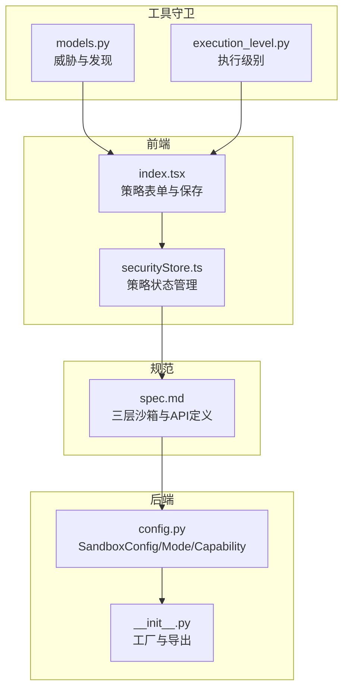
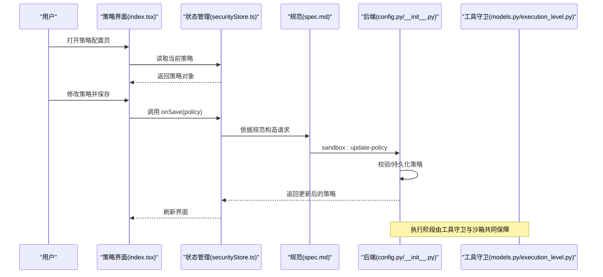
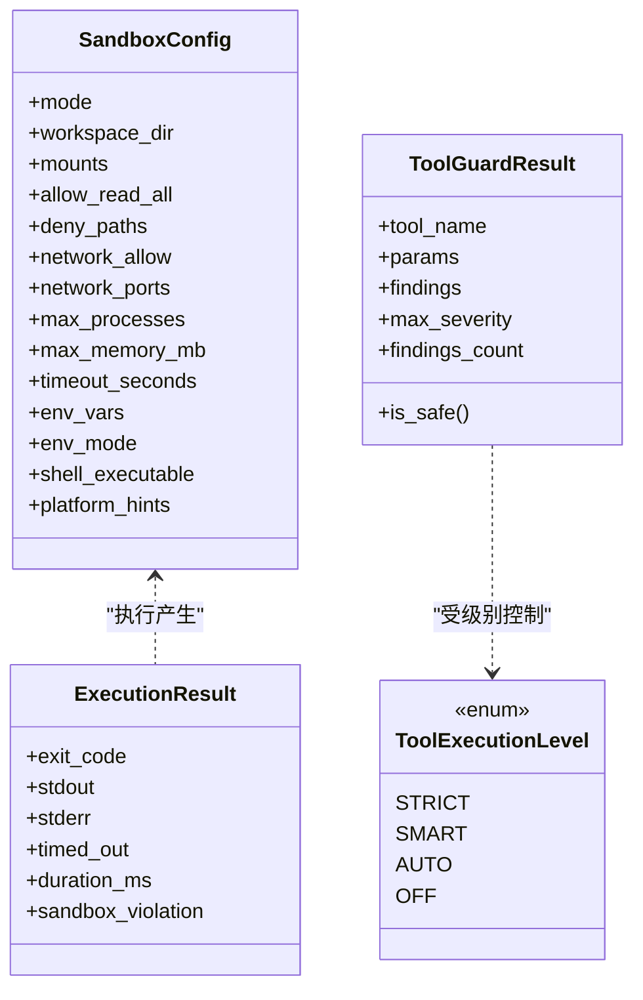

# 沙箱安全 API

<cite>
**本文引用的文件**   
- [spec.md](file://docs/changes/qwenpaw-integration/specs/sandbox/spec.md)
- [config.py](file://tongtian-tauri/src/agent/sandbox/config.py)
- [__init__.py](file://tongtian-tauri/src/agent/sandbox/__init__.py)
- [index.tsx](file://tongtian-tauri/src/renderer/components/SandboxPolicy/index.tsx)
- [securityStore.ts](file://tongtian-tauri/src/renderer/store/securityStore.ts)
- [models.py](file://tongtian-tauri/src/agent/security/tool_guard/models.py)
- [execution_level.py](file://tongtian-tauri/src/agent/security/tool_guard/execution_level.py)
</cite>

## 目录
1. [简介](#简介)
2. [项目结构](#项目结构)
3. [核心组件](#核心组件)
4. [架构总览](#架构总览)
5. [详细组件分析](#详细组件分析)
6. [依赖关系分析](#依赖关系分析)
7. [性能与资源限制](#性能与资源限制)
8. [故障排查指南](#故障排查指南)
9. [结论](#结论)
10. [附录：API 定义与示例](#附录api-定义与示例)

## 简介
本文件面向“沙箱安全”相关能力，系统化说明以下要点：
- IPC 接口：sandbox_getPolicy、sandbox_updatePolicy 的请求/响应格式与用途
- 策略配置项：文件系统访问（白名单/黑名单）、网络请求（域名/端口）、进程执行控制、超时与环境变量注入
- 安全级别与告警：SandboxLevel 安全级别、DangerousOpAlert 危险操作告警机制
- 资源限制：CPU、内存、磁盘 IO 配额及超限处理
- 监控指标：可观测性字段与上报建议
- 定制与违规处理：策略定制流程、拦截与回滚、用户确认与降级策略

## 项目结构
围绕“沙箱策略”的前后端交互与实现，关键位置如下：
- 规范层：三层沙箱与 API 定义（IPC Channel、错误码、数据模型）
- 后端实现：平台探测、模式选择、隔离执行与结果封装
- 前端界面：策略表单、保存与状态管理
- 工具守卫：威胁分类、严重等级、执行级别

图表来源 
- [spec.md:84-127](file://docs/changes/qwenpaw-integration/specs/sandbox/spec.md#L84-L127)
- [config.py:84-140](file://tongtian-tauri/src/agent/sandbox/config.py#L84-L140)
- [__init__.py:30-75](file://tongtian-tauri/src/agent/sandbox/__init__.py#L30-L75)
- [index.tsx:36-70](file://tongtian-tauri/src/renderer/components/SandboxPolicy/index.tsx#L36-L70)
- [securityStore.ts:164-192](file://tongtian-tauri/src/renderer/store/securityStore.ts#L164-L192)
- [models.py:60-96](file://tongtian-tauri/src/agent/security/tool_guard/models.py#L60-L96)
- [execution_level.py:15-49](file://tongtian-tauri/src/agent/security/tool_guard/execution_level.py#L15-L49)

章节来源
- [spec.md:84-127](file://docs/changes/qwenpaw-integration/specs/sandbox/spec.md#L84-L127)
- [config.py:84-140](file://tongtian-tauri/src/agent/sandbox/config.py#L84-L140)
- [__init__.py:30-75](file://tongtian-tauri/src/agent/sandbox/__init__.py#L30-L75)
- [index.tsx:36-70](file://tongtian-tauri/src/renderer/components/SandboxPolicy/index.tsx#L36-L70)
- [securityStore.ts:164-192](file://tongtian-tauri/src/renderer/store/securityStore.ts#L164-L192)
- [models.py:60-96](file://tongtian-tauri/src/agent/security/tool_guard/models.py#L60-L96)
- [execution_level.py:15-49](file://tongtian-tauri/src/agent/security/tool_guard/execution_level.py#L15-L49)

## 核心组件
- 沙箱配置与模式
  - SandboxMode：SEATBELT、BUBBLEWRAP、LANDLOCK、APPCONTAINER、NONE
  - SandboxConfig：工作区路径、挂载点、读写控制、网络规则、资源上限、超时、环境变量注入、平台透传
  - ExecutionResult：退出码、标准输出/错误、是否超时、耗时、违规信息
- 平台能力探测
  - probe_sandbox_support()：按平台优先顺序探测可用隔离能力并缓存
  - detect_platform_mode()：自动选择最佳模式
- 工厂与生命周期
  - create_sandbox(config)：根据 mode 返回具体后端实例
  - shutdown_all_sandboxes()：应用退出时清理 Windows 沙箱残留
- 工具守卫与安全级别
  - GuardFinding/ToolGuardResult：单次工具调用的安全发现聚合
  - ToolExecutionLevel：STRICT/SMART/AUTO/OFF 四种执行级别

章节来源
- [config.py:43-152](file://tongtian-tauri/src/agent/sandbox/config.py#L43-L152)
- [config.py:435-476](file://tongtian-tauri/src/agent/sandbox/config.py#L435-L476)
- [config.py:484-523](file://tongtian-tauri/src/agent/sandbox/config.py#L484-L523)
- [__init__.py:30-75](file://tongtian-tauri/src/agent/sandbox/__init__.py#L30-L75)
- [models.py:60-176](file://tongtian-tauri/src/agent/security/tool_guard/models.py#L60-L176)
- [execution_level.py:15-49](file://tongtian-tauri/src/agent/security/tool_guard/execution_level.py#L15-L49)

## 架构总览
下图展示从前端策略界面到后端沙箱执行的端到端流程，以及危险操作拦截与资源配额控制的介入点。

图表来源 
- [index.tsx:59-70](file://tongtian-tauri/src/renderer/components/SandboxPolicy/index.tsx#L59-L70)
- [securityStore.ts:164-192](file://tongtian-tauri/src/renderer/store/securityStore.ts#L164-L192)
- [spec.md:84-127](file://docs/changes/qwenpaw-integration/specs/sandbox/spec.md#L84-L127)
- [config.py:484-523](file://tongtian-tauri/src/agent/sandbox/config.py#L484-L523)

## 详细组件分析

### IPC 接口：sandbox_getPolicy / sandbox_updatePolicy
- 通道名称
  - sandbox:get-policy：R→M，请求体包含 workspaceId，返回 SandboxPolicy
  - sandbox:update-policy：R→M，请求体为 SandboxPolicy，返回更新后的 SandboxPolicy
- 错误码
  - SANDBOX_VIOLATION：策略违规
  - SANDBOX_QUOTA_EXCEEDED：资源配额超限
  - DANGEROUS_OPERATION_BLOCKED：危险操作被拦截

章节来源
- [spec.md:84-127](file://docs/changes/qwenpaw-integration/specs/sandbox/spec.md#L84-L127)

### 策略数据结构与字段说明
- 执行级别 executionLevel：L0/L1/L2（只读/标准/完全权限）
- 文件访问
  - fileAllowlist：允许访问的路径列表
  - fileBlocklist：禁止访问的路径列表
- 工具访问
  - toolAllowlist：允许的工具列表
  - toolBlocklist：禁止的工具列表
- 资源限制
  - maxCpuPercent：CPU 使用率上限（%）
  - maxMemoryMB：内存上限（MB）
  - maxDiskWriteMbps：磁盘写入速率上限（MB/s）

章节来源
- [index.tsx:42-52](file://tongtian-tauri/src/renderer/components/SandboxPolicy/index.tsx#L42-L52)

### 沙箱配置与模式（后端）
- SandboxMode 枚举：决定底层隔离方式（macOS Seatbelt、Linux bubblewrap/Landlock、Windows AppContainer、无隔离）
- SandboxConfig 关键字段
  - 文件系统：workspace_dir、mounts、allow_read_all、deny_paths
  - 网络：network_allow（域名白名单）、network_ports（TCP 端口规则）
  - 资源：max_processes、max_memory_mb
  - 执行：timeout_seconds、env_vars、env_mode、shell_executable
  - 平台透传：platform_hints
- 能力探测与工厂
  - probe_sandbox_support()：按平台优先级探测并缓存
  - detect_platform_mode()：自动选择最佳模式
  - create_sandbox(config)：按 mode 返回具体后端实例

章节来源
- [config.py:43-140](file://tongtian-tauri/src/agent/sandbox/config.py#L43-L140)
- [config.py:435-476](file://tongtian-tauri/src/agent/sandbox/config.py#L435-L476)
- [config.py:484-523](file://tongtian-tauri/src/agent/sandbox/config.py#L484-L523)

### 执行结果与违规信息
- ExecutionResult
  - exit_code、stdout、stderr、timed_out、duration_ms、sandbox_violation
- 典型场景
  - 超时：timed_out=true，duration_ms 记录实际耗时
  - 违规：sandbox_violation 描述违规原因（如越权访问）

章节来源
- [config.py:142-152](file://tongtian-tauri/src/agent/sandbox/config.py#L142-L152)

### 工具守卫与安全级别
- GuardFinding：单次发现的详细信息（规则ID、类别、严重等级、匹配值等）
- ToolGuardResult：聚合结果，提供 is_safe、max_severity、findings_count 等便捷属性
- ToolExecutionLevel：STRICT/SMART/AUTO/OFF，控制是否需要用户审批

章节来源
- [models.py:60-176](file://tongtian-tauri/src/agent/security/tool_guard/models.py#L60-L176)
- [execution_level.py:15-49](file://tongtian-tauri/src/agent/security/tool_guard/execution_level.py#L15-L49)

### 前端策略界面与保存流程
- 表单字段：executionLevel、fileAllowlist/fileBlocklist、toolAllowlist/toolBlocklist、maxCpuPercent/maxMemoryMB/maxDiskWriteMbps
- 保存流程：onSave(policy) 触发后，状态管理更新并反馈成功/失败消息

章节来源
- [index.tsx:36-70](file://tongtian-tauri/src/renderer/components/SandboxPolicy/index.tsx#L36-L70)
- [index.tsx:59-70](file://tongtian-tauri/src/renderer/components/SandboxPolicy/index.tsx#L59-L70)
- [securityStore.ts:164-192](file://tongtian-tauri/src/renderer/store/securityStore.ts#L164-L192)

## 依赖关系分析
- 前端依赖规范定义与状态管理，通过 onSave 将策略提交至后端
- 后端通过配置与工厂创建具体隔离后端，并在执行时结合工具守卫进行风险判定
- 能力探测结果影响默认模式选择与降级策略

图表来源 
- [config.py:84-152](file://tongtian-tauri/src/agent/sandbox/config.py#L84-L152)
- [models.py:103-176](file://tongtian-tauri/src/agent/security/tool_guard/models.py#L103-L176)
- [execution_level.py:15-49](file://tongtian-tauri/src/agent/security/tool_guard/execution_level.py#L15-L49)

章节来源
- [config.py:84-152](file://tongtian-tauri/src/agent/sandbox/config.py#L84-L152)
- [models.py:103-176](file://tongtian-tauri/src/agent/security/tool_guard/models.py#L103-L176)
- [execution_level.py:15-49](file://tongtian-tauri/src/agent/security/tool_guard/execution_level.py#L15-L49)

## 性能与资源限制
- CPU 限制：maxCpuPercent（前端滑块），后端可通过 cgroups/Job Object 或代理层限速
- 内存限制：max_memory_mb（后端配置），超限暂停任务并释放非关键资源
- 磁盘 IO：maxDiskWriteMbps（前端滑块），后端对写入进行节流
- 进程数限制：max_processes（后端配置），防止 fork 风暴
- 超时控制：timeout_seconds，避免长时间占用资源

章节来源
- [index.tsx:176-223](file://tongtian-tauri/src/renderer/components/SandboxPolicy/index.tsx#L176-L223)
- [config.py:112-127](file://tongtian-tauri/src/agent/sandbox/config.py#L112-L127)

## 故障排查指南
- 常见错误码
  - SANDBOX_VIOLATION：检查 deny_paths、fileBlocklist、mounts 配置是否正确
  - SANDBOX_QUOTA_EXCEEDED：调整 max_memory_mb、maxCpuPercent、maxDiskWriteMbps
  - DANGEROUS_OPERATION_BLOCKED：查看工具守卫的 GuardFinding，必要时提升 ToolExecutionLevel 或添加例外
- 能力探测失败
  - Linux：确认 bwrap/Landlock 可用性；查看 probe_sandbox_support() 返回 reason
  - macOS：确认 sandbox-exec 存在
  - Windows：确认 AppContainer API 可用
- 执行结果异常
  - 检查 ExecutionResult.timed_out、duration_ms、sandbox_violation 定位问题

章节来源
- [spec.md:115-122](file://docs/changes/qwenpaw-integration/specs/sandbox/spec.md#L115-L122)
- [config.py:435-476](file://tongtian-tauri/src/agent/sandbox/config.py#L435-L476)
- [config.py:142-152](file://tongtian-tauri/src/agent/sandbox/config.py#L142-L152)

## 结论
本方案以“规范先行、前后端协同、平台自适应”的方式构建沙箱安全体系：
- 通过 IPC 接口统一策略获取与更新
- 借助多层隔离与工具守卫实现细粒度权限控制与风险拦截
- 以资源配额与超时控制保障系统稳定性
- 提供清晰的错误码与执行结果，便于监控与排障

## 附录：API 定义与示例

### IPC 接口定义
- sandbox:get-policy
  - 方向：R→M
  - 请求：{ workspaceId: string }
  - 响应：SandboxPolicy（见下方字段）
- sandbox:update-policy
  - 方向：R→M
  - 请求：SandboxPolicy
  - 响应：SandboxPolicy（更新后）

章节来源
- [spec.md:84-127](file://docs/changes/qwenpaw-integration/specs/sandbox/spec.md#L84-L127)

### SandboxPolicy 字段说明
- executionLevel：L0/L1/L2
- fileAllowlist：字符串数组（允许的文件路径）
- fileBlocklist：字符串数组（禁止的文件路径）
- toolAllowlist：字符串数组（允许的工具名）
- toolBlocklist：字符串数组（禁止的工具名）
- maxCpuPercent：数值（百分比）
- maxMemoryMB：数值（MB）
- maxDiskWriteMbps：数值（MB/s）

章节来源
- [index.tsx:42-52](file://tongtian-tauri/src/renderer/components/SandboxPolicy/index.tsx#L42-L52)

### 安全级别与告警
- SandboxLevel（对应 executionLevel）
  - L0：只读模式，仅允许读取文件
  - L1：标准权限，在授权目录内读写，受策略控制
  - L2：完全权限，谨慎使用
- DangerousOpAlert（危险操作告警）
  - 扫描命令与参数，生成 GuardFinding
  - 根据 ToolExecutionLevel 决定是否要求用户确认
  - 高危操作（CRITICAL/HIGH）默认阻断并提示

章节来源
- [index.tsx:108-124](file://tongtian-tauri/src/renderer/components/SandboxPolicy/index.tsx#L108-L124)
- [models.py:60-96](file://tongtian-tauri/src/agent/security/tool_guard/models.py#L60-L96)
- [execution_level.py:15-49](file://tongtian-tauri/src/agent/security/tool_guard/execution_level.py#L15-L49)

### 资源限制与监控指标
- 资源限制
  - CPU：maxCpuPercent（前端滑块），后端限速或限制
  - 内存：max_memory_mb（后端配置），超限暂停任务
  - 磁盘IO：maxDiskWriteMbps（前端滑块），后端节流
- 监控指标建议
  - 执行耗时 duration_ms
  - 是否超时 timed_out
  - 违规信息 sandbox_violation
  - 工具守卫发现数量 findings_count、最高严重等级 max_severity

章节来源
- [config.py:142-152](file://tongtian-tauri/src/agent/sandbox/config.py#L142-L152)
- [models.py:103-176](file://tongtian-tauri/src/agent/security/tool_guard/models.py#L103-L176)

### 策略定制与违规处理示例
- 定制步骤
  - 在前端打开策略页面，设置 executionLevel、文件/工具白名单与黑名单、资源上限
  - 点击保存，触发 onSave(policy)，状态管理更新并显示结果
- 违规处理
  - 若出现 SANDBOX_VIOLATION，检查 deny_paths/fileBlocklist/mounts
  - 若出现 SANDBOX_QUOTA_EXCEEDED，降低资源上限或扩容
  - 若出现 DANGEROUS_OPERATION_BLOCKED，查看 GuardFinding，必要时提升执行级别或添加例外

章节来源
- [index.tsx:59-70](file://tongtian-tauri/src/renderer/components/SandboxPolicy/index.tsx#L59-L70)
- [securityStore.ts:164-192](file://tongtian-tauri/src/renderer/store/securityStore.ts#L164-L192)
- [spec.md:115-122](file://docs/changes/qwenpaw-integration/specs/sandbox/spec.md#L115-L122)