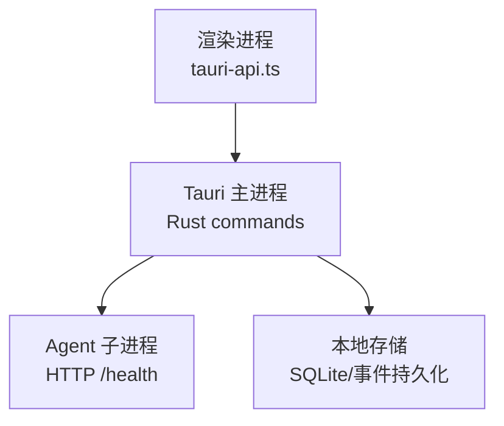
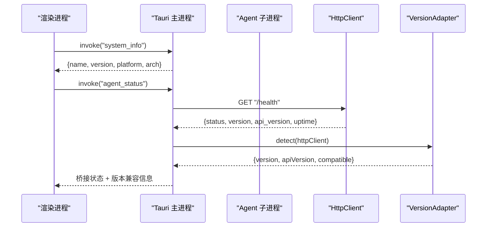
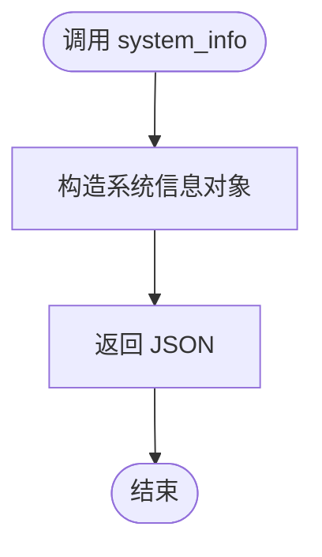
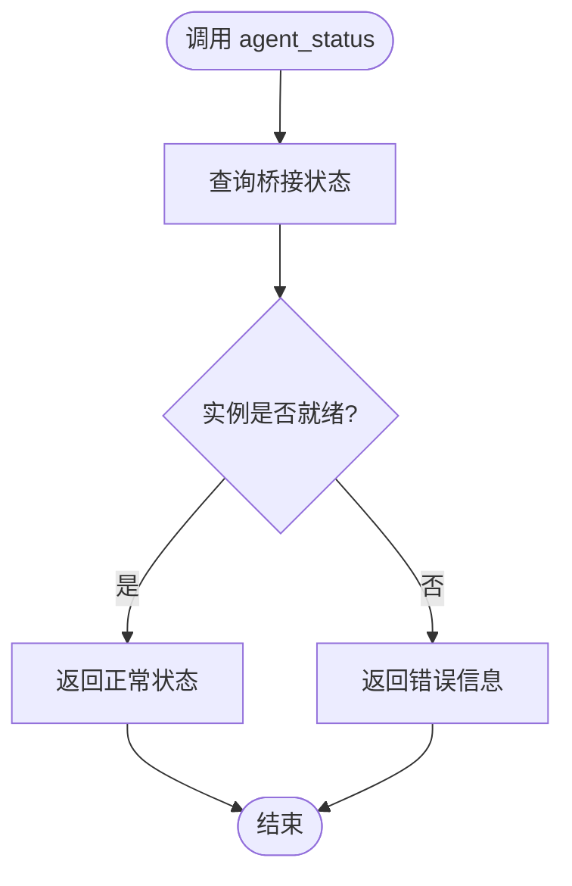
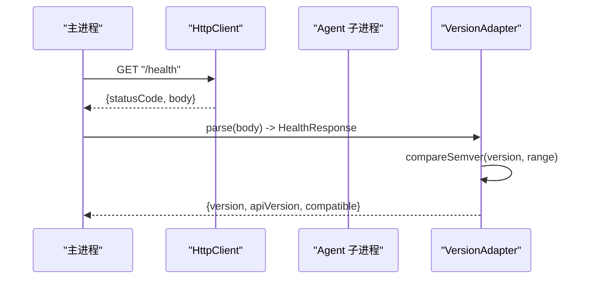
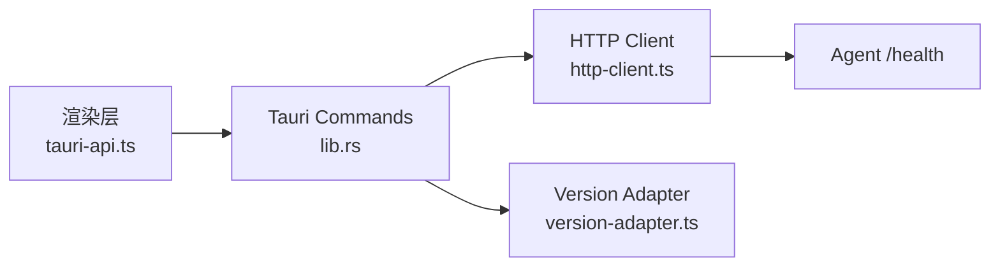

# 系统信息 API

<cite>
**本文引用的文件**
- [lib.rs](file://tongtian-tauri/src-tauri/src/lib.rs)
- [main.rs](file://tongtian-tauri/src-tauri/src/main.rs)
- [tauri-api.ts](file://tongtian-tauri/src/renderer/lib/tauri-api.ts)
- [http-client.ts](file://tongtian-tauri/src/main/bridge/http-client.ts)
- [version-adapter.ts](file://tongtian-tauri/src/main/bridge/version-adapter.ts)
</cite>

## 目录
1. [简介](#简介)
2. [项目结构](#项目结构)
3. [核心组件](#核心组件)
4. [架构总览](#架构总览)
5. [详细组件分析](#详细组件分析)
6. [依赖关系分析](#依赖关系分析)
7. [性能与监控指标](#性能与监控指标)
8. [故障排查指南](#故障排查指南)
9. [结论](#结论)
10. [附录：API 定义与示例](#附录api-定义与示例)

## 简介
本文件面向“系统信息”相关能力，覆盖 system_info、system_health（Agent 健康检查）等命令接口，说明系统健康检查机制、状态监控指标、应用版本信息与运行环境探测，并给出资源使用与性能监控的落地建议与工具方法。文档同时提供诊断与问题排查指引，帮助快速定位 Agent 进程、HTTP 连通性、版本兼容性与事件流异常等问题。

## 项目结构
系统信息与健康检查能力贯穿前端渲染层、Tauri 主进程与 Rust 后端命令：
- 渲染层通过 tauriAPI 统一调用 Tauri command（如 system_info、agent_status）。
- Tauri 主进程暴露 Rust command（system_info、agent_status），并通过 HTTP 客户端与 Agent 子进程通信进行健康检查与版本探测。
- Agent 子进程对外提供 /health 接口用于健康探测与版本信息返回。

图表来源
- [lib.rs:51-59](file://tongtian-tauri/src-tauri/src/lib.rs#L51-L59)
- [lib.rs:62-65](file://tongtian-tauri/src-tauri/src/lib.rs#L62-L65)
- [tauri-api.ts:42-47](file://tongtian-tauri/src/renderer/lib/tauri-api.ts#L42-L47)
- [http-client.ts:121-132](file://tongtian-tauri/src/main/bridge/http-client.ts#L121-L132)
- [version-adapter.ts:69-113](file://tongtian-tauri/src/main/bridge/version-adapter.ts#L69-L113)

章节来源
- [lib.rs:51-59](file://tongtian-tauri/src-tauri/src/lib.rs#L51-L59)
- [lib.rs:62-65](file://tongtian-tauri/src-tauri/src/lib.rs#L62-L65)
- [tauri-api.ts:42-47](file://tongtian-tauri/src/renderer/lib/tauri-api.ts#L42-L47)
- [http-client.ts:121-132](file://tongtian-tauri/src/main/bridge/http-client.ts#L121-L132)
- [version-adapter.ts:69-113](file://tongtian-tauri/src/main/bridge/version-adapter.ts#L69-L113)

## 核心组件
- system_info（系统信息）
  - 作用：返回应用名称、版本、平台与架构等基础信息。
  - 入口：Tauri command system_info。
  - 调用方：渲染层 tauriAPI.systemInfo。
- agent_status（系统健康检查）
  - 作用：查询桥接状态（Python 探测结果 + 各 workspace 实例状态）。
  - 入口：Tauri command agent_status。
  - 调用方：渲染层 tauriAPI.systemHealth。
- HTTP 健康检查与版本适配
  - 作用：对 Agent 子进程发起 GET /health，获取版本与兼容性判断。
  - 实现：HttpClient.healthCheck、VersionAdapter.detect。

章节来源
- [lib.rs:51-59](file://tongtian-tauri/src-tauri/src/lib.rs#L51-L59)
- [lib.rs:62-65](file://tongtian-tauri/src-tauri/src/lib.rs#L62-L65)
- [tauri-api.ts:168-170](file://tongtian-tauri/src/renderer/lib/tauri-api.ts#L168-L170)
- [http-client.ts:121-132](file://tongtian-tauri/src/main/bridge/http-client.ts#L121-L132)
- [version-adapter.ts:69-113](file://tongtian-tauri/src/main/bridge/version-adapter.ts#L69-L113)

## 架构总览
系统信息与健康检查的整体交互流程如下：
- 渲染层调用 tauriAPI.systemInfo/systemHealth。
- Tauri 主进程执行对应 Rust command（system_info/agent_status）。
- agent_status 进一步通过 HttpClient 访问 Agent 子进程的 /health 接口，结合 VersionAdapter 完成版本探测与兼容性判定。

图表来源
- [tauri-api.ts:42-47](file://tongtian-tauri/src/renderer/lib/tauri-api.ts#L42-L47)
- [lib.rs:51-59](file://tongtian-tauri/src-tauri/src/lib.rs#L51-L59)
- [lib.rs:62-65](file://tongtian-tauri/src-tauri/src/lib.rs#L62-L65)
- [http-client.ts:121-132](file://tongtian-tauri/src/main/bridge/http-client.ts#L121-L132)
- [version-adapter.ts:69-113](file://tongtian-tauri/src/main/bridge/version-adapter.ts#L69-L113)

## 详细组件分析

### system_info（系统信息）
- 功能概述
  - 返回应用名、版本、操作系统与架构信息，便于运行时环境与版本识别。
- 数据模型
  - 字段：name、version、platform、arch。
- 错误处理
  - 该命令为同步 JSON 构造，无外部依赖失败路径。
- 调用方式
  - 渲染层：tauriAPI.systemInfo()。
- 适用场景
  - 启动时展示应用信息；日志上报包含运行环境标识。

图表来源
- [lib.rs:51-59](file://tongtian-tauri/src-tauri/src/lib.rs#L51-L59)

章节来源
- [lib.rs:51-59](file://tongtian-tauri/src-tauri/src/lib.rs#L51-L59)
- [tauri-api.ts:168](file://tongtian-tauri/src/renderer/lib/tauri-api.ts#L168)

### agent_status（系统健康检查）
- 功能概述
  - 查询桥接状态，包括 Python 探测结果与各 workspace 实例状态。
- 数据模型
  - 由 agent::bridge_status 返回的具体结构（含实例列表与探测结果）。
- 错误处理
  - 若桥接不可用或实例未就绪，返回相应错误码与描述。
- 调用方式
  - 渲染层：tauriAPI.systemHealth()。
- 适用场景
  - 页面初始化时检测 Agent 可用性；任务提交前校验环境。

图表来源
- [lib.rs:62-65](file://tongtian-tauri/src-tauri/src/lib.rs#L62-L65)

章节来源
- [lib.rs:62-65](file://tongtian-tauri/src-tauri/src/lib.rs#L62-L65)
- [tauri-api.ts:169](file://tongtian-tauri/src/renderer/lib/tauri-api.ts#L169)

### HTTP 健康检查与版本适配（/health）
- 功能概述
  - 通过 HttpClient 向 Agent 子进程发起 GET /health，解析响应体以获取版本与 API 版本，并进行兼容性判断。
- 数据模型
  - HealthResponse：status、version、api_version、uptime。
  - AgentVersionInfo：version、apiVersion、compatible。
- 错误处理
  - 网络超时、非 2xx 状态码、JSON 解析失败均会记录错误并返回降级信息。
- 调用方式
  - 主进程内部：VersionAdapter.detect(httpClient)。
- 适用场景
  - 启动阶段探测 Agent 版本；根据兼容性决定后续行为。

图表来源
- [http-client.ts:121-132](file://tongtian-tauri/src/main/bridge/http-client.ts#L121-L132)
- [version-adapter.ts:69-113](file://tongtian-tauri/src/main/bridge/version-adapter.ts#L69-L113)

章节来源
- [http-client.ts:121-132](file://tongtian-tauri/src/main/bridge/http-client.ts#L121-L132)
- [version-adapter.ts:69-113](file://tongtian-tauri/src/main/bridge/version-adapter.ts#L69-L113)

## 依赖关系分析
- 渲染层依赖
  - tauriAPI 封装了 system_info 与 agent_status 的 invoke 调用。
- 主进程依赖
  - lib.rs 注册 system_info 与 agent_status 命令。
  - http-client.ts 提供带超时与重试的 HTTP 客户端。
  - version-adapter.ts 负责版本探测与兼容性判断。
- 外部依赖
  - Agent 子进程提供 /health 接口。
  - 本地存储（SQLite）与事件持久化用于任务与事件管理（与系统信息间接相关）。

图表来源
- [tauri-api.ts:42-47](file://tongtian-tauri/src/renderer/lib/tauri-api.ts#L42-L47)
- [lib.rs:51-59](file://tongtian-tauri/src-tauri/src/lib.rs#L51-L59)
- [lib.rs:62-65](file://tongtian-tauri/src-tauri/src/lib.rs#L62-L65)
- [http-client.ts:121-132](file://tongtian-tauri/src/main/bridge/http-client.ts#L121-L132)
- [version-adapter.ts:69-113](file://tongtian-tauri/src/main/bridge/version-adapter.ts#L69-L113)

章节来源
- [tauri-api.ts:42-47](file://tongtian-tauri/src/renderer/lib/tauri-api.ts#L42-L47)
- [lib.rs:51-59](file://tongtian-tauri/src-tauri/src/lib.rs#L51-L59)
- [lib.rs:62-65](file://tongtian-tauri/src-tauri/src/lib.rs#L62-L65)
- [http-client.ts:121-132](file://tongtian-tauri/src/main/bridge/http-client.ts#L121-L132)
- [version-adapter.ts:69-113](file://tongtian-tauri/src/main/bridge/version-adapter.ts#L69-L113)

## 性能与监控指标
- 健康检查延迟
  - HttpClient.healthCheck 返回 latencyMs，可用于评估 Agent 子进程响应时间。
- 版本探测耗时
  - VersionAdapter.detect 在首次探测时可能涉及网络往返与语义比较，建议在启动阶段缓存结果。
- 资源使用监控建议
  - CPU：采集进程 CPU 使用率（Node.js 侧可用 process.cpuUsage，Rust 侧可引入系统库）。
  - 内存：RSS/堆内存（Node.js 侧可用 process.memoryUsage，Rust 侧可读取系统信息）。
  - 磁盘：工作区目录占用与 I/O 吞吐（文件系统统计）。
  - GPU/显存：本地模型场景下可通过 system_info.get_vram_size_gb 等工具函数获取（当前仓库中多处引用 system_info 模块）。
- 指标上报
  - 将关键指标（延迟、错误率、配额使用）聚合后上报至监控中心或写入本地日志。

[本节为通用指导，不直接分析具体文件]

## 故障排查指南
- Agent 不可达
  - 现象：GET /health 超时或非 2xx。
  - 排查：确认 Agent 子进程端口与地址；检查防火墙与代理设置；查看 HttpClient 重试与日志。
- 版本不兼容
  - 现象：VersionAdapter.detect 返回 compatible=false。
  - 排查：核对 MIN/MAX 版本范围；升级或降级 Agent 版本；检查 api_version 字段。
- 桥接状态异常
  - 现象：agent_status 返回错误或空实例列表。
  - 排查：检查 Python 环境探测结果；确认 workspace 实例是否已启动；查看事件流与租约状态。
- 事件流中断
  - 现象：chat-event 出现 seq gap。
  - 排查：使用 event_replay 从 fromSeq 重放；检查 EventStore TTL 清理策略。

章节来源
- [http-client.ts:121-132](file://tongtian-tauri/src/main/bridge/http-client.ts#L121-L132)
- [version-adapter.ts:69-113](file://tongtian-tauri/src/main/bridge/version-adapter.ts#L69-L113)
- [lib.rs:62-65](file://tongtian-tauri/src-tauri/src/lib.rs#L62-L65)

## 结论
system_info 与 agent_status 构成了系统信息与健康检查的基础能力。通过 Tauri command 与 HTTP 客户端的组合，实现了跨进程的环境探测与版本兼容判断。建议在此基础上扩展资源使用与性能监控指标，完善诊断工具链，提升系统的可观测性与稳定性。

[本节为总结，不直接分析具体文件]

## 附录：API 定义与示例
- system_info
  - 请求：无参数。
  - 响应：{ name, version, platform, arch }。
  - 调用：tauriAPI.systemInfo()。
- agent_status
  - 请求：无参数。
  - 响应：桥接状态对象（含实例列表与探测结果）。
  - 调用：tauriAPI.systemHealth()。
- /health（Agent 子进程）
  - 方法：GET。
  - 响应：{ status, version, api_version, uptime }。
  - 用途：健康检查与版本探测。

章节来源
- [lib.rs:51-59](file://tongtian-tauri/src-tauri/src/lib.rs#L51-L59)
- [lib.rs:62-65](file://tongtian-tauri/src-tauri/src/lib.rs#L62-L65)
- [tauri-api.ts:168-170](file://tongtian-tauri/src/renderer/lib/tauri-api.ts#L168-L170)
- [http-client.ts:121-132](file://tongtian-tauri/src/main/bridge/http-client.ts#L121-L132)
- [version-adapter.ts:69-113](file://tongtian-tauri/src/main/bridge/version-adapter.ts#L69-L113)