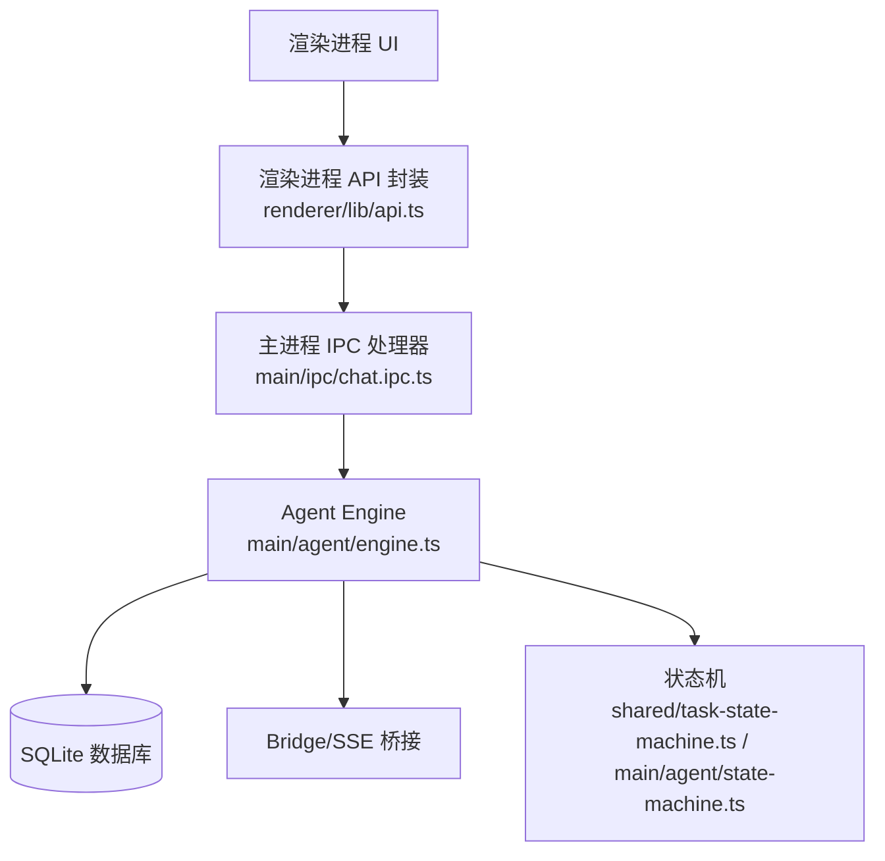
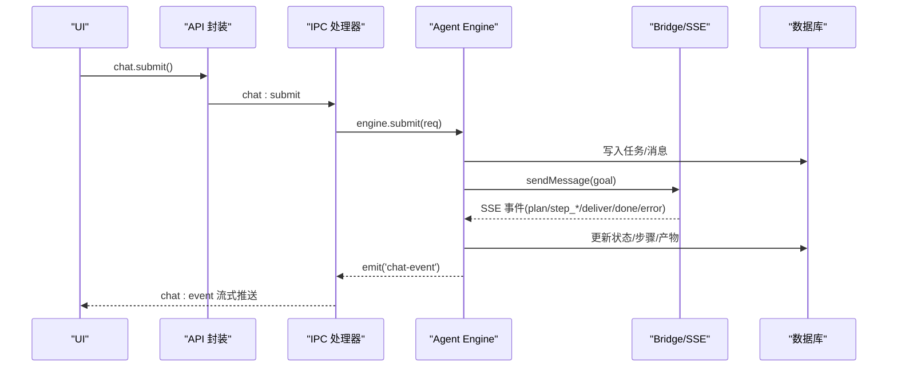
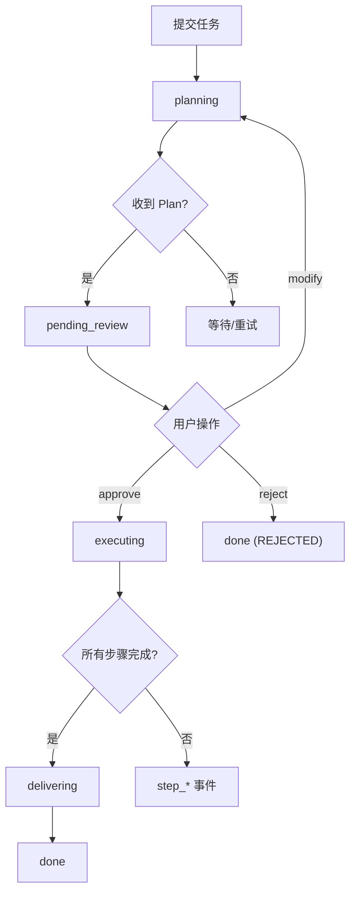
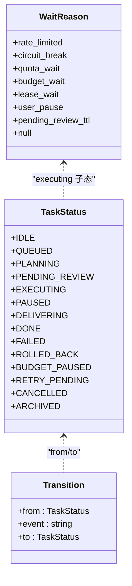
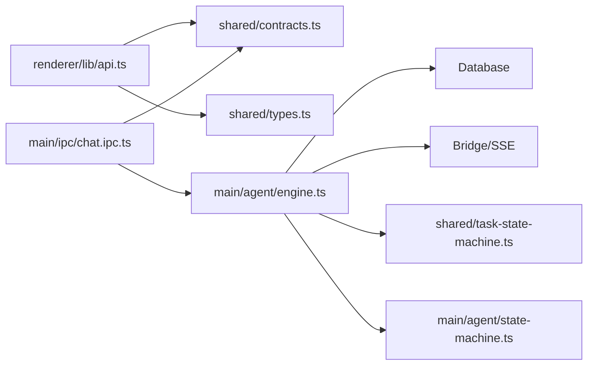

# 聊天与任务 API

<cite>
**本文引用的文件**
- [contracts.ts](file://tongtian-tauri/src/shared/contracts.ts)
- [types.ts](file://tongtian-tauri/src/shared/types.ts)
- [task-state-machine.ts](file://tongtian-tauri/src/shared/task-state-machine.ts)
- [chat.ipc.ts](file://tongtian-tauri/src/main/ipc/chat.ipc.ts)
- [engine.ts](file://tongtian-tauri/src/main/agent/engine.ts)
- [state-machine.ts](file://tongtian-tauri/src/main/agent/state-machine.ts)
- [api.ts](file://tongtian-tauri/src/renderer/lib/api.ts)
- [state-machine-14.test.ts](file://tongtian-tauri/tests/unit/agent/state-machine-14.test.ts)
</cite>

## 目录
1. [简介](#简介)
2. [项目结构](#项目结构)
3. [核心组件](#核心组件)
4. [架构总览](#架构总览)
5. [详细组件分析](#详细组件分析)
6. [依赖关系分析](#依赖关系分析)
7. [性能考量](#性能考量)
8. [故障排查指南](#故障排查指南)
9. [结论](#结论)
10. [附录：调用示例与最佳实践](#附录调用示例与最佳实践)

## 简介
本文件面向“聊天与任务”相关 API，覆盖以下命令接口的请求参数、响应格式与错误处理：
- chat_submit：提交对话目标，启动 Agent 流程
- chat_review：审阅计划（两阶段协议）
- chat_control：控制运行中任务（暂停/继续/回滚）
- chat_history：查询历史任务
- chat_cancel：取消任务（P0 新增）

同时说明两阶段协议的工作流程：计划生成 → 用户审阅 → 执行；并完整记录 ChatEvent 事件流（plan、step_start、step_progress、step_done、step_failed、deliver、done、error 等），以及 14 态任务状态机（含 wait_reason 子态与重试上限）。

## 项目结构
聊天与任务能力由三层构成：
- 共享契约层：定义 IPC Channel、请求/响应类型、事件类型与错误码
- 主进程服务层：IPC 处理器 + Agent Engine（事件转发、状态迁移、持久化）
- 渲染进程封装层：类型安全的 API 封装，供 UI 调用

图表来源
- [api.ts:33-69](file://tongtian-tauri/src/renderer/lib/api.ts#L33-L69)
- [chat.ipc.ts:122-189](file://tongtian-tauri/src/main/ipc/chat.ipc.ts#L122-L189)
- [engine.ts:56-102](file://tongtian-tauri/src/main/agent/engine.ts#L56-L102)
- [task-state-machine.ts:63-133](file://tongtian-tauri/src/shared/task-state-machine.ts#L63-L133)
- [state-machine.ts:31-63](file://tongtian-tauri/src/main/agent/state-machine.ts#L31-L63)

章节来源
- [contracts.ts:480-584](file://tongtian-tauri/src/shared/contracts.ts#L480-L584)
- [api.ts:33-69](file://tongtian-tauri/src/renderer/lib/api.ts#L33-L69)
- [chat.ipc.ts:122-189](file://tongtian-tauri/src/main/ipc/chat.ipc.ts#L122-L189)
- [engine.ts:56-102](file://tongtian-tauri/src/main/agent/engine.ts#L56-L102)

## 核心组件
- 共享契约（contracts.ts/types.ts）
  - 定义 IPC 通道名（如 CHAT_SUBMIT、CHAT_REVIEW、CHAT_CONTROL、CHAT_HISTORY、CHAT_EVENT、CHAT_CANCEL）
  - 定义 ChatSubmitReq、ChatReviewReq、ChatControlReq、ChatEvent、TaskSummary 等类型
  - 定义 ErrorCode 枚举（模型、文件、任务、配置、工作区、技能、MCP、沙箱、合规、桥接、调度、通用等）
  - 定义 TaskStatus（14 态）、WaitReason、StepType、PlanStatus、StepStatus 等
- 主进程 IPC（chat.ipc.ts）
  - 使用 Zod 校验请求参数
  - 将请求路由到 AgentEngine 的 submit/review/control/getHistory
  - 通过 BrowserWindow 向渲染进程转发 chat:event 流式事件
- Agent Engine（engine.ts）
  - 负责创建任务、发送目标到 Bridge、监听 SSE 事件、驱动状态机、持久化消息/步骤/产物
  - 维护活跃任务表、AbortController 支持取消
- 状态机（task-state-machine.ts / state-machine.ts）
  - shared 层提供 14 态转移表、guard（重试上限）、wait_reason 子态管理
  - main 层提供简单规则引擎与历史记录

章节来源
- [contracts.ts:15-158](file://tongtian-tauri/src/shared/contracts.ts#L15-L158)
- [types.ts:3-41](file://tongtian-tauri/src/shared/types.ts#L3-L41)
- [task-state-machine.ts:16-43](file://tongtian-tauri/src/shared/task-state-machine.ts#L16-L43)
- [state-machine.ts:31-63](file://tongtian-tauri/src/main/agent/state-machine.ts#L31-L63)

## 架构总览
两阶段协议（计划生成 → 用户审阅 → 执行）在 Engine 中的实现要点：
- 提交后进入 planning，收到 plan 事件后转为 pending_review，等待用户 review
- 用户 approve → executing；reject → done（REJECTED）；modify → planning 重新规划
- 执行过程中持续推送 step_* 与 deliver/done/error 等事件

图表来源
- [api.ts:33-69](file://tongtian-tauri/src/renderer/lib/api.ts#L33-L69)
- [chat.ipc.ts:127-136](file://tongtian-tauri/src/main/ipc/chat.ipc.ts#L127-L136)
- [engine.ts:56-102](file://tongtian-tauri/src/main/agent/engine.ts#L56-L102)
- [engine.ts:295-331](file://tongtian-tauri/src/main/agent/engine.ts#L295-L331)
- [engine.ts:351-454](file://tongtian-tauri/src/main/agent/engine.ts#L351-L454)

## 详细组件分析

### 命令接口：chat_submit
- 通道：chat:submit
- 请求体（ChatSubmitReq）
  - taskId?: string（可选，未提供则服务端生成）
  - goal: string（必填，长度限制见校验）
  - modelBinding?: string（可选）
  - attachments?: AttachmentMeta[]（可选，附件元数据）
- 响应
  - { taskId: string }
- 行为
  - 创建任务记录（初始状态 idle），随后立即转入 planning
  - 无可用工作区时返回失败并推送 error 事件
  - 非阻塞地发送目标到 Bridge，后台处理 SSE 事件
- 错误处理
  - 参数校验失败：VALIDATION_ERROR
  - 无工作区：WORKSPACE_NOT_FOUND
  - Bridge 通信失败：BRIDGE_COMMUNICATION_FAILED
  - 其他异常：INTERNAL_ERROR

章节来源
- [contracts.ts:121-127](file://tongtian-tauri/src/shared/contracts.ts#L121-L127)
- [types.ts:258-276](file://tongtian-tauri/src/shared/types.ts#L258-L276)
- [chat.ipc.ts:19-23](file://tongtian-tauri/src/main/ipc/chat.ipc.ts#L19-L23)
- [chat.ipc.ts:47-58](file://tongtian-tauri/src/main/ipc/chat.ipc.ts#L47-L58)
- [engine.ts:56-102](file://tongtian-tauri/src/main/agent/engine.ts#L56-L102)
- [engine.ts:295-331](file://tongtian-tauri/src/main/agent/engine.ts#L295-L331)

### 命令接口：chat_review
- 通道：chat:review
- 请求体（ChatReviewReq）
  - planId: string（必填）
  - action: 'approve' | 'reject' | 'modify'（必填）
  - patch?: Record<string, unknown> 或 Partial<Step>[]（可选，用于 modify）
- 响应
  - { ok: boolean; status?: string }（根据实现可能不同，至少包含 ok）
- 行为
  - approve：更新计划状态为 approved，任务进入 executing，通知 Agent 开始执行
  - reject：标记计划 rejected，任务进入 done（REJECTED），推送 done 事件
  - modify：标记计划草稿，任务回到 planning，携带 patch 重新规划
- 错误处理
  - 找不到 plan 或未找到活跃任务：返回 ok=false
  - 通知 Agent 失败：记录日志但不阻断后续流程

章节来源
- [contracts.ts:129-133](file://tongtian-tauri/src/shared/contracts.ts#L129-L133)
- [types.ts:305-309](file://tongtian-tauri/src/shared/types.ts#L305-L309)
- [chat.ipc.ts:25-29](file://tongtian-tauri/src/main/ipc/chat.ipc.ts#L25-L29)
- [engine.ts:107-185](file://tongtian-tauri/src/main/agent/engine.ts#L107-L185)

### 命令接口：chat_control
- 通道：chat:control
- 请求体（ChatControlReq）
  - taskId: string（必填）
  - action: 'pause' | 'resume' | 'rollback_to'（必填）
  - stepId?: string（可选，回滚目标步骤）
- 响应
  - { ok: boolean; status?: string }
- 行为
  - pause：从 executing → paused
  - resume：从 paused → executing
  - rollback_to：触发回滚逻辑（Engine 内部处理），完成后清理活跃任务
- 错误处理
  - 任务不存在或无活跃任务：ok=false
  - 动作在当前状态非法：ok=false

章节来源
- [contracts.ts:135-139](file://tongtian-tauri/src/shared/contracts.ts#L135-L139)
- [types.ts:311-315](file://tongtian-tauri/src/shared/types.ts#L311-L315)
- [chat.ipc.ts:31-35](file://tongtian-tauri/src/main/ipc/chat.ipc.ts#L31-L35)
- [engine.ts:190-239](file://tongtian-tauri/src/main/agent/engine.ts#L190-L239)
- [state-machine.ts:145-159](file://tongtian-tauri/src/main/agent/state-machine.ts#L145-L159)

### 命令接口：chat_history
- 通道：chat:history
- 请求体
  - limit?: number（默认 50，最大 500）
- 响应
  - TaskSummary[]（id/title/status/createdAt/updatedAt）
- 行为
  - 按创建时间倒序取最近 N 条任务摘要
- 错误处理
  - 参数校验失败：VALIDATION_ERROR

章节来源
- [contracts.ts:278-286](file://tongtian-tauri/src/shared/contracts.ts#L278-L286)
- [chat.ipc.ts:37-39](file://tongtian-tauri/src/main/ipc/chat.ipc.ts#L37-L39)
- [engine.ts:244-258](file://tongtian-tauri/src/main/agent/engine.ts#L244-L258)

### 命令接口：chat_cancel（P0 新增）
- 通道：chat:cancel
- 请求体
  - taskId: string（必填）
  - workspaceId?: string（可选）
- 响应
  - { taskId: string; cancelled: boolean }
- 行为
  - 对活跃任务调用 AbortController 中止，并清理活跃任务
  - 状态机层面支持多来源态取消（queued/planning/executing/paused/budget_paused）→ cancelled
- 错误处理
  - 若底层方法不可用（旧版本），降级返回 cancelled=false

章节来源
- [contracts.ts:577-578](file://tongtian-tauri/src/shared/contracts.ts#L577-L578)
- [api.ts:49-52](file://tongtian-tauri/src/renderer/lib/api.ts#L49-L52)
- [api.ts:171-175](file://tongtian-tauri/src/renderer/lib/api.ts#L171-L175)
- [engine.ts:273-279](file://tongtian-tauri/src/main/agent/engine.ts#L273-L279)

### 事件流：ChatEvent
- 通道：chat:event（SSE 事件经 IPC 转发）
- 事件类型
  - plan：{ type:'plan', planId, steps[], seq?, taskId? }
  - step_start：{ type:'step_start', stepId, stepType, description, seq?, taskId? }
  - step_progress：{ type:'step_progress', stepId, progress, message, seq?, taskId? }
  - step_done：{ type:'step_done', stepId, output, usage?, seq?, taskId? }
  - step_failed：{ type:'step_failed', stepId, error, seq?, taskId? }
  - deliver：{ type:'deliver', taskId, summary, artifacts[], seq? }
  - done：{ type:'done', taskId, seq? }
  - error：{ type:'error', code, message, seq?, taskId? }
  - status_change：{ type:'status_change', taskId, status, waitReason?, statusReasonCode?, queuePosition?, seq? }
  - quota_warning：{ type:'quota_warning', level, action, usedTokens, quotaTokens, seq? }
  - heartbeat：{ type:'heartbeat', seq? }
- 行为
  - Engine 接收 Bridge SSE 事件，转换为 ChatEvent 并通过事件总线发出
  - IPC 层订阅事件并转发至渲染进程
- 错误处理
  - 事件转发失败会记录警告，不影响主流程

章节来源
- [contracts.ts:141-158](file://tongtian-tauri/src/shared/contracts.ts#L141-L158)
- [types.ts:286-303](file://tongtian-tauri/src/shared/types.ts#L286-L303)
- [chat.ipc.ts:87-112](file://tongtian-tauri/src/main/ipc/chat.ipc.ts#L87-L112)
- [engine.ts:351-454](file://tongtian-tauri/src/main/agent/engine.ts#L351-L454)

### 两阶段协议工作流程
- 计划生成：submit → planning → 收到 plan 事件 → pending_review
- 用户审阅：approve → executing；reject → done(REJECTED)；modify → planning（带 patch）
- 执行：executing → 逐步推进 step_* → all_steps_done → delivering → done

图表来源
- [engine.ts:56-102](file://tongtian-tauri/src/main/agent/engine.ts#L56-L102)
- [engine.ts:107-185](file://tongtian-tauri/src/main/agent/engine.ts#L107-L185)
- [engine.ts:295-331](file://tongtian-tauri/src/main/agent/engine.ts#L295-L331)
- [engine.ts:351-454](file://tongtian-tauri/src/main/agent/engine.ts#L351-L454)

### 14 态任务状态机
- 状态集合（TaskStatus）
  - IDLE、PLANNING、PENDING_REVIEW、EXECUTING、PAUSED、DELIVERING、DONE、FAILED、ROLLED_BACK
  - QUEUED（排队）、BUDGET_PAUSED（预算暂停）、RETRY_PENDING（自动重试等待）、CANCELLED（已取消）、ARCHIVED（已归档）
- 等待原因（WaitReason）
  - rate_limited、circuit_break、quota_wait、budget_wait、lease_wait、user_pause、pending_review_ttl、null
- 合法转移（35 条）
  - 包括队列超时、租约丢失、预算耗尽/恢复、重试耗尽、手动重试、归档等
- 关键约束
  - retryable_error 在 retryCount≥3 时直接路由到 failed（重试耗尽）
  - 仅 EXECUTING 允许设置 wait_reason 子态
  - CANCELLED、ARCHIVED 为终态（无出边）

图表来源
- [types.ts:3-41](file://tongtian-tauri/src/shared/types.ts#L3-L41)
- [task-state-machine.ts:63-133](file://tongtian-tauri/src/shared/task-state-machine.ts#L63-L133)

章节来源
- [task-state-machine.ts:16-43](file://tongtian-tauri/src/shared/task-state-machine.ts#L16-L43)
- [task-state-machine.ts:63-133](file://tongtian-tauri/src/shared/task-state-machine.ts#L63-L133)
- [task-state-machine.ts:141-155](file://tongtian-tauri/src/shared/task-state-machine.ts#L141-L155)
- [task-state-machine.ts:165-222](file://tongtian-tauri/src/shared/task-state-machine.ts#L165-L222)
- [state-machine-14.test.ts:18-39](file://tongtian-tauri/tests/unit/agent/state-machine-14.test.ts#L18-L39)
- [state-machine-14.test.ts:41-121](file://tongtian-tauri/tests/unit/agent/state-machine-14.test.ts#L41-L121)
- [state-machine-14.test.ts:123-183](file://tongtian-tauri/tests/unit/agent/state-machine-14.test.ts#L123-L183)
- [state-machine-14.test.ts:185-212](file://tongtian-tauri/tests/unit/agent/state-machine-14.test.ts#L185-L212)

## 依赖关系分析
- 渲染进程 api.ts 依赖 shared 契约与 types，封装 chat/model/file/system/p0 系列 API
- 主进程 chat.ipc.ts 依赖 shared 契约与 zod 校验，调用 engine 并转发事件
- engine.ts 依赖 Database、Bridge、AgentStateMachine、Logger，并驱动状态迁移与事件分发
- task-state-machine.ts 提供统一的 14 态转移表与 guard，被测试与上层逻辑共用

图表来源
- [api.ts:33-69](file://tongtian-tauri/src/renderer/lib/api.ts#L33-L69)
- [chat.ipc.ts:122-189](file://tongtian-tauri/src/main/ipc/chat.ipc.ts#L122-L189)
- [engine.ts:56-102](file://tongtian-tauri/src/main/agent/engine.ts#L56-L102)
- [task-state-machine.ts:63-133](file://tongtian-tauri/src/shared/task-state-machine.ts#L63-L133)
- [state-machine.ts:31-63](file://tongtian-tauri/src/main/agent/state-machine.ts#L31-L63)

章节来源
- [api.ts:33-69](file://tongtian-tauri/src/renderer/lib/api.ts#L33-L69)
- [chat.ipc.ts:122-189](file://tongtian-tauri/src/main/ipc/chat.ipc.ts#L122-L189)
- [engine.ts:56-102](file://tongtian-tauri/src/main/agent/engine.ts#L56-L102)

## 性能考量
- 本地 local-first 退化：queued 停留目标 <100ms，减少排队感知延迟
- 事件流：SSE 事件经 IPC 转发，避免阻塞主流程
- 重试策略：retry_pending 退避窗口，最多 3 次；超限直接失败
- 配额与预算：四档预警（70/85/95/100%），动作链降级→排队→阻断
- 资源限制：CPU/内存/磁盘写带宽限制（ResourceLimits）

章节来源
- [task-state-machine.ts:54-55](file://tongtian-tauri/src/shared/task-state-machine.ts#L54-L55)
- [task-state-machine.ts:51-52](file://tongtian-tauri/src/shared/task-state-machine.ts#L51-L52)
- [contracts.ts:311-321](file://tongtian-tauri/src/shared/contracts.ts#L311-L321)
- [contracts.ts:339-343](file://tongtian-tauri/src/shared/contracts.ts#L339-L343)

## 故障排查指南
- 参数校验失败：检查 ChatSubmitReq/ChatReviewReq/ChatControlReq 字段是否符合 schema
- 无工作区：确保存在活跃工作区后再提交
- Bridge 通信失败：检查 Python 环境、Agent 进程、SSE 连接
- 状态非法：确认当前任务状态是否允许该控制动作（如 paused 才能 resume）
- 重试耗尽：当 retryCount≥3 时，retryable_error 将直接失败，需人工介入
- 事件丢失：检查 chat:event 订阅是否正确建立，窗口关闭时会移除监听器

章节来源
- [chat.ipc.ts:47-83](file://tongtian-tauri/src/main/ipc/chat.ipc.ts#L47-L83)
- [engine.ts:81-91](file://tongtian-tauri/src/main/agent/engine.ts#L81-L91)
- [engine.ts:295-331](file://tongtian-tauri/src/main/agent/engine.ts#L295-L331)
- [task-state-machine.ts:165-222](file://tongtian-tauri/src/shared/task-state-machine.ts#L165-L222)

## 结论
本 API 体系以共享契约为核心，结合主进程 IPC 与 Agent Engine，实现了稳定的聊天与任务管理能力。两阶段协议保障用户对计划的审阅权；14 态状态机提供严谨的生命周期管理与容错机制；事件流提供实时反馈。建议在集成时严格遵循参数校验、事件订阅与状态机约束，以获得稳定可靠的体验。

## 附录：调用示例与最佳实践
- 提交任务
  - 调用 chat.submit({ goal, modelBinding?, attachments? })
  - 监听 chat.onEvent 获取 plan/step_* 等事件
  - 最佳实践：goal 简洁明确；必要时提供 modelBinding 指定模型；attachments 先暂存再提交
- 审阅计划
  - 收到 plan 事件后展示步骤预览
  - 调用 chat.review({ planId, action, patch? })
  - 最佳实践：modify 时尽量最小化 patch；reject 时给出清晰原因
- 控制任务
  - 运行中可调用 chat.control({ taskId, action, stepId? })
  - 最佳实践：仅在 executing 时 pause；paused 时 resume；rollback_to 指定目标步骤
- 查询历史
  - 调用 chat.history({ limit? })
  - 最佳实践：limit 不超过 500，分页加载
- 取消任务
  - 调用 p0.cancel(taskId, workspaceId?)
  - 最佳实践：及时取消不再需要的任务，释放资源
- 事件处理
  - 订阅 chat.onEvent，处理 plan/step_* / deliver / done / error / status_change / quota_warning / heartbeat
  - 最佳实践：基于 seq 去重与排序；遇到 error 及时提示用户

章节来源
- [api.ts:33-69](file://tongtian-tauri/src/renderer/lib/api.ts#L33-L69)
- [api.ts:171-196](file://tongtian-tauri/src/renderer/lib/api.ts#L171-L196)
- [contracts.ts:141-158](file://tongtian-tauri/src/shared/contracts.ts#L141-L158)
- [types.ts:286-303](file://tongtian-tauri/src/shared/types.ts#L286-L303)