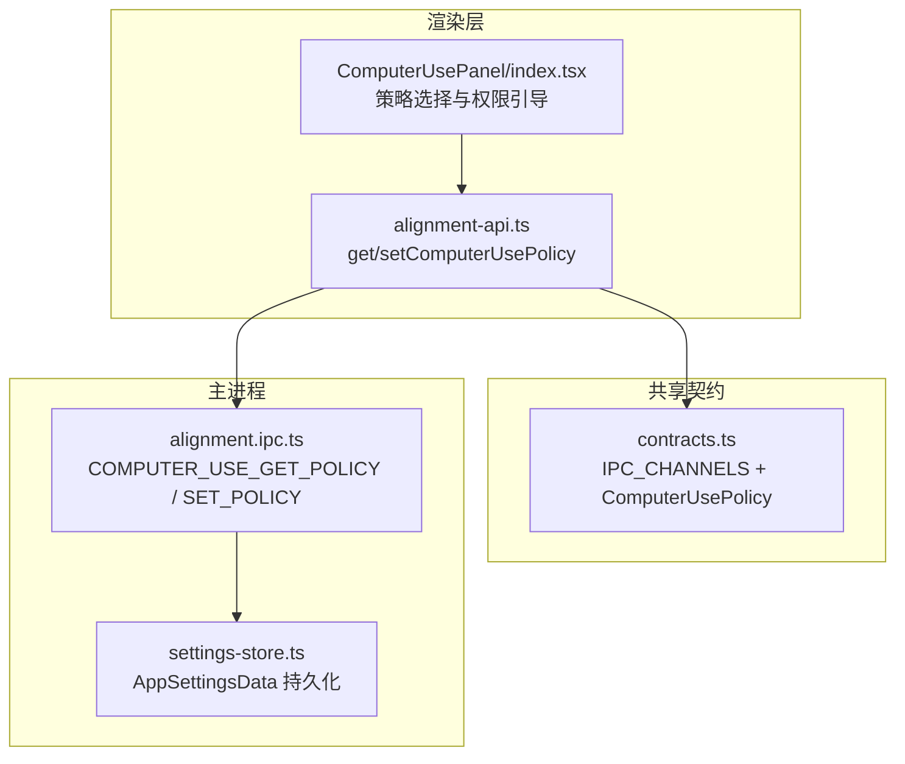
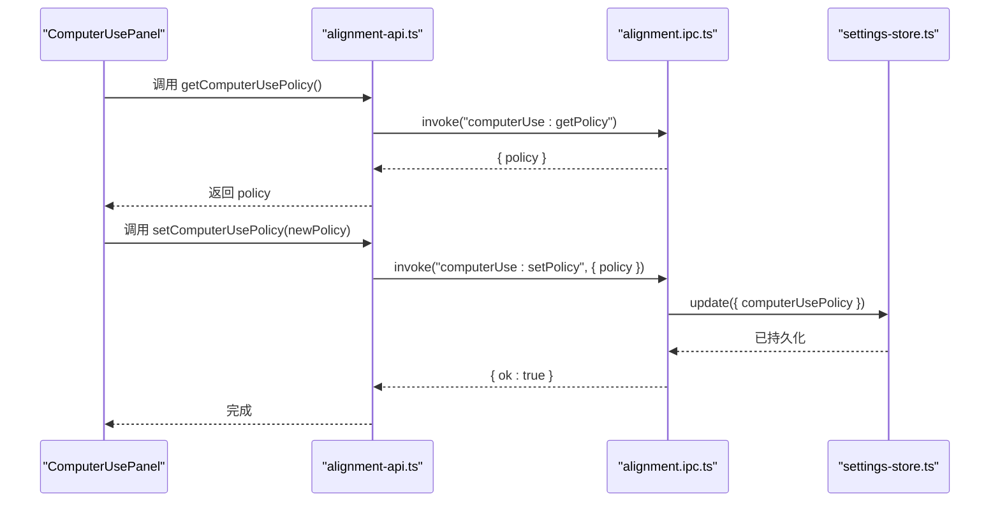
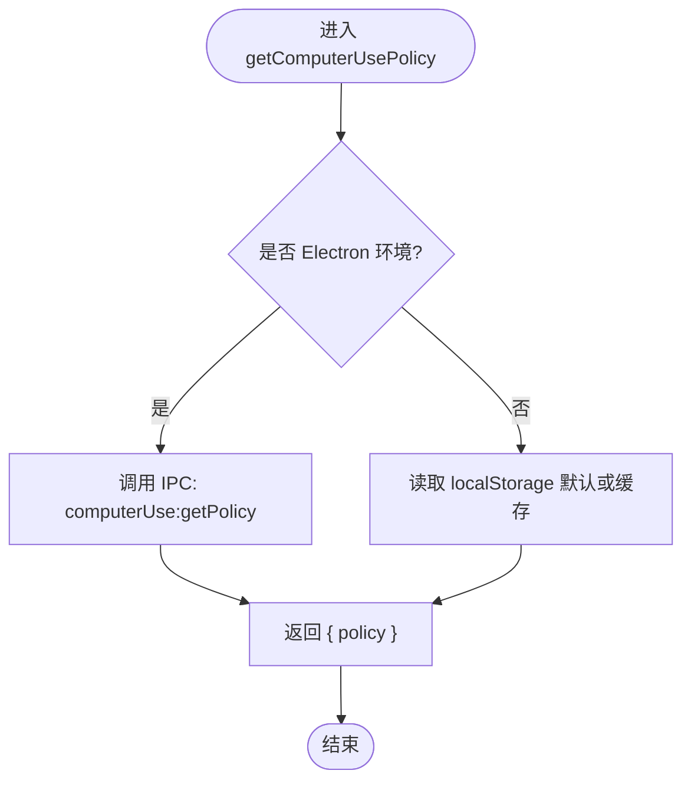
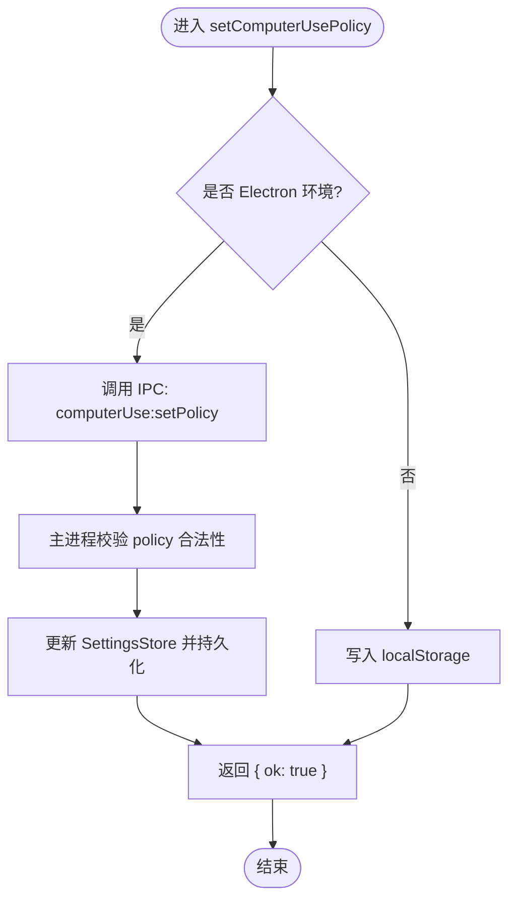
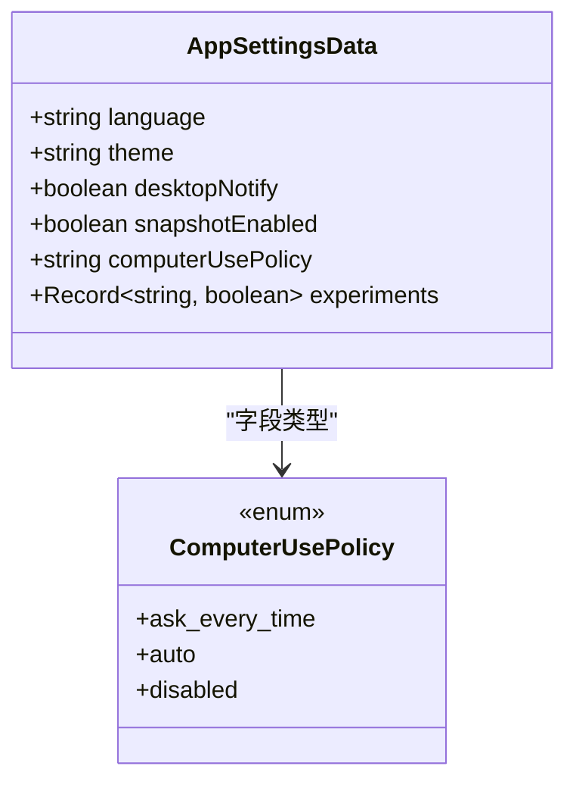
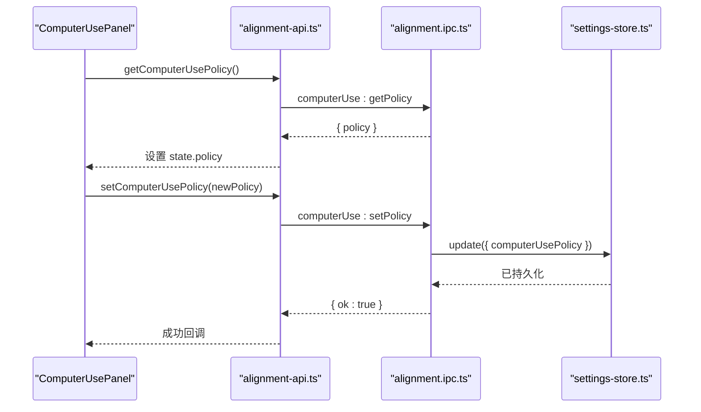
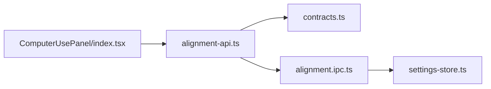

# 计算机使用 API

<cite>
**本文引用的文件**   
- [contracts.ts](file://tongtian-tauri/src/shared/contracts.ts)
- [alignment-api.ts](file://tongtian-tauri/src/renderer/lib/alignment-api.ts)
- [alignment.ipc.ts](file://tongtian-tauri/src/main/ipc/alignment.ipc.ts)
- [settings-store.ts](file://tongtian-tauri/src/main/store/settings-store.ts)
- [ComputerUsePanel/index.tsx](file://tongtian-tauri/src/renderer/pages/ComputerUsePanel/index.tsx)
</cite>

## 目录
1. [简介](#简介)
2. [项目结构](#项目结构)
3. [核心组件](#核心组件)
4. [架构总览](#架构总览)
5. [详细组件分析](#详细组件分析)
6. [依赖分析](#依赖分析)
7. [性能考虑](#性能考虑)
8. [故障排查指南](#故障排查指南)
9. [结论](#结论)
10. [附录：配置示例与最佳实践](#附录配置示例与最佳实践)

## 简介
本文件面向“计算机使用”能力，提供桌面自动化控制的 API 文档。重点覆盖以下接口与策略：
- 获取策略：computerUse_getPolicy（对应 IPC 通道 computerUse:getPolicy）
- 设置策略：computerUse_setPolicy（对应 IPC 通道 computerUse:setPolicy）
- ComputerUsePolicy 策略模式：ask_every_time、auto、disabled
- 权限与安全约束：截屏、辅助功能、鼠标键盘模拟、窗口操作、屏幕捕获等
- 人机协作模式：每次询问、自动执行、禁用三种模式的适用场景与配置建议

该能力通过渲染层（前端）调用 IPC，主进程持久化到设置存储，并在 UI 面板中暴露给用户进行管理与授权引导。

## 项目结构
围绕“计算机使用”的 API 涉及三层：
- 共享契约层：定义 IPC 通道名与类型
- 渲染层（前端）：封装 API 调用，提供 UI 交互
- 主进程（后端）：处理 IPC 请求，读写设置并落地系统行为

**图表来源** 
- [contracts.ts:478-586](file://tongtian-tauri/src/shared/contracts.ts#L478-L586)
- [alignment-api.ts:288-306](file://tongtian-tauri/src/renderer/lib/alignment-api.ts#L288-L306)
- [alignment.ipc.ts:236-248](file://tongtian-tauri/src/main/ipc/alignment.ipc.ts#L236-L248)
- [settings-store.ts:15-41](file://tongtian-tauri/src/main/store/settings-store.ts#L15-L41)

**章节来源**
- [contracts.ts:478-586](file://tongtian-tauri/src/shared/contracts.ts#L478-L586)
- [alignment-api.ts:288-306](file://tongtian-tauri/src/renderer/lib/alignment-api.ts#L288-L306)
- [alignment.ipc.ts:236-248](file://tongtian-tauri/src/main/ipc/alignment.ipc.ts#L236-L248)
- [settings-store.ts:15-41](file://tongtian-tauri/src/main/store/settings-store.ts#L15-L41)

## 核心组件
- 共享契约（contracts.ts）
  - 定义 ComputerUsePolicy 枚举值：'ask_every_time' | 'auto' | 'disabled'
  - 定义 AppSettingsData 中的 computerUsePolicy 字段
  - 定义 IPC 通道名：COMPUTER_USE_GET_POLICY、COMPUTER_USE_SET_POLICY
- 渲染层 API（alignment-api.ts）
  - getComputerUsePolicy：读取当前策略（Electron 环境走 IPC，浏览器开发回退 localStorage）
  - setComputerUsePolicy：写入新策略（Electron 环境走 IPC，浏览器开发回退 localStorage）
- 主进程 IPC（alignment.ipc.ts）
  - 注册两个处理器：获取策略、设置策略
  - 设置策略时进行参数校验（仅允许三种合法值）
  - 更新 SettingsStore 中的 computerUsePolicy
- 设置存储（settings-store.ts）
  - 默认值包含 computerUsePolicy: 'ask_every_time'
  - 增量更新并持久化到 SQLite
- 用户界面（ComputerUsePanel/index.tsx）
  - 展示三档策略，支持切换并调用 setComputerUsePolicy
  - 展示权限状态与风险提示

**章节来源**
- [contracts.ts:446-476](file://tongtian-tauri/src/shared/contracts.ts#L446-L476)
- [contracts.ts:574-575](file://tongtian-tauri/src/shared/contracts.ts#L574-L575)
- [alignment-api.ts:288-306](file://tongtian-tauri/src/renderer/lib/alignment-api.ts#L288-L306)
- [alignment.ipc.ts:236-248](file://tongtian-tauri/src/main/ipc/alignment.ipc.ts#L236-L248)
- [settings-store.ts:15-41](file://tongtian-tauri/src/main/store/settings-store.ts#L15-L41)
- [ComputerUsePanel/index.tsx:21-66](file://tongtian-tauri/src/renderer/pages/ComputerUsePanel/index.tsx#L21-L66)

## 架构总览
下图展示了从 UI 到主进程的完整调用链，以及策略数据的流向。

**图表来源** 
- [alignment-api.ts:288-306](file://tongtian-tauri/src/renderer/lib/alignment-api.ts#L288-L306)
- [alignment.ipc.ts:236-248](file://tongtian-tauri/src/main/ipc/alignment.ipc.ts#L236-L248)
- [settings-store.ts:74-92](file://tongtian-tauri/src/main/store/settings-store.ts#L74-L92)

## 详细组件分析

### 接口：computerUse_getPolicy
- 通道名：computerUse:getPolicy
- 入参：无
- 出参：{ policy: string }，policy 为 'ask_every_time' | 'auto' | 'disabled'
- 行为说明：
  - 渲染层优先通过 Electron IPC 调用主进程；若不在 Electron 环境则回退到 localStorage
  - 主进程从 SettingsStore 读取当前 computerUsePolicy 并返回

**图表来源** 
- [alignment-api.ts:288-306](file://tongtian-tauri/src/renderer/lib/alignment-api.ts#L288-L306)
- [alignment.ipc.ts:236-248](file://tongtian-tauri/src/main/ipc/alignment.ipc.ts#L236-L248)

**章节来源**
- [alignment-api.ts:288-306](file://tongtian-tauri/src/renderer/lib/alignment-api.ts#L288-L306)
- [alignment.ipc.ts:236-248](file://tongtian-tauri/src/main/ipc/alignment.ipc.ts#L236-L248)

### 接口：computerUse_setPolicy
- 通道名：computerUse:setPolicy
- 入参：{ policy: 'ask_every_time' | 'auto' | 'disabled' }
- 出参：{ ok: boolean }
- 行为说明：
  - 渲染层优先通过 IPC 调用主进程；非 Electron 环境回退到 localStorage
  - 主进程对入参进行严格校验，仅接受三种合法值
  - 更新 SettingsStore 中的 computerUsePolicy 并持久化

**图表来源** 
- [alignment-api.ts:288-306](file://tongtian-tauri/src/renderer/lib/alignment-api.ts#L288-L306)
- [alignment.ipc.ts:236-248](file://tongtian-tauri/src/main/ipc/alignment.ipc.ts#L236-L248)

**章节来源**
- [alignment-api.ts:288-306](file://tongtian-tauri/src/renderer/lib/alignment-api.ts#L288-L306)
- [alignment.ipc.ts:236-248](file://tongtian-tauri/src/main/ipc/alignment.ipc.ts#L236-L248)

### 策略模型：ComputerUsePolicy
- 取值范围：'ask_every_time'、'auto'、'disabled'
- 语义：
  - ask_every_time：每次需要操控桌面时先征求用户确认（默认）
  - auto：直接执行桌面操作，无需逐次确认
  - disabled：完全关闭电脑操控功能
- 存储位置：AppSettingsData.computerUsePolicy

**图表来源** 
- [contracts.ts:446-476](file://tongtian-tauri/src/shared/contracts.ts#L446-L476)

**章节来源**
- [contracts.ts:446-476](file://tongtian-tauri/src/shared/contracts.ts#L446-L476)

### 用户界面：ComputerUsePanel
- 功能：
  - 展示三档策略，支持点击切换
  - 显示权限状态（截屏、辅助功能），并提供授权入口
  - 展示执行过程透明度（四段式时间线）
  - 风险警示区提示敏感操作注意事项
- 数据流：
  - 初始化时调用 getComputerUsePolicy 加载策略
  - 切换策略时调用 setComputerUsePolicy 保存

**图表来源** 
- [ComputerUsePanel/index.tsx:21-66](file://tongtian-tauri/src/renderer/pages/ComputerUsePanel/index.tsx#L21-L66)
- [alignment-api.ts:288-306](file://tongtian-tauri/src/renderer/lib/alignment-api.ts#L288-L306)
- [alignment.ipc.ts:236-248](file://tongtian-tauri/src/main/ipc/alignment.ipc.ts#L236-L248)
- [settings-store.ts:74-92](file://tongtian-tauri/src/main/store/settings-store.ts#L74-L92)

**章节来源**
- [ComputerUsePanel/index.tsx:21-66](file://tongtian-tauri/src/renderer/pages/ComputerUsePanel/index.tsx#L21-L66)

## 依赖分析
- 渲染层依赖共享契约（IPC_CHANNELS、ComputerUsePolicy）
- 渲染层在 Electron 环境下依赖 window.tongtianAPI.invoke 进行 IPC
- 主进程依赖 SettingsStore 进行设置持久化
- 用户界面依赖渲染层 API 进行策略读写

**图表来源** 
- [contracts.ts:478-586](file://tongtian-tauri/src/shared/contracts.ts#L478-L586)
- [alignment-api.ts:288-306](file://tongtian-tauri/src/renderer/lib/alignment-api.ts#L288-L306)
- [alignment.ipc.ts:236-248](file://tongtian-tauri/src/main/ipc/alignment.ipc.ts#L236-L248)
- [settings-store.ts:74-92](file://tongtian-tauri/src/main/store/settings-store.ts#L74-L92)

**章节来源**
- [contracts.ts:478-586](file://tongtian-tauri/src/shared/contracts.ts#L478-L586)
- [alignment-api.ts:288-306](file://tongtian-tauri/src/renderer/lib/alignment-api.ts#L288-L306)
- [alignment.ipc.ts:236-248](file://tongtian-tauri/src/main/ipc/alignment.ipc.ts#L236-L248)
- [settings-store.ts:74-92](file://tongtian-tauri/src/main/store/settings-store.ts#L74-L92)

## 性能考虑
- IPC 调用开销较小，但应避免频繁轮询策略；建议在 UI 初始化或用户切换时调用
- 设置持久化采用 SQLite 单键值存储，写入成本低
- 浏览器开发模式下使用 localStorage，避免网络 IO，提升调试效率

[本节为通用指导，不直接分析具体文件]

## 故障排查指南
- 无法读取策略
  - 检查是否在 Electron 环境；若非 Electron，确认 localStorage 中存在 tt:computerUsePolicy
  - 检查 IPC 通道是否正确注册（computerUse:getPolicy）
- 设置策略失败
  - 检查传入的 policy 是否为合法值之一
  - 检查主进程日志是否有参数校验错误
- UI 未刷新
  - 确保 setComputerUsePolicy 成功后重新读取策略或触发 UI 重渲染

**章节来源**
- [alignment-api.ts:288-306](file://tongtian-tauri/src/renderer/lib/alignment-api.ts#L288-L306)
- [alignment.ipc.ts:236-248](file://tongtian-tauri/src/main/ipc/alignment.ipc.ts#L236-L248)

## 结论
计算机使用 API 提供了清晰的策略管理能力，通过 IPC 将前端 UI 与主进程设置存储解耦，保证策略的一致性与可追溯性。结合权限引导与风险提示，可在保障安全的前提下实现高效的桌面自动化与人机协作。

[本节为总结性内容，不直接分析具体文件]

## 附录：配置示例与最佳实践
- 策略模式说明
  - ask_every_time（默认）：适合高风险场景，所有桌面操作需用户确认
  - auto：适合可信环境与脚本化流程，减少人工干预
  - disabled：用于临时关闭桌面控制能力
- 权限管理
  - 截屏权限：用于识别界面状态与结果验证
  - 辅助功能权限：用于模拟点击、输入等桌面操作
- 安全约束
  - 屏幕内容可能被截取，请在使用前关闭含敏感信息的窗口
  - 部分操作不可撤销，谨慎使用 auto 模式
  - 验证码与二步验证需人工介入，AI 无法绕过
- 人机协作模式建议
  - 日常办公：ask_every_time
  - 自动化脚本：auto（配合审计与监控）
  - 高敏感任务：disabled 或 ask_every_time

[本节为概念性指导，不直接分析具体文件]