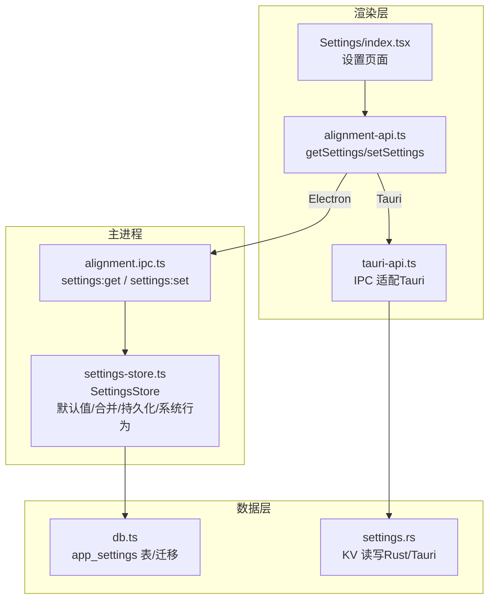
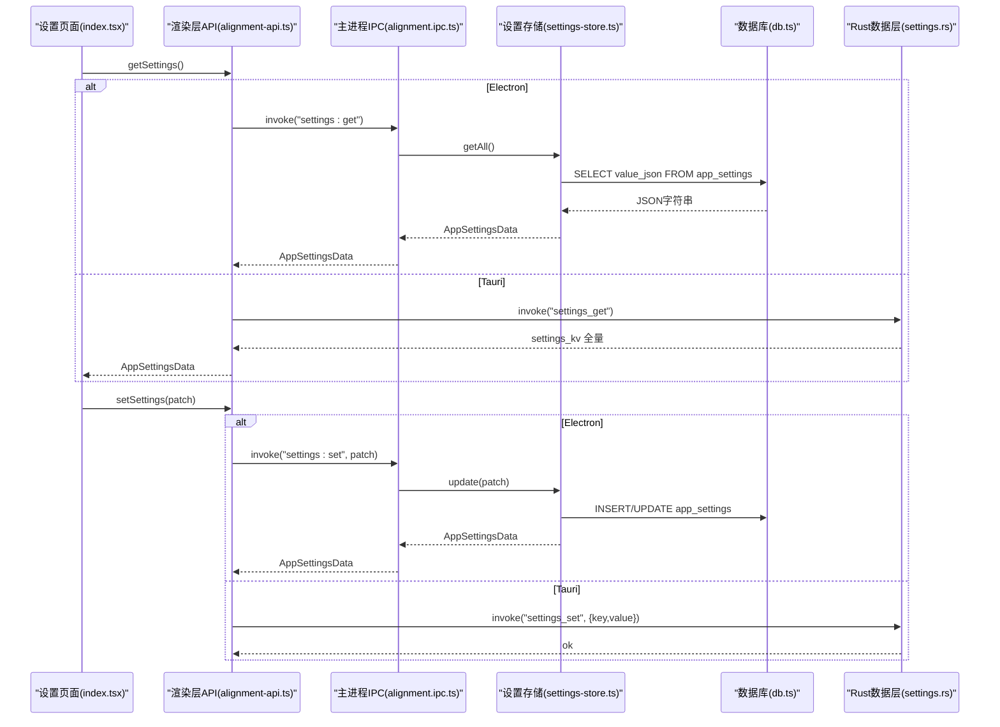
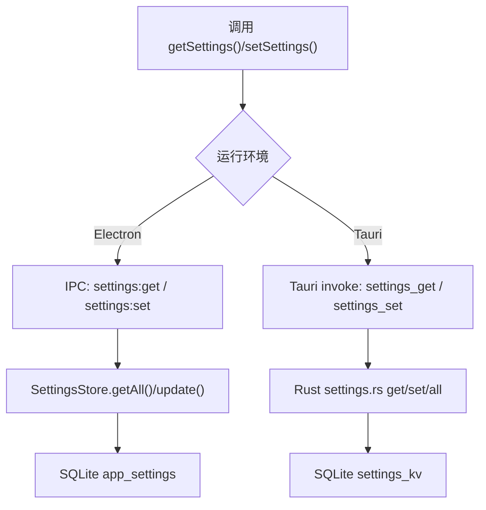
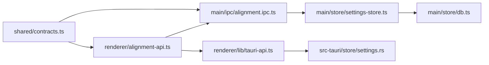

# 设置管理 API

<cite>
**本文引用的文件**   
- [settings-store.ts](file://tongtian-tauri/src/main/store/settings-store.ts)
- [alignment.ipc.ts](file://tongtian-tauri/src/main/ipc/alignment.ipc.ts)
- [contracts.ts](file://tongtian-tauri/src/shared/contracts.ts)
- [db.ts](file://tongtian-tauri/src/main/store/db.ts)
- [alignment-api.ts](file://tongtian-tauri/src/renderer/lib/alignment-api.ts)
- [tauri-api.ts](file://tongtian-tauri/src/renderer/lib/tauri-api.ts)
- [index.tsx](file://tongtian-tauri/src/renderer/pages/Settings/index.tsx)
- [settings.rs](file://tongtian-tauri/src-tauri/src/store/settings.rs)
</cite>

## 目录
1. [简介](#简介)
2. [项目结构](#项目结构)
3. [核心组件](#核心组件)
4. [架构总览](#架构总览)
5. [详细组件分析](#详细组件分析)
6. [依赖关系分析](#依赖关系分析)
7. [性能与一致性](#性能与一致性)
8. [故障排查指南](#故障排查指南)
9. [结论](#结论)
10. [附录：API 参考与示例](#附录api-参考与示例)

## 简介
本文件面向“设置管理”能力，提供 settings_get、settings_set 等命令接口的完整文档。内容覆盖 AppSettingsData 数据结构（UI 配置、主题、通知偏好等）、持久化机制（SQLite + 内存缓存）、系统行为落地（开机自启动、保持唤醒）、默认值处理与迁移策略、以及前端个性化配置与用户偏好管理的调用示例。

## 项目结构
设置管理涉及渲染层、主进程 IPC、设置存储与数据库初始化四个关键位置：
- 渲染层封装：alignment-api.ts、tauri-api.ts
- 主进程 IPC：alignment.ipc.ts
- 设置存储与系统行为：settings-store.ts
- 数据契约与通道名：contracts.ts
- 数据库表结构与迁移：db.ts
- Rust Tauri 侧 KV 读写（settings_get/set 的数据层）：settings.rs
- 设置页面 UI 与使用方式：index.tsx

图表来源 
- [alignment-api.ts:89-105](file://tongtian-tauri/src/renderer/lib/alignment-api.ts#L89-L105)
- [alignment.ipc.ts:72-77](file://tongtian-tauri/src/main/ipc/alignment.ipc.ts#L72-L77)
- [settings-store.ts:56-92](file://tongtian-tauri/src/main/store/settings-store.ts#L56-L92)
- [db.ts:217-221](file://tongtian-tauri/src/main/store/db.ts#L217-L221)
- [tauri-api.ts:81-82](file://tongtian-tauri/src/renderer/lib/tauri-api.ts#L81-L82)
- [settings.rs:6-30](file://tongtian-tauri/src-tauri/src/store/settings.rs#L6-L30)

章节来源
- [alignment-api.ts:89-105](file://tongtian-tauri/src/renderer/lib/alignment-api.ts#L89-L105)
- [alignment.ipc.ts:72-77](file://tongtian-tauri/src/main/ipc/alignment.ipc.ts#L72-L77)
- [settings-store.ts:56-92](file://tongtian-tauri/src/main/store/settings-store.ts#L56-L92)
- [db.ts:217-221](file://tongtian-tauri/src/main/store/db.ts#L217-L221)
- [tauri-api.ts:81-82](file://tongtian-tauri/src/renderer/lib/tauri-api.ts#L81-L82)
- [settings.rs:6-30](file://tongtian-tauri/src-tauri/src/store/settings.rs#L6-L30)

## 核心组件
- AppSettingsData 数据结构：定义在 contracts.ts，包含语言、主题、界面风格、对话字体/字号/宽度、预览模式、提示建议、工具调用展示、开机自启、保持唤醒、桌面通知、任务栏未读、声音通知、代理模式、隐私模式、语音输入、应用快照、QuickPick、电脑操控策略、安全工作环境、工作台模式与默认模式、实验特性开关等。
- SettingsStore（主进程）：负责读取全部设置（内存缓存 + SQLite）、增量更新并落库、应用系统级行为（开机自启动、保持唤醒）。
- alignment.ipc.ts（主进程 IPC）：注册 settings:get 与 settings:set 通道，接收渲染层请求并委托 SettingsStore。
- alignment-api.ts（渲染层）：Electron 环境下通过 window.tongtianAPI.invoke 走真实 IPC；浏览器开发环境回退到 localStorage 模拟。
- tauri-api.ts（Tauri 适配）：将渲染层 channel 映射为 Tauri invoke 调用（settings_get / settings_set）。
- db.ts（数据库）：定义 app_settings 表及 schema_version 迁移逻辑。
- settings.rs（Rust/Tauri）：settings_kv 表的 get/set/all 实现，作为 Tauri 端 settings_get/set 的数据层。

章节来源
- [contracts.ts:449-476](file://tongtian-tauri/src/shared/contracts.ts#L449-L476)
- [settings-store.ts:15-41](file://tongtian-tauri/src/main/store/settings-store.ts#L15-L41)
- [settings-store.ts:56-92](file://tongtian-tauri/src/main/store/settings-store.ts#L56-L92)
- [alignment.ipc.ts:72-77](file://tongtian-tauri/src/main/ipc/alignment.ipc.ts#L72-L77)
- [alignment-api.ts:89-105](file://tongtian-tauri/src/renderer/lib/alignment-api.ts#L89-L105)
- [tauri-api.ts:81-82](file://tongtian-tauri/src/renderer/lib/tauri-api.ts#L81-L82)
- [db.ts:217-221](file://tongtian-tauri/src/main/store/db.ts#L217-L221)
- [settings.rs:6-30](file://tongtian-tauri/src-tauri/src/store/settings.rs#L6-L30)

## 架构总览
设置管理的端到端流程如下：
- 渲染层调用 getSettings/setSettings
- Electron 环境：通过 window.tongtianAPI.invoke 发送 IPC 通道
- 主进程 IPC 处理器接收后调用 SettingsStore
- SettingsStore 合并默认值与补丁，写入 SQLite，并触发系统行为
- Tauri 环境：通过 tauri-api.ts 映射为 invoke('settings_get'/'settings_set')，由 Rust 侧 settings.rs 读写 settings_kv

图表来源 
- [alignment-api.ts:89-105](file://tongtian-tauri/src/renderer/lib/alignment-api.ts#L89-L105)
- [alignment.ipc.ts:72-77](file://tongtian-tauri/src/main/ipc/alignment.ipc.ts#L72-L77)
- [settings-store.ts:56-92](file://tongtian-tauri/src/main/store/settings-store.ts#L56-L92)
- [db.ts:217-221](file://tongtian-tauri/src/main/store/db.ts#L217-L221)
- [tauri-api.ts:81-82](file://tongtian-tauri/src/renderer/lib/tauri-api.ts#L81-L82)
- [settings.rs:6-30](file://tongtian-tauri/src-tauri/src/store/settings.rs#L6-L30)

## 详细组件分析

### 数据结构：AppSettingsData
- 字段类别
  - UI 与主题：language、theme、uiStyle、chatFont、chatFontSize、chatWidth、previewMode
  - 交互体验：promptSuggestion、expandToolCalls、imShowToolProcess
  - 系统与通知：autoStart、keepAwake、desktopNotify、badgeUnread、soundNotify、proxyMode、privacyMode
  - 功能开关：voiceEnabled、snapshotEnabled、quickPickEnabled、secureEnv
  - 工作台：workbenchModes、workbenchDefaultMode
  - 实验特性：experiments（键值对布尔开关）
  - 其他扩展：computerUsePolicy 等
- 默认值与兼容性
  - 主进程 SettingsStore 提供 DEFAULT_SETTINGS，读取时与已存储的 Partial<AppSettingsData> 合并，缺失字段以默认值补齐
  - 渲染层在浏览器模式下也维护一份 DEFAULT_SETTINGS 用于 localStorage 回退

章节来源
- [contracts.ts:449-476](file://tongtian-tauri/src/shared/contracts.ts#L449-L476)
- [settings-store.ts:15-41](file://tongtian-tauri/src/main/store/settings-store.ts#L15-L41)
- [alignment-api.ts:61-87](file://tongtian-tauri/src/renderer/lib/alignment-api.ts#L61-L87)

### 接口：settings_get / settings_set
- settings_get
  - Electron：渲染层调用 getSettings() → IPC channels.SETTINGS_GET → 主进程返回 SettingsStore.getAll()
  - Tauri：渲染层通过 tauri-api.ts 映射为 invoke('settings_get') → Rust settings.rs all()
- settings_set
  - Electron：setSettings(patch) → IPC channels.SETTINGS_SET → SettingsStore.update(patch) → 落库并应用系统行为
  - Tauri：invoke('settings_set', { key, value }) → Rust settings.rs set(key, value)

图表来源 
- [alignment-api.ts:89-105](file://tongtian-tauri/src/renderer/lib/alignment-api.ts#L89-L105)
- [alignment.ipc.ts:72-77](file://tongtian-tauri/src/main/ipc/alignment.ipc.ts#L72-L77)
- [settings-store.ts:56-92](file://tongtian-tauri/src/main/store/settings-store.ts#L56-L92)
- [settings.rs:6-30](file://tongtian-tauri/src-tauri/src/store/settings.rs#L6-L30)

章节来源
- [alignment-api.ts:89-105](file://tongtian-tauri/src/renderer/lib/alignment-api.ts#L89-L105)
- [alignment.ipc.ts:72-77](file://tongtian-tauri/src/main/ipc/alignment.ipc.ts#L72-L77)
- [settings-store.ts:56-92](file://tongtian-tauri/src/main/store/settings-store.ts#L56-L92)
- [settings.rs:6-30](file://tongtian-tauri/src-tauri/src/store/settings.rs#L6-L30)

### 持久化机制与同步策略
- 主进程（Electron）
  - 存储表：app_settings（key 固定为 'app_settings'，value_json 保存整体 JSON）
  - 读取：先查内存缓存，未命中则从 SQLite 读取并合并默认值
  - 写入：增量更新，JSON 序列化后 UPSERT 到 app_settings，同时更新 updated_at
  - 同步：SettingsStore 内部维护 cache，保证同进程内多次读取一致
- Tauri（Rust）
  - 存储表：settings_kv（key-value 形式），all() 返回键值对映射
  - 读取/写入：通过 get/set/all 直接操作 SQLite
- 渲染层回退
  - 非 Electron 环境（Vite 开发）：localStorage 模拟，键前缀 tt:，合并默认值

章节来源
- [db.ts:217-221](file://tongtian-tauri/src/main/store/db.ts#L217-L221)
- [settings-store.ts:56-92](file://tongtian-tauri/src/main/store/settings-store.ts#L56-L92)
- [settings.rs:32-48](file://tongtian-tauri/src-tauri/src/store/settings.rs#L32-L48)
- [alignment-api.ts:33-57](file://tongtian-tauri/src/renderer/lib/alignment-api.ts#L33-L57)

### 设置验证、默认值与迁移
- 默认值处理
  - 主进程 SettingsStore.DEFAULT_SETTINGS 定义所有字段的默认值
  - 读取时 with stored 合并，确保旧数据或空库也能得到完整对象
- 迁移策略
  - db.ts 维护 schema_version，v1→v2 新增 app_settings 等表，幂等 DDL 保障升级安全
  - 若读取失败，SettingsStore 回退到默认值并记录错误日志
- 校验
  - 主进程 IPC 对部分通道使用 Zod 校验（如 hooks/awareness），settings 通道当前采用宽松解析（Partial<AppSettingsData>）

章节来源
- [settings-store.ts:15-41](file://tongtian-tauri/src/main/store/settings-store.ts#L15-L41)
- [db.ts:321-328](file://tongtian-tauri/src/main/store/db.ts#L321-L328)
- [settings-store.ts:66-69](file://tongtian-tauri/src/main/store/settings-store.ts#L66-L69)
- [alignment.ipc.ts:74-77](file://tongtian-tauri/src/main/ipc/alignment.ipc.ts#L74-L77)

### 系统行为落地（开机自启动、保持唤醒）
- 开机自启动：根据 autoStart 调用系统登录项设置
- 保持唤醒：根据 keepAwake 启用/停止电源阻止器
- 变更时机：SettingsStore.update 中对比 prev/next 差异后生效

章节来源
- [settings-store.ts:103-132](file://tongtian-tauri/src/main/store/settings-store.ts#L103-L132)

### 前端使用与示例
- 获取设置：getSettings() 返回 AppSettingsData
- 更新设置：setSettings(patch) 传入需要更新的字段
- 设置页面：Settings/index.tsx 通过 useAppSettings hook 加载与更新设置

章节来源
- [alignment-api.ts:89-105](file://tongtian-tauri/src/renderer/lib/alignment-api.ts#L89-L105)
- [index.tsx:161-171](file://tongtian-tauri/src/renderer/pages/Settings/index.tsx#L161-L171)

## 依赖关系分析
- 渲染层依赖
  - alignment-api.ts 依赖 shared/contracts 中的 IPC_CHANNELS 与类型
  - tauri-api.ts 将 channel 映射为 Tauri invoke
- 主进程依赖
  - alignment.ipc.ts 依赖 SettingsStore、Database、Logger
  - SettingsStore 依赖 Database（SQLite）与 Electron 系统 API
- 数据层依赖
  - db.ts 定义表结构与迁移
  - settings.rs 提供 Rust 侧 KV 读写

图表来源 
- [contracts.ts:478-587](file://tongtian-tauri/src/shared/contracts.ts#L478-L587)
- [alignment-api.ts:89-105](file://tongtian-tauri/src/renderer/lib/alignment-api.ts#L89-L105)
- [alignment.ipc.ts:72-77](file://tongtian-tauri/src/main/ipc/alignment.ipc.ts#L72-L77)
- [settings-store.ts:56-92](file://tongtian-tauri/src/main/store/settings-store.ts#L56-L92)
- [db.ts:217-221](file://tongtian-tauri/src/main/store/db.ts#L217-L221)
- [tauri-api.ts:81-82](file://tongtian-tauri/src/renderer/lib/tauri-api.ts#L81-L82)
- [settings.rs:6-30](file://tongtian-tauri/src-tauri/src/store/settings.rs#L6-L30)

章节来源
- [contracts.ts:478-587](file://tongtian-tauri/src/shared/contracts.ts#L478-L587)
- [alignment-api.ts:89-105](file://tongtian-tauri/src/renderer/lib/alignment-api.ts#L89-L105)
- [alignment.ipc.ts:72-77](file://tongtian-tauri/src/main/ipc/alignment.ipc.ts#L72-L77)
- [settings-store.ts:56-92](file://tongtian-tauri/src/main/store/settings-store.ts#L56-L92)
- [db.ts:217-221](file://tongtian-tauri/src/main/store/db.ts#L217-L221)
- [tauri-api.ts:81-82](file://tongtian-tauri/src/renderer/lib/tauri-api.ts#L81-L82)
- [settings.rs:6-30](file://tongtian-tauri/src-tauri/src/store/settings.rs#L6-L30)

## 性能与一致性
- 读取路径
  - 主进程 SettingsStore 使用内存缓存，避免重复 IO
  - SQLite 开启 WAL 模式提升并发读性能
- 写入路径
  - 增量更新，UPSERT 单行 JSON，减少锁竞争
- 一致性
  - 同进程内通过 cache 保证多次读取一致
  - 跨进程需重新读取（IPC 每次调用都会访问存储）

[本节为通用指导，不直接分析具体文件]

## 故障排查指南
- 常见问题
  - 首次启动无设置：SettingsStore 会回退到默认值并记录错误日志
  - 浏览器开发模式：localStorage 可能为空，需确认 tt:settings 键存在
  - Tauri 环境：检查 settings_kv 表是否被正确写入
- 定位步骤
  - 查看主进程日志（logger.error）
  - 检查 SQLite 文件 data.db 中 app_settings/settings_kv 表
  - 确认 IPC 通道名称与映射是否正确

章节来源
- [settings-store.ts:66-69](file://tongtian-tauri/src/main/store/settings-store.ts#L66-L69)
- [alignment-api.ts:33-57](file://tongtian-tauri/src/renderer/lib/alignment-api.ts#L33-L57)
- [settings.rs:6-30](file://tongtian-tauri/src-tauri/src/store/settings.rs#L6-L30)

## 结论
设置管理 API 通过统一的 AppSettingsData 模型与 settings_get/set 接口，实现了跨平台（Electron/Tauri）的一致体验。主进程负责默认值合并、持久化与系统行为落地；渲染层提供便捷 API 与开发回退；数据库层提供稳定可靠的存储与迁移。建议在后续迭代中增加更严格的参数校验与版本化的字段迁移策略，以提升健壮性与可演进性。

[本节为总结，不直接分析具体文件]

## 附录：API 参考与示例

### 接口定义
- settings_get
  - 作用：获取完整的 AppSettingsData
  - Electron：调用 getSettings()
  - Tauri：调用 tauri-api.ts 映射的 settings_get
- settings_set
  - 作用：增量更新设置（Partial<AppSettingsData>）
  - Electron：调用 setSettings(patch)
  - Tauri：调用 tauri-api.ts 映射的 settings_set

章节来源
- [alignment-api.ts:89-105](file://tongtian-tauri/src/renderer/lib/alignment-api.ts#L89-L105)
- [tauri-api.ts:81-82](file://tongtian-tauri/src/renderer/lib/tauri-api.ts#L81-L82)

### AppSettingsData 字段说明（节选）
- language：界面语言
- theme：主题（亮色/暗色/跟随系统）
- uiStyle：界面风格（默认/玻璃/经典/羊皮纸）
- chatFont/chatFontSize：对话字体与字号
- chatWidth：对话宽度（标准/宽/全宽）
- previewMode：预览方式（应用内预览/系统默认程序）
- promptSuggestion：提示词建议
- expandToolCalls：默认展开工具调用
- imShowToolProcess：IM 频道展示工具执行过程
- autoStart：开机自启动
- keepAwake：保持系统唤醒
- desktopNotify/badgeUnread/soundNotify：通知相关
- proxyMode：网络代理（跟随系统/自定义）
- privacyMode：隐私模式
- voiceEnabled/snapshotEnabled/quickPickEnabled：功能开关
- computerUsePolicy：电脑操控策略
- secureEnv：安全工作环境
- workbenchModes/workbenchDefaultMode：工作台模式与默认模式
- experiments：实验特性开关（键值对）

章节来源
- [contracts.ts:449-476](file://tongtian-tauri/src/shared/contracts.ts#L449-L476)

### 使用示例（路径引用）
- 获取设置：见 [alignment-api.ts:89-95](file://tongtian-tauri/src/renderer/lib/alignment-api.ts#L89-L95)
- 更新设置：见 [alignment-api.ts:97-105](file://tongtian-tauri/src/renderer/lib/alignment-api.ts#L97-L105)
- 设置页面 Hook：见 [index.tsx:161-171](file://tongtian-tauri/src/renderer/pages/Settings/index.tsx#L161-L171)

章节来源
- [alignment-api.ts:89-105](file://tongtian-tauri/src/renderer/lib/alignment-api.ts#L89-L105)
- [index.tsx:161-171](file://tongtian-tauri/src/renderer/pages/Settings/index.tsx#L161-L171)