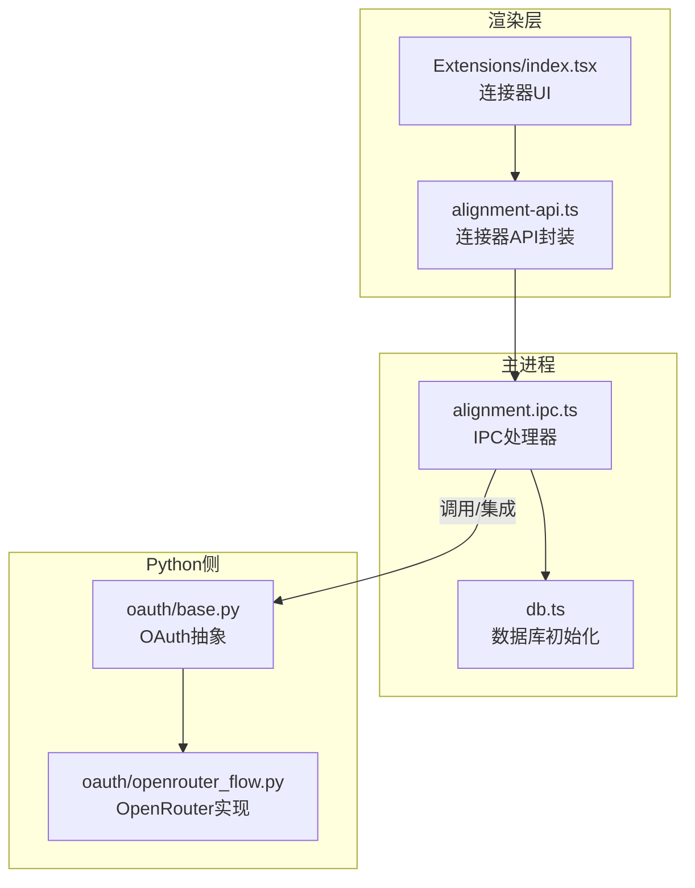
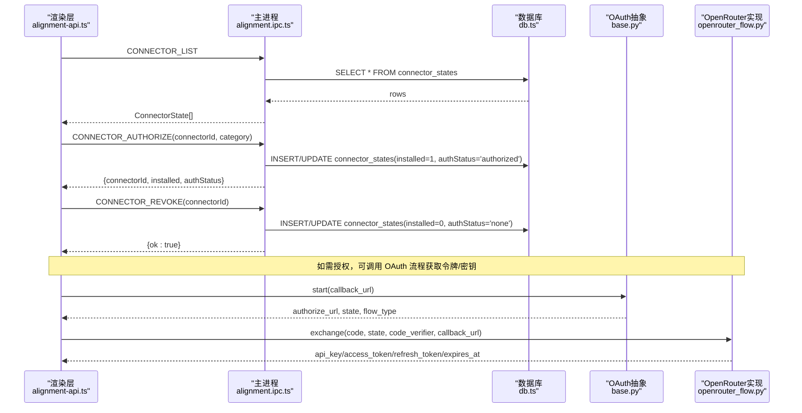
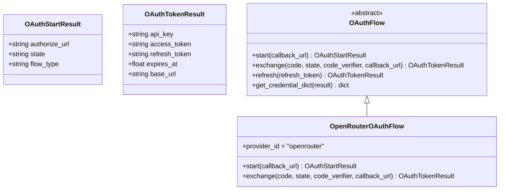
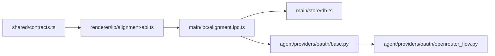

# 连接器 API

<cite>
**本文引用的文件**   
- [contracts.ts](file://tongtian-tauri/src/shared/contracts.ts)
- [alignment-api.ts](file://tongtian-tauri/src/renderer/lib/alignment-api.ts)
- [alignment.ipc.ts](file://tongtian-tauri/src/main/ipc/alignment.ipc.ts)
- [db.ts](file://tongtian-tauri/src/main/store/db.ts)
- [base.py](file://tongtian-tauri/src/agent/providers/oauth/base.py)
- [openrouter_flow.py](file://tongtian-tauri/src/agent/providers/oauth/openrouter_flow.py)
- [index.tsx](file://tongtian-tauri/src/renderer/pages/Extensions/index.tsx)
</cite>

## 目录
1. [简介](#简介)
2. [项目结构](#项目结构)
3. [核心组件](#核心组件)
4. [架构总览](#架构总览)
5. [详细组件分析](#详细组件分析)
6. [依赖关系分析](#依赖关系分析)
7. [性能考虑](#性能考虑)
8. [故障排查指南](#故障排查指南)
9. [结论](#结论)
10. [附录](#附录)

## 简介
本文件面向“连接器”能力，提供完整的 API 文档与实现说明，覆盖以下要点：
- 命令接口：connector_list、connector_authorize、connector_revoke
- 数据结构：ConnectorState 字段含义与认证状态管理
- OAuth 流程：基础抽象、OpenRouter 示例、令牌存储与刷新机制
- 内置连接器与市场连接器的管理方式
- 安全考虑与最佳实践
- 第三方服务集成与自定义连接器开发指南

## 项目结构
连接器相关代码横跨前端渲染层、主进程 IPC 处理、持久化存储以及 Python 侧的 OAuth 抽象。关键位置如下：
- 共享契约（类型与通道名）：src/shared/contracts.ts
- 渲染层封装（浏览器/本地回退）：src/renderer/lib/alignment-api.ts
- 主进程 IPC 处理器（SQLite 持久化）：src/main/ipc/alignment.ipc.ts
- 数据库初始化（表结构）：src/main/store/db.ts
- OAuth 基础与 OpenRouter 实现：src/agent/providers/oauth/base.py、openrouter_flow.py
- 扩展页面 UI（连接器市场/已安装展示）：src/renderer/pages/Extensions/index.tsx

图表来源 
- [contracts.ts:480-584](file://tongtian-tauri/src/shared/contracts.ts#L480-L584)
- [alignment-api.ts:206-237](file://tongtian-tauri/src/renderer/lib/alignment-api.ts#L206-L237)
- [alignment.ipc.ts:139-178](file://tongtian-tauri/src/main/ipc/alignment.ipc.ts#L139-L178)
- [db.ts:241-241](file://tongtian-tauri/src/main/store/db.ts#L241-L241)
- [base.py:15-113](file://tongtian-tauri/src/agent/providers/oauth/base.py#L15-L113)
- [openrouter_flow.py:18-52](file://tongtian-tauri/src/agent/providers/oauth/openrouter_flow.py#L18-L52)

章节来源
- [contracts.ts:430-437](file://tongtian-tauri/src/shared/contracts.ts#L430-L437)
- [contracts.ts:480-584](file://tongtian-tauri/src/shared/contracts.ts#L480-L584)
- [alignment-api.ts:206-237](file://tongtian-tauri/src/renderer/lib/alignment-api.ts#L206-L237)
- [alignment.ipc.ts:139-178](file://tongtian-tauri/src/main/ipc/alignment.ipc.ts#L139-L178)
- [db.ts:241-241](file://tongtian-tauri/src/main/store/db.ts#L241-L241)
- [base.py:15-113](file://tongtian-tauri/src/agent/providers/oauth/base.py#L15-L113)
- [openrouter_flow.py:18-52](file://tongtian-tauri/src/agent/providers/oauth/openrouter_flow.py#L18-L52)
- [index.tsx:45-54](file://tongtian-tauri/src/renderer/pages/Extensions/index.tsx#L45-L54)

## 核心组件
- ConnectorState：连接器状态模型，包含标识、分类、安装与认证状态、服务器引用与更新时间等。
- IPC 通道：CONNECTOR_LIST、CONNECTOR_AUTHORIZE、CONNECTOR_REVOKE
- 渲染层 API：listConnectors、authorizeConnector、revokeConnector（含浏览器环境 localStorage 回退）
- 主进程处理器：读取/写入 connector_states 表，维护 installed/authStatus/updatedAt
- OAuth 抽象：OAuthFlow、OAuthStartResult、OAuthTokenResult、刷新与凭证转换
- OpenRouter 实现：浏览器重定向 -> code -> 永久 API Key

章节来源
- [contracts.ts:430-437](file://tongtian-tauri/src/shared/contracts.ts#L430-L437)
- [contracts.ts:566-568](file://tongtian-tauri/src/shared/contracts.ts#L566-L568)
- [alignment-api.ts:208-237](file://tongtian-tauri/src/renderer/lib/alignment-api.ts#L208-L237)
- [alignment.ipc.ts:141-178](file://tongtian-tauri/src/main/ipc/alignment.ipc.ts#L141-L178)
- [base.py:15-113](file://tongtian-tauri/src/agent/providers/oauth/base.py#L15-L113)
- [openrouter_flow.py:18-52](file://tongtian-tauri/src/agent/providers/oauth/openrouter_flow.py#L18-L52)

## 架构总览
连接器能力通过三层协作完成：
- 渲染层：暴露 listConnectors、authorizeConnector、revokeConnector 等方法；在 Electron 环境下走 IPC，在浏览器开发环境回退到 localStorage。
- 主进程：注册 IPC 处理器，使用 SQLite 读写 connector_states 表，确保状态持久化。
- Python 侧：提供 OAuth 抽象与具体实现，用于获取访问令牌或永久密钥，供上层调用。

图表来源 
- [alignment-api.ts:208-237](file://tongtian-tauri/src/renderer/lib/alignment-api.ts#L208-L237)
- [alignment.ipc.ts:141-178](file://tongtian-tauri/src/main/ipc/alignment.ipc.ts#L141-L178)
- [db.ts:241-241](file://tongtian-tauri/src/main/store/db.ts#L241-L241)
- [base.py:15-113](file://tongtian-tauri/src/agent/providers/oauth/base.py#L15-L113)
- [openrouter_flow.py:18-52](file://tongtian-tauri/src/agent/providers/oauth/openrouter_flow.py#L18-L52)

## 详细组件分析

### 连接器状态数据模型 ConnectorState
- connectorId：连接器唯一标识
- category：分类，'builtin'（内置）或 'market'（市场）
- installed：是否已安装
- authStatus：认证状态，'none'、'pending'、'authorized'
- serverRef：可选的服务器引用
- updatedAt：最后更新时间

该模型用于统一描述连接器生命周期与认证状态，并在 UI 与后端之间保持一致。

章节来源
- [contracts.ts:430-437](file://tongtian-tauri/src/shared/contracts.ts#L430-L437)

### 命令接口定义与行为

#### connector_list
- 通道名：CONNECTOR_LIST
- 请求参数：无
- 返回：ConnectorState[]
- 行为：从 connector_states 表查询所有记录并映射为 ConnectorState

章节来源
- [contracts.ts:566-566](file://tongtian-tauri/src/shared/contracts.ts#L566-L566)
- [alignment.ipc.ts:141-152](file://tongtian-tauri/src/main/ipc/alignment.ipc.ts#L141-L152)
- [alignment-api.ts:208-214](file://tongtian-tauri/src/renderer/lib/alignment-api.ts#L208-L214)

#### connector_authorize
- 通道名：CONNECTOR_AUTHORIZE
- 请求参数：{ connectorId: string, category?: 'builtin' | 'market' }
- 返回：{ connectorId, installed: true, authStatus: 'authorized' }
- 行为：插入或更新 connector_states，设置 installed=1、authStatus='authorized'、updated_at=当前时间

章节来源
- [contracts.ts:567-567](file://tongtian-tauri/src/shared/contracts.ts#L567-L567)
- [alignment.ipc.ts:154-166](file://tongtian-tauri/src/main/ipc/alignment.ipc.ts#L154-L166)
- [alignment-api.ts:216-225](file://tongtian-tauri/src/renderer/lib/alignment-api.ts#L216-L225)

#### connector_revoke
- 通道名：CONNECTOR_REVOKE
- 请求参数：{ connectorId: string }
- 返回：{ ok: true }
- 行为：插入或更新 connector_states，设置 installed=0、authStatus='none'、updated_at=当前时间

章节来源
- [contracts.ts:568-568](file://tongtian-tauri/src/shared/contracts.ts#L568-L568)
- [alignment.ipc.ts:168-178](file://tongtian-tauri/src/main/ipc/alignment.ipc.ts#L168-L178)
- [alignment-api.ts:227-237](file://tongtian-tauri/src/renderer/lib/alignment-api.ts#L227-L237)

### 认证状态管理与 OAuth 流程
- OAuthStartResult：包含 authorize_url、state、flow_type（browser_redirect/device_code）
- OAuthTokenResult：包含 api_key、access_token、refresh_token、expires_at、base_url
- OAuthFlow：抽象类，定义 start、exchange、refresh、get_credential_dict
- OpenRouterOAuthFlow：实现 browser_redirect 流程，code 换取永久 API Key

图表来源 
- [base.py:15-113](file://tongtian-tauri/src/agent/providers/oauth/base.py#L15-L113)
- [openrouter_flow.py:18-52](file://tongtian-tauri/src/agent/providers/oauth/openrouter_flow.py#L18-L52)

章节来源
- [base.py:15-113](file://tongtian-tauri/src/agent/providers/oauth/base.py#L15-L113)
- [openrouter_flow.py:18-52](file://tongtian-tauri/src/agent/providers/oauth/openrouter_flow.py#L18-L52)

### 内置连接器与市场连接器的管理
- 内置连接器（category='builtin'）：通常随应用发布，默认可用，授权后标记为 installed=true、authStatus='authorized'
- 市场连接器（category='market'）：由用户从市场选择安装，安装后同样写入 connector_states，支持后续授权与撤销
- UI 展示：Extensions 页面提供“市场”和“已安装”两个视图，便于用户浏览与管理

章节来源
- [contracts.ts:430-437](file://tongtian-tauri/src/shared/contracts.ts#L430-L437)
- [index.tsx:45-54](file://tongtian-tauri/src/renderer/pages/Extensions/index.tsx#L45-L54)
- [alignment.ipc.ts:154-178](file://tongtian-tauri/src/main/ipc/alignment.ipc.ts#L154-L178)

### 认证令牌存储、刷新机制与安全考虑
- 令牌存储：OAuthTokenResult 中的 api_key/access_token/refresh_token 可由上层安全存储（例如加密存储或系统凭据管理器），避免明文落盘
- 刷新机制：OAuthFlow.refresh 支持刷新过期 access_token；若 provider 不支持，应抛出明确错误
- 安全建议：
  - 使用 PKCE（generate_code_verifier/generate_code_challenge）增强授权码安全性
  - 校验 state 防 CSRF
  - 限制回调 URL 白名单
  - 最小权限原则，仅申请必要 scope
  - 定期轮换密钥与令牌

章节来源
- [base.py:97-113](file://tongtian-tauri/src/agent/providers/oauth/base.py#L97-L113)
- [base.py:76-84](file://tongtian-tauri/src/agent/providers/oauth/base.py#L76-L84)
- [openrouter_flow.py:23-52](file://tongtian-tauri/src/agent/providers/oauth/openrouter_flow.py#L23-L52)

### 第三方服务集成与自定义连接器开发指南
- 步骤概览：
  1. 定义连接器元信息（id、name、category、desc）
  2. 实现 OAuthFlow 子类，提供 start/exchange/refresh（如需要）
  3. 在连接器授权时调用 OAuth 流程获取凭证
  4. 将凭证安全存储，并在调用第三方 API 时使用
  5. 通过 connector_authorize 更新连接器状态为 authorized
- 参考实现：OpenRouterOAuthFlow 展示了浏览器重定向与 code 换 key 的流程

章节来源
- [openrouter_flow.py:18-52](file://tongtian-tauri/src/agent/providers/oauth/openrouter_flow.py#L18-L52)
- [base.py:57-95](file://tongtian-tauri/src/agent/providers/oauth/base.py#L57-L95)

## 依赖关系分析
- 渲染层依赖 shared contracts 的类型与通道名
- 主进程依赖 SQLite 数据库进行持久化
- OAuth 抽象为各 Provider 提供统一接口，降低耦合

图表来源 
- [contracts.ts:480-584](file://tongtian-tauri/src/shared/contracts.ts#L480-L584)
- [alignment-api.ts:206-237](file://tongtian-tauri/src/renderer/lib/alignment-api.ts#L206-L237)
- [alignment.ipc.ts:139-178](file://tongtian-tauri/src/main/ipc/alignment.ipc.ts#L139-L178)
- [db.ts:241-241](file://tongtian-tauri/src/main/store/db.ts#L241-L241)
- [base.py:15-113](file://tongtian-tauri/src/agent/providers/oauth/base.py#L15-L113)
- [openrouter_flow.py:18-52](file://tongtian-tauri/src/agent/providers/oauth/openrouter_flow.py#L18-L52)

章节来源
- [contracts.ts:480-584](file://tongtian-tauri/src/shared/contracts.ts#L480-L584)
- [alignment-api.ts:206-237](file://tongtian-tauri/src/renderer/lib/alignment-api.ts#L206-L237)
- [alignment.ipc.ts:139-178](file://tongtian-tauri/src/main/ipc/alignment.ipc.ts#L139-L178)
- [db.ts:241-241](file://tongtian-tauri/src/main/store/db.ts#L241-L241)
- [base.py:15-113](file://tongtian-tauri/src/agent/providers/oauth/base.py#L15-L113)
- [openrouter_flow.py:18-52](file://tongtian-tauri/src/agent/providers/oauth/openrouter_flow.py#L18-L52)

## 性能考虑
- 列表查询：connector_states 表按 connector_id 排序，建议在 connector_id 上建立索引以提升查询性能
- 授权/撤销：使用 UPSERT（INSERT ... ON CONFLICT DO UPDATE）减少额外判断逻辑
- 缓存策略：前端可在短时间内缓存 ConnectorState[]，减少重复 IPC 调用
- OAuth 网络：合理设置超时与重试，避免阻塞 UI

[本节为通用指导，不直接分析具体文件]

## 故障排查指南
- 常见问题：
  - 列表为空：检查 connector_states 表是否存在及数据是否正确写入
  - 授权失败：确认 category 与 connectorId 匹配，且 OAuth 流程正确执行
  - 撤销无效：确认 connectorId 存在且 SQL 执行成功
- 日志定位：主进程 IPC 处理器会记录授权与撤销操作日志，便于问题追踪
- 浏览器模式回退：在开发模式下，连接器状态存储在 localStorage，检查键 tt:connectors 的数据一致性

章节来源
- [alignment.ipc.ts:164-177](file://tongtian-tauri/src/main/ipc/alignment.ipc.ts#L164-L177)
- [alignment-api.ts:208-237](file://tongtian-tauri/src/renderer/lib/alignment-api.ts#L208-L237)

## 结论
连接器 API 通过清晰的契约、稳健的 IPC 处理与安全的 OAuth 抽象，实现了内置与市场连接器的统一管理。ConnectorState 提供了统一的认证状态模型，配合 SQLite 持久化保障数据一致性。遵循本文档的安全建议与开发指南，可快速集成第三方服务并扩展自定义连接器。

[本节为总结性内容，不直接分析具体文件]

## 附录

### 连接器数据库表结构（connector_states）
- connector_id：主键
- category：'builtin' | 'market'
- installed：整数（0/1）
- auth_status：'none' | 'pending' | 'authorized'
- updated_at：时间戳

章节来源
- [db.ts:241-241](file://tongtian-tauri/src/main/store/db.ts#L241-L241)

### 连接器命令接口速查表
- connector_list
  - 请求：无
  - 返回：ConnectorState[]
- connector_authorize
  - 请求：{ connectorId, category? }
  - 返回：{ connectorId, installed, authStatus }
- connector_revoke
  - 请求：{ connectorId }
  - 返回：{ ok }

章节来源
- [contracts.ts:566-568](file://tongtian-tauri/src/shared/contracts.ts#L566-L568)
- [alignment.ipc.ts:141-178](file://tongtian-tauri/src/main/ipc/alignment.ipc.ts#L141-L178)