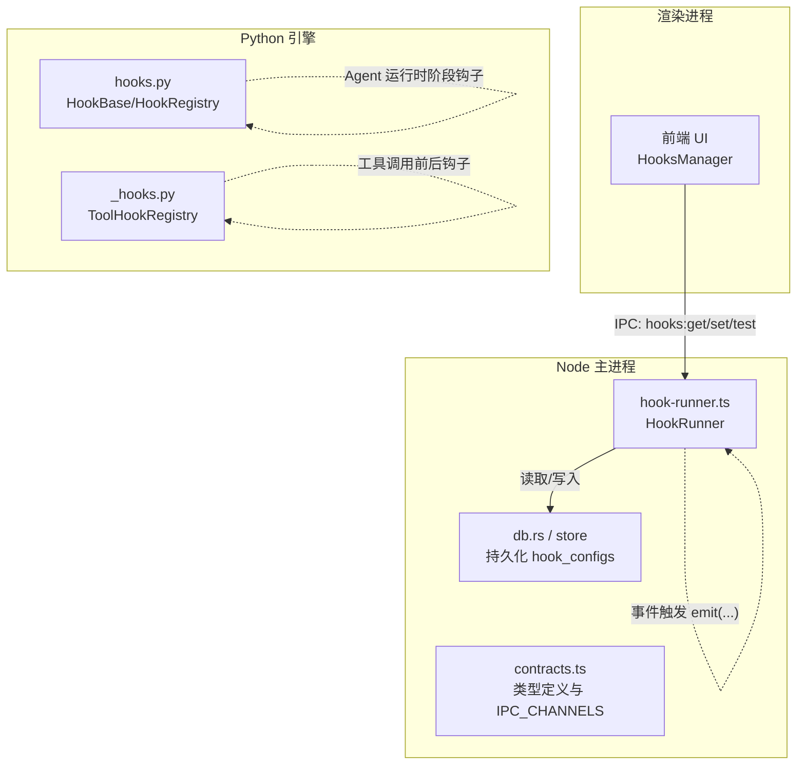
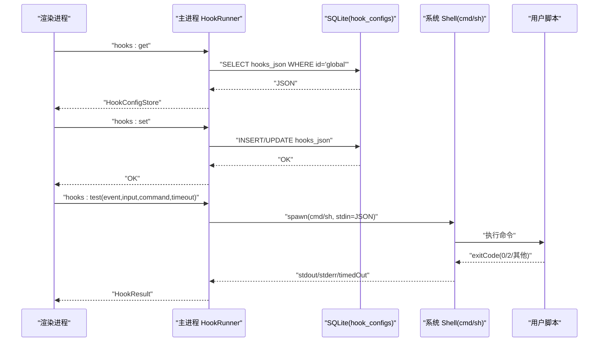
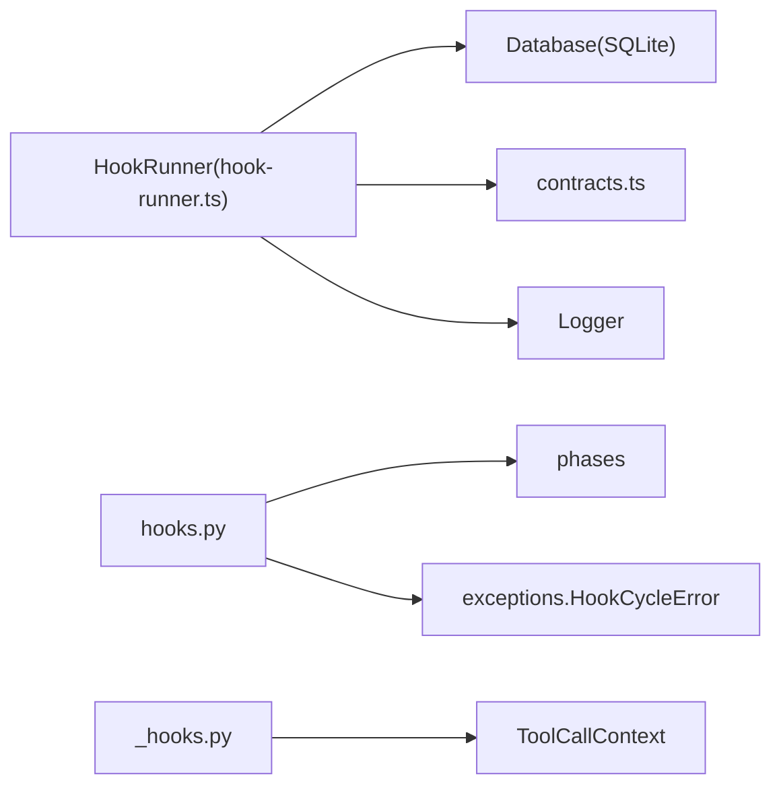

# 钩子系统 API

<cite>
**本文引用的文件**   
- [hook-runner.ts](file://tongtian-tauri/src/main/hooks/hook-runner.ts)
- [contracts.ts](file://tongtian-tauri/src/shared/contracts.ts)
- [hooks.py](file://tongtian-tauri/src/agent/runtime/hooks.py)
- [_hooks.py](file://tongtian-tauri/src/agent/tool_calls/_hooks.py)
- [probe-hooks.py](file://.tools/probe-hooks.py)
</cite>

## 目录
1. [简介](#简介)
2. [项目结构](#项目结构)
3. [核心组件](#核心组件)
4. [架构总览](#架构总览)
5. [详细组件分析](#详细组件分析)
6. [依赖关系分析](#依赖关系分析)
7. [性能考虑](#性能考虑)
8. [故障排查指南](#故障排查指南)
9. [结论](#结论)
10. [附录](#附录)

## 简介
本文件面向“钩子系统”的 API 与实现，覆盖以下要点：
- 命令接口：hooks_get、hooks_set、hooks_test（IPC 通道）
- 数据结构：HookConfigStore、HookCommand、HookMatcherGroup、HookInput、HookResult、HookAggregate
- 事件模型：SessionStart、UserPromptSubmit、PreToolUse、PostToolUse、PostToolUseFailure、Stop、SubagentStart、SubagentStop、PreCompact、Notification、PermissionRequest、SessionEnd
- 执行时机与语义：脚本通过 stdin 接收 JSON，exit 0 成功；特定事件支持 exit 2 阻塞语义
- 匹配器规则：空值或“*”匹配全部；“A|B”多值；支持正则表达式
- 错误处理：超时、进程异常、阻塞原因聚合
- 扩展集成：Python 运行时 HookBase/HookRegistry 与工具级 before/after 钩子

## 项目结构
钩子系统由两部分组成：
- Node 侧 HookRunner：负责配置读写、事件触发、脚本执行与结果聚合
- Python 侧 Runtime Hooks：面向 Agent 运行时的阶段式钩子（与 Node 侧脚本钩子互补）

图表来源
- [hook-runner.ts:1-226](file://tongtian-tauri/src/main/hooks/hook-runner.ts#L1-L226)
- [contracts.ts:371-411](file://tongtian-tauri/src/shared/contracts.ts#L371-L411)
- [contracts.ts:478-584](file://tongtian-tauri/src/shared/contracts.ts#L478-L584)
- [hooks.py:1-338](file://tongtian-tauri/src/agent/runtime/hooks.py#L1-L338)
- [_hooks.py:1-77](file://tongtian-tauri/src/agent/tool_calls/_hooks.py#L1-L77)

章节来源
- [hook-runner.ts:1-226](file://tongtian-tauri/src/main/hooks/hook-runner.ts#L1-L226)
- [contracts.ts:371-411](file://tongtian-tauri/src/shared/contracts.ts#L371-L411)
- [contracts.ts:478-584](file://tongtian-tauri/src/shared/contracts.ts#L478-L584)

## 核心组件
- HookRunner（Node）
  - getConfig()/setConfig()：从 SQLite 表 hook_configs 中读写全局 hooks_json
  - emit(event, input)：按事件名查找匹配的 HookMatcherGroup，顺序执行命令并聚合结果
  - testRun(event, input, command, timeoutSec)：单条命令试运行
  - matchHook(matcher, target)：支持空/“*”、多值“A|B”、精确匹配与正则
- 类型契约（contracts.ts）
  - HookEventName：所有支持的钩子事件名
  - HookCommand：type=command，包含 command 与可选 timeout
  - HookMatcherGroup：matcher + hooks[]
  - HookConfigStore：hooks: Partial<Record<HookEventName, HookMatcherGroup[]>>
  - HookInput：session_id、cwd、hook_event_name 及事件附加字段
  - HookResult：exitCode、stdout、stderr、blocked、timedOut
  - HookAggregate：blocked、blockReason、results[]
  - IPC_CHANNELS：HOOKS_GET、HOOKS_SET、HOOKS_TEST
- Python 运行时钩子（hooks.py）
  - HookAction/HookResult/HookContext/HookBase/HookRegistry：阶段式钩子编排与拓扑排序
- 工具级钩子（_hooks.py）
  - ToolHookRegistry：为每个 tool 注册 before/after 钩子与超时元数据

章节来源
- [hook-runner.ts:1-226](file://tongtian-tauri/src/main/hooks/hook-runner.ts#L1-L226)
- [contracts.ts:371-411](file://tongtian-tauri/src/shared/contracts.ts#L371-L411)
- [contracts.ts:478-584](file://tongtian-tauri/src/shared/contracts.ts#L478-L584)
- [hooks.py:1-338](file://tongtian-tauri/src/agent/runtime/hooks.py#L1-L338)
- [_hooks.py:1-77](file://tongtian-tauri/src/agent/tool_calls/_hooks.py#L1-L77)

## 架构总览
Node 侧 HookRunner 是钩子系统的核心入口。它暴露三类 IPC 通道：
- hooks:get：返回当前 HookConfigStore
- hooks:set：保存新的 HookConfigStore
- hooks:test：对单个命令进行试运行

事件触发时，HookRunner 根据事件名和输入构造匹配目标，遍历配置的 matcher 组，依次执行命令，并将 stdout/stderr/退出码等汇总为 HookAggregate。

图表来源
- [hook-runner.ts:1-226](file://tongtian-tauri/src/main/hooks/hook-runner.ts#L1-L226)
- [contracts.ts:478-584](file://tongtian-tauri/src/shared/contracts.ts#L478-L584)

## 详细组件分析

### 命令接口：hooks_get、hooks_set、hooks_test
- hooks_get
  - 用途：获取当前全局钩子配置
  - 请求：无参数
  - 响应：HookConfigStore
  - 行为：从数据库读取 hooks_json，解析为对象后返回
- hooks_set
  - 用途：保存全局钩子配置
  - 请求：HookConfigStore
  - 响应：成功标志
  - 行为：序列化 hooks 字段并写入 hook_configs 表（id='global'），更新 updated_at
- hooks_test
  - 用途：测试单个命令在当前事件上下文中的执行结果
  - 请求：event(HookEventName)、input(HookInput)、command(string)、timeoutSec(number)
  - 响应：HookResult
  - 行为：将 input 序列化为 JSON 传入 stdin，等待子进程结束，收集 stdout/stderr/退出码/是否超时

章节来源
- [hook-runner.ts:156-178](file://tongtian-tauri/src/main/hooks/hook-runner.ts#L156-L178)
- [hook-runner.ts:183-221](file://tongtian-tauri/src/main/hooks/hook-runner.ts#L183-L221)
- [contracts.ts:478-584](file://tongtian-tauri/src/shared/contracts.ts#L478-L584)

### 数据结构：HookConfigStore、HookCommand、HookMatcherGroup、HookInput、HookResult、HookAggregate
- HookEventName
  - 枚举：SessionStart、SessionEnd、UserPromptSubmit、PreToolUse、PostToolUse、PostToolUseFailure、Stop、SubagentStart、SubagentStop、PreCompact、Notification、PermissionRequest
- HookCommand
  - type: 'command'
  - command: 可展开 ~ 路径的命令字符串
  - timeout?: 秒，默认 60
- HookMatcherGroup
  - matcher?: 匹配规则（空/“*”/“A|B”/正则）
  - hooks: HookCommand[]
- HookConfigStore
  - hooks: Partial<Record<HookEventName, HookMatcherGroup[]>>
- HookInput
  - session_id: string
  - cwd: string
  - hook_event_name: HookEventName
  - 其他字段随事件不同而不同（如 tool_name、source、reason、agent_type、trigger、notification_type）
- HookResult
  - exitCode: number
  - stdout: string
  - stderr: string
  - blocked: boolean
  - timedOut: boolean
- HookAggregate
  - blocked: boolean
  - blockReason?: string
  - results: HookResult[]

章节来源
- [contracts.ts:371-411](file://tongtian-tauri/src/shared/contracts.ts#L371-L411)

### 事件匹配器与命令配置
- 匹配器规则 matchHook
  - 空值或“*”：匹配全部
  - “A|B”：多值精确匹配（不含正则元字符时）
  - 否则尝试正则匹配（以 ^...$ 包裹）
- 事件目标字段提取 getMatchTarget
  - PreToolUse/PostToolUse/PostToolUseFailure/PermissionRequest → tool_name
  - SessionStart → source
  - SessionEnd → reason
  - SubagentStart/SubagentStop → agent_type
  - PreCompact → trigger
  - Notification → notification_type
  - 其他事件 → 空串

章节来源
- [hook-runner.ts:45-89](file://tongtian-tauri/src/main/hooks/hook-runner.ts#L45-L89)

### 支持的钩子事件类型与执行时机
- 支持事件集合 ALL_HOOK_EVENTS
  - SessionStart、SessionEnd、UserPromptSubmit
  - PreToolUse、PostToolUse、PostToolUseFailure
  - Stop、SubagentStart、SubagentStop
  - PreCompact、Notification、PermissionRequest
- 阻塞语义 BLOCKABLE_EVENTS
  - PreToolUse、Stop、SubagentStop
  - 当脚本 exit code=2 时，标记 blocked=true，并记录 blockReason（stderr 首行）

章节来源
- [hook-runner.ts:26-37](file://tongtian-tauri/src/main/hooks/hook-runner.ts#L26-L37)
- [hook-runner.ts:195-216](file://tongtian-tauri/src/main/hooks/hook-runner.ts#L195-L216)

### 钩子脚本编写规范
- 输入输出
  - 标准输入：JSON（对齐 QwenWork 契约），包含 hook_event_name 与事件相关字段
  - 标准输出：任意文本（用于调试/审计）
  - 标准错误：错误信息（阻塞事件的 blockReason 取自 stderr）
- 退出码约定
  - 0：成功
  - 2：阻塞（仅适用于 PreToolUse、Stop、SubagentStop）
  - 其他：失败
- 超时控制
  - 每条命令可设置 timeout（秒），默认 60；超时将被强制终止并标记 timedOut=true
- 路径展开
  - 支持 ~ 展开为用户主目录

章节来源
- [hook-runner.ts:93-142](file://tongtian-tauri/src/main/hooks/hook-runner.ts#L93-L142)
- [hook-runner.ts:199-216](file://tongtian-tauri/src/main/hooks/hook-runner.ts#L199-L216)

### 错误处理机制
- 子进程错误
  - spawn error：返回 exitCode=1，stderr 包含错误信息
- 超时处理
  - Windows：taskkill /T 终止进程树；非 Windows：SIGKILL
  - 超时后 timedOut=true，exitCode=1
- 阻塞语义
  - 针对 BLOCKABLE_EVENTS，若 exitCode=2，则 aggregated.blocked=true，blockReason=stderr.trim()
- 日志记录
  - 每次执行记录 event、command、exitCode、timedOut

章节来源
- [hook-runner.ts:112-142](file://tongtian-tauri/src/main/hooks/hook-runner.ts#L112-L142)
- [hook-runner.ts:199-216](file://tongtian-tauri/src/main/hooks/hook-runner.ts#L199-L216)

### Python 运行时钩子（与 Node 脚本钩子互补）
- HookBase/HookRegistry
  - 基于 Phase 的阶段式钩子，支持 before/after 约束与优先级排序
  - 三种返回语义：CONTINUE、SHORT_CIRCUIT、SKIP_AGENT
  - 拓扑排序检测循环依赖，失败快速抛出 HookCycleError
- ToolHookRegistry
  - 为每个工具注册 before/after 钩子与超时元数据（default_timeout_secs、max_internal_timeout_secs）

章节来源
- [hooks.py:46-338](file://tongtian-tauri/src/agent/runtime/hooks.py#L46-L338)
- [_hooks.py:20-77](file://tongtian-tauri/src/agent/tool_calls/_hooks.py#L20-L77)

### 自定义钩子开发与扩展集成示例
- 在 UI 中通过 hooks:set 写入 HookConfigStore
  - 为某个事件（如 PreToolUse）添加一个 matcher 组，指定 matcher 与命令列表
- 使用 hooks:test 验证命令
  - 传入具体 event、input、command、timeout，检查 exitCode/stdout/stderr/blocked/timedOut
- 在 Python 侧扩展工具钩子
  - 通过 ToolHookRegistry.register(tool_name, before, after, default_timeout_secs, max_internal_timeout_secs) 注入逻辑
- 在 Python 运行时扩展阶段钩子
  - 继承 HookBase，设置 phase/name/priority/before/after，实现 run(ctx) -> HookResult

章节来源
- [hook-runner.ts:156-221](file://tongtian-tauri/src/main/hooks/hook-runner.ts#L156-L221)
- [_hooks.py:42-77](file://tongtian-tauri/src/agent/tool_calls/_hooks.py#L42-L77)
- [hooks.py:145-312](file://tongtian-tauri/src/agent/runtime/hooks.py#L145-L312)

## 依赖关系分析
- Node 侧
  - HookRunner 依赖 Database（SQLite）读写 hook_configs
  - 依赖 Logger 记录执行日志
  - 依赖 contracts.ts 的类型与 IPC_CHANNELS
- Python 侧
  - hooks.py 依赖 phases 枚举与 exceptions.HookCycleError
  - _hooks.py 依赖 ToolCallContext

图表来源
- [hook-runner.ts:1-226](file://tongtian-tauri/src/main/hooks/hook-runner.ts#L1-L226)
- [contracts.ts:478-584](file://tongtian-tauri/src/shared/contracts.ts#L478-L584)
- [hooks.py:1-338](file://tongtian-tauri/src/agent/runtime/hooks.py#L1-L338)
- [_hooks.py:1-77](file://tongtian-tauri/src/agent/tool_calls/_hooks.py#L1-L77)

章节来源
- [hook-runner.ts:1-226](file://tongtian-tauri/src/main/hooks/hook-runner.ts#L1-L226)
- [contracts.ts:478-584](file://tongtian-tauri/src/shared/contracts.ts#L478-L584)
- [hooks.py:1-338](file://tongtian-tauri/src/agent/runtime/hooks.py#L1-L338)
- [_hooks.py:1-77](file://tongtian-tauri/src/agent/tool_calls/_hooks.py#L1-L77)

## 性能考虑
- 子进程启动开销：频繁触发的事件建议合并或缓存结果
- 超时策略：合理设置 timeout，避免长耗时脚本阻塞主流程
- 匹配器复杂度：正则匹配可能带来额外 CPU 消耗，尽量使用精确或多值匹配
- 并发执行：当前实现顺序执行命中的 hooks，如需并行需改造 emit 流程

[本节为通用指导，不直接分析具体文件]

## 故障排查指南
- 常见问题
  - 命令未执行：检查 matcher 是否正确，target 字段是否与事件一致
  - 脚本被阻断：确认是否为 BLOCKABLE_EVENTS 且 exitCode=2
  - 超时：增大 timeout 或优化脚本逻辑
  - 路径问题：确保 ~ 展开正确，命令可用
- 定位方法
  - 使用 hooks:test 单独测试命令
  - 查看 stderr 与 exitCode，结合日志定位
  - 检查数据库 hook_configs 表中 hooks_json 内容

章节来源
- [hook-runner.ts:112-142](file://tongtian-tauri/src/main/hooks/hook-runner.ts#L112-L142)
- [hook-runner.ts:195-216](file://tongtian-tauri/src/main/hooks/hook-runner.ts#L195-L216)

## 结论
钩子系统通过 Node 侧 HookRunner 提供统一的配置管理与事件驱动脚本执行能力，配合 Python 侧运行时与工具级钩子，形成端到端的可扩展钩子生态。开发者可通过 hooks_get/set/test 完成配置与调试，遵循匹配器与脚本规范，即可安全、可控地扩展系统行为。

[本节为总结性内容，不直接分析具体文件]

## 附录
- 探针脚本 probe-hooks.py 可用于列出 ReActAgent 支持的钩子类型，便于调试与验证

章节来源
- [probe-hooks.py:1-6](file://.tools/probe-hooks.py#L1-L6)