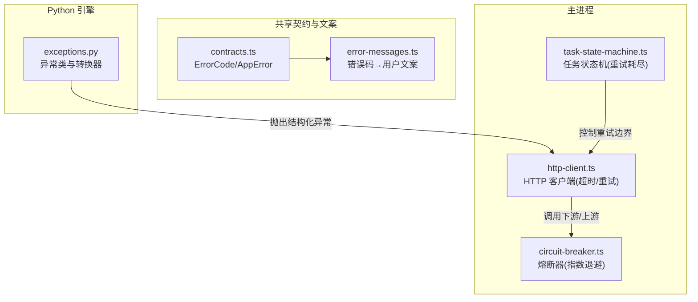
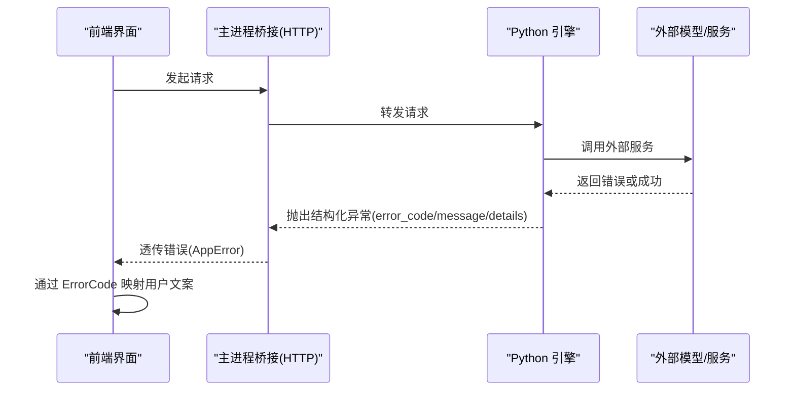
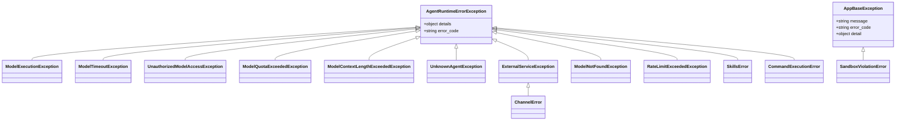
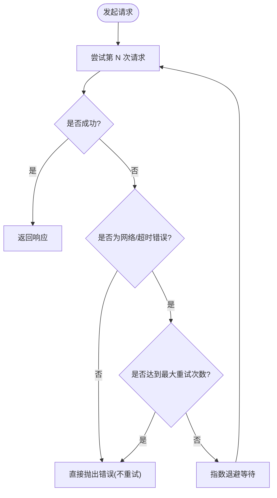
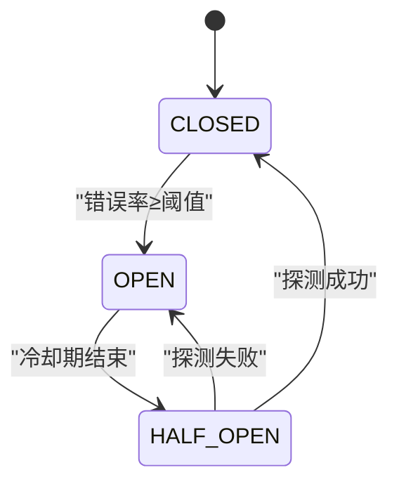
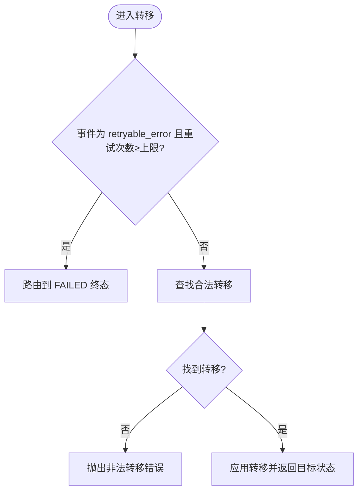
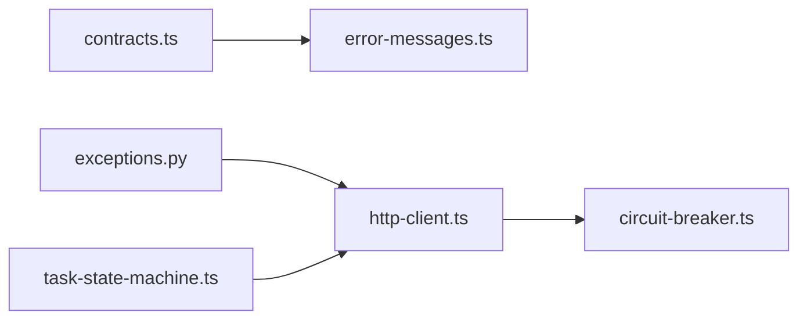

# 错误处理规范

<cite>
**本文引用的文件**   
- [contracts.ts](file://tongtian-tauri/src/shared/contracts.ts)
- [error-messages.ts](file://tongtian-tauri/src/shared/error-messages.ts)
- [exceptions.py](file://tongtian-tauri/src/agent/exceptions.py)
- [http-client.ts](file://tongtian-tauri/src/main/bridge/http-client.ts)
- [circuit-breaker.ts](file://tongtian-tauri/src/main/model/circuit-breaker.ts)
- [task-state-machine.ts](file://tongtian-tauri/src/shared/task-state-machine.ts)
</cite>

## 目录
1. [引言](#引言)
2. [项目结构](#项目结构)
3. [核心组件](#核心组件)
4. [架构总览](#架构总览)
5. [详细组件分析](#详细组件分析)
6. [依赖关系分析](#依赖关系分析)
7. [性能与可靠性考虑](#性能与可靠性考虑)
8. [故障排查指南](#故障排查指南)
9. [结论](#结论)
10. [附录](#附录)

## 引言
本规范面向全栈（前端、主进程、Python 引擎）的错误处理，统一 ErrorCode 枚举、AppError 接口、错误分类、重试策略、降级处理与用户友好提示。目标：
- 明确所有错误码的分类与语义（MODEL_*、FILE_*、TASK_*、CONFIG_*、WORKSPACE_*、SKILL_*、MCP_*、SANDBOX_*、COMPLIANCE_*、BRIDGE_*、SCHEDULE_* 等）。
- 标准化 AppError 结构与跨层错误信息格式。
- 定义可操作的重试与降级策略，保障用户体验与系统稳定性。
- 提供监控、日志记录与故障排查的最佳实践。

## 项目结构
错误处理相关代码分布在以下位置：
- TypeScript 共享契约与文案映射：shared/contracts.ts、shared/error-messages.ts
- Python 引擎异常体系：agent/exceptions.py
- 主进程网络与容错：main/bridge/http-client.ts、main/model/circuit-breaker.ts
- 任务状态机与重试边界：shared/task-state-machine.ts

图表来源 
- [contracts.ts:15-109](file://tongtian-tauri/src/shared/contracts.ts#L15-L109)
- [error-messages.ts:1-37](file://tongtian-tauri/src/shared/error-messages.ts#L1-L37)
- [exceptions.py:10-171](file://tongtian-tauri/src/agent/exceptions.py#L10-L171)
- [http-client.ts:1-249](file://tongtian-tauri/src/main/bridge/http-client.ts#L1-L249)
- [circuit-breaker.ts:1-346](file://tongtian-tauri/src/main/model/circuit-breaker.ts#L1-L346)
- [task-state-machine.ts:140-223](file://tongtian-tauri/src/shared/task-state-machine.ts#L140-L223)

章节来源
- [contracts.ts:15-109](file://tongtian-tauri/src/shared/contracts.ts#L15-L109)
- [error-messages.ts:1-37](file://tongtian-tauri/src/shared/error-messages.ts#L1-L37)
- [exceptions.py:10-171](file://tongtian-tauri/src/agent/exceptions.py#L10-L171)
- [http-client.ts:1-249](file://tongtian-tauri/src/main/bridge/http-client.ts#L1-L249)
- [circuit-breaker.ts:1-346](file://tongtian-tauri/src/main/model/circuit-breaker.ts#L1-L346)
- [task-state-machine.ts:140-223](file://tongtian-tauri/src/shared/task-state-machine.ts#L140-L223)

## 核心组件
- ErrorCode 枚举：集中定义全系统错误码，覆盖模型、文件、任务、配置、工作区、技能、MCP、沙箱、合规、桥接、调度及通用错误。
- AppError 接口：统一错误对象结构（code、message、details），用于跨层传递与展示。
- 错误文案映射：将 ErrorCode 映射为用户可读的中文提示，未知码走默认分支避免白屏。
- Python 异常体系：以 AppBaseException 为根，派生业务与运行时异常，并提供 LLM SDK 异常到内部异常的转换器。
- HTTP 客户端：具备超时与指数退避重试能力，仅对网络/超时错误重试，不重试 4xx。
- 熔断器：按模型维度维护 CLOSED/OPEN/HALF_OPEN 状态，基于滑动窗口错误率触发熔断，支持指数退避。
- 任务状态机：限定 retryable_error 的重试次数上限，超过阈值路由至失败态，防止无限重试。

章节来源
- [contracts.ts:15-109](file://tongtian-tauri/src/shared/contracts.ts#L15-L109)
- [contracts.ts:113-117](file://tongtian-tauri/src/shared/contracts.ts#L113-L117)
- [error-messages.ts:1-37](file://tongtian-tauri/src/shared/error-messages.ts#L1-L37)
- [exceptions.py:10-171](file://tongtian-tauri/src/agent/exceptions.py#L10-L171)
- [http-client.ts:1-249](file://tongtian-tauri/src/main/bridge/http-client.ts#L1-L249)
- [circuit-breaker.ts:1-346](file://tongtian-tauri/src/main/model/circuit-breaker.ts#L1-L346)
- [task-state-machine.ts:140-223](file://tongtian-tauri/src/shared/task-state-machine.ts#L140-L223)

## 架构总览
错误从 Python 引擎或外部依赖抛出，经主进程桥接与 HTTP 客户端，最终由前端根据 ErrorCode 渲染用户提示。关键路径：
- Python 异常 → 转换器 → 结构化错误（含 error_code、message、details）
- 主进程 HTTP 客户端 → 超时/重试 → 失败时向上抛出
- 熔断器 → 保护后端服务，降低雪崩风险
- 任务状态机 → 限制重试次数，确保终态可达
- 前端错误文案映射 → 用户友好提示

图表来源 
- [exceptions.py:673-800](file://tongtian-tauri/src/agent/exceptions.py#L673-L800)
- [http-client.ts:59-98](file://tongtian-tauri/src/main/bridge/http-client.ts#L59-L98)
- [contracts.ts:113-117](file://tongtian-tauri/src/shared/contracts.ts#L113-L117)
- [error-messages.ts:32-36](file://tongtian-tauri/src/shared/error-messages.ts#L32-L36)

## 详细组件分析

### ErrorCode 枚举与分类
- MODEL_*：模型不可用、连接失败、鉴权失败、限流、上下文溢出、响应无效等。
- FILE_*：文件不存在、权限拒绝、写入失败、转换失败、过大、备份失败等。
- TASK_*：任务未找到、重复执行、计划被拒、执行失败、回滚失败、暂停等。
- CONFIG_*：配置无效、缺失、解析错误。
- WORKSPACE_*：工作区未找到、挂起、创建失败、委托失败。
- SKILL_*：技能未找到、安装失败、执行失败、不兼容。
- MCP_*：连接失败、工具未找到、工具被拦截、鉴权失败、超时。
- SANDBOX_*：越界违规、资源限制、文件/工具被拦截。
- COMPLIANCE_*：硬开关阻断、数据泄露、模型不允许。
- BRIDGE_*：Python 环境缺失、Agent 未找到、启动失败、通信失败。
- SCHEDULE_*：定时任务未找到、Cron 非法、执行失败。
- 通用：INTERNAL_ERROR、VALIDATION_ERROR。
- 三层架构演进 P0：BUDGET_EXHAUSTED、QUEUE_TIMEOUT、LEASE_LOST、FILE_REJECTED、SYNC_CONFLICT、PAYMENT_GRACE、DATA_TIER_BLOCKED、INJECTION_BLOCKED、QUOTA_EXCEEDED。

章节来源
- [contracts.ts:15-109](file://tongtian-tauri/src/shared/contracts.ts#L15-L109)

### AppError 接口与标准化格式
- code：ErrorCode 枚举值，唯一标识错误类型。
- message：人类可读的错误摘要，建议包含必要上下文（如模型名、会话 ID）。
- details：可选的结构化扩展字段，便于诊断与自动化处理（如 status_code、model_name、session_id、command、returncode 等）。

章节来源
- [contracts.ts:113-117](file://tongtian-tauri/src/shared/contracts.ts#L113-L117)

### 错误文案映射与用户提示
- 使用 ErrorCode 作为键，映射到中文提示；未知码降级为“发生错误（{code}）”，避免白屏。
- 云端必需错误码（预算耗尽、排队超时、租约丢失、附件被拒、同步冲突、支付宽限期、数据分级阻断、注入拦截、配额超限）均有明确文案。
- 既有 Bridge/任务错误码（任务不存在、任务正在运行、模型繁忙、连接失败、Python 缺失、启动超时、空目标、取消）均提供中性且可操作的提示。

章节来源
- [error-messages.ts:1-37](file://tongtian-tauri/src/shared/error-messages.ts#L1-L37)

### Python 异常体系与转换器
- 基类 AppBaseException：承载 error_code、message、detail 与任意附加属性。
- AgentRuntimeErrorException：携带 error_code + details，用于运行时/模型错误。
- 具体异常：ModelExecutionException、ModelTimeoutException、UnauthorizedModelAccessException、ModelQuotaExceededException、ModelContextLengthExceededException、UnknownAgentException、ExternalServiceException、ModelNotFoundException、RateLimitExceededException、ChannelError、SkillsError、HookCycleError、SkillConflictError、SkillImportCancelled、SkillScanError、CommandExecutionError、ProcessLaunchError、SandboxViolationError、ACPError 系列、Backup 系列、PrdValidationError、RestartInProgressError、DirectUrlDownloadRejectedError、LspError 等。
- 转换器 convert_model_exception：将 LLM SDK 异常转换为内部异常，依据状态码与关键词进行精确分类，并保留原始错误摘要与详情。

图表来源 
- [exceptions.py:10-171](file://tongtian-tauri/src/agent/exceptions.py#L10-L171)
- [exceptions.py:231-386](file://tongtian-tauri/src/agent/exceptions.py#L231-L386)
- [exceptions.py:388-575](file://tongtian-tauri/src/agent/exceptions.py#L388-L575)

章节来源
- [exceptions.py:10-171](file://tongtian-tauri/src/agent/exceptions.py#L10-L171)
- [exceptions.py:673-800](file://tongtian-tauri/src/agent/exceptions.py#L673-L800)

### HTTP 客户端：超时与重试
- 支持超时控制与指数退避重试（默认 3 次，基础延迟 1s）。
- 仅对网络/超时错误重试，不对 4xx 响应重试。
- 流式请求（SSE）不进行自动重试，由调用方负责重连。
- 健康检查 /health 无重试，快速判定可用性。

图表来源 
- [http-client.ts:59-98](file://tongtian-tauri/src/main/bridge/http-client.ts#L59-L98)
- [http-client.ts:138-186](file://tongtian-tauri/src/main/bridge/http-client.ts#L138-L186)

章节来源
- [http-client.ts:1-249](file://tongtian-tauri/src/main/bridge/http-client.ts#L1-L249)

### 熔断器：按模型维度的保护
- 状态机：CLOSED → OPEN → HALF_OPEN → CLOSED。
- 滑动窗口统计错误率，超过阈值（15%）进入 OPEN，冷却期后允许探测一次（HALF_OPEN）。
- 指数退避：1s → 2s → 4s → 8s（最多 4 次），用于限流场景的重试。
- 提供统计快照与手动重置能力。

图表来源 
- [circuit-breaker.ts:1-346](file://tongtian-tauri/src/main/model/circuit-breaker.ts#L1-L346)

章节来源
- [circuit-breaker.ts:1-346](file://tongtian-tauri/src/main/model/circuit-breaker.ts#L1-L346)

### 任务状态机：重试边界与终态保证
- 转移函数 canTransition/transition 限制 retryable_error 的重试次数（≥MAX_RETRY_COUNT 视为非法事件）。
- 当重试耗尽时，planning/executing/delivering 状态均允许落入 failed 终态，避免卡死。
- 提供可用事件查询与终态判断。

图表来源 
- [task-state-machine.ts:165-201](file://tongtian-tauri/src/shared/task-state-machine.ts#L165-L201)

章节来源
- [task-state-machine.ts:140-223](file://tongtian-tauri/src/shared/task-state-machine.ts#L140-L223)

## 依赖关系分析
- contracts.ts 定义 ErrorCode 与 AppError，被 error-messages.ts 与前端各模块引用。
- exceptions.py 的转换器将外部 SDK 异常映射为内部异常，供上层统一处理。
- http-client.ts 与 circuit-breaker.ts 在主进程侧提供网络与容错能力。
- task-state-machine.ts 约束重试边界，确保状态机健壮性。

图表来源 
- [contracts.ts:15-109](file://tongtian-tauri/src/shared/contracts.ts#L15-L109)
- [error-messages.ts:1-37](file://tongtian-tauri/src/shared/error-messages.ts#L1-L37)
- [exceptions.py:673-800](file://tongtian-tauri/src/agent/exceptions.py#L673-L800)
- [http-client.ts:1-249](file://tongtian-tauri/src/main/bridge/http-client.ts#L1-L249)
- [circuit-breaker.ts:1-346](file://tongtian-tauri/src/main/model/circuit-breaker.ts#L1-L346)
- [task-state-machine.ts:140-223](file://tongtian-tauri/src/shared/task-state-machine.ts#L140-L223)

章节来源
- [contracts.ts:15-109](file://tongtian-tauri/src/shared/contracts.ts#L15-L109)
- [error-messages.ts:1-37](file://tongtian-tauri/src/shared/error-messages.ts#L1-L37)
- [exceptions.py:673-800](file://tongtian-tauri/src/agent/exceptions.py#L673-L800)
- [http-client.ts:1-249](file://tongtian-tauri/src/main/bridge/http-client.ts#L1-L249)
- [circuit-breaker.ts:1-346](file://tongtian-tauri/src/main/model/circuit-breaker.ts#L1-L346)
- [task-state-machine.ts:140-223](file://tongtian-tauri/src/shared/task-state-machine.ts#L140-L223)

## 性能与可靠性考虑
- 重试策略
  - HTTP 客户端：指数退避，仅对网络/超时错误重试，避免放大 4xx 错误。
  - 熔断器：按模型维度统计错误率，超限熔断，冷却期后探测恢复。
  - 任务状态机：限制 retryable_error 的最大重试次数，防止无限重试。
- 降级处理
  - 未知错误码降级为中性提示，避免白屏。
  - 配额/预算/合规等强控错误直接阻断新任务，引导用户调整策略。
- 监控与可观测性
  - 记录错误码、消息、details（status_code、model_name、session_id、command、returncode 等）。
  - 熔断器统计（总调用、成功/失败、错误率、平均延迟、打开时间）。
  - HTTP 客户端与健康检查日志（失败次数、延迟、错误摘要）。

[本节为通用指导，无需特定文件来源]

## 故障排查指南
- 常见错误定位
  - 模型相关：查看 UnauthorizedModelAccessException、ModelQuotaExceededException、ModelTimeoutException、ModelContextLengthExceededException 的 details 字段（status_code、model_name）。
  - 命令执行：CommandExecutionError 的 command、returncode、stdout/stderr 前 500 字符。
  - 通道/外部服务：ChannelError/ExternalServiceException 的 service_name 与 details。
  - 沙箱违规：SandboxViolationError 的 message。
- 重试与熔断
  - 若频繁 429/超时，检查熔断器状态与退避参数；必要时手动 reset。
  - 确认 HTTP 客户端重试次数与基础延迟是否合理。
- 任务状态
  - 若任务卡在 executing/planning/delivering，检查状态机转移与 retryCount 是否已达上限。
- 日志采集
  - 收集错误码、消息、details、时间戳、调用链（IPC channel、方法、路径）。
  - 对熔断器与 HTTP 客户端的关键日志进行聚合与告警。

章节来源
- [exceptions.py:673-800](file://tongtian-tauri/src/agent/exceptions.py#L673-L800)
- [http-client.ts:59-98](file://tongtian-tauri/src/main/bridge/http-client.ts#L59-L98)
- [circuit-breaker.ts:183-230](file://tongtian-tauri/src/main/model/circuit-breaker.ts#L183-L230)
- [task-state-machine.ts:165-201](file://tongtian-tauri/src/shared/task-state-machine.ts#L165-L201)

## 结论
本规范通过统一的 ErrorCode 与 AppError 结构，结合 Python 异常转换器、HTTP 客户端重试、熔断器与任务状态机，构建了端到端的错误处理体系。建议在开发中严格遵循错误分类、细节记录与用户提示规范，配合监控与日志，提升系统的可观测性与稳定性。

[本节为总结，无需特定文件来源]

## 附录
- 错误码清单速览（按分类）
  - MODEL_*：MODEL_NOT_FOUND、MODEL_CONNECTION_FAILED、MODEL_AUTH_FAILED、MODEL_RATE_LIMITED、MODEL_CONTEXT_OVERFLOW、MODEL_RESPONSE_INVALID
  - FILE_*：FILE_NOT_FOUND、FILE_ACCESS_DENIED、FILE_WRITE_FAILED、FILE_CONVERSION_FAILED、FILE_TOO_LARGE、FILE_BACKUP_FAILED
  - TASK_*：TASK_NOT_FOUND、TASK_ALREADY_RUNNING、TASK_PLAN_REJECTED、TASK_EXECUTION_FAILED、TASK_ROLLBACK_FAILED、TASK_PAUSED
  - CONFIG_*：CONFIG_INVALID、CONFIG_MISSING、CONFIG_PARSE_ERROR
  - WORKSPACE_*：WORKSPACE_NOT_FOUND、WORKSPACE_SUSPENDED、WORKSPACE_CREATION_FAILED、WORKSPACE_DELEGATE_FAILED
  - SKILL_*：SKILL_NOT_FOUND、SKILL_INSTALL_FAILED、SKILL_EXECUTION_FAILED、SKILL_INCOMPATIBLE
  - MCP_*：MCP_CONNECTION_FAILED、MCP_TOOL_NOT_FOUND、MCP_TOOL_BLOCKED、MCP_AUTH_FAILED、MCP_TIMEOUT
  - SANDBOX_*：SANDBOX_VIOLATION、SANDBOX_RESOURCE_LIMIT、SANDBOX_FILE_BLOCKED、SANDBOX_TOOL_BLOCKED
  - COMPLIANCE_*：COMPLIANCE_HARD_SWITCH、COMPLIANCE_DATA_LEAK、COMPLIANCE_MODEL_NOT_ALLOWED
  - BRIDGE_*：BRIDGE_PYTHON_NOT_FOUND、BRIDGE_AGENT_NOT_FOUND、BRIDGE_STARTUP_FAILED、BRIDGE_COMMUNICATION_FAILED
  - SCHEDULE_*：SCHEDULE_NOT_FOUND、SCHEDULE_CRON_INVALID、SCHEDULE_EXECUTION_FAILED
  - 通用：INTERNAL_ERROR、VALIDATION_ERROR
  - 三层架构演进 P0：BUDGET_EXHAUSTED、QUEUE_TIMEOUT、LEASE_LOST、FILE_REJECTED、SYNC_CONFLICT、PAYMENT_GRACE、DATA_TIER_BLOCKED、INJECTION_BLOCKED、QUOTA_EXCEEDED

章节来源
- [contracts.ts:15-109](file://tongtian-tauri/src/shared/contracts.ts#L15-L109)