# Agent 引擎

<cite>
**本文引用的文件**   
- [react_agent.py](file://tongtian-tauri/src/agent/agents/react_agent.py)
- [runtime.py](file://tongtian-tauri/src/agent/runtime/runtime.py)
- [builder.py](file://tongtian-tauri/src/agent/runtime/builder.py)
- [envelope.py](file://tongtian-tauri/src/agent/runtime/envelope.py)
- [executor.py](file://tongtian-tauri/src/agent/runtime/executor.py)
- [hooks.py](file://tongtian-tauri/src/agent/runtime/hooks.py)
- [phases.py](file://tongtian-tauri/src/agent/runtime/phases.py)
- [tool_registry.py](file://tongtian-tauri/src/agent/runtime/tool_registry.py)
- [base_memory_manager.py](file://tongtian-tauri/src/agent/agents/memory/base_memory_manager.py)
- [hub.py](file://tongtian-tauri/src/agent/agents/skill_system/hub.py)
- [task-state-machine.ts](file://tongtian-tauri/src/shared/task-state-machine.ts)
- [types.ts](file://tongtian-tauri/src/shared/types.ts)
- [state-machine.ts](file://tongtian-tauri/src/main/agent/state-machine.ts)
</cite>

## 目录
1. [简介](#简介)
2. [项目结构](#项目结构)
3. [核心组件](#核心组件)
4. [架构总览](#架构总览)
5. [详细组件分析](#详细组件分析)
6. [依赖关系分析](#依赖关系分析)
7. [性能考量](#性能考量)
8. [故障排查指南](#故障排查指南)
9. [结论](#结论)
10. [附录](#附录)

## 简介
本文件为“通天办公 Agent 引擎”的综合技术文档，围绕 ReAct 代理的实现原理、推理-行动循环、记忆系统、技能系统、任务规划与执行、状态机（14 种任务状态）、事件驱动架构、钩子系统、工具注册机制等进行系统化说明。同时覆盖 Agent 生命周期管理、上下文管理以及与前端/Tauri/Rust 的集成方式，并提供扩展指南与使用示例路径，帮助开发者理解并自定义 Agent 行为。

## 项目结构
Agent 引擎由 Python 运行时（请求编排、Agent 构建与执行、SSE 信封、钩子与阶段）与 TypeScript 共享类型/状态机共同组成：
- Python 侧
  - 运行时编排：Runtime（8 阶段）、Envelope（SSE 状态机）、Executor（心跳包装）、Builder（按请求装配 Agent）
  - Agent 实现：QwenPawAgent（基于 ReAct），集成工具、技能、记忆、上下文压缩
  - 钩子系统：HookBase/HookRegistry 与 Phase 枚举
  - 工具注册：ToolDescriptor/ToolRegistry/@tool_descriptor
  - 记忆系统：BaseMemoryManager 抽象及后台摘要工作流
  - 技能系统：Hub（安装/缓存/HTTP 重试等）
- TypeScript 侧
  - 14 态任务状态机与事件定义（shared）
  - Electron 遗留状态机（main/agent/state-machine.ts）
  - 类型定义（TaskStatus、PlanStatus、StepType、ChatEvent 等）

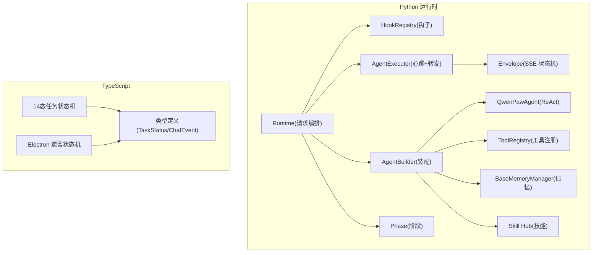

图表来源
- [runtime.py:1-120](file://tongtian-tauri/src/agent/runtime/runtime.py#L1-L120)
- [builder.py:180-410](file://tongtian-tauri/src/agent/runtime/builder.py#L180-L410)
- [react_agent.py:59-150](file://tongtian-tauri/src/agent/agents/react_agent.py#L59-L150)
- [envelope.py:83-150](file://tongtian-tauri/src/agent/runtime/envelope.py#L83-L150)
- [executor.py:23-61](file://tongtian-tauri/src/agent/runtime/executor.py#L23-L61)
- [hooks.py:145-338](file://tongtian-tauri/src/agent/runtime/hooks.py#L145-L338)
- [phases.py:28-42](file://tongtian-tauri/src/agent/runtime/phases.py#L28-L42)
- [tool_registry.py:89-181](file://tongtian-tauri/src/agent/runtime/tool_registry.py#L89-L181)
- [base_memory_manager.py:36-120](file://tongtian-tauri/src/agent/agents/memory/base_memory_manager.py#L36-L120)
- [hub.py:1-120](file://tongtian-tauri/src/agent/agents/skill_system/hub.py#L1-L120)
- [task-state-machine.ts:1-134](file://tongtian-tauri/src/shared/task-state-machine.ts#L1-L134)
- [types.ts:1-120](file://tongtian-tauri/src/shared/types.ts#L1-L120)
- [state-machine.ts:1-80](file://tongtian-tauri/src/main/agent/state-machine.ts#L1-L80)

章节来源
- [runtime.py:1-120](file://tongtian-tauri/src/agent/runtime/runtime.py#L1-L120)
- [builder.py:180-410](file://tongtian-tauri/src/agent/runtime/builder.py#L180-L410)
- [react_agent.py:59-150](file://tongtian-tauri/src/agent/agents/react_agent.py#L59-L150)
- [envelope.py:83-150](file://tongtian-tauri/src/agent/runtime/envelope.py#L83-L150)
- [executor.py:23-61](file://tongtian-tauri/src/agent/runtime/executor.py#L23-L61)
- [hooks.py:145-338](file://tongtian-tauri/src/agent/runtime/hooks.py#L145-L338)
- [phases.py:28-42](file://tongtian-tauri/src/agent/runtime/phases.py#L28-L42)
- [tool_registry.py:89-181](file://tongtian-tauri/src/agent/runtime/tool_registry.py#L89-L181)
- [base_memory_manager.py:36-120](file://tongtian-tauri/src/agent/agents/memory/base_memory_manager.py#L36-L120)
- [hub.py:1-120](file://tongtian-tauri/src/agent/agents/skill_system/hub.py#L1-L120)
- [task-state-machine.ts:1-134](file://tongtian-tauri/src/shared/task-state-machine.ts#L1-L134)
- [types.ts:1-120](file://tongtian-tauri/src/shared/types.ts#L1-L120)
- [state-machine.ts:1-80](file://tongtian-tauri/src/main/agent/state-machine.ts#L1-L80)

## 核心组件
- Runtime（请求编排）
  - 8 阶段生命周期：PRE_DISPATCH → POST_DISPATCH → PRE_AGENT_BUILD → POST_AGENT_BUILD → PRE_EXECUTE → POST_RESPONSE → ON_ERROR → FINALLY
  - 通过 HookRegistry 在固定步骤（斜杠命令分发、Agent 构建、执行）前后注入扩展逻辑
  - 异常与取消路径统一处理，保证 SSE 信封完成或错误事件发出
- QwenPawAgent（ReAct 代理）
  - 继承 AgentScope 的 Agent，支持 ReAct 推理-行动循环
  - 集成工具集、技能加载、记忆工具、上下文压缩/恢复、媒体块自适应
  - 提供 compress_context、_save_to_context、state_dict/load_state_dict 等能力
- Envelope（SSE 信封状态机）
  - 将 AgentScope 事件转换为前端期望的 SSE 对象序列（文本块、思考块、工具调用、工具结果、数据块、用量统计）
  - 维护消息与块的状态，确保顺序与完整性
- AgentExecutor（执行器）
  - 以心跳包装 agent.reply_stream，避免长空闲断开连接
  - 将每个事件转交给 Envelope 进行转换
- AgentBuilder（装配器）
  - 按请求组装模型、工具、中间件、提示词、上下文策略、记忆管理器、技能目录等
  - 应用 subagent 工具白名单、Governor 安全层、Driver/MCP 工具注入
- HookRegistry（钩子系统）
  - 基于 Phase 的拓扑排序执行，支持 SHORT_CIRCUIT/SKIP_AGENT 语义
  - 提供 HookContext 跨阶段传递上下文与动态注入
- ToolRegistry（工具注册）
  - @tool_descriptor 装饰器自动收集内置工具，支持模式/技能/特性开关、沙箱需求、治理元数据
  - filter() 根据当前请求上下文筛选可用工具
- BaseMemoryManager（记忆系统）
  - 抽象接口：start/close/get_memory_prompt/list_memory_tools/build_middlewares
  - 后台 summarize 工作队列、自动记忆搜索、Token 估算、任务状态追踪
- Skill Hub（技能系统）
  - 统一的 HTTP 客户端、重试/退避、GitHub 响应缓存、取消检查、包大小限制
  - 支持多来源安装与冲突检测

章节来源
- [runtime.py:1-200](file://tongtian-tauri/src/agent/runtime/runtime.py#L1-L200)
- [react_agent.py:59-200](file://tongtian-tauri/src/agent/agents/react_agent.py#L59-L200)
- [envelope.py:83-200](file://tongtian-tauri/src/agent/runtime/envelope.py#L83-L200)
- [executor.py:23-61](file://tongtian-tauri/src/agent/runtime/executor.py#L23-L61)
- [builder.py:180-410](file://tongtian-tauri/src/agent/runtime/builder.py#L180-L410)
- [hooks.py:145-338](file://tongtian-tauri/src/agent/runtime/hooks.py#L145-L338)
- [tool_registry.py:89-181](file://tongtian-tauri/src/agent/runtime/tool_registry.py#L89-L181)
- [base_memory_manager.py:36-120](file://tongtian-tauri/src/agent/agents/memory/base_memory_manager.py#L36-L120)
- [hub.py:1-120](file://tongtian-tauri/src/agent/agents/skill_system/hub.py#L1-L120)

## 架构总览
下图展示了从请求进入、钩子编排、Agent 构建与执行、到 SSE 输出的完整流程，以及 14 态任务状态机在前端/后端契约中的角色。

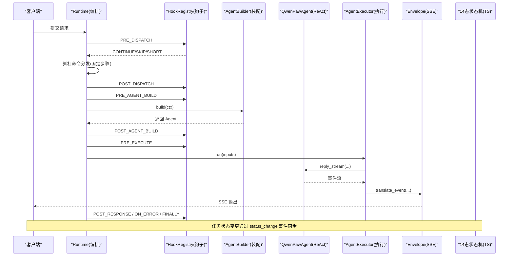

图表来源
- [runtime.py:49-142](file://tongtian-tauri/src/agent/runtime/runtime.py#L49-L142)
- [hooks.py:293-313](file://tongtian-tauri/src/agent/runtime/hooks.py#L293-L313)
- [builder.py:183-410](file://tongtian-tauri/src/agent/runtime/builder.py#L183-L410)
- [executor.py:36-58](file://tongtian-tauri/src/agent/runtime/executor.py#L36-L58)
- [envelope.py:195-300](file://tongtian-tauri/src/agent/runtime/envelope.py#L195-L300)
- [types.ts:291-304](file://tongtian-tauri/src/shared/types.ts#L291-L304)

章节来源
- [runtime.py:49-200](file://tongtian-tauri/src/agent/runtime/runtime.py#L49-L200)
- [hooks.py:293-313](file://tongtian-tauri/src/agent/runtime/hooks.py#L293-L313)
- [builder.py:183-410](file://tongtian-tauri/src/agent/runtime/builder.py#L183-L410)
- [executor.py:36-58](file://tongtian-tauri/src/agent/runtime/executor.py#L36-L58)
- [envelope.py:195-300](file://tongtian-tauri/src/agent/runtime/envelope.py#L195-L300)
- [types.ts:291-304](file://tongtian-tauri/src/shared/types.ts#L291-L304)

## 详细组件分析

### ReAct 代理与推理-行动循环
- QwenPawAgent 基于 AgentScope 的 Agent，重写 _call_model/_reasoning 以增强：
  - 主动剥离不支持的媒体块（当模型不支持或多模态被拒绝时）
  - 被动重试（对媒体相关 400 错误识别与重试）
  - 上下文溢出恢复（调用 context_manager.recover_from_context_overflow）
  - Stop Handler 控制迭代继续/中断
- 上下文压缩与持久化：
  - compress_context 委托给 ContextManager 或回退到原生压缩
  - state_dict/load_state_dict 支持 2.0 与 1.x 兼容迁移，清理孤儿 tool_result
- 工具与技能：
  - 构造时注册 memory tools 并包裹 PolicyGuardedTool
  - 从工作区目录加载有效技能并注入 Toolkit

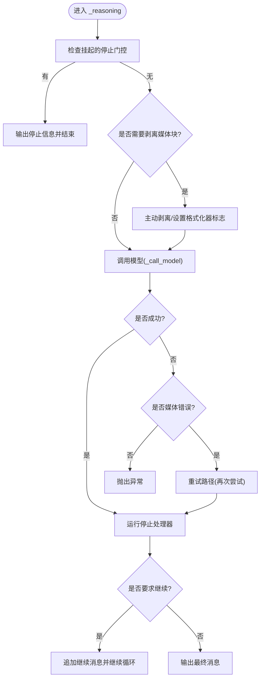

图表来源
- [react_agent.py:566-738](file://tongtian-tauri/src/agent/agents/react_agent.py#L566-L738)
- [react_agent.py:504-564](file://tongtian-tauri/src/agent/agents/react_agent.py#L504-L564)
- [react_agent.py:173-225](file://tongtian-tauri/src/agent/agents/react_agent.py#L173-L225)

章节来源
- [react_agent.py:566-738](file://tongtian-tauri/src/agent/agents/react_agent.py#L566-L738)
- [react_agent.py:504-564](file://tongtian-tauri/src/agent/agents/react_agent.py#L504-L564)
- [react_agent.py:173-225](file://tongtian-tauri/src/agent/agents/react_agent.py#L173-L225)

### 任务规划器与执行器
- 规划器（计划生成）：
  - 由上层（如 Runner/云端）产出 Plan 事件，包含步骤预览；前端通过 ChatEvent.plan 展示
- 执行器（步骤执行）：
  - AgentExecutor 驱动 Agent 的 reply_stream，将事件转为 SSE
  - 状态机事件 status_change 用于更新任务状态（executing/delivering/done/failed 等）
  - 14 态状态机定义了合法转移与守卫条件（如 retry_count<3）

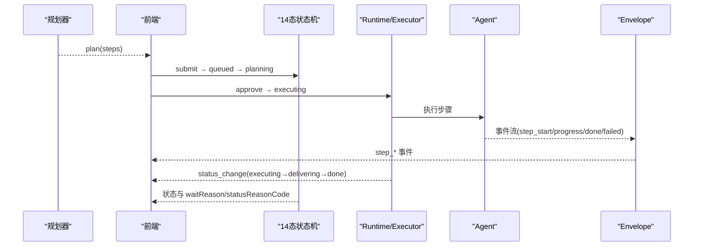

图表来源
- [types.ts:291-304](file://tongtian-tauri/src/shared/types.ts#L291-L304)
- [task-state-machine.ts:63-133](file://tongtian-tauri/src/shared/task-state-machine.ts#L63-L133)
- [executor.py:36-58](file://tongtian-tauri/src/agent/runtime/executor.py#L36-L58)

章节来源
- [types.ts:291-304](file://tongtian-tauri/src/shared/types.ts#L291-L304)
- [task-state-machine.ts:63-133](file://tongtian-tauri/src/shared/task-state-machine.ts#L63-L133)
- [executor.py:36-58](file://tongtian-tauri/src/agent/runtime/executor.py#L36-L58)

### 状态机设计（14 种任务状态）
- 14 态包括：IDLE、PLANNING、PENDING_REVIEW、EXECUTING、PAUSED、DELIVERING、DONE、FAILED、ROLLED_BACK、QUEUED、BUDGET_PAUSED、RETRY_PENDING、CANCELLED、ARCHIVED
- 35 条合法转移，含守卫条件（如 retryable_error 且 retryCount≥3 路由到 failed）
- executing 子态通过 wait_reason 表达（rate_limited/circuit_break 等），避免状态爆炸
- 终态集合：CANCELLED、ARCHIVED（DONE 仅保留 archive 边）

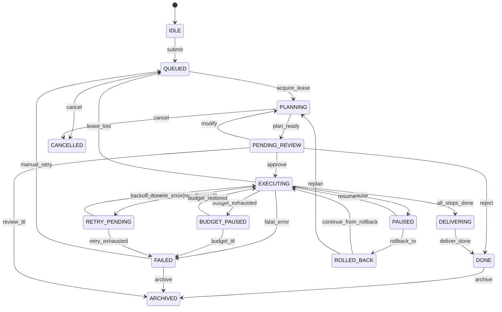

图表来源
- [task-state-machine.ts:63-133](file://tongtian-tauri/src/shared/task-state-machine.ts#L63-L133)
- [types.ts:4-25](file://tongtian-tauri/src/shared/types.ts#L4-L25)

章节来源
- [task-state-machine.ts:63-133](file://tongtian-tauri/src/shared/task-state-machine.ts#L63-L133)
- [types.ts:4-25](file://tongtian-tauri/src/shared/types.ts#L4-L25)

### 事件驱动架构与 SSE 信封
- Envelope 维护文本块、思考块、工具调用、工具结果、数据块的增量状态
- 将 AgentScope 事件映射为前端所需的 Message/DataContent/TextContent 等对象
- 心跳机制保障长连接存活，异常路径输出 error_envelope

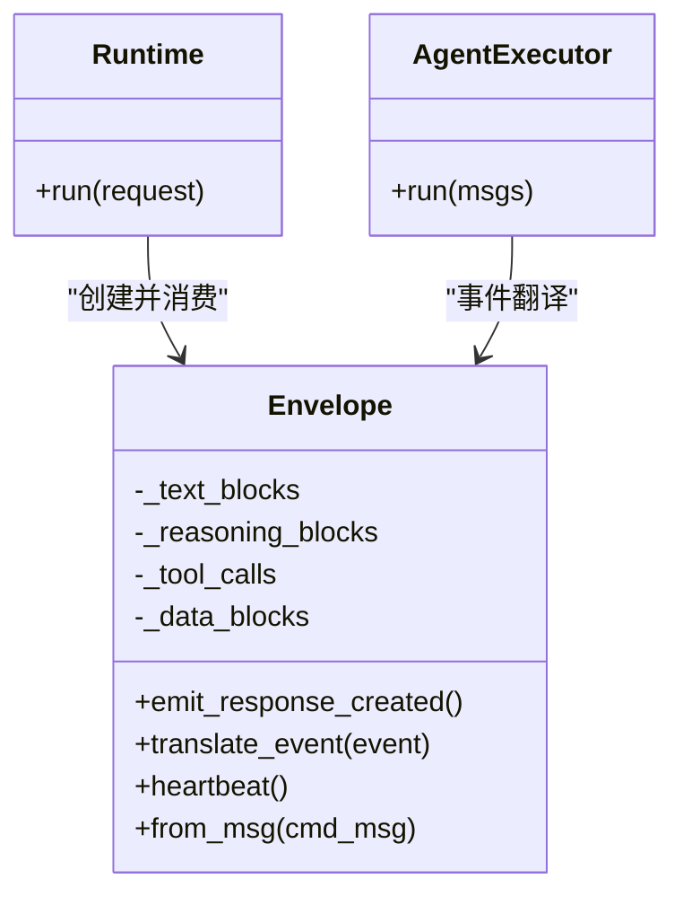

图表来源
- [envelope.py:83-200](file://tongtian-tauri/src/agent/runtime/envelope.py#L83-L200)
- [executor.py:23-61](file://tongtian-tauri/src/agent/runtime/executor.py#L23-L61)
- [runtime.py:49-142](file://tongtian-tauri/src/agent/runtime/runtime.py#L49-L142)

章节来源
- [envelope.py:83-200](file://tongtian-tauri/src/agent/runtime/envelope.py#L83-L200)
- [executor.py:23-61](file://tongtian-tauri/src/agent/runtime/executor.py#L23-L61)
- [runtime.py:49-142](file://tongtian-tauri/src/agent/runtime/runtime.py#L49-L142)

### 钩子系统与八阶段编排
- Phase 枚举定义 8 个阶段点，Runtime.run() 在每个阶段调用 HookRegistry.run(phase, ctx)
- HookResult.action 支持 CONTINUE、SHORT_CIRCUIT、SKIP_AGENT
- HookRegistry 基于 before/after 约束进行拓扑排序，确保确定性执行顺序

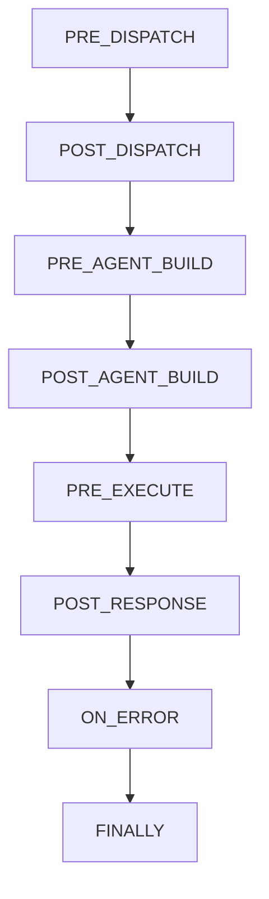

图表来源
- [phases.py:28-42](file://tongtian-tauri/src/agent/runtime/phases.py#L28-L42)
- [hooks.py:293-313](file://tongtian-tauri/src/agent/runtime/hooks.py#L293-L313)

章节来源
- [phases.py:28-42](file://tongtian-tauri/src/agent/runtime/phases.py#L28-L42)
- [hooks.py:293-313](file://tongtian-tauri/src/agent/runtime/hooks.py#L293-L313)

### 工具注册机制
- @tool_descriptor 装饰器将函数注册为 ToolDescriptor，支持模式/技能/特性/沙箱需求、治理元数据、UI 描述
- ToolRegistry.filter() 根据 active_modes/effective_skills/enabled_features/allowed/denied 筛选工具
- AgentBuilder 在构建 Toolkit 时应用 subagent 工具白名单与额外工具过滤

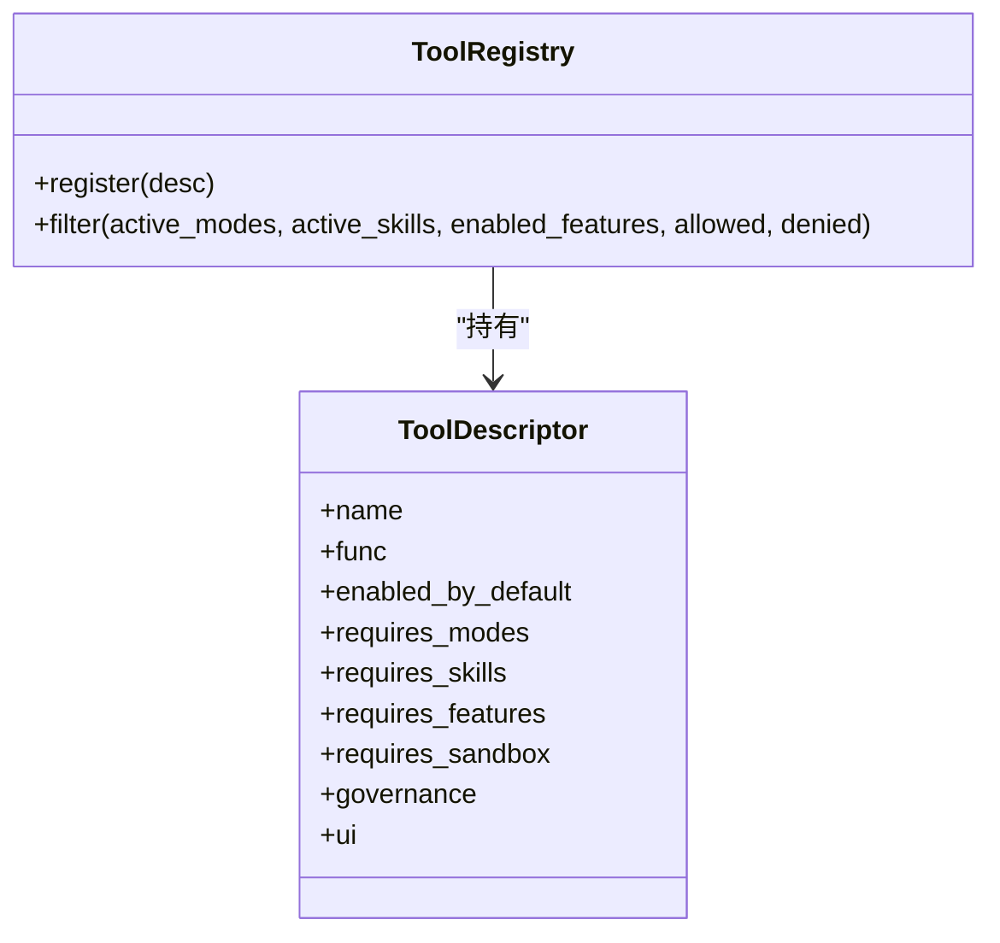

图表来源
- [tool_registry.py:55-181](file://tongtian-tauri/src/agent/runtime/tool_registry.py#L55-L181)
- [builder.py:42-109](file://tongtian-tauri/src/agent/runtime/builder.py#L42-L109)

章节来源
- [tool_registry.py:55-181](file://tongtian-tauri/src/agent/runtime/tool_registry.py#L55-L181)
- [builder.py:42-109](file://tongtian-tauri/src/agent/runtime/builder.py#L42-L109)

### 记忆系统设计与实现
- BaseMemoryManager 抽象：
  - start/close：初始化与关闭存储后端
  - get_memory_prompt：生成记忆指导提示
  - list_memory_tools：暴露记忆访问工具（如 memory_search）
  - build_middlewares：注入 MemoryMiddleware
- 后台摘要工作流：
  - add_summarize_task：非阻塞入队，串行执行
  - _summarize_worker：队列消费者，跟踪任务状态
  - list_summarize_status：查询任务状态
- 自动记忆搜索：
  - auto_memory_search：在 pre_reply 阶段检索相关记忆
  - 合成 AssistantMsg 模拟工具调用，便于上下文注入

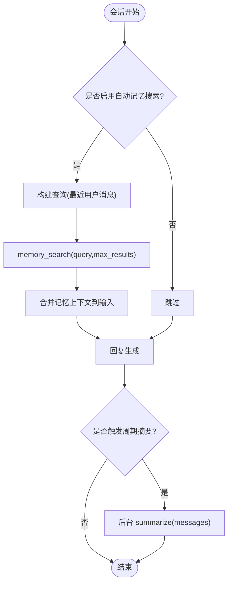

图表来源
- [base_memory_manager.py:284-330](file://tongtian-tauri/src/agent/agents/memory/base_memory_manager.py#L284-L330)
- [base_memory_manager.py:438-476](file://tongtian-tauri/src/agent/agents/memory/base_memory_manager.py#L438-L476)
- [base_memory_manager.py:375-437](file://tongtian-tauri/src/agent/agents/memory/base_memory_manager.py#L375-L437)

章节来源
- [base_memory_manager.py:284-330](file://tongtian-tauri/src/agent/agents/memory/base_memory_manager.py#L284-L330)
- [base_memory_manager.py:438-476](file://tongtian-tauri/src/agent/agents/memory/base_memory_manager.py#L438-L476)
- [base_memory_manager.py:375-437](file://tongtian-tauri/src/agent/agents/memory/base_memory_manager.py#L375-L437)

### 技能系统与 Hub
- Hub 提供统一的 HTTP 客户端、重试/退避、取消检查、GitHub 缓存、包大小限制
- 支持多来源安装（skills-sh/github/lobehub/qwenpaw/modelscope/aliyun/skillsmp/clawhub/url/zip）
- 冲突检测与建议命名、版本解析、bundle 树构建与校验

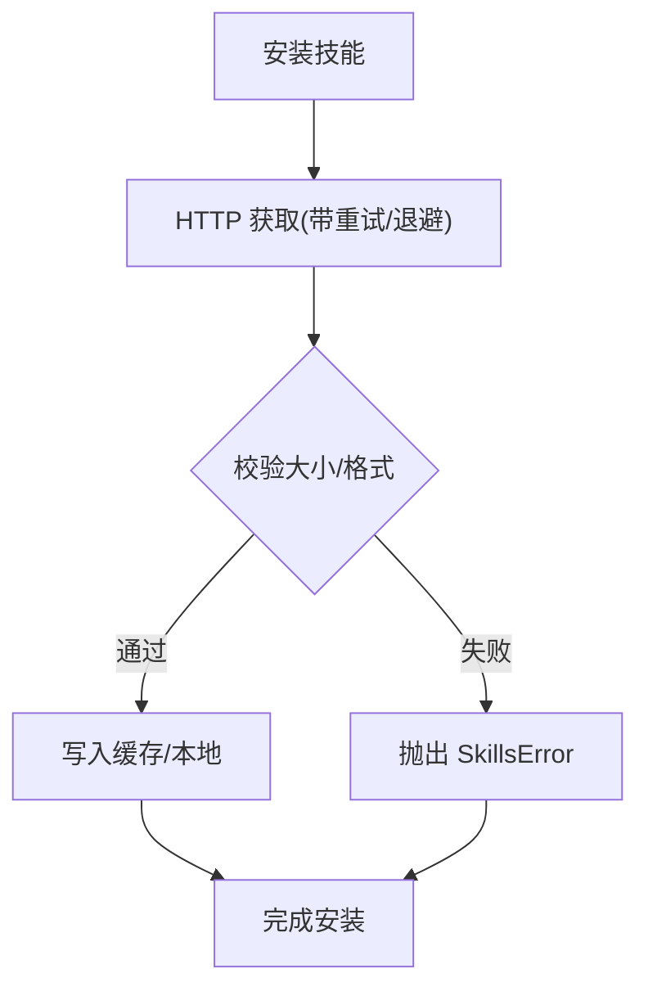

图表来源
- [hub.py:507-638](file://tongtian-tauri/src/agent/agents/skill_system/hub.py#L507-L638)
- [hub.py:146-205](file://tongtian-tauri/src/agent/agents/skill_system/hub.py#L146-L205)

章节来源
- [hub.py:507-638](file://tongtian-tauri/src/agent/agents/skill_system/hub.py#L507-L638)
- [hub.py:146-205](file://tongtian-tauri/src/agent/agents/skill_system/hub.py#L146-L205)

### Agent 生命周期管理与上下文管理
- 生命周期：
  - Runtime.run() 负责 8 阶段编排、异常/取消处理、finally 清理
  - Agent.close() 释放 governor、上下文管理器、offloader 过期清理
- 上下文管理：
  - compress_context 委托 ContextManager 或原生压缩
  - _save_to_context 追加块后通知 ContextManager
  - state_dict/load_state_dict 支持 2.0/1.x 迁移与孤儿清理

章节来源
- [runtime.py:143-207](file://tongtian-tauri/src/agent/runtime/runtime.py#L143-L207)
- [react_agent.py:331-382](file://tongtian-tauri/src/agent/agents/react_agent.py#L331-L382)
- [react_agent.py:173-225](file://tongtian-tauri/src/agent/agents/react_agent.py#L173-L225)
- [react_agent.py:234-330](file://tongtian-tauri/src/agent/agents/react_agent.py#L234-L330)

### 与其他系统的集成方式
- 前端/Tauri：
  - SSE 事件通过 Envelope 输出，前端订阅 ChatEvent（plan/step_start/step_progress/step_done/step_failed/deliver/done/error/status_change/quota_warning/heartbeat）
  - 14 态状态机用于 UI 渲染与操作可用性
- Rust/Tauri：
  - 通过 IPC/桥接层与 Python 运行时交互（此处不展开具体代码）
- Provider/模型：
  - AgentBuilder.build_model 创建模型与 formatter，支持 slot 覆盖与能力缓存

章节来源
- [types.ts:291-304](file://tongtian-tauri/src/shared/types.ts#L291-L304)
- [task-state-machine.ts:1-134](file://tongtian-tauri/src/shared/task-state-machine.ts#L1-L134)
- [builder.py:455-478](file://tongtian-tauri/src/agent/runtime/builder.py#L455-L478)

## 依赖关系分析
- Runtime 依赖 HookRegistry、AgentBuilder、AgentExecutor、Envelope
- AgentBuilder 依赖 Workspace（工具列表）、PromptManager、ProviderManager、Governor、MemoryManager、Skill System
- QwenPawAgent 依赖 Toolkit、Model、ContextManager、Offloader、Governor
- Envelope 依赖 AgentScope 事件与前端 Schema
- 14 态状态机与 types.ts 为前后端契约基础

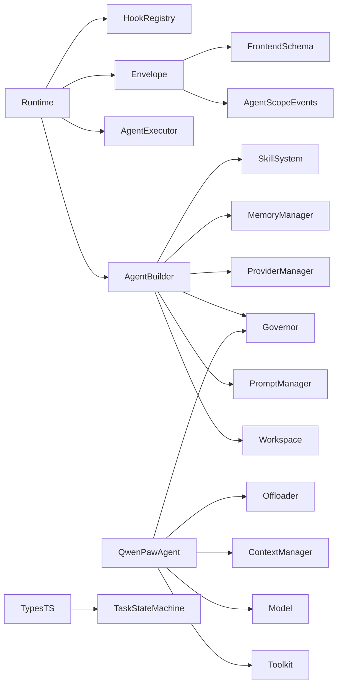

图表来源
- [runtime.py:49-142](file://tongtian-tauri/src/agent/runtime/runtime.py#L49-L142)
- [builder.py:183-410](file://tongtian-tauri/src/agent/runtime/builder.py#L183-L410)
- [react_agent.py:59-150](file://tongtian-tauri/src/agent/agents/react_agent.py#L59-L150)
- [envelope.py:83-150](file://tongtian-tauri/src/agent/runtime/envelope.py#L83-L150)
- [types.ts:1-120](file://tongtian-tauri/src/shared/types.ts#L1-L120)
- [task-state-machine.ts:1-134](file://tongtian-tauri/src/shared/task-state-machine.ts#L1-L134)

章节来源
- [runtime.py:49-142](file://tongtian-tauri/src/agent/runtime/runtime.py#L49-L142)
- [builder.py:183-410](file://tongtian-tauri/src/agent/runtime/builder.py#L183-L410)
- [react_agent.py:59-150](file://tongtian-tauri/src/agent/agents/react_agent.py#L59-L150)
- [envelope.py:83-150](file://tongtian-tauri/src/agent/runtime/envelope.py#L83-L150)
- [types.ts:1-120](file://tongtian-tauri/src/shared/types.ts#L1-L120)
- [task-state-machine.ts:1-134](file://tongtian-tauri/src/shared/task-state-machine.ts#L1-L134)

## 性能考量
- SSE 心跳：AgentExecutor 周期性发送心跳，避免长连接超时
- 上下文压缩：ContextManager 可配置滚动窗口与工具结果裁剪，减少 token 消耗
- 后台摘要：BaseMemoryManager 的 summarize 工作队列串行执行，避免阻塞主流程
- HTTP 重试与退避：Skill Hub 使用指数退避与最大重试次数，降低网络抖动影响
- 媒体块优化：按需剥离/格式化器标记，避免不必要的传输与处理

[本节为通用指导，无需特定文件引用]

## 故障排查指南
- 常见错误定位：
  - 上下文溢出：检查 _is_context_overflow_error 与 recover_from_context_overflow 日志
  - 媒体错误：查看 _is_bad_request_or_media_error 与能力缓存 learn("rejects_media")
  - 钩子循环：HookCycleError 表示 before/after 约束存在环
  - 非法状态转移：IllegalTransitionError 表明事件不在 35 条合法转移内
- 调试建议：
  - 启用详细日志（logger.debug/info/warning）
  - 检查 Envelope 的 sequence_number 与 output 顺序
  - 使用 list_summarize_status 查看摘要任务状态
  - 通过 availableEvents(from) 确认当前状态允许的操作

章节来源
- [react_agent.py:459-503](file://tongtian-tauri/src/agent/agents/react_agent.py#L459-L503)
- [react_agent.py:756-799](file://tongtian-tauri/src/agent/agents/react_agent.py#L756-L799)
- [hooks.py:248-253](file://tongtian-tauri/src/agent/runtime/hooks.py#L248-L253)
- [task-state-machine.ts:147-155](file://tongtian-tauri/src/shared/task-state-machine.ts#L147-L155)
- [task-state-machine.ts:220-223](file://tongtian-tauri/src/shared/task-state-machine.ts#L220-L223)
- [base_memory_manager.py:500-528](file://tongtian-tauri/src/agent/agents/memory/base_memory_manager.py#L500-L528)

## 结论
通天办公 Agent 引擎以 ReAct 为核心，结合 8 阶段钩子编排、14 态任务状态机、SSE 事件驱动、工具注册与治理、记忆与技能系统，构建了可扩展、高可靠、易观测的 Agent 平台。开发者可通过 Hook 扩展、@tool_descriptor 注册工具、自定义 MemoryManager 与 ContextManager 来定制行为，并通过前端状态机与事件流实现一致的交互体验。

[本节为总结性内容，无需特定文件引用]

## 附录
- 使用示例路径（参考）：
  - 自定义钩子：参考 hooks.py 中 HookBase/HookRegistry 的使用
  - 注册工具：参考 tool_registry.py 中 @tool_descriptor 的用法
  - 记忆后端：参考 base_memory_manager.py 中 BaseMemoryManager 的抽象方法
  - 技能安装：参考 hub.py 中的 HTTP 客户端与重试逻辑
  - 状态机使用：参考 task-state-machine.ts 中的 transition/canTransition/availableEvents

[本节为补充信息，无需特定文件引用]