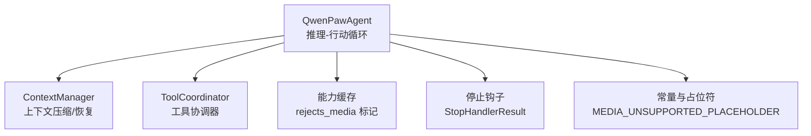
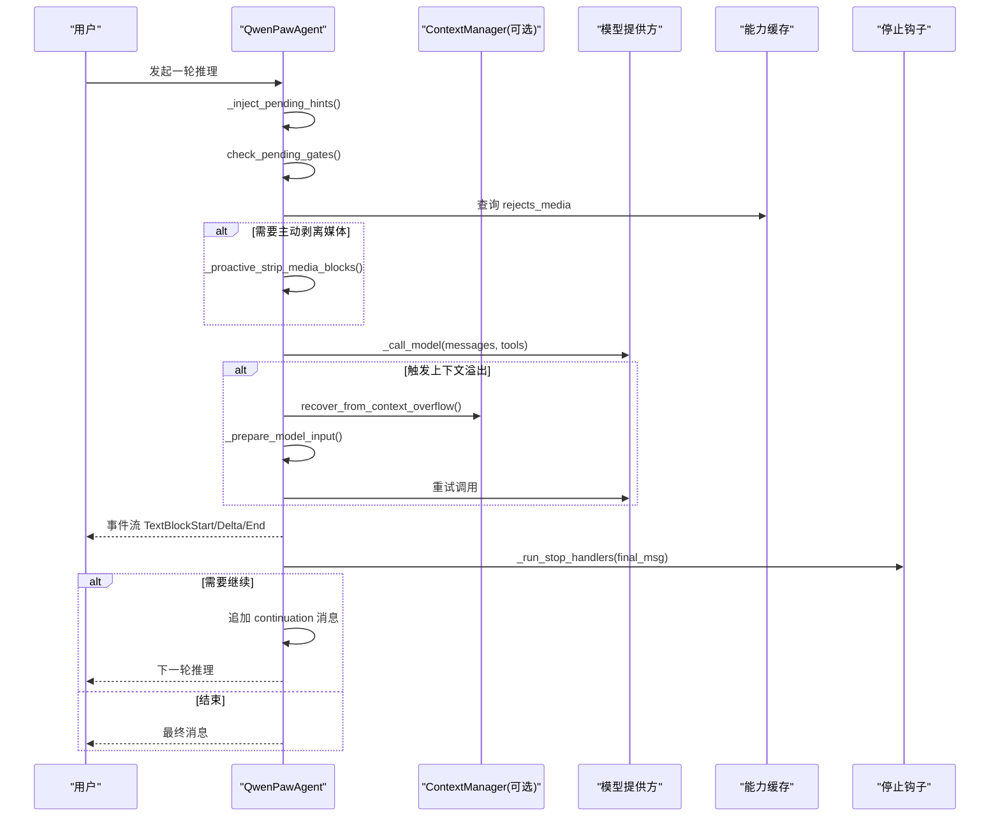
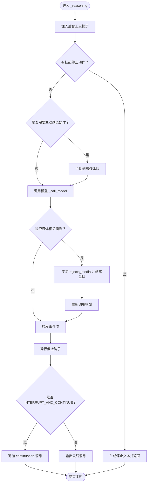
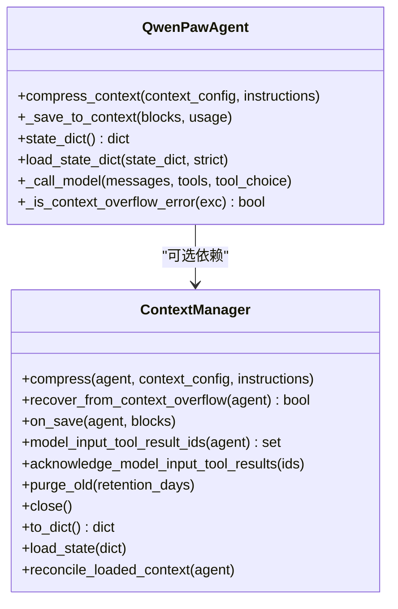
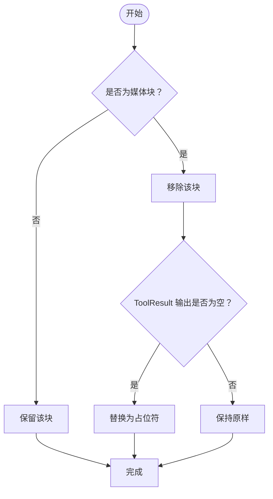
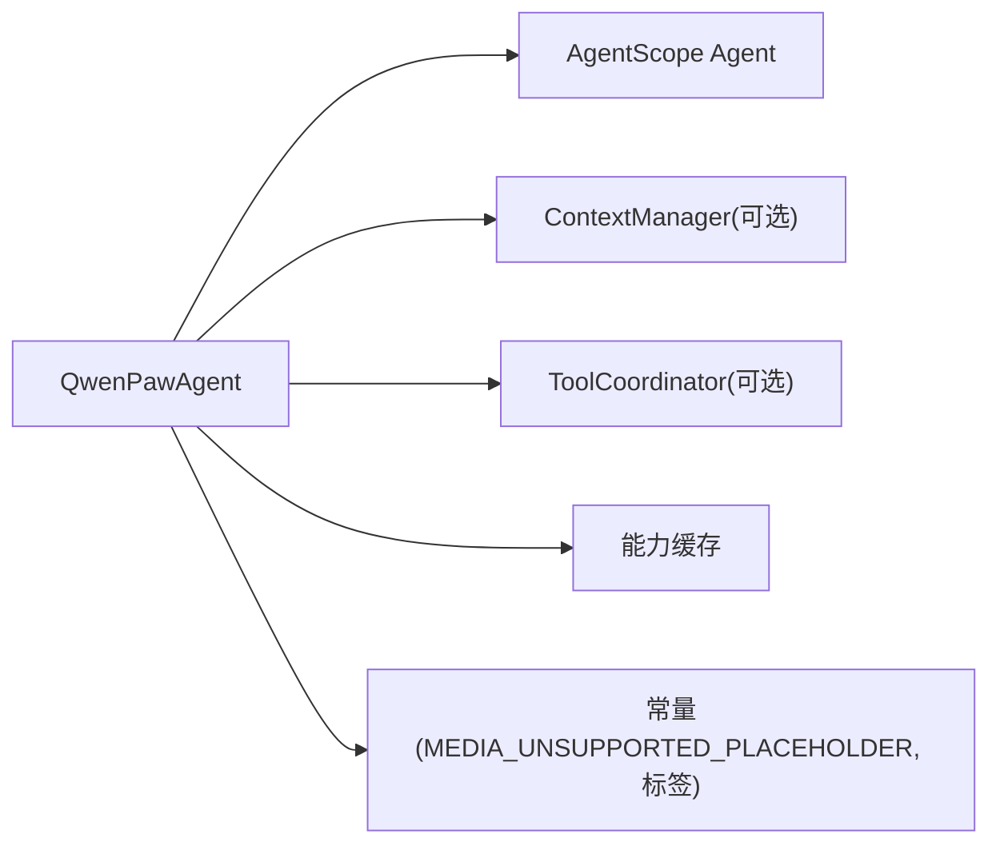

# ReAct 代理核心

<cite>
**本文引用的文件**   
- [react_agent.py](file://tongtian-tauri/src/agent/agents/react_agent.py)
- [constant.py](file://tongtian-tauri/src/agent/constant.py)
</cite>

## 目录
1. [简介](#简介)
2. [项目结构](#项目结构)
3. [核心组件](#核心组件)
4. [架构总览](#架构总览)
5. [详细组件分析](#详细组件分析)
6. [依赖关系分析](#依赖关系分析)
7. [性能考量](#性能考量)
8. [故障排查指南](#故障排查指南)
9. [结论](#结论)
10. [附录：扩展与自定义示例](#附录扩展与自定义示例)

## 简介
本文件聚焦于 QwenPawAgent 的 ReAct 代理核心实现，系统阐述推理-行动循环机制、上下文管理策略、媒体块处理逻辑，以及 _reasoning 方法的工作流程（工具调用、状态更新、事件流处理）。同时覆盖上下文压缩算法、错误恢复机制（特别是上下文溢出和媒体不支持的处理），以及与工具协调器、能力缓存、停止钩子等组件的集成方式。文档以渐进式复杂度组织，并辅以可视化图示帮助理解。

## 项目结构
QwenPawAgent 位于 agents 模块下，作为 AgentScope 2.0 Agent 的扩展，整合了工具、技能、记忆管理与安全治理。关键职责包括：
- 初始化时注册技能元数据、注入内存工具、应用子代理工具白名单
- 重写上下文压缩入口，支持可插拔 ContextManager 或回退到原生压缩
- 重写模型调用入口，提供上下文溢出的一次性恢复重试
- 重写推理主循环，实现主动媒体剥离、被动媒体错误重试、自动继续控制
- 维护工具超时默认值、停止钩子执行、会话持久化与清理

图表来源
- [react_agent.py:59-157](file://tongtian-tauri/src/agent/agents/react_agent.py#L59-L157)
- [react_agent.py:173-224](file://tongtian-tauri/src/agent/agents/react_agent.py#L173-L224)
- [react_agent.py:504-563](file://tongtian-tauri/src/agent/agents/react_agent.py#L504-L563)
- [react_agent.py:566-737](file://tongtian-tauri/src/agent/agents/react_agent.py#L566-L737)
- [constant.py:421-426](file://tongtian-tauri/src/agent/constant.py#L421-L426)

章节来源
- [react_agent.py:59-157](file://tongtian-tauri/src/agent/agents/react_agent.py#L59-L157)
- [constant.py:129-147](file://tongtian-tauri/src/agent/constant.py#L129-L147)
- [constant.py:421-426](file://tongtian-tauri/src/agent/constant.py#L421-L426)

## 核心组件
- QwenPawAgent：ReAct 代理主体，封装推理-行动循环、上下文压缩、媒体处理、工具超时、停止钩子、会话持久化。
- ContextManager（可选）：外部注入的上下文管理器，负责压缩、恢复、去重、滚动窗口等；未注入时回退到 AgentScope 原生压缩。
- ToolCoordinator（通过 request_context 注入）：提供后台工具提示注入、工具超时配置、执行钩子。
- 能力缓存：记录模型对媒体类型的拒绝行为，驱动主动/被动媒体剥离策略。
- 停止钩子系统：每轮迭代后评估是否中断并继续，或输出最终消息。

章节来源
- [react_agent.py:59-157](file://tongtian-tauri/src/agent/agents/react_agent.py#L59-L157)
- [react_agent.py:173-224](file://tongtian-tauri/src/agent/agents/react_agent.py#L173-L224)
- [react_agent.py:817-903](file://tongtian-tauri/src/agent/agents/react_agent.py#L817-L903)
- [react_agent.py:908-939](file://tongtian-tauri/src/agent/agents/react_agent.py#L908-L939)

## 架构总览
下图展示 QwenPawAgent 在推理-行动循环中的关键交互：工具结果注入、媒体剥离、模型调用、溢出恢复、停止钩子与事件流。

图表来源
- [react_agent.py:566-737](file://tongtian-tauri/src/agent/agents/react_agent.py#L566-L737)
- [react_agent.py:504-563](file://tongtian-tauri/src/agent/agents/react_agent.py#L504-L563)
- [react_agent.py:821-832](file://tongtian-tauri/src/agent/agents/react_agent.py#L821-L832)

## 详细组件分析

### 推理-行动循环：_reasoning 方法
- 背景工具结果注入：每轮开始前从 ToolCoordinator 拉取待处理的 hints 并追加到上下文。
- 前置门控检查：若存在挂起的停止动作，直接生成文本块并返回。
- 媒体剥离策略：
  - 主动剥离：当当前模型不支持多模态或被能力缓存标记为拒绝媒体时，启用请求时剥离或内存中提前剥离。
  - 被动重试：若模型调用抛出“媒体相关”的错误，则记录能力缓存并尝试一次剥离后重试。
- 事件流处理：转发底层 _reasoning 的事件，并在完成时收集 final_msg。
- 停止钩子：每轮结束后运行停止处理器，根据 StopAction.INTERRUPT_AND_CONTINUE 决定是否追加 continuation 消息并继续循环。

图表来源
- [react_agent.py:566-737](file://tongtian-tauri/src/agent/agents/react_agent.py#L566-L737)
- [react_agent.py:821-832](file://tongtian-tauri/src/agent/agents/react_agent.py#L821-L832)

章节来源
- [react_agent.py:566-737](file://tongtian-tauri/src/agent/agents/react_agent.py#L566-L737)
- [react_agent.py:821-832](file://tongtian-tauri/src/agent/agents/react_agent.py#L821-L832)

### 上下文压缩与恢复
- compress_context：优先使用注入的 ContextManager 进行压缩；否则回退到 AgentScope 原生压缩，受 light_context_config.context_compact_config.enabled 控制。每次压缩前会清理孤立 tool_result 消息，避免 400 错误。
- _save_to_context：保存消息块后通知 ContextManager 写入，确保滚动窗口与去重一致。
- 会话持久化：state_dict/load_state_dict 支持 2.0 与 1.x 兼容格式，加载后执行 _sanitize_loaded_context 清理孤儿消息，并恢复滚动管理器状态。
- 上下文溢出恢复：_call_model 捕获 provider 400 且判定为输入过长时，调用 context_manager.recover_from_context_overflow 进行一次恢复，重建输入并重试。

图表来源
- [react_agent.py:173-224](file://tongtian-tauri/src/agent/agents/react_agent.py#L173-L224)
- [react_agent.py:226-231](file://tongtian-tauri/src/agent/agents/react_agent.py#L226-L231)
- [react_agent.py:234-310](file://tongtian-tauri/src/agent/agents/react_agent.py#L234-L310)
- [react_agent.py:311-330](file://tongtian-tauri/src/agent/agents/react_agent.py#L311-L330)
- [react_agent.py:504-563](file://tongtian-tauri/src/agent/agents/react_agent.py#L504-L563)

章节来源
- [react_agent.py:173-224](file://tongtian-tauri/src/agent/agents/react_agent.py#L173-L224)
- [react_agent.py:234-310](file://tongtian-tauri/src/agent/agents/react_agent.py#L234-L310)
- [react_agent.py:504-563](file://tongtian-tauri/src/agent/agents/react_agent.py#L504-L563)

### 媒体块处理逻辑
- 识别媒体块：_is_media_block 支持 dict 与对象两种形式，匹配 image/audio/video/file 类型或 data source 的 media_type 前缀。
- 主动剥离：_proactive_strip_media_blocks 在模型不支持多模态或能力缓存标记拒绝媒体时提前移除。
- 被动剥离与重试：_is_bad_request_or_media_error 精确识别媒体相关错误（排除内容安全与尺寸过大），失败后记录能力缓存并剥离重试。
- 内存剥离：_strip_media_blocks_from_memory 遍历上下文消息，移除媒体块；若 ToolResultBlock 输出为空则替换为 MEDIA_UNSUPPORTED_PLACEHOLDER，保证 API 合法。

图表来源
- [react_agent.py:800-812](file://tongtian-tauri/src/agent/agents/react_agent.py#L800-L812)
- [react_agent.py:942-1006](file://tongtian-tauri/src/agent/agents/react_agent.py#L942-L1006)
- [constant.py:421-426](file://tongtian-tauri/src/agent/constant.py#L421-L426)

章节来源
- [react_agent.py:800-812](file://tongtian-tauri/src/agent/agents/react_agent.py#L800-L812)
- [react_agent.py:942-1006](file://tongtian-tauri/src/agent/agents/react_agent.py#L942-L1006)
- [constant.py:421-426](file://tongtian-tauri/src/agent/constant.py#L421-L426)

### 工具调用与超时管理
- 工具协调器：通过 request_context.tool_coordinator 获取，用于注入后台提示、设置工具默认超时、清除 agent 级超时。
- 内置工具超时：为 shell、grep/glob/ast 搜索、LSP 系列、桌面截图、浏览器等工具注册默认超时上限，部分工具允许较长内部超时。
- 子代理工具白名单：构造阶段对 toolkit 各组的工具列表进行过滤，确保 subagent_allowed_tools 生效。

章节来源
- [react_agent.py:817-903](file://tongtian-tauri/src/agent/agents/react_agent.py#L817-L903)
- [react_agent.py:159-172](file://tongtian-tauri/src/agent/agents/react_agent.py#L159-L172)

### 停止钩子与自动继续
- 每轮推理结束后运行停止钩子，依据 StopHandlerResult.action 决定输出或继续。
- 当 action 为 INTERRUPT_AND_CONTINUE 时，向上下文追加 continuation 消息（带 LOOP_CONTINUATION_MESSAGE_TAG），外层循环继续执行。

章节来源
- [react_agent.py:908-939](file://tongtian-tauri/src/agent/agents/react_agent.py#L908-L939)
- [react_agent.py:696-737](file://tongtian-tauri/src/agent/agents/react_agent.py#L696-L737)
- [constant.py:129-147](file://tongtian-tauri/src/agent/constant.py#L129-L147)

## 依赖关系分析
- 外部依赖：
  - AgentScope 2.0 Agent：提供基础 ReAct 循环、状态管理、事件流。
  - ContextManager（可选）：压缩、恢复、滚动窗口、去重。
  - ToolCoordinator（通过 request_context）：工具超时、后台提示。
  - 能力缓存：记录模型媒体支持情况。
- 内部常量：
  - MEDIA_UNSUPPORTED_PLACEHOLDER：媒体剥离后的占位文本。
  - 消息标签：LOOP_CONTINUATION_MESSAGE_TAG 等用于标记合成消息。

图表来源
- [react_agent.py:59-157](file://tongtian-tauri/src/agent/agents/react_agent.py#L59-L157)
- [constant.py:129-147](file://tongtian-tauri/src/agent/constant.py#L129-L147)
- [constant.py:421-426](file://tongtian-tauri/src/agent/constant.py#L421-L426)

章节来源
- [react_agent.py:59-157](file://tongtian-tauri/src/agent/agents/react_agent.py#L59-L157)
- [constant.py:129-147](file://tongtian-tauri/src/agent/constant.py#L129-L147)

## 性能考量
- 上下文压缩：优先使用外部 ContextManager，减少不必要的模型输入大小；原生压缩需开启配置开关。
- 媒体剥离：主动剥离可降低请求失败率；被动剥离仅在必要时触发，避免过度处理。
- 溢出恢复：仅一次恢复重试，防止无限循环；重建输入确保引用一致性。
- 工具超时：为不同工具设置合理默认超时，避免长时间阻塞；部分长耗时工具放宽内部上限。
- 资源清理：close 方法释放历史存储、过期工具结果文件，避免长期进程的资源泄漏。

[本节为通用指导，不直接分析具体文件]

## 故障排查指南
- 上下文溢出（400）：
  - 现象：provider 返回 400，包含“context length exceeded”等关键词。
  - 处理：_call_model 捕获后调用 context_manager.recover_from_context_overflow 恢复并重试。
  - 建议：检查 ContextManager 的恢复策略是否有效，确认压缩阈值与保留窗口。
- 媒体不支持：
  - 现象：错误信息包含 image/audio/video/vision/multimodal 等关键词。
  - 处理：_is_bad_request_or_media_error 判断后记录能力缓存，剥离媒体并重试。
  - 建议：确认 _supports_multimodal_for_current_model 与能力缓存的一致性。
- 内容安全拦截：
  - 现象：错误包含 content policy/moderation/safety_filter 等关键词。
  - 处理：不被视为媒体问题，不进行剥离重试。
  - 建议：审查输入内容，调整提示词或过滤规则。
- 孤立 tool_result：
  - 现象：加载会话后出现无对应 tool_call 的 tool_result，导致 400。
  - 处理：compress_context 与 _sanitize_loaded_context 均会清理孤儿消息。
  - 建议：确保加载路径与压缩路径都执行清理。

章节来源
- [react_agent.py:504-563](file://tongtian-tauri/src/agent/agents/react_agent.py#L504-L563)
- [react_agent.py:755-799](file://tongtian-tauri/src/agent/agents/react_agent.py#L755-L799)
- [react_agent.py:311-330](file://tongtian-tauri/src/agent/agents/react_agent.py#L311-L330)

## 结论
QwenPawAgent 在 ReAct 框架基础上，提供了健壮的上下文管理、媒体支持与错误恢复机制，并通过工具协调器与停止钩子实现了灵活的运行时控制。其设计强调可扩展性与鲁棒性，适合复杂任务场景下的智能体部署。

[本节为总结，不直接分析具体文件]

## 附录：扩展与自定义示例
- 自定义上下文管理器：
  - 实现 compress、recover_from_context_overflow、on_save、model_input_tool_result_ids、acknowledge_model_input_tool_results、purge_old、close、to_dict、load_state、reconcile_loaded_context 等方法。
  - 在 QwenPawAgent 构造时注入 context_manager，即可接管压缩与恢复逻辑。
- 扩展工具超时：
  - 通过 _register_tool_call_hooks 新增或修改工具的默认超时与最大内部超时。
- 自定义停止钩子：
  - 注册新的停止处理器，根据 final_msg 与 iteration 返回 StopHandlerResult，控制是否继续循环。
- 媒体处理定制：
  - 重写 _is_media_block 与 _strip_media_blocks_from_memory，适配新的媒体类型或输出结构。

章节来源
- [react_agent.py:173-224](file://tongtian-tauri/src/agent/agents/react_agent.py#L173-L224)
- [react_agent.py:817-903](file://tongtian-tauri/src/agent/agents/react_agent.py#L817-L903)
- [react_agent.py:908-939](file://tongtian-tauri/src/agent/agents/react_agent.py#L908-L939)
- [react_agent.py:800-812](file://tongtian-tauri/src/agent/agents/react_agent.py#L800-L812)
- [react_agent.py:942-1006](file://tongtian-tauri/src/agent/agents/react_agent.py#L942-L1006)