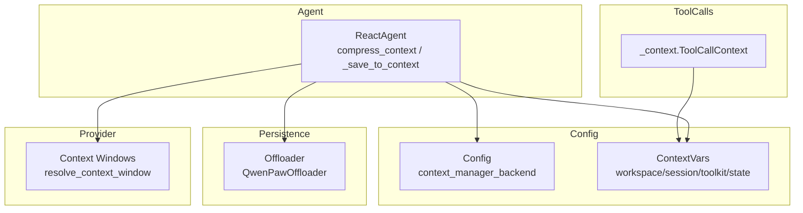
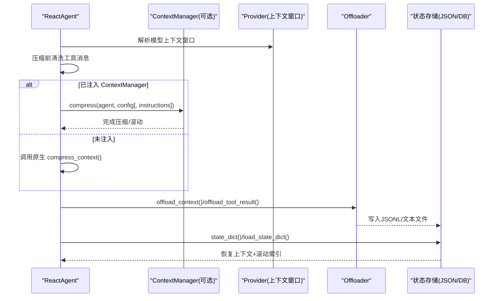
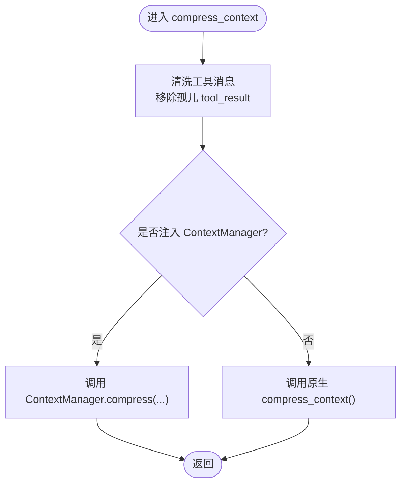
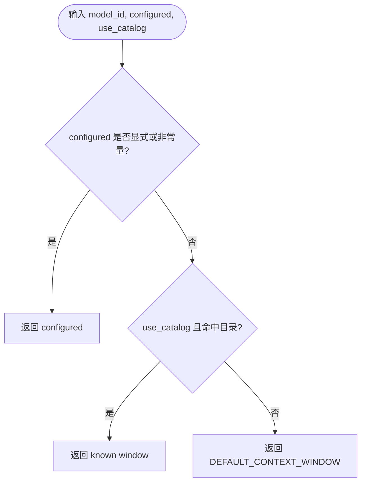
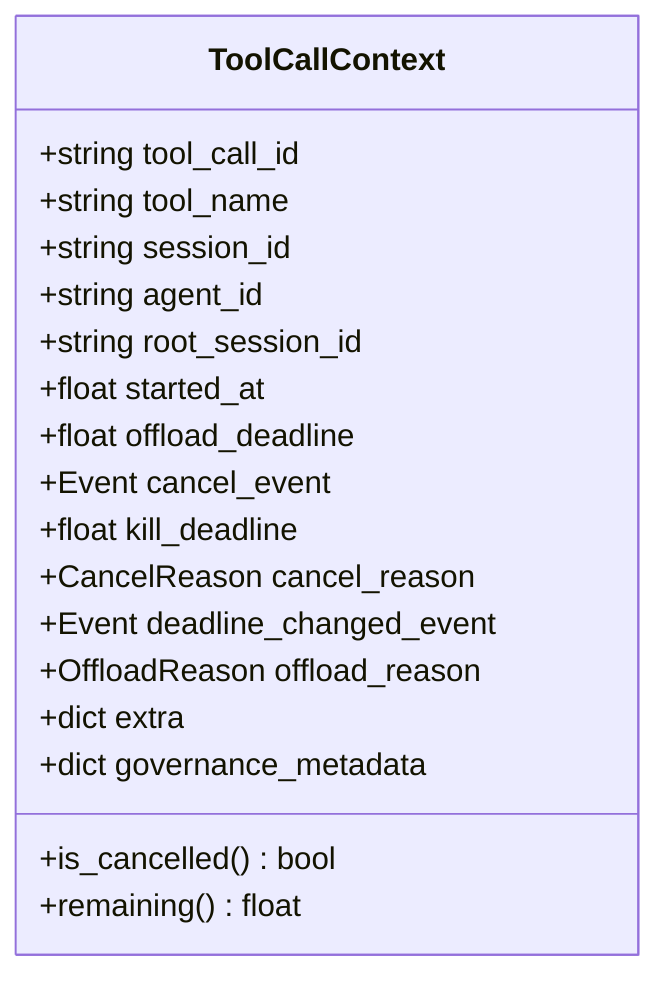
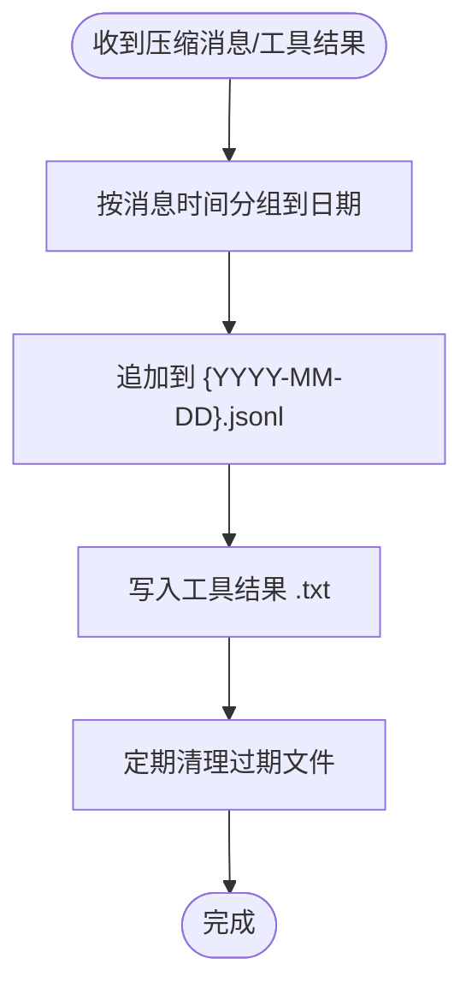
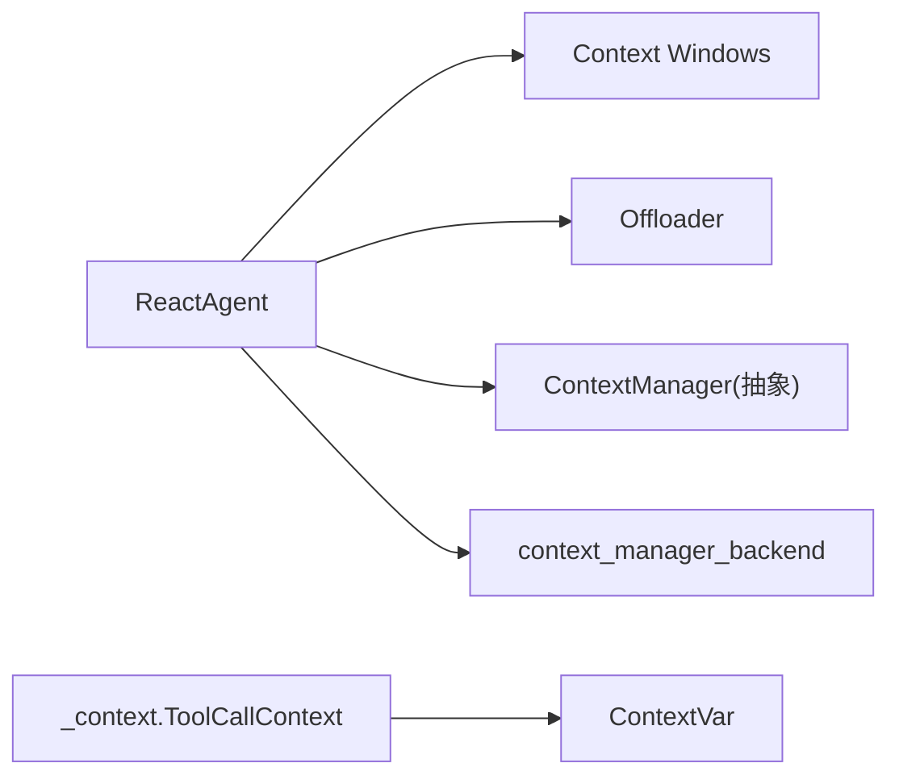

# 上下文管理

<cite>
**本文引用的文件**   
- [react_agent.py](file://tongtian-tauri/src/agent/agents/react_agent.py)
- [context_windows.py](file://tongtian-tauri/src/agent/providers/context_windows.py)
- [_context.py](file://tongtian-tauri/src/agent/tool_calls/_context.py)
- [offloader.py](file://tongtian-tauri/src/agent/agents/offloader.py)
- [config.py](file://tongtian-tauri/src/agent/config/config.py)
- [context.py](file://tongtian-tauri/src/agent/config/context.py)
</cite>

## 目录
1. [简介](#简介)
2. [项目结构](#项目结构)
3. [核心组件](#核心组件)
4. [架构总览](#架构总览)
5. [详细组件分析](#详细组件分析)
6. [依赖关系分析](#依赖关系分析)
7. [性能考量](#性能考量)
8. [故障排查指南](#故障排查指南)
9. [结论](#结论)
10. [附录](#附录)

## 简介
本文件围绕“上下文管理系统”展开，重点解释 ContextManager 抽象类的设计模式、滚动策略的实现原理，以及上下文压缩算法、消息清理机制与内存优化策略。文档还涵盖工具消息的规范化处理、孤儿消息的检测与清理、上下文溢出的恢复机制，并提供配置选项与性能调优建议，帮助在不同应用场景中选择合适的上下文管理策略。

## 项目结构
与上下文管理相关的代码主要分布在以下模块：
- Agent 层：ReactAgent 集成并委派上下文压缩与保存逻辑，支持注入自定义 ContextManager（如滚动策略）。
- Provider 层：提供模型上下文窗口解析能力，统一压缩触发阈值来源。
- Tool Calls：为工具调用生命周期提供运行时上下文句柄。
- Offloader：将压缩后的上下文与截断的工具结果持久化到磁盘。
- Config：提供运行期上下文变量与全局配置项（如后端选择）。

图表来源
- [react_agent.py:173-224](file://tongtian-tauri/src/agent/agents/react_agent.py#L173-L224)
- [context_windows.py:118-143](file://tongtian-tauri/src/agent/providers/context_windows.py#L118-L143)
- [_context.py:24-59](file://tongtian-tauri/src/agent/tool_calls/_context.py#L24-L59)
- [offloader.py:29-103](file://tongtian-tauri/src/agent/agents/offloader.py#L29-L103)
- [config.py:1554-1554](file://tongtian-tauri/src/agent/config/config.py#L1554-L1554)
- [context.py:18-41](file://tongtian-tauri/src/agent/config/context.py#L18-L41)

章节来源
- [react_agent.py:173-224](file://tongtian-tauri/src/agent/agents/react_agent.py#L173-L224)
- [context_windows.py:118-143](file://tongtian-tauri/src/agent/providers/context_windows.py#L118-L143)
- [_context.py:24-59](file://tongtian-tauri/src/agent/tool_calls/_context.py#L24-L59)
- [offloader.py:29-103](file://tongtian-tauri/src/agent/agents/offloader.py#L29-L103)
- [config.py:1554-1554](file://tongtian-tauri/src/agent/config/config.py#L1554-L1554)
- [context.py:18-41](file://tongtian-tauri/src/agent/config/context.py#L18-L41)

## 核心组件
- ReactAgent 上下文委派与兜底压缩
  - 在每次推理前执行工具消息清洗，确保无孤儿 tool_result。
  - 若注入 ContextManager，则由其负责压缩；否则回退到原生压缩路径。
  - 保存新块时通过 on_save 钩子通知上下文管理器。
  - 状态序列化时携带滚动管理器索引，避免恢复后重复追加历史。
- 上下文窗口解析
  - 统一的 resolve_context_window 入口，优先用户显式配置，其次内置目录，最后默认值。
  - 匹配规则按词边界最长匹配，保证跨提供商一致。
- 工具调用上下文
  - ToolCallContext 封装单次工具调用的生命周期、超时、取消与治理元数据。
- Offloader 持久化
  - 将压缩后的消息按日期分组写入 JSONL，并将截断的工具结果写入独立文本文件。
  - 提供过期清理接口，控制磁盘占用。
- 配置与上下文变量
  - context_manager_backend 决定使用何种上下文管理后端。
  - ContextVar 传递工作区、会话ID、Toolkit、AgentState 等运行期信息。

章节来源
- [react_agent.py:173-224](file://tongtian-tauri/src/agent/agents/react_agent.py#L173-L224)
- [react_agent.py:226-231](file://tongtian-tauri/src/agent/agents/react_agent.py#L226-L231)
- [react_agent.py:234-245](file://tongtian-tauri/src/agent/agents/react_agent.py#L234-L245)
- [context_windows.py:118-143](file://tongtian-tauri/src/agent/providers/context_windows.py#L118-L143)
- [_context.py:24-59](file://tongtian-tauri/src/agent/tool_calls/_context.py#L24-L59)
- [offloader.py:29-103](file://tongtian-tauri/src/agent/agents/offloader.py#L29-L103)
- [config.py:1554-1554](file://tongtian-tauri/src/agent/config/config.py#L1554-L1554)
- [context.py:18-41](file://tongtian-tauri/src/agent/config/context.py#L18-L41)

## 架构总览
下图展示 ReactAgent 如何与上下文窗口解析、Offloader、以及可选的 ContextManager 协作，形成“压缩—持久化—恢复”的闭环。

图表来源
- [react_agent.py:173-224](file://tongtian-tauri/src/agent/agents/react_agent.py#L173-L224)
- [react_agent.py:234-245](file://tongtian-tauri/src/agent/agents/react_agent.py#L234-L245)
- [context_windows.py:118-143](file://tongtian-tauri/src/agent/providers/context_windows.py#L118-L143)
- [offloader.py:29-103](file://tongtian-tauri/src/agent/agents/offloader.py#L29-L103)

## 详细组件分析

### ReactAgent 的上下文委派与压缩流程
- 压缩前清洗：对当前上下文中的工具消息进行规范化，移除孤儿 tool_result，防止后续模型调用失败。
- 委派压缩：若存在注入的 ContextManager，则调用其 compress 方法；否则启用原生压缩路径。
- 保存钩子：_save_to_context 在追加消息后通知 ContextManager，便于滚动策略维护索引与去重。
- 状态持久化：state_dict 中额外保存滚动管理器的 to_dict 快照，load_state_dict 恢复时重建索引并做一致性校验。

图表来源
- [react_agent.py:173-224](file://tongtian-tauri/src/agent/agents/react_agent.py#L173-L224)
- [react_agent.py:226-231](file://tongtian-tauri/src/agent/agents/react_agent.py#L226-L231)
- [react_agent.py:234-245](file://tongtian-tauri/src/agent/agents/react_agent.py#L234-L245)

章节来源
- [react_agent.py:173-224](file://tongtian-tauri/src/agent/agents/react_agent.py#L173-L224)
- [react_agent.py:226-231](file://tongtian-tauri/src/agent/agents/react_agent.py#L226-L231)
- [react_agent.py:234-245](file://tongtian-tauri/src/agent/agents/react_agent.py#L234-L245)

### 上下文窗口解析与压缩触发
- 解析优先级：用户显式配置 > 内置目录匹配 > 默认值。
- 匹配策略：按词边界最长匹配，兼容不同提供商命名空间。
- 作用范围：既用于压缩触发（Provider._get_context_size），也用于显示/用量统计，保证 UI 与行为一致。

图表来源
- [context_windows.py:118-143](file://tongtian-tauri/src/agent/providers/context_windows.py#L118-L143)

章节来源
- [context_windows.py:118-143](file://tongtian-tauri/src/agent/providers/context_windows.py#L118-L143)

### 工具调用上下文与生命周期
- ToolCallContext 包含工具调用 ID、名称、会话/代理标识、启动时间、卸载截止时间、取消事件、剩余时间计算等。
- 通过 ContextVar 注入，使工具链路与治理、权限检查共享同一运行期上下文。

图表来源
- [_context.py:24-59](file://tongtian-tauri/src/agent/tool_calls/_context.py#L24-L59)

章节来源
- [_context.py:24-59](file://tongtian-tauri/src/agent/tool_calls/_context.py#L24-L59)

### Offloader 持久化与清理
- offload_context：将压缩后的消息按日期分组追加到 JSONL，保持时间顺序。
- offload_tool_result：将截断的工具输出写入独立文本文件，便于按需读取。
- cleanup_expired：基于文件创建/修改时间清理过期工具结果文件，控制磁盘增长。

图表来源
- [offloader.py:29-103](file://tongtian-tauri/src/agent/agents/offloader.py#L29-L103)
- [offloader.py:141-176](file://tongtian-tauri/src/agent/agents/offloader.py#L141-L176)

章节来源
- [offloader.py:29-103](file://tongtian-tauri/src/agent/agents/offloader.py#L29-L103)
- [offloader.py:141-176](file://tongtian-tauri/src/agent/agents/offloader.py#L141-L176)

### 配置与上下文变量
- context_manager_backend：决定使用何种上下文管理后端（例如滚动策略实现）。
- ContextVar：在工作区、会话ID、Shell命令超时、可执行文件、Toolkit、AgentState 等维度提供线程/协程隔离的运行期上下文。

章节来源
- [config.py:1554-1554](file://tongtian-tauri/src/agent/config/config.py#L1554-L1554)
- [context.py:18-41](file://tongtian-tauri/src/agent/config/context.py#L18-L41)
- [context.py:44-66](file://tongtian-tauri/src/agent/config/context.py#L44-L66)
- [context.py:69-91](file://tongtian-tauri/src/agent/config/context.py#L69-L91)
- [context.py:93-115](file://tongtian-tauri/src/agent/config/context.py#L93-L115)
- [context.py:118-140](file://tongtian-tauri/src/agent/config/context.py#L118-L140)
- [context.py:143-165](file://tongtian-tauri/src/agent/config/context.py#L143-L165)
- [context.py:168-193](file://tongtian-tauri/src/agent/config/context.py#L168-L193)

## 依赖关系分析
- ReactAgent 依赖：
  - Provider 的上下文窗口解析，以决定压缩触发点。
  - Offloader 协议，用于持久化压缩结果与工具输出。
  - 可选的 ContextManager 抽象，允许替换压缩与滚动策略。
- ToolCallContext 依赖 ContextVar，贯穿工具调用链路。
- 配置项 context_manager_backend 影响 ReactAgent 初始化时的上下文管理策略选择。

图表来源
- [react_agent.py:173-224](file://tongtian-tauri/src/agent/agents/react_agent.py#L173-L224)
- [context_windows.py:118-143](file://tongtian-tauri/src/agent/providers/context_windows.py#L118-L143)
- [_context.py:24-59](file://tongtian-tauri/src/agent/tool_calls/_context.py#L24-L59)
- [config.py:1554-1554](file://tongtian-tauri/src/agent/config/config.py#L1554-L1554)

章节来源
- [react_agent.py:173-224](file://tongtian-tauri/src/agent/agents/react_agent.py#L173-L224)
- [context_windows.py:118-143](file://tongtian-tauri/src/agent/providers/context_windows.py#L118-L143)
- [_context.py:24-59](file://tongtian-tauri/src/agent/tool_calls/_context.py#L24-L59)
- [config.py:1554-1554](file://tongtian-tauri/src/agent/config/config.py#L1554-L1554)

## 性能考量
- 压缩触发时机：由 resolve_context_window 提供的窗口大小决定，避免过早或过晚压缩导致频繁 I/O 或上下文过大。
- 工具消息清洗：在每次压缩前执行，虽增加少量 CPU 开销，但显著降低因孤儿消息导致的请求失败重试成本。
- 持久化策略：按日期分组的 JSONL 追加写，减少随机 IO；工具结果独立文件便于按需加载，避免大对象常驻内存。
- 资源回收：关闭阶段执行 purge_old/close，释放数据库连接与文件句柄，防止长驻进程资源泄漏。
- 内存优化：通过 Offloader 将压缩后的消息与工具结果外置，降低主上下文内存占用；滚动策略可结合去重与索引提升读写效率。

[本节为通用指导，不直接分析具体文件]

## 故障排查指南
- 现象：模型返回 400，提示 tool 角色消息必须响应前面的 tool_calls。
  - 原因：上下文中存在孤儿 tool_result（对应的 tool_call 已被压缩驱逐）。
  - 处理：ReactAgent 在 compress_context 与 load_state_dict 中均执行工具消息清洗，确保异常被捕获并修复；若仍出现，检查历史恢复路径与第三方压缩实现的一致性。
- 现象：长时间运行后磁盘占用增长。
  - 原因：工具结果文件未及时清理。
  - 处理：调用 Offloader.cleanup_expired 设置合理的 retention_days，并在应用关闭时执行。
- 现象：压缩未触发或触发过早。
  - 原因：模型上下文窗口解析不正确或未显式配置。
  - 处理：检查 resolve_context_window 的传入参数与内置目录匹配，必要时通过 per-model 配置覆盖。

章节来源
- [react_agent.py:173-224](file://tongtian-tauri/src/agent/agents/react_agent.py#L173-L224)
- [react_agent.py:234-245](file://tongtian-tauri/src/agent/agents/react_agent.py#L234-L245)
- [offloader.py:141-176](file://tongtian-tauri/src/agent/agents/offloader.py#L141-L176)
- [context_windows.py:118-143](file://tongtian-tauri/src/agent/providers/context_windows.py#L118-L143)

## 结论
本系统通过 ReactAgent 的委派机制与 Provider 的统一窗口解析，实现了可扩展的上下文管理与压缩策略。Offloader 提供稳定的持久化能力，配合 ContextVar 的运行期上下文，保障工具调用链路的隔离与治理。通过合理配置与调优，可在不同场景下平衡延迟、吞吐与内存占用，获得稳定高效的上下文管理能力。

[本节为总结性内容，不直接分析具体文件]

## 附录
- 配置建议
  - 根据模型族选择合适的上下文窗口：优先使用内置目录，必要时通过 per-model 配置覆盖。
  - 开启 light_context_config.context_compact_config.enabled 以启用原生压缩路径（当未注入 ContextManager 时）。
  - 设置 history_retention_days 控制历史保留时长，避免磁盘膨胀。
- 策略选择
  - 短对话、低延迟场景：使用轻量滚动策略，减少压缩频率。
  - 长对话、高吞吐场景：采用强压缩与异步 Offloader，结合去重与索引，降低内存峰值。
  - 多会话并发：利用 ContextVar 隔离会话与工作区，避免上下文污染。

[本节为补充说明，不直接分析具体文件]