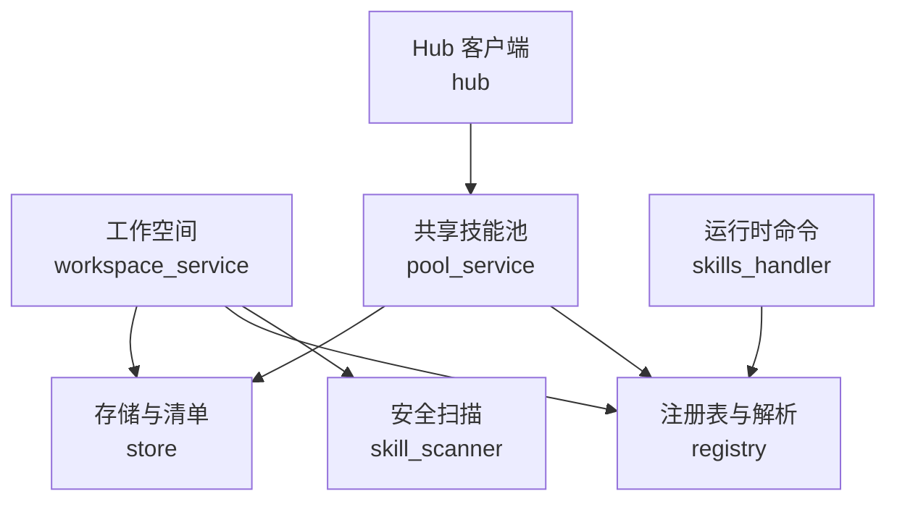
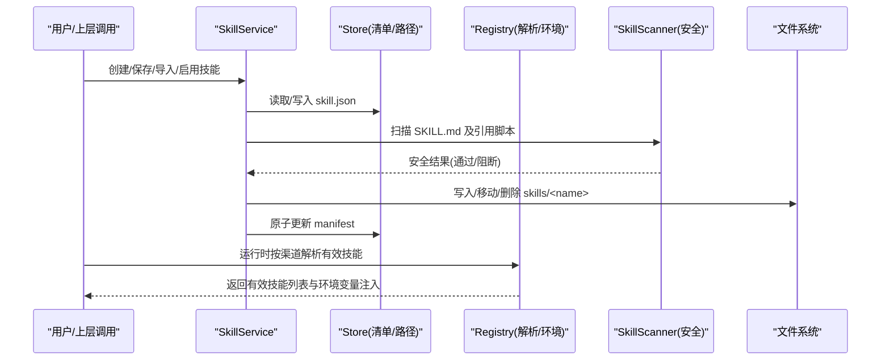
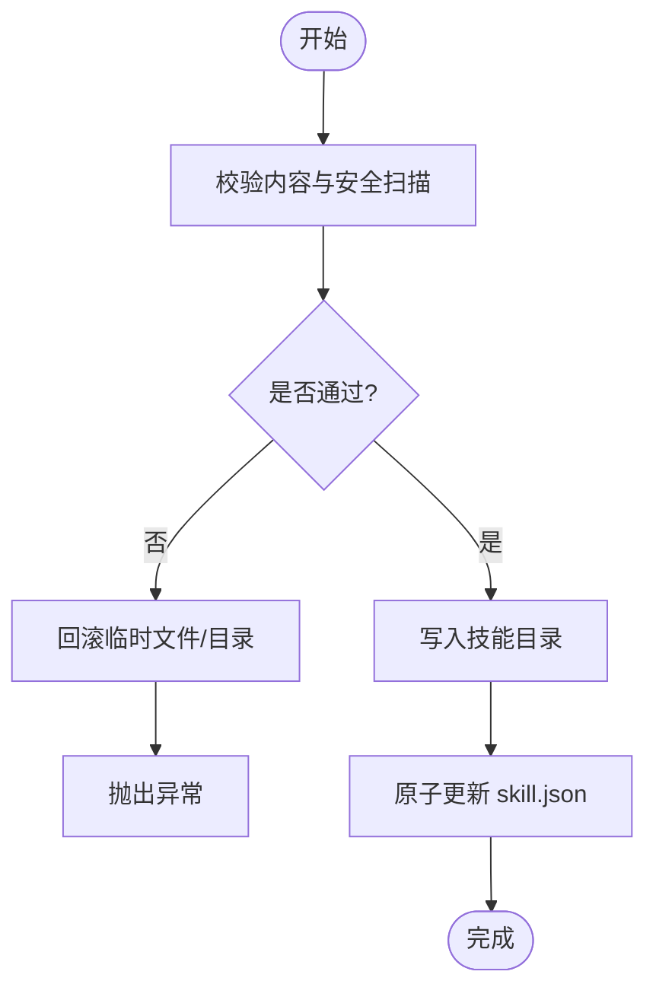
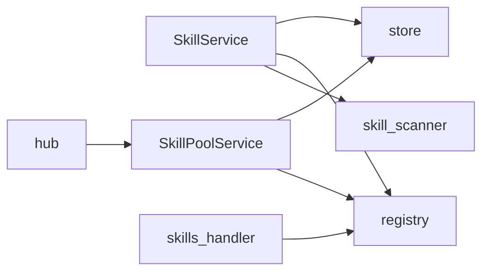

# 工作空间技能服务

<cite>
**本文引用的文件**
- [workspace_service.py](file://tongtian-tauri/src/agent/agents/skill_system/workspace_service.py)
- [hub.py](file://tongtian-tauri/src/agent/agents/skill_system/hub.py)
- [registry.py](file://tongtian-tauri/src/agent/agents/skill_system/registry.py)
- [store.py](file://tongtian-tauri/src/agent/agents/skill_system/store.py)
- [models.py](file://tongtian-tauri/src/agent/agents/skill_system/models.py)
- [pool_service.py](file://tongtian-tauri/src/agent/agents/skill_system/pool_service.py)
- [skills_handler.py](file://tongtian-tauri/src/agent/runtime/commands/control/skills_handler.py)
- [scanner.py](file://tongtian-tauri/src/agent/security/skill_scanner/scanner.py)
- [models.py](file://tongtian-tauri/src/agent/security/skill_scanner/models.py)
</cite>

## 目录
1. [简介](#简介)
2. [项目结构](#项目结构)
3. [核心组件](#核心组件)
4. [架构总览](#架构总览)
5. [详细组件分析](#详细组件分析)
6. [依赖关系分析](#依赖关系分析)
7. [性能考虑](#性能考虑)
8. [故障排除指南](#故障排除指南)
9. [结论](#结论)
10. [附录：使用示例与最佳实践](#附录使用示例与最佳实践)

## 简介
本文件面向“工作空间级别”的技能服务，系统性说明技能的安装、卸载、版本控制、启用/禁用、渠道路由、配置注入、权限与安全扫描等能力。重点围绕 SkillService 类提供的 API，解释其如何在工作空间内管理技能目录与清单（manifest），并与共享技能池、内置技能注册表、安全扫描器协同工作。文档同时覆盖工作空间技能目录结构、配置文件格式、权限控制策略、调试方法与常见问题定位。

## 项目结构
工作空间技能系统由多个模块协作完成：
- 工作空间技能生命周期：SkillService 负责单个工作空间的技能 CRUD、启用/禁用、渠道设置、标签管理、ZIP 导入、文件读取等。
- 本地技能池：SkillPoolService 管理共享的 skill_pool，支持创建、导入、删除、自动更新与跨工作空间同步。
- 注册表与解析：registry 提供内置技能发现、语言偏好、环境覆盖、运行时有效技能解析。
- 存储与清单：store 提供路径工具、原子写入、清单读写、冲突检测、ZIP 解压校验、元数据构建等。
- Hub 客户端：hub 负责从远程市场下载、缓存、重试、取消、大小限制等。
- 运行时命令：skills_handler 暴露 /skills 命令以列出当前渠道可用的已启用技能。
- 安全扫描：skill_scanner 在导入/启用时扫描技能包，阻止高危风险。

图表来源
- [workspace_service.py:88-105](file://tongtian-tauri/src/agent/agents/skill_system/workspace_service.py#L88-L105)
- [store.py:58-82](file://tongtian-tauri/src/agent/agents/skill_system/store.py#L58-L82)
- [registry.py:347-392](file://tongtian-tauri/src/agent/agents/skill_system/registry.py#L347-L392)
- [pool_service.py:121-145](file://tongtian-tauri/src/agent/agents/skill_system/pool_service.py#L121-L145)
- [hub.py:146-237](file://tongtian-tauri/src/agent/agents/skill_system/hub.py#L146-L237)
- [skills_handler.py:47-101](file://tongtian-tauri/src/agent/runtime/commands/control/skills_handler.py#L47-L101)

章节来源
- [workspace_service.py:88-105](file://tongtian-tauri/src/agent/agents/skill_system/workspace_service.py#L88-L105)
- [store.py:58-82](file://tongtian-tauri/src/agent/agents/skill_system/store.py#L58-L82)
- [registry.py:347-392](file://tongtian-tauri/src/agent/agents/skill_system/registry.py#L347-L392)
- [pool_service.py:121-145](file://tongtian-tauri/src/agent/agents/skill_system/pool_service.py#L121-L145)
- [hub.py:146-237](file://tongtian-tauri/src/agent/agents/skill_system/hub.py#L146-L237)
- [skills_handler.py:47-101](file://tongtian-tauri/src/agent/runtime/commands/control/skills_handler.py#L47-L101)

## 核心组件
- SkillService（工作空间技能服务）
  - 职责：维护 <workspace>/skills 目录与 <workspace>/skill.json 清单；提供 create/save/import/enable/disable/delete/set_channels/set_tags/load_skill_file 等能力。
  - 关键行为：内容校验、安全扫描、原子化清单更新、冲突建议、回滚清理。
- SkillPoolService（共享技能池服务）
  - 职责：管理 WORKING_DIR/skill_pool；支持创建、导入、删除、标签、自动更新、重命名迁移到工作空间。
- Registry（注册表与解析）
  - 职责：内置技能发现、语言偏好、环境变量注入、运行时有效技能解析（按渠道）。
- Store（存储与清单）
  - 职责：路径工具、清单默认值、原子写入、锁、ZIP 解压校验、元数据构建、冲突名建议。
- Hub（Hub 客户端）
  - 职责：远程搜索/详情/文件下载、HTTP 重试、超时、取消、大小限制、GitHub 缓存。
- SkillsCommandHandler（运行时命令）
  - 职责：/skills 列出当前渠道可用技能，展示描述与调用提示。
- SkillScanner（安全扫描）
  - 职责：发现文件、运行分析器、去重、输出结果；阻断 CRITICAL/HIGH 风险。

章节来源
- [workspace_service.py:88-105](file://tongtian-tauri/src/agent/agents/skill_system/workspace_service.py#L88-L105)
- [pool_service.py:121-145](file://tongtian-tauri/src/agent/agents/skill_system/pool_service.py#L121-L145)
- [registry.py:347-392](file://tongtian-tauri/src/agent/agents/skill_system/registry.py#L347-L392)
- [store.py:384-395](file://tongtian-tauri/src/agent/agents/skill_system/store.py#L384-L395)
- [hub.py:507-638](file://tongtian-tauri/src/agent/agents/skill_system/hub.py#L507-L638)
- [skills_handler.py:47-101](file://tongtian-tauri/src/agent/runtime/commands/control/skills_handler.py#L47-L101)
- [scanner.py:148-242](file://tongtian-tauri/src/agent/security/skill_scanner/scanner.py#L148-L242)

## 架构总览
下图展示了工作空间技能服务的端到端流程：从用户操作到文件系统与清单变更，再到运行时渠道解析与环境注入。

图表来源
- [workspace_service.py:145-227](file://tongtian-tauri/src/agent/agents/skill_system/workspace_service.py#L145-L227)
- [store.py:384-395](file://tongtian-tauri/src/agent/agents/skill_system/store.py#L384-L395)
- [registry.py:347-392](file://tongtian-tauri/src/agent/agents/skill_system/registry.py#L347-L392)
- [scanner.py:148-242](file://tongtian-tauri/src/agent/security/skill_scanner/scanner.py#L148-L242)

## 详细组件分析

### SkillService 工作空间技能服务
- 设计要点
  - 以 <workspace>/skills 为技能源码根，<workspace>/skill.json 为运行时状态（enabled/channels/config/metadata/requirements/updated_at）。
  - 所有写操作均通过原子化 mutate_json 保证并发安全与一致性。
  - 创建/保存/导入前进行内容校验与安全扫描，失败则回滚。
- 主要 API
  - list_all_skills / list_available_skills：列举工作空间全部或按渠道有效的技能。
  - create_skill：创建新技能，支持 references/scripts/extra_files/config，可选 enable/source。
  - save_skill：原地编辑或重命名保存，处理冲突与建议名。
  - import_from_zip：批量导入 ZIP，冲突检测、可选一键启用。
  - enable_skill / disable_skill：切换启用状态，并在启用前再次扫描。
  - set_skill_channels / set_skill_tags：设置渠道范围与用户标签。
  - delete_skill：仅允许删除未启用的技能，并清理目录与清单。
  - load_skill_file：受限读取 references/ 与 scripts/ 下的文本文件，防路径穿越。
- 错误与回滚
  - 清单更新失败会尝试回滚已创建的文件，若回滚也失败则抛出包含上下文的异常。

图表来源
- [workspace_service.py:145-227](file://tongtian-tauri/src/agent/agents/skill_system/workspace_service.py#L145-L227)
- [store.py:384-395](file://tongtian-tauri/src/agent/agents/skill_system/store.py#L384-L395)

章节来源
- [workspace_service.py:111-143](file://tongtian-tauri/src/agent/agents/skill_system/workspace_service.py#L111-L143)
- [workspace_service.py:145-227](file://tongtian-tauri/src/agent/agents/skill_system/workspace_service.py#L145-L227)
- [workspace_service.py:229-442](file://tongtian-tauri/src/agent/agents/skill_system/workspace_service.py#L229-L442)
- [workspace_service.py:444-552](file://tongtian-tauri/src/agent/agents/skill_system/workspace_service.py#L444-L552)
- [workspace_service.py:554-750](file://tongtian-tauri/src/agent/agents/skill_system/workspace_service.py#L554-L750)
- [workspace_service.py:751-782](file://tongtian-tauri/src/agent/agents/skill_system/workspace_service.py#L751-L782)

### 共享技能池 SkillPoolService
- 职责：在共享 skill_pool 中创建、导入、删除技能；支持自动更新与跨工作空间重命名迁移。
- 关键点：
  - 导入 ZIP 时进行内容校验与安全扫描，冲突检测并返回建议名。
  - 重命名时可选择目标工作空间集合，自动迁移副本并更新清单。
  - 自动更新开关可立即触发一次同步以对齐目标集。

章节来源
- [pool_service.py:121-145](file://tongtian-tauri/src/agent/agents/skill_system/pool_service.py#L121-L145)
- [pool_service.py:237-351](file://tongtian-tauri/src/agent/agents/skill_system/pool_service.py#L237-L351)
- [pool_service.py:353-458](file://tongtian-tauri/src/agent/agents/skill_system/pool_service.py#L353-L458)
- [pool_service.py:504-682](file://tongtian-tauri/src/agent/agents/skill_system/pool_service.py#L504-L682)
- [pool_service.py:684-789](file://tongtian-tauri/src/agent/agents/skill_system/pool_service.py#L684-L789)

### 注册表与解析 registry
- 内置技能语言偏好：从 settings.json 推断或显式配置。
- 环境变量注入：将技能声明的 require_envs 映射为环境变量，并将完整配置以 JSON 注入 QWENPAW_SKILL_CONFIG_<SKILL_NAME>。
- 运行时有效技能：按渠道解析出当前生效的技能列表。

章节来源
- [registry.py:67-117](file://tongtian-tauri/src/agent/agents/skill_system/registry.py#L67-L117)
- [registry.py:247-305](file://tongtian-tauri/src/agent/agents/skill_system/registry.py#L247-L305)
- [registry.py:347-392](file://tongtian-tauri/src/agent/agents/skill_system/registry.py#L347-L392)
- [registry.py:559-579](file://tongtian-tauri/src/agent/agents/skill_system/registry.py#L559-L579)

### 存储与清单 store
- 路径与清单：
  - 工作空间技能目录：<workspace>/skills
  - 工作空间清单：<workspace>/skill.json
  - 共享池清单：<WORKING_DIR>/skill_pool/skill.json
- 原子写入与锁：基于文件锁 + 临时文件替换，避免并发损坏。
- 元数据构建：从 SKILL.md frontmatter 提取名称、描述、版本、需求等。
- ZIP 安全：限制体积、禁止符号链接、路径穿越检查。
- 冲突建议：生成带时间戳的重命名建议。

章节来源
- [store.py:58-82](file://tongtian-tauri/src/agent/agents/skill_system/store.py#L58-L82)
- [store.py:320-395](file://tongtian-tauri/src/agent/agents/skill_system/store.py#L320-L395)
- [store.py:402-465](file://tongtian-tauri/src/agent/agents/skill_system/store.py#L402-L465)
- [store.py:482-557](file://tongtian-tauri/src/agent/agents/skill_system/store.py#L482-L557)
- [store.py:636-660](file://tongtian-tauri/src/agent/agents/skill_system/store.py#L636-L660)
- [store.py:671-743](file://tongtian-tauri/src/agent/agents/skill_system/store.py#L671-L743)
- [store.py:778-789](file://tongtian-tauri/src/agent/agents/skill_system/store.py#L778-L789)

### Hub 客户端 hub
- 功能：搜索、详情、版本、文件下载；支持 HTTP 重试、退避、取消、大小限制、GitHub 速率限制提示。
- 缓存：对 GitHub 响应做 LRU 缓存与键级锁，防止惊群。
- 配置：基础 URL、路径模板、超时、重试次数、退避参数均可通过环境变量调整。

章节来源
- [hub.py:146-237](file://tongtian-tauri/src/agent/agents/skill_system/hub.py#L146-L237)
- [hub.py:265-345](file://tongtian-tauri/src/agent/agents/skill_system/hub.py#L265-L345)
- [hub.py:351-407](file://tongtian-tauri/src/agent/agents/skill_system/hub.py#L351-L407)
- [hub.py:507-638](file://tongtian-tauri/src/agent/agents/skill_system/hub.py#L507-L638)

### 运行时命令 skills_handler
- /skills 命令：列出当前渠道可用的已启用技能，显示描述与调用提示。
- 数据来源：工作空间清单与 SKILL.md frontmatter。

章节来源
- [skills_handler.py:47-101](file://tongtian-tauri/src/agent/runtime/commands/control/skills_handler.py#L47-L101)

### 安全扫描 skill_scanner
- 扫描流程：发现文件 -> 运行分析器 -> 去重 -> 输出结果。
- 策略：默认跳过二进制/归档等扩展；限制最大文件数与单文件大小；拒绝符号链接与越界路径。
- 判定：无 CRITICAL/HIGH 即视为安全。

章节来源
- [scanner.py:76-138](file://tongtian-tauri/src/agent/security/skill_scanner/scanner.py#L76-L138)
- [scanner.py:148-242](file://tongtian-tauri/src/agent/security/skill_scanner/scanner.py#L148-L242)
- [scanner.py:248-299](file://tongtian-tauri/src/agent/security/skill_scanner/scanner.py#L248-L299)
- [models.py:19-54](file://tongtian-tauri/src/agent/security/skill_scanner/models.py#L19-L54)
- [models.py:168-235](file://tongtian-tauri/src/agent/security/skill_scanner/models.py#L168-L235)

## 依赖关系分析
- 组件耦合
  - SkillService 强依赖 store（清单/路径）、registry（解析/环境）、security scanner（安全）。
  - SkillPoolService 复用 store/registry，并可与 workspace 双向同步。
  - Hub 通过 httpx 访问远程市场，受全局客户端与缓存影响。
- 外部依赖
  - 文件系统：原子写入、锁、目录遍历。
  - 网络：HTTP 客户端、重试、超时、取消。
  - 安全：模式匹配规则、策略配置。

图表来源
- [workspace_service.py:88-105](file://tongtian-tauri/src/agent/agents/skill_system/workspace_service.py#L88-L105)
- [pool_service.py:121-145](file://tongtian-tauri/src/agent/agents/skill_system/pool_service.py#L121-L145)
- [registry.py:347-392](file://tongtian-tauri/src/agent/agents/skill_system/registry.py#L347-L392)
- [store.py:384-395](file://tongtian-tauri/src/agent/agents/skill_system/store.py#L384-L395)
- [hub.py:507-638](file://tongtian-tauri/src/agent/agents/skill_system/hub.py#L507-L638)
- [skills_handler.py:47-101](file://tongtian-tauri/src/agent/runtime/commands/control/skills_handler.py#L47-L101)

章节来源
- [workspace_service.py:88-105](file://tongtian-tauri/src/agent/agents/skill_system/workspace_service.py#L88-L105)
- [pool_service.py:121-145](file://tongtian-tauri/src/agent/agents/skill_system/pool_service.py#L121-L145)
- [registry.py:347-392](file://tongtian-tauri/src/agent/agents/skill_system/registry.py#L347-L392)
- [store.py:384-395](file://tongtian-tauri/src/agent/agents/skill_system/store.py#L384-L395)
- [hub.py:507-638](file://tongtian-tauri/src/agent/agents/skill_system/hub.py#L507-L638)
- [skills_handler.py:47-101](file://tongtian-tauri/src/agent/runtime/commands/control/skills_handler.py#L47-L101)

## 性能考虑
- 清单 I/O：使用 mtime 缓存与原子写入，减少重复解析与并发竞争。
- 网络请求：共享 httpx 客户端、连接池、重试退避、GitHub 响应缓存。
- 扫描限制：限制文件数量与大小，跳过二进制/归档，降低扫描开销。
- 资源释放：Hub 关闭等待进行中请求，避免资源泄漏。

[本节为通用性能指导，不直接分析具体文件]

## 故障排除指南
- 导入 ZIP 失败
  - 可能原因：压缩包过大、包含符号链接、路径穿越、内容不安全。
  - 排查：查看返回的 conflicts 与错误信息；确认 ZIP 结构与 SKILL.md 存在且合法。
  - 参考实现：ZIP 解压与安全检查、大小限制。
- 启用技能失败
  - 可能原因：技能目录不存在、清单条目缺失、扫描未通过。
  - 排查：确认技能目录存在、清单中有对应 entry；查看扫描结果。
- 删除技能失败
  - 可能原因：技能处于启用状态；清单更新失败。
  - 排查：先禁用再删除；检查清单文件权限与磁盘空间。
- 渠道路由不生效
  - 可能原因：channels 未设置为 all 或未包含当前渠道。
  - 排查：检查技能 entry 的 channels；使用 /skills 验证。
- 环境变量未注入
  - 可能原因：技能未声明 require_envs；配置键不匹配。
  - 排查：检查 SKILL.md metadata.requires.env；确认配置项存在。
- Hub 下载失败
  - 可能原因：网络超时、429 限流、服务器错误。
  - 排查：调整超时/重试；设置 GITHUB_TOKEN；检查基础 URL。

章节来源
- [store.py:482-557](file://tongtian-tauri/src/agent/agents/skill_system/store.py#L482-L557)
- [workspace_service.py:554-750](file://tongtian-tauri/src/agent/agents/skill_system/workspace_service.py#L554-L750)
- [registry.py:347-392](file://tongtian-tauri/src/agent/agents/skill_system/registry.py#L347-L392)
- [hub.py:507-638](file://tongtian-tauri/src/agent/agents/skill_system/hub.py#L507-L638)
- [scanner.py:148-242](file://tongtian-tauri/src/agent/security/skill_scanner/scanner.py#L148-L242)

## 结论
工作空间技能服务通过清晰的分层与严格的约束，实现了安全的技能生命周期管理与灵活的运行时路由。SkillService 作为工作空间入口，结合 store 的原子化清单、registry 的环境注入与解析、以及安全扫描器的风险拦截，提供了稳定可靠的技能管理能力。配合共享技能池与 Hub，可实现从远程市场到本地工作空间的完整闭环。

[本节为总结性内容，不直接分析具体文件]

## 附录：使用示例与最佳实践

- 工作空间技能目录结构
  - 位置：<workspace>/skills/<skill_name>/SKILL.md
  - 附加目录：references/ 与 scripts/ 用于存放引用与脚本，仅允许通过受限接口读取。
  - 清单：<workspace>/skill.json 记录 enabled、channels、config、metadata、requirements、updated_at 等。

- 配置文件格式（清单字段）
  - schema_version/version：清单版本与自增版本号。
  - skills.<name>.enabled：是否启用。
  - skills.<name>.channels：渠道白名单，all 表示全渠道。
  - skills.<name>.source：builtin/customized 等来源标识。
  - skills.<name>.installed_from：来源标记（zip、github 等）。
  - skills.<name>.config：用户配置（会被注入为环境变量）。
  - skills.<name>.metadata：从 SKILL.md 提取的描述、版本、更新时间等。
  - skills.<name>.requirements：require_bins/require_envs。
  - skills.<name>.tags：用户自定义标签。

- 权限与安全策略
  - 导入/启用前强制安全扫描，阻断 CRITICAL/HIGH 风险。
  - 文件路径严格限制，禁止符号链接与路径穿越。
  - 清单写入采用文件锁与原子替换，避免并发损坏。
  - 环境变量注入遵循 require_envs 白名单，避免泄露无关配置。

- 在不同工作空间中管理技能
  - 创建/编辑：使用 SkillService.create_skill / save_skill，注意冲突与建议名。
  - 导入：使用 import_from_zip，支持批量与冲突报告。
  - 启用/禁用：根据渠道需要设置 channels，必要时使用 enable_skill/disable_skill。
  - 删除：确保未启用后再删除，避免残留。

- 调试技巧
  - 使用 /skills 命令快速查看当前渠道可用技能与描述。
  - 检查 skill.json 中的 channels、enabled、config、metadata 是否正确。
  - 查看安全扫描结果，定位被阻断的原因。
  - 对于环境变量问题，确认 SKILL.md 的 metadata.requires.env 与 config 一致。

- 常见错误与修复
  - 冲突：当目标名已存在时，使用建议名或覆盖策略。
  - 权限：确保工作空间目录可写，清单文件未被锁定。
  - 网络：Hub 下载失败时，检查代理、令牌与限流策略。

章节来源
- [store.py:58-82](file://tongtian-tauri/src/agent/agents/skill_system/store.py#L58-L82)
- [store.py:402-465](file://tongtian-tauri/src/agent/agents/skill_system/store.py#L402-L465)
- [store.py:636-660](file://tongtian-tauri/src/agent/agents/skill_system/store.py#L636-L660)
- [workspace_service.py:145-227](file://tongtian-tauri/src/agent/agents/skill_system/workspace_service.py#L145-L227)
- [workspace_service.py:444-552](file://tongtian-tauri/src/agent/agents/skill_system/workspace_service.py#L444-L552)
- [workspace_service.py:554-750](file://tongtian-tauri/src/agent/agents/skill_system/workspace_service.py#L554-L750)
- [skills_handler.py:47-101](file://tongtian-tauri/src/agent/runtime/commands/control/skills_handler.py#L47-L101)
- [registry.py:347-392](file://tongtian-tauri/src/agent/agents/skill_system/registry.py#L347-L392)
- [scanner.py:148-242](file://tongtian-tauri/src/agent/security/skill_scanner/scanner.py#L148-L242)