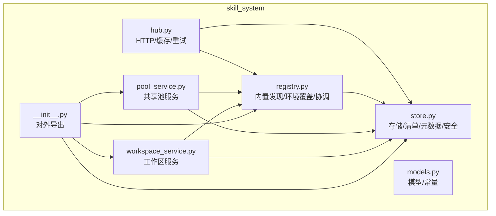
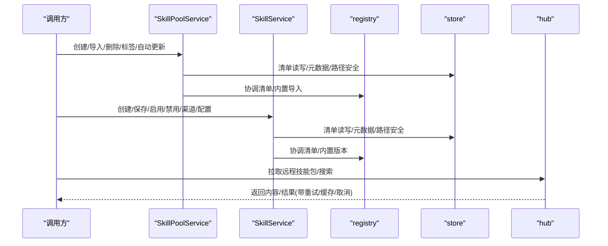
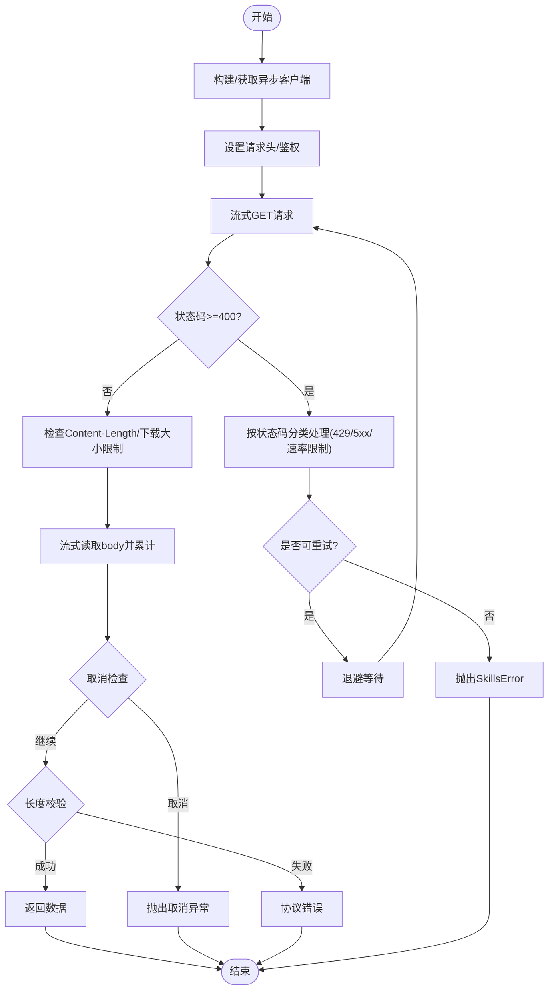
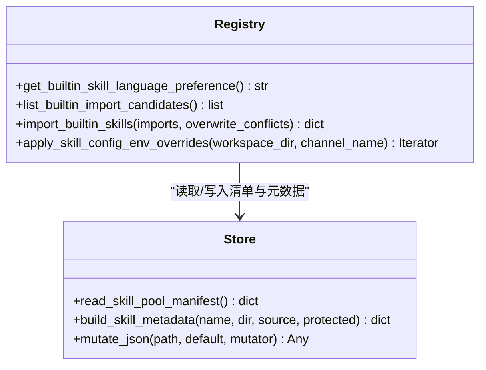
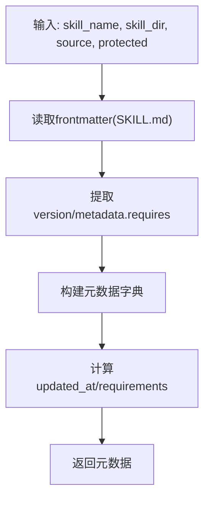
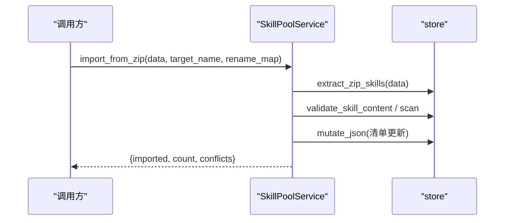
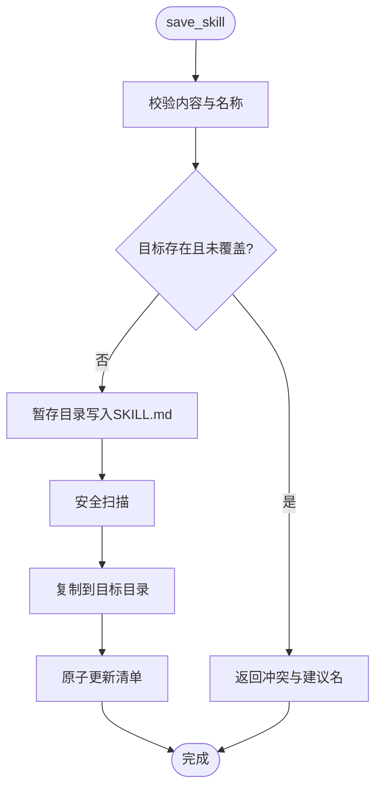
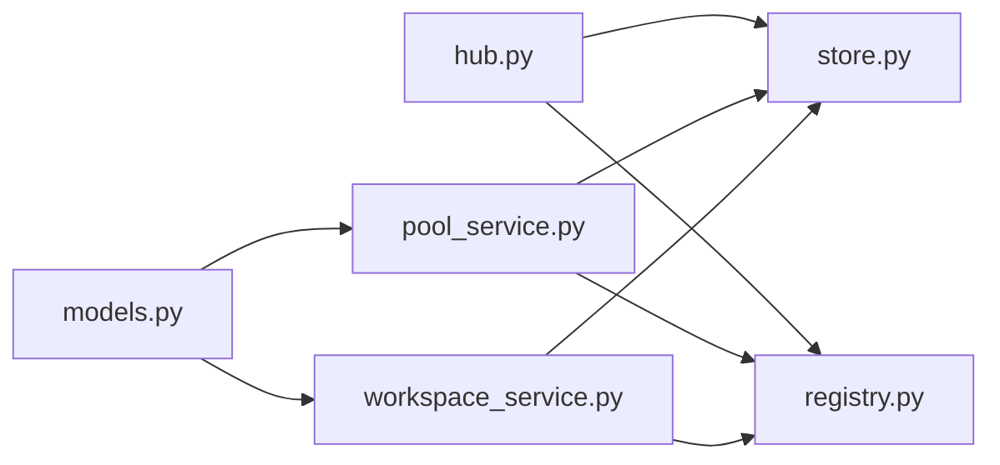

# 技能中心 (SkillHub)

<cite>
**本文引用的文件**   
- [hub.py](file://tongtian-tauri/src/agent/agents/skill_system/hub.py)
- [registry.py](file://tongtian-tauri/src/agent/agents/skill_system/registry.py)
- [models.py](file://tongtian-tauri/src/agent/agents/skill_system/models.py)
- [store.py](file://tongtian-tauri/src/agent/agents/skill_system/store.py)
- [pool_service.py](file://tongtian-tauri/src/agent/agents/skill_system/pool_service.py)
- [workspace_service.py](file://tongtian-tauri/src/agent/agents/skill_system/workspace_service.py)
- [__init__.py](file://tongtian-tauri/src/agent/agents/skill_system/__init__.py)
</cite>

## 目录
1. [简介](#简介)
2. [项目结构](#项目结构)
3. [核心组件](#核心组件)
4. [架构总览](#架构总览)
5. [详细组件分析](#详细组件分析)
6. [依赖关系分析](#依赖关系分析)
7. [性能考虑](#性能考虑)
8. [故障排查指南](#故障排查指南)
9. [结论](#结论)
10. [附录：使用示例与最佳实践](#附录使用示例与最佳实践)

## 简介
本文件为 SkillHub（技能中心）的详细技术文档，围绕技能的发现、加载、验证与生命周期管理展开，覆盖以下关键主题：
- 技能注册机制与冲突检测/处理策略
- 技能元数据解析与依赖关系管理
- 技能与工具系统的集成方式
- 初始化、注册新技能、查询可用技能列表的使用示例
- 错误处理机制与性能优化建议

SkillHub 由“共享技能池”和“工作区技能”两层组成：共享池用于跨工作区复用与版本管理；工作区层负责启用/禁用、渠道路由与编辑。两者通过清单（manifest）与文件系统协同，保证一致性与可追溯性。

## 项目结构
SkillHub 位于 Python 模块 skill_system 下，核心文件职责如下：
- hub.py：技能中心客户端与安装辅助（HTTP 获取、重试、缓存、取消钩子等）
- registry.py：内置技能发现、语言偏好、环境覆盖、清单协调与导入流程
- models.py：共享模型与常量（如 SkillInfo、SkillRequirements、通道枚举）
- store.py：本地存储、清单读写、元数据构建、路径安全与冲突名建议
- pool_service.py：共享技能池生命周期服务（创建、导入、删除、标签、自动更新同步）
- workspace_service.py：工作区级技能生命周期服务（创建、保存、启用/禁用、渠道、配置）
- __init__.py：对外导出统一入口

**图表来源** 
- [hub.py:1-120](file://tongtian-tauri/src/agent/agents/skill_system/hub.py#L1-L120)
- [registry.py:1-120](file://tongtian-tauri/src/agent/agents/skill_system/registry.py#L1-L120)
- [models.py:1-81](file://tongtian-tauri/src/agent/agents/skill_system/models.py#L1-L81)
- [store.py:1-120](file://tongtian-tauri/src/agent/agents/skill_system/store.py#L1-L120)
- [pool_service.py:1-120](file://tongtian-tauri/src/agent/agents/skill_system/pool_service.py#L1-L120)
- [workspace_service.py:1-120](file://tongtian-tauri/src/agent/agents/skill_system/workspace_service.py#L1-L120)
- [__init__.py:1-46](file://tongtian-tauri/src/agent/agents/skill_system/__init__.py#L1-L46)

**章节来源**
- [__init__.py:1-46](file://tongtian-tauri/src/agent/agents/skill_system/__init__.py#L1-L46)

## 核心组件
- 技能中心客户端（hub）：提供 HTTP 请求封装、重试退避、GitHub 响应缓存、取消检查、流式下载与大小限制等能力，作为所有外部网络访问的统一入口。
- 注册与协调（registry）：内置技能发现、语言偏好选择、环境变量注入、清单协调与导入执行。
- 存储与元数据（store）：清单读写（原子写入+进程锁）、SKILL.md frontmatter 解析、依赖提取、路径安全校验、冲突名建议。
- 共享技能池服务（pool_service）：共享池的增删改查、ZIP 导入、标签与自动更新同步、重命名迁移。
- 工作区服务（workspace_service）：工作区内技能的创建、保存、启用/禁用、渠道范围控制、配置持久化与文件读取。
- 模型与常量（models）：SkillInfo、SkillRequirements、通道枚举等。

**章节来源**
- [hub.py:1-200](file://tongtian-tauri/src/agent/agents/skill_system/hub.py#L1-L200)
- [registry.py:1-120](file://tongtian-tauri/src/agent/agents/skill_system/registry.py#L1-L120)
- [store.py:1-120](file://tongtian-tauri/src/agent/agents/skill_system/store.py#L1-L120)
- [pool_service.py:1-120](file://tongtian-tauri/src/agent/agents/skill_system/pool_service.py#L1-L120)
- [workspace_service.py:1-120](file://tongtian-tauri/src/agent/agents/skill_system/workspace_service.py#L1-L120)
- [models.py:1-81](file://tongtian-tauri/src/agent/agents/skill_system/models.py#L1-L81)

## 架构总览
SkillHub 采用“服务 + 存储 + 注册”的分层架构：
- 服务层：pool_service 与 workspace_service 分别管理共享池与工作区的技能生命周期。
- 注册层：registry 负责内置技能发现、语言偏好与环境覆盖，协调清单变更。
- 存储层：store 提供清单读写、元数据构建、路径安全与冲突名建议。
- 客户端层：hub 提供统一的 HTTP 能力，供市场源或远程仓库拉取技能包。

**图表来源** 
- [pool_service.py:120-250](file://tongtian-tauri/src/agent/agents/skill_system/pool_service.py#L120-L250)
- [workspace_service.py:100-230](file://tongtian-tauri/src/agent/agents/skill_system/workspace_service.py#L100-L230)
- [registry.py:560-740](file://tongtian-tauri/src/agent/agents/skill_system/registry.py#L560-L740)
- [store.py:380-420](file://tongtian-tauri/src/agent/agents/skill_system/store.py#L380-L420)
- [hub.py:500-640](file://tongtian-tauri/src/agent/agents/skill_system/hub.py#L500-L640)

## 详细组件分析

### 技能中心客户端（hub）
- 功能要点
  - 统一 HTTP 客户端：超时、连接池、重试退避、取消钩子、流式下载、最大字节限制。
  - GitHub 响应缓存：LRU + TTL + 键级并发锁，避免“惊群效应”。
  - 搜索与详情接口：支持多平台返回格式归一化。
  - 取消检查：通过 contextvar 传播，确保长任务可被用户中断。
- 关键实现点
  - 重试策略：基于状态码与指数退避，区分 429/5xx 等场景。
  - 安全限制：Content-Length 校验、传输长度上限、协议截断保护。
  - 资源清理：aclose_hub_client 等待在途请求后关闭客户端。

**图表来源** 
- [hub.py:500-640](file://tongtian-tauri/src/agent/agents/skill_system/hub.py#L500-L640)
- [hub.py:350-410](file://tongtian-tauri/src/agent/agents/skill_system/hub.py#L350-L410)
- [hub.py:260-340](file://tongtian-tauri/src/agent/agents/skill_system/hub.py#L260-L340)

**章节来源**
- [hub.py:1-200](file://tongtian-tauri/src/agent/agents/skill_system/hub.py#L1-L200)
- [hub.py:500-640](file://tongtian-tauri/src/agent/agents/skill_system/hub.py#L500-L640)

### 注册与协调（registry）
- 功能要点
  - 内置技能发现：扫描 packaged 内置目录，按名称-语言变体组织。
  - 语言偏好：从 settings.json 或 UI 语言推断，支持显式覆盖。
  - 环境覆盖：将 SKILL 声明的 require_envs 注入到进程环境变量，并以 JSON 形式暴露完整配置。
  - 清单协调：导入内置技能到本地池，处理冲突与版本差异。
- 关键实现点
  - 变量作用域：线程锁保护缓存与活跃环境变量，避免竞态。
  - 冲突收集：比较当前 source/language/version，生成需确认的冲突描述。
  - 默认导入：未指定时按偏好语言选择变体。

**图表来源** 
- [registry.py:120-220](file://tongtian-tauri/src/agent/agents/skill_system/registry.py#L120-L220)
- [registry.py:560-740](file://tongtian-tauri/src/agent/agents/skill_system/registry.py#L560-L740)
- [store.py:380-420](file://tongtian-tauri/src/agent/agents/skill_system/store.py#L380-L420)

**章节来源**
- [registry.py:1-120](file://tongtian-tauri/src/agent/agents/skill_system/registry.py#L1-L120)
- [registry.py:560-740](file://tongtian-tauri/src/agent/agents/skill_system/registry.py#L560-L740)

### 存储与元数据（store）
- 功能要点
  - 清单读写：原子写入（临时文件替换）+ 进程级文件锁，保证一致性。
  - 元数据构建：从 SKILL.md frontmatter 提取 name/description/version/requirements。
  - 路径安全：规范化目录名、拒绝绝对路径与越界路径、禁止符号链接。
  - 冲突名建议：时间戳后缀去重，避免重复命名。
- 关键实现点
  - mtime 缓存：JSON 读取按文件修改时间缓存，减少 IO。
  - ZIP 安全：解压前校验大小、路径合法性与类型。
  - 忽略规则：过滤 OS 缓存与系统文件。

**图表来源** 
- [store.py:636-660](file://tongtian-tauri/src/agent/agents/skill_system/store.py#L636-L660)
- [store.py:380-420](file://tongtian-tauri/src/agent/agents/skill_system/store.py#L380-L420)
- [store.py:480-520](file://tongtian-tauri/src/agent/agents/skill_system/store.py#L480-L520)

**章节来源**
- [store.py:1-120](file://tongtian-tauri/src/agent/agents/skill_system/store.py#L1-L120)
- [store.py:380-420](file://tongtian-tauri/src/agent/agents/skill_system/store.py#L380-L420)
- [store.py:636-660](file://tongtian-tauri/src/agent/agents/skill_system/store.py#L636-L660)

### 共享技能池服务（pool_service）
- 功能要点
  - 创建技能：校验内容、安全路径、扫描策略、原子写入清单。
  - ZIP 导入：批量导入、冲突检测、标记来源、回滚清理。
  - 删除/标签/自动更新：清单原子更新、自动同步触发。
  - 重命名与迁移：在工作区中重定向自动更新副本。
- 关键实现点
  - staged_skill_dir：先写暂存目录，再原子替换，保障一致性。
  - scan_skill_dir_or_raise：导入前进行安全扫描。
  - _register_pool_skill_entry：统一清单条目形状，保留历史字段。

**图表来源** 
- [pool_service.py:237-352](file://tongtian-tauri/src/agent/agents/skill_system/pool_service.py#L237-L352)
- [store.py:480-520](file://tongtian-tauri/src/agent/agents/skill_system/store.py#L480-L520)

**章节来源**
- [pool_service.py:120-250](file://tongtian-tauri/src/agent/agents/skill_system/pool_service.py#L120-L250)
- [pool_service.py:237-352](file://tongtian-tauri/src/agent/agents/skill_system/pool_service.py#L237-L352)

### 工作区服务（workspace_service）
- 功能要点
  - 创建/保存：支持原地编辑与重命名保存，冲突名建议。
  - 启用/禁用：仅翻转清单状态，并在启用前重新扫描。
  - 渠道范围：channels 控制技能生效的通道集合。
  - 配置持久化：config 字段随清单持久化，运行时注入环境变量。
- 关键实现点
  - reconcile_workspace_manifest：导入后协调清单。
  - load_skill_file：限定 references/scripts 子目录访问，防止越权。

**图表来源** 
- [workspace_service.py:229-285](file://tongtian-tauri/src/agent/agents/skill_system/workspace_service.py#L229-L285)
- [workspace_service.py:286-373](file://tongtian-tauri/src/agent/agents/skill_system/workspace_service.py#L286-L373)

**章节来源**
- [workspace_service.py:100-230](file://tongtian-tauri/src/agent/agents/skill_system/workspace_service.py#L100-L230)
- [workspace_service.py:229-285](file://tongtian-tauri/src/agent/agents/skill_system/workspace_service.py#L229-L285)

### 模型与常量（models）
- 定义
  - SkillInfo：对外返回的技能信息（name/description/version/content/source/references/scripts/emoji）。
  - SkillRequirements：技能声明的系统依赖（require_bins、require_envs）。
  - ALL_SKILL_ROUTING_CHANNELS：支持的通道枚举。
- 用途
  - 统一数据结构，便于 API 返回与前端展示。
  - 驱动环境变量注入与依赖检查。

**章节来源**
- [models.py:1-81](file://tongtian-tauri/src/agent/agents/skill_system/models.py#L1-L81)

## 依赖关系分析
- 组件耦合
  - pool_service 与 workspace_service 均依赖 store 与 registry，形成“服务-存储-注册”的稳定三角。
  - hub 独立于业务逻辑，仅通过 store/registry 间接参与（主要用于远程拉取与搜索）。
- 外部依赖
  - httpx：HTTP 客户端与流式传输。
  - frontmatter/yaml：SKILL.md frontmatter 解析。
  - 操作系统锁：fcntl/msvcrt 用于跨进程清单写入互斥。
- 潜在循环依赖
  - 当前模块间无循环导入，__init__.py 仅做导出聚合。

**图表来源** 
- [__init__.py:1-46](file://tongtian-tauri/src/agent/agents/skill_system/__init__.py#L1-L46)
- [store.py:1-120](file://tongtian-tauri/src/agent/agents/skill_system/store.py#L1-L120)
- [registry.py:1-120](file://tongtian-tauri/src/agent/agents/skill_system/registry.py#L1-L120)
- [pool_service.py:1-120](file://tongtian-tauri/src/agent/agents/skill_system/pool_service.py#L1-L120)
- [workspace_service.py:1-120](file://tongtian-tauri/src/agent/agents/skill_system/workspace_service.py#L1-L120)

**章节来源**
- [__init__.py:1-46](file://tongtian-tauri/src/agent/agents/skill_system/__init__.py#L1-L46)

## 性能考虑
- HTTP 层
  - 连接池与重试退避：减少网络抖动影响，提高吞吐。
  - GitHub 缓存：TTL + LRU + 键级锁，降低热点键并发压力。
  - 流式下载：避免一次性加载大文件内存占用。
- 存储层
  - 原子写入 + 文件锁：避免并发竞争导致的清单损坏。
  - mtime 缓存：减少频繁 IO 开销。
- 生命周期
  - staged_skill_dir：先写后换，缩短锁定窗口。
  - 按需扫描：仅在创建/启用/导入时进行安全扫描，避免全量扫描。

[本节为通用指导，不直接分析具体文件]

## 故障排查指南
- 常见错误
  - SkillsError：来自 store/hub 的通用错误（路径非法、ZIP过大、HTTP错误等）。
  - SkillConflictError：名称冲突或版本不一致。
  - SkillImportCancelled：用户取消导入。
- 定位方法
  - 查看清单文件（skill_pool/skill.json、workspaces/*/skill.json）是否损坏或被锁。
  - 检查日志中的重试与退避记录，确认网络与速率限制问题。
  - 核对 SKILL.md frontmatter 与 requirements 声明是否合法。
- 恢复步骤
  - 修复清单 JSON 后重试操作。
  - 清理暂存目录与锁文件（.lock）。
  - 设置 GITHUB_TOKEN 解决速率限制。

**章节来源**
- [hub.py:500-640](file://tongtian-tauri/src/agent/agents/skill_system/hub.py#L500-L640)
- [store.py:380-420](file://tongtian-tauri/src/agent/agents/skill_system/store.py#L380-L420)
- [models.py:1-81](file://tongtian-tauri/src/agent/agents/skill_system/models.py#L1-L81)

## 结论
SkillHub 通过清晰的分层与严格的存储一致性保障，实现了技能的全生命周期管理。其 HTTP 客户端与缓存机制提升了稳定性与性能；注册与协调模块保证了内置技能的多语言与版本管理；存储层的安全与原子性确保了高并发下的可靠性。服务层（池与工作区）提供了丰富的 CRUD 与配置管理能力，满足复杂场景需求。

[本节为总结，不直接分析具体文件]

## 附录：使用示例与最佳实践
- 初始化技能中心
  - 调用 ensure_skill_pool_initialized() 与 ensure_skills_initialized() 完成基础初始化。
  - 参考导出入口：__init__.py 提供的函数。
- 注册新技能（工作区）
  - 使用 SkillService.create_skill(name, content, ...) 创建，支持 references/scripts/extra_files/config。
  - 若需要启用，可在 create 后调用 enable_skill(name)。
- 注册新技能（共享池）
  - 使用 SkillPoolService.create_skill(...) 或 import_from_zip(...) 导入。
  - 支持 tags 与 installed_from 标记来源。
- 查询可用技能列表
  - 工作区：SkillService.list_all_skills() 或 list_available_skills()。
  - 共享池：SkillPoolService.list_all_skills()。
- 冲突处理
  - 导入/保存时若发生冲突，返回 conflicts 列表与建议名，根据提示调整名称或覆盖策略。
- 最佳实践
  - 始终在暂存目录写入后再原子替换，避免部分写入导致不一致。
  - 对 require_envs 明确声明，并通过 apply_skill_config_env_overrides 注入运行环境。
  - 合理设置 HTTP 超时与重试参数，避免长时间阻塞。

**章节来源**
- [__init__.py:1-46](file://tongtian-tauri/src/agent/agents/skill_system/__init__.py#L1-L46)
- [workspace_service.py:145-228](file://tongtian-tauri/src/agent/agents/skill_system/workspace_service.py#L145-L228)
- [pool_service.py:162-236](file://tongtian-tauri/src/agent/agents/skill_system/pool_service.py#L162-L236)
- [registry.py:560-740](file://tongtian-tauri/src/agent/agents/skill_system/registry.py#L560-L740)