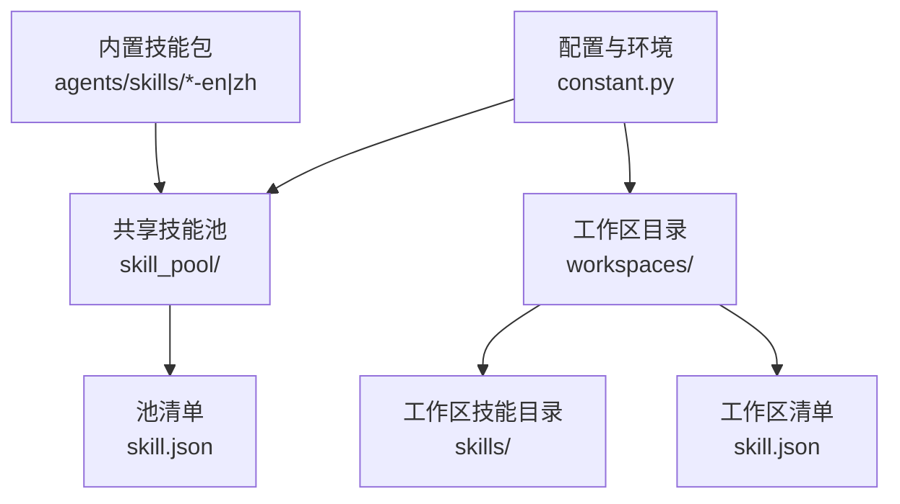
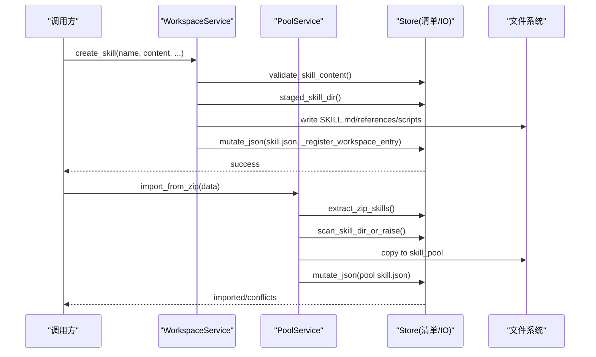
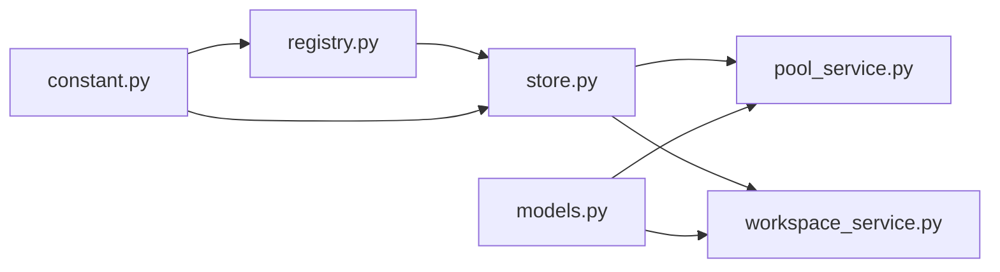

# 技能存储管理

<cite>
**本文引用的文件**
- [store.py](file://tongtian-tauri/src/agent/agents/skill_system/store.py)
- [pool_service.py](file://tongtian-tauri/src/agent/agents/skill_system/pool_service.py)
- [workspace_service.py](file://tongtian-tauri/src/agent/agents/skill_system/workspace_service.py)
- [registry.py](file://tongtian-tauri/src/agent/agents/skill_system/registry.py)
- [models.py](file://tongtian-tauri/src/agent/agents/skill_system/models.py)
- [constant.py](file://tongtian-tauri/src/agent/constant.py)
</cite>

## 目录
1. [简介](#简介)
2. [项目结构](#项目结构)
3. [核心组件](#核心组件)
4. [架构总览](#架构总览)
5. [详细组件分析](#详细组件分析)
6. [依赖关系分析](#依赖关系分析)
7. [性能与并发特性](#性能与并发特性)
8. [故障排查指南](#故障排查指南)
9. [结论](#结论)
10. [附录：存储布局与操作示例](#附录存储布局与操作示例)

## 简介
本文件面向“技能存储管理”主题，系统化说明技能文件的存储结构、目录组织、清单文件格式、路径解析规则、文件访问机制与安全控制，并覆盖备份、恢复与迁移相关操作。重点解释以下核心函数与流程：
- get_skill_pool_dirs：获取技能池根目录列表（主池 + 扩展只读池）
- get_workspace_skills_dir：解析工作区技能目录（兼容旧版 skill 目录）
- read_skill_manifest：读取工作区技能清单（带 mtime 缓存）

## 项目结构
技能系统位于 Python 模块 agents/skill_system 下，围绕“共享技能池”和“工作区技能”两个层次组织：
- 共享技能池：WORKING_DIR/skill_pool，存放可复用的技能，支持导入 ZIP、内置技能同步、标签与自动更新等
- 工作区技能：<workspace>/skills，存放当前工作区可编辑的技能，清单为 <workspace>/skill.json
- 清单格式：使用 JSON 描述元数据与状态；SKILL.md 使用 frontmatter 描述技能内容、版本、需求等

图表来源
- [constant.py:100-122](file://tongtian-tauri/src/agent/constant.py#L100-L122)
- [store.py:58-133](file://tongtian-tauri/src/agent/agents/skill_system/store.py#L58-L133)
- [registry.py:238-240](file://tongtian-tauri/src/agent/agents/skill_system/registry.py#L238-L240)

章节来源
- [constant.py:100-122](file://tongtian-tauri/src/agent/constant.py#L100-L122)
- [store.py:58-133](file://tongtian-tauri/src/agent/agents/skill_system/store.py#L58-L133)
- [registry.py:238-240](file://tongtian-tauri/src/agent/agents/skill_system/registry.py#L238-L240)

## 核心组件
- store.py：底层存储与清单读写、路径安全校验、ZIP 导入、原子写入、扫描校验、元数据构建
- pool_service.py：共享技能池生命周期服务（创建、导入、删除、重命名、自动更新、上传/下载）
- workspace_service.py：工作区技能生命周期服务（创建、编辑、启用/禁用、通道路由、ZIP 导入）
- registry.py：内置技能发现、语言偏好、环境注入、运行时解析
- models.py：统一的数据模型（SkillInfo、SkillRequirements 等）
- constant.py：工作目录、备份目录、插件目录等全局常量

章节来源
- [store.py:1-983](file://tongtian-tauri/src/agent/agents/skill_system/store.py#L1-L983)
- [pool_service.py:1-1264](file://tongtian-tauri/src/agent/agents/skill_system/pool_service.py#L1-L1264)
- [workspace_service.py:1-782](file://tongtian-tauri/src/agent/agents/skill_system/workspace_service.py#L1-L782)
- [registry.py:1-800](file://tongtian-tauri/src/agent/agents/skill_system/registry.py#L1-L800)
- [models.py:1-81](file://tongtian-tauri/src/agent/agents/skill_system/models.py#L1-L81)
- [constant.py:100-122](file://tongtian-tauri/src/agent/constant.py#L100-L122)

## 架构总览
技能系统采用“清单驱动 + 文件系统事实”的架构：
- 清单（JSON）记录运行态信息（enabled、channels、config、tags、source、metadata 等）
- 文件系统（SKILL.md、references、scripts）是技能内容的权威来源
- 通过原子写入与跨进程锁保证清单一致性
- 通过安全路径校验与 ZIP 白名单防止越界访问

图表来源
- [workspace_service.py:145-227](file://tongtian-tauri/src/agent/agents/skill_system/workspace_service.py#L145-L227)
- [pool_service.py:237-351](file://tongtian-tauri/src/agent/agents/skill_system/pool_service.py#L237-L351)
- [store.py:853-983](file://tongtian-tauri/src/agent/agents/skill_system/store.py#L853-L983)

## 详细组件分析

### 存储与路径解析（store.py）
- 技能池与工作区目录解析
  - get_skill_pool_dir：返回 WORKING_DIR/skill_pool
  - get_skill_pool_dirs：返回 [主池] + 配置的额外只读池
  - get_workspace_skills_dir：优先 workspaces/<ws>/skills，若不存在则尝试 legacy skill 并重命名为 skills
  - get_workspace_skill_manifest_path：返回 <workspace>/skill.json
  - get_pool_skill_manifest_path：返回 skill_pool/skill.json
- 清单读取与缓存
  - read_skill_manifest：读取工作区清单，基于文件 mtime 缓存
  - read_skill_pool_manifest：读取池清单，同样基于 mtime 缓存
- 安全与校验
  - safe_skill_dir / normalize_skill_dir_name：拒绝空名、NUL、路径穿越、绝对路径
  - _safe_child_path：限制只能访问 references/ 或 scripts/ 下的子文件
  - validate_skill_content：校验 SKILL.md frontmatter 必须包含 name 与 description
  - scan_skill_dir_or_raise：调用安全扫描器检查技能目录
- 原子写入与并发
  - write_json_atomic：临时文件 + replace 实现原子写入，自动递增 version
  - mutate_json：在写锁保护下读取-修改-写回
  - _file_write_lock：跨进程文件锁（fcntl/msvcrt）
- ZIP 导入与暂存
  - extract_zip_skills：解压并校验 zip，限制大小、禁止符号链接、路径必须在根内
  - staged_skill_dir：为每次写入提供隔离的暂存目录，失败自动清理

章节来源
- [store.py:58-133](file://tongtian-tauri/src/agent/agents/skill_system/store.py#L58-L133)
- [store.py:320-395](file://tongtian-tauri/src/agent/agents/skill_system/store.py#L320-L395)
- [store.py:482-556](file://tongtian-tauri/src/agent/agents/skill_system/store.py#L482-L556)
- [store.py:751-789](file://tongtian-tauri/src/agent/agents/skill_system/store.py#L751-L789)
- [store.py:853-983](file://tongtian-tauri/src/agent/agents/skill_system/store.py#L853-L983)

### 共享技能池服务（pool_service.py）
- 能力概览
  - list_all_skills：从池清单与目录重建 SkillInfo 列表
  - create_skill：创建自定义技能到 skill_pool，并更新池清单
  - import_from_zip：导入 ZIP，冲突检测，批量导入后更新清单
  - delete_skill：删除技能目录并从清单移除
  - set_pool_skill_tags：更新标签
  - set_skill_auto_update：开启/关闭自动更新，并可指定目标工作区
  - save_pool_skill：原地编辑或重命名保存，必要时迁移工作区副本
  - rename_in_workspaces：当池技能重命名时，迁移已自动更新的各工作区副本
  - upload_from_workspace：将工作区技能上传至池（预览/覆盖模式）
- 关键流程
  - 所有写操作均通过 mutate_json 进行，确保清单原子性与并发安全
  - 导入前执行 validate_skill_content 与 scan_skill_dir_or_raise，确保安全合规
  - 重命名时同时更新 manifest 与物理目录，并在需要时迁移工作区副本

章节来源
- [pool_service.py:121-141](file://tongtian-tauri/src/agent/agents/skill_system/pool_service.py#L121-L141)
- [pool_service.py:162-235](file://tongtian-tauri/src/agent/agents/skill_system/pool_service.py#L162-L235)
- [pool_service.py:237-351](file://tongtian-tauri/src/agent/agents/skill_system/pool_service.py#L237-L351)
- [pool_service.py:353-458](file://tongtian-tauri/src/agent/agents/skill_system/pool_service.py#L353-L458)
- [pool_service.py:504-682](file://tongtian-tauri/src/agent/agents/skill_system/pool_service.py#L504-L682)
- [pool_service.py:684-789](file://tongtian-tauri/src/agent/agents/skill_system/pool_service.py#L684-L789)

### 工作区技能服务（workspace_service.py）
- 能力概览
  - list_all_skills / list_available_skills：列出工作区技能与有效技能（考虑通道）
  - create_skill：在工作区 skills 目录创建技能，并写入 skill.json
  - save_skill：原地编辑或重命名保存，冲突时建议新名称
  - import_from_zip：导入 ZIP，可选 enable，冲突检测
  - enable_skill / disable_skill：切换 enabled 标志，并重新扫描校验
  - set_skill_channels / set_skill_tags：设置通道范围与用户标签
  - delete_skill：仅允许删除未启用的技能
  - load_skill_file：受限读取 references/ 或 scripts/ 下的文件，严格路径校验
- 关键流程
  - 所有写操作通过 mutate_json 原子更新清单
  - 导入后 reconcile_workspace_manifest 以对齐清单与目录
  - load_skill_file 仅允许相对路径且限定在 references/ 或 scripts/ 下

章节来源
- [workspace_service.py:88-143](file://tongtian-tauri/src/agent/agents/skill_system/workspace_service.py#L88-L143)
- [workspace_service.py:145-227](file://tongtian-tauri/src/agent/agents/skill_system/workspace_service.py#L145-L227)
- [workspace_service.py:229-442](file://tongtian-tauri/src/agent/agents/skill_system/workspace_service.py#L229-L442)
- [workspace_service.py:444-552](file://tongtian-tauri/src/agent/agents/skill_system/workspace_service.py#L444-L552)
- [workspace_service.py:554-782](file://tongtian-tauri/src/agent/agents/skill_system/workspace_service.py#L554-L782)

### 内置技能与运行时解析（registry.py）
- 内置技能发现与语言偏好
  - get_builtin_skills_dir：指向打包的内置技能目录
  - get_packaged_builtin_versions：列出内置技能及其版本
  - get_builtin_skill_language_preference：从 settings.json 或 UI 语言推断默认语言
- 环境注入
  - apply_skill_config_env_overrides：将技能的 require_envs 配置注入为环境变量，并提供完整配置的 JSON 变量
- 运行时解析
  - resolve_effective_skills：根据工作区清单与通道选择生效的技能集合
  - import_builtin_skills：将内置技能导入到本地池，处理冲突与语言选择

章节来源
- [registry.py:67-116](file://tongtian-tauri/src/agent/agents/skill_system/registry.py#L67-L116)
- [registry.py:155-240](file://tongtian-tauri/src/agent/agents/skill_system/registry.py#L155-L240)
- [registry.py:248-392](file://tongtian-tauri/src/agent/agents/skill_system/registry.py#L248-L392)
- [registry.py:662-800](file://tongtian-tauri/src/agent/agents/skill_system/registry.py#L662-L800)

### 数据模型（models.py）
- SkillInfo：对外暴露的技能详情（name、description、version_text、content、source、references、scripts、emoji）
- SkillRequirements：技能声明的系统需求（require_bins、require_envs）
- ALL_SKILL_ROUTING_CHANNELS：支持的通道枚举（console、discord、telegram 等）

章节来源
- [models.py:15-81](file://tongtian-tauri/src/agent/agents/skill_system/models.py#L15-L81)

## 依赖关系分析
- store.py 被 pool_service.py 与 workspace_service.py 广泛复用，提供统一的 IO、清单与校验能力
- pool_service.py 与 workspace_service.py 都依赖 registry.py 的内置技能与运行时解析能力
- registry.py 依赖 store.py 的清单读取与路径工具
- models.py 提供统一数据结构，供上层服务序列化/反序列化
- constant.py 提供 WORKING_DIR、BACKUP_DIR 等全局路径常量

图表来源
- [store.py:1-983](file://tongtian-tauri/src/agent/agents/skill_system/store.py#L1-L983)
- [pool_service.py:1-1264](file://tongtian-tauri/src/agent/agents/skill_system/pool_service.py#L1-L1264)
- [workspace_service.py:1-782](file://tongtian-tauri/src/agent/agents/skill_system/workspace_service.py#L1-L782)
- [registry.py:1-800](file://tongtian-tauri/src/agent/agents/skill_system/registry.py#L1-L800)
- [models.py:1-81](file://tongtian-tauri/src/agent/agents/skill_system/models.py#L1-L81)
- [constant.py:100-122](file://tongtian-tauri/src/agent/constant.py#L100-L122)

## 性能与并发特性
- 清单读取缓存：read_skill_manifest/read_skill_pool_manifest 基于文件 mtime 缓存，减少重复 I/O
- 原子写入：write_json_atomic 使用临时文件 + replace，避免部分写入导致的损坏
- 跨进程锁：_file_write_lock 使用 fcntl 或 msvcrt 对清单文件加锁，防止并发竞争
- ZIP 导入限制：最大解压体积限制、禁止符号链接、路径必须在根目录下，提升安全性与稳定性
- 暂存目录：staged_skill_dir 为每次写入提供隔离空间，失败自动清理，降低脏数据风险

章节来源
- [store.py:320-395](file://tongtian-tauri/src/agent/agents/skill_system/store.py#L320-L395)
- [store.py:751-789](file://tongtian-tauri/src/agent/agents/skill_system/store.py#L751-L789)
- [store.py:482-503](file://tongtian-tauri/src/agent/agents/skill_system/store.py#L482-L503)
- [store.py:972-983](file://tongtian-tauri/src/agent/agents/skill_system/store.py#L972-L983)

## 故障排查指南
- 清单 JSON 损坏：系统会记录警告并重置为默认清单，需检查对应 .lock 文件是否残留锁
- ZIP 导入失败：确认是否为合法 zip、解压体积是否超限、是否存在符号链接或路径穿越
- 权限问题：确保工作目录与技能目录可写；Windows 下 msvcrt 锁可用，Linux/macOS 下 fcntl 锁可用
- 路径错误：safe_skill_dir/_safe_child_path 会拒绝非法路径，检查传入参数是否符合规范
- 扫描失败：scan_skill_dir_or_raise 抛出异常时，检查技能脚本与引用文件是否包含不安全行为

章节来源
- [store.py:344-395](file://tongtian-tauri/src/agent/agents/skill_system/store.py#L344-L395)
- [store.py:482-503](file://tongtian-tauri/src/agent/agents/skill_system/store.py#L482-L503)
- [store.py:968-969](file://tongtian-tauri/src/agent/agents/skill_system/store.py#L968-L969)

## 结论
技能存储管理通过清晰的目录分层、严格的清单格式与安全的路径校验，实现了可移植、可复用、可审计的技能体系。共享技能池与工作区技能解耦，既支持团队协作与分发，又保留工作区的灵活定制能力。原子写入与跨进程锁保障了高并发场景下的数据一致性，ZIP 导入与暂存机制提升了导入体验与安全性。

## 附录：存储布局与操作示例

### 存储布局示例
- 工作区技能目录
  - workspaces/<ws_id>/skills/<skill_name>/SKILL.md
  - workspaces/<ws_id>/skills/<skill_name>/references/...
  - workspaces/<ws_id>/skills/<skill_name>/scripts/...
  - workspaces/<ws_id>/skill.json（工作区清单）
- 共享技能池目录
  - skill_pool/<skill_name>/SKILL.md
  - skill_pool/skill.json（池清单）
- 内置技能包
  - agents/skills/<skill_name>-en|zh/SKILL.md

章节来源
- [store.py:58-133](file://tongtian-tauri/src/agent/agents/skill_system/store.py#L58-L133)
- [registry.py:238-240](file://tongtian-tauri/src/agent/agents/skill_system/registry.py#L238-L240)

### 清单文件格式规范
- 工作区清单 schema_version: "workspace-skill-manifest.v1"
  - 字段包括：version、skills（键为技能名，值为 enabled、channels、source、installed_from、config、metadata、requirements、updated_at 等）
- 池清单 schema_version: "skill-pool-manifest.v1"
  - 字段包括：version、skills、builtin_skill_names（内置技能名列表）
- SKILL.md frontmatter
  - 必须包含 name 与 description
  - metadata 可为 dict，支持 openclaw/qwenpaw/clawdbot 命名空间的 requires/env/bins 等
  - 版本可从 top-level version 或 metadata.version/builtin_skill_version 提取

章节来源
- [store.py:402-416](file://tongtian-tauri/src/agent/agents/skill_system/store.py#L402-L416)
- [store.py:267-278](file://tongtian-tauri/src/agent/agents/skill_system/store.py#L267-L278)
- [store.py:853-874](file://tongtian-tauri/src/agent/agents/skill_system/store.py#L853-L874)

### 路径解析规则
- get_skill_pool_dirs：返回 [主池, ...扩展只读池]，顺序决定优先级
- get_workspace_skills_dir：优先 skills，若不存在则尝试 legacy skill 并重命名
- safe_skill_dir/normalize_skill_dir_name：拒绝空名、NUL、路径穿越、绝对路径
- _safe_child_path：仅允许 references/ 或 scripts/ 下的相对路径

章节来源
- [store.py:58-133](file://tongtian-tauri/src/agent/agents/skill_system/store.py#L58-L133)
- [store.py:505-556](file://tongtian-tauri/src/agent/agents/skill_system/store.py#L505-L556)

### 文件访问机制与安全控制
- 受限读取：load_skill_file 仅允许读取 references/ 或 scripts/ 下的文件，并进行路径校验
- 安全扫描：scan_skill_dir_or_raise 调用安全扫描器检查脚本与引用
- ZIP 导入限制：体积上限、禁止符号链接、路径必须在根目录下
- 原子写入与锁：write_json_atomic + _file_write_lock 保证清单一致性

章节来源
- [workspace_service.py:751-782](file://tongtian-tauri/src/agent/agents/skill_system/workspace_service.py#L751-L782)
- [store.py:968-969](file://tongtian-tauri/src/agent/agents/skill_system/store.py#L968-L969)
- [store.py:482-503](file://tongtian-tauri/src/agent/agents/skill_system/store.py#L482-L503)
- [store.py:320-395](file://tongtian-tauri/src/agent/agents/skill_system/store.py#L320-L395)

### 备份、恢复与迁移
- 备份目录：BACKUP_DIR = WORKING_DIR.backups（可通过 QWENPAW_BACKUP_DIR 覆盖）
- 恢复建议：
  - 直接复制 skill_pool 与 workspaces 目录到备份位置
  - 恢复时将备份目录还原至原路径
- 迁移建议：
  - 工作区技能目录从 legacy skill 迁移到 skills（get_workspace_skills_dir 会自动重命名）
  - 池技能重命名时，rename_in_workspaces 会迁移已自动更新的各工作区副本

章节来源
- [constant.py:272-282](file://tongtian-tauri/src/agent/constant.py#L272-L282)
- [store.py:65-76](file://tongtian-tauri/src/agent/agents/skill_system/store.py#L65-L76)
- [pool_service.py:684-789](file://tongtian-tauri/src/agent/agents/skill_system/pool_service.py#L684-L789)