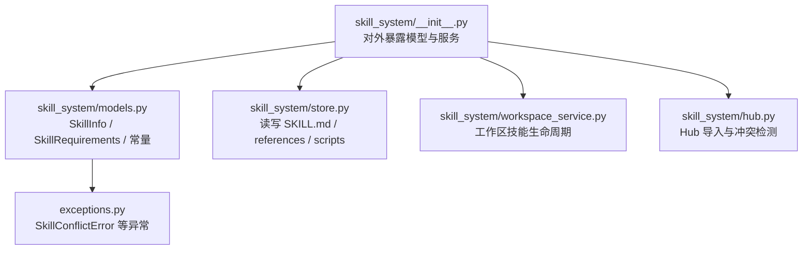
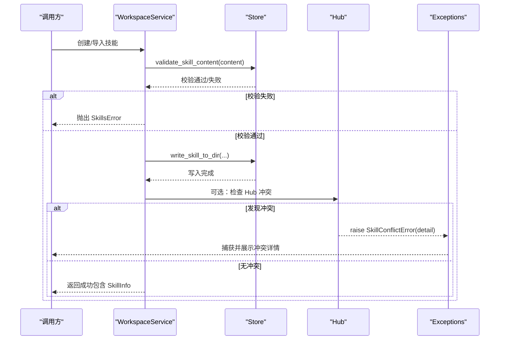
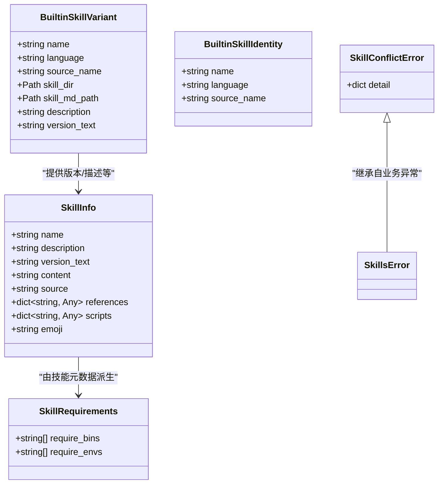
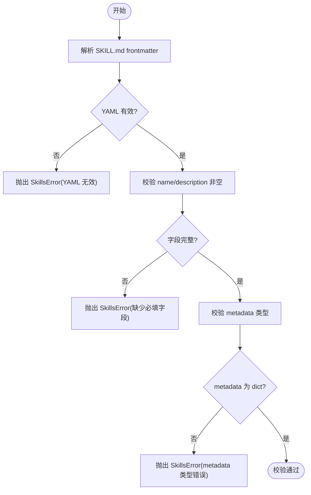
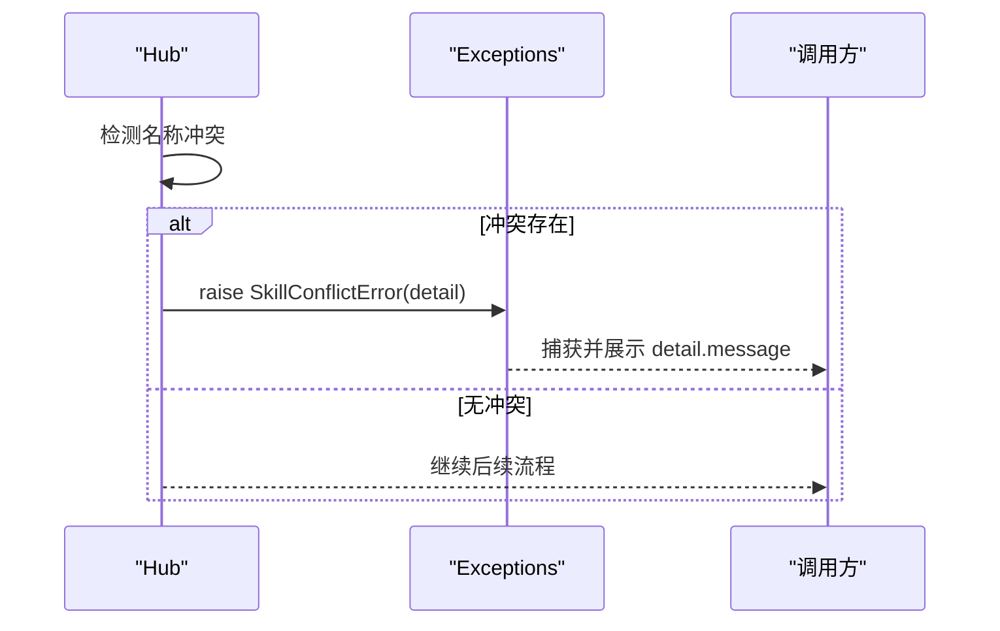
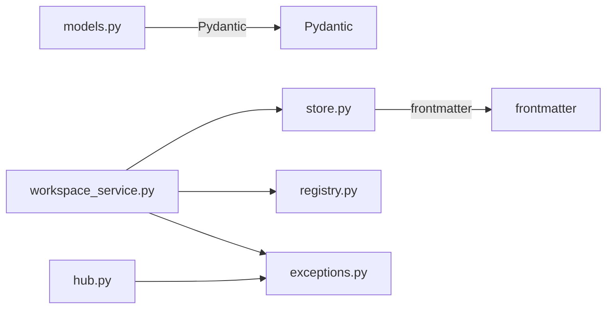

# 技能数据模型

<cite>
**本文引用的文件**
- [models.py](file://tongtian-tauri/src/agent/agents/skill_system/models.py)
- [exceptions.py](file://tongtian-tauri/src/agent/exceptions.py)
- [__init__.py](file://tongtian-tauri/src/agent/agents/skill_system/__init__.py)
- [store.py](file://tongtian-tauri/src/agent/agents/skill_system/store.py)
- [workspace_service.py](file://tongtian-tauri/src/agent/agents/skill_system/workspace_service.py)
- [hub.py](file://tongtian-tauri/src/agent/agents/skill_system/hub.py)
</cite>

## 目录
1. [简介](#简介)
2. [项目结构](#项目结构)
3. [核心组件](#核心组件)
4. [架构总览](#架构总览)
5. [详细组件分析](#详细组件分析)
6. [依赖关系分析](#依赖关系分析)
7. [性能考虑](#性能考虑)
8. [故障排查指南](#故障排查指南)
9. [结论](#结论)
10. [附录](#附录)

## 简介
本文件聚焦于“技能系统”的数据模型与使用规范，围绕 SkillInfo、SkillConflictError 等核心数据结构展开，说明字段含义、验证规则、数据类型约束，并给出创建技能实例、验证配置、处理冲突异常的具体流程。同时涵盖技能描述格式（SKILL.md frontmatter）、参数定义与返回值类型的约定，以及数据迁移与版本兼容性注意事项。

## 项目结构
技能数据模型位于 agent 子系统的 skill_system 模块中，核心模型定义在 models.py，并通过 __init__.py 对外暴露；技能的读取、写入、导入导出与清单管理集中在 store.py；工作区生命周期服务在 workspace_service.py；Hub 侧的导入与冲突检测在 hub.py；通用异常定义在 exceptions.py。

**图表来源**
- [__init__.py:1-46](file://tongtian-tauri/src/agent/agents/skill_system/__init__.py#L1-L46)
- [models.py:1-81](file://tongtian-tauri/src/agent/agents/skill_system/models.py#L1-L81)
- [store.py:807-874](file://tongtian-tauri/src/agent/agents/skill_system/store.py#L807-L874)
- [workspace_service.py:88-200](file://tongtian-tauri/src/agent/agents/skill_system/workspace_service.py#L88-L200)
- [hub.py:2280-2340](file://tongtian-tauri/src/agent/agents/skill_system/hub.py#L2280-L2340)
- [exceptions.py:311-342](file://tongtian-tauri/src/agent/exceptions.py#L311-L342)

**章节来源**
- [__init__.py:1-46](file://tongtian-tauri/src/agent/agents/skill_system/__init__.py#L1-L46)
- [models.py:1-81](file://tongtian-tauri/src/agent/agents/skill_system/models.py#L1-L81)

## 核心组件
- SkillInfo：技能元数据与内容的统一载体，用于向调用方返回技能的稳定标识、描述、版本文本、内容、来源、引用与脚本树、表情等。
- SkillRequirements：技能声明的系统级依赖（外部二进制与环境变量）。
- BuiltinSkillVariant / BuiltinSkillIdentity：内置技能变体与身份标识，用于构建内置技能集合与版本信息。
- SkillConflictError：当导入或保存操作遇到可重命名冲突时抛出的业务异常，携带结构化 detail。

关键要点
- name 是稳定的运行时标识，不随 frontmatter 漂移而改变，确保 API、同步状态与通道路由的一致性。
- content 为 SKILL.md 的原始文本；references 与 scripts 以目录树形式组织，便于前端渲染与工具链消费。
- source 表示技能来源（如 builtin/customized），用于区分内置与用户自定义技能。
- version_text 用于版本对比与升级提示。

**章节来源**
- [models.py:15-81](file://tongtian-tauri/src/agent/agents/skill_system/models.py#L15-L81)
- [exceptions.py:311-342](file://tongtian-tauri/src/agent/exceptions.py#L311-L342)

## 架构总览
技能数据模型贯穿“读取—校验—持久化—注册—冲突检测”的全链路：
- 读取：从工作区或 Hub 的技能目录读取 SKILL.md 及 references/scripts 目录，构造 SkillInfo。
- 校验：对 SKILL.md 的 frontmatter 进行 YAML 解析与必填字段校验。
- 持久化：将技能文件写入目标目录，并更新工作区清单（manifest）中的启用状态、通道、来源、版本等信息。
- 注册：在工作区清单中登记技能条目，生成元数据与更新时间戳。
- 冲突检测：Hub 导入或保存时检测名称冲突，必要时抛出 SkillConflictError。

**图表来源**
- [workspace_service.py:145-200](file://tongtian-tauri/src/agent/agents/skill_system/workspace_service.py#L145-L200)
- [store.py:853-874](file://tongtian-tauri/src/agent/agents/skill_system/store.py#L853-L874)
- [store.py:902-921](file://tongtian-tauri/src/agent/agents/skill_system/store.py#L902-L921)
- [hub.py:2280-2340](file://tongtian-tauri/src/agent/agents/skill_system/hub.py#L2280-L2340)
- [exceptions.py:311-342](file://tongtian-tauri/src/agent/exceptions.py#L311-L342)

## 详细组件分析

### 数据模型类图

**图表来源**
- [models.py:29-81](file://tongtian-tauri/src/agent/agents/skill_system/models.py#L29-L81)
- [exceptions.py:311-342](file://tongtian-tauri/src/agent/exceptions.py#L311-L342)

**章节来源**
- [models.py:29-81](file://tongtian-tauri/src/agent/agents/skill_system/models.py#L29-L81)
- [exceptions.py:311-342](file://tongtian-tauri/src/agent/exceptions.py#L311-L342)

### 技能描述格式（SKILL.md）与验证规则
- 文件位置：每个技能目录下的 SKILL.md。
- Frontmatter 要求：
  - name：非空字符串，作为技能名称。
  - description：非空字符串，作为技能描述。
  - metadata：若存在，必须为字典类型。
- 其他字段：
  - metadata.qwenpaw.emoji：可选，用于显示表情。
  - 版本信息：通过 extract_version 提取 version_text。
- 验证流程：
  - 使用 frontmatter 解析 YAML。
  - 校验 name 与 description 是否非空。
  - 校验 metadata 类型是否为 dict。
  - 解析失败或校验失败抛出 SkillsError。

**图表来源**
- [store.py:853-874](file://tongtian-tauri/src/agent/agents/skill_system/store.py#L853-L874)

**章节来源**
- [store.py:807-874](file://tongtian-tauri/src/agent/agents/skill_system/store.py#L807-L874)

### 参数定义与返回值类型
- 输入参数（创建/导入）：
  - name：技能目录名（会被规范化）。
  - content：SKILL.md 原始文本。
  - references：references 目录树（可选）。
  - scripts：scripts 目录树（可选）。
  - extra_files：额外文件树（可选）。
  - config：技能配置（可选）。
  - enable：是否启用（默认 false）。
  - installed_from：安装来源（可选）。
  - source：来源标记（可选，覆盖默认推断）。
- 返回值：
  - 成功：返回 None 或成功标志（具体取决于方法），并在工作区清单中登记技能条目。
  - 失败：抛出 SkillsError 或返回 None（如目录已存在）。

注意
- 参数类型由 Python 类型注解与 Pydantic 模型共同约束。
- 目录结构与键名需遵循约定（references/scripts 为目录树映射）。

**章节来源**
- [workspace_service.py:145-200](file://tongtian-tauri/src/agent/agents/skill_system/workspace_service.py#L145-L200)
- [store.py:902-921](file://tongtian-tauri/src/agent/agents/skill_system/store.py#L902-L921)

### 技能冲突异常处理
- 触发场景：
  - Hub 导入或保存时检测到名称冲突（例如与现有技能重名且不可自动重命名）。
- 异常结构：
  - SkillConflictError 继承自 SkillsError，detail 中包含 message 等上下文信息。
- 处理建议：
  - 捕获 SkillConflictError，读取 detail.message 与相关字段，提示用户选择重命名或覆盖策略。
  - 在 UI 层展示冲突详情并提供交互选项。

**图表来源**
- [hub.py:2280-2340](file://tongtian-tauri/src/agent/agents/skill_system/hub.py#L2280-L2340)
- [exceptions.py:311-342](file://tongtian-tauri/src/agent/exceptions.py#L311-L342)

**章节来源**
- [hub.py:2280-2340](file://tongtian-tauri/src/agent/agents/skill_system/hub.py#L2280-L2340)
- [exceptions.py:311-342](file://tongtian-tauri/src/agent/exceptions.py#L311-L342)

### 数据迁移与版本兼容性
- 版本字段：
  - version_text：来自 SKILL.md 的 extract_version，用于比较当前与 Hub/内置版本的差异。
- 兼容策略：
  - 在工作区清单中记录 current_version_text，并与 preferred/current variant 的 version_text 对比，决定是否提示升级或回滚。
  - 对于内置技能，维护 packaged builtin versions，以便识别版本漂移。
- 迁移建议：
  - 新增字段时应保持向后兼容（默认值或可选）。
  - 变更字段语义时需评估历史清单的兼容性，并在升级流程中做适配。

**章节来源**
- [registry.py:229-234](file://tongtian-tauri/src/agent/agents/skill_system/registry.py#L229-L234)
- [registry.py:471-547](file://tongtian-tauri/src/agent/agents/skill_system/registry.py#L471-L547)
- [models.py:37-58](file://tongtian-tauri/src/agent/agents/skill_system/models.py#L37-L58)

## 依赖关系分析
- SkillInfo 依赖 Pydantic BaseModel，提供字段校验与序列化能力。
- Store 依赖 frontmatter 解析 SKILL.md，并使用文件系统操作读写 references/scripts。
- WorkspaceService 组合 Store 与 Registry，负责工作区清单的读写与技能生命周期管理。
- Hub 在导入/保存路径上触发冲突检测，必要时抛出 SkillConflictError。
- 异常体系集中于 exceptions.py，SkillsError 及其子类统一封装业务错误。

**图表来源**
- [models.py:10-12](file://tongtian-tauri/src/agent/agents/skill_system/models.py#L10-L12)
- [store.py:815-827](file://tongtian-tauri/src/agent/agents/skill_system/store.py#L815-L827)
- [workspace_service.py:10-17](file://tongtian-tauri/src/agent/agents/skill_system/workspace_service.py#L10-L17)
- [hub.py:2280-2340](file://tongtian-tauri/src/agent/agents/skill_system/hub.py#L2280-L2340)
- [exceptions.py:311-342](file://tongtian-tauri/src/agent/exceptions.py#L311-L342)

**章节来源**
- [models.py:10-12](file://tongtian-tauri/src/agent/agents/skill_system/models.py#L10-L12)
- [store.py:815-827](file://tongtian-tauri/src/agent/agents/skill_system/store.py#L815-L827)
- [workspace_service.py:10-17](file://tongtian-tauri/src/agent/agents/skill_system/workspace_service.py#L10-L17)
- [hub.py:2280-2340](file://tongtian-tauri/src/agent/agents/skill_system/hub.py#L2280-L2340)
- [exceptions.py:311-342](file://tongtian-tauri/src/agent/exceptions.py#L311-L342)

## 性能考虑
- 读取与解析：
  - read_skill_from_dir 会读取 SKILL.md 并解析 frontmatter，建议在批量列举时避免重复解析。
- 目录树构建：
  - references/scripts 目录树通过 _directory_tree 构建，层级较深时可能影响性能，可考虑缓存或懒加载。
- 并发与安全：
  - 使用 staged_skill_dir 临时目录进行原子写入，减少并发写冲突风险。
- 版本对比：
  - version_text 的比较应轻量，避免频繁 I/O。

[本节为一般性指导，不直接分析具体文件]

## 故障排查指南
- SKILL.md 解析失败：
  - 现象：抛出 SkillsError，提示 YAML 无效或缺少必填字段。
  - 排查：检查 frontmatter 语法与 name/description 是否非空。
- 目录已存在：
  - 现象：create_skill 返回 None。
  - 排查：确认技能目录名是否已存在，或先删除/重命名。
- 冲突异常：
  - 现象：抛出 SkillConflictError，detail.message 包含冲突原因。
  - 排查：根据 detail 提示进行重命名或覆盖决策。
- 清单写入失败：
  - 现象：抛出 SkillsError，提示清单写入失败。
  - 排查：检查工作区权限与磁盘空间，必要时清理残留临时目录。

**章节来源**
- [store.py:853-874](file://tongtian-tauri/src/agent/agents/skill_system/store.py#L853-L874)
- [workspace_service.py:145-200](file://tongtian-tauri/src/agent/agents/skill_system/workspace_service.py#L145-L200)
- [exceptions.py:311-342](file://tongtian-tauri/src/agent/exceptions.py#L311-L342)

## 结论
SkillInfo 作为技能元数据的统一载体，结合 SKILL.md 的严格校验与工作区清单的持久化，构成了技能系统的核心数据契约。通过 SkillRequirements 声明系统依赖、version_text 管理版本兼容、SkillConflictError 处理导入冲突，系统在易用性与安全性之间取得平衡。建议在实际使用中遵循本文档的字段约定与校验流程，确保技能的可维护性与跨环境一致性。

## 附录
- 常用入口与导出：
  - 通过 skill_system/__init__.py 暴露 SkillInfo、SkillConflictError、SkillPoolService、SkillService 等。
- 典型流程参考：
  - 创建技能：validate → write → scan → copy → register。
  - 导入技能：extract_zip → validate → conflict check → import → register。
  - 列表查询：read manifest → read_skill_from_dir → 组装 SkillInfo 列表。

**章节来源**
- [__init__.py:1-46](file://tongtian-tauri/src/agent/agents/skill_system/__init__.py#L1-L46)
- [workspace_service.py:114-143](file://tongtian-tauri/src/agent/agents/skill_system/workspace_service.py#L114-L143)
- [store.py:923-965](file://tongtian-tauri/src/agent/agents/skill_system/store.py#L923-L965)