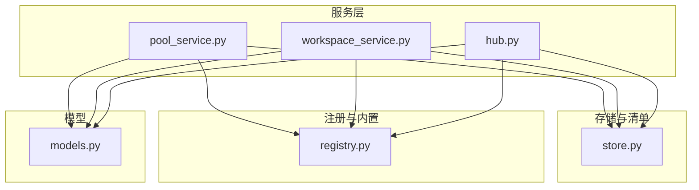
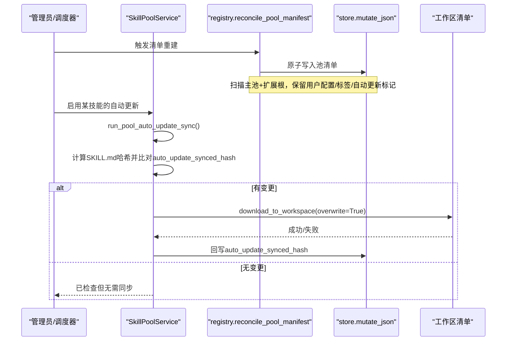
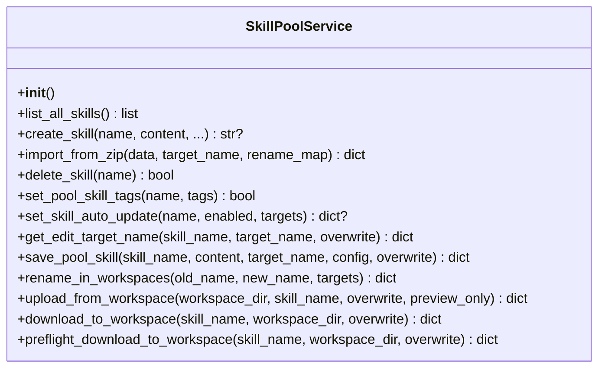
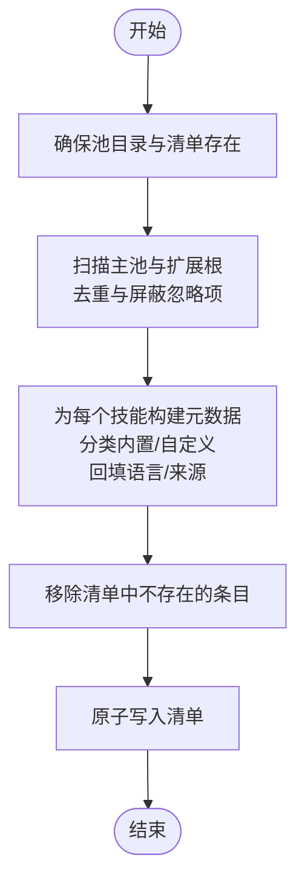
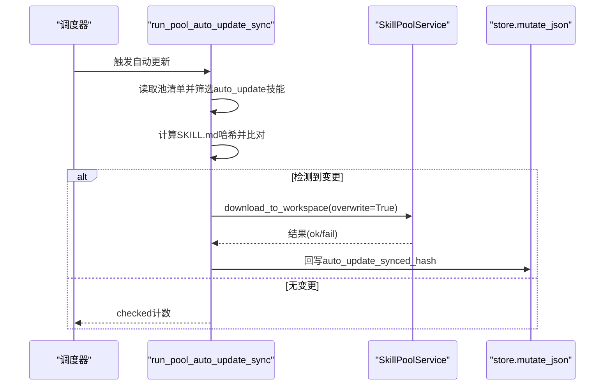
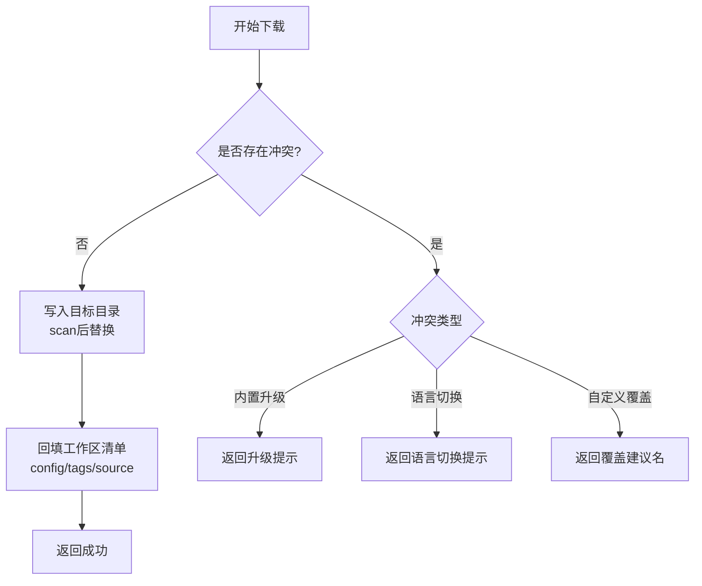
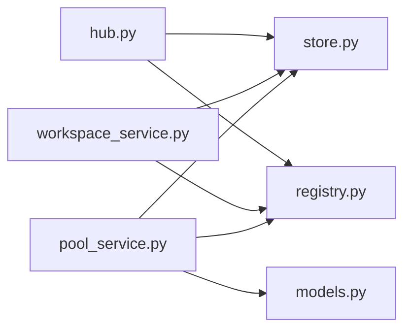

# 技能池服务

<cite>
**本文引用的文件**
- [pool_service.py](file://tongtian-tauri/src/agent/agents/skill_system/pool_service.py)
- [registry.py](file://tongtian-tauri/src/agent/agents/skill_system/registry.py)
- [store.py](file://tongtian-tauri/src/agent/agents/skill_system/store.py)
- [workspace_service.py](file://tongtian-tauri/src/agent/agents/skill_system/workspace_service.py)
- [hub.py](file://tongtian-tauri/src/agent/agents/skill_system/hub.py)
- [models.py](file://tongtian-tauri/src/agent/agents/skill_system/models.py)
</cite>

## 目录
1. [简介](#简介)
2. [项目结构](#项目结构)
3. [核心组件](#核心组件)
4. [架构总览](#架构总览)
5. [详细组件分析](#详细组件分析)
6. [依赖关系分析](#依赖关系分析)
7. [性能考虑](#性能考虑)
8. [故障排查指南](#故障排查指南)
9. [结论](#结论)
10. [附录：使用示例与最佳实践](#附录使用示例与最佳实践)

## 简介
本文件面向“技能池服务”，系统性说明其概念、职责与实现要点。技能池是跨工作区共享的可复用技能集合，负责预置技能的导入与管理、多源技能整合（本地主池、扩展只读根、内置包）、自动更新机制（按内容哈希驱动）以及在工作区间的同步分发。核心类 SkillPoolService 提供技能池的初始化、创建、导入、编辑、重命名、下载至工作区、标签与自动更新配置等能力；关键函数 reconcile_pool_manifest 负责将磁盘上的技能目录与池清单进行一致性重建；run_pool_auto_update_sync 则基于内容变更检测，将启用了自动更新的技能推送到目标工作区。

## 项目结构
技能系统由多个模块协作完成：
- 存储与清单层：store.py 提供路径解析、清单读写、原子写入、安全校验、目录复制、ZIP 解压与安全扫描等基础能力。
- 注册与内置管理：registry.py 负责内置技能发现、语言偏好、清单合并与重建、工作区清单重建、工作区列表与运行时技能解析。
- 服务层：pool_service.py 暴露 SkillPoolService，封装对技能池的生命周期操作与自动更新流程；workspace_service.py 提供工作区级技能生命周期；hub.py 提供外部源安装与网络访问能力。
- 数据模型：models.py 定义统一返回结构与常量。

图表来源
- [pool_service.py:121-145](file://tongtian-tauri/src/agent/agents/skill_system/pool_service.py#L121-L145)
- [registry.py:853-870](file://tongtian-tauri/src/agent/agents/skill_system/registry.py#L853-L870)
- [store.py:58-133](file://tongtian-tauri/src/agent/agents/skill_system/store.py#L58-L133)

章节来源
- [pool_service.py:121-145](file://tongtian-tauri/src/agent/agents/skill_system/pool_service.py#L121-L145)
- [registry.py:853-870](file://tongtian-tauri/src/agent/agents/skill_system/registry.py#L853-L870)
- [store.py:58-133](file://tongtian-tauri/src/agent/agents/skill_system/store.py#L58-L133)

## 核心组件
- SkillPoolService：技能池生命周期服务，负责创建、导入、编辑、重命名、删除、上传到池、下载到工作区、设置标签与自动更新开关，并协调自动更新推送。
- reconcile_pool_manifest：将技能池目录与清单进行一致性重建，保留用户配置、标签、自动更新状态等元信息。
- run_pool_auto_update_sync：检测已启用自动更新的技能是否发生内容变化，计算 SKILL.md 哈希并与上次同步哈希比较，若不同则推送到目标工作区，并回写新的同步哈希。
- store 工具集：清单原子写入、跨进程锁、ZIP 安全解压、目录复制、安全路径校验、前置扫描、冲突建议名生成等。
- registry：内置技能发现、语言偏好、工作区清单重建、工作区枚举、运行时技能解析。
- workspace_service：工作区级技能 CRUD、启用/禁用、通道路由、配置持久化。
- hub：外部源安装、HTTP 重试与缓存、取消检查、大小限制、协议错误处理。

章节来源
- [pool_service.py:121-145](file://tongtian-tauri/src/agent/agents/skill_system/pool_service.py#L121-L145)
- [registry.py:968-1033](file://tongtian-tauri/src/agent/agents/skill_system/registry.py#L968-L1033)
- [pool_service.py:1218-1264](file://tongtian-tauri/src/agent/agents/skill_system/pool_service.py#L1218-L1264)
- [store.py:320-395](file://tongtian-tauri/src/agent/agents/skill_system/store.py#L320-L395)
- [registry.py:1151-1207](file://tongtian-tauri/src/agent/agents/skill_system/registry.py#L1151-L1207)
- [workspace_service.py:88-143](file://tongtian-tauri/src/agent/agents/skill_system/workspace_service.py#L88-L143)
- [hub.py:413-638](file://tongtian-tauri/src/agent/agents/skill_system/hub.py#L413-L638)

## 架构总览
技能池服务的整体交互如下：
- 初始化阶段：确保技能池目录与清单存在，必要时导入内置技能或迁移字段。
- 清单重建：reconcile_pool_manifest 扫描主池与扩展只读根，构建统一的池清单，保留用户配置与自动更新标记。
- 自动更新：run_pool_auto_update_sync 通过 SKILL.md 哈希检测变更，调用 SkillPoolService.download_to_workspace 覆盖推送至目标工作区，并记录同步哈希。
- 工作区同步：download_to_workspace 在写入前进行冲突检测（内置版本/语言切换/自定义覆盖），成功后回填工作区清单中的配置、标签、来源等信息。
- 多源整合：支持从 ZIP、工作区上传、内置包等多源导入，统一进入技能池，再分发到工作区。

图表来源
- [registry.py:968-1033](file://tongtian-tauri/src/agent/agents/skill_system/registry.py#L968-L1033)
- [pool_service.py:1218-1264](file://tongtian-tauri/src/agent/agents/skill_system/pool_service.py#L1218-L1264)
- [store.py:384-395](file://tongtian-tauri/src/agent/agents/skill_system/store.py#L384-L395)

## 详细组件分析

### SkillPoolService 类
- 职责：统一管理共享技能池的生命周期，包括创建、导入、编辑、重命名、删除、上传到池、下载到工作区、标签与自动更新配置。
- 关键点：
  - 初始化时确保技能池就绪。
  - 所有写操作均通过 staged_skill_dir + scan_skill_dir_or_raise 保证内容安全后再落盘。
  - 清单更新通过 mutate_json 原子写入，失败时尝试回滚文件并抛出结构化异常。
  - 自动更新开关会立即触发一次同步以对齐当前目标集合。
  - 下载至工作区前进行冲突检测（内置版本/语言切换/自定义覆盖），避免误覆盖。

图表来源
- [pool_service.py:121-145](file://tongtian-tauri/src/agent/agents/skill_system/pool_service.py#L121-L145)
- [pool_service.py:162-235](file://tongtian-tauri/src/agent/agents/skill_system/pool_service.py#L162-L235)
- [pool_service.py:237-351](file://tongtian-tauri/src/agent/agents/skill_system/pool_service.py#L237-L351)
- [pool_service.py:353-458](file://tongtian-tauri/src/agent/agents/skill_system/pool_service.py#L353-L458)
- [pool_service.py:460-682](file://tongtian-tauri/src/agent/agents/skill_system/pool_service.py#L460-L682)
- [pool_service.py:684-860](file://tongtian-tauri/src/agent/agents/skill_system/pool_service.py#L684-L860)
- [pool_service.py:980-1112](file://tongtian-tauri/src/agent/agents/skill_system/pool_service.py#L980-L1112)

章节来源
- [pool_service.py:121-145](file://tongtian-tauri/src/agent/agents/skill_system/pool_service.py#L121-L145)
- [pool_service.py:162-235](file://tongtian-tauri/src/agent/agents/skill_system/pool_service.py#L162-L235)
- [pool_service.py:237-351](file://tongtian-tauri/src/agent/agents/skill_system/pool_service.py#L237-L351)
- [pool_service.py:353-458](file://tongtian-tauri/src/agent/agents/skill_system/pool_service.py#L353-L458)
- [pool_service.py:460-682](file://tongtian-tauri/src/agent/agents/skill_system/pool_service.py#L460-L682)
- [pool_service.py:684-860](file://tongtian-tauri/src/agent/agents/skill_system/pool_service.py#L684-L860)
- [pool_service.py:980-1112](file://tongtian-tauri/src/agent/agents/skill_system/pool_service.py#L980-L1112)

### reconcile_pool_manifest：清单重建
- 作用：将技能池目录（主池 + 扩展只读根）与清单进行一致性重建，保留用户配置、标签、自动更新标记等元信息。
- 行为：
  - 扫描主池与扩展根，按优先级去重，屏蔽忽略项。
  - 为每个发现的技能目录构建元数据，区分内置/自定义，并回填语言与来源信息。
  - 清理清单中不再存在的条目。
  - 通过 mutate_json 原子写入，异常时记录警告并跳过对应条目。

图表来源
- [registry.py:968-1033](file://tongtian-tauri/src/agent/agents/skill_system/registry.py#L968-L1033)
- [store.py:384-395](file://tongtian-tauri/src/agent/agents/skill_system/store.py#L384-L395)

章节来源
- [registry.py:968-1033](file://tongtian-tauri/src/agent/agents/skill_system/registry.py#L968-L1033)

### run_pool_auto_update_sync：自动更新同步
- 作用：检测已启用自动更新的技能是否发生内容变化，并将变更推送到目标工作区。
- 流程：
  - 读取池清单，筛选 auto_update=true 的技能。
  - 计算 SKILL.md 哈希并与 auto_update_synced_hash 比较，识别变更。
  - 解析目标工作区（显式指定或包含该技能的工作区）。
  - 逐个调用 download_to_workspace(overwrite=True) 推送。
  - 成功后回写新的同步哈希。

图表来源
- [pool_service.py:1189-1264](file://tongtian-tauri/src/agent/agents/skill_system/pool_service.py#L1189-L1264)
- [store.py:384-395](file://tongtian-tauri/src/agent/agents/skill_system/store.py#L384-L395)

章节来源
- [pool_service.py:1189-1264](file://tongtian-tauri/src/agent/agents/skill_system/pool_service.py#L1189-L1264)

### 下载至工作区与冲突处理
- 冲突类型：
  - 内置版本升级：当工作区已有内置且版本不一致时提示升级。
  - 语言切换：当内置语言与工作区已配置语言不一致时提示切换。
  - 自定义覆盖：非内置技能直接覆盖需显式允许。
- 行为：
  - preflight_download_to_workspace 仅做冲突检查。
  - download_to_workspace 执行实际写入，并在成功后回填配置、标签、来源等信息。

图表来源
- [pool_service.py:862-959](file://tongtian-tauri/src/agent/agents/skill_system/pool_service.py#L862-L959)
- [pool_service.py:980-1112](file://tongtian-tauri/src/agent/agents/skill_system/pool_service.py#L980-L1112)

章节来源
- [pool_service.py:862-959](file://tongtian-tauri/src/agent/agents/skill_system/pool_service.py#L862-L959)
- [pool_service.py:980-1112](file://tongtian-tauri/src/agent/agents/skill_system/pool_service.py#L980-L1112)

### 多源技能整合
- 来源：
  - 内置包：通过 registry 发现并导入到池，支持语言选择与冲突处理。
  - ZIP 导入：支持批量导入、重映射、冲突检测与回滚。
  - 工作区上传：将工作区技能复制到池，保留配置与标签。
- 统一入口：最终都进入技能池清单，再由工作区按需下载。

章节来源
- [registry.py:662-803](file://tongtian-tauri/src/agent/agents/skill_system/registry.py#L662-L803)
- [pool_service.py:237-351](file://tongtian-tauri/src/agent/agents/skill_system/pool_service.py#L237-L351)
- [pool_service.py:791-860](file://tongtian-tauri/src/agent/agents/skill_system/pool_service.py#L791-L860)

## 依赖关系分析
- SkillPoolService 依赖 store 提供的清单原子写入、路径安全、目录复制、ZIP 解压与安全扫描；依赖 registry 提供工作区列表与内置技能信息；依赖 models 提供统一数据结构。
- registry 依赖 store 的路径与清单工具，同时维护内置技能注册表与语言偏好。
- workspace_service 与 pool_service 共同维护工作区与池的一致性，前者聚焦工作区内可编辑技能，后者聚焦共享池与跨工作区同步。
- hub 提供外部源安装与网络访问，具备重试、取消、大小限制与错误处理。

图表来源
- [pool_service.py:121-145](file://tongtian-tauri/src/agent/agents/skill_system/pool_service.py#L121-L145)
- [registry.py:853-870](file://tongtian-tauri/src/agent/agents/skill_system/registry.py#L853-L870)
- [workspace_service.py:88-143](file://tongtian-tauri/src/agent/agents/skill_system/workspace_service.py#L88-L143)
- [hub.py:413-638](file://tongtian-tauri/src/agent/agents/skill_system/hub.py#L413-L638)

章节来源
- [pool_service.py:121-145](file://tongtian-tauri/src/agent/agents/skill_system/pool_service.py#L121-L145)
- [registry.py:853-870](file://tongtian-tauri/src/agent/agents/skill_system/registry.py#L853-L870)
- [workspace_service.py:88-143](file://tongtian-tauri/src/agent/agents/skill_system/workspace_service.py#L88-L143)
- [hub.py:413-638](file://tongtian-tauri/src/agent/agents/skill_system/hub.py#L413-L638)

## 性能考虑
- 清单读写采用原子写入与跨进程锁，避免并发竞争导致的数据损坏。
- 自动更新通过 SKILL.md 哈希快速判断变更，减少不必要的全量同步。
- 内置技能注册表与语言偏好使用内存缓存，降低重复 IO。
- ZIP 导入与网络下载具备大小限制与流式读取，防止内存溢出。
- 工作区与池的扫描遵循优先级顺序，避免重复与阴影问题。

[本节为通用性能指导，不直接分析具体文件]

## 故障排查指南
- 清单损坏：read_json 遇到 JSONDecodeError 时会重置为默认清单并记录警告；后续 reconcile 会重建。
- 文件锁定失败：若平台缺少 fcntl/msvcrt 会抛出导入错误；需确保运行环境可用。
- 自动更新失败：_push_auto_update_skill 捕获异常并记录警告，失败目标加入 failed 列表；检查日志定位具体工作区。
- 下载冲突：download_to_workspace 返回 reason（builtin_upgrade/language_switch/conflict），根据提示调整覆盖策略或语言设置。
- ZIP 导入冲突：import_from_zip 返回 conflicts 与建议名，需重命名或覆盖确认。
- 网络错误：hub 层对 429/5xx/超时等进行重试与退避，GitHub 限频会提示设置令牌。

章节来源
- [store.py:344-357](file://tongtian-tauri/src/agent/agents/skill_system/store.py#L344-L357)
- [store.py:31-45](file://tongtian-tauri/src/agent/agents/skill_system/store.py#L31-L45)
- [pool_service.py:1142-1186](file://tongtian-tauri/src/agent/agents/skill_system/pool_service.py#L1142-L1186)
- [pool_service.py:862-959](file://tongtian-tauri/src/agent/agents/skill_system/pool_service.py#L862-L959)
- [pool_service.py:237-351](file://tongtian-tauri/src/agent/agents/skill_system/pool_service.py#L237-L351)
- [hub.py:413-638](file://tongtian-tauri/src/agent/agents/skill_system/hub.py#L413-L638)

## 结论
技能池服务通过清晰的职责划分与稳健的存储机制，实现了跨工作区的技能共享、预置管理与自动更新。reconcile_pool_manifest 确保清单与文件系统一致，run_pool_auto_update_sync 提供高效的内容变更检测与推送。结合多源整合与严格的冲突处理，系统在易用性与安全性之间取得平衡。建议在生产环境中定期执行清单重建与自动更新，并结合日志与监控及时发现异常。

[本节为总结性内容，不直接分析具体文件]

## 附录：使用示例与最佳实践

### 配置技能池
- 初始化：确保技能池目录与清单存在，必要时导入内置技能。
- 清单重建：在手动修改池目录后调用 reconcile_pool_manifest 以恢复清单一致性。
- 多源整合：优先使用 ZIP 导入或工作区上传，避免直接手写目录造成不一致。

章节来源
- [registry.py:853-870](file://tongtian-tauri/src/agent/agents/skill_system/registry.py#L853-L870)
- [registry.py:968-1033](file://tongtian-tauri/src/agent/agents/skill_system/registry.py#L968-L1033)
- [pool_service.py:237-351](file://tongtian-tauri/src/agent/agents/skill_system/pool_service.py#L237-L351)
- [pool_service.py:791-860](file://tongtian-tauri/src/agent/agents/skill_system/pool_service.py#L791-L860)

### 管理预置技能
- 导入内置：通过内置导入接口选择语言与版本，处理冲突后写入池。
- 更新内置：对比池与内置版本，按需更新并保留用户配置与标签。
- 语言切换：注意内置语言与工作区配置的差异，避免误覆盖。

章节来源
- [registry.py:662-803](file://tongtian-tauri/src/agent/agents/skill_system/registry.py#L662-L803)
- [registry.py:1435-1510](file://tongtian-tauri/src/agent/agents/skill_system/registry.py#L1435-L1510)
- [pool_service.py:862-959](file://tongtian-tauri/src/agent/agents/skill_system/pool_service.py#L862-L959)

### 处理更新冲突
- 预览模式：使用 preflight_download_to_workspace 检查冲突，再决定是否覆盖。
- 覆盖策略：对于自定义技能可设置 overwrite=True；对于内置技能需明确升级或语言切换。
- 冲突建议名：利用 suggest_conflict_name 生成唯一名称，避免覆盖现有技能。

章节来源
- [pool_service.py:1081-1112](file://tongtian-tauri/src/agent/agents/skill_system/pool_service.py#L1081-L1112)
- [store.py:671-691](file://tongtian-tauri/src/agent/agents/skill_system/store.py#L671-L691)

### 自动更新最佳实践
- 启用自动更新：通过 set_skill_auto_update 开启并设置目标工作区。
- 内容变更：修改 SKILL.md 后，自动更新会在下次同步时检测到哈希变化并推送。
- 回滚策略：若推送失败，检查日志与目标工作区状态，必要时手动回滚并修复清单。

章节来源
- [pool_service.py:417-458](file://tongtian-tauri/src/agent/agents/skill_system/pool_service.py#L417-L458)
- [pool_service.py:1189-1264](file://tongtian-tauri/src/agent/agents/skill_system/pool_service.py#L1189-L1264)

### 错误处理与日志记录
- 结构化异常：SkillsError 携带 message 与 details，便于上层处理与展示。
- 日志级别：关键路径使用 info/warning，异常堆栈使用 exc_info=True 记录。
- 幂等性：清单重建与自动更新具备幂等性，重复执行不会产生副作用。

章节来源
- [pool_service.py:203-235](file://tongtian-tauri/src/agent/agents/skill_system/pool_service.py#L203-L235)
- [pool_service.py:1142-1186](file://tongtian-tauri/src/agent/agents/skill_system/pool_service.py#L1142-L1186)
- [registry.py:990-1027](file://tongtian-tauri/src/agent/agents/skill_system/registry.py#L990-L1027)