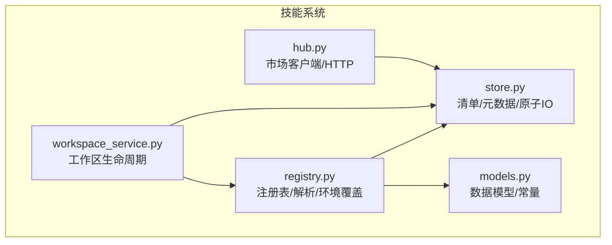
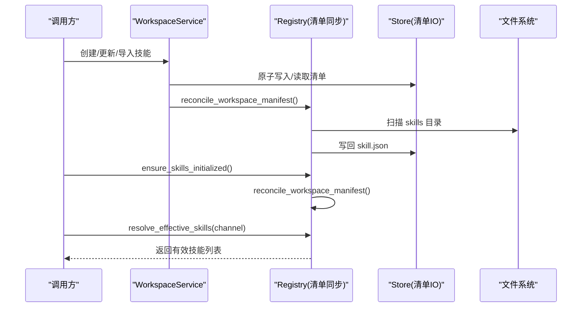
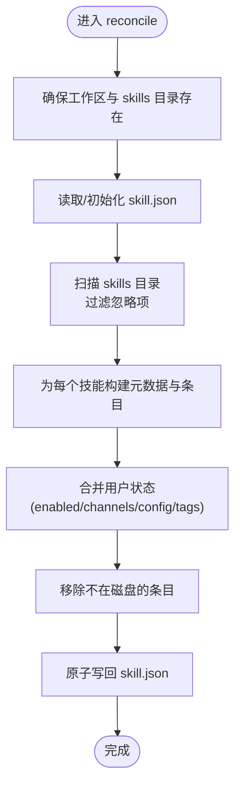
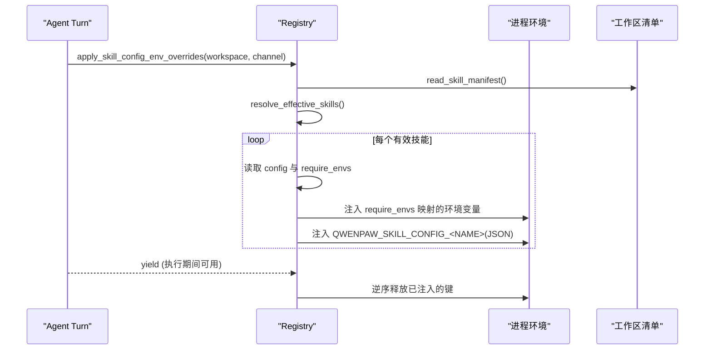
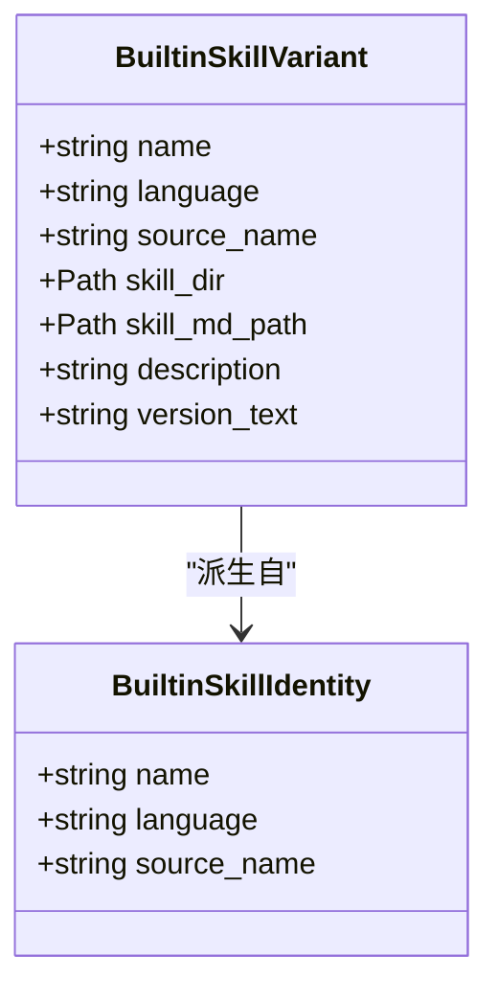
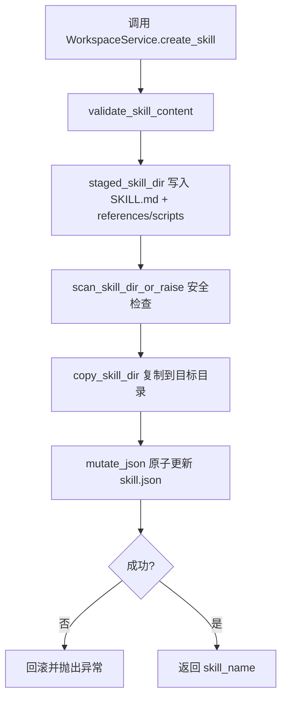
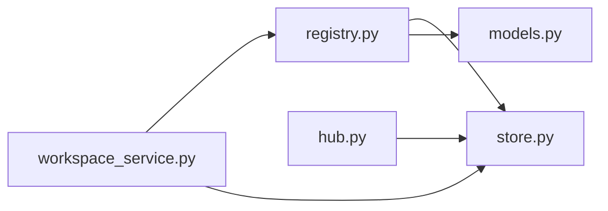

# 技能注册表

<cite>
**本文引用的文件**   
- [registry.py](file://tongtian-tauri/src/agent/agents/skill_system/registry.py)
- [store.py](file://tongtian-tauri/src/agent/agents/skill_system/store.py)
- [models.py](file://tongtian-tauri/src/agent/agents/skill_system/models.py)
- [workspace_service.py](file://tongtian-tauri/src/agent/agents/skill_system/workspace_service.py)
- [hub.py](file://tongtian-tauri/src/agent/agents/skill_system/hub.py)
</cite>

## 目录
1. [简介](#简介)
2. [项目结构](#项目结构)
3. [核心组件](#核心组件)
4. [架构总览](#架构总览)
5. [详细组件分析](#详细组件分析)
6. [依赖关系分析](#依赖关系分析)
7. [性能考虑](#性能考虑)
8. [故障排查指南](#故障排查指南)
9. [结论](#结论)
10. [附录](#附录)

## 简介
本文件系统性阐述“技能注册表”的实现原理与使用方式，覆盖以下关键主题：
- 技能发现算法：工作区技能目录扫描、池化内置技能发现、语言变体选择。
- 配置合并策略：工作区清单与文件系统的双向同步（reconcile），运行时按通道解析有效技能。
- 环境覆盖机制：基于技能声明的 require_envs 将配置注入进程环境变量，支持并发安全与生命周期管理。
- 核心函数：ensure_skills_initialized、resolve_effective_skills、reconcile_workspace_manifest 的作用与调用时机。
- 工作空间技能目录结构与清单格式：skill.json 字段说明、SKILL.md frontmatter 约定。
- 优先级规则与冲突处理：内置 vs 自定义、版本兼容、语言切换、导入冲突建议。
- 最佳实践：如何避免冲突、管理版本兼容性、安全地引入外部技能包。

## 项目结构
技能系统位于 tongtian-tauri/src/agent/agents/skill_system 下，主要模块职责如下：
- registry.py：注册表核心逻辑，包含清单同步、运行时解析、内置技能发现与环境覆盖。
- store.py：本地存储与清单读写、路径安全校验、元数据构建、原子写入与跨进程锁。
- models.py：共享数据结构与常量（如路由通道、技能需求模型）。
- workspace_service.py：工作区级技能生命周期服务（创建、保存、启用/禁用、导入等）。
- hub.py：技能市场客户端与网络下载、重试、缓存、取消钩子等。

图表来源 
- [registry.py:1036-1235](file://tongtian-tauri/src/agent/agents/skill_system/registry.py#L1036-L1235)
- [store.py:402-601](file://tongtian-tauri/src/agent/agents/skill_system/store.py#L402-L601)
- [models.py:1-81](file://tongtian-tauri/src/agent/agents/skill_system/models.py#L1-L81)
- [workspace_service.py:1-200](file://tongtian-tauri/src/agent/agents/skill_system/workspace_service.py#L1-L200)
- [hub.py:1-200](file://tongtian-tauri/src/agent/agents/skill_system/hub.py#L1-L200)

章节来源
- [registry.py:1036-1235](file://tongtian-tauri/src/agent/agents/skill_system/registry.py#L1036-L1235)
- [store.py:402-601](file://tongtian-tauri/src/agent/agents/skill_system/store.py#L402-L601)
- [models.py:1-81](file://tongtian-tauri/src/agent/agents/skill_system/models.py#L1-L81)
- [workspace_service.py:1-200](file://tongtian-tauri/src/agent/agents/skill_system/workspace_service.py#L1-L200)
- [hub.py:1-200](file://tongtian-tauri/src/agent/agents/skill_system/hub.py#L1-L200)

## 核心组件
- 清单与元数据
  - 工作区清单：schema_version 为 workspace-skill-manifest.v1，包含 version、skills 字典。
  - 池清单：schema_version 为 skill-pool-manifest.v1，包含 version、skills、builtin_skill_names。
  - 元数据由 SKILL.md frontmatter 与目录信息生成，含 description、version_text、requirements、updated_at 等。
- 运行时解析
  - resolve_effective_skills 根据 channel_name 过滤 enabled 且 channels 匹配的技能。
- 环境覆盖
  - apply_skill_config_env_overrides 将技能配置的 require_envs 映射为环境变量，并注入 QWENPAW_SKILL_CONFIG_<SKILL_NAME> 完整 JSON。
- 内置技能
  - 从打包内置目录发现语言变体，按用户偏好或配置选择语言；支持导入到池并维护 sync 状态。

章节来源
- [store.py:402-416](file://tongtian-tauri/src/agent/agents/skill_system/store.py#L402-L416)
- [store.py:636-661](file://tongtian-tauri/src/agent/agents/skill_system/store.py#L636-L661)
- [registry.py:1186-1207](file://tongtian-tauri/src/agent/agents/skill_system/registry.py#L1186-L1207)
- [registry.py:348-392](file://tongtian-tauri/src/agent/agents/skill_system/registry.py#L348-L392)
- [registry.py:155-236](file://tongtian-tauri/src/agent/agents/skill_system/registry.py#L155-L236)

## 架构总览
技能注册表围绕“文件系统即真相 + 清单即状态”的设计：
- 工作区 skills 目录存放实际技能内容（以 SKILL.md 标识）。
- 工作区 skill.json 记录运行时状态（enabled、channels、config、metadata 等）。
- 池 skill_pool/skill.json 记录内置技能的导入与同步状态。
- 运行时通过 reconcile 保证清单与文件系统一致，再按通道解析有效技能。

图表来源 
- [workspace_service.py:145-227](file://tongtian-tauri/src/agent/agents/skill_system/workspace_service.py#L145-L227)
- [registry.py:1036-1143](file://tongtian-tauri/src/agent/agents/skill_system/registry.py#L1036-L1143)
- [store.py:384-395](file://tongtian-tauri/src/agent/agents/skill_system/store.py#L384-L395)

## 详细组件分析

### 清单同步与运行时解析
- reconcile_workspace_manifest
  - 扫描 <workspace>/skills 下所有含 SKILL.md 的目录，忽略特定名称（如 ~ 前缀、常见缓存名）。
  - 保留用户状态（enabled、channels、config、tags、installed_from），重建 metadata 与 requirements。
  - 删除已不存在于磁盘的清单条目，确保清单与文件系统一致。
- resolve_effective_skills
  - 读取工作区清单，筛选 enabled=True 且 channels 包含 all 或当前 channel_name 的技能。
  - 仅当对应目录存在时加入结果集，保证运行时可用性。
- ensure_skills_initialized
  - 在运行前调用，确保清单存在并与文件系统同步。

图表来源 
- [registry.py:1036-1143](file://tongtian-tauri/src/agent/agents/skill_system/registry.py#L1036-L1143)
- [store.py:384-395](file://tongtian-tauri/src/agent/agents/skill_system/store.py#L384-L395)

章节来源
- [registry.py:1036-1143](file://tongtian-tauri/src/agent/agents/skill_system/registry.py#L1036-L1143)
- [registry.py:1186-1207](file://tongtian-tauri/src/agent/agents/skill_system/registry.py#L1186-L1207)
- [store.py:472-479](file://tongtian-tauri/src/agent/agents/skill_system/store.py#L472-L479)

### 环境覆盖机制（配置 -> 环境变量）
- apply_skill_config_env_overrides
  - 遍历 resolve_effective_skills 返回的有效技能，读取其 config 与 requirements.require_envs。
  - 将匹配的键值序列化为字符串注入进程环境变量，同时注入完整 JSON 变量 QWENPAW_SKILL_CONFIG_<SKILL_NAME>。
  - 使用线程锁保护 _ACTIVE_SKILL_ENV_ENTRIES，实现并发安全的 acquire/release，避免重复设置与泄漏。
- _build_skill_config_env_overrides
  - 仅对 require_envs 中声明的键进行注入，缺失键会记录警告日志。
- 生命周期
  - 上下文管理器确保 finally 阶段按逆序释放环境变量，恢复原状。

图表来源 
- [registry.py:348-392](file://tongtian-tauri/src/agent/agents/skill_system/registry.py#L348-L392)
- [registry.py:264-306](file://tongtian-tauri/src/agent/agents/skill_system/registry.py#L264-L306)

章节来源
- [registry.py:348-392](file://tongtian-tauri/src/agent/agents/skill_system/registry.py#L348-L392)
- [registry.py:264-306](file://tongtian-tauri/src/agent/agents/skill_system/registry.py#L264-L306)
- [models.py:66-71](file://tongtian-tauri/src/agent/agents/skill_system/models.py#L66-L71)

### 内置技能发现与语言变体选择
- 发现
  - 扫描打包内置目录（默认位于模块父级 skills），识别含 SKILL.md 的目录。
  - 目录命名约定：<name>-<language>（language ∈ {en, zh}）。
- 语言选择
  - 优先使用 entry.builtin_language，其次尝试 source_name 的语言，再次基于 SKILL.md 内容哈希匹配或 CJK 密度猜测，最后回退到用户偏好（settings.json 中的 builtin_skill_language 或 UI language）。
- 导入与同步
  - import_builtin_skills 将选定的语言变体复制到池目录，维护 builtin_language、builtin_source_name，并保留用户 config/tags/auto_update 等字段。
  - get_pool_builtin_sync_status 比较池内版本与打包内置版本，输出 synced/outdated 状态。

图表来源 
- [models.py:29-45](file://tongtian-tauri/src/agent/agents/skill_system/models.py#L29-L45)
- [registry.py:155-236](file://tongtian-tauri/src/agent/agents/skill_system/registry.py#L155-L236)
- [registry.py:399-457](file://tongtian-tauri/src/agent/agents/skill_system/registry.py#L399-L457)

章节来源
- [registry.py:155-236](file://tongtian-tauri/src/agent/agents/skill_system/registry.py#L155-L236)
- [registry.py:399-457](file://tongtian-tauri/src/agent/agents/skill_system/registry.py#L399-L457)
- [registry.py:662-800](file://tongtian-tauri/src/agent/agents/skill_system/registry.py#L662-L800)
- [registry.py:1214-1283](file://tongtian-tauri/src/agent/agents/skill_system/registry.py#L1214-L1283)

### 工作区技能生命周期（创建/保存/导入/启用）
- create_skill：校验内容 -> 暂存目录写入 -> 安全扫描 -> 复制至目标 -> 原子更新清单。
- save_skill：原地编辑或重命名保存，冲突时提供建议名称。
- import_from_zip：解压校验 -> 冲突检测 -> 批量导入 -> 可选启用 -> 标记 installed_from=zip。
- enable/disable/set_channels/set_tags：原子更新清单状态。
- delete_skill：仅允许删除未启用的技能，清理目录并移除清单条目。

图表来源 
- [workspace_service.py:145-227](file://tongtian-tauri/src/agent/agents/skill_system/workspace_service.py#L145-L227)
- [store.py:384-395](file://tongtian-tauri/src/agent/agents/skill_system/store.py#L384-L395)

章节来源
- [workspace_service.py:145-227](file://tongtian-tauri/src/agent/agents/skill_system/workspace_service.py#L145-L227)
- [workspace_service.py:229-442](file://tongtian-tauri/src/agent/agents/skill_system/workspace_service.py#L229-L442)
- [workspace_service.py:444-553](file://tongtian-tauri/src/agent/agents/skill_system/workspace_service.py#L444-L553)
- [workspace_service.py:554-750](file://tongtian-tauri/src/agent/agents/skill_system/workspace_service.py#L554-L750)

### 清单文件格式与字段说明
- 工作区清单（skill.json）
  - schema_version: "workspace-skill-manifest.v1"
  - version: 版本号（递增）
  - skills: 技能条目字典，键为技能目录名
    - enabled: 是否启用
    - channels: 作用通道（all 或具体通道名）
    - source: "builtin" | "customized"
    - installed_from: 来源标记（如 zip）
    - config: 用户配置（按需注入环境变量）
    - metadata: 描述、版本、requirements、更新时间等
    - tags: 用户标签
- 池清单（skill_pool/skill.json）
  - schema_version: "skill-pool-manifest.v1"
  - version: 版本号
  - skills: 技能条目（内置技能含 builtin_language、builtin_source_name）
  - builtin_skill_names: 内置技能名称集合（用于变更通知）

章节来源
- [store.py:402-416](file://tongtian-tauri/src/agent/agents/skill_system/store.py#L402-L416)
- [store.py:636-661](file://tongtian-tauri/src/agent/agents/skill_system/store.py#L636-L661)
- [registry.py:1036-1143](file://tongtian-tauri/src/agent/agents/skill_system/registry.py#L1036-L1143)

### 优先级规则与冲突处理
- 优先级
  - 工作区清单优先于文件系统：reconcile 保留用户状态，仅刷新元数据。
  - 运行时解析优先 enabled 且 channels 匹配的技能。
  - 内置 vs 自定义：若清单已有 source=builtin，则保持内置槽位；同名自定义副本仍视为 customized。
- 冲突处理
  - 导入冲突：suggest_conflict_name 生成带时间戳的建议名称，避免重复后缀。
  - 内置语言切换：若当前语言与请求语言不同，标记为 language_switch，需用户确认。
  - 版本兼容：对比 current_version_text 与 packaged version_text，标记 outdated。

章节来源
- [store.py:671-692](file://tongtian-tauri/src/agent/agents/skill_system/store.py#L671-L692)
- [registry.py:618-655](file://tongtian-tauri/src/agent/agents/skill_system/registry.py#L618-L655)
- [registry.py:1435-1510](file://tongtian-tauri/src/agent/agents/skill_system/registry.py#L1435-L1510)

## 依赖关系分析
- registry 依赖 store 进行清单读写与元数据构建，依赖 models 获取常量与数据类型。
- workspace_service 依赖 registry 与 store 完成工作区技能的生命周期操作。
- hub 提供网络能力，供市场侧安装与下载，最终落盘后由 store/registry 管理清单与状态。

图表来源 
- [registry.py:1-60](file://tongtian-tauri/src/agent/agents/skill_system/registry.py#L1-L60)
- [store.py:1-50](file://tongtian-tauri/src/agent/agents/skill_system/store.py#L1-L50)
- [models.py:1-30](file://tongtian-tauri/src/agent/agents/skill_system/models.py#L1-L30)
- [workspace_service.py:1-40](file://tongtian-tauri/src/agent/agents/skill_system/workspace_service.py#L1-L40)
- [hub.py:1-40](file://tongtian-tauri/src/agent/agents/skill_system/hub.py#L1-L40)

章节来源
- [registry.py:1-60](file://tongtian-tauri/src/agent/agents/skill_system/registry.py#L1-L60)
- [store.py:1-50](file://tongtian-tauri/src/agent/agents/skill_system/store.py#L1-L50)
- [models.py:1-30](file://tongtian-tauri/src/agent/agents/skill_system/models.py#L1-L30)
- [workspace_service.py:1-40](file://tongtian-tauri/src/agent/agents/skill_system/workspace_service.py#L1-L40)
- [hub.py:1-40](file://tongtian-tauri/src/agent/agents/skill_system/hub.py#L1-L40)

## 性能考虑
- 清单读取采用 mtime 缓存（_read_json_mtime_cached），减少频繁 IO。
- 原子写入（write_json_atomic）+ 跨进程锁（fcntl/msvcrt）保障并发安全。
- 内置语言偏好与注册表缓存（_builtin_cache）降低重复计算。
- 环境变量注入使用线程锁与引用计数，避免重复设置与泄漏。
- HTTP 层具备超时、重试、指数退避与连接池，提升稳定性。

章节来源
- [store.py:751-776](file://tongtian-tauri/src/agent/agents/skill_system/store.py#L751-L776)
- [store.py:359-395](file://tongtian-tauri/src/agent/agents/skill_system/store.py#L359-L395)
- [registry.py:80-117](file://tongtian-tauri/src/agent/agents/skill_system/registry.py#L80-L117)
- [registry.py:308-345](file://tongtian-tauri/src/agent/agents/skill_system/registry.py#L308-L345)
- [hub.py:351-408](file://tongtian-tauri/src/agent/agents/skill_system/hub.py#L351-L408)

## 故障排查指南
- 清单损坏或格式错误
  - 现象：读取失败或字段异常。
  - 处理：系统自动回退到默认清单并记录警告；检查 skill.json 完整性。
- 技能目录缺失或权限问题
  - 现象：resolve_effective_skills 不返回该技能。
  - 处理：确认 <workspace>/skills/<name>/SKILL.md 存在且可读。
- 环境变量未生效
  - 现象：技能无法读取所需环境变量。
  - 处理：检查 require_envs 声明与 config 键名一致性；确认 apply_skill_config_env_overrides 被调用。
- 导入冲突
  - 现象：import_from_zip 返回 conflicts。
  - 处理：使用 suggested_name 重命名或覆盖（overwrite）。
- 内置语言切换
  - 现象：语言与当前不一致导致冲突。
  - 处理：确认 builtin_language 或 source_name，必要时用户确认。

章节来源
- [store.py:344-357](file://tongtian-tauri/src/agent/agents/skill_system/store.py#L344-L357)
- [registry.py:1186-1207](file://tongtian-tauri/src/agent/agents/skill_system/registry.py#L1186-L1207)
- [registry.py:348-392](file://tongtian-tauri/src/agent/agents/skill_system/registry.py#L348-L392)
- [workspace_service.py:444-553](file://tongtian-tauri/src/agent/agents/skill_system/workspace_service.py#L444-L553)
- [registry.py:618-655](file://tongtian-tauri/src/agent/agents/skill_system/registry.py#L618-L655)

## 结论
技能注册表通过“文件系统 + 清单”的双源设计，实现了可编辑性与运行时稳定性的平衡。reconcile 保证清单与目录一致，resolve_effective_skills 提供通道感知的有效技能集合，环境覆盖机制让配置注入既安全又可控。内置技能的多语言变体与导入流程，配合冲突与建议名称机制，提升了用户体验与可维护性。遵循本文的最佳实践，可有效避免冲突、管理版本兼容性并确保安全部署。

## 附录
- 工作空间技能目录结构示例
  - <workspace>/skills/<skill_name>/SKILL.md
  - <workspace>/skills/<skill_name>/references/*（可选）
  - <workspace>/skills/<skill_name>/scripts/*（可选）
  - <workspace>/skill.json（清单）
- 清单字段速查
  - enabled: 布尔，是否启用
  - channels: 数组，all 或通道名
  - source: builtin/customized
  - config: 对象，按需注入环境变量
  - metadata.description/version_text/requirements.updated_at
- 环境变量命名
  - QWENPAW_SKILL_CONFIG_<SKILL_NAME>: 完整配置 JSON
  - 其他键来自 require_envs 声明

[本节为概念性补充，无需源码引用]