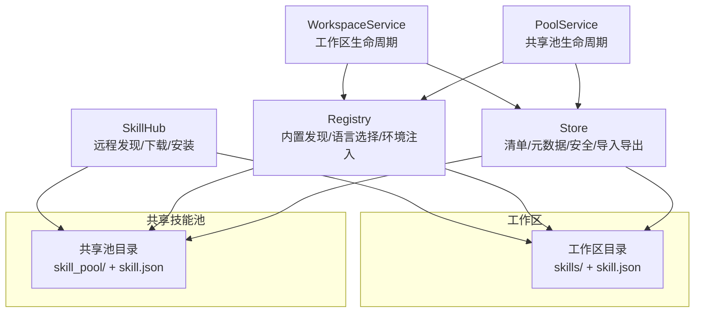
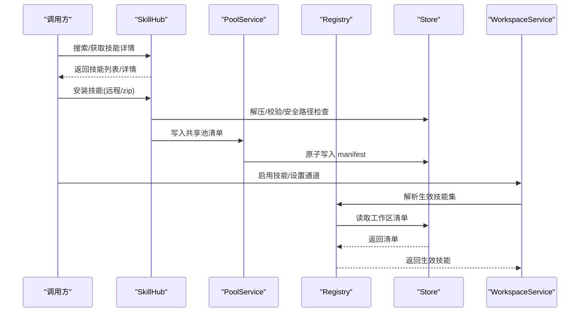
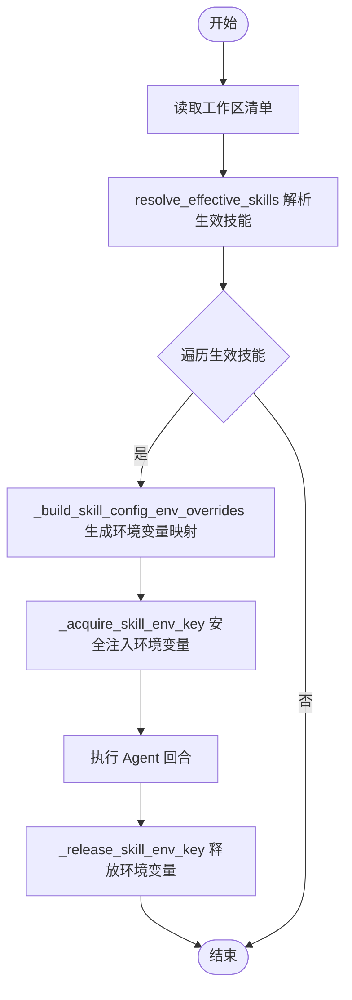
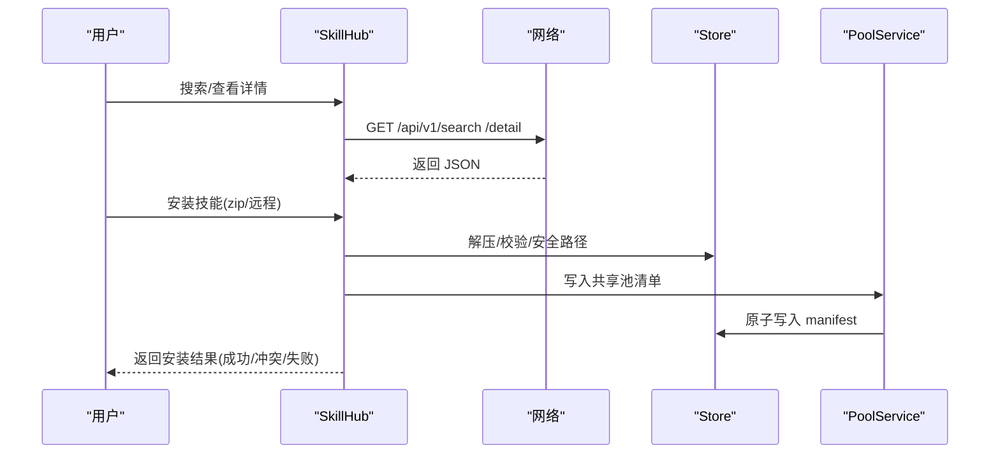
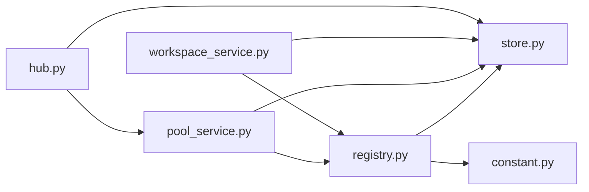

# 技能系统

<cite>
**本文引用的文件**
- [tongtian-tauri/src/agent/agents/skill_system/__init__.py](file://tongtian-tauri/src/agent/agents/skill_system/__init__.py)
- [tongtian-tauri/src/agent/agents/skill_system/hub.py](file://tongtian-tauri/src/agent/agents/skill_system/hub.py)
- [tongtian-tauri/src/agent/agents/skill_system/models.py](file://tongtian-tauri/src/agent/agents/skill_system/models.py)
- [tongtian-tauri/src/agent/agents/skill_system/registry.py](file://tongtian-tauri/src/agent/agents/skill_system/registry.py)
- [tongtian-tauri/src/agent/agents/skill_system/store.py](file://tongtian-tauri/src/agent/agents/skill_system/store.py)
- [tongtian-tauri/src/agent/agents/skill_system/workspace_service.py](file://tongtian-tauri/src/agent/agents/skill_system/workspace_service.py)
- [tongtian-tauri/src/agent/agents/skill_system/pool_service.py](file://tongtian-tauri/src/agent/agents/skill_system/pool_service.py)
- [tongtian-tauri/src/agent/constant.py](file://tongtian-tauri/src/agent/constant.py)
</cite>

## 目录
1. [简介](#简介)
2. [项目结构](#项目结构)
3. [核心组件](#核心组件)
4. [架构总览](#架构总览)
5. [详细组件分析](#详细组件分析)
6. [依赖关系分析](#依赖关系分析)
7. [性能与可靠性](#性能与可靠性)
8. [故障排查指南](#故障排查指南)
9. [结论](#结论)
10. [附录：开发指南](#附录开发指南)

## 简介
本文件系统性地说明技能系统的注册机制、动态加载原理、以及技能与工具的集成方式。重点覆盖 SkillHub 的管理能力（发现、验证、生命周期）、工作空间技能目录结构、权限与安全控制，并提供创建自定义技能、注册新技能类型、测试与调试的实践指南。

## 项目结构
技能系统位于 agent 子模块的 skill_system 包中，围绕“共享技能池 + 工作空间技能”的双层模型组织：
- 共享技能池：WORKING_DIR/skill_pool，用于跨工作区复用、内置技能同步与版本管理。
- 工作区技能：每个工作区的 skills 目录，作为该工作区可编辑技能的来源；skill.json 为运行时状态（启用、通道、配置等）。
- Hub：负责从远程源（如 ClawHub、GitHub、Zip 等）下载、校验、安装技能到本地池或工作区。
- Registry：负责内置技能发现、语言偏好选择、环境注入、工作区清单协调。
- Store：提供清单读写、原子写入、路径安全、ZIP 导入导出、元数据构建等基础能力。
- WorkspaceService / PoolService：面向工作区和共享池的生命周期服务（创建、导入、启用/禁用、标签、自动更新等）。

图表来源
- [tongtian-tauri/src/agent/agents/skill_system/hub.py:1-120](file://tongtian-tauri/src/agent/agents/skill_system/hub.py#L1-L120)
- [tongtian-tauri/src/agent/agents/skill_system/registry.py:155-240](file://tongtian-tauri/src/agent/agents/skill_system/registry.py#L155-L240)
- [tongtian-tauri/src/agent/agents/skill_system/store.py:58-134](file://tongtian-tauri/src/agent/agents/skill_system/store.py#L58-L134)
- [tongtian-tauri/src/agent/agents/skill_system/workspace_service.py:88-143](file://tongtian-tauri/src/agent/agents/skill_system/workspace_service.py#L88-L143)
- [tongtian-tauri/src/agent/agents/skill_system/pool_service.py:121-160](file://tongtian-tauri/src/agent/agents/skill_system/pool_service.py#L121-L160)

章节来源
- [tongtian-tauri/src/agent/agents/skill_system/__init__.py:1-46](file://tongtian-tauri/src/agent/agents/skill_system/__init__.py#L1-L46)
- [tongtian-tauri/src/agent/constant.py:100-122](file://tongtian-tauri/src/agent/constant.py#L100-L122)

## 核心组件
- SkillInfo：对外暴露的技能信息模型，包含名称、描述、版本、内容、来源、引用、脚本、表情等。
- SkillRequirements：声明技能运行所需的二进制与环境变量。
- Registry：内置技能发现、语言偏好、环境注入、工作区清单协调。
- Store：清单与元数据、路径安全、ZIP 导入、原子写入、扫描校验。
- WorkspaceService：工作区技能 CRUD、启用/禁用、通道范围、配置持久化、文件访问。
- PoolService：共享池技能 CRUD、批量导入、自动更新、跨工作区重命名迁移。
- Hub：远程技能发现、下载、安装、冲突处理、重试与缓存。

章节来源
- [tongtian-tauri/src/agent/agents/skill_system/models.py:47-81](file://tongtian-tauri/src/agent/agents/skill_system/models.py#L47-L81)
- [tongtian-tauri/src/agent/agents/skill_system/registry.py:243-392](file://tongtian-tauri/src/agent/agents/skill_system/registry.py#L243-L392)
- [tongtian-tauri/src/agent/agents/skill_system/store.py:315-395](file://tongtian-tauri/src/agent/agents/skill_system/store.py#L315-L395)
- [tongtian-tauri/src/agent/agents/skill_system/workspace_service.py:88-143](file://tongtian-tauri/src/agent/agents/skill_system/workspace_service.py#L88-L143)
- [tongtian-tauri/src/agent/agents/skill_system/pool_service.py:121-160](file://tongtian-tauri/src/agent/agents/skill_system/pool_service.py#L121-L160)
- [tongtian-tauri/src/agent/agents/skill_system/hub.py:40-120](file://tongtian-tauri/src/agent/agents/skill_system/hub.py#L40-L120)

## 架构总览
技能系统采用“清单驱动 + 文件系统为主”的设计：
- 清单（manifest）：工作区 skill.json 与共享池 skill.json 记录运行时状态与元数据。
- 文件系统：SKILL.md 是技能的核心文档与 frontmatter 来源；references/scripts 目录承载引用与脚本。
- 动态加载：通过 resolve_effective_skills 按通道与工作区清单解析当前生效技能集合，并在执行时注入环境变量。
- 生命周期：创建/导入/启用/禁用/删除/重命名/自动更新，均由 WorkspaceService/PoolService 编排，底层由 Store 保证一致性与安全。

图表来源
- [tongtian-tauri/src/agent/agents/skill_system/hub.py:507-688](file://tongtian-tauri/src/agent/agents/skill_system/hub.py#L507-L688)
- [tongtian-tauri/src/agent/agents/skill_system/store.py:359-395](file://tongtian-tauri/src/agent/agents/skill_system/store.py#L359-L395)
- [tongtian-tauri/src/agent/agents/skill_system/workspace_service.py:554-625](file://tongtian-tauri/src/agent/agents/skill_system/workspace_service.py#L554-L625)
- [tongtian-tauri/src/agent/agents/skill_system/registry.py:347-392](file://tongtian-tauri/src/agent/agents/skill_system/registry.py#L347-L392)

## 详细组件分析

### 技能模型与清单
- SkillInfo：对外统一输出，name 稳定且来自目录名，避免 frontmatter 漂移影响运行时标识。
- SkillRequirements：支持 require_bins 与 require_envs，供运行时环境与工具链准备。
- 清单结构：
  - 工作区：schema_version、version、skills（每项含 enabled/channels/source/config/metadata/requirements/updated_at）。
  - 共享池：额外包含 builtin_skill_names、auto_update 相关字段。

章节来源
- [tongtian-tauri/src/agent/agents/skill_system/models.py:47-81](file://tongtian-tauri/src/agent/agents/skill_system/models.py#L47-L81)
- [tongtian-tauri/src/agent/agents/skill_system/store.py:402-416](file://tongtian-tauri/src/agent/agents/skill_system/store.py#L402-L416)
- [tongtian-tauri/src/agent/agents/skill_system/workspace_service.py:41-86](file://tongtian-tauri/src/agent/agents/skill_system/workspace_service.py#L41-L86)

### 工作区技能目录结构
- 根目录：<workspace>/skills/<skill_name>/SKILL.md
- 可选目录：
  - references：技能参考资源树（UI 展示与按需加载）
  - scripts：脚本资源树（受安全策略限制访问）
- 清单：<workspace>/skill.json 记录启用状态、通道范围、配置、元数据等。

章节来源
- [tongtian-tauri/src/agent/agents/skill_system/store.py:65-82](file://tongtian-tauri/src/agent/agents/skill_system/store.py#L65-L82)
- [tongtian-tauri/src/agent/agents/skill_system/store.py:807-851](file://tongtian-tauri/src/agent/agents/skill_system/store.py#L807-L851)
- [tongtian-tauri/src/agent/agents/skill_system/workspace_service.py:751-782](file://tongtian-tauri/src/agent/agents/skill_system/workspace_service.py#L751-L782)

### 技能注册机制与动态加载
- 注册入口：
  - 工作区：WorkspaceService.create_skill/save_skill/import_from_zip 将技能写入 <workspace>/skills 并更新 skill.json。
  - 共享池：PoolService.create_skill/import_from_zip 将技能写入 skill_pool 并更新 pool manifest。
- 动态加载：
  - resolve_effective_skills 根据工作区清单与通道过滤得到当前生效技能集合。
  - apply_skill_config_env_overrides 在单次 Agent 回合中将匹配 require_envs 的配置注入为环境变量，并将完整配置以 JSON 字符串形式注入到 QWENPAW_SKILL_CONFIG_<SKILL_NAME>。
- 内置技能：
  - registry 扫描 packaged builtins，按语言偏好选择变体，支持冲突检测与覆盖策略。

图表来源
- [tongtian-tauri/src/agent/agents/skill_system/registry.py:347-392](file://tongtian-tauri/src/agent/agents/skill_system/registry.py#L347-L392)
- [tongtian-tauri/src/agent/agents/skill_system/registry.py:248-345](file://tongtian-tauri/src/agent/agents/skill_system/registry.py#L248-L345)

章节来源
- [tongtian-tauri/src/agent/agents/skill_system/workspace_service.py:145-227](file://tongtian-tauri/src/agent/agents/skill_system/workspace_service.py#L145-L227)
- [tongtian-tauri/src/agent/agents/skill_system/pool_service.py:162-235](file://tongtian-tauri/src/agent/agents/skill_system/pool_service.py#L162-L235)
- [tongtian-tauri/src/agent/agents/skill_system/registry.py:155-240](file://tongtian-tauri/src/agent/agents/skill_system/registry.py#L155-L240)

### 技能与工具的集成方式
- 工具调用上下文：技能通过 SKILL.md 描述能力，结合 workspace 清单中的 channels 控制可用渠道（console、discord、dingtalk 等）。
- 环境变量注入：技能所需的环境变量在 Agent 回合期间注入，确保工具链可用。
- 安全访问：技能内部 files 访问需通过 WorkspaceService.load_skill_file，仅允许 references/scripts 下的相对路径，防止越权。

章节来源
- [tongtian-tauri/src/agent/agents/skill_system/models.py:15-26](file://tongtian-tauri/src/agent/agents/skill_system/models.py#L15-L26)
- [tongtian-tauri/src/agent/agents/skill_system/workspace_service.py:751-782](file://tongtian-tauri/src/agent/agents/skill_system/workspace_service.py#L751-L782)
- [tongtian-tauri/src/agent/agents/skill_system/registry.py:347-392](file://tongtian-tauri/src/agent/agents/skill_system/registry.py#L347-L392)

### SkillHub 管理功能（发现、验证、生命周期）
- 发现：支持多来源（skills-sh、github、lobehub、qwenpaw、modelscope、aliyun、skillsmp、clawhub、url、zip），通过 _http_json_get/_http_text_get 拉取列表与详情。
- 验证：对响应大小、内容长度进行限制；对 zip 进行路径安全与符号链接检查；frontmatter 校验 name/description。
- 生命周期：
  - 安装：下载到临时目录，校验后复制到目标（pool 或 workspace），更新清单。
  - 冲突：当同名已存在时，建议带时间戳的新名称或提示覆盖。
  - 重试与缓存：HTTP 请求具备指数退避重试；GitHub 响应有 LRU 缓存与键级锁，避免并发风暴。
  - 取消：支持用户中断导入流程。

图表来源
- [tongtian-tauri/src/agent/agents/skill_system/hub.py:200-236](file://tongtian-tauri/src/agent/agents/skill_system/hub.py#L200-L236)
- [tongtian-tauri/src/agent/agents/skill_system/hub.py:507-688](file://tongtian-tauri/src/agent/agents/skill_system/hub.py#L507-L688)
- [tongtian-tauri/src/agent/agents/skill_system/store.py:482-503](file://tongtian-tauri/src/agent/agents/skill_system/store.py#L482-L503)
- [tongtian-tauri/src/agent/agents/skill_system/pool_service.py:237-351](file://tongtian-tauri/src/agent/agents/skill_system/pool_service.py#L237-L351)

章节来源
- [tongtian-tauri/src/agent/agents/skill_system/hub.py:40-120](file://tongtian-tauri/src/agent/agents/skill_system/hub.py#L40-L120)
- [tongtian-tauri/src/agent/agents/skill_system/hub.py:265-346](file://tongtian-tauri/src/agent/agents/skill_system/hub.py#L265-L346)
- [tongtian-tauri/src/agent/agents/skill_system/hub.py:413-638](file://tongtian-tauri/src/agent/agents/skill_system/hub.py#L413-L638)

### 权限控制与安全
- 路径安全：safe_skill_dir、_safe_child_path 拒绝绝对路径与越界路径；zip 解压禁止符号链接与越界路径。
- 内容校验：validate_skill_content 要求 SKILL.md frontmatter 包含非空 name 与 description，metadata 必须为 dict。
- 扫描策略：scan_skill_dir_or_raise 调用安全扫描器，阻止危险模式（命令注入、数据泄露、硬编码密钥等）。
- 文件访问限制：load_skill_file 仅允许 references/scripts 下的相对路径，防止任意文件读取。

章节来源
- [tongtian-tauri/src/agent/agents/skill_system/store.py:505-556](file://tongtian-tauri/src/agent/agents/skill_system/store.py#L505-L556)
- [tongtian-tauri/src/agent/agents/skill_system/store.py:853-874](file://tongtian-tauri/src/agent/agents/skill_system/store.py#L853-L874)
- [tongtian-tauri/src/agent/agents/skill_system/store.py:968-969](file://tongtian-tauri/src/agent/agents/skill_system/store.py#L968-L969)
- [tongtian-tauri/src/agent/agents/skill_system/workspace_service.py:751-782](file://tongtian-tauri/src/agent/agents/skill_system/workspace_service.py#L751-L782)

### 工作区技能清单协调与内置技能导入
- 协调：reconcile_workspace_manifest 将工作区 skills 目录与 skill.json 保持一致，处理新增/删除/变更。
- 内置导入：import_builtin_skills 将打包内置技能复制到共享池，维护 builtin_language/builtin_source_name，支持冲突检测与覆盖策略。

章节来源
- [tongtian-tauri/src/agent/agents/skill_system/registry.py:662-800](file://tongtian-tauri/src/agent/agents/skill_system/registry.py#L662-L800)

## 依赖关系分析
- 模块耦合：
  - WorkspaceService/PoolService 依赖 Store（清单/元数据/安全）与 Registry（内置/环境注入）。
  - Hub 依赖 Store（解压/校验/路径安全）与 PoolService（写入共享池）。
  - Registry 依赖 Store（清单/元数据）与常量（工作区路径）。
- 外部依赖：
  - httpx：异步 HTTP 客户端，支持重试、超时、流式读取。
  - frontmatter/yaml：解析 SKILL.md frontmatter。
  - 平台文件锁：fcntl/msvcrt 实现跨进程清单原子写入。

图表来源
- [tongtian-tauri/src/agent/agents/skill_system/hub.py:1-36](file://tongtian-tauri/src/agent/agents/skill_system/hub.py#L1-L36)
- [tongtian-tauri/src/agent/agents/skill_system/workspace_service.py:1-39](file://tongtian-tauri/src/agent/agents/skill_system/workspace_service.py#L1-L39)
- [tongtian-tauri/src/agent/agents/skill_system/pool_service.py:1-49](file://tongtian-tauri/src/agent/agents/skill_system/pool_service.py#L1-L49)
- [tongtian-tauri/src/agent/agents/skill_system/registry.py:1-47](file://tongtian-tauri/src/agent/agents/skill_system/registry.py#L1-L47)
- [tongtian-tauri/src/agent/constant.py:100-122](file://tongtian-tauri/src/agent/constant.py#L100-L122)

章节来源
- [tongtian-tauri/src/agent/agents/skill_system/__init__.py:1-46](file://tongtian-tauri/src/agent/agents/skill_system/__init__.py#L1-L46)

## 性能与可靠性
- 并发与缓存：
  - GitHub 响应 LRU 缓存，键级锁避免并发重复请求。
  - 共享 httpx 客户端连接池与重试策略，提升稳定性。
- 原子写入：
  - 清单写入使用临时文件 + replace 原子操作，配合跨进程文件锁，保证一致性。
- 资源限制：
  - ZIP 解压限制最大体积，防止内存耗尽。
  - HTTP 响应长度限制，防止超大响应。
- 取消与优雅关闭：
  - 支持导入过程的用户取消；共享客户端关闭前等待进行中请求完成。

章节来源
- [tongtian-tauri/src/agent/agents/skill_system/hub.py:265-346](file://tongtian-tauri/src/agent/agents/skill_system/hub.py#L265-L346)
- [tongtian-tauri/src/agent/agents/skill_system/hub.py:351-408](file://tongtian-tauri/src/agent/agents/skill_system/hub.py#L351-L408)
- [tongtian-tauri/src/agent/agents/skill_system/store.py:359-395](file://tongtian-tauri/src/agent/agents/skill_system/store.py#L359-L395)
- [tongtian-tauri/src/agent/agents/skill_system/store.py:482-503](file://tongtian-tauri/src/agent/agents/skill_system/store.py#L482-L503)

## 故障排查指南
- 常见错误与定位：
  - 清单损坏：read_json 遇到 JSONDecodeError 会重置为默认清单并记录日志。
  - 路径不安全：safe_skill_dir/_safe_child_path 抛出异常，检查传入名称是否包含路径分隔符或越界。
  - ZIP 非法：extract_zip_skills 校验是否为有效 zip，是否存在合法技能目录。
  - 前端显示为空：read_skill_from_dir 需要 SKILL.md 存在且 frontmatter 有效，否则返回 None。
- 调试建议：
  - 查看工作区 skill.json 与共享池 skill.json 的版本号与更新时间。
  - 检查 SKILL.md 的 frontmatter 是否包含 name 与 description。
  - 确认环境变量注入是否正确（QWENPAW_SKILL_CONFIG_<SKILL_NAME>）。
  - 使用 Hub 的日志与重试信息定位网络问题。

章节来源
- [tongtian-tauri/src/agent/agents/skill_system/store.py:344-357](file://tongtian-tauri/src/agent/agents/skill_system/store.py#L344-L357)
- [tongtian-tauri/src/agent/agents/skill_system/store.py:505-556](file://tongtian-tauri/src/agent/agents/skill_system/store.py#L505-L556)
- [tongtian-tauri/src/agent/agents/skill_system/store.py:923-965](file://tongtian-tauri/src/agent/agents/skill_system/store.py#L923-L965)
- [tongtian-tauri/src/agent/agents/skill_system/store.py:807-851](file://tongtian-tauri/src/agent/agents/skill_system/store.py#L807-L851)

## 结论
技能系统通过清晰的清单驱动与文件系统主数据模型，实现了跨工作区共享、内置技能管理与远程技能安装的全生命周期管理。其安全策略（路径校验、内容校验、扫描策略）与可靠性设计（原子写入、重试与缓存、取消支持）确保了在生产环境中的稳定运行。开发者可基于 WorkspaceService/PoolService 快速扩展技能能力，并通过 Registry 的环境注入机制与工具链无缝集成。

## 附录：开发指南

### 如何创建自定义技能
- 在工作区目录下创建 skills/<skill_name>/SKILL.md，确保 frontmatter 包含 name 与 description。
- 可选添加 references/scripts 目录存放资源与脚本。
- 使用 WorkspaceService.create_skill 或 import_from_zip 创建/导入技能，随后通过 enable_skill 启用并按需设置 channels。

章节来源
- [tongtian-tauri/src/agent/agents/skill_system/workspace_service.py:145-227](file://tongtian-tauri/src/agent/agents/skill_system/workspace_service.py#L145-L227)
- [tongtian-tauri/src/agent/agents/skill_system/workspace_service.py:554-625](file://tongtian-tauri/src/agent/agents/skill_system/workspace_service.py#L554-L625)
- [tongtian-tauri/src/agent/agents/skill_system/store.py:902-921](file://tongtian-tauri/src/agent/agents/skill_system/store.py#L902-L921)

### 如何注册新技能类型
- 在 Registry 中扩展内置技能发现逻辑，遵循 name-language 命名约定（如 docx-en/docx-zh）。
- 使用 import_builtin_skills 将内置技能复制到共享池，维护 builtin_language/builtin_source_name。
- 如需新增通道，扩展 ALL_SKILL_ROUTING_CHANNELS 并在 resolve_effective_skills 中考虑通道过滤。

章节来源
- [tongtian-tauri/src/agent/agents/skill_system/models.py:15-26](file://tongtian-tauri/src/agent/agents/skill_system/models.py#L15-L26)
- [tongtian-tauri/src/agent/agents/skill_system/registry.py:155-240](file://tongtian-tauri/src/agent/agents/skill_system/registry.py#L155-L240)
- [tongtian-tauri/src/agent/agents/skill_system/registry.py:662-800](file://tongtian-tauri/src/agent/agents/skill_system/registry.py#L662-L800)

### 技能的测试与调试方法
- 单元测试：
  - 验证 validate_skill_content 对非法 frontmatter 的处理。
  - 验证 safe_skill_dir/_safe_child_path 对不安全路径的拒绝。
  - 验证 extract_zip_skills 对非法 zip 与无技能目录的处理。
- 集成测试：
  - 使用 WorkspaceService.import_from_zip 导入多技能 zip，检查 conflicts 与 imported 列表。
  - 使用 PoolService.set_skill_auto_update 开启自动更新，验证 run_pool_auto_update_sync 的行为。
- 调试技巧：
  - 打印工作区 skill.json 与共享池 skill.json 的变化。
  - 检查环境变量注入（QWENPAW_SKILL_CONFIG_<SKILL_NAME>）是否符合预期。
  - 使用 Hub 的日志与重试信息定位网络问题。

章节来源
- [tongtian-tauri/src/agent/agents/skill_system/store.py:853-874](file://tongtian-tauri/src/agent/agents/skill_system/store.py#L853-L874)
- [tongtian-tauri/src/agent/agents/skill_system/store.py:505-556](file://tongtian-tauri/src/agent/agents/skill_system/store.py#L505-L556)
- [tongtian-tauri/src/agent/agents/skill_system/store.py:923-965](file://tongtian-tauri/src/agent/agents/skill_system/store.py#L923-L965)
- [tongtian-tauri/src/agent/agents/skill_system/pool_service.py:417-458](file://tongtian-tauri/src/agent/agents/skill_system/pool_service.py#L417-L458)