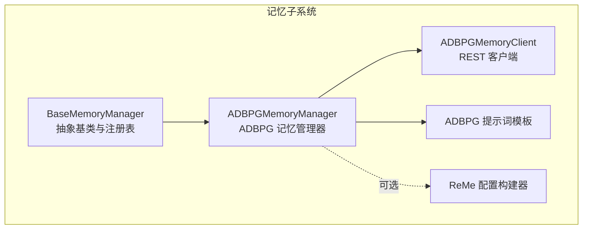
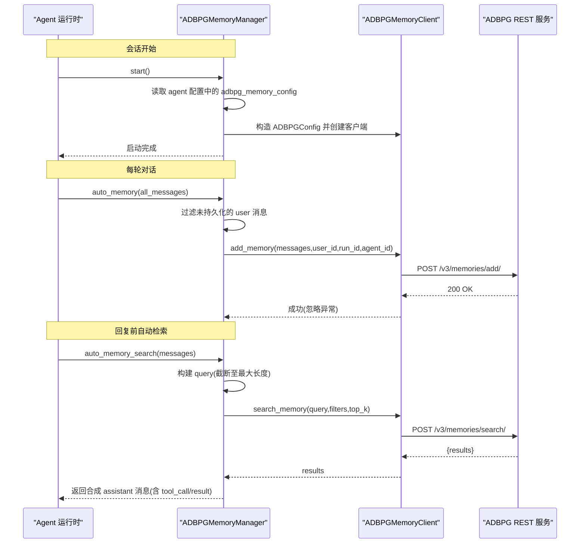
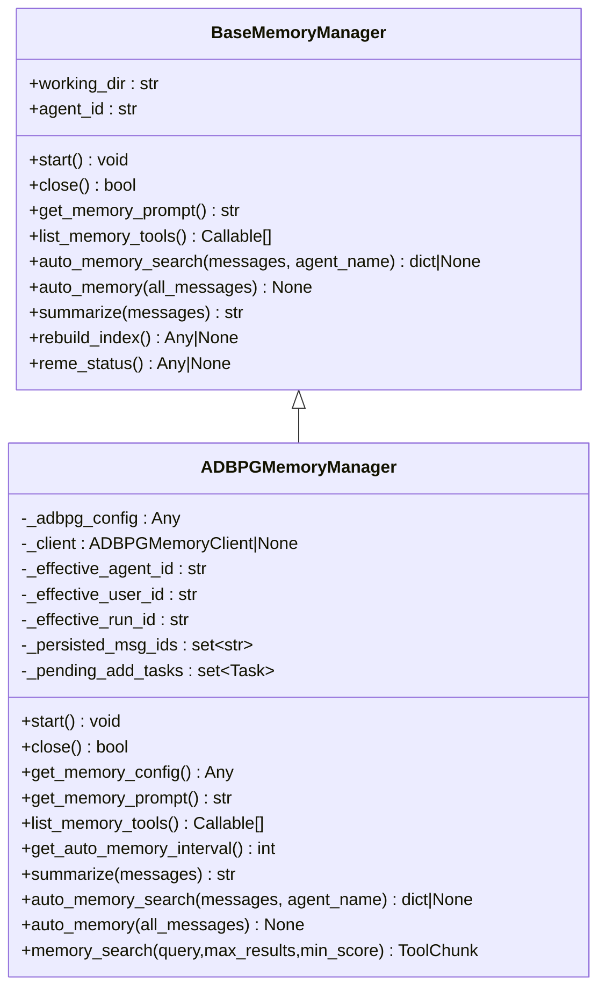
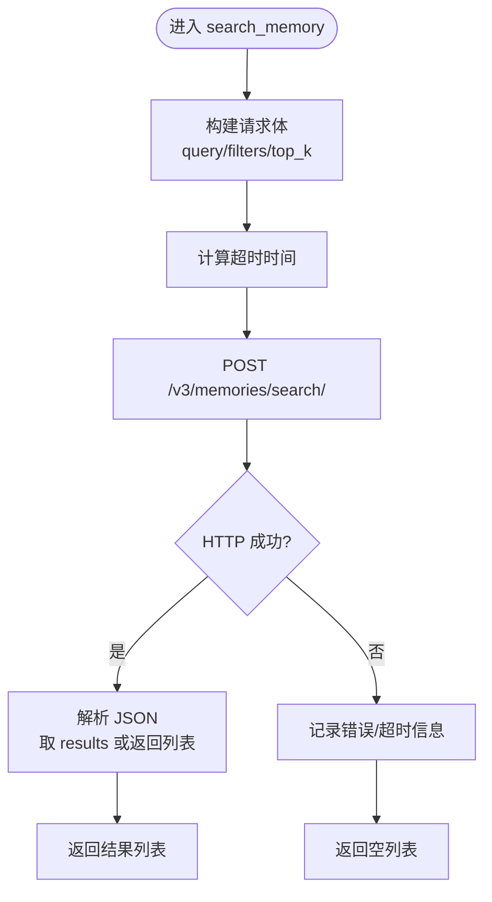
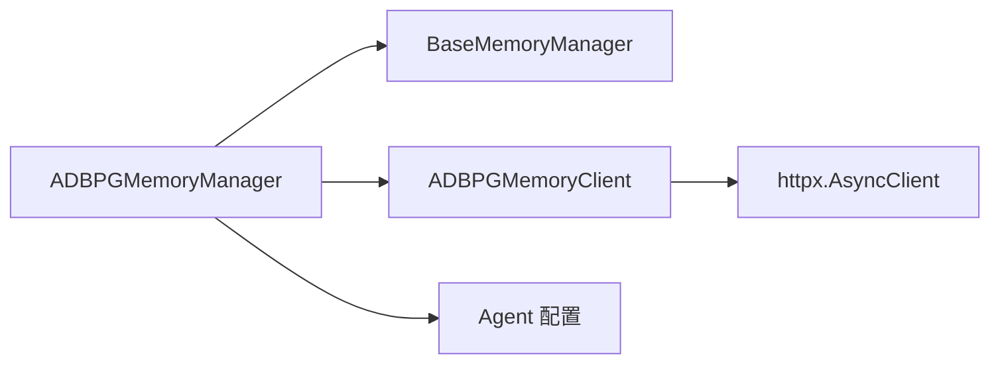

# ADBPG 记忆管理器

<cite>
**本文引用的文件**   
- [adbpg_memory_manager.py](file://tongtian-tauri/src/agent/agents/memory/adbpg_memory_manager.py)
- [adbpg_client.py](file://tongtian-tauri/src/agent/agents/memory/adbpg_client.py)
- [base_memory_manager.py](file://tongtian-tauri/src/agent/agents/memory/base_memory_manager.py)
- [adbpg_prompts.py](file://tongtian-tauri/src/agent/agents/memory/adbpg_prompts.py)
- [reme_config.py](file://tongtian-tauri/src/agent/agents/memory/reme_config.py)
- [config.py](file://tongtian-tauri/src/agent/config/config.py)
</cite>

## 目录
1. [简介](#简介)
2. [项目结构](#项目结构)
3. [核心组件](#核心组件)
4. [架构总览](#架构总览)
5. [详细组件分析](#详细组件分析)
6. [依赖关系分析](#依赖关系分析)
7. [性能与优化](#性能与优化)
8. [故障恢复与错误处理](#故障恢复与错误处理)
9. [配置与使用示例](#配置与使用示例)
10. [监控指标与可观测性](#监控指标与可观测性)
11. [结论](#结论)

## 简介
本文件面向基于阿里云数据库 PostgreSQL（ADBPG）的记忆存储实现，系统性说明 ADBPG 记忆管理器的设计、数据流、索引策略、查询优化、批量操作支持、连接配置、故障恢复机制、数据迁移方案，以及错误处理与监控指标。文档同时覆盖与本地文件记忆（ReMe）的协同方式，帮助读者在工程实践中高效部署与调优。

## 项目结构
ADBPG 记忆相关代码位于 agents/memory 目录下，核心由以下模块组成：
- 抽象基类与注册表：定义统一接口、生命周期、后台任务与工作器、自动记忆流程等
- ADBPG 客户端：封装 REST API 调用，负责认证、超时、日志
- ADBPG 记忆管理器：对接 AgentScope 工具与中间件，完成持久化、检索、自动记忆
- 提示词模板：为系统提示注入记忆使用说明
- ReMe 配置：用于本地文件型记忆（与 ADBPG 互补）

图表来源
- [base_memory_manager.py:36-123](file://tongtian-tauri/src/agent/agents/memory/base_memory_manager.py#L36-L123)
- [adbpg_memory_manager.py:32-158](file://tongtian-tauri/src/agent/agents/memory/adbpg_memory_manager.py#L32-L158)
- [adbpg_client.py:22-38](file://tongtian-tauri/src/agent/agents/memory/adbpg_client.py#L22-L38)
- [adbpg_prompts.py:5-71](file://tongtian-tauri/src/agent/agents/memory/adbpg_prompts.py#L5-L71)
- [reme_config.py:25-54](file://tongtian-tauri/src/agent/agents/memory/reme_config.py#L25-L54)

章节来源
- [base_memory_manager.py:36-123](file://tongtian-tauri/src/agent/agents/memory/base_memory_manager.py#L36-L123)
- [adbpg_memory_manager.py:32-158](file://tongtian-tauri/src/agent/agents/memory/adbpg_memory_manager.py#L32-L158)
- [adbpg_client.py:22-38](file://tongtian-tauri/src/agent/agents/memory/adbpg_client.py#L22-L38)
- [adbpg_prompts.py:5-71](file://tongtian-tauri/src/agent/agents/memory/adbpg_prompts.py#L5-L71)
- [reme_config.py:25-54](file://tongtian-tauri/src/agent/agents/memory/reme_config.py#L25-L54)

## 核心组件
- BaseMemoryManager：定义所有记忆后端的统一接口（start/close/get_memory_prompt/list_memory_tools/auto_memory_search/auto_memory/summarize/dream/rebuild_index/reme_status），并提供后台总结工作器、自动记忆状态跟踪、消息过滤与合成工具交互块等能力。
- ADBPGMemoryManager：基于 ADBPG 的长期记忆实现，负责从 Agent 配置加载 ADBPG 参数、初始化 REST 客户端、暴露 memory_search 工具、按轮次异步持久化用户消息、自动检索增强回复。
- ADBPGMemoryClient：通过 httpx 发起异步 REST 请求，封装 add_memory/search_memory 两个端点，统一鉴权头、超时、调试日志。
- 提示词模板：提供中英文记忆指导语，引导模型主动检索记忆并避免“凭空猜测”。
- ReMe 配置：用于本地文件型记忆（非 ADBPG），但作为对比与互补参考，便于理解整体记忆体系。

章节来源
- [base_memory_manager.py:36-123](file://tongtian-tauri/src/agent/agents/memory/base_memory_manager.py#L36-L123)
- [adbpg_memory_manager.py:32-158](file://tongtian-tauri/src/agent/agents/memory/adbpg_memory_manager.py#L32-L158)
- [adbpg_client.py:22-38](file://tongtian-tauri/src/agent/agents/memory/adbpg_client.py#L22-L38)
- [adbpg_prompts.py:5-71](file://tongtian-tauri/src/agent/agents/memory/adbpg_prompts.py#L5-L71)

## 架构总览
ADBPG 记忆管理器采用“管理器 + 客户端”的分层架构：管理器负责业务编排与 Agent 集成，客户端专注 HTTP 通信与错误处理。自动记忆与自动检索分别嵌入到 Agent 的生命周期钩子中，确保低延迟与高吞吐。

图表来源
- [adbpg_memory_manager.py:55-115](file://tongtian-tauri/src/agent/agents/memory/adbpg_memory_manager.py#L55-L115)
- [adbpg_memory_manager.py:177-217](file://tongtian-tauri/src/agent/agents/memory/adbpg_memory_manager.py#L177-L217)
- [adbpg_memory_manager.py:219-249](file://tongtian-tauri/src/agent/agents/memory/adbpg_memory_manager.py#L219-L249)
- [adbpg_client.py:39-70](file://tongtian-tauri/src/agent/agents/memory/adbpg_client.py#L39-L70)
- [adbpg_client.py:71-121](file://tongtian-tauri/src/agent/agents/memory/adbpg_client.py#L71-L121)

## 详细组件分析

### ADBPGMemoryManager（ADBPG 记忆管理器）
- 职责
  - 从 Agent 配置加载 ADBPG 连接参数（rest_base_url、rest_api_key、search_timeout、memory_isolation）。
  - 初始化 ADBPGMemoryClient，失败时降级为禁用长记忆。
  - 暴露 memory_search 工具，合并 ADBPG 语义检索与本地文件关键词匹配结果。
  - 每轮自动持久化用户消息（fire-and-forget），并通过 _persisted_msg_ids 去重。
  - 支持 auto_memory_search，在回复前自动检索并注入合成工具交互块。
- 关键方法
  - start(): 解析配置、校验必填项、创建客户端
  - close(): 等待待完成任务、关闭客户端
  - summarize(): 将用户消息异步写入 ADBPG
  - auto_memory(): 每轮增量持久化
  - auto_memory_search(): 根据最近一条用户消息生成查询并检索
  - memory_search(): 组合 ADBPG 与本地文件搜索结果
- 隔离模式
  - memory_isolation=true 时使用 agent_id；否则共享空间（shared）

图表来源
- [base_memory_manager.py:36-123](file://tongtian-tauri/src/agent/agents/memory/base_memory_manager.py#L36-L123)
- [adbpg_memory_manager.py:32-158](file://tongtian-tauri/src/agent/agents/memory/adbpg_memory_manager.py#L32-L158)

章节来源
- [adbpg_memory_manager.py:55-115](file://tongtian-tauri/src/agent/agents/memory/adbpg_memory_manager.py#L55-L115)
- [adbpg_memory_manager.py:177-217](file://tongtian-tauri/src/agent/agents/memory/adbpg_memory_manager.py#L177-L217)
- [adbpg_memory_manager.py:219-249](file://tongtian-tauri/src/agent/agents/memory/adbpg_memory_manager.py#L219-L249)
- [adbpg_memory_manager.py:255-333](file://tongtian-tauri/src/agent/agents/memory/adbpg_memory_manager.py#L255-L333)

### ADBPGMemoryClient（REST 客户端）
- 职责
  - 维护 httpx.AsyncClient，设置 Authorization 与 Content-Type
  - add_memory：POST /v3/memories/add/，携带 messages、identity、run_id、metadata
  - search_memory：POST /v3/memories/search/，携带 query、filters(agent_id/user_id)、top_k
  - 统一超时控制与 curl 风格调试日志
- 错误处理
  - 网络/超时：记录警告或错误，返回空列表
  - 响应体兼容：dict/list 两种格式均能解析

图表来源
- [adbpg_client.py:71-121](file://tongtian-tauri/src/agent/agents/memory/adbpg_client.py#L71-L121)

章节来源
- [adbpg_client.py:22-38](file://tongtian-tauri/src/agent/agents/memory/adbpg_client.py#L22-L38)
- [adbpg_client.py:39-70](file://tongtian-tauri/src/agent/agents/memory/adbpg_client.py#L39-L70)
- [adbpg_client.py:71-121](file://tongtian-tauri/src/agent/agents/memory/adbpg_client.py#L71-L121)
- [adbpg_client.py:127-157](file://tongtian-tauri/src/agent/agents/memory/adbpg_client.py#L127-L157)

### BaseMemoryManager（抽象基类与工作器）
- 职责
  - 定义统一的记忆后端接口
  - 提供后台总结工作器（串行执行 summarize 任务）、任务状态追踪与清理
  - 自动记忆搜索的合成消息构建（包含 thinking/tool_call/tool_result 块）
  - 自动记忆去重与消息清洗（移除合成块）
- 关键点
  - get_auto_memory_interval：默认 0（禁用），ADBPG 实现返回 1（每轮）
  - list_summarize_status：暴露任务状态供外部监控
  - message_without_auto_memory_search：过滤掉自动检索合成的工具块

章节来源
- [base_memory_manager.py:36-123](file://tongtian-tauri/src/agent/agents/memory/base_memory_manager.py#L36-L123)
- [base_memory_manager.py:375-436](file://tongtian-tauri/src/agent/agents/memory/base_memory_manager.py#L375-L436)
- [base_memory_manager.py:438-527](file://tongtian-tauri/src/agent/agents/memory/base_memory_manager.py#L438-L527)
- [base_memory_manager.py:145-216](file://tongtian-tauri/src/agent/agents/memory/base_memory_manager.py#L145-L216)

### 提示词与语言适配
- ADBPG_MEMORY_GUIDANCE_ZH/EN：指导模型在回答前先检索记忆，强调“先搜后答”，避免幻觉
- 语言选择依据 Agent 配置的 language 字段

章节来源
- [adbpg_prompts.py:5-71](file://tongtian-tauri/src/agent/agents/memory/adbpg_prompts.py#L5-L71)
- [adbpg_memory_manager.py:141-149](file://tongtian-tauri/src/agent/agents/memory/adbpg_memory_manager.py#L141-L149)

## 依赖关系分析
- ADBPGMemoryManager 依赖 BaseMemoryManager（继承）、ADBPGMemoryClient（HTTP 调用）、Agent 配置（load_agent_config）
- ADBPGMemoryClient 依赖 httpx 进行异步 HTTP 通信
- BaseMemoryManager 依赖 AgentScope 的消息类型与工具块类型，以及常量定义

图表来源
- [adbpg_memory_manager.py:20-28](file://tongtian-tauri/src/agent/agents/memory/adbpg_memory_manager.py#L20-L28)
- [adbpg_client.py:8-10](file://tongtian-tauri/src/agent/agents/memory/adbpg_client.py#L8-L10)
- [base_memory_manager.py:14-26](file://tongtian-tauri/src/agent/agents/memory/base_memory_manager.py#L14-L26)

章节来源
- [adbpg_memory_manager.py:20-28](file://tongtian-tauri/src/agent/agents/memory/adbpg_memory_manager.py#L20-L28)
- [adbpg_client.py:8-10](file://tongtian-tauri/src/agent/agents/memory/adbpg_client.py#L8-L10)
- [base_memory_manager.py:14-26](file://tongtian-tauri/src/agent/agents/memory/base_memory_manager.py#L14-L26)

## 性能与优化
- 连接与超时
  - search_timeout 控制检索超时；add_memory 使用 max(search_timeout, 30s) 保证最低超时阈值
  - httpx.AsyncClient 复用连接，减少握手开销
- 异步与批处理
  - 持久化采用 fire-and-forget（_schedule_add），不阻塞主流程
  - 后台总结工作器串行执行 summarize 任务，避免并发写冲突
- 查询优化
  - auto_memory_search 仅取最近一条用户消息作为 query，并限制最大字符数（MAX_QUERY_CHARS=50）
  - 搜索结果按分数过滤（min_score），避免噪声
- 存储与索引
  - ADBPG 服务端负责事实提取与索引；客户端仅传递结构化消息与身份标识
  - 本地文件检索作为补充，关键词匹配快速命中

章节来源
- [adbpg_client.py:39-70](file://tongtian-tauri/src/agent/agents/memory/adbpg_client.py#L39-L70)
- [adbpg_client.py:71-121](file://tongtian-tauri/src/agent/agents/memory/adbpg_client.py#L71-L121)
- [adbpg_memory_manager.py:364-386](file://tongtian-tauri/src/agent/agents/memory/adbpg_memory_manager.py#L364-L386)
- [base_memory_manager.py:306-313](file://tongtian-tauri/src/agent/agents/memory/base_memory_manager.py#L306-L313)
- [base_memory_manager.py:375-436](file://tongtian-tauri/src/agent/agents/memory/base_memory_manager.py#L375-L436)

## 故障恢复与错误处理
- 连接配置缺失
  - 缺少 rest_base_url/rest_api_key 时记录警告并禁用长记忆
  - 客户端初始化失败同样降级为禁用
- 网络与超时
  - search_memory 捕获超时并记录警告，返回空结果
  - add_memory 异常被记录但不影响主流程
- 资源释放
  - close() 等待 pending_add_tasks 完成，再关闭客户端
  - BaseMemoryManager 提供 _shutdown_summarize_worker 确保后台任务安全退出

章节来源
- [adbpg_memory_manager.py:55-115](file://tongtian-tauri/src/agent/agents/memory/adbpg_memory_manager.py#L55-L115)
- [adbpg_memory_manager.py:116-134](file://tongtian-tauri/src/agent/agents/memory/adbpg_memory_manager.py#L116-L134)
- [adbpg_client.py:71-121](file://tongtian-tauri/src/agent/agents/memory/adbpg_client.py#L71-L121)
- [base_memory_manager.py:403-436](file://tongtian-tauri/src/agent/agents/memory/base_memory_manager.py#L403-L436)

## 配置与使用示例
- 必要配置项（来自 Agent 配置）
  - running.adbpg_memory_config.rest_base_url：ADBPG REST 基础地址
  - running.adbpg_memory_config.rest_api_key：API Key
  - running.adbpg_memory_config.search_timeout：检索超时（秒）
  - running.adbpg_memory_config.memory_isolation：是否按 agent_id 隔离
- 自动检索开关
  - running.adbpg_memory_config.auto_memory_search_config.enabled：是否启用回复前自动检索
  - running.adbpg_memory_config.auto_memory_search_config.max_results：最大结果数
- 使用场景
  - 每轮自动持久化用户消息（interval=1）
  - 回复前自动检索并注入合成工具交互块
  - 手动 memory_search 工具供模型按需检索

章节来源
- [adbpg_memory_manager.py:55-115](file://tongtian-tauri/src/agent/agents/memory/adbpg_memory_manager.py#L55-L115)
- [adbpg_memory_manager.py:177-217](file://tongtian-tauri/src/agent/agents/memory/adbpg_memory_manager.py#L177-L217)
- [adbpg_memory_manager.py:155-158](file://tongtian-tauri/src/agent/agents/memory/adbpg_memory_manager.py#L155-L158)

## 监控指标与可观测性
- 日志
  - REST 请求以 curl 风格输出（脱敏 Authorization），便于复现问题
  - 错误/警告分级记录（超时、网络异常、配置缺失、关闭失败）
- 任务状态
  - list_summarize_status 返回 summarize 任务的状态、开始时间、结果与错误信息
- 内存与进程
  - 通过 ReMe 的 status 作业可获得内存估计与 RSS（适用于本地文件记忆场景）

章节来源
- [adbpg_client.py:140-157](file://tongtian-tauri/src/agent/agents/memory/adbpg_client.py#L140-L157)
- [base_memory_manager.py:500-527](file://tongtian-tauri/src/agent/agents/memory/base_memory_manager.py#L500-L527)
- [reme_config.py:132-140](file://tongtian-tauri/src/agent/agents/memory/reme_config.py#L132-L140)

## 结论
ADBPG 记忆管理器以简洁清晰的“管理器+客户端”分层实现了高可用、低侵入的长期记忆能力。通过异步持久化、自动检索与严格的错误降级策略，系统在保障用户体验的同时具备较强的鲁棒性。结合合理的配置与监控手段，可在生产环境中稳定运行并持续优化性能与存储效率。