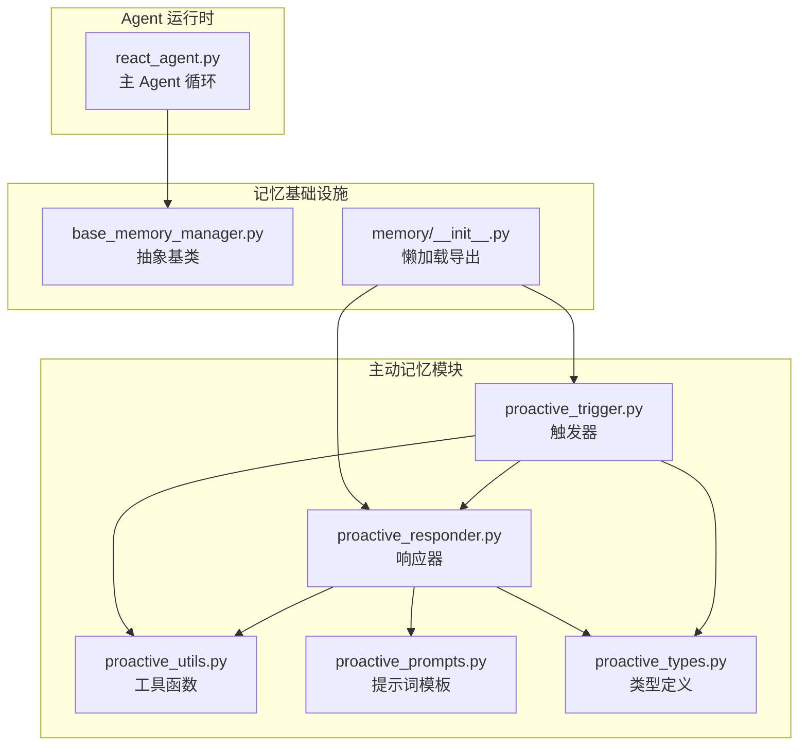
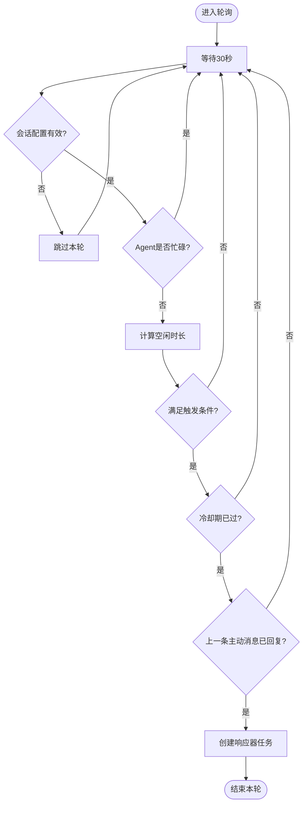
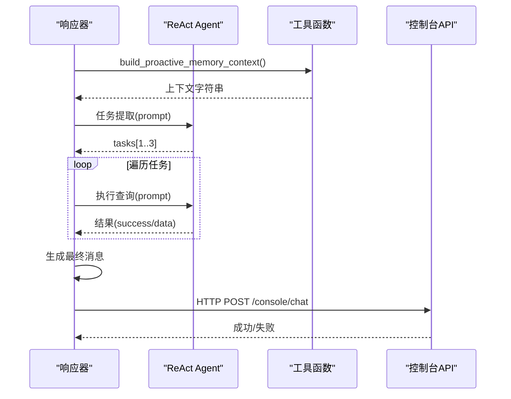
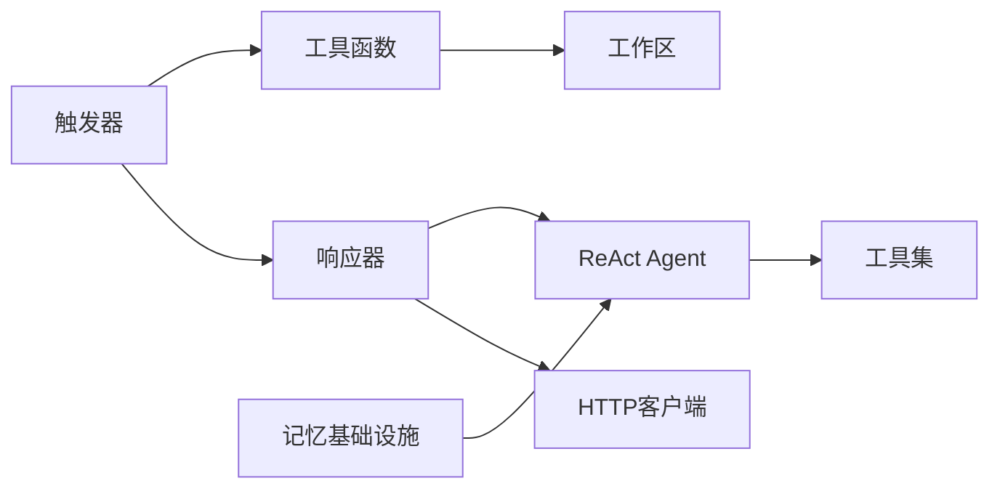

# 主动记忆系统

<cite>
**本文引用的文件**
- [proactive_trigger.py](file://tongtian-tauri/src/agent/agents/memory/proactive/proactive_trigger.py)
- [proactive_responder.py](file://tongtian-tauri/src/agent/agents/memory/proactive/proactive_responder.py)
- [proactive_types.py](file://tongtian-tauri/src/agent/agents/memory/proactive/proactive_types.py)
- [proactive_utils.py](file://tongtian-tauri/src/agent/agents/memory/proactive/proactive_utils.py)
- [proactive_prompts.py](file://tongtian-tauri/src/agent/agents/memory/proactive/proactive_prompts.py)
- [base_memory_manager.py](file://tongtian-tauri/src/agent/agents/memory/base_memory_manager.py)
- [react_agent.py](file://tongtian-tauri/src/agent/agents/react_agent.py)
- [memory __init__.py](file://tongtian-tauri/src/agent/agents/memory/__init__.py)
</cite>

## 目录
1. [简介](#简介)
2. [项目结构](#项目结构)
3. [核心组件](#核心组件)
4. [架构总览](#架构总览)
5. [详细组件分析](#详细组件分析)
6. [依赖关系分析](#依赖关系分析)
7. [性能与调优](#性能与调优)
8. [故障排查指南](#故障排查指南)
9. [结论](#结论)
10. [附录：触发规则配置示例](#附录触发规则配置示例)

## 简介
本文件面向“主动记忆系统”的完整设计与实现，聚焦以下目标：
- 解释主动记忆的触发机制：事件监听、条件判断、优先级调度。
- 说明响应器工作原理：上下文分析、记忆检索、响应生成策略。
- 覆盖触发器类型、配置选项、性能调优。
- 提供复杂记忆触发逻辑的配置示例。
- 阐述与 Agent 生命周期集成方式及资源管理策略。

该系统通过后台轮询检测会话空闲状态，结合会话上下文与屏幕活动（可选）构建记忆上下文，由专用 ReAct Agent 抽取任务并执行查询，最终将结果以“主动消息”形式推送给用户。

## 项目结构
主动记忆子系统位于 agents/memory/proactive 目录下，包含触发器、响应器、类型定义、工具函数与提示词模板；同时与通用记忆管理器、Agent 主循环紧密协作。



图表来源
- [proactive_trigger.py:1-292](file://tongtian-tauri/src/agent/agents/memory/proactive/proactive_trigger.py#L1-L292)
- [proactive_responder.py:1-358](file://tongtian-tauri/src/agent/agents/memory/proactive/proactive_responder.py#L1-L358)
- [proactive_utils.py:1-452](file://tongtian-tauri/src/agent/agents/memory/proactive/proactive_utils.py#L1-L452)
- [proactive_prompts.py:1-74](file://tongtian-tauri/src/agent/agents/memory/proactive/proactive_prompts.py#L1-L74)
- [proactive_types.py:1-38](file://tongtian-tauri/src/agent/agents/memory/proactive/proactive_types.py#L1-L38)
- [base_memory_manager.py:1-573](file://tongtian-tauri/src/agent/agents/memory/base_memory_manager.py#L1-L573)
- [memory __init__.py:1-70](file://tongtian-tauri/src/agent/agents/memory/__init__.py#L1-L70)

章节来源
- [proactive_trigger.py:1-292](file://tongtian-tauri/src/agent/agents/memory/proactive/proactive_trigger.py#L1-L292)
- [proactive_responder.py:1-358](file://tongtian-tauri/src/agent/agents/memory/proactive/proactive_responder.py#L1-L358)
- [proactive_utils.py:1-452](file://tongtian-tauri/src/agent/agents/memory/proactive/proactive_utils.py#L1-L452)
- [proactive_prompts.py:1-74](file://tongtian-tauri/src/agent/agents/memory/proactive/proactive_prompts.py#L1-L74)
- [proactive_types.py:1-38](file://tongtian-tauri/src/agent/agents/memory/proactive/proactive_types.py#L1-L38)
- [base_memory_manager.py:1-573](file://tongtian-tauri/src/agent/agents/memory/base_memory_manager.py#L1-L573)
- [memory __init__.py:1-70](file://tongtian-tauri/src/agent/agents/memory/__init__.py#L1-L70)

## 核心组件
- 触发器（Trigger）：维护会话级配置，周期性轮询空闲时间、Agent 忙碌状态、冷却时间与重复发送保护，满足条件后调用响应器。
- 响应器（Responder）：构造独立 ReAct Agent，聚合多会话上下文与屏幕活动，提取高价值任务，执行查询，生成用户可见的主动消息并通过 HTTP 推送到控制台。
- 工具函数（Utils）：负责内存上下文组装、会话过滤、消息清洗、时间处理、Agent 忙碌检测等。
- 类型定义（Types）：ProactiveConfig、ProactiveTask、ProactiveQueryResult。
- 提示词（Prompts）：任务提取与用户消息生成的模板。
- 记忆基础设施：BaseMemoryManager 提供统一的生命周期与中间件扩展点；Agent 主循环在压缩/恢复时保障上下文一致性。

章节来源
- [proactive_types.py:1-38](file://tongtian-tauri/src/agent/agents/memory/proactive/proactive_types.py#L1-L38)
- [proactive_utils.py:1-452](file://tongtian-tauri/src/agent/agents/memory/proactive/proactive_utils.py#L1-L452)
- [proactive_prompts.py:1-74](file://tongtian-tauri/src/agent/agents/memory/proactive/proactive_prompts.py#L1-L74)
- [base_memory_manager.py:1-573](file://tongtian-tauri/src/agent/agents/memory/base_memory_manager.py#L1-L573)
- [react_agent.py:1-800](file://tongtian-tauri/src/agent/agents/react_agent.py#L1-L800)

## 架构总览
主动记忆系统采用“触发器 + 响应器”的双阶段架构：
- 触发器每 30 秒检查一次会话空闲、Agent 忙碌、冷却期与未响应标记，决定是否触发。
- 响应器创建轻量 ReAct Agent，基于多会话上下文与屏幕截图（若支持）提取任务，执行查询，生成最终消息并通过 HTTP 发送到控制台。

```mermaid
sequenceDiagram
participant Loop as "触发器循环"
participant WS as "工作区"
participant Res as "响应器"
participant Ag as "ReAct Agent"
participant API as "控制台API"
Loop->>WS : 获取最后用户交互时间/忙碌状态
alt 空闲且可触发
Loop->>Res : generate_proactive_response(workspace)
Res->>Ag : 构建上下文(会话+屏幕)
Ag-->>Res : 任务列表(1-3个)
loop 最多3个任务
Res->>Ag : 执行查询(浏览器/文件/命令)
Ag-->>Res : 查询结果
end
Res->>API : 发送主动消息(HTTP)
API-->>Res : 成功/失败
else 不可触发
Loop-->>Loop : 等待下一轮
end
```

图表来源
- [proactive_trigger.py:51-292](file://tongtian-tauri/src/agent/agents/memory/proactive/proactive_trigger.py#L51-L292)
- [proactive_responder.py:41-358](file://tongtian-tauri/src/agent/agents/memory/proactive/proactive_responder.py#L41-L358)
- [proactive_utils.py:39-80](file://tongtian-tauri/src/agent/agents/memory/proactive/proactive_utils.py#L39-L80)

## 详细组件分析

### 触发器（Trigger）
- 会话级配置：启用开关、空闲阈值、上次用户交互时间、运行中任务ID、模式启用时间。
- 轮询策略：每 30 秒检查一次；若 Agent 忙碌则跳过；读取最近用户交互时间；计算空闲时长；考虑冷却期（60 秒）与“上一主动消息未响应”的保护。
- 触发条件：
  - 空闲时长 >= idle_minutes
  - 若存在 mode_enabled_time，需自启用以来达到 idle_minutes
  - 无正在运行的任务
  - 距上次尝试至少 60 秒
  - 若上次主动消息未回复，则跳过
- 触发动作：创建异步任务调用响应器，记录 running_task_id，完成后清理。



图表来源
- [proactive_trigger.py:125-215](file://tongtian-tauri/src/agent/agents/memory/proactive/proactive_trigger.py#L125-L215)
- [proactive_trigger.py:218-292](file://tongtian-tauri/src/agent/agents/memory/proactive/proactive_trigger.py#L218-L292)

章节来源
- [proactive_trigger.py:27-48](file://tongtian-tauri/src/agent/agents/memory/proactive/proactive_trigger.py#L27-L48)
- [proactive_trigger.py:125-215](file://tongtian-tauri/src/agent/agents/memory/proactive/proactive_trigger.py#L125-L215)
- [proactive_trigger.py:218-292](file://tongtian-tauri/src/agent/agents/memory/proactive/proactive_trigger.py#L218-L292)

### 响应器（Responder）
- 初始化：为主动记忆创建独立的 ReAct Agent，注入工具（浏览器、文件读取、Shell 命令，必要时桌面截图）。
- 上下文构建：聚合多会话消息（按时间倒序，限制条数与字符数），可选加入屏幕活动分析。
- 任务提取：使用提示词让模型从上下文中抽取 1-3 个高价值任务（含 query 与原因）。
- 查询执行：对每个任务调用工具链，解析结果，优先返回成功的查询。
- 消息生成：根据语言设置与收集到的信息生成用户友好消息，并以 HTTP 发送到控制台。
- 中断检测：在关键步骤检查是否有新的用户活动或 Agent 忙碌，及时中止以避免打扰。



图表来源
- [proactive_responder.py:41-98](file://tongtian-tauri/src/agent/agents/memory/proactive/proactive_responder.py#L41-L98)
- [proactive_responder.py:150-247](file://tongtian-tauri/src/agent/agents/memory/proactive/proactive_responder.py#L150-L247)
- [proactive_utils.py:39-80](file://tongtian-tauri/src/agent/agents/memory/proactive/proactive_utils.py#L39-L80)

章节来源
- [proactive_responder.py:41-98](file://tongtian-tauri/src/agent/agents/memory/proactive/proactive_responder.py#L41-L98)
- [proactive_responder.py:101-147](file://tongtian-tauri/src/agent/agents/memory/proactive/proactive_responder.py#L101-L147)
- [proactive_responder.py:150-247](file://tongtian-tauri/src/agent/agents/memory/proactive/proactive_responder.py#L150-L247)
- [proactive_responder.py:250-358](file://tongtian-tauri/src/agent/agents/memory/proactive/proactive_responder.py#L250-L358)

### 工具函数（Utils）
- 空闲检测：is_agent_busy 通过 task_tracker 判断 Agent 是否忙碌。
- 上下文构建：build_proactive_memory_context 组合屏幕分析与会话消息，过滤系统消息，仅保留文本块，按时间排序，限制最大消息数与字符数。
- 会话读取：_read_chat_sessions_metadata 列出聊天会话，_filter_recent_sessions 筛选最近 7 天或前 5 个会话，_collect_messages 汇总消息。
- 安全 JSON 解析：load_json_safely 支持代码块包裹与括号匹配提取。
- 屏幕分析：_analyze_screen_activity 调用桌面截图工具，将图片作为多模态输入进行分析。

章节来源
- [proactive_utils.py:18-36](file://tongtian-tauri/src/agent/agents/memory/proactive/proactive_utils.py#L18-L36)
- [proactive_utils.py:39-80](file://tongtian-tauri/src/agent/agents/memory/proactive/proactive_utils.py#L39-L80)
- [proactive_utils.py:117-193](file://tongtian-tauri/src/agent/agents/memory/proactive/proactive_utils.py#L117-L193)
- [proactive_utils.py:195-232](file://tongtian-tauri/src/agent/agents/memory/proactive/proactive_utils.py#L195-L232)
- [proactive_utils.py:248-327](file://tongtian-tauri/src/agent/agents/memory/proactive/proactive_utils.py#L248-L327)
- [proactive_utils.py:329-452](file://tongtian-tauri/src/agent/agents/memory/proactive/proactive_utils.py#L329-L452)

### 类型定义（Types）
- ProactiveConfig：控制启用、空闲阈值、上次交互时间、运行任务ID、模式启用时间。
- ProactiveTask：任务描述、查询语句、优先级、原因。
- ProactiveQueryResult：查询结果、成功标志、数据与错误信息。

章节来源
- [proactive_types.py:9-38](file://tongtian-tauri/src/agent/agents/memory/proactive/proactive_types.py#L9-L38)

### 提示词（Prompts）
- 任务提取提示词：要求模型基于上下文抽取 1-3 个任务，输出严格 JSON，避免重复与工具调用。
- 用户消息提示词：根据收集信息生成友好、不侵入的主动消息，建议以 “[PROACTIVE]” 开头，并按 Agent 语言输出。

章节来源
- [proactive_prompts.py:4-42](file://tongtian-tauri/src/agent/agents/memory/proactive/proactive_prompts.py#L4-L42)
- [proactive_prompts.py:45-74](file://tongtian-tauri/src/agent/agents/memory/proactive/proactive_prompts.py#L45-L74)

### 与 Agent 生命周期的集成
- 懒加载导出：memory/__init__.py 通过 __getattr__ 延迟导入 proactive 模块，避免循环依赖。
- 记忆中间件：BaseMemoryManager 提供中间件钩子，可在 reply 前后进行自动搜索与摘要；Agent 主循环在压缩/恢复时确保上下文一致性与资源释放。
- 资源管理：Agent.close 会停止 governor、清理历史存储、过期工具结果；BaseMemoryManager 提供后台摘要任务队列与优雅关闭。

章节来源
- [memory __init__.py:16-70](file://tongtian-tauri/src/agent/agents/memory/__init__.py#L16-L70)
- [base_memory_manager.py:36-123](file://tongtian-tauri/src/agent/agents/memory/base_memory_manager.py#L36-L123)
- [base_memory_manager.py:375-436](file://tongtian-tauri/src/agent/agents/memory/base_memory_manager.py#L375-L436)
- [react_agent.py:331-382](file://tongtian-tauri/src/agent/agents/react_agent.py#L331-L382)

## 依赖关系分析
- 触发器依赖：
  - 工作区（Workspace）：获取会话列表、会话状态、最后消息时间戳。
  - 工具函数：空闲检测、上下文构建、时间处理。
  - 响应器：生成主动消息。
- 响应器依赖：
  - ReAct Agent：任务提取与查询执行。
  - 工具集：浏览器、文件读取、Shell 命令、桌面截图（可选）。
  - HTTP 客户端：向控制台发送主动消息。
- 工具函数依赖：
  - 会话管理：list_chats、get_session_state_dict。
  - 多模态能力：根据模型能力决定是否采集屏幕。
- 记忆基础设施：
  - BaseMemoryManager：抽象接口与后台任务管理。
  - Agent 主循环：上下文压缩与恢复、资源释放。



图表来源
- [proactive_trigger.py:1-292](file://tongtian-tauri/src/agent/agents/memory/proactive/proactive_trigger.py#L1-L292)
- [proactive_responder.py:1-358](file://tongtian-tauri/src/agent/agents/memory/proactive/proactive_responder.py#L1-L358)
- [proactive_utils.py:1-452](file://tongtian-tauri/src/agent/agents/memory/proactive/proactive_utils.py#L1-L452)
- [base_memory_manager.py:1-573](file://tongtian-tauri/src/agent/agents/memory/base_memory_manager.py#L1-L573)

章节来源
- [proactive_trigger.py:1-292](file://tongtian-tauri/src/agent/agents/memory/proactive/proactive_trigger.py#L1-L292)
- [proactive_responder.py:1-358](file://tongtian-tauri/src/agent/agents/memory/proactive/proactive_responder.py#L1-L358)
- [proactive_utils.py:1-452](file://tongtian-tauri/src/agent/agents/memory/proactive/proactive_utils.py#L1-L452)
- [base_memory_manager.py:1-573](file://tongtian-tauri/src/agent/agents/memory/base_memory_manager.py#L1-L573)

## 性能与调优
- 轮询频率：默认 30 秒，可根据负载调整；过高会增加 I/O 与模型调用压力。
- 空闲阈值：idle_minutes 控制触发灵敏度；过短易频繁打扰，过长则响应滞后。
- 冷却期：60 秒防止重复触发；可按场景调整。
- 上下文大小：限制消息数量与字符数，避免超出模型上下文窗口；必要时减少会话范围或内容长度。
- 多模态成本：屏幕截图与分析仅在模型支持时启用；可减少不必要的截图开销。
- 任务上限：最多处理 3 个任务，降低模型调用次数与网络请求。
- 中断检测：在关键步骤检查用户活动与 Agent 忙碌，及时中止，提升用户体验。
- 资源释放：Agent 关闭时清理历史存储与过期工具结果；BaseMemoryManager 后台任务队列有序关闭。

[本节为通用指导，无需特定文件引用]

## 故障排查指南
- 无法触发：
  - 检查会话配置是否启用、空闲阈值是否合理。
  - 确认 Agent 是否忙碌；若忙碌则跳过。
  - 查看冷却期与“上一条主动消息未响应”保护是否生效。
- 上下文为空或过小：
  - 检查会话列表与最近会话过滤逻辑。
  - 确认消息清洗是否移除了过多内容。
- 任务提取失败：
  - 验证提示词与模型输出格式；确保 JSON 可解析。
  - 检查 load_json_safely 是否能正确提取对象。
- 查询执行失败：
  - 检查工具可用性（浏览器、文件、Shell）。
  - 关注网络超时与异常日志。
- 消息发送失败：
  - 检查 HTTP 客户端与 API 地址；确认超时配置。
  - 查看 SSE 数据接收情况。
- 资源泄漏：
  - 确认 Agent 关闭流程是否执行；检查后台任务是否被取消。

章节来源
- [proactive_trigger.py:148-215](file://tongtian-tauri/src/agent/agents/memory/proactive/proactive_trigger.py#L148-L215)
- [proactive_responder.py:250-358](file://tongtian-tauri/src/agent/agents/memory/proactive/proactive_responder.py#L250-L358)
- [proactive_utils.py:195-232](file://tongtian-tauri/src/agent/agents/memory/proactive/proactive_utils.py#L195-L232)
- [base_memory_manager.py:375-436](file://tongtian-tauri/src/agent/agents/memory/base_memory_manager.py#L375-L436)

## 结论
主动记忆系统通过“触发器 + 响应器”的解耦设计，实现了基于会话空闲与上下文分析的主动提醒能力。其核心优势包括：
- 低侵入：仅在空闲且必要情况下触发，避免打扰用户。
- 高相关：基于多会话上下文与屏幕活动，精准识别用户需求。
- 可扩展：通过工具集与提示词模板，灵活适配不同场景。
- 健壮性：具备冷却期、中断检测与资源管理，保障稳定性。

[本节为总结，无需特定文件引用]

## 附录：触发规则配置示例
以下为常见配置思路（概念性说明，非具体代码）：
- 基础空闲触发：
  - 启用主动记忆，设置空闲阈值为 30 分钟。
  - 适用于一般办公场景，避免频繁打扰。
- 快速响应模式：
  - 设置空闲阈值为 5 分钟，冷却期为 30 秒。
  - 适用于紧急任务或高活跃对话。
- 分时段策略：
  - 在工作时段（如 9:00-18:00）启用较短空闲阈值。
  - 在非工作时段禁用或延长阈值，减少干扰。
- 多会话聚合：
  - 限制只读取最近 7 天或前 5 个会话，控制上下文大小。
  - 针对长会话，进一步限制消息数量与字符数。
- 多模态增强：
  - 当模型支持多模态时，启用屏幕分析以提升上下文质量。
  - 在不支持多模态的模型上禁用截图，降低成本。
- 任务优先级：
  - 根据任务频率与近期性排序，优先处理高频与最新任务。
  - 限制最多 3 个任务，平衡效果与性能。

[本节为概念性示例，无需特定文件引用]