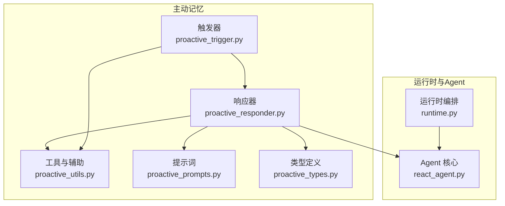
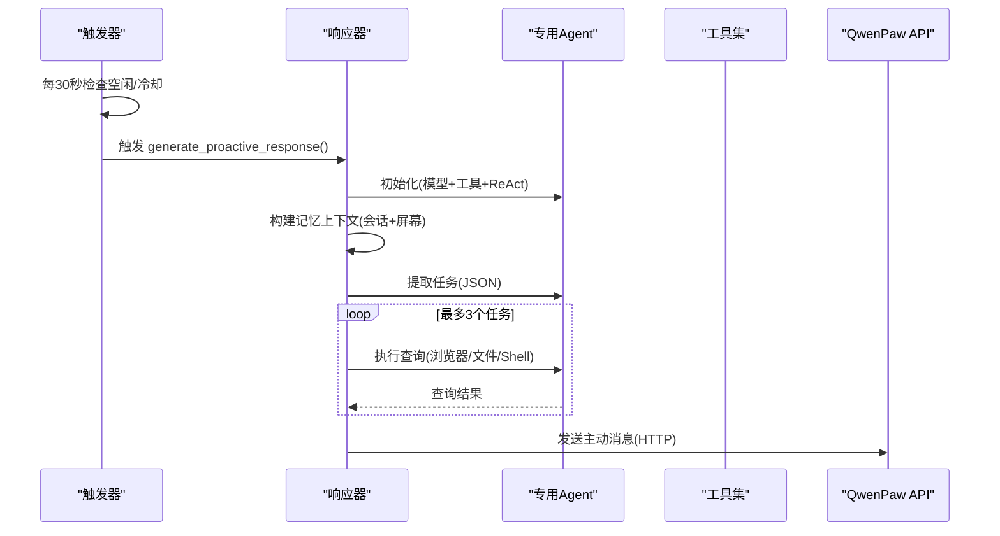
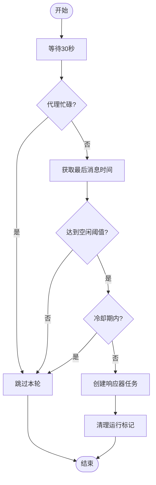
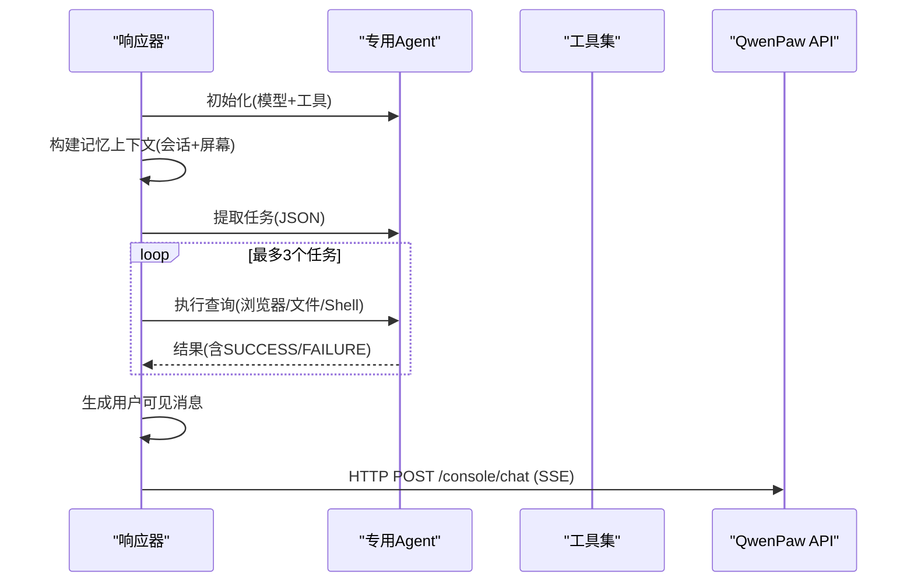
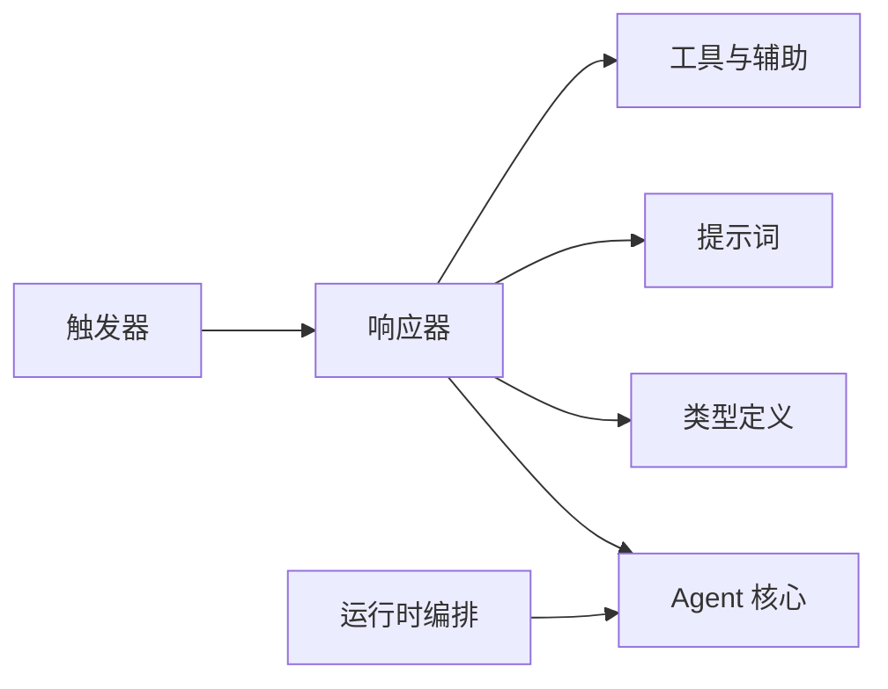

# 响应器核心

<cite>
**本文引用的文件**
- [proactive_responder.py](file://tongtian-tauri/src/agent/agents/memory/proactive/proactive_responder.py)
- [proactive_trigger.py](file://tongtian-tauri/src/agent/agents/memory/proactive/proactive_trigger.py)
- [proactive_types.py](file://tongtian-tauri/src/agent/agents/memory/proactive/proactive_types.py)
- [proactive_utils.py](file://tongtian-tauri/src/agent/agents/memory/proactive/proactive_utils.py)
- [proactive_prompts.py](file://tongtian-tauri/src/agent/agents/memory/proactive/proactive_prompts.py)
- [react_agent.py](file://tongtian-tauri/src/agent/agents/react_agent.py)
- [runtime.py](file://tongtian-tauri/src/agent/runtime/runtime.py)
</cite>

## 目录
1. [简介](#简介)
2. [项目结构](#项目结构)
3. [核心组件](#核心组件)
4. [架构总览](#架构总览)
5. [详细组件分析](#详细组件分析)
6. [依赖关系分析](#依赖关系分析)
7. [性能与并发](#性能与并发)
8. [故障排查指南](#故障排查指南)
9. [结论](#结论)
10. [附录：配置与使用示例](#附录配置与使用示例)

## 简介
本文件围绕“主动记忆响应器”的核心实现，系统化阐述其工作原理与关键流程，包括：
- 上下文构建与多模态支持（屏幕截图分析）
- 任务提取、优先级排序与查询执行
- 消息生成与通过 HTTP 推送至前端
- Agent 初始化、工具集装配与中断检测
- 触发器的后台轮询、冷却与并发控制
- 错误处理、日志记录与可观测性要点
- 配置项说明与自定义策略建议

## 项目结构
主动记忆响应器位于 memory/proactive 子模块中，由以下职责清晰的模块组成：
- 触发器：负责后台轮询、空闲判定、冷却与并发保护
- 响应器：负责上下文构建、任务提取、查询执行、最终消息生成与发送
- 类型定义：统一数据结构（配置、任务、查询结果）
- 工具函数：会话/聊天读取、时间处理、JSON 解析、屏幕分析等
- 提示词模板：任务提取与用户可见消息的提示模板
- 运行时与 Agent：提供请求编排、Agent 生命周期、媒体能力探测与上下文压缩

图表来源
- [proactive_trigger.py:27-48](file://tongtian-tauri/src/agent/agents/memory/proactive/proactive_trigger.py#L27-L48)
- [proactive_responder.py:41-98](file://tongtian-tauri/src/agent/agents/memory/proactive/proactive_responder.py#L41-L98)
- [proactive_utils.py:39-80](file://tongtian-tauri/src/agent/agents/memory/proactive/proactive_utils.py#L39-L80)
- [proactive_prompts.py:4-42](file://tongtian-tauri/src/agent/agents/memory/proactive/proactive_prompts.py#L4-L42)
- [proactive_types.py:9-38](file://tongtian-tauri/src/agent/agents/memory/proactive/proactive_types.py#L9-L38)
- [runtime.py:49-141](file://tongtian-tauri/src/agent/runtime/runtime.py#L49-L141)
- [react_agent.py:59-146](file://tongtian-tauri/src/agent/agents/react_agent.py#L59-L146)

章节来源
- [proactive_trigger.py:27-48](file://tongtian-tauri/src/agent/agents/memory/proactive/proactive_trigger.py#L27-L48)
- [proactive_responder.py:41-98](file://tongtian-tauri/src/agent/agents/memory/proactive/proactive_responder.py#L41-L98)
- [runtime.py:49-141](file://tongtian-tauri/src/agent/runtime/runtime.py#L49-L141)

## 核心组件
- 触发器（Trigger）
  - 维护每会话的主动模式配置与运行任务
  - 后台循环每 30 秒检查空闲与冷却，避免重复触发
  - 调用响应器生成主动消息，并清理运行状态
- 响应器（Responder）
  - 初始化专用 Agent（含工具集与可选多模态能力）
  - 构建包含会话与屏幕上下文的综合记忆
  - 通过 LLM 提取任务列表（最多 3 个），按顺序执行查询
  - 将成功查询结果组装为用户可见消息并通过 HTTP 推送
- 工具与辅助（Utils）
  - 会话/聊天元数据读取、最近消息时间获取
  - JSON 安全解析、时间时区处理
  - 屏幕截图与分析（多模态模型可用时）
- 类型定义（Types）
  - ProactiveConfig：启用标志、空闲阈值、最后交互时间、运行任务 ID、模式开启时间
  - ProactiveTask：任务描述、查询语句、优先级、原因
  - ProactiveQueryResult：查询、成功标志、数据、错误信息
- 提示词（Prompts）
  - 任务提取提示：要求输出结构化 JSON，限制为 1–3 个高优先级任务
  - 用户可见消息提示：基于收集信息生成友好、不侵入的主动消息

章节来源
- [proactive_trigger.py:27-48](file://tongtian-tauri/src/agent/agents/memory/proactive/proactive_trigger.py#L27-L48)
- [proactive_responder.py:101-147](file://tongtian-tauri/src/agent/agents/memory/proactive/proactive_responder.py#L101-L147)
- [proactive_utils.py:18-36](file://tongtian-tauri/src/agent/agents/memory/proactive/proactive_utils.py#L18-L36)
- [proactive_types.py:9-38](file://tongtian-tauri/src/agent/agents/memory/proactive/proactive_types.py#L9-L38)
- [proactive_prompts.py:4-42](file://tongtian-tauri/src/agent/agents/memory/proactive/proactive_prompts.py#L4-L42)

## 架构总览
主动记忆响应器以“触发器 + 响应器”的双阶段架构工作：
- 触发器在后台轮询，依据空闲时间与冷却策略决定是否触发
- 响应器在触发后构建上下文、提取任务、执行查询并生成消息
- 运行时负责整体请求编排与 Agent 生命周期管理；Agent 负责推理、工具调用与上下文压缩

图表来源
- [proactive_trigger.py:218-292](file://tongtian-tauri/src/agent/agents/memory/proactive/proactive_trigger.py#L218-L292)
- [proactive_responder.py:41-98](file://tongtian-tauri/src/agent/agents/memory/proactive/proactive_responder.py#L41-L98)
- [proactive_responder.py:101-147](file://tongtian-tauri/src/agent/agents/memory/proactive/proactive_responder.py#L101-L147)
- [proactive_responder.py:192-222](file://tongtian-tauri/src/agent/agents/memory/proactive/proactive_responder.py#L192-L222)
- [proactive_responder.py:250-320](file://tongtian-tauri/src/agent/agents/memory/proactive/proactive_responder.py#L250-L320)

## 详细组件分析

### 触发器：后台轮询与并发控制
- 会话级配置存储于全局字典，支持多会话并行
- 每 30 秒轮询一次，检查：
  - 是否处于活跃任务（is_agent_busy）
  - 是否满足空闲阈值（idle_minutes）
  - 冷却期（上次尝试间隔 ≤ 60 秒则跳过）
  - 若上一条消息已是主动消息且未回复，则跳过
- 触发后创建异步任务执行响应器，并在 finally 中清理 running_task_id

图表来源
- [proactive_trigger.py:218-292](file://tongtian-tauri/src/agent/agents/memory/proactive/proactive_trigger.py#L218-L292)
- [proactive_utils.py:18-29](file://tongtian-tauri/src/agent/agents/memory/proactive/proactive_utils.py#L18-L29)

章节来源
- [proactive_trigger.py:27-48](file://tongtian-tauri/src/agent/agents/memory/proactive/proactive_trigger.py#L27-L48)
- [proactive_trigger.py:125-146](file://tongtian-tauri/src/agent/agents/memory/proactive/proactive_trigger.py#L125-L146)
- [proactive_trigger.py:148-215](file://tongtian-tauri/src/agent/agents/memory/proactive/proactive_trigger.py#L148-L215)
- [proactive_trigger.py:218-292](file://tongtian-tauri/src/agent/agents/memory/proactive/proactive_trigger.py#L218-L292)

### 响应器：上下文、任务提取、查询与消息生成
- 初始化专用 Agent：
  - 加载配置、创建模型与格式化器
  - 注册工具：浏览器、文件读取、Shell 命令；若当前模型支持多模态，附加桌面截图工具
  - 设置 ReAct 最大迭代次数
- 构建记忆上下文：
  - 可选屏幕分析（多模态）
  - 读取最近会话与消息，过滤系统消息，限制条数与字符数
- 任务提取：
  - 使用提示词让 LLM 输出 1–3 个任务（JSON），按出现频率与近期度排序
- 查询执行：
  - 对每个任务构造提示，优先使用浏览器工具，必要时使用 Shell/文件
  - 解析结果中的成功标记，封装为查询结果
- 消息生成与发送：
  - 将查询结果与语言偏好注入提示词，生成用户可见消息
  - 通过 HTTP POST 到 QwenPaw API，SSE 流式读取最后一条 data，记录日志

图表来源
- [proactive_responder.py:41-98](file://tongtian-tauri/src/agent/agents/memory/proactive/proactive_responder.py#L41-L98)
- [proactive_responder.py:101-147](file://tongtian-tauri/src/agent/agents/memory/proactive/proactive_responder.py#L101-L147)
- [proactive_responder.py:150-189](file://tongtian-tauri/src/agent/agents/memory/proactive/proactive_responder.py#L150-L189)
- [proactive_responder.py:192-222](file://tongtian-tauri/src/agent/agents/memory/proactive/proactive_responder.py#L192-L222)
- [proactive_responder.py:225-247](file://tongtian-tauri/src/agent/agents/memory/proactive/proactive_responder.py#L225-L247)
- [proactive_responder.py:250-320](file://tongtian-tauri/src/agent/agents/memory/proactive/proactive_responder.py#L250-L320)

章节来源
- [proactive_responder.py:41-98](file://tongtian-tauri/src/agent/agents/memory/proactive/proactive_responder.py#L41-L98)
- [proactive_responder.py:101-147](file://tongtian-tauri/src/agent/agents/memory/proactive/proactive_responder.py#L101-L147)
- [proactive_responder.py:150-189](file://tongtian-tauri/src/agent/agents/memory/proactive/proactive_responder.py#L150-L189)
- [proactive_responder.py:192-222](file://tongtian-tauri/src/agent/agents/memory/proactive/proactive_responder.py#L192-L222)
- [proactive_responder.py:225-247](file://tongtian-tauri/src/agent/agents/memory/proactive/proactive_responder.py#L225-L247)
- [proactive_responder.py:250-320](file://tongtian-tauri/src/agent/agents/memory/proactive/proactive_responder.py#L250-L320)

### 工具与辅助：会话读取、屏幕分析与 JSON 解析
- is_agent_busy：通过 task_tracker 判断代理是否忙碌
- build_proactive_memory_context：组合屏幕上下文与会话上下文，限制消息数量与字符数
- _analyze_screen_activity：多模态模式下截取屏幕并分析用户活动
- load_json_safely：安全解析 LLM 输出的 JSON（支持代码块包裹与对象提取）
- get_last_message_ts：获取所有会话的最新更新时间戳

章节来源
- [proactive_utils.py:18-36](file://tongtian-tauri/src/agent/agents/memory/proactive/proactive_utils.py#L18-L36)
- [proactive_utils.py:39-80](file://tongtian-tauri/src/agent/agents/memory/proactive/proactive_utils.py#L39-L80)
- [proactive_utils.py:248-326](file://tongtian-tauri/src/agent/agents/memory/proactive/proactive_utils.py#L248-L326)
- [proactive_utils.py:195-232](file://tongtian-tauri/src/agent/agents/memory/proactive/proactive_utils.py#L195-L232)
- [proactive_utils.py:433-451](file://tongtian-tauri/src/agent/agents/memory/proactive/proactive_utils.py#L433-L451)

### 类型定义：配置、任务与查询结果
- ProactiveConfig：enabled、idle_minutes、last_user_interaction、running_task_id、mode_enabled_time
- ProactiveTask：task、query、priority、reason
- ProactiveQueryResult：query、success、data、error

章节来源
- [proactive_types.py:9-38](file://tongtian-tauri/src/agent/agents/memory/proactive/proactive_types.py#L9-L38)

### 提示词模板：任务提取与用户可见消息
- 任务提取提示：限定输出 JSON，强调具体、可操作、工具友好的查询，禁止重复上下文内容
- 用户可见消息提示：基于收集信息生成友好、不侵入的消息，并以特定标识开头

章节来源
- [proactive_prompts.py:4-42](file://tongtian-tauri/src/agent/agents/memory/proactive/proactive_prompts.py#L4-L42)
- [proactive_prompts.py:45-73](file://tongtian-tauri/src/agent/agents/memory/proactive/proactive_prompts.py#L45-L73)

### 运行时与 Agent：请求编排、媒体支持与上下文压缩
- Runtime：八阶段编排，构建 Agent、执行、错误处理、取消保存、关闭资源
- QwenPawAgent：
  - 注册技能与内存工具，应用子代理工具白名单
  - 上下文压缩与恢复（溢出恢复、媒体块剥离）
  - 推理前注入背景工具结果、检查停止门控、媒体错误重试
  - 关闭时清理 governor、历史保留、过期工件

章节来源
- [runtime.py:49-141](file://tongtian-tauri/src/agent/runtime/runtime.py#L49-L141)
- [runtime.py:222-299](file://tongtian-tauri/src/agent/runtime/runtime.py#L222-L299)
- [react_agent.py:59-146](file://tongtian-tauri/src/agent/agents/react_agent.py#L59-L146)
- [react_agent.py:173-224](file://tongtian-tauri/src/agent/agents/react_agent.py#L173-L224)
- [react_agent.py:504-563](file://tongtian-tauri/src/agent/agents/react_agent.py#L504-L563)
- [react_agent.py:566-737](file://tongtian-tauri/src/agent/agents/react_agent.py#L566-L737)

## 依赖关系分析
- 触发器依赖响应器与工具函数，维护会话级配置与任务
- 响应器依赖 Agent、工具集、提示词与类型定义，负责端到端流程
- 工具函数依赖会话/聊天管理器、Agent 与多模态能力探测
- 运行时与 Agent 提供通用推理、上下文管理与资源清理

图表来源
- [proactive_trigger.py:218-292](file://tongtian-tauri/src/agent/agents/memory/proactive/proactive_trigger.py#L218-L292)
- [proactive_responder.py:41-98](file://tongtian-tauri/src/agent/agents/memory/proactive/proactive_responder.py#L41-L98)
- [runtime.py:49-141](file://tongtian-tauri/src/agent/runtime/runtime.py#L49-L141)

章节来源
- [proactive_trigger.py:218-292](file://tongtian-tauri/src/agent/agents/memory/proactive/proactive_trigger.py#L218-L292)
- [proactive_responder.py:41-98](file://tongtian-tauri/src/agent/agents/memory/proactive/proactive_responder.py#L41-L98)
- [runtime.py:49-141](file://tongtian-tauri/src/agent/runtime/runtime.py#L49-L141)

## 性能与并发
- 并发策略
  - 触发器为每个会话创建独立 asyncio.Task，避免相互阻塞
  - 响应器串行执行最多 3 个任务，遇到成功即停止，减少不必要开销
  - 运行时在取消路径下使用 asyncio.shield 保证状态持久化完成
- 中断检测
  - 响应器在关键步骤检查 _was_interrupted，结合任务忙态与聊天更新时间戳
  - 运行时在异常或取消时保存部分响应与关闭悬挂工具调用
- 上下文与媒体优化
  - Agent 在推理前剥离不支持的媒体块，或在失败后重试并记录能力缓存
  - 上下文压缩与溢出恢复降低大输入导致的失败概率

章节来源
- [proactive_trigger.py:148-215](file://tongtian-tauri/src/agent/agents/memory/proactive/proactive_trigger.py#L148-L215)
- [proactive_responder.py:59-87](file://tongtian-tauri/src/agent/agents/memory/proactive/proactive_responder.py#L59-L87)
- [runtime.py:143-191](file://tongtian-tauri/src/agent/runtime/runtime.py#L143-L191)
- [react_agent.py:504-563](file://tongtian-tauri/src/agent/agents/react_agent.py#L504-L563)
- [react_agent.py:566-737](file://tongtian-tauri/src/agent/agents/react_agent.py#L566-L737)

## 故障排查指南
- 常见问题定位
  - 触发器未触发：检查空闲阈值、冷却期、代理忙态与最后消息是否为主动消息
  - 任务提取为空：确认提示词与上下文是否有效，检查 JSON 解析逻辑
  - 查询失败：查看工具调用日志与返回内容中的成功标记
  - 消息未送达：检查 HTTP 超时、SSE 数据接收与 API 地址拼接
- 日志与可观测性
  - 触发器与响应器均记录关键步骤与异常
  - 运行时在错误与取消路径记录会话 ID 与错误码
  - Agent 在媒体错误与上下文溢出时记录警告与恢复动作

章节来源
- [proactive_trigger.py:218-292](file://tongtian-tauri/src/agent/agents/memory/proactive/proactive_trigger.py#L218-L292)
- [proactive_responder.py:250-320](file://tongtian-tauri/src/agent/agents/memory/proactive/proactive_responder.py#L250-L320)
- [runtime.py:143-191](file://tongtian-tauri/src/agent/runtime/runtime.py#L143-L191)
- [react_agent.py:504-563](file://tongtian-tauri/src/agent/agents/react_agent.py#L504-L563)

## 结论
主动记忆响应器通过“触发器 + 响应器”的解耦设计，实现了基于会话与屏幕上下文的智能主动服务。其关键优势包括：
- 明确的优先级与任务提取机制，聚焦高价值查询
- 多模态支持提升上下文感知能力
- 完善的并发控制与中断检测，保障用户体验
- 健壮的上下文压缩与媒体处理能力，提高稳定性
- 可扩展的工具集与提示词体系，便于定制策略

## 附录：配置与使用示例
- 启用主动模式
  - 调用 enable_proactive_for_session(session_id, idle_minutes=30) 启动后台轮询
  - 可通过修改 idle_minutes 调整触发灵敏度
- 自定义响应策略
  - 调整任务提取提示词，强化或弱化某些领域关注点
  - 扩展工具集（如新增浏览器行为或文件系统访问）
- 监控与调优
  - 观察日志中的触发频率、任务成功率与 HTTP 发送结果
  - 根据模型能力与负载调整 ReAct 最大迭代次数与上下文压缩阈值

章节来源
- [proactive_trigger.py:27-48](file://tongtian-tauri/src/agent/agents/memory/proactive/proactive_trigger.py#L27-L48)
- [proactive_prompts.py:4-42](file://tongtian-tauri/src/agent/agents/memory/proactive/proactive_prompts.py#L4-L42)
- [proactive_responder.py:101-147](file://tongtian-tauri/src/agent/agents/memory/proactive/proactive_responder.py#L101-L147)