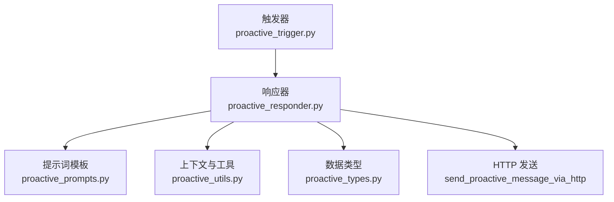
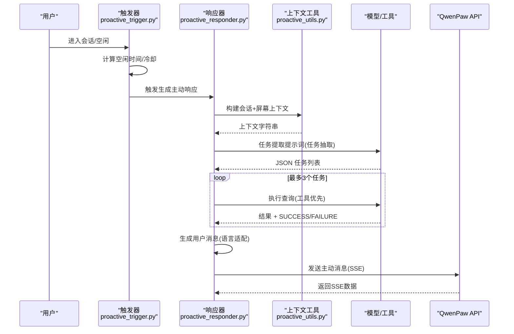
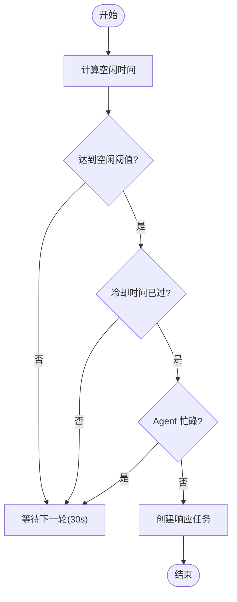
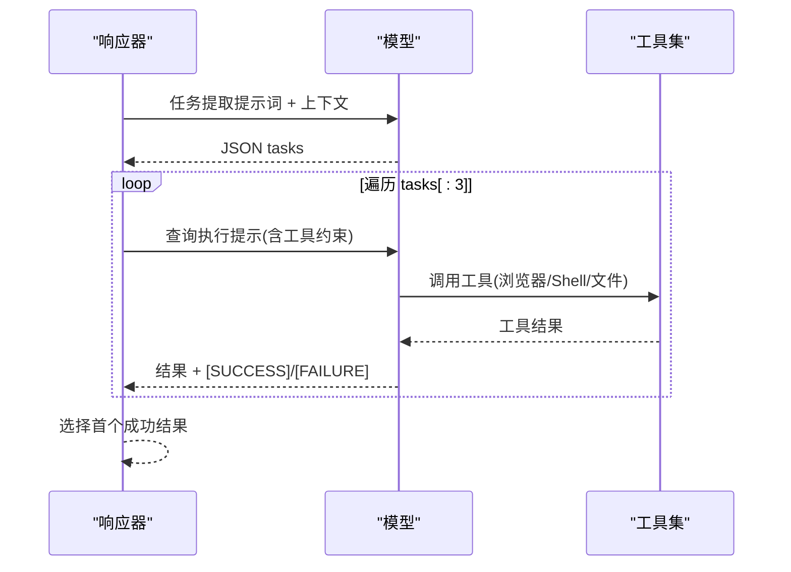
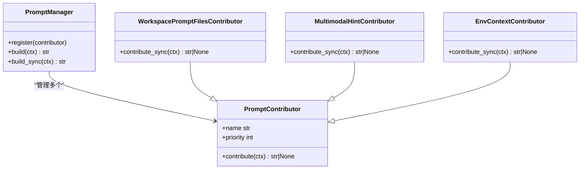
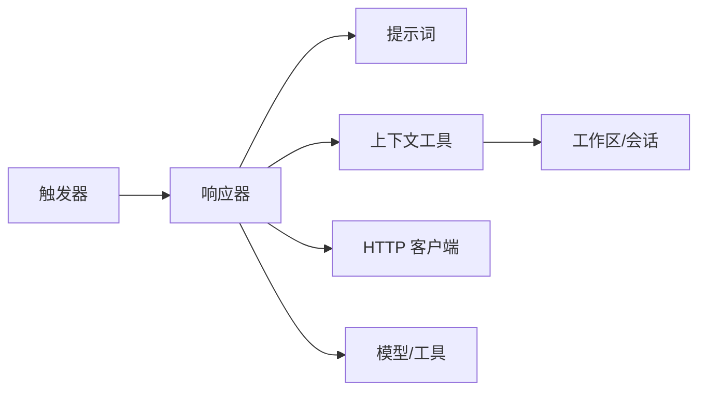

# 提示词引擎

<cite>
**本文引用的文件**
- [proactive_prompts.py](file://tongtian-tauri/src/agent/agents/memory/proactive/proactive_prompts.py)
- [proactive_responder.py](file://tongtian-tauri/src/agent/agents/memory/proactive/proactive_responder.py)
- [proactive_trigger.py](file://tongtian-tauri/src/agent/agents/memory/proactive/proactive_trigger.py)
- [proactive_types.py](file://tongtian-tauri/src/agent/agents/memory/proactive/proactive_types.py)
- [proactive_utils.py](file://tongtian-tauri/src/agent/agents/memory/proactive/proactive_utils.py)
- [prompt_manager.py](file://tongtian-tauri/src/agent/runtime/prompt_manager.py)
- [prompt_contributors.py](file://tongtian-tauri/src/agent/runtime/prompt_contributors.py)
- [adbpg_prompts.py](file://tongtian-tauri/src/agent/agents/memory/adbpg_prompts.py)
- [base_memory_manager.py](file://tongtian-tauri/src/agent/agents/memory/base_memory_manager.py)
- [config.py](file://tongtian-tauri/src/agent/config/config.py)
</cite>

## 目录
1. [简介](#简介)
2. [项目结构](#项目结构)
3. [核心组件](#核心组件)
4. [架构总览](#架构总览)
5. [详细组件分析](#详细组件分析)
6. [依赖关系分析](#依赖关系分析)
7. [性能考量](#性能考量)
8. [故障排查指南](#故障排查指南)
9. [结论](#结论)
10. [附录](#附录)

## 简介
本文件面向“主动记忆提示词引擎”，系统性阐述其设计原则、模板结构与运行机制，覆盖任务提取提示词、用户消息生成提示词等关键模块；说明变量替换机制、语言适配策略、上下文注入方式；并给出版本管理、A/B 测试支持建议与性能优化技巧。同时提供编写指南与调试方法，帮助按业务需求定制和优化提示词效果。

## 项目结构
主动记忆提示词引擎位于 agents/memory/proactive 子系统中，围绕“触发—响应—工具执行—消息发送”的闭环构建：
- 触发器（Trigger）：基于空闲时长与活动状态检测是否发起主动提示。
- 响应器（Responder）：组装上下文、调用模型进行任务提取与查询执行，最终生成用户可见的主动消息。
- 提示词（Prompts）：定义任务提取与用户消息生成的模板。
- 类型（Types）：统一数据结构描述配置、任务与查询结果。
- 工具与上下文（Utils）：会话/屏幕上下文构建、JSON 安全解析、时区处理、忙碌检测等。

图表来源
- [proactive_trigger.py:27-48](file://tongtian-tauri/src/agent/agents/memory/proactive/proactive_trigger.py#L27-L48)
- [proactive_responder.py:41-98](file://tongtian-tauri/src/agent/agents/memory/proactive/proactive_responder.py#L41-L98)
- [proactive_prompts.py:4-73](file://tongtian-tauri/src/agent/agents/memory/proactive/proactive_prompts.py#L4-L73)
- [proactive_utils.py:39-80](file://tongtian-tauri/src/agent/agents/memory/proactive/proactive_utils.py#L39-L80)
- [proactive_types.py:9-38](file://tongtian-tauri/src/agent/agents/memory/proactive/proactive_types.py#L9-L38)

章节来源
- [proactive_trigger.py:27-48](file://tongtian-tauri/src/agent/agents/memory/proactive/proactive_trigger.py#L27-L48)
- [proactive_responder.py:41-98](file://tongtian-tauri/src/agent/agents/memory/proactive/proactive_responder.py#L41-L98)
- [proactive_prompts.py:4-73](file://tongtian-tauri/src/agent/agents/memory/proactive/proactive_prompts.py#L4-L73)
- [proactive_utils.py:39-80](file://tongtian-tauri/src/agent/agents/memory/proactive/proactive_utils.py#L39-L80)
- [proactive_types.py:9-38](file://tongtian-tauri/src/agent/agents/memory/proactive/proactive_types.py#L9-L38)

## 核心组件
- 提示词模板层
  - 任务提取提示词：从历史会话与当前屏幕内容中抽取 1–3 个高优先级目标，并为每个目标生成具体可执行的下一步查询。
  - 用户消息生成提示词：将收集到的信息组织为友好、不侵入的主动消息，并以指定语言输出，且以固定标识开头便于识别。
- 上下文构建层
  - 会话上下文：读取最近会话元数据，过滤近 N 天会话，收集并格式化消息，限制最大消息数与字符数。
  - 屏幕上下文：若模型支持多模态，截取桌面截图并进行活动分析，作为额外上下文注入。
- 触发与调度层
  - 空闲阈值判定：根据最后用户交互时间与模式启用时间判断是否触发。
  - 防抖与并发控制：冷却时间、运行中标记避免重复触发。
  - 中断检测：在长流程中检查是否有新的用户活动或 Agent 忙碌，及时中止。
- 执行与发送层
  - 任务执行：通过内置工具（浏览器、文件读取、Shell、可选截图）获取信息，要求严格以成功/失败标记结尾。
  - 消息发送：通过 HTTP 直接调用 QwenPaw API 控制台接口，使用 SSE 流式接收数据。

章节来源
- [proactive_prompts.py:4-73](file://tongtian-tauri/src/agent/agents/memory/proactive/proactive_prompts.py#L4-L73)
- [proactive_utils.py:39-80](file://tongtian-tauri/src/agent/agents/memory/proactive/proactive_utils.py#L39-L80)
- [proactive_trigger.py:125-146](file://tongtian-tauri/src/agent/agents/memory/proactive/proactive_trigger.py#L125-L146)
- [proactive_responder.py:192-222](file://tongtian-tauri/src/agent/agents/memory/proactive/proactive_responder.py#L192-L222)
- [proactive_responder.py:250-320](file://tongtian-tauri/src/agent/agents/memory/proactive/proactive_responder.py#L250-L320)

## 架构总览
下图展示了主动记忆提示词引擎的整体调用链路与数据流向：

图表来源
- [proactive_trigger.py:218-292](file://tongtian-tauri/src/agent/agents/memory/proactive/proactive_trigger.py#L218-L292)
- [proactive_responder.py:41-98](file://tongtian-tauri/src/agent/agents/memory/proactive/proactive_responder.py#L41-L98)
- [proactive_utils.py:39-80](file://tongtian-tauri/src/agent/agents/memory/proactive/proactive_utils.py#L39-L80)
- [proactive_responder.py:150-173](file://tongtian-tauri/src/agent/agents/memory/proactive/proactive_responder.py#L150-L173)
- [proactive_responder.py:192-222](file://tongtian-tauri/src/agent/agents/memory/proactive/proactive_responder.py#L192-L222)
- [proactive_responder.py:250-320](file://tongtian-tauri/src/agent/agents/memory/proactive/proactive_responder.py#L250-L320)

## 详细组件分析

### 提示词模板与变量替换机制
- 任务提取提示词
  - 输入：会话上下文与可选屏幕内容（倒序）。
  - 输出：JSON 数组，包含任务描述、具体查询、原因。
  - 约束：仅基于用户请求或消息；不重复已有上下文；不直接使用工具；至少返回一个任务。
  - 变量：无显式占位符，但会在运行时拼接 #Contexts: {memory_context}。
- 用户消息生成提示词
  - 输入：{gathered_info}（查询与结果）、{language}（来自代理配置）。
  - 输出：以 “[PROACTIVE] ” 开头的自然语言消息，语气友好且不侵入。
  - 语言适配：通过代理配置的 language 字段注入到模板。

变量替换位置与方式
- 任务提取：在 _extract_tasks_from_memory 中将 memory_context 拼接到提示词末尾。
- 用户消息：在 _generate_final_message 中使用 .format(gathered_info=..., language=...) 注入。

章节来源
- [proactive_prompts.py:4-73](file://tongtian-tauri/src/agent/agents/memory/proactive/proactive_prompts.py#L4-L73)
- [proactive_responder.py:150-173](file://tongtian-tauri/src/agent/agents/memory/proactive/proactive_responder.py#L150-L173)
- [proactive_responder.py:225-247](file://tongtian-tauri/src/agent/agents/memory/proactive/proactive_responder.py#L225-L247)

### 上下文注入方式
- 会话上下文
  - 读取聊天会话元数据，过滤最近 N 天会话，收集消息并按时间倒序排序，限制最大消息数与字符数。
  - 清理系统消息与非文本块，去除主动助手请求的内容，避免污染上下文。
- 屏幕上下文
  - 若模型支持多模态，捕获桌面截图并通过多模态消息进行分析，得到当前桌面活动摘要。
- 组合上下文
  - 将屏幕上下文与会话上下文合并为统一的 memory_context 字符串，供任务提取提示词使用。

章节来源
- [proactive_utils.py:39-80](file://tongtian-tauri/src/agent/agents/memory/proactive/proactive_utils.py#L39-L80)
- [proactive_utils.py:248-327](file://tongtian-tauri/src/agent/agents/memory/proactive/proactive_utils.py#L248-L327)
- [proactive_utils.py:329-430](file://tongtian-tauri/src/agent/agents/memory/proactive/proactive_utils.py#L329-L430)

### 触发与调度逻辑
- 空闲阈值与冷却
  - 基于 last_user_interaction 与 mode_enabled_time 计算是否达到 idle_minutes。
  - 冷却时间：两次尝试之间至少间隔 60 秒，避免频繁触发。
- 并发与中断
  - running_task_id 防止重复执行；_was_interrupted 在长流程中检测新活动或忙碌状态，必要时中止。
- 轮询循环
  - 每 30 秒检查一次，结合 is_agent_busy 与 get_last_message_ts 决定是否触发。

图表来源
- [proactive_trigger.py:125-146](file://tongtian-tauri/src/agent/agents/memory/proactive/proactive_trigger.py#L125-L146)
- [proactive_trigger.py:148-215](file://tongtian-tauri/src/agent/agents/memory/proactive/proactive_trigger.py#L148-L215)
- [proactive_trigger.py:218-292](file://tongtian-tauri/src/agent/agents/memory/proactive/proactive_trigger.py#L218-L292)
- [proactive_responder.py:323-358](file://tongtian-tauri/src/agent/agents/memory/proactive/proactive_responder.py#L323-L358)

章节来源
- [proactive_trigger.py:125-146](file://tongtian-tauri/src/agent/agents/memory/proactive/proactive_trigger.py#L125-L146)
- [proactive_trigger.py:148-215](file://tongtian-tauri/src/agent/agents/memory/proactive/proactive_trigger.py#L148-L215)
- [proactive_trigger.py:218-292](file://tongtian-tauri/src/agent/agents/memory/proactive/proactive_trigger.py#L218-L292)
- [proactive_responder.py:323-358](file://tongtian-tauri/src/agent/agents/memory/proactive/proactive_responder.py#L323-L358)

### 任务提取与查询执行
- 任务提取
  - 将 memory_context 注入任务提取提示词，调用模型回复，解析 JSON 并转换为 ProactiveTask 列表。
  - 容错：支持代码块包裹的 JSON 与正则提取对象。
- 查询执行
  - 构造强约束提示，要求以 [SUCCESS] 或 [FAILURE] 结尾，确保结果可判读。
  - 工具优先级：优先浏览器使用，必要时再使用 Shell/文件读取。
- 结果聚合
  - 取第一个成功且有数据的任务结果用于生成最终消息。

图表来源
- [proactive_responder.py:150-173](file://tongtian-tauri/src/agent/agents/memory/proactive/proactive_responder.py#L150-L173)
- [proactive_responder.py:192-222](file://tongtian-tauri/src/agent/agents/memory/proactive/proactive_responder.py#L192-L222)

章节来源
- [proactive_responder.py:150-173](file://tongtian-tauri/src/agent/agents/memory/proactive/proactive_responder.py#L150-L173)
- [proactive_responder.py:192-222](file://tongtian-tauri/src/agent/agents/memory/proactive/proactive_responder.py#L192-L222)

### 用户消息生成与发送
- 生成
  - 将查询与结果组装为 gathered_info，注入用户消息提示词，按 agent 配置的语言输出。
  - 强制以 “[PROACTIVE] ” 开头，便于后续识别与去重。
- 发送
  - 通过 HTTP POST 调用 QwenPaw 控制台接口，携带 session_id 与 X-Agent-Id 头。
  - 使用 aiohttp 客户端超时配置，解析 SSE data 行，记录日志。

章节来源
- [proactive_responder.py:225-247](file://tongtian-tauri/src/agent/agents/memory/proactive/proactive_responder.py#L225-L247)
- [proactive_responder.py:250-320](file://tongtian-tauri/src/agent/agents/memory/proactive/proactive_responder.py#L250-L320)

### 内存提示与系统提示装配
- 内存提示
  - ADBPG 后端提供中英文记忆指导提示，引导模型在回答前检索云端长期记忆，强调自动记录与主动检索。
- 系统提示装配
  - PromptManager 按优先级顺序聚合多个贡献者片段，形成最终系统提示。
  - 贡献者包括身份、工作区文件、多模态提示、编码模式、滚动上下文、环境上下文等。
  - 支持从工作区 Markdown 文件中加载 AGENTS.md/SOUL.md/PROFILE.md，并处理心跳与内存段。

图表来源
- [prompt_manager.py:26-137](file://tongtian-tauri/src/agent/runtime/prompt_manager.py#L26-L137)
- [prompt_contributors.py:129-398](file://tongtian-tauri/src/agent/runtime/prompt_contributors.py#L129-L398)

章节来源
- [adbpg_prompts.py:5-70](file://tongtian-tauri/src/agent/agents/memory/adbpg_prompts.py#L5-L70)
- [prompt_manager.py:26-137](file://tongtian-tauri/src/agent/runtime/prompt_manager.py#L26-L137)
- [prompt_contributors.py:129-398](file://tongtian-tauri/src/agent/runtime/prompt_contributors.py#L129-L398)

### 类型与配置
- 类型
  - ProactiveConfig：启用标志、空闲阈值、最后交互时间、运行任务 ID、模式启用时间。
  - ProactiveTask：任务描述、查询、优先级、原因。
  - ProactiveQueryResult：查询、成功标志、数据、错误。
- 配置
  - 代理配置中的 language 字段用于语言适配。
  - 运行期上下文（如 light_context_config）影响上下文压缩与 token 估算。

章节来源
- [proactive_types.py:9-38](file://tongtian-tauri/src/agent/agents/memory/proactive/proactive_types.py#L9-L38)
- [config.py:748-777](file://tongtian-tauri/src/agent/config/config.py#L748-L777)

## 依赖关系分析
- 模块耦合
  - 触发器依赖响应器与工具函数（忙碌检测、最后消息时间戳）。
  - 响应器依赖提示词模板、上下文工具、类型定义与 HTTP 发送。
  - 上下文工具依赖工作区、会话管理器、模型能力探测。
- 外部依赖
  - aiohttp 用于 HTTP 请求与 SSE 流式读取。
  - AgentScope 的 Agent、Msg、Tool 等基础能力。
- 潜在循环与解耦
  - 通过类型与工具抽象降低耦合；响应器内部延迟导入以避免启动时循环依赖。

图表来源
- [proactive_trigger.py:1-292](file://tongtian-tauri/src/agent/agents/memory/proactive/proactive_trigger.py#L1-L292)
- [proactive_responder.py:1-358](file://tongtian-tauri/src/agent/agents/memory/proactive/proactive_responder.py#L1-L358)
- [proactive_utils.py:1-452](file://tongtian-tauri/src/agent/agents/memory/proactive/proactive_utils.py#L1-L452)

章节来源
- [proactive_trigger.py:1-292](file://tongtian-tauri/src/agent/agents/memory/proactive/proactive_trigger.py#L1-L292)
- [proactive_responder.py:1-358](file://tongtian-tauri/src/agent/agents/memory/proactive/proactive_responder.py#L1-L358)
- [proactive_utils.py:1-452](file://tongtian-tauri/src/agent/agents/memory/proactive/proactive_utils.py#L1-L452)

## 性能考量
- 上下文裁剪
  - 限制会话消息数量与字符上限，避免超出模型上下文窗口。
  - 过滤系统消息与非文本块，减少无效内容。
- 工具调用成本
  - 优先浏览器使用，仅在必要时调用 Shell/文件读取，降低开销。
  - 对截图与分析仅在多模态可用时启用，避免不必要的 I/O。
- 并发与中断
  - 冷却时间与运行中标记避免重复触发；长流程中检测中断及时退出，节省资源。
- 网络超时
  - HTTP 请求设置超时，避免阻塞；SSE 流式读取只保留最后一条有效数据。

章节来源
- [proactive_utils.py:39-80](file://tongtian-tauri/src/agent/agents/memory/proactive/proactive_utils.py#L39-L80)
- [proactive_responder.py:192-222](file://tongtian-tauri/src/agent/agents/memory/proactive/proactive_responder.py#L192-L222)
- [proactive_responder.py:250-320](file://tongtian-tauri/src/agent/agents/memory/proactive/proactive_responder.py#L250-L320)
- [proactive_trigger.py:148-215](file://tongtian-tauri/src/agent/agents/memory/proactive/proactive_trigger.py#L148-L215)

## 故障排查指南
- 常见问题定位
  - 未触发：检查空闲阈值、冷却时间、Agent 忙碌状态与最后消息时间戳。
  - 任务提取失败：查看模型返回是否为合法 JSON；确认上下文是否非空。
  - 查询执行失败：确认工具可用性；检查提示词约束与结果标记格式。
  - 消息发送失败：核对 API Base URL、Session ID、超时配置与 SSE 数据解析。
- 日志与断点
  - 关注触发器与响应器的异常日志；在 _was_interrupted、send_proactive_message_via_http 等处添加断点。
- 回退策略
  - JSON 解析失败时尝试正则提取对象；截图失败时降级为仅会话上下文。

章节来源
- [proactive_trigger.py:218-292](file://tongtian-tauri/src/agent/agents/memory/proactive/proactive_trigger.py#L218-L292)
- [proactive_responder.py:150-173](file://tongtian-tauri/src/agent/agents/memory/proactive/proactive_responder.py#L150-L173)
- [proactive_responder.py:250-320](file://tongtian-tauri/src/agent/agents/memory/proactive/proactive_responder.py#L250-L320)
- [proactive_utils.py:195-232](file://tongtian-tauri/src/agent/agents/memory/proactive/proactive_utils.py#L195-L232)

## 结论
主动记忆提示词引擎通过“触发—响应—执行—发送”的闭环，结合会话与屏幕上下文，实现智能的任务提取与用户友好的主动消息推送。其模块化设计便于扩展与维护，配合系统提示装配与内存提示，形成完整的提示词工程体系。在生产环境中，应重点关注上下文裁剪、工具调用成本、并发控制与网络稳定性，以确保高效稳定的主动记忆体验。

## 附录

### 提示词版本管理与 A/B 测试支持建议
- 版本管理
  - 将提示词模板独立为可版本化的资源（例如按功能域分文件），并在运行时通过配置选择版本。
  - 在 PromptManager 中引入“版本化贡献者”，按 agent 配置切换不同版本的提示片段。
- A/B 测试
  - 在触发器或响应器中加入实验分流逻辑，按 session_id 或用户分组选择不同提示版本。
  - 记录每次触发的提示版本、上下文长度、工具调用次数与成功率，用于评估效果。
- 最佳实践
  - 保持提示词最小变更原则，逐步迭代；对关键路径（任务提取、用户消息）进行回归测试。
  - 结合内存提示（ADBPG）与系统提示装配，确保模型具备一致的长期记忆与行为指引。

章节来源
- [prompt_manager.py:26-137](file://tongtian-tauri/src/agent/runtime/prompt_manager.py#L26-L137)
- [prompt_contributors.py:129-398](file://tongtian-tauri/src/agent/runtime/prompt_contributors.py#L129-L398)
- [adbpg_prompts.py:5-70](file://tongtian-tauri/src/agent/agents/memory/adbpg_prompts.py#L5-L70)

### 提示词编写指南与调试方法
- 编写指南
  - 明确输入输出契约：任务提取需返回结构化 JSON；用户消息需以固定标识开头。
  - 强化约束：禁止重复上下文、禁止凭空猜测、要求工具优先。
  - 语言适配：通过 {language} 注入，确保本地化一致性。
- 调试方法
  - 打印上下文字符串与模型返回，验证 JSON 合法性与任务质量。
  - 逐步关闭屏幕上下文，观察效果变化；调整空闲阈值与冷却时间，平衡触发频率。
  - 使用 HTTP 客户端模拟发送，校验 SSE 数据解析与超时配置。

章节来源
- [proactive_prompts.py:4-73](file://tongtian-tauri/src/agent/agents/memory/proactive/proactive_prompts.py#L4-L73)
- [proactive_responder.py:150-173](file://tongtian-tauri/src/agent/agents/memory/proactive/proactive_responder.py#L150-L173)
- [proactive_responder.py:250-320](file://tongtian-tauri/src/agent/agents/memory/proactive/proactive_responder.py#L250-L320)