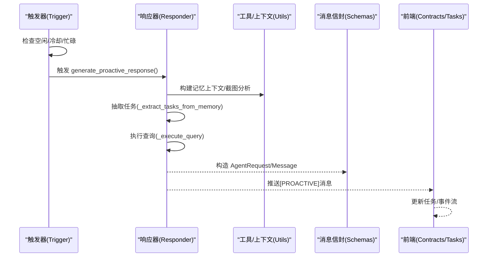
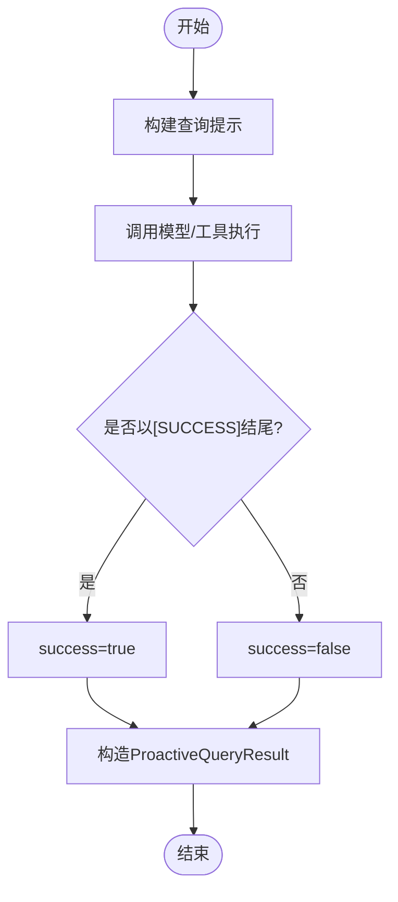
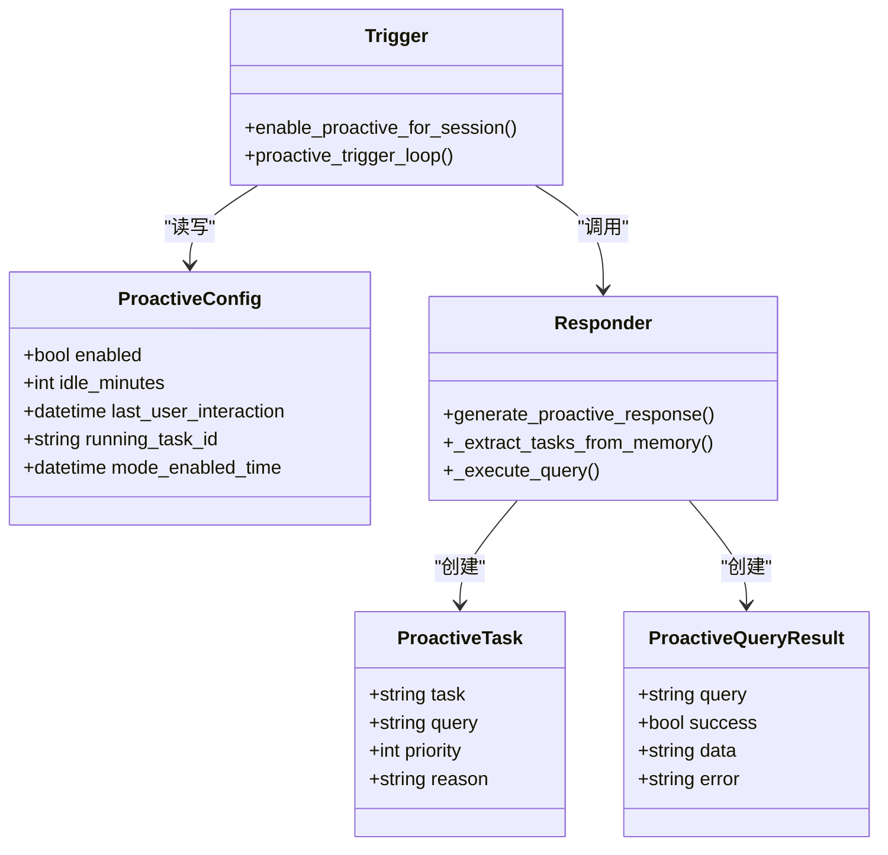
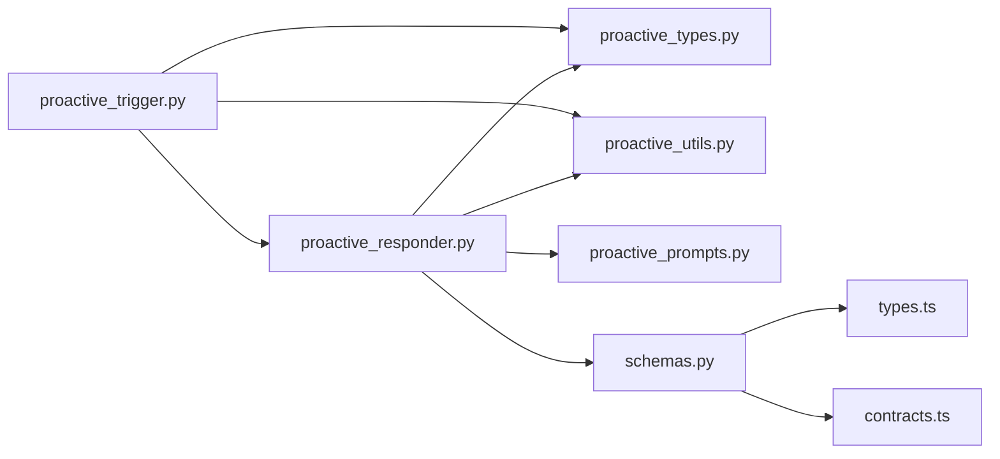

# 类型定义

<cite>
**本文引用的文件**
- [proactive_types.py](file://tongtian-tauri/src/agent/agents/memory/proactive/proactive_types.py)
- [proactive_trigger.py](file://tongtian-tauri/src/agent/agents/memory/proactive/proactive_trigger.py)
- [proactive_responder.py](file://tongtian-tauri/src/agent/agents/memory/proactive/proactive_responder.py)
- [proactive_utils.py](file://tongtian-tauri/src/agent/agents/memory/proactive/proactive_utils.py)
- [proactive_prompts.py](file://tongtian-tauri/src/agent/agents/memory/proactive/proactive_prompts.py)
- [schemas.py](file://tongtian-tauri/src/agent/schemas.py)
- [types.ts](file://tongtian-tauri/src/shared/types.ts)
- [contracts.ts](file://tongtian-tauri/src/shared/contracts.ts)
</cite>

## 目录
1. [简介](#简介)
2. [项目结构](#项目结构)
3. [核心组件](#核心组件)
4. [架构总览](#架构总览)
5. [详细组件分析](#详细组件分析)
6. [依赖关系分析](#依赖关系分析)
7. [性能考虑](#性能考虑)
8. [故障排查指南](#故障排查指南)
9. [结论](#结论)
10. [附录](#附录)

## 简介
本文件聚焦“主动记忆系统”的类型定义与使用规范，覆盖以下目标：
- 明确 ProactiveConfig、ProactiveTask、ProactiveQueryResult 等核心类型的字段含义、数据类型、约束条件与默认值。
- 说明类型在触发器、响应器、工具与跨进程通信中的传递与验证方式。
- 提供类型扩展方法与兼容性策略，确保前后端与多语言模块间的契约稳定演进。

## 项目结构
主动记忆系统位于 Python Agent 侧的 memory/proactive 子系统中，配合前端共享类型与后端消息信封，形成端到端的类型契约。

```mermaid
graph TB
subgraph "Python 主动记忆"
PT["proactive_types.py<br/>核心数据类"]
TR["proactive_trigger.py<br/>触发循环与调度"]
RS["proactive_responder.py<br/>任务提取/查询/回复"]
UT["proactive_utils.py<br/>上下文构建/工具辅助"]
PR["proactive_prompts.py<br/>提示词模板"]
end
subgraph "协议与契约"
SC["schemas.py<br/>Agent 请求/响应信封"]
TS["types.ts<br/>前端共享类型"]
CT["contracts.ts<br/>IPC 契约与事件"]
end
PT --> TR
PT --> RS
UT --> RS
PR --> RS
RS --> SC
TR --> UT
TS < --> CT
```

图表来源
- [proactive_types.py:1-38](file://tongtian-tauri/src/agent/agents/memory/proactive/proactive_types.py#L1-L38)
- [proactive_trigger.py:1-292](file://tongtian-tauri/src/agent/agents/memory/proactive/proactive_trigger.py#L1-L292)
- [proactive_responder.py:1-358](file://tongtian-tauri/src/agent/agents/memory/proactive/proactive_responder.py#L1-L358)
- [proactive_utils.py:1-452](file://tongtian-tauri/src/agent/agents/memory/proactive/proactive_utils.py#L1-L452)
- [proactive_prompts.py:1-74](file://tongtian-tauri/src/agent/agents/memory/proactive/proactive_prompts.py#L1-L74)
- [schemas.py:1-296](file://tongtian-tauri/src/agent/schemas.py#L1-L296)
- [types.ts:1-346](file://tongtian-tauri/src/shared/types.ts#L1-L346)
- [contracts.ts:1-587](file://tongtian-tauri/src/shared/contracts.ts#L1-L587)

章节来源
- [proactive_types.py:1-38](file://tongtian-tauri/src/agent/agents/memory/proactive/proactive_types.py#L1-L38)
- [proactive_trigger.py:1-292](file://tongtian-tauri/src/agent/agents/memory/proactive/proactive_trigger.py#L1-L292)
- [proactive_responder.py:1-358](file://tongtian-tauri/src/agent/agents/memory/proactive/proactive_responder.py#L1-L358)
- [proactive_utils.py:1-452](file://tongtian-tauri/src/agent/agents/memory/proactive/proactive_utils.py#L1-L452)
- [proactive_prompts.py:1-74](file://tongtian-tauri/src/agent/agents/memory/proactive/proactive_prompts.py#L1-L74)
- [schemas.py:1-296](file://tongtian-tauri/src/agent/schemas.py#L1-L296)
- [types.ts:1-346](file://tongtian-tauri/src/shared/types.ts#L1-L346)
- [contracts.ts:1-587](file://tongtian-tauri/src/shared/contracts.ts#L1-L587)

## 核心组件
本节梳理主动记忆系统的核心类型及其职责边界。

- ProactiveConfig（会话级配置）
  - enabled: 是否启用主动模式
  - idle_minutes: 空闲阈值（分钟），用于判定是否触发
  - last_user_interaction: 上次用户交互时间（UTC）
  - running_task_id: 当前运行任务标识（防重入）
  - mode_enabled_time: 模式开启时间（UTC）
  - 默认值：enabled=False；其余为可选或运行时填充

- ProactiveTask（从记忆中抽取的任务）
  - task: 任务简述
  - query: 具体可执行的查询语句
  - priority: 优先级（数值越小优先级越高）
  - reason: 生成该任务的依据

- ProactiveQueryResult（执行查询的结果）
  - query: 原始查询
  - success: 是否成功（由响应末尾标记判定）
  - data: 返回内容（字符串）
  - error: 错误信息（可选）

- 相关枚举与信封（跨进程/HTTP）
  - schemas.Message / AgentRequest / AgentResponse：统一的消息与请求/响应信封
  - Role / MessageType / ContentType / RunStatus：消息角色、类型、内容类型与状态
  - types.ts TaskStatus / PlanStatus / StepStatus 等：前端任务与步骤状态机
  - contracts.ts ChatEvent / IPC_CHANNELS：事件流与通道名

章节来源
- [proactive_types.py:9-38](file://tongtian-tauri/src/agent/agents/memory/proactive/proactive_types.py#L9-L38)
- [schemas.py:23-131](file://tongtian-tauri/src/agent/schemas.py#L23-L131)
- [schemas.py:199-274](file://tongtian-tauri/src/agent/schemas.py#L199-L274)
- [types.ts:4-81](file://tongtian-tauri/src/shared/types.ts#L4-L81)
- [contracts.ts:146-158](file://tongtian-tauri/src/shared/contracts.ts#L146-L158)

## 架构总览
主动记忆系统通过“触发器—响应器—工具—输出”的流水线工作：
- 触发器周期性检测空闲与冷却，决定是否发起主动响应。
- 响应器基于会话上下文与屏幕分析，调用 LLM 抽取任务并执行查询。
- 查询结果经格式化后通过 HTTP 推送到控制台聊天入口。
- 前端通过共享类型与事件流消费状态变更。



图表来源
- [proactive_trigger.py:125-215](file://tongtian-tauri/src/agent/agents/memory/proactive/proactive_trigger.py#L125-L215)
- [proactive_responder.py:41-98](file://tongtian-tauri/src/agent/agents/memory/proactive/proactive_responder.py#L41-L98)
- [proactive_utils.py:39-80](file://tongtian-tauri/src/agent/agents/memory/proactive/proactive_utils.py#L39-L80)
- [schemas.py:247-274](file://tongtian-tauri/src/agent/schemas.py#L247-L274)
- [contracts.ts:146-158](file://tongtian-tauri/src/shared/contracts.ts#L146-L158)

## 详细组件分析

### 类型：ProactiveConfig
- 用途：管理单个会话的主动模式开关、空闲阈值、最近交互时间与运行态。
- 关键字段与约束
  - enabled: 布尔，控制是否进入主动流程
  - idle_minutes: 整数，必须大于 0（建议最小 1）
  - last_user_interaction: UTC 时间，若为空则回退到模式开启时间
  - running_task_id: 字符串，防止并发重复触发
  - mode_enabled_time: UTC 时间，用于计算“自开启以来的空闲时长”
- 默认值：enabled=False；其余为 Optional，运行时填充
- 使用示例路径
  - 创建与启用：[enable_proactive_for_session:27-48](file://tongtian-tauri/src/agent/agents/memory/proactive/proactive_trigger.py#L27-L48)
  - 读取与判断：[_should_trigger_proactive:125-145](file://tongtian-tauri/src/agent/agents/memory/proactive/proactive_trigger.py#L125-L145)

章节来源
- [proactive_types.py:9-18](file://tongtian-tauri/src/agent/agents/memory/proactive/proactive_types.py#L9-L18)
- [proactive_trigger.py:27-48](file://tongtian-tauri/src/agent/agents/memory/proactive/proactive_trigger.py#L27-L48)
- [proactive_trigger.py:125-145](file://tongtian-tauri/src/agent/agents/memory/proactive/proactive_trigger.py#L125-L145)

### 类型：ProactiveTask
- 用途：表示从历史上下文中推断出的高价值任务。
- 关键字段与约束
  - task: 非空字符串，描述目标
  - query: 非空字符串，具体可执行查询
  - priority: 正整数，越小越优先（由抽取顺序+1保证）
  - reason: 可选字符串，解释原因
- 构造路径
  - 从 LLM 输出解析并构造：[_create_tasks_from_data:176-189](file://tongtian-tauri/src/agent/agents/memory/proactive/proactive_responder.py#L176-L189)
- 使用示例路径
  - 任务抽取：[_extract_tasks_from_memory:150-173](file://tongtian-tauri/src/agent/agents/memory/proactive/proactive_responder.py#L150-L173)

章节来源
- [proactive_types.py:20-28](file://tongtian-tauri/src/agent/agents/memory/proactive/proactive_types.py#L20-L28)
- [proactive_responder.py:150-189](file://tongtian-tauri/src/agent/agents/memory/proactive/proactive_responder.py#L150-L189)

### 类型：ProactiveQueryResult
- 用途：封装一次查询的执行结果。
- 关键字段与约束
  - query: 原始查询
  - success: 根据响应末尾标记判定
  - data: 文本结果（可能为空）
  - error: 可选错误信息
- 构造路径
  - 执行查询后构造：[_execute_query:192-222](file://tongtian-tauri/src/agent/agents/memory/proactive/proactive_responder.py#L192-L222)
- 使用示例路径
  - 结果聚合与最终消息生成：[generate_proactive_response:41-98](file://tongtian-tauri/src/agent/agents/memory/proactive/proactive_responder.py#L41-L98)

章节来源
- [proactive_types.py:30-38](file://tongtian-tauri/src/agent/agents/memory/proactive/proactive_types.py#L30-L38)
- [proactive_responder.py:192-222](file://tongtian-tauri/src/agent/agents/memory/proactive/proactive_responder.py#L192-L222)
- [proactive_responder.py:41-98](file://tongtian-tauri/src/agent/agents/memory/proactive/proactive_responder.py#L41-L98)

### 类型：消息信封与事件（跨进程/HTTP）
- schemas.Message / AgentRequest / AgentResponse
  - Message：包含 id、type、role、content、status、metadata
  - AgentRequest：input、session_id、user_id、stream、metadata
  - AgentResponse：id、output、status、created_at、completed_at、metadata
- Role / MessageType / ContentType / RunStatus：统一枚举
- 前端类型与事件
  - types.ts：TaskStatus、PlanStatus、StepStatus、Message、ChatEvent 等
  - contracts.ts：ChatEvent 联合类型、IPC_CHANNELS、错误码等

章节来源
- [schemas.py:23-131](file://tongtian-tauri/src/agent/schemas.py#L23-L131)
- [schemas.py:199-274](file://tongtian-tauri/src/agent/schemas.py#L199-L274)
- [types.ts:4-81](file://tongtian-tauri/src/shared/types.ts#L4-L81)
- [types.ts:147-187](file://tongtian-tauri/src/shared/types.ts#L147-L187)
- [contracts.ts:146-158](file://tongtian-tauri/src/shared/contracts.ts#L146-L158)
- [contracts.ts:480-584](file://tongtian-tauri/src/shared/contracts.ts#L480-L584)

### 触发器流程（时序图）
```mermaid
sequenceDiagram
participant Loop as "触发循环"
participant WS as "工作区"
participant TR as "触发逻辑"
participant RS as "响应器"
Loop->>Loop : 每30秒轮询
Loop->>WS : 获取最后消息时间/忙碌状态
Loop->>TR : 判断是否满足空闲/冷却/未重复
alt 满足
TR->>RS : 生成主动响应
RS-->>TR : 返回消息或None
else 不满足
TR-->>Loop : 继续等待
end
```

图表来源
- [proactive_trigger.py:218-292](file://tongtian-tauri/src/agent/agents/memory/proactive/proactive_trigger.py#L218-L292)
- [proactive_trigger.py:125-215](file://tongtian-tauri/src/agent/agents/memory/proactive/proactive_trigger.py#L125-L215)
- [proactive_responder.py:41-98](file://tongtian-tauri/src/agent/agents/memory/proactive/proactive_responder.py#L41-L98)

### 查询执行流程（流程图）


图表来源
- [proactive_responder.py:192-222](file://tongtian-tauri/src/agent/agents/memory/proactive/proactive_responder.py#L192-L222)

### 对象关系图（类与依赖）


图表来源
- [proactive_types.py:9-38](file://tongtian-tauri/src/agent/agents/memory/proactive/proactive_types.py#L9-L38)
- [proactive_trigger.py:27-48](file://tongtian-tauri/src/agent/agents/memory/proactive/proactive_trigger.py#L27-L48)
- [proactive_trigger.py:218-292](file://tongtian-tauri/src/agent/agents/memory/proactive/proactive_trigger.py#L218-L292)
- [proactive_responder.py:41-98](file://tongtian-tauri/src/agent/agents/memory/proactive/proactive_responder.py#L41-L98)
- [proactive_responder.py:150-222](file://tongtian-tauri/src/agent/agents/memory/proactive/proactive_responder.py#L150-L222)

## 依赖关系分析
- 模块内依赖
  - proactive_trigger 依赖 proactive_types 与 proactive_utils，并调用 proactive_responder
  - proactive_responder 依赖 proactive_types、proactive_prompts 与 proactive_utils
  - proactive_utils 提供内存上下文构建、时间处理、JSON 安全解析等通用能力
- 外部依赖
  - schemas 提供统一的 Agent 请求/响应信封，供 HTTP 推送
  - types.ts 与 contracts.ts 提供前端共享类型与事件契约，保障 UI 与后端一致



图表来源
- [proactive_trigger.py:1-292](file://tongtian-tauri/src/agent/agents/memory/proactive/proactive_trigger.py#L1-L292)
- [proactive_responder.py:1-358](file://tongtian-tauri/src/agent/agents/memory/proactive/proactive_responder.py#L1-L358)
- [proactive_utils.py:1-452](file://tongtian-tauri/src/agent/agents/memory/proactive/proactive_utils.py#L1-L452)
- [proactive_prompts.py:1-74](file://tongtian-tauri/src/agent/agents/memory/proactive/proactive_prompts.py#L1-L74)
- [schemas.py:1-296](file://tongtian-tauri/src/agent/schemas.py#L1-L296)
- [types.ts:1-346](file://tongtian-tauri/src/shared/types.ts#L1-L346)
- [contracts.ts:1-587](file://tongtian-tauri/src/shared/contracts.ts#L1-L587)

章节来源
- [proactive_trigger.py:1-292](file://tongtian-tauri/src/agent/agents/memory/proactive/proactive_trigger.py#L1-L292)
- [proactive_responder.py:1-358](file://tongtian-tauri/src/agent/agents/memory/proactive/proactive_responder.py#L1-L358)
- [proactive_utils.py:1-452](file://tongtian-tauri/src/agent/agents/memory/proactive/proactive_utils.py#L1-L452)
- [schemas.py:1-296](file://tongtian-tauri/src/agent/schemas.py#L1-L296)
- [types.ts:1-346](file://tongtian-tauri/src/shared/types.ts#L1-L346)
- [contracts.ts:1-587](file://tongtian-tauri/src/shared/contracts.ts#L1-L587)

## 性能考虑
- 触发频率：每 30 秒轮询一次，避免频繁 I/O
- 冷却机制：同一会话 60 秒内不重复触发，降低重复开销
- 并发保护：running_task_id 防止同会话并发执行
- 上下文裁剪：限制消息条数与字符上限，减少 LLM 输入成本
- 中断检测：在执行过程中检测用户活动，及时中止长耗时流程

章节来源
- [proactive_trigger.py:218-292](file://tongtian-tauri/src/agent/agents/memory/proactive/proactive_trigger.py#L218-L292)
- [proactive_responder.py:323-358](file://tongtian-tauri/src/agent/agents/memory/proactive/proactive_responder.py#L323-L358)
- [proactive_utils.py:39-80](file://tongtian-tauri/src/agent/agents/memory/proactive/proactive_utils.py#L39-L80)

## 故障排查指南
- 无法触发
  - 检查 enabled 是否为 True，idle_minutes 是否合理
  - 确认 last_user_interaction 与 mode_enabled_time 已正确设置
  - 查看是否处于冷却期或已有运行任务
- 查询失败
  - 检查 _execute_query 的响应是否以 [SUCCESS]/[FAILURE] 结尾
  - 确认工具可用性与网络连通性
- 推送失败
  - 检查 HTTP 超时与 API 地址拼接是否正确
  - 查看日志中是否有 SSE 数据接收异常
- 上下文构建异常
  - 检查会话状态读取与消息清洗逻辑
  - 确认多模态截图与分析流程是否成功

章节来源
- [proactive_trigger.py:125-215](file://tongtian-tauri/src/agent/agents/memory/proactive/proactive_trigger.py#L125-L215)
- [proactive_responder.py:192-222](file://tongtian-tauri/src/agent/agents/memory/proactive/proactive_responder.py#L192-L222)
- [proactive_responder.py:250-320](file://tongtian-tauri/src/agent/agents/memory/proactive/proactive_responder.py#L250-L320)
- [proactive_utils.py:83-114](file://tongtian-tauri/src/agent/agents/memory/proactive/proactive_utils.py#L83-L114)
- [proactive_utils.py:248-326](file://tongtian-tauri/src/agent/agents/memory/proactive/proactive_utils.py#L248-L326)

## 结论
主动记忆系统的类型设计围绕三个核心数据类展开，并通过触发器与响应器协同完成“感知—决策—执行—反馈”的闭环。结合统一的消息信封与前端共享类型，系统在跨进程与多语言环境下具备良好的可扩展性与兼容性。建议在后续演进中：
- 保持类型向后兼容（新增字段可选）
- 强化校验与错误码（如 ErrorCode）
- 完善监控与指标（触发成功率、延迟、中断率）

## 附录
- 类型扩展方法
  - 在 ProactiveConfig 中增加新开关或阈值时，保持默认值兼容旧版本
  - 在 ProactiveTask/ProactiveQueryResult 中追加可选字段，避免破坏现有解析
  - 在前端 types.ts 与 contracts.ts 中同步新增事件或字段，保持契约一致
- 最佳实践
  - 所有时间字段统一使用 UTC，并在必要时进行 ensure_tz_aware 转换
  - 对 LLM 输出进行严格解析与容错（JSON 安全解析、正则兜底）
  - 对外部调用设置超时与重试策略，记录详细日志便于定位问题