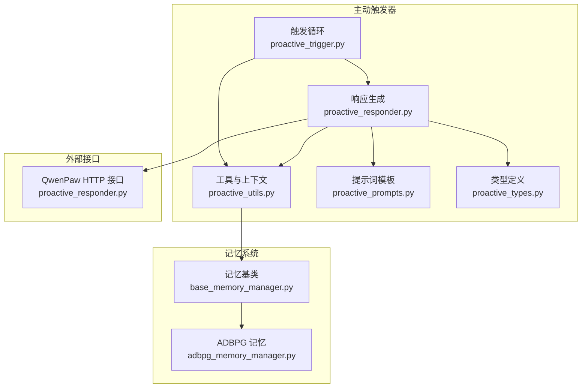
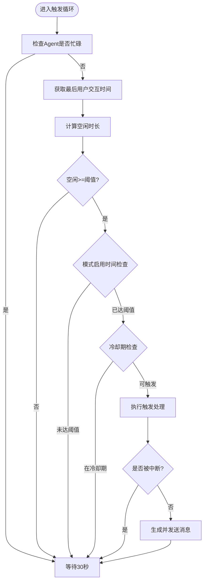
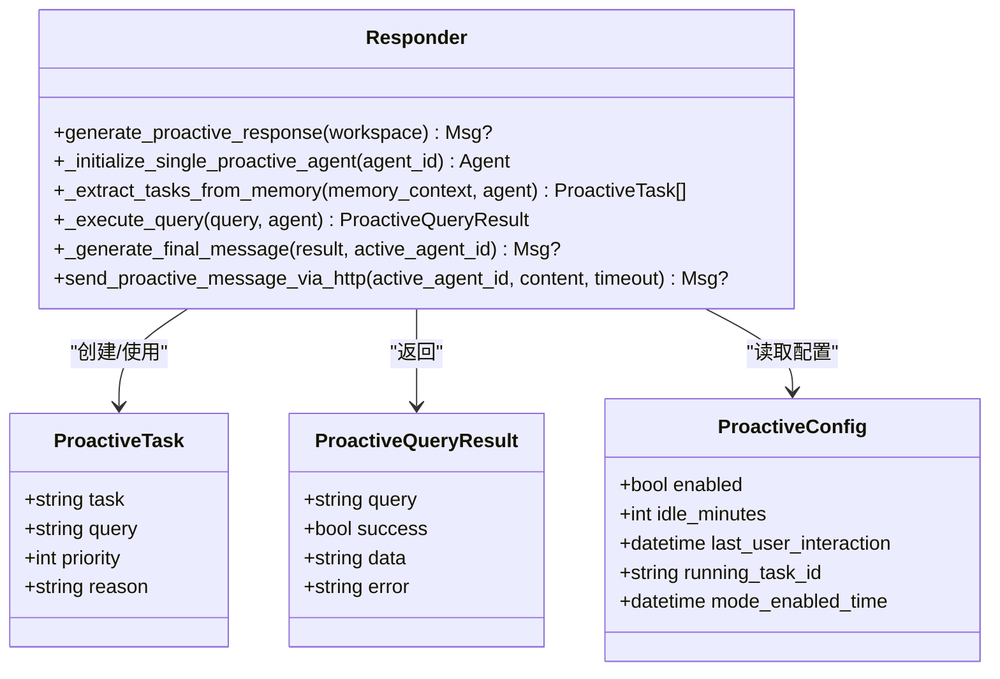
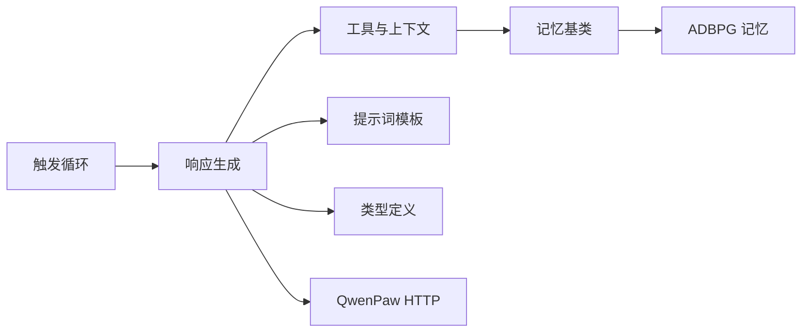

# 触发器系统

<cite>
**本文引用的文件**
- [proactive_trigger.py](file://tongtian-tauri/src/agent/agents/memory/proactive/proactive_trigger.py)
- [proactive_responder.py](file://tongtian-tauri/src/agent/agents/memory/proactive/proactive_responder.py)
- [proactive_types.py](file://tongtian-tauri/src/agent/agents/memory/proactive/proactive_types.py)
- [proactive_utils.py](file://tongtian-tauri/src/agent/agents/memory/proactive/proactive_utils.py)
- [proactive_prompts.py](file://tongtian-tauri/src/agent/agents/memory/proactive/proactive_prompts.py)
- [base_memory_manager.py](file://tongtian-tauri/src/agent/agents/memory/base_memory_manager.py)
- [adbpg_memory_manager.py](file://tongtian-tauri/src/agent/agents/memory/adbpg_memory_manager.py)
- [config.py](file://tongtian-tauri/src/agent/config/config.py)
</cite>

## 目录
1. [简介](#简介)
2. [项目结构](#项目结构)
3. [核心组件](#核心组件)
4. [架构总览](#架构总览)
5. [详细组件分析](#详细组件分析)
6. [依赖关系分析](#依赖关系分析)
7. [性能考量](#性能考量)
8. [故障排查指南](#故障排查指南)
9. [结论](#结论)
10. [附录：配置与示例](#附录：配置与示例)

## 简介
本文件系统性地梳理并文档化“主动记忆触发器”子系统，覆盖其设计原理、事件监听机制、条件判断逻辑、优先级调度算法、触发器类型（时间触发、事件触发、状态触发等）的实现方式与配置方法。同时给出触发规则定义格式、匹配算法、性能优化策略、复杂触发条件与响应策略的设计示例，以及生命周期管理与资源清理机制说明。

该子系统通过后台轮询检测会话空闲时长与用户活动状态，在满足条件时自动构建上下文、提取任务、执行查询并生成面向用户的主动消息，从而在不打扰用户的前提下提供“适时提醒与帮助”。

## 项目结构
主动记忆触发器位于 agent 的 memory 子模块下，围绕以下文件组织：
- proactive_trigger.py：触发循环、条件判断、冷却控制、任务编排
- proactive_responder.py：响应生成、任务提取、工具调用、HTTP 发送
- proactive_types.py：数据类型定义（配置、任务、查询结果）
- proactive_utils.py：工具函数（忙碌检查、上下文构建、屏幕分析、会话聚合、时间处理）
- proactive_prompts.py：提示词模板（任务提取、最终消息）
- base_memory_manager.py / adbpg_memory_manager.py：记忆管理基类与 ADBPG 实现（用于长期记忆存储与检索）
- config.py：Agent 配置加载与校验（语言、运行参数等）



图表来源
- [proactive_trigger.py:51-292](file://tongtian-tauri/src/agent/agents/memory/proactive/proactive_trigger.py#L51-L292)
- [proactive_responder.py:41-358](file://tongtian-tauri/src/agent/agents/memory/proactive/proactive_responder.py#L41-L358)
- [proactive_utils.py:18-452](file://tongtian-tauri/src/agent/agents/memory/proactive/proactive_utils.py#L18-L452)
- [proactive_prompts.py:4-74](file://tongtian-tauri/src/agent/agents/memory/proactive/proactive_prompts.py#L4-L74)
- [proactive_types.py:9-38](file://tongtian-tauri/src/agent/agents/memory/proactive/proactive_types.py#L9-L38)
- [base_memory_manager.py:36-123](file://tongtian-tauri/src/agent/agents/memory/base_memory_manager.py#L36-L123)
- [adbpg_memory_manager.py:32-158](file://tongtian-tauri/src/agent/agents/memory/adbpg_memory_manager.py#L32-L158)

章节来源
- [proactive_trigger.py:27-49](file://tongtian-tauri/src/agent/agents/memory/proactive/proactive_trigger.py#L27-L49)
- [proactive_responder.py:41-99](file://tongtian-tauri/src/agent/agents/memory/proactive/proactive_responder.py#L41-L99)
- [proactive_utils.py:39-80](file://tongtian-tauri/src/agent/agents/memory/proactive/proactive_utils.py#L39-L80)

## 核心组件
- 触发循环与调度：以固定间隔轮询会话空闲与活跃状态，计算是否达到触发阈值，避免重复触发与并发冲突。
- 响应生成：基于历史会话与当前屏幕信息构建上下文，使用 LLM 提取潜在任务，调用工具执行查询，生成最终消息并通过 HTTP 推送。
- 工具与上下文：封装忙碌检查、会话聚合、屏幕截图与分析、时间处理、JSON 安全解析等能力。
- 类型与提示词：统一数据结构与提示词模板，保证输出一致性与可解析性。
- 记忆管理：支持长期记忆的持久化与检索，为主动触发提供更丰富的上下文。

章节来源
- [proactive_trigger.py:125-215](file://tongtian-tauri/src/agent/agents/memory/proactive/proactive_trigger.py#L125-L215)
- [proactive_responder.py:101-247](file://tongtian-tauri/src/agent/agents/memory/proactive/proactive_responder.py#L101-L247)
- [proactive_utils.py:18-452](file://tongtian-tauri/src/agent/agents/memory/proactive/proactive_utils.py#L18-L452)
- [proactive_types.py:9-38](file://tongtian-tauri/src/agent/agents/memory/proactive/proactive_types.py#L9-L38)
- [proactive_prompts.py:4-74](file://tongtian-tauri/src/agent/agents/memory/proactive/proactive_prompts.py#L4-L74)
- [base_memory_manager.py:36-123](file://tongtian-tauri/src/agent/agents/memory/base_memory_manager.py#L36-L123)
- [adbpg_memory_manager.py:151-158](file://tongtian-tauri/src/agent/agents/memory/adbpg_memory_manager.py#L151-L158)

## 架构总览
主动触发器采用“轮询+异步任务”的架构：
- 每个会话维护一个独立的触发循环任务，周期检查空闲时长与 Agent 忙碌状态。
- 当满足触发条件时，创建响应生成任务，内部包含：
  - 构建记忆上下文（会话聚合、可选屏幕分析）
  - 使用 LLM 从上下文中提取任务列表（按频率与最近性排序）
  - 依次执行前 N 个任务的查询，优先返回成功结果
  - 生成最终消息并通过 HTTP 发送到 QwenPaw 控制台
- 所有耗时操作均异步化，避免阻塞主流程；具备中断检测，防止在用户新活动时继续执行。

```mermaid
sequenceDiagram
participant Loop as "触发循环<br/>proactive_trigger.py"
participant Resp as "响应生成<br/>proactive_responder.py"
participant Utils as "工具与上下文<br/>proactive_utils.py"
participant Mem as "记忆管理<br/>base_memory_manager.py/adbpg_memory_manager.py"
participant API as "QwenPaw HTTP<br/>proactive_responder.py"
Loop->>Loop : 每30秒检查空闲与忙碌
alt 满足触发条件
Loop->>Resp : generate_proactive_response(workspace)
Resp->>Utils : build_proactive_memory_context()
Utils->>Mem : 读取会话/长期记忆
Mem-->>Utils : 聚合后的上下文
Resp->>Resp : 提取任务列表(LLM)
loop 最多3个任务
Resp->>Resp : _execute_query(query)
Resp->>API : send_proactive_message_via_http()
API-->>Resp : 发送结果
end
Resp-->>Loop : 完成或中断
else 不满足条件
Loop->>Loop : 等待下一轮
end
```

图表来源
- [proactive_trigger.py:218-292](file://tongtian-tauri/src/agent/agents/memory/proactive/proactive_trigger.py#L218-L292)
- [proactive_responder.py:41-99](file://tongtian-tauri/src/agent/agents/memory/proactive/proactive_responder.py#L41-L99)
- [proactive_utils.py:39-80](file://tongtian-tauri/src/agent/agents/memory/proactive/proactive_utils.py#L39-L80)
- [adbpg_memory_manager.py:177-217](file://tongtian-tauri/src/agent/agents/memory/adbpg_memory_manager.py#L177-L217)

## 详细组件分析

### 触发循环与调度（时间触发）
- 启用与启动：通过 enable_proactive_for_session 为指定会话创建配置并启动后台任务。
- 轮询策略：每 30 秒检查一次，若 Agent 忙碌则跳过；否则获取最后用户交互时间并计算空闲时长。
- 条件判断：
  - 空闲时长 >= idle_minutes
  - 模式启用后需等待至少 idle_minutes 才允许触发
  - 若上次主动消息未被响应，则跳过本轮触发
- 冷却与并发控制：
  - running_task_id 防止重复执行
  - last_trigger_attempt 冷却期 60 秒内不再尝试
- 中断检测：在执行过程中检查是否有新的用户活动，若有则终止生成流程。



图表来源
- [proactive_trigger.py:218-292](file://tongtian-tauri/src/agent/agents/memory/proactive/proactive_trigger.py#L218-L292)
- [proactive_trigger.py:125-215](file://tongtian-tauri/src/agent/agents/memory/proactive/proactive_trigger.py#L125-L215)

章节来源
- [proactive_trigger.py:27-49](file://tongtian-tauri/src/agent/agents/memory/proactive/proactive_trigger.py#L27-L49)
- [proactive_trigger.py:125-215](file://tongtian-tauri/src/agent/agents/memory/proactive/proactive_trigger.py#L125-L215)
- [proactive_trigger.py:218-292](file://tongtian-tauri/src/agent/agents/memory/proactive/proactive_trigger.py#L218-L292)

### 响应生成（事件触发）
- 初始化专用 Agent：限制最大迭代次数，注册工具（浏览器、文件读取、Shell、可选桌面截图）。
- 构建上下文：
  - 可选屏幕分析（多模态模型支持时）
  - 会话聚合：读取最近会话，过滤与格式化消息，控制消息数量与字符上限
- 任务提取：使用提示词让 LLM 从上下文中提取 1–3 个高优先级任务，按频率与最近性排序。
- 查询执行：对每个任务构造查询提示，调用工具执行，解析结果并标记成功/失败。
- 最终消息：根据语言设置与收集到的信息生成友好提示，通过 HTTP 发送到控制台。



图表来源
- [proactive_types.py:9-38](file://tongtian-tauri/src/agent/agents/memory/proactive/proactive_types.py#L9-L38)
- [proactive_responder.py:41-247](file://tongtian-tauri/src/agent/agents/memory/proactive/proactive_responder.py#L41-L247)

章节来源
- [proactive_responder.py:41-99](file://tongtian-tauri/src/agent/agents/memory/proactive/proactive_responder.py#L41-L99)
- [proactive_responder.py:101-247](file://tongtian-tauri/src/agent/agents/memory/proactive/proactive_responder.py#L101-L247)
- [proactive_responder.py:250-320](file://tongtian-tauri/src/agent/agents/memory/proactive/proactive_responder.py#L250-L320)

### 工具与上下文（状态触发）
- 忙碌检查：通过 workspace.task_tracker.has_active_tasks() 判断 Agent 是否在处理用户请求。
- 会话聚合：
  - 读取聊天会话元数据，过滤最近 7 天或最近的 5 个会话
  - 解析会话状态或遗留记忆，清洗系统消息，仅保留文本块
  - 按时间倒序合并，限制消息数与字符数
- 屏幕分析：若模型支持多模态，截取桌面并分析用户当前活动，作为上下文补充。
- 时间处理：确保时间对象带时区，统一 UTC 比较。
- JSON 安全解析：支持代码块包裹与嵌套 JSON 提取，提高鲁棒性。

章节来源
- [proactive_utils.py:18-452](file://tongtian-tauri/src/agent/agents/memory/proactive/proactive_utils.py#L18-L452)

### 记忆管理（长期记忆与检索）
- 基类职责：定义生命周期（start/close）、工具注册、自动记忆间隔、摘要任务队列与状态跟踪。
- ADBPG 实现：
  - 启动时加载配置，建立客户端连接
  - 每轮对话自动持久化用户消息
  - 自动搜索：在回复前根据用户消息构建查询，检索相关记忆并注入上下文
  - 混合检索：结合 ADBPG 语义搜索与本地文件关键词匹配

章节来源
- [base_memory_manager.py:36-123](file://tongtian-tauri/src/agent/agents/memory/base_memory_manager.py#L36-L123)
- [base_memory_manager.py:375-527](file://tongtian-tauri/src/agent/agents/memory/base_memory_manager.py#L375-L527)
- [adbpg_memory_manager.py:55-158](file://tongtian-tauri/src/agent/agents/memory/adbpg_memory_manager.py#L55-L158)
- [adbpg_memory_manager.py:177-217](file://tongtian-tauri/src/agent/agents/memory/adbpg_memory_manager.py#L177-L217)
- [adbpg_memory_manager.py:255-333](file://tongtian-tauri/src/agent/agents/memory/adbpg_memory_manager.py#L255-L333)

### 提示词与输出规范
- 任务提取提示词：要求输出结构化 JSON，包含任务描述、具体查询与原因，并按优先级排序。
- 最终消息提示词：强调友好、简洁、可操作，并以特定标识开头以便识别主动消息。

章节来源
- [proactive_prompts.py:4-74](file://tongtian-tauri/src/agent/agents/memory/proactive/proactive_prompts.py#L4-L74)

## 依赖关系分析
- 触发循环依赖响应生成与工具函数，响应生成依赖提示词与类型定义。
- 上下文构建依赖记忆管理（会话与长期记忆），必要时依赖多模态能力。
- 记忆管理通过配置加载器获取运行时参数，支持多种后端（如 ADBPG）。
- 对外通过 HTTP 与 QwenPaw 控制台通信，携带 Agent ID 头以区分来源。



图表来源
- [proactive_trigger.py:218-292](file://tongtian-tauri/src/agent/agents/memory/proactive/proactive_trigger.py#L218-L292)
- [proactive_responder.py:41-320](file://tongtian-tauri/src/agent/agents/memory/proactive/proactive_responder.py#L41-L320)
- [proactive_utils.py:39-452](file://tongtian-tauri/src/agent/agents/memory/proactive/proactive_utils.py#L39-L452)
- [base_memory_manager.py:36-123](file://tongtian-tauri/src/agent/agents/memory/base_memory_manager.py#L36-L123)
- [adbpg_memory_manager.py:55-158](file://tongtian-tauri/src/agent/agents/memory/adbpg_memory_manager.py#L55-L158)

章节来源
- [proactive_trigger.py:218-292](file://tongtian-tauri/src/agent/agents/memory/proactive/proactive_trigger.py#L218-L292)
- [proactive_responder.py:41-320](file://tongtian-tauri/src/agent/agents/memory/proactive/proactive_responder.py#L41-L320)
- [proactive_utils.py:39-452](file://tongtian-tauri/src/agent/agents/memory/proactive/proactive_utils.py#L39-L452)
- [base_memory_manager.py:36-123](file://tongtian-tauri/src/agent/agents/memory/base_memory_manager.py#L36-L123)
- [adbpg_memory_manager.py:55-158](file://tongtian-tauri/src/agent/agents/memory/adbpg_memory_manager.py#L55-L158)

## 性能考量
- 轮询间隔：默认 30 秒，可根据负载调整。
- 消息与上下文裁剪：限制会话消息数量与字符上限，减少 LLM 输入成本。
- 任务数量限制：最多处理 3 个任务，降低并发与延迟。
- 中断检测：在长耗时操作中定期检查用户活动，及时中止以避免浪费资源。
- 异步与队列：记忆持久化与摘要任务通过异步队列串行执行，避免阻塞。
- 超时与重试：HTTP 调用设置超时，异常捕获与日志记录提升稳定性。

[本节为通用性能建议，不直接分析具体文件]

## 故障排查指南
- 无法触发：
  - 检查会话是否已启用主动模式与空闲阈值
  - 确认 Agent 是否忙碌或处于冷却期
  - 查看日志中“未响应主动消息”的跳过逻辑
- 无消息输出：
  - 检查上下文构建是否成功（会话/屏幕分析）
  - 验证 LLM 任务提取是否返回有效 JSON
  - 确认 HTTP 发送是否成功及返回数据
- 记忆问题：
  - 检查 ADBPG 配置是否完整（URL、密钥）
  - 查看自动搜索是否启用与结果是否为空
  - 本地文件搜索是否找到匹配内容

章节来源
- [proactive_trigger.py:125-215](file://tongtian-tauri/src/agent/agents/memory/proactive/proactive_trigger.py#L125-L215)
- [proactive_responder.py:250-320](file://tongtian-tauri/src/agent/agents/memory/proactive/proactive_responder.py#L250-L320)
- [adbpg_memory_manager.py:55-115](file://tongtian-tauri/src/agent/agents/memory/adbpg_memory_manager.py#L55-L115)
- [adbpg_memory_manager.py:177-217](file://tongtian-tauri/src/agent/agents/memory/adbpg_memory_manager.py#L177-L217)

## 结论
主动记忆触发器通过时间触发、事件触发与状态触发的组合，实现了智能、低干扰的用户辅助机制。其核心在于：
- 精确的空闲检测与冷却控制，避免过度打扰
- 强大的上下文构建能力，融合会话与屏幕信息
- 灵活的 LLM 任务提取与工具执行，按需生成有用信息
- 完善的记忆管理与持久化，支持长期知识积累
- 健壮的生命周期与资源清理，保障系统稳定运行

## 附录：配置与示例

### 触发规则定义格式
- 会话级配置：
  - enabled：是否启用主动模式
  - idle_minutes：空闲阈值（分钟）
  - last_user_interaction：最后用户交互时间
  - running_task_id：当前运行任务标识（防重入）
  - mode_enabled_time：模式启用时间（用于首次触发延迟）
- 任务优先级：
  - 由 LLM 根据频率与最近性排序，priority 字段表示顺序（数值越小优先级越高）

章节来源
- [proactive_types.py:9-38](file://tongtian-tauri/src/agent/agents/memory/proactive/proactive_types.py#L9-L38)

### 匹配算法
- 空闲匹配：current_time - last_user_interaction >= idle_minutes
- 模式延迟：current_time - mode_enabled_time >= idle_minutes
- 去重匹配：running_task_id 非空则跳过；last_trigger_attempt 冷却期内跳过
- 状态匹配：is_agent_busy 为真则跳过；is_last_message_proactive 为真且未响应则跳过

章节来源
- [proactive_trigger.py:125-215](file://tongtian-tauri/src/agent/agents/memory/proactive/proactive_trigger.py#L125-L215)

### 性能优化策略
- 上下文裁剪：限制会话消息数量与字符上限
- 任务限流：最多处理 3 个任务
- 异步执行：HTTP 调用与记忆持久化异步化
- 中断检测：长耗时操作中途检查用户活动
- 超时控制：HTTP 调用设置超时，异常捕获与日志记录

章节来源
- [proactive_utils.py:39-80](file://tongtian-tauri/src/agent/agents/memory/proactive/proactive_utils.py#L39-L80)
- [proactive_responder.py:41-99](file://tongtian-tauri/src/agent/agents/memory/proactive/proactive_responder.py#L41-L99)
- [proactive_responder.py:250-320](file://tongtian-tauri/src/agent/agents/memory/proactive/proactive_responder.py#L250-L320)

### 复杂触发条件与响应策略示例
- 场景一：用户在会议后长时间空闲，系统自动整理会议纪要并推送摘要
  - 触发条件：空闲 >= 30 分钟，Agent 不忙碌
  - 响应策略：提取“整理会议纪要”任务，调用文件读取工具，生成友好提示
- 场景二：用户频繁搜索某主题，系统主动推送最新相关信息
  - 触发条件：空闲 >= 30 分钟，且上下文显示多次提及同一主题
  - 响应策略：提取“搜索最新信息”任务，调用浏览器工具，生成更新提示
- 场景三：用户切换应用后长时间无操作，系统询问是否需要帮助
  - 触发条件：空闲 >= 30 分钟，屏幕分析显示新应用
  - 响应策略：提取“询问需求”任务，生成引导式消息

章节来源
- [proactive_prompts.py:4-74](file://tongtian-tauri/src/agent/agents/memory/proactive/proactive_prompts.py#L4-L74)
- [proactive_responder.py:150-222](file://tongtian-tauri/src/agent/agents/memory/proactive/proactive_responder.py#L150-L222)

### 生命周期管理与资源清理
- 会话启用：enable_proactive_for_session 创建配置并启动后台任务
- 任务管理：proactive_tasks 字典维护各会话的触发循环任务
- 资源释放：close() 方法等待未完成任务并关闭客户端连接
- 状态清理：running_task_id 置空，冷却时间更新，避免残留状态影响后续触发

章节来源
- [proactive_trigger.py:27-49](file://tongtian-tauri/src/agent/agents/memory/proactive/proactive_trigger.py#L27-L49)
- [adbpg_memory_manager.py:116-134](file://tongtian-tauri/src/agent/agents/memory/adbpg_memory_manager.py#L116-L134)