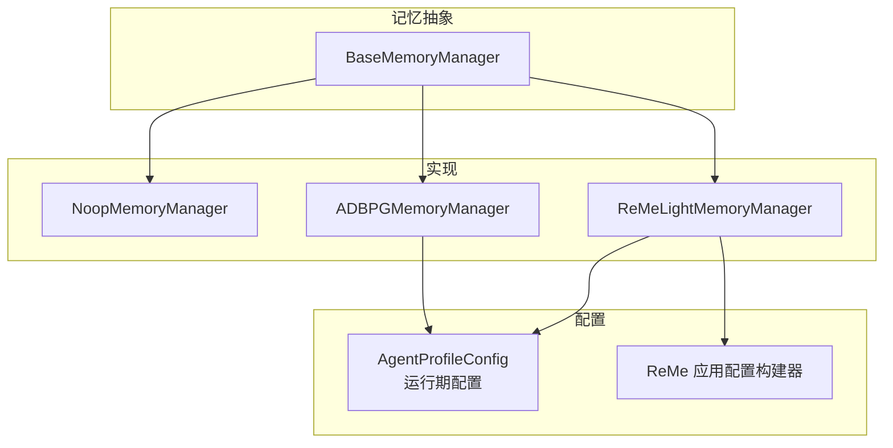
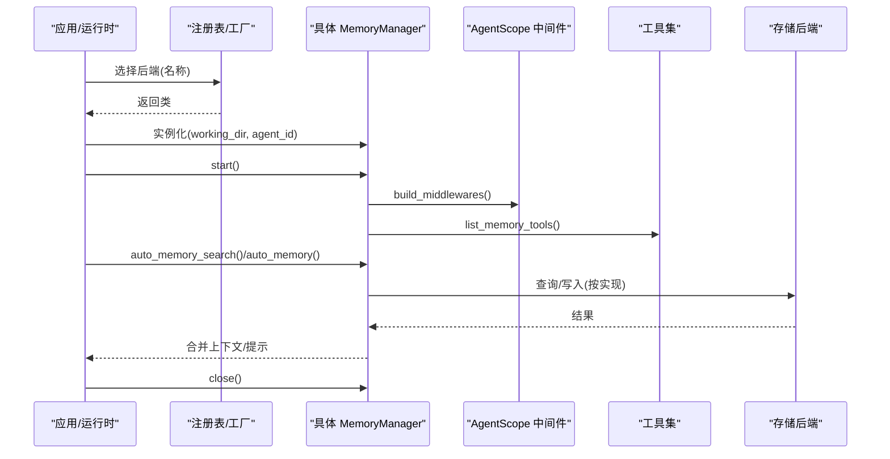
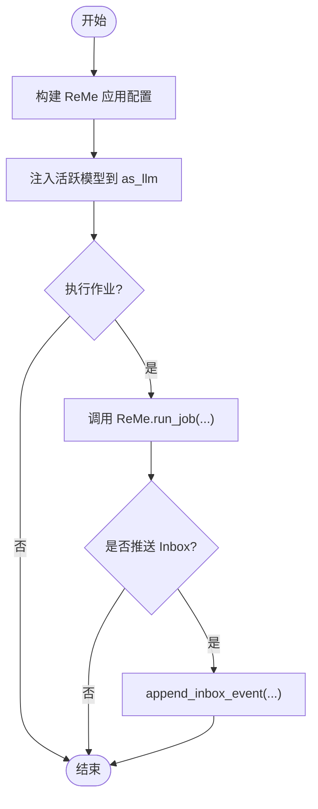
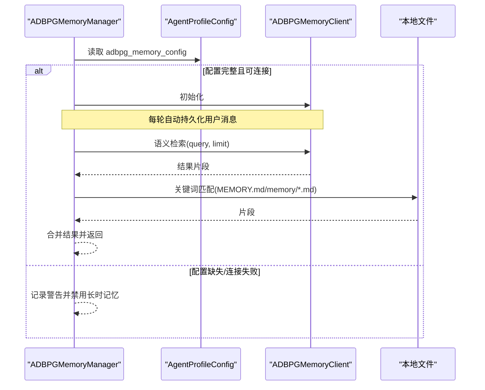
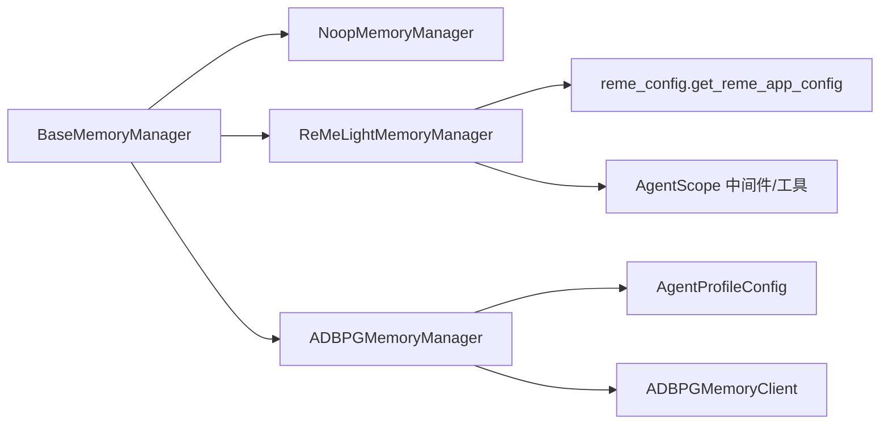

# 记忆存储后端

<cite>
**本文引用的文件**
- [base_memory_manager.py](file://tongtian-tauri/src/agent/agents/memory/base_memory_manager.py)
- [dummy.py](file://tongtian-tauri/src/agent/agents/memory/dummy.py)
- [adbpg_memory_manager.py](file://tongtian-tauri/src/agent/agents/memory/adbpg_memory_manager.py)
- [reme_light_memory_manager.py](file://tongtian-tauri/src/agent/agents/memory/reme_light_memory_manager.py)
- [reme_config.py](file://tongtian-tauri/src/agent/agents/memory/reme_config.py)
- [config.py](file://tongtian-tauri/src/agent/config/config.py)
</cite>

## 目录
1. [简介](#简介)
2. [项目结构](#项目结构)
3. [核心组件](#核心组件)
4. [架构总览](#架构总览)
5. [详细组件分析](#详细组件分析)
6. [依赖关系分析](#依赖关系分析)
7. [性能考量](#性能考量)
8. [故障排查指南](#故障排查指南)
9. [结论](#结论)
10. [附录：配置示例与最佳实践](#附录：配置示例与最佳实践)

## 简介
本文件面向“记忆存储后端”的扩展、配置与使用，重点覆盖以下目标：
- NoopMemoryManager（禁用型）在单元测试与性能基准测试中的用途与使用方式。
- RemeConfig 的配置管理机制：配置文件来源、环境变量覆盖、动态配置更新。
- 存储后端的扩展点、配置验证、默认值管理。
- 为不同场景选择合适的存储后端并提供具体配置示例与最佳实践。

## 项目结构
记忆模块采用“抽象基类 + 多实现 + 注册表”的分层设计：
- 抽象基类 BaseMemoryManager 定义统一生命周期与工具接口。
- 具体实现包括：
  - NoopMemoryManager：禁用所有记忆能力，用于测试与基准。
  - ReMeLightMemoryManager：基于 ReMe 应用框架的文件型记忆（每日笔记、摘要、搜索等）。
  - ADBPGMemoryManager：基于 AnalyticDB for PostgreSQL 的长期记忆。
- 配置由 AgentProfileConfig 提供，ReMe 应用配置通过 reme_config.py 构建并注入。

图表来源
- [base_memory_manager.py:36-122](file://tongtian-tauri/src/agent/agents/memory/base_memory_manager.py#L36-L122)
- [dummy.py:11-43](file://tongtian-tauri/src/agent/agents/memory/dummy.py#L11-L43)
- [reme_light_memory_manager.py:104-205](file://tongtian-tauri/src/agent/agents/memory/reme_light_memory_manager.py#L104-L205)
- [adbpg_memory_manager.py:32-158](file://tongtian-tauri/src/agent/agents/memory/adbpg_memory_manager.py#L32-L158)
- [reme_config.py:25-54](file://tongtian-tauri/src/agent/agents/memory/reme_config.py#L25-L54)

章节来源
- [base_memory_manager.py:36-122](file://tongtian-tauri/src/agent/agents/memory/base_memory_manager.py#L36-L122)
- [dummy.py:11-43](file://tongtian-tauri/src/agent/agents/memory/dummy.py#L11-L43)
- [reme_light_memory_manager.py:104-205](file://tongtian-tauri/src/agent/agents/memory/reme_light_memory_manager.py#L104-L205)
- [adbpg_memory_manager.py:32-158](file://tongtian-tauri/src/agent/agents/memory/adbpg_memory_manager.py#L32-L158)
- [reme_config.py:25-54](file://tongtian-tauri/src/agent/agents/memory/reme_config.py#L25-L54)

## 核心组件
- BaseMemoryManager
  - 统一生命周期：start/close；工具暴露 list_memory_tools；中间件 build_middlewares。
  - 自动记忆：auto_memory_search/auto_memory；任务队列与后台 summarize worker。
  - 注册表 memory_registry 与工厂 get_memory_manager_backend。
- NoopMemoryManager
  - enabled=False；所有方法返回空结果或空列表；适合禁用记忆。
- ReMeLightMemoryManager
  - 嵌入 ReMe 应用，提供 search/auto_memory/auto_dream/reindex/status 等能力。
  - 将 ReMe 作业结果推送到 QwenPaw Inbox（可配置开关）。
  - 会话 ID 安全转换以兼容 Windows 文件系统命名限制。
- ADBPGMemoryManager
  - 从 AgentProfileConfig 读取 adbpg_memory_config，构造客户端进行语义检索。
  - 每轮自动持久化用户消息到 ADBPG；支持 auto_memory_search。
  - 本地文件关键词匹配作为补充源（MEMORY.md 与 memory/*.md）。

章节来源
- [base_memory_manager.py:36-122](file://tongtian-tauri/src/agent/agents/memory/base_memory_manager.py#L36-L122)
- [base_memory_manager.py:247-329](file://tongtian-tauri/src/agent/agents/memory/base_memory_manager.py#L247-L329)
- [base_memory_manager.py:375-527](file://tongtian-tauri/src/agent/agents/memory/base_memory_manager.py#L375-L527)
- [base_memory_manager.py:534-572](file://tongtian-tauri/src/agent/agents/memory/base_memory_manager.py#L534-L572)
- [dummy.py:11-43](file://tongtian-tauri/src/agent/agents/memory/dummy.py#L11-L43)
- [reme_light_memory_manager.py:104-205](file://tongtian-tauri/src/agent/agents/memory/reme_light_memory_manager.py#L104-L205)
- [reme_light_memory_manager.py:218-360](file://tongtian-tauri/src/agent/agents/memory/reme_light_memory_manager.py#L218-L360)
- [reme_light_memory_manager.py:380-549](file://tongtian-tauri/src/agent/agents/memory/reme_light_memory_manager.py#L380-L549)
- [adbpg_memory_manager.py:32-158](file://tongtian-tauri/src/agent/agents/memory/adbpg_memory_manager.py#L32-L158)
- [adbpg_memory_manager.py:163-246](file://tongtian-tauri/src/agent/agents/memory/adbpg_memory_manager.py#L163-L246)
- [adbpg_memory_manager.py:255-431](file://tongtian-tauri/src/agent/agents/memory/adbpg_memory_manager.py#L255-L431)

## 架构总览
下图展示三类后端的启动、配置与调用路径，以及它们如何与 AgentScope 中间件和工具系统交互。

图表来源
- [base_memory_manager.py:64-122](file://tongtian-tauri/src/agent/agents/memory/base_memory_manager.py#L64-L122)
- [base_memory_manager.py:534-572](file://tongtian-tauri/src/agent/agents/memory/base_memory_manager.py#L534-L572)
- [reme_light_memory_manager.py:143-176](file://tongtian-tauri/src/agent/agents/memory/reme_light_memory_manager.py#L143-L176)
- [adbpg_memory_manager.py:55-134](file://tongtian-tauri/src/agent/agents/memory/adbpg_memory_manager.py#L55-L134)

## 详细组件分析

### NoopMemoryManager（禁用型）
- 作用
  - 完全禁用记忆功能：不暴露工具、不注入中间件、无自动记忆。
  - 适用于：
    - 单元测试：隔离记忆对断言的影响，保证确定性。
    - 性能基准测试：排除记忆开销，测量模型/工具链路的纯性能。
- 关键行为
  - enabled=False；start/close 为空操作；get_memory_prompt 返回空字符串；list_memory_tools 返回空列表；get_auto_memory_interval 返回 0。
- 使用建议
  - 在测试夹具中通过注册表选择 "none" 后端。
  - 在基准脚本中显式指定后端为 "none"，避免任何 I/O。

章节来源
- [dummy.py:11-43](file://tongtian-tauri/src/agent/agents/memory/dummy.py#L11-L43)
- [base_memory_manager.py:534-572](file://tongtian-tauri/src/agent/agents/memory/base_memory_manager.py#L534-L572)

### ReMeLightMemoryManager（文件型记忆）
- 作用
  - 通过嵌入 ReMe 应用，提供每日笔记、摘要、兴趣主题、资源解析、混合检索（向量+BM25）等能力。
  - 支持自动记忆、自动搜索、自动梦境（auto_dream）、重建索引、状态查询。
- 配置机制
  - 通过 get_reme_app_config 将 AgentProfileConfig.running.reme_light_memory_config 映射为 ReMe 应用配置。
  - 工作区目录、各子目录（daily/digest/resource/session/mem_session/metadata）均来源于配置。
  - 语言与时区来自全局配置；日志输出到控制台。
- 动态更新
  - 启动前会注入当前 QwenPaw 活跃模型到 ReMe 的 as_llm 组件，确保 ReMe 复用主流程模型。
  - 支持通过 _run_reme_job 动态执行 ReMe 作业（search/auto_memory/auto_dream/reindex/status 等）。
- 结果回传
  - 可将 auto_memory/auto_resource/auto_dream 的结果推送到 QwenPaw Inbox（可配置开关），便于前端展示。
- 会话 ID 安全
  - 将逻辑 session_id 转换为 Windows 安全的文件名形式，避免非法字符与保留名。

图表来源
- [reme_light_memory_manager.py:104-205](file://tongtian-tauri/src/agent/agents/memory/reme_light_memory_manager.py#L104-L205)
- [reme_light_memory_manager.py:218-360](file://tongtian-tauri/src/agent/agents/memory/reme_light_memory_manager.py#L218-L360)
- [reme_config.py:25-54](file://tongtian-tauri/src/agent/agents/memory/reme_config.py#L25-L54)

章节来源
- [reme_light_memory_manager.py:104-205](file://tongtian-tauri/src/agent/agents/memory/reme_light_memory_manager.py#L104-L205)
- [reme_light_memory_manager.py:218-360](file://tongtian-tauri/src/agent/agents/memory/reme_light_memory_manager.py#L218-L360)
- [reme_light_memory_manager.py:380-549](file://tongtian-tauri/src/agent/agents/memory/reme_light_memory_manager.py#L380-L549)
- [reme_config.py:25-54](file://tongtian-tauri/src/agent/agents/memory/reme_config.py#L25-L54)

### ADBPGMemoryManager（数据库型记忆）
- 作用
  - 将用户消息持久化到 ADBPG，并在回答前进行自动语义检索；同时结合本地文件关键词匹配增强召回。
- 配置与验证
  - 启动时从 AgentProfileConfig.running.adbpg_memory_config 读取配置。
  - 若缺少 rest_base_url/rest_api_key 或连接失败，则记录警告并禁用长时记忆。
  - 支持 memory_isolation 控制 agent_id 隔离模式。
- 自动记忆与自动搜索
  - 每轮自动持久化用户消息（interval=1）。
  - 支持 auto_memory_search，依据配置决定是否启用及最大结果数。
- 工具与中间件
  - 暴露 memory_search 工具；根据语言返回对应记忆指导提示。

图表来源
- [adbpg_memory_manager.py:55-134](file://tongtian-tauri/src/agent/agents/memory/adbpg_memory_manager.py#L55-L134)
- [adbpg_memory_manager.py:163-246](file://tongtian-tauri/src/agent/agents/memory/adbpg_memory_manager.py#L163-L246)
- [adbpg_memory_manager.py:255-431](file://tongtian-tauri/src/agent/agents/memory/adbpg_memory_manager.py#L255-L431)

章节来源
- [adbpg_memory_manager.py:55-134](file://tongtian-tauri/src/agent/agents/memory/adbpg_memory_manager.py#L55-L134)
- [adbpg_memory_manager.py:163-246](file://tongtian-tauri/src/agent/agents/memory/adbpg_memory_manager.py#L163-L246)
- [adbpg_memory_manager.py:255-431](file://tongtian-tauri/src/agent/agents/memory/adbpg_memory_manager.py#L255-L431)

## 依赖关系分析
- 抽象与实现
  - BaseMemoryManager 定义统一接口；三个实现分别侧重不同存储与能力。
- 配置依赖
  - ReMe 实现依赖 AgentProfileConfig.running.reme_light_memory_config 与全局 user_timezone。
  - ADBPG 实现依赖 AgentProfileConfig.running.adbpg_memory_config。
- 外部依赖
  - ReMe 应用（通过 import reme.ReMe）。
  - ADBPG 客户端（ADBPGMemoryClient）。
  - AgentScope 中间件与工具系统。

图表来源
- [base_memory_manager.py:36-122](file://tongtian-tauri/src/agent/agents/memory/base_memory_manager.py#L36-L122)
- [reme_light_memory_manager.py:104-205](file://tongtian-tauri/src/agent/agents/memory/reme_light_memory_manager.py#L104-L205)
- [adbpg_memory_manager.py:32-158](file://tongtian-tauri/src/agent/agents/memory/adbpg_memory_manager.py#L32-L158)
- [reme_config.py:25-54](file://tongtian-tauri/src/agent/agents/memory/reme_config.py#L25-L54)

章节来源
- [base_memory_manager.py:36-122](file://tongtian-tauri/src/agent/agents/memory/base_memory_manager.py#L36-L122)
- [reme_light_memory_manager.py:104-205](file://tongtian-tauri/src/agent/agents/memory/reme_light_memory_manager.py#L104-L205)
- [adbpg_memory_manager.py:32-158](file://tongtian-tauri/src/agent/agents/memory/adbpg_memory_manager.py#L32-L158)
- [reme_config.py:25-54](file://tongtian-tauri/src/agent/agents/memory/reme_config.py#L25-L54)

## 性能考量
- NoopMemoryManager
  - 零 I/O、零中间件、零工具注册，适合基准测试以获得最纯净的性能数据。
- ReMeLightMemoryManager
  - 自动记忆通过后台 summarize worker 串行处理，避免阻塞回复；支持关闭自动记忆（interval=0）。
  - 搜索结果包含向量与 BM25 融合，注意 min_score 设置以避免过滤掉有效关键词匹配。
  - 大结果集可通过 max_results 控制；Inbox 推送可关闭以减少额外 I/O。
- ADBPGMemoryManager
  - 每轮自动持久化用户消息（interval=1），网络延迟取决于 ADBPG REST 服务；可在高吞吐场景下评估是否需要批处理或降低频率。
  - 本地文件关键词匹配作为补充，避免过度依赖网络。

[本节为通用性能讨论，不直接分析具体文件]

## 故障排查指南
- ReMe 导入失败或启动失败
  - 现象：日志提示 import 失败或 start 异常，导致记忆功能被禁用。
  - 处理：检查 reme 依赖安装与环境变量；确认工作区目录权限。
- ADBPG 配置不完整或连接失败
  - 现象：启动时记录警告，长时记忆被禁用。
  - 处理：校验 rest_base_url 与 rest_api_key；检查网络与鉴权。
- 自动记忆未生效
  - 现象：auto_memory 未触发或无结果。
  - 处理：检查 interval 配置；确认 session_id 非空；对于 ReMe 需确保作业成功且 modified=True。
- 搜索结果为空
  - 现象：memory_search 返回“无相关记忆”。
  - 处理：检查 query 是否为空；调整 max_results/min_score；确认索引已构建或重建。

章节来源
- [reme_light_memory_manager.py:143-176](file://tongtian-tauri/src/agent/agents/memory/reme_light_memory_manager.py#L143-L176)
- [adbpg_memory_manager.py:55-134](file://tongtian-tauri/src/agent/agents/memory/adbpg_memory_manager.py#L55-L134)
- [reme_light_memory_manager.py:426-549](file://tongtian-tauri/src/agent/agents/memory/reme_light_memory_manager.py#L426-L549)
- [adbpg_memory_manager.py:255-431](file://tongtian-tauri/src/agent/agents/memory/adbpg_memory_manager.py#L255-L431)

## 结论
- 通过统一的抽象基类与注册表，记忆后端具备良好的可扩展性与可替换性。
- NoopMemoryManager 为测试与基准提供了稳定的“零开销”选项。
- ReMeLightMemoryManager 提供丰富的文件型记忆能力，并通过配置驱动灵活适配不同场景。
- ADBPGMemoryManager 提供高性能的语义检索与持久化，适合需要跨会话长期记忆的复杂场景。
- 合理配置与监控（如自动记忆间隔、最小分数阈值、Inbox 推送开关）是保障性能与稳定性的关键。

[本节为总结性内容，不直接分析具体文件]

## 附录：配置示例与最佳实践

### 配置来源与覆盖
- 配置文件
  - AgentProfileConfig 提供运行期配置，包含 reme_light_memory_config 与 adbpg_memory_config。
- 环境变量
  - ReMe 应用通过环境变量控制行为（例如 REME_DISABLE_LOGURU 用于抑制日志库输出）。
- 动态更新
  - ReMe 启动前会注入当前活跃模型到 as_llm 组件，确保与主流程一致。
  - 通过 _run_reme_job 动态执行作业（search/auto_memory/auto_dream/reindex/status）。

章节来源
- [reme_light_memory_manager.py:104-205](file://tongtian-tauri/src/agent/agents/memory/reme_light_memory_manager.py#L104-L205)
- [reme_light_memory_manager.py:218-360](file://tongtian-tauri/src/agent/agents/memory/reme_light_memory_manager.py#L218-L360)
- [reme_config.py:25-54](file://tongtian-tauri/src/agent/agents/memory/reme_config.py#L25-L54)

### 选择存储后端的建议
- 单元测试/基准测试
  - 选择 "none"（NoopMemoryManager），避免 I/O 干扰。
- 轻量级、可解释的记忆
  - 选择 "remelight"（ReMeLightMemoryManager），利用文件型记忆与混合检索。
- 大规模、跨会话的语义检索
  - 选择 "adbpg"（ADBPGMemoryManager），获得高性能向量检索与持久化。

章节来源
- [base_memory_manager.py:534-572](file://tongtian-tauri/src/agent/agents/memory/base_memory_manager.py#L534-L572)
- [dummy.py:11-43](file://tongtian-tauri/src/agent/agents/memory/dummy.py#L11-L43)
- [reme_light_memory_manager.py:104-205](file://tongtian-tauri/src/agent/agents/memory/reme_light_memory_manager.py#L104-L205)
- [adbpg_memory_manager.py:32-158](file://tongtian-tauri/src/agent/agents/memory/adbpg_memory_manager.py#L32-L158)

### 配置项速查（概念说明）
- ReMe 应用配置（由 AgentProfileConfig.running.reme_light_memory_config 映射）
  - 工作区与各子目录：workspace_dir、daily_dir、digest_dir、resource_dir、session_dir、mem_session_dir、metadata_dir。
  - 语言与时区：language、timezone。
  - 自动记忆间隔：auto_memory_interval（0 表示禁用）。
  - 自动搜索开关与参数：auto_memory_search_config.enabled、max_results。
  - Inbox 推送开关：inbox_push_enabled。
- ADBPG 配置（AgentProfileConfig.running.adbpg_memory_config）
  - 必需字段：rest_base_url、rest_api_key。
  - 可选字段：search_timeout、memory_isolation。
  - 自动搜索配置：auto_memory_search_config.enabled、max_results。

章节来源
- [reme_config.py:25-54](file://tongtian-tauri/src/agent/agents/memory/reme_config.py#L25-L54)
- [reme_light_memory_manager.py:178-205](file://tongtian-tauri/src/agent/agents/memory/reme_light_memory_manager.py#L178-L205)
- [adbpg_memory_manager.py:55-134](file://tongtian-tauri/src/agent/agents/memory/adbpg_memory_manager.py#L55-L134)
- [adbpg_memory_manager.py:177-217](file://tongtian-tauri/src/agent/agents/memory/adbpg_memory_manager.py#L177-L217)

### 最佳实践
- 测试与基准
  - 使用 "none" 后端隔离记忆影响；确保测试环境无 I/O 依赖。
- 生产环境
  - 合理设置 auto_memory_interval 与 auto_memory_search_config.max_results，平衡效果与性能。
  - 对 ReMe 启用 Inbox 推送以便运维可视化；对 ADBPG 关注网络延迟与重试策略。
- 索引维护
  - 定期执行 rebuild_index（ReMe）以确保检索质量；必要时清理冗余文件。

[本节为通用实践建议，不直接分析具体文件]