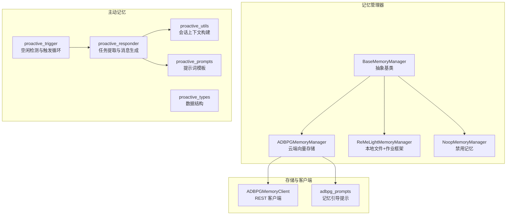
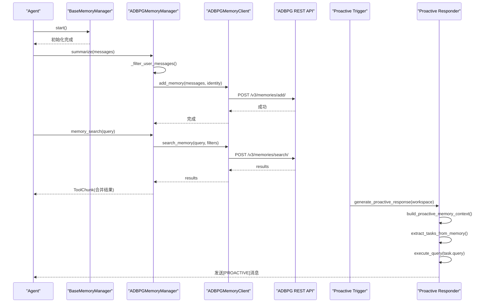
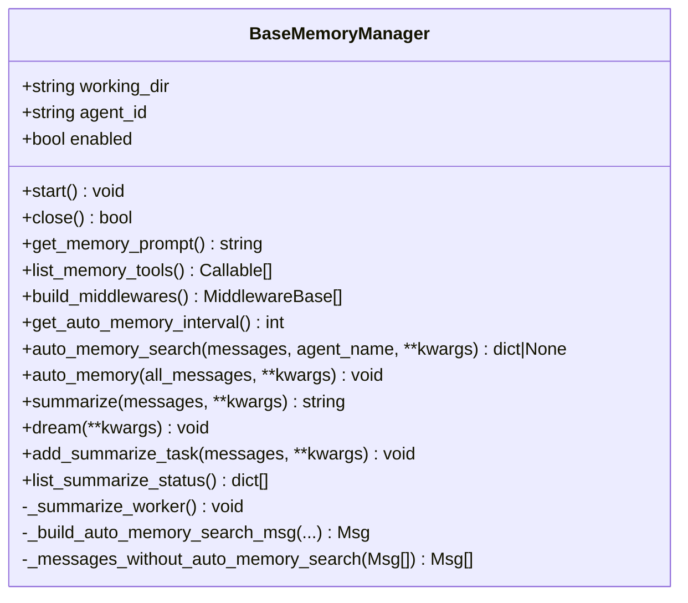
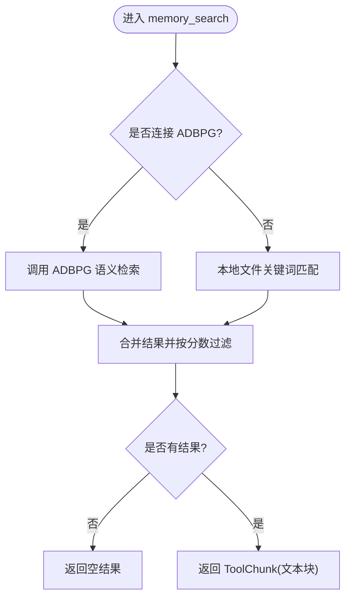
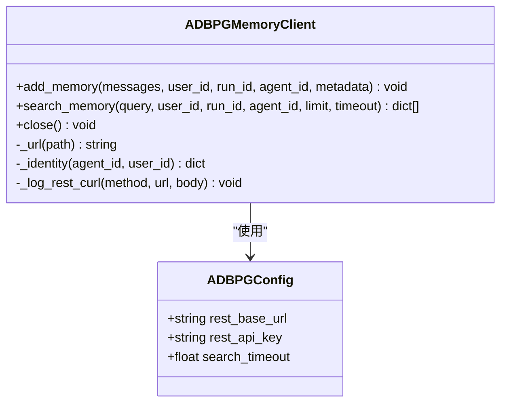
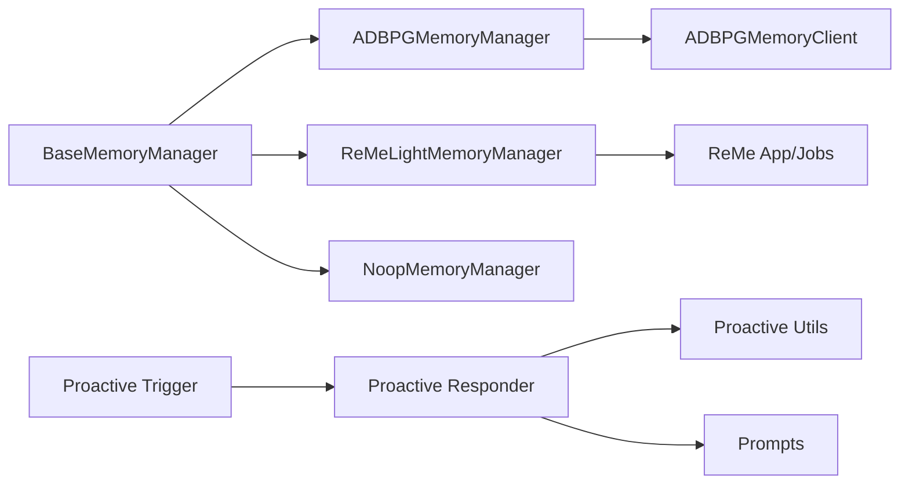

# 记忆系统

<cite>
**本文引用的文件**   
- [base_memory_manager.py](file://tongtian-tauri/src/agent/agents/memory/base_memory_manager.py)
- [adbpg_memory_manager.py](file://tongtian-tauri/src/agent/agents/memory/adbpg_memory_manager.py)
- [adbpg_client.py](file://tongtian-tauri/src/agent/agents/memory/adbpg_client.py)
- [adbpg_prompts.py](file://tongtian-tauri/src/agent/agents/memory/adbpg_prompts.py)
- [dummy.py](file://tongtian-tauri/src/agent/agents/memory/dummy.py)
- [reme_light_memory_manager.py](file://tongtian-tauri/src/agent/agents/memory/reme_light_memory_manager.py)
- [proactive/__init__.py](file://tongtian-tauri/src/agent/agents/memory/proactive/__init__.py)
- [proactive_trigger.py](file://tongtian-tauri/src/agent/agents/memory/proactive/proactive_trigger.py)
- [proactive_responder.py](file://tongtian-tauri/src/agent/agents/memory/proactive/proactive_responder.py)
- [proactive_types.py](file://tongtian-tauri/src/agent/agents/memory/proactive/proactive_types.py)
- [proactive_prompts.py](file://tongtian-tauri/src/agent/agents/memory/proactive/proactive_prompts.py)
- [proactive_utils.py](file://tongtian-tauri/src/agent/agents/memory/proactive/proactive_utils.py)
</cite>

## 目录
1. [简介](#简介)
2. [项目结构](#项目结构)
3. [核心组件](#核心组件)
4. [架构总览](#架构总览)
5. [详细组件分析](#详细组件分析)
6. [依赖关系分析](#依赖关系分析)
7. [性能考量](#性能考量)
8. [故障排查指南](#故障排查指南)
9. [结论](#结论)
10. [附录：配置与使用示例](#附录配置与使用示例)

## 简介
本文件为“记忆系统”的综合文档，聚焦以下目标：
- 抽象基类 BaseMemoryManager 的设计模式与生命周期约定
- ADBPGMemoryManager 的具体实现（持久化、检索、自动记忆）
- 主动记忆（Proactive Memory）的工作原理（触发器、响应策略、存储格式）
- 记忆的持久化方案、压缩策略、检索算法
- 与 Agent 生命周期的集成方式
- 自定义记忆管理器的实现路径与最佳实践

## 项目结构
记忆子系统位于 agents/memory 目录下，包含：
- 抽象基类与注册机制：BaseMemoryManager、Registry
- 具体后端实现：ADBPGMemoryManager、ReMeLightMemoryManager、NoopMemoryManager
- 主动记忆模块：proactive/*（触发器、响应器、工具函数、类型定义、提示词）
- 客户端与提示词：adbpg_client.py、adbpg_prompts.py



**图表来源** 
- [base_memory_manager.py:36-123](file://tongtian-tauri/src/agent/agents/memory/base_memory_manager.py#L36-L123)
- [adbpg_memory_manager.py:32-158](file://tongtian-tauri/src/agent/agents/memory/adbpg_memory_manager.py#L32-L158)
- [reme_light_memory_manager.py:104-205](file://tongtian-tauri/src/agent/agents/memory/reme_light_memory_manager.py#L104-L205)
- [dummy.py:11-43](file://tongtian-tauri/src/agent/agents/memory/dummy.py#L11-L43)
- [proactive_trigger.py:27-60](file://tongtian-tauri/src/agent/agents/memory/proactive/proactive_trigger.py#L27-L60)
- [proactive_responder.py:41-99](file://tongtian-tauri/src/agent/agents/memory/proactive/proactive_responder.py#L41-L99)
- [proactive_utils.py:39-81](file://tongtian-tauri/src/agent/agents/memory/proactive/proactive_utils.py#L39-L81)
- [proactive_types.py:9-38](file://tongtian-tauri/src/agent/agents/memory/proactive/proactive_types.py#L9-L38)
- [proactive_prompts.py:4-74](file://tongtian-tauri/src/agent/agents/memory/proactive/proactive_prompts.py#L4-L74)
- [adbpg_client.py:22-157](file://tongtian-tauri/src/agent/agents/memory/adbpg_client.py#L22-L157)
- [adbpg_prompts.py:5-71](file://tongtian-tauri/src/agent/agents/memory/adbpg_prompts.py#L5-L71)

**章节来源**
- [base_memory_manager.py:36-123](file://tongtian-tauri/src/agent/agents/memory/base_memory_manager.py#L36-L123)
- [adbpg_memory_manager.py:32-158](file://tongtian-tauri/src/agent/agents/memory/adbpg_memory_manager.py#L32-L158)
- [reme_light_memory_manager.py:104-205](file://tongtian-tauri/src/agent/agents/memory/reme_light_memory_manager.py#L104-L205)
- [dummy.py:11-43](file://tongtian-tauri/src/agent/agents/memory/dummy.py#L11-L43)
- [proactive_trigger.py:27-60](file://tongtian-tauri/src/agent/agents/memory/proactive/proactive_trigger.py#L27-L60)
- [proactive_responder.py:41-99](file://tongtian-tauri/src/agent/agents/memory/proactive/proactive_responder.py#L41-L99)
- [proactive_utils.py:39-81](file://tongtian-tauri/src/agent/agents/memory/proactive/proactive_utils.py#L39-L81)
- [proactive_types.py:9-38](file://tongtian-tauri/src/agent/agents/memory/proactive/proactive_types.py#L9-L38)
- [proactive_prompts.py:4-74](file://tongtian-tauri/src/agent/agents/memory/proactive/proactive_prompts.py#L4-L74)
- [adbpg_client.py:22-157](file://tongtian-tauri/src/agent/agents/memory/adbpg_client.py#L22-L157)
- [adbpg_prompts.py:5-71](file://tongtian-tauri/src/agent/agents/memory/adbpg_prompts.py#L5-L71)

## 核心组件
- BaseMemoryManager：定义统一接口与生命周期（start/close）、记忆引导提示、工具暴露、中间件注入、自动记忆间隔、自动搜索合成消息、后台摘要任务队列等。
- ADBPGMemoryManager：基于 AnalyticDB for PostgreSQL 的长期记忆，提供语义检索、自动记忆写入、自动搜索注入。
- ReMeLightMemoryManager：基于 ReMe 应用/作业框架的本地文件记忆，支持 auto_memory/auto_dream/reindex/status 等。
- NoopMemoryManager：禁用所有记忆能力，用于测试或无记忆场景。
- 主动记忆模块：proactive_trigger（空闲检测与触发）、proactive_responder（任务提取与消息生成）、proactive_utils（会话上下文构建）、proactive_types（数据结构）、proactive_prompts（提示词）。

**章节来源**
- [base_memory_manager.py:36-123](file://tongtian-tauri/src/agent/agents/memory/base_memory_manager.py#L36-L123)
- [adbpg_memory_manager.py:32-158](file://tongtian-tauri/src/agent/agents/memory/adbpg_memory_manager.py#L32-L158)
- [reme_light_memory_manager.py:104-205](file://tongtian-tauri/src/agent/agents/memory/reme_light_memory_manager.py#L104-L205)
- [dummy.py:11-43](file://tongtian-tauri/src/agent/agents/memory/dummy.py#L11-L43)
- [proactive_trigger.py:27-60](file://tongtian-tauri/src/agent/agents/memory/proactive/proactive_trigger.py#L27-L60)
- [proactive_responder.py:41-99](file://tongtian-tauri/src/agent/agents/memory/proactive/proactive_responder.py#L41-L99)
- [proactive_utils.py:39-81](file://tongtian-tauri/src/agent/agents/memory/proactive/proactive_utils.py#L39-L81)
- [proactive_types.py:9-38](file://tongtian-tauri/src/agent/agents/memory/proactive/proactive_types.py#L9-L38)
- [proactive_prompts.py:4-74](file://tongtian-tauri/src/agent/agents/memory/proactive/proactive_prompts.py#L4-L74)

## 架构总览
记忆系统采用“抽象基类 + 多后端实现”的分层架构，结合“主动记忆”的异步触发与响应流程，形成完整的“写-存-搜-用”闭环。



**图表来源** 
- [adbpg_memory_manager.py:163-246](file://tongtian-tauri/src/agent/agents/memory/adbpg_memory_manager.py#L163-L246)
- [adbpg_client.py:39-122](file://tongtian-tauri/src/agent/agents/memory/adbpg_client.py#L39-L122)
- [proactive_responder.py:41-99](file://tongtian-tauri/src/agent/agents/memory/proactive/proactive_responder.py#L41-L99)
- [proactive_utils.py:39-81](file://tongtian-tauri/src/agent/agents/memory/proactive/proactive_utils.py#L39-L81)

## 详细组件分析

### BaseMemoryManager 抽象类
- 设计要点
  - 生命周期：start/close；工作目录与 agent_id 作为实例属性
  - 记忆引导提示：get_memory_prompt 注入系统提示
  - 工具暴露：list_memory_tools 返回可注册的 ToolChunk 函数
  - 中间件：build_middlewares 注入 MemoryMiddleware（由上层提供）
  - 自动记忆：auto_memory_interval 控制周期；auto_memory_search 在回复前自动检索并合成 AssistantMsg
  - 后台摘要任务：add_summarize_task/_summarize_worker 串行执行 summarize，状态跟踪与清理
  - 自动记忆搜索合成消息：_build_auto_memory_search_msg 构造带元数据的合成消息，便于过滤与用量估算



**图表来源** 
- [base_memory_manager.py:36-123](file://tongtian-tauri/src/agent/agents/memory/base_memory_manager.py#L36-L123)
- [base_memory_manager.py:247-329](file://tongtian-tauri/src/agent/agents/memory/base_memory_manager.py#L247-L329)
- [base_memory_manager.py:375-528](file://tongtian-tauri/src/agent/agents/memory/base_memory_manager.py#L375-L528)

**章节来源**
- [base_memory_manager.py:36-123](file://tongtian-tauri/src/agent/agents/memory/base_memory_manager.py#L36-L123)
- [base_memory_manager.py:247-329](file://tongtian-tauri/src/agent/agents/memory/base_memory_manager.py#L247-L329)
- [base_memory_manager.py:375-528](file://tongtian-tauri/src/agent/agents/memory/base_memory_manager.py#L375-L528)

### ADBPGMemoryManager 实现
- 职责
  - 从 Agent 配置加载 ADBPG 配置，建立 ADBPGMemoryClient
  - 暴露 memory_search 工具（云端语义检索 + 本地文件关键词匹配）
  - 每轮自动记忆（interval=1），仅持久化新的 user 消息
  - 自动记忆搜索（auto_memory_search）在回复前根据用户消息构建查询并注入合成消息
  - 通过 _schedule_add 异步添加记忆，避免阻塞回复



**图表来源** 
- [adbpg_memory_manager.py:255-333](file://tongtian-tauri/src/agent/agents/memory/adbpg_memory_manager.py#L255-L333)

**章节来源**
- [adbpg_memory_manager.py:55-115](file://tongtian-tauri/src/agent/agents/memory/adbpg_memory_manager.py#L55-L115)
- [adbpg_memory_manager.py:163-246](file://tongtian-tauri/src/agent/agents/memory/adbpg_memory_manager.py#L163-L246)
- [adbpg_memory_manager.py:255-333](file://tongtian-tauri/src/agent/agents/memory/adbpg_memory_manager.py#L255-L333)
- [adbpg_memory_manager.py:364-431](file://tongtian-tauri/src/agent/agents/memory/adbpg_memory_manager.py#L364-L431)

### ADBPGMemoryClient 客户端
- 功能
  - add_memory：POST /v3/memories/add/ 持久化消息
  - search_memory：POST /v3/memories/search/ 语义检索，按 agent_id/user_id 过滤
  - close：关闭 HTTP 客户端
  - 日志：打印等效 curl 命令便于调试



**图表来源** 
- [adbpg_client.py:13-157](file://tongtian-tauri/src/agent/agents/memory/adbpg_client.py#L13-L157)

**章节来源**
- [adbpg_client.py:39-122](file://tongtian-tauri/src/agent/agents/memory/adbpg_client.py#L39-L122)
- [adbpg_client.py:123-157](file://tongtian-tauri/src/agent/agents/memory/adbpg_client.py#L123-L157)

### ReMeLightMemoryManager 实现
- 功能
  - 启动 ReMe 应用，注入 QwenPaw 模型
  - 通过作业框架执行 auto_memory/auto_dream/reindex/status
  - 将作业结果推送到 Inbox（可选）
  - memory_search 调用 ReMe 搜索，返回格式化结果
  - auto_memory_search 合成 AssistantMsg 注入搜索结果

**章节来源**
- [reme_light_memory_manager.py:104-205](file://tongtian-tauri/src/agent/agents/memory/reme_light_memory_manager.py#L104-L205)
- [reme_light_memory_manager.py:380-549](file://tongtian-tauri/src/agent/agents/memory/reme_light_memory_manager.py#L380-L549)

### NoopMemoryManager 实现
- 功能
  - 禁用全部记忆能力，返回空提示与工具列表
  - 适合测试或无需记忆的场景

**章节来源**
- [dummy.py:11-43](file://tongtian-tauri/src/agent/agents/memory/dummy.py#L11-L43)

### 主动记忆（Proactive Memory）
- 触发器（proactive_trigger）
  - enable_proactive_for_session：启用会话级主动记忆，启动后台循环
  - proactive_trigger_loop：每 30s 检查空闲时间、忙碌状态、冷却时间，满足条件则触发响应
  - is_last_message_proactive：判断最后一条消息是否为主动消息，避免重复触发

- 响应器（proactive_responder）
  - generate_proactive_response：构建记忆上下文、提取任务、执行查询、生成最终消息并通过 HTTP 推送
  - _initialize_single_proactive_agent：创建专用 Agent，绑定工具集（浏览器、文件读取、Shell、截图）
  - send_proactive_message_via_http：调用 QwenPaw API 发送 [PROACTIVE] 消息

- 工具与类型（proactive_utils、proactive_types、proactive_prompts）
  - build_proactive_memory_context：收集屏幕分析与会话消息，限制长度与数量
  - ProactiveConfig/Task/QueryResult：结构化数据描述配置、任务与查询结果
  - 提示词模板：任务提取与面向用户的消息生成

```mermaid
sequenceDiagram
participant Loop as "Trigger Loop"
participant WS as "Workspace"
participant Resp as "Responder"
participant Agent as "Proactive Agent"
participant API as "QwenPaw API"
Loop->>Loop : 每30秒检查
Loop->>WS : 获取最后用户交互时间
Loop->>Loop : 计算空闲时长与冷却
Loop->>Resp : generate_proactive_response()
Resp->>Resp : build_proactive_memory_context()
Resp->>Agent : reply(任务提取提示)
Agent-->>Resp : tasks(JSON)
loop 最多3个任务
Resp->>Agent : reply(执行查询提示)
Agent-->>Resp : 结果+[SUCCESS]/[FAILURE]
end
Resp->>API : POST /console/chat (SSE)
API-->>Resp : 成功/失败
```

**图表来源** 
- [proactive_trigger.py:218-292](file://tongtian-tauri/src/agent/agents/memory/proactive/proactive_trigger.py#L218-L292)
- [proactive_responder.py:41-99](file://tongtian-tauri/src/agent/agents/memory/proactive/proactive_responder.py#L41-L99)
- [proactive_utils.py:39-81](file://tongtian-tauri/src/agent/agents/memory/proactive/proactive_utils.py#L39-L81)
- [proactive_types.py:9-38](file://tongtian-tauri/src/agent/agents/memory/proactive/proactive_types.py#L9-L38)
- [proactive_prompts.py:4-74](file://tongtian-tauri/src/agent/agents/memory/proactive/proactive_prompts.py#L4-L74)

**章节来源**
- [proactive_trigger.py:27-60](file://tongtian-tauri/src/agent/agents/memory/proactive/proactive_trigger.py#L27-L60)
- [proactive_trigger.py:218-292](file://tongtian-tauri/src/agent/agents/memory/proactive/proactive_trigger.py#L218-L292)
- [proactive_responder.py:41-99](file://tongtian-tauri/src/agent/agents/memory/proactive/proactive_responder.py#L41-L99)
- [proactive_responder.py:250-321](file://tongtian-tauri/src/agent/agents/memory/proactive/proactive_responder.py#L250-L321)
- [proactive_utils.py:39-81](file://tongtian-tauri/src/agent/agents/memory/proactive/proactive_utils.py#L39-L81)
- [proactive_types.py:9-38](file://tongtian-tauri/src/agent/agents/memory/proactive/proactive_types.py#L9-L38)
- [proactive_prompts.py:4-74](file://tongtian-tauri/src/agent/agents/memory/proactive/proactive_prompts.py#L4-L74)

## 依赖关系分析
- BaseMemoryManager 被各后端实现继承，并通过 Registry 进行注册与解析
- ADBPGMemoryManager 依赖 ADBPGMemoryClient 访问云端存储
- ReMeLightMemoryManager 依赖 ReMe 应用/作业框架与 QwenPaw 模型
- 主动记忆模块依赖 Workspace、Agent、HTTP 客户端与提示词模板



**图表来源** 
- [base_memory_manager.py:534-573](file://tongtian-tauri/src/agent/agents/memory/base_memory_manager.py#L534-L573)
- [adbpg_memory_manager.py:32-158](file://tongtian-tauri/src/agent/agents/memory/adbpg_memory_manager.py#L32-L158)
- [reme_light_memory_manager.py:104-205](file://tongtian-tauri/src/agent/agents/memory/reme_light_memory_manager.py#L104-L205)
- [proactive_trigger.py:218-292](file://tongtian-tauri/src/agent/agents/memory/proactive/proactive_trigger.py#L218-L292)
- [proactive_responder.py:41-99](file://tongtian-tauri/src/agent/agents/memory/proactive/proactive_responder.py#L41-L99)

**章节来源**
- [base_memory_manager.py:534-573](file://tongtian-tauri/src/agent/agents/memory/base_memory_manager.py#L534-L573)
- [adbpg_memory_manager.py:32-158](file://tongtian-tauri/src/agent/agents/memory/adbpg_memory_manager.py#L32-L158)
- [reme_light_memory_manager.py:104-205](file://tongtian-tauri/src/agent/agents/memory/reme_light_memory_manager.py#L104-L205)
- [proactive_trigger.py:218-292](file://tongtian-tauri/src/agent/agents/memory/proactive/proactive_trigger.py#L218-L292)
- [proactive_responder.py:41-99](file://tongtian-tauri/src/agent/agents/memory/proactive/proactive_responder.py#L41-L99)

## 性能考量
- 后台摘要任务串行执行，避免并发竞争；任务状态追踪与历史裁剪（最大保留条数）
- 自动记忆写入采用 fire-and-forget（异步任务），不阻塞主流程
- 自动记忆搜索合成消息时进行轻量 Token 估算，减少开销
- ADBPG 检索超时与错误处理，降级到本地文件关键词匹配
- 主动记忆循环固定间隔（30s），具备冷却时间与忙碌检测，避免频繁触发

**章节来源**
- [base_memory_manager.py:375-528](file://tongtian-tauri/src/agent/agents/memory/base_memory_manager.py#L375-L528)
- [adbpg_memory_manager.py:364-431](file://tongtian-tauri/src/agent/agents/memory/adbpg_memory_manager.py#L364-L431)
- [adbpg_client.py:98-122](file://tongtian-tauri/src/agent/agents/memory/adbpg_client.py#L98-L122)
- [proactive_trigger.py:218-292](file://tongtian-tauri/src/agent/agents/memory/proactive/proactive_trigger.py#L218-L292)

## 故障排查指南
- ADBPG 配置缺失或不完整：start 阶段会记录警告并禁用长期记忆
- ADBPG 连接失败：close 阶段捕获异常并记录
- 自动记忆搜索未生效：检查 auto_memory_search_config.enabled 与查询构建逻辑
- 主动记忆未触发：确认会话已启用、空闲阈值、冷却时间、忙碌状态
- ReMe 作业失败：查看 inbox 推送与作业结果，必要时重建索引

**章节来源**
- [adbpg_memory_manager.py:55-115](file://tongtian-tauri/src/agent/agents/memory/adbpg_memory_manager.py#L55-L115)
- [adbpg_memory_manager.py:116-135](file://tongtian-tauri/src/agent/agents/memory/adbpg_memory_manager.py#L116-L135)
- [proactive_trigger.py:218-292](file://tongtian-tauri/src/agent/agents/memory/proactive/proactive_trigger.py#L218-L292)
- [reme_light_memory_manager.py:528-549](file://tongtian-tauri/src/agent/agents/memory/reme_light_memory_manager.py#L528-L549)

## 结论
记忆系统通过统一的抽象基类与多后端实现，提供了可扩展、可插拔的记忆能力。ADBPG 后端侧重云端语义检索与持久化，ReMe 后端侧重本地文件与作业编排。主动记忆模块以空闲检测与任务驱动的方式，为用户提供前瞻性的信息推送。整体设计兼顾性能与可靠性，并提供完善的错误处理与监控手段。

## 附录：配置与使用示例
- 选择后端
  - 通过 Registry 注册键名选择后端（如 adbpg、remelight、none）
  - 使用 get_memory_manager_backend(backend) 解析具体类

- ADBPG 配置
  - 在 Agent 配置中设置 running.adbpg_memory_config
  - 必填字段：rest_base_url、rest_api_key；可选：search_timeout
  - 自动记忆搜索：running.adbpg_memory_config.auto_memory_search_config.enabled/max_results

- ReMe 配置
  - 在 Agent 配置中设置 running.reme_light_memory_config
  - 关键项：daily_dir、auto_memory_interval、auto_memory_search_config.inbox_push_enabled

- 主动记忆启用
  - 调用 enable_proactive_for_session(session_id, idle_minutes) 开启会话级主动记忆
  - 后台循环每 30s 检测空闲与忙碌，满足条件后生成 [PROACTIVE] 消息

- 自定义记忆管理器
  - 继承 BaseMemoryManager，实现 start/close/get_memory_prompt/list_memory_tools
  - 按需覆盖 summarize/auto_memory/auto_memory_search/dream
  - 使用 @memory_registry.register("your_backend") 注册并选择

**章节来源**
- [base_memory_manager.py:534-573](file://tongtian-tauri/src/agent/agents/memory/base_memory_manager.py#L534-L573)
- [adbpg_memory_manager.py:55-115](file://tongtian-tauri/src/agent/agents/memory/adbpg_memory_manager.py#L55-L115)
- [adbpg_memory_manager.py:136-158](file://tongtian-tauri/src/agent/agents/memory/adbpg_memory_manager.py#L136-L158)
- [reme_light_memory_manager.py:178-205](file://tongtian-tauri/src/agent/agents/memory/reme_light_memory_manager.py#L178-L205)
- [proactive_trigger.py:27-60](file://tongtian-tauri/src/agent/agents/memory/proactive/proactive_trigger.py#L27-L60)