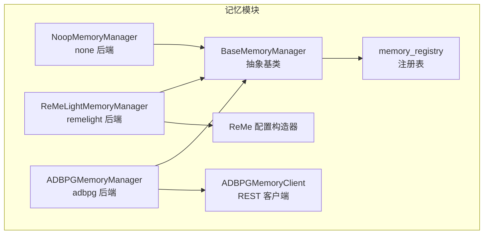
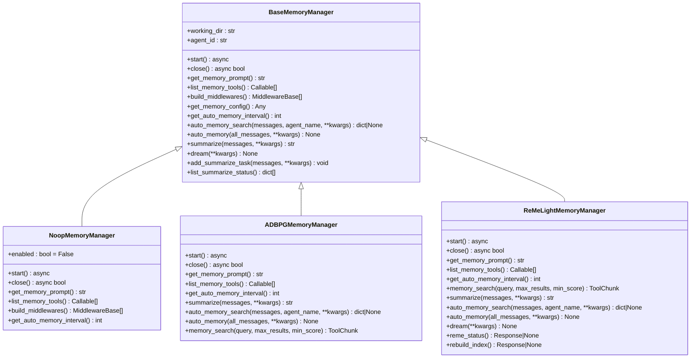
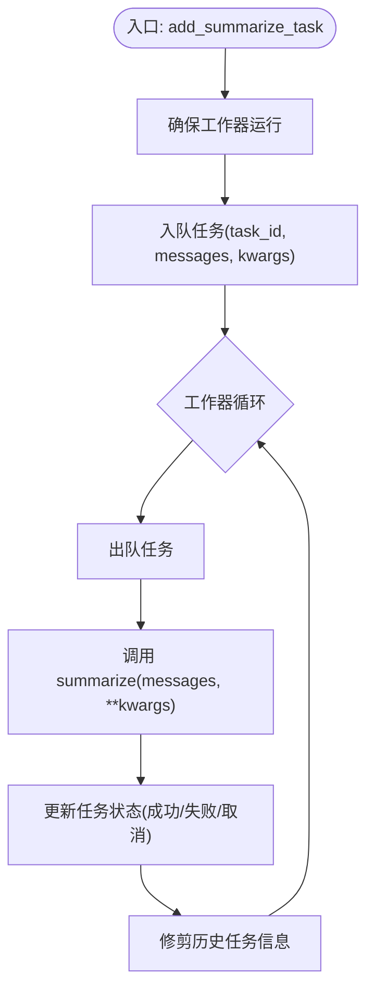
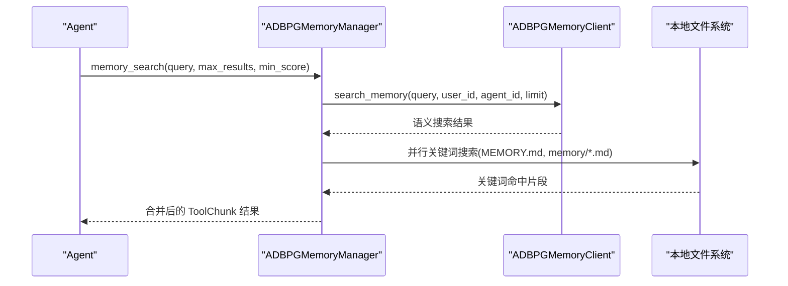
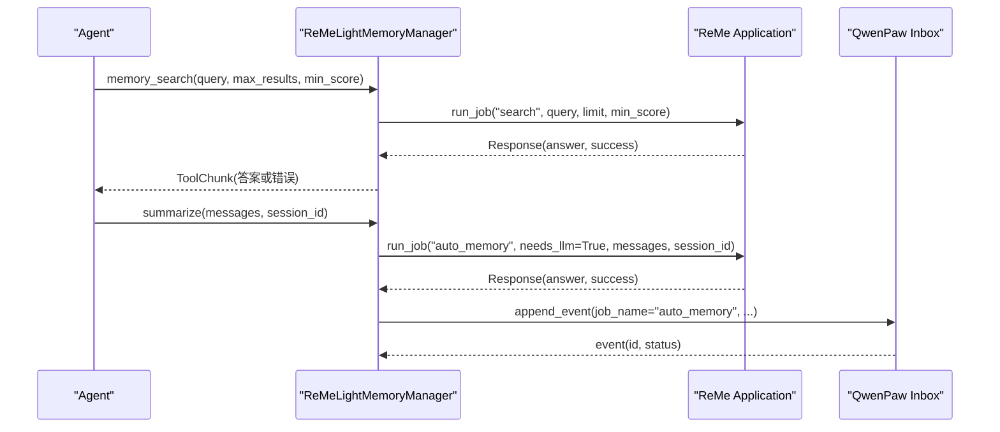
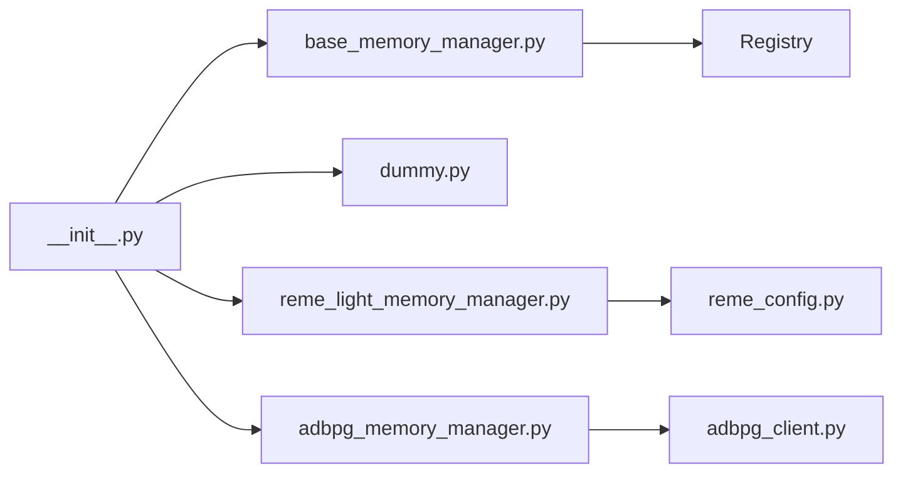

# 记忆系统基础架构

<cite>
**本文引用的文件**   
- [base_memory_manager.py](file://tongtian-tauri/src/agent/agents/memory/base_memory_manager.py)
- [__init__.py](file://tongtian-tauri/src/agent/agents/memory/__init__.py)
- [dummy.py](file://tongtian-tauri/src/agent/agents/memory/dummy.py)
- [adbpg_memory_manager.py](file://tongtian-tauri/src/agent/agents/memory/adbpg_memory_manager.py)
- [adbpg_client.py](file://tongtian-tauri/src/agent/agents/memory/adbpg_client.py)
- [reme_light_memory_manager.py](file://tongtian-tauri/src/agent/agents/memory/reme_light_memory_manager.py)
- [reme_config.py](file://tongtian-tauri/src/agent/agents/memory/reme_config.py)
</cite>

## 目录
1. [引言](#引言)
2. [项目结构](#项目结构)
3. [核心组件](#核心组件)
4. [架构总览](#架构总览)
5. [详细组件分析](#详细组件分析)
6. [依赖关系分析](#依赖关系分析)
7. [性能考虑](#性能考虑)
8. [故障排查指南](#故障排查指南)
9. [结论](#结论)
10. [附录：自定义记忆管理器实现指南](#附录自定义记忆管理器实现指南)

## 引言
本文件系统化梳理记忆系统的基础架构，重点围绕 BaseMemoryManager 抽象类的设计模式、生命周期管理、配置管理机制与插件化架构展开。通过统一的抽象接口，系统支持多种存储后端（如 ReMe 本地文件索引、ADBPG 远程向量检索、以及无操作后端），并提供自动记忆、自动搜索、摘要任务队列、中间件集成等能力。文档同时给出注册机制、错误处理策略、性能优化建议，并附带实现自定义记忆管理器的最佳实践。

## 项目结构
记忆系统位于 agents/memory 模块下，采用“抽象基类 + 多后端实现 + 统一注册表”的组织方式：
- base_memory_manager.py：定义抽象基类、生命周期钩子、通用工具方法、后台摘要任务队列、自动记忆辅助方法与注册表工厂。
- __init__.py：集中导出公共符号，并通过导入各后端触发其注册。
- dummy.py：提供禁用记忆的 Noop 后端，用于测试或关闭记忆功能。
- adbpg_memory_manager.py：基于 ADBPG REST API 的长期记忆后端，结合本地文件关键词匹配。
- reme_light_memory_manager.py：基于 ReMe 应用框架的记忆后端，封装作业调度、索引构建、自动记忆与自动梦想等能力。
- adbpg_client.py：ADBPG REST 客户端，负责 add/search/close。
- reme_config.py：为嵌入的 ReMe 应用生成配置，映射 QwenPaw 的嵌入模型与路径设置。

**图表来源** 
- [base_memory_manager.py:36-123](file://tongtian-tauri/src/agent/agents/memory/base_memory_manager.py#L36-L123)
- [dummy.py:11-43](file://tongtian-tauri/src/agent/agents/memory/dummy.py#L11-L43)
- [adbpg_memory_manager.py:32-158](file://tongtian-tauri/src/agent/agents/memory/adbpg_memory_manager.py#L32-L158)
- [adbpg_client.py:22-157](file://tongtian-tauri/src/agent/agents/memory/adbpg_client.py#L22-L157)
- [reme_light_memory_manager.py:104-205](file://tongtian-tauri/src/agent/agents/memory/reme_light_memory_manager.py#L104-L205)
- [reme_config.py:25-54](file://tongtian-tauri/src/agent/agents/memory/reme_config.py#L25-L54)

**章节来源**
- [base_memory_manager.py:36-123](file://tongtian-tauri/src/agent/agents/memory/base_memory_manager.py#L36-L123)
- [__init__.py:1-70](file://tongtian-tauri/src/agent/agents/memory/__init__.py#L1-L70)

## 核心组件
- BaseMemoryManager 抽象基类
  - 生命周期：start() 初始化、close() 释放资源；子类必须实现。
  - 提示与工具：get_memory_prompt() 注入系统提示；list_memory_tools() 暴露 Agent 可调用工具。
  - 中间件：build_middlewares() 返回 MemoryMiddleware 实例，参与 Prompt/Model/Reply 生命周期。
  - 自动记忆：auto_memory_search()/auto_memory() 在回复前后进行自动检索与持久化。
  - 摘要任务：add_summarize_task()/summarize() 提供后台串行执行队列，状态可查询。
  - 配置钩子：get_memory_config()/get_auto_memory_interval() 供共享中间件读取后端配置。
  - 自动记忆搜索消息构造：_build_auto_memory_search_msg() 生成合成 AssistantMsg，便于中间件合并上下文。
  - 注册与工厂：memory_registry 与 get_memory_manager_backend() 实现后端选择与回退。

- 后端实现
  - NoopMemoryManager（none）：禁用所有记忆能力，适合调试或关闭记忆场景。
  - ADBPGMemoryManager（adbpg）：通过 ADBPG REST 进行语义检索，并结合本地 MEMORY.md 与 memory/*.md 关键词匹配；每轮自动持久化用户消息。
  - ReMeLightMemoryManager（remelight）：嵌入 ReMe 应用，使用作业框架完成搜索、自动记忆、自动梦想、资源解析、索引重建等；支持将结果推送到 QwenPaw Inbox。

**章节来源**
- [base_memory_manager.py:36-123](file://tongtian-tauri/src/agent/agents/memory/base_memory_manager.py#L36-L123)
- [base_memory_manager.py:247-329](file://tongtian-tauri/src/agent/agents/memory/base_memory_manager.py#L247-L329)
- [base_memory_manager.py:375-528](file://tongtian-tauri/src/agent/agents/memory/base_memory_manager.py#L375-L528)
- [base_memory_manager.py:534-573](file://tongtian-tauri/src/agent/agents/memory/base_memory_manager.py#L534-L573)
- [dummy.py:11-43](file://tongtian-tauri/src/agent/agents/memory/dummy.py#L11-L43)
- [adbpg_memory_manager.py:32-158](file://tongtian-tauri/src/agent/agents/memory/adbpg_memory_manager.py#L32-L158)
- [reme_light_memory_manager.py:104-205](file://tongtian-tauri/src/agent/agents/memory/reme_light_memory_manager.py#L104-L205)

## 架构总览
记忆系统以 BaseMemoryManager 为核心抽象，通过 Registry 统一注册后端，并由 get_memory_manager_backend(backend) 根据配置选择具体实现。运行时，Agent 通过 list_memory_tools() 获取工具函数，通过 build_middlewares() 注入中间件，从而在对话流程中自动完成记忆检索与持久化。

**图表来源** 
- [base_memory_manager.py:36-123](file://tongtian-tauri/src/agent/agents/memory/base_memory_manager.py#L36-L123)
- [dummy.py:11-43](file://tongtian-tauri/src/agent/agents/memory/dummy.py#L11-L43)
- [adbpg_memory_manager.py:32-158](file://tongtian-tauri/src/agent/agents/memory/adbpg_memory_manager.py#L32-L158)
- [reme_light_memory_manager.py:104-205](file://tongtian-tauri/src/agent/agents/memory/reme_light_memory_manager.py#L104-L205)

## 详细组件分析

### BaseMemoryManager 抽象类
- 设计要点
  - 生命周期钩子 start()/close() 强制由子类实现，确保存储后端正确初始化与清理。
  - 工具与提示分离：list_memory_tools() 暴露工具，get_memory_prompt() 注入系统提示。
  - 中间件扩展点：build_middlewares() 返回 MemoryMiddleware，参与对话生命周期。
  - 自动记忆：auto_memory_search() 在 pre_reply 阶段检索相关记忆；auto_memory() 在 post_reply 阶段提取并持久化。
  - 摘要任务队列：add_summarize_task() 非阻塞入队，_summarize_worker() 串行执行 summarize()，支持状态查询与修剪历史。
  - 自动记忆搜索消息构造：_build_auto_memory_search_msg() 生成合成 AssistantMsg，包含估计 token 用量与元数据，避免与真实回复合并。
  - 配置钩子：get_memory_config() 与 get_auto_memory_interval() 供共享中间件读取后端配置。
  - 注册与工厂：memory_registry 与 get_memory_manager_backend() 实现按名称选择后端，未注册时回退到首个已注册后端。

**图表来源** 
- [base_memory_manager.py:375-528](file://tongtian-tauri/src/agent/agents/memory/base_memory_manager.py#L375-L528)

**章节来源**
- [base_memory_manager.py:36-123](file://tongtian-tauri/src/agent/agents/memory/base_memory_manager.py#L36-L123)
- [base_memory_manager.py:247-329](file://tongtian-tauri/src/agent/agents/memory/base_memory_manager.py#L247-L329)
- [base_memory_manager.py:375-528](file://tongtian-tauri/src/agent/agents/memory/base_memory_manager.py#L375-L528)
- [base_memory_manager.py:534-573](file://tongtian-tauri/src/agent/agents/memory/base_memory_manager.py#L534-L573)

### NoopMemoryManager（none 后端）
- 作用：完全禁用记忆功能，所有工具与中间件返回空结果，适用于测试或关闭记忆的场景。
- 关键行为：start()/close() 为空操作；get_memory_prompt() 返回空字符串；list_memory_tools() 返回空列表；get_auto_memory_interval() 返回 0 禁用自动记忆。

**章节来源**
- [dummy.py:11-43](file://tongtian-tauri/src/agent/agents/memory/dummy.py#L11-L43)

### ADBPGMemoryManager（adbpg 后端）
- 作用：基于 AnalyticDB for PostgreSQL 的长期记忆存储与检索，结合本地文件关键词匹配。
- 关键行为：
  - start() 加载 agent 配置中的 adbpg_memory_config，校验必填字段并创建 ADBPGMemoryClient。
  - close() 等待待提交任务完成后关闭 HTTP 客户端。
  - get_memory_prompt() 根据语言返回引导提示。
  - list_memory_tools() 暴露 memory_search 工具。
  - get_auto_memory_interval() 返回 1，表示每轮都尝试持久化用户消息。
  - summarize() 过滤 role=user 的消息并异步添加至 ADBPG。
  - auto_memory_search() 根据配置启用自动检索，构造合成 AssistantMsg 以便中间件合并上下文。
  - auto_memory() 每轮去重后异步持久化新消息。
  - memory_search() 组合 ADBPG 语义搜索结果与本地 MEMORY.md/memory/*.md 关键词匹配结果。

**图表来源** 
- [adbpg_memory_manager.py:255-333](file://tongtian-tauri/src/agent/agents/memory/adbpg_memory_manager.py#L255-L333)
- [adbpg_client.py:71-122](file://tongtian-tauri/src/agent/agents/memory/adbpg_client.py#L71-L122)

**章节来源**
- [adbpg_memory_manager.py:32-158](file://tongtian-tauri/src/agent/agents/memory/adbpg_memory_manager.py#L32-L158)
- [adbpg_memory_manager.py:255-333](file://tongtian-tauri/src/agent/agents/memory/adbpg_memory_manager.py#L255-L333)
- [adbpg_client.py:22-157](file://tongtian-tauri/src/agent/agents/memory/adbpg_client.py#L22-L157)

### ReMeLightMemoryManager（remelight 后端）
- 作用：嵌入 ReMe 应用，通过作业框架完成搜索、自动记忆、自动梦想、资源解析、索引重建等；支持将作业结果推送到 QwenPaw Inbox。
- 关键行为：
  - start() 更新 ReMe 的 LLM 组件为当前 QwenPaw 模型，然后启动 ReMe。
  - close() 停止摘要工作器并关闭 ReMe。
  - get_memory_prompt() 根据语言与 daily_dir 构建引导提示。
  - list_memory_tools() 暴露 memory_search 工具。
  - get_auto_memory_interval() 从 agent 配置读取自动记忆间隔。
  - memory_search() 调用 ReMe 的 search 作业，返回格式化结果。
  - summarize() 调用 auto_memory 作业，将对话事实写入每日笔记。
  - auto_memory_search() 根据配置启用自动检索，构造合成 AssistantMsg。
  - auto_memory() 将消息加入摘要任务队列，由 ReMe 后台处理。
  - dream() 执行 auto_dream 作业，整合兴趣主题与摘要节点。
  - reme_status()/rebuild_index() 查询状态与重建索引。

**图表来源** 
- [reme_light_memory_manager.py:380-424](file://tongtian-tauri/src/agent/agents/memory/reme_light_memory_manager.py#L380-L424)
- [reme_light_memory_manager.py:426-454](file://tongtian-tauri/src/agent/agents/memory/reme_light_memory_manager.py#L426-L454)
- [reme_light_memory_manager.py:269-360](file://tongtian-tauri/src/agent/agents/memory/reme_light_memory_manager.py#L269-L360)

**章节来源**
- [reme_light_memory_manager.py:104-205](file://tongtian-tauri/src/agent/agents/memory/reme_light_memory_manager.py#L104-L205)
- [reme_light_memory_manager.py:380-424](file://tongtian-tauri/src/agent/agents/memory/reme_light_memory_manager.py#L380-L424)
- [reme_light_memory_manager.py:426-454](file://tongtian-tauri/src/agent/agents/memory/reme_light_memory_manager.py#L426-L454)
- [reme_light_memory_manager.py:269-360](file://tongtian-tauri/src/agent/agents/memory/reme_light_memory_manager.py#L269-L360)

### ReMe 配置构造器
- 作用：将 QwenPaw 的 AgentProfileConfig 与全局配置转换为 ReMe Application 所需的配置字典，包括工作区路径、目录、语言、时区、组件与作业定义。
- 关键点：
  - build_reme_app_config() 组装基础配置与工作区路径。
  - _apply_embedding_config() 映射嵌入模型配置到 ReMe 组件，支持 openai/dashscope/gemini/ollama 等后端。
  - _is_embedding_enabled() 判断是否启用嵌入（需满足模型名与凭据要求）。
  - get_reme_app_config() 对外提供深拷贝安全配置。

**章节来源**
- [reme_config.py:25-54](file://tongtian-tauri/src/agent/agents/memory/reme_config.py#L25-L54)
- [reme_config.py:642-711](file://tongtian-tauri/src/agent/agents/memory/reme_config.py#L642-L711)
- [reme_config.py:714-728](file://tongtian-tauri/src/agent/agents/memory/reme_config.py#L714-L728)

## 依赖关系分析
- 模块内依赖
  - base_memory_manager.py 提供抽象与通用逻辑，被各后端实现继承。
  - __init__.py 通过导入各后端触发 @memory_registry.register(...) 装饰器，完成后端注册。
  - ADBPGMemoryManager 依赖 ADBPGMemoryClient 进行 REST 通信。
  - ReMeLightMemoryManager 依赖 reme_config.py 生成 ReMe 应用配置，并在运行时调用 ReMe 作业。

**图表来源** 
- [__init__.py:1-70](file://tongtian-tauri/src/agent/agents/memory/__init__.py#L1-L70)
- [base_memory_manager.py:534-573](file://tongtian-tauri/src/agent/agents/memory/base_memory_manager.py#L534-L573)
- [adbpg_memory_manager.py:32-158](file://tongtian-tauri/src/agent/agents/memory/adbpg_memory_manager.py#L32-L158)
- [reme_light_memory_manager.py:104-205](file://tongtian-tauri/src/agent/agents/memory/reme_light_memory_manager.py#L104-L205)

**章节来源**
- [__init__.py:1-70](file://tongtian-tauri/src/agent/agents/memory/__init__.py#L1-L70)
- [base_memory_manager.py:534-573](file://tongtian-tauri/src/agent/agents/memory/base_memory_manager.py#L534-L573)

## 性能考虑
- 后台摘要任务队列
  - 串行执行避免并发竞争，降低 I/O 压力；支持超时关闭与状态修剪，防止内存泄漏。
  - 建议在高吞吐场景下合理设置 SUMMARY_WORKER_CLOSE_TIMEOUT_SECONDS 与 MAX_SUMMARY_TASK_HISTORY。
- 自动记忆与自动搜索
  - ADBPG 后端每轮持久化用户消息，注意网络延迟与重试策略；本地文件搜索使用线程池避免阻塞事件循环。
  - ReMe 后端通过作业框架异步处理，避免阻塞主流程；Inbox 推送可配置开关以减少额外开销。
- 估算 Token 用量
  - _get_token_estimate_divisor() 与 _estimate_message_text_tokens() 提供轻量级字节长度启发式估算，避免精确分词开销。
- 连接与资源管理
  - ADBPGMemoryClient 使用 httpx.AsyncClient，需在 close() 中释放；ReMe 应用需在 close() 中正确关闭。

[本节为通用指导，不直接分析具体文件]

## 故障排查指南
- 后端未注册或配置缺失
  - get_memory_manager_backend() 在未找到后端时会抛出 ValueError，并记录警告日志；检查 __init__.py 是否正确导入后端模块。
- ADBPG 连接失败
  - start() 会捕获异常并记录警告，导致长记忆禁用；检查 rest_base_url 与 rest_api_key 是否配置完整。
- ReMe 启动失败
  - start() 捕获异常并记录堆栈；确认嵌入模型配置有效且凭据正确。
- 摘要任务失败或卡住
  - list_summarize_status() 可查看任务状态与错误信息；_shutdown_summarize_worker() 支持双重取消与超时控制。
- 自动记忆搜索未生效
  - 检查 auto_memory_search_config.enabled 与 max_results；确认 _build_query() 能提取到用户文本。

**章节来源**
- [base_memory_manager.py:534-573](file://tongtian-tauri/src/agent/agents/memory/base_memory_manager.py#L534-L573)
- [adbpg_memory_manager.py:55-115](file://tongtian-tauri/src/agent/agents/memory/adbpg_memory_manager.py#L55-L115)
- [reme_light_memory_manager.py:143-157](file://tongtian-tauri/src/agent/agents/memory/reme_light_memory_manager.py#L143-L157)
- [base_memory_manager.py:375-528](file://tongtian-tauri/src/agent/agents/memory/base_memory_manager.py#L375-L528)

## 结论
记忆系统通过 BaseMemoryManager 抽象类统一了不同存储后端的接口与生命周期，借助 Registry 实现插件化扩展。ADBPG 与 ReMe 两种后端分别面向远程向量检索与本地文件索引，配合自动记忆、自动搜索与摘要任务队列，形成完整的记忆闭环。合理的错误处理与性能优化策略确保了系统的稳定性与可扩展性。

[本节为总结性内容，不直接分析具体文件]

## 附录：自定义记忆管理器实现指南
- 步骤概览
  - 继承 BaseMemoryManager，实现 start()/close()/get_memory_prompt()/list_memory_tools()。
  - 可选实现 summarize()/auto_memory_search()/auto_memory()/dream() 等增强能力。
  - 使用 @memory_registry.register("your_backend") 装饰器注册后端。
  - 在 __init__.py 中导入你的模块以触发注册。
- 最佳实践
  - 在 start() 中验证配置并建立连接，失败时记录警告并降级。
  - 在 close() 中确保释放所有资源（HTTP 客户端、文件句柄、进程等）。
  - list_memory_tools() 返回的工具应返回 ToolChunk，保证与 AgentScope 兼容。
  - 使用 add_summarize_task() 非阻塞地提交摘要任务，避免阻塞回复流程。
  - 对于自动记忆搜索，使用 _build_auto_memory_search_msg() 构造合成消息，便于中间件合并上下文。
  - 对网络与 I/O 操作进行异常捕获与日志记录，提升可观测性与可维护性。

**章节来源**
- [base_memory_manager.py:36-123](file://tongtian-tauri/src/agent/agents/memory/base_memory_manager.py#L36-L123)
- [base_memory_manager.py:534-573](file://tongtian-tauri/src/agent/agents/memory/base_memory_manager.py#L534-L573)
- [__init__.py:1-70](file://tongtian-tauri/src/agent/agents/memory/__init__.py#L1-L70)