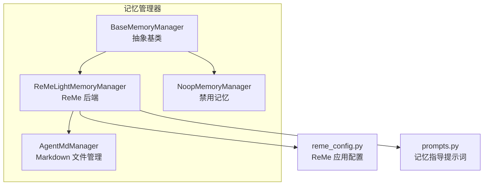
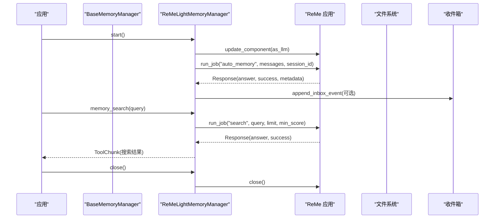
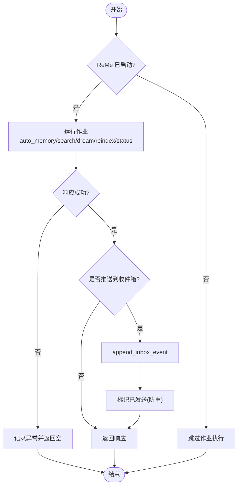
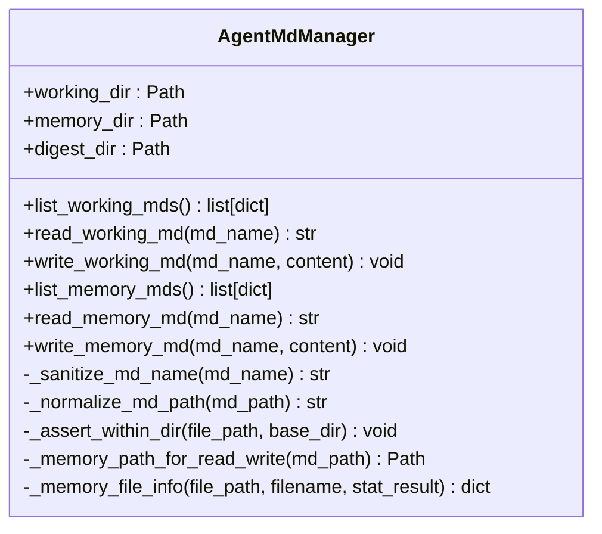
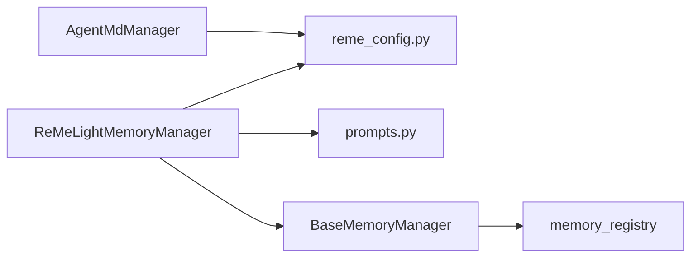

# 轻量级记忆管理器

<cite>
**本文引用的文件**
- [reme_light_memory_manager.py](file://tongtian-tauri/src/agent/agents/memory/reme_light_memory_manager.py)
- [base_memory_manager.py](file://tongtian-tauri/src/agent/agents/memory/base_memory_manager.py)
- [agent_md_manager.py](file://tongtian-tauri/src/agent/agents/memory/agent_md_manager.py)
- [reme_config.py](file://tongtian-tauri/src/agent/agents/memory/reme_config.py)
- [prompts.py](file://tongtian-tauri/src/agent/agents/memory/prompts.py)
- [dummy.py](file://tongtian-tauri/src/agent/agents/memory/dummy.py)
</cite>

## 目录
1. [简介](#简介)
2. [项目结构](#项目结构)
3. [核心组件](#核心组件)
4. [架构总览](#架构总览)
5. [详细组件分析](#详细组件分析)
6. [依赖关系分析](#依赖关系分析)
7. [性能与优化](#性能与优化)
8. [故障排查指南](#故障排查指南)
9. [结论](#结论)
10. [附录：使用示例与迁移指南](#附录使用示例与迁移指南)

## 简介
本文件面向“轻量级记忆管理器”的设计与实现，聚焦两类能力：
- ReMeLightMemoryManager：基于 ReMe 的嵌入式应用/作业框架，提供自动记忆、自动梦境（dream）、资源自动处理、混合检索（向量+BM25）等能力。
- AgentMdManager：对工作目录与记忆目录中的 Markdown 文件进行安全读写与列表管理，支撑每日笔记、摘要归档等持久化需求。

文档将解释内存优化策略、缓存机制、数据压缩思路、Markdown 存储规范、版本控制与同步策略，并给出适用场景、性能对比、配置选项、使用示例与迁移建议。

## 项目结构
记忆子系统位于 agent/agents/memory 下，关键文件职责如下：
- base_memory_manager.py：抽象基类、生命周期、后台总结任务队列、自动记忆中间件钩子、注册表。
- reme_light_memory_manager.py：ReMe 后端实现，封装启动/关闭、作业调用、结果回灌到收件箱、会话 ID 转换、索引重建等。
- agent_md_manager.py：Markdown 文件的安全读写、路径校验、工作目录与记忆目录（含 digest）管理。
- reme_config.py：构建 ReMe 应用配置，包括 watch 目录、作业定义、组件（LLM、嵌入、索引、文件存储等）。
- prompts.py：注入给 Agent 的记忆指导提示词模板。
- dummy.py：无操作后端，用于禁用记忆功能。

图表来源
- [base_memory_manager.py:36-122](file://tongtian-tauri/src/agent/agents/memory/base_memory_manager.py#L36-L122)
- [reme_light_memory_manager.py:104-190](file://tongtian-tauri/src/agent/agents/memory/reme_light_memory_manager.py#L104-L190)
- [agent_md_manager.py:12-45](file://tongtian-tauri/src/agent/agents/memory/agent_md_manager.py#L12-L45)
- [reme_config.py:25-54](file://tongtian-tauri/src/agent/agents/memory/reme_config.py#L25-L54)
- [prompts.py:7-57](file://tongtian-tauri/src/agent/agents/memory/prompts.py#L7-L57)

章节来源
- [base_memory_manager.py:36-122](file://tongtian-tauri/src/agent/agents/memory/base_memory_manager.py#L36-L122)
- [reme_light_memory_manager.py:104-190](file://tongtian-tauri/src/agent/agents/memory/reme_light_memory_manager.py#L104-L190)
- [agent_md_manager.py:12-45](file://tongtian-tauri/src/agent/agents/memory/agent_md_manager.py#L12-L45)
- [reme_config.py:25-54](file://tongtian-tauri/src/agent/agents/memory/reme_config.py#L25-L54)
- [prompts.py:7-57](file://tongtian-tauri/src/agent/agents/memory/prompts.py#L7-L57)

## 核心组件
- BaseMemoryManager
  - 统一生命周期：start/close；抽象方法 get_memory_prompt、list_memory_tools、summarize、dream 等。
  - 后台总结任务：串行队列 + 单 worker，支持状态追踪、超时关闭、历史裁剪。
  - 自动记忆：auto_memory_search、auto_memory、interval 控制。
  - 注册表：memory_registry 与 get_memory_manager_backend 工厂。
- ReMeLightMemoryManager
  - 通过 ReMe 应用执行 auto_memory、auto_dream、search、reindex、status 等作业。
  - 会话 ID 规范化为 Windows 安全文件名，避免非法字符与保留名。
  - 结果回灌：将作业结果推送到 QwenPaw 收件箱（可配置开关）。
  - 模型注入：启动前将当前活跃模型注入 ReMe 的 LLM 组件。
- AgentMdManager
  - 安全路径校验：拒绝路径穿越、限制扩展名、确保目标在允许目录内。
  - 工作目录与记忆目录：支持 memory_dir 与 digest_dir，读取/写入/列出 .md 文件。
  - 时间戳元信息：创建/修改时间以 UTC ISO 格式返回。
- ReMe 配置（reme_config.py）
  - 构建 ReMe 应用参数：workspace_dir、各目录映射、语言与时区。
  - 作业定义：search、node_search、daily_*、frontmatter_*、read/write/edit、auto_memory/auto_resource/auto_dream、proactive、status/reindex/version 等。
  - 组件：tokenizer、as_llm、agent_wrapper、file_graph/file_catalog/file_chunker、keyword_index、as_embedding/embedding_store、file_store。
  - 嵌入配置映射：根据后端类型与凭据启用/禁用向量能力。
- 提示词（prompts.py）
  - 生成记忆指导提示词，说明 MEMORY.md、每日笔记的使用方式与检索工具。
- NoopMemoryManager（dummy.py）
  - 全量禁用记忆功能，便于测试或特殊场景。

章节来源
- [base_memory_manager.py:36-122](file://tongtian-tauri/src/agent/agents/memory/base_memory_manager.py#L36-L122)
- [base_memory_manager.py:375-527](file://tongtian-tauri/src/agent/agents/memory/base_memory_manager.py#L375-L527)
- [reme_light_memory_manager.py:57-93](file://tongtian-tauri/src/agent/agents/memory/reme_light_memory_manager.py#L57-L93)
- [reme_light_memory_manager.py:143-190](file://tongtian-tauri/src/agent/agents/memory/reme_light_memory_manager.py#L143-L190)
- [reme_light_memory_manager.py:218-240](file://tongtian-tauri/src/agent/agents/memory/reme_light_memory_manager.py#L218-L240)
- [reme_light_memory_manager.py:242-360](file://tongtian-tauri/src/agent/agents/memory/reme_light_memory_manager.py#L242-L360)
- [reme_light_memory_manager.py:380-548](file://tongtian-tauri/src/agent/agents/memory/reme_light_memory_manager.py#L380-L548)
- [agent_md_manager.py:12-105](file://tongtian-tauri/src/agent/agents/memory/agent_md_manager.py#L12-L105)
- [agent_md_manager.py:107-252](file://tongtian-tauri/src/agent/agents/memory/agent_md_manager.py#L107-L252)
- [reme_config.py:25-54](file://tongtian-tauri/src/agent/agents/memory/reme_config.py#L25-L54)
- [reme_config.py:57-558](file://tongtian-tauri/src/agent/agents/memory/reme_config.py#L57-L558)
- [reme_config.py:561-639](file://tongtian-tauri/src/agent/agents/memory/reme_config.py#L561-L639)
- [reme_config.py:642-728](file://tongtian-tauri/src/agent/agents/memory/reme_config.py#L642-L728)
- [prompts.py:7-57](file://tongtian-tauri/src/agent/agents/memory/prompts.py#L7-L57)
- [dummy.py:11-43](file://tongtian-tauri/src/agent/agents/memory/dummy.py#L11-L43)

## 架构总览
ReMeLightMemoryManager 作为后端实现，负责：
- 启动/关闭 ReMe 应用，注入模型，运行作业（auto_memory、auto_dream、search、reindex、status）。
- 将作业结果推入收件箱（可配置），屏蔽重复投递与无变更情况。
- 暴露 memory_search 工具供 Agent 检索精选长期记忆与每日笔记片段。
- 通过 BaseMemoryManager 的后台总结任务队列，异步执行 summarize，避免阻塞主流程。

AgentMdManager 提供安全的 Markdown 文件访问，配合 ReMe 的 daily/digest 目录组织，形成“短期日志 + 长期摘要”的双层记忆结构。

图表来源
- [reme_light_memory_manager.py:143-190](file://tongtian-tauri/src/agent/agents/memory/reme_light_memory_manager.py#L143-L190)
- [reme_light_memory_manager.py:218-240](file://tongtian-tauri/src/agent/agents/memory/reme_light_memory_manager.py#L218-L240)
- [reme_light_memory_manager.py:242-360](file://tongtian-tauri/src/agent/agents/memory/reme_light_memory_manager.py#L242-L360)
- [reme_light_memory_manager.py:380-454](file://tongtian-tauri/src/agent/agents/memory/reme_light_memory_manager.py#L380-L454)

章节来源
- [reme_light_memory_manager.py:143-190](file://tongtian-tauri/src/agent/agents/memory/reme_light_memory_manager.py#L143-L190)
- [reme_light_memory_manager.py:218-240](file://tongtian-tauri/src/agent/agents/memory/reme_light_memory_manager.py#L218-L240)
- [reme_light_memory_manager.py:242-360](file://tongtian-tauri/src/agent/agents/memory/reme_light_memory_manager.py#L242-L360)
- [reme_light_memory_manager.py:380-454](file://tongtian-tauri/src/agent/agents/memory/reme_light_memory_manager.py#L380-L454)

## 详细组件分析

### ReMeLightMemoryManager：设计理念与实现策略
- 设计要点
  - 通过 ReMe 的作业系统解耦记忆提取、梦境整合、资源解析与搜索索引维护。
  - 会话 ID 规范化保证跨平台（尤其是 Windows）的文件命名安全。
  - 结果回灌到收件箱，便于上层 UI/日志展示与审计。
  - 后台总结任务串行执行，避免并发竞争与资源争用。
- 内存优化与缓存
  - 嵌入缓存：embedding_store 默认开启缓存，最大缓存条目与输入长度可配。
  - 文件分块：markdown 分块器仅处理 .md，减少无关文件开销。
  - 索引更新：watch_dirs 仅监控 daily_dir 与 digest_dir，避免全仓扫描。
- 数据压缩与结构化
  - 通过 daily 笔记记录短期上下文，由 auto_dream 合并提炼至长期摘要（如 MEMORY.md），降低冗余。
  - frontmatter 字段用于元数据标注（name、description、session_id 等），便于检索与溯源。
- 错误处理与健壮性
  - 作业失败时记录异常并返回空响应，避免中断主流程。
  - 收件箱推送失败不影响作业主逻辑，仅记录日志。
  - 索引重建加锁，防止并发重建导致竞争。

图表来源
- [reme_light_memory_manager.py:218-240](file://tongtian-tauri/src/agent/agents/memory/reme_light_memory_manager.py#L218-L240)
- [reme_light_memory_manager.py:242-360](file://tongtian-tauri/src/agent/agents/memory/reme_light_memory_manager.py#L242-L360)
- [reme_light_memory_manager.py:543-548](file://tongtian-tauri/src/agent/agents/memory/reme_light_memory_manager.py#L543-L548)

章节来源
- [reme_light_memory_manager.py:57-93](file://tongtian-tauri/src/agent/agents/memory/reme_light_memory_manager.py#L57-L93)
- [reme_light_memory_manager.py:143-190](file://tongtian-tauri/src/agent/agents/memory/reme_light_memory_manager.py#L143-L190)
- [reme_light_memory_manager.py:218-240](file://tongtian-tauri/src/agent/agents/memory/reme_light_memory_manager.py#L218-L240)
- [reme_light_memory_manager.py:242-360](file://tongtian-tauri/src/agent/agents/memory/reme_light_memory_manager.py#L242-L360)
- [reme_light_memory_manager.py:380-548](file://tongtian-tauri/src/agent/agents/memory/reme_light_memory_manager.py#L380-L548)

### AgentMdManager：Markdown 文件存储方案
- 文件格式规范
  - 工作目录：*.md 直接存放临时或工作态文件。
  - 记忆目录：按 daily_dir 与 digest_dir 组织，支持子目录与相对路径。
  - 文件名安全：拒绝路径穿越、强制 .md 扩展名、最终路径需落在允许目录内。
- 版本控制与同步策略
  - 通过 ReMe 的 watch 机制监听 daily/digest 变化，触发索引更新。
  - 文件变更批量处理，结合 file_catalog 与 change 事件驱动 auto_resource。
  - 前端/上层可通过 list_memory_mds 获取文件元信息（大小、创建/修改时间）进行差异对比与增量同步。
- 安全与一致性
  - 所有写操作先创建父目录，再写入 UTF-8 文本。
  - 读操作采用编码回退策略，增强兼容性。

图表来源
- [agent_md_manager.py:12-105](file://tongtian-tauri/src/agent/agents/memory/agent_md_manager.py#L12-L105)
- [agent_md_manager.py:107-252](file://tongtian-tauri/src/agent/agents/memory/agent_md_manager.py#L107-L252)

章节来源
- [agent_md_manager.py:12-105](file://tongtian-tauri/src/agent/agents/memory/agent_md_manager.py#L12-L105)
- [agent_md_manager.py:107-252](file://tongtian-tauri/src/agent/agents/memory/agent_md_manager.py#L107-L252)

### BaseMemoryManager：抽象与通用能力
- 生命周期与中间件
  - build_middlewares 注入 MemoryMiddleware，统一管理 prompt/model-call/reply 行为。
- 后台总结任务
  - 串行 worker 处理 summarize，支持状态追踪、超时关闭、历史裁剪。
- 自动记忆
  - auto_memory_search 可在回复前自动检索相关记忆，构造合成消息以便 Agent 理解。
  - auto_memory 周期性从对话中提取记忆，交由后台任务处理。
- 注册表与工厂
  - memory_registry 与 get_memory_manager_backend 支持多后端切换与降级。

章节来源
- [base_memory_manager.py:36-122](file://tongtian-tauri/src/agent/agents/memory/base_memory_manager.py#L36-L122)
- [base_memory_manager.py:145-215](file://tongtian-tauri/src/agent/agents/memory/base_memory_manager.py#L145-L215)
- [base_memory_manager.py:315-373](file://tongtian-tauri/src/agent/agents/memory/base_memory_manager.py#L315-L373)
- [base_memory_manager.py:375-527](file://tongtian-tauri/src/agent/agents/memory/base_memory_manager.py#L375-L527)
- [base_memory_manager.py:534-572](file://tongtian-tauri/src/agent/agents/memory/base_memory_manager.py#L534-L572)

## 依赖关系分析
- ReMeLightMemoryManager 依赖 ReMe 应用与作业系统，同时依赖配置模块与提示词模块。
- AgentMdManager 依赖配置文件以动态确定 memory_dir 与 digest_dir。
- BaseMemoryManager 被多个后端继承，提供统一接口与通用能力。
- 配置模块集中管理 ReMe 的 watch 目录、作业、组件与嵌入设置。

图表来源
- [reme_light_memory_manager.py:104-190](file://tongtian-tauri/src/agent/agents/memory/reme_light_memory_manager.py#L104-L190)
- [reme_config.py:25-54](file://tongtian-tauri/src/agent/agents/memory/reme_config.py#L25-L54)
- [agent_md_manager.py:12-45](file://tongtian-tauri/src/agent/agents/memory/agent_md_manager.py#L12-L45)
- [base_memory_manager.py:534-572](file://tongtian-tauri/src/agent/agents/memory/base_memory_manager.py#L534-L572)

章节来源
- [reme_light_memory_manager.py:104-190](file://tongtian-tauri/src/agent/agents/memory/reme_light_memory_manager.py#L104-L190)
- [reme_config.py:25-54](file://tongtian-tauri/src/agent/agents/memory/reme_config.py#L25-L54)
- [agent_md_manager.py:12-45](file://tongtian-tauri/src/agent/agents/memory/agent_md_manager.py#L12-L45)
- [base_memory_manager.py:534-572](file://tongtian-tauri/src/agent/agents/memory/base_memory_manager.py#L534-L572)

## 性能与优化
- 索引与检索
  - 混合检索：向量权重与候选倍数可调，RRF 融合提升召回质量。
  - 只监控必要目录（daily/digest），减少 IO 压力。
  - 嵌入缓存：启用本地缓存，限制最大条目与输入长度，降低重复计算。
- 后台任务
  - 串行总结任务避免并发竞争，支持超时关闭与状态追踪。
  - 自动记忆间隔可由配置控制，避免频繁触发。
- 文件 I/O
  - 安全路径校验与目录约束，避免越界写入。
  - 编码回退读取，提高兼容性。
- 内存占用
  - 通过 daily 与 digest 分层，减少长上下文膨胀。
  - 资源文件监听与自动解析，按需处理，避免全量加载。

[本节为通用性能讨论，不直接分析具体文件]

## 故障排查指南
- ReMe 未启动或导入失败
  - 现象：作业跳过执行或返回空响应。
  - 排查：检查 ReMe 启动流程与模型注入；查看日志中 import 失败与 start 异常。
- 收件箱推送失败
  - 现象：作业成功但未收到结果通知。
  - 排查：确认 inbox_push_enabled 配置；检查 append_inbox_event 异常日志。
- 索引重建冲突
  - 现象：并发重建抛出运行时错误。
  - 排查：确保同一时刻仅一个重建任务；检查 _reindex_lock 使用情况。
- 文件路径非法
  - 现象：读写时报错路径逃逸或无效路径。
  - 排查：使用 _sanitize_md_name/_normalize_md_path 校验；确认目标在允许目录内。
- 嵌入未启用
  - 现象：搜索仅关键词匹配，无向量结果。
  - 排查：检查 embedding_model_config 与凭据；确认后端类型与 enable_cache 设置。

章节来源
- [reme_light_memory_manager.py:123-157](file://tongtian-tauri/src/agent/agents/memory/reme_light_memory_manager.py#L123-L157)
- [reme_light_memory_manager.py:218-240](file://tongtian-tauri/src/agent/agents/memory/reme_light_memory_manager.py#L218-L240)
- [reme_light_memory_manager.py:242-360](file://tongtian-tauri/src/agent/agents/memory/reme_light_memory_manager.py#L242-L360)
- [reme_light_memory_manager.py:543-548](file://tongtian-tauri/src/agent/agents/memory/reme_light_memory_manager.py#L543-L548)
- [agent_md_manager.py:51-105](file://tongtian-tauri/src/agent/agents/memory/agent_md_manager.py#L51-L105)
- [reme_config.py:642-728](file://tongtian-tauri/src/agent/agents/memory/reme_config.py#L642-L728)

## 结论
- ReMeLightMemoryManager 提供强大的自动化记忆能力，适合需要长期记忆、自动整理与混合检索的场景。
- AgentMdManager 提供安全可靠的 Markdown 文件管理，适合对文件结构与版本有明确要求的场景。
- 两者结合可实现“短期日志 + 长期摘要”的分层记忆体系，兼顾性能与可维护性。
- 通过配置项可灵活调整嵌入、缓存、索引与自动记忆策略，满足不同性能与功能需求。

[本节为总结性内容，不直接分析具体文件]

## 附录：使用示例与迁移指南

### 选择与适用场景
- 选择 ReMeLightMemoryManager
  - 需要自动记忆、自动梦境、资源解析、混合检索。
  - 希望将作业结果推送到收件箱，便于可视化与审计。
  - 需要嵌入向量能力与本地缓存以提升检索性能。
- 选择 AgentMdManager
  - 仅需基础 Markdown 文件读写与列表管理。
  - 需要严格的路径安全与目录约束。
  - 不需要复杂的作业与索引机制。
- 选择 NoopMemoryManager
  - 完全禁用记忆功能，适用于测试或极简场景。

### 配置选项要点
- ReMe 应用配置
  - workspace_dir、metadata_dir、session_dir、mem_session_dir、resource_dir、daily_dir、digest_dir。
  - language、timezone、enable_logo、log_to_console。
  - jobs：search、node_search、daily_list、daily_reindex、frontmatter_*、read/write/edit、auto_memory/auto_resource/auto_dream、proactive、status/reindex/version。
  - components：tokenizer、as_llm、agent_wrapper、file_graph/file_catalog/file_chunker、keyword_index、as_embedding/embedding_store、file_store。
- 嵌入配置
  - backend、model_name、dimensions、api_key、base_url、enable_cache、max_cache_size、max_input_length、max_batch_size。
- 自动记忆
  - auto_memory_interval：周期秒数，0 表示禁用。
  - auto_memory_search_config.enabled：是否在回复前自动检索。
  - inbox_push_enabled：是否推送作业结果到收件箱。

### 使用示例（步骤式）
- 初始化与启动
  - 实例化 ReMeLightMemoryManager，传入 working_dir 与 agent_id。
  - 调用 start() 完成模型注入与 ReMe 启动。
- 会话期间
  - 使用 memory_search 进行语义检索。
  - 在 post_reply 阶段调用 auto_memory 提交待总结消息。
  - 定期触发 dream 进行记忆整合。
- 关闭
  - 调用 close() 停止后台任务并关闭 ReMe。

### 迁移指南
- 从旧版 ReMeLight 迁移
  - 保持公共类名与注册键不变，内部委托给 ReMe 应用/作业框架。
  - 关注会话 ID 规范化规则，确保兼容现有 channel/session 标识。
- 从纯文件存储迁移到 ReMe
  - 将日常笔记与摘要目录映射到 daily_dir 与 digest_dir。
  - 启用 watch 机制与索引更新，逐步引入自动记忆与检索。
- 禁用记忆
  - 切换到 NoopMemoryManager，快速验证无记忆场景下的行为。

章节来源
- [reme_config.py:25-54](file://tongtian-tauri/src/agent/agents/memory/reme_config.py#L25-L54)
- [reme_config.py:57-558](file://tongtian-tauri/src/agent/agents/memory/reme_config.py#L57-L558)
- [reme_config.py:561-639](file://tongtian-tauri/src/agent/agents/memory/reme_config.py#L561-L639)
- [reme_config.py:642-728](file://tongtian-tauri/src/agent/agents/memory/reme_config.py#L642-L728)
- [reme_light_memory_manager.py:57-93](file://tongtian-tauri/src/agent/agents/memory/reme_light_memory_manager.py#L57-L93)
- [reme_light_memory_manager.py:143-190](file://tongtian-tauri/src/agent/agents/memory/reme_light_memory_manager.py#L143-L190)
- [reme_light_memory_manager.py:380-548](file://tongtian-tauri/src/agent/agents/memory/reme_light_memory_manager.py#L380-L548)
- [dummy.py:11-43](file://tongtian-tauri/src/agent/agents/memory/dummy.py#L11-L43)