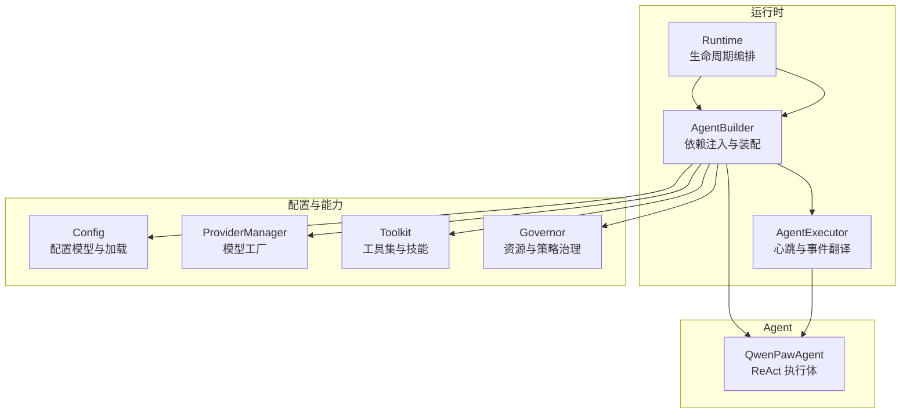
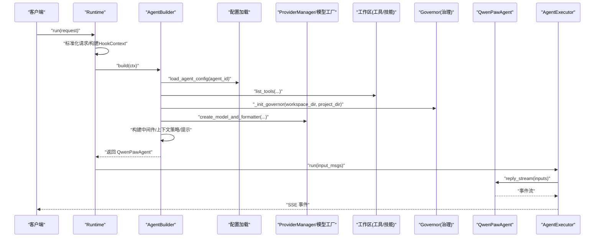
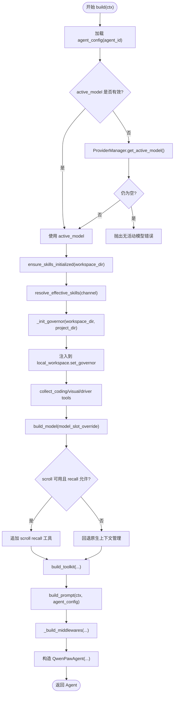
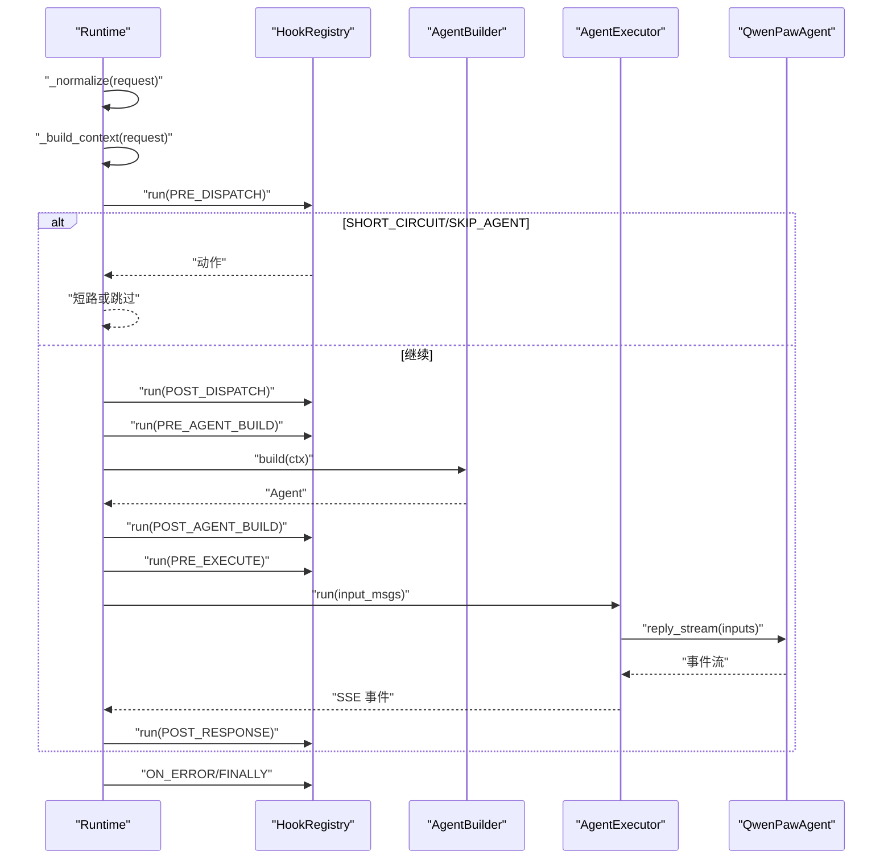
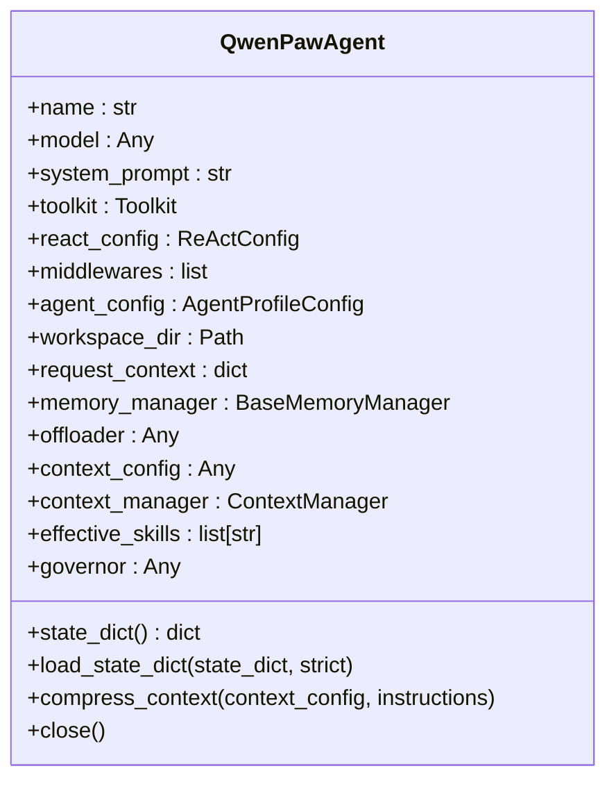
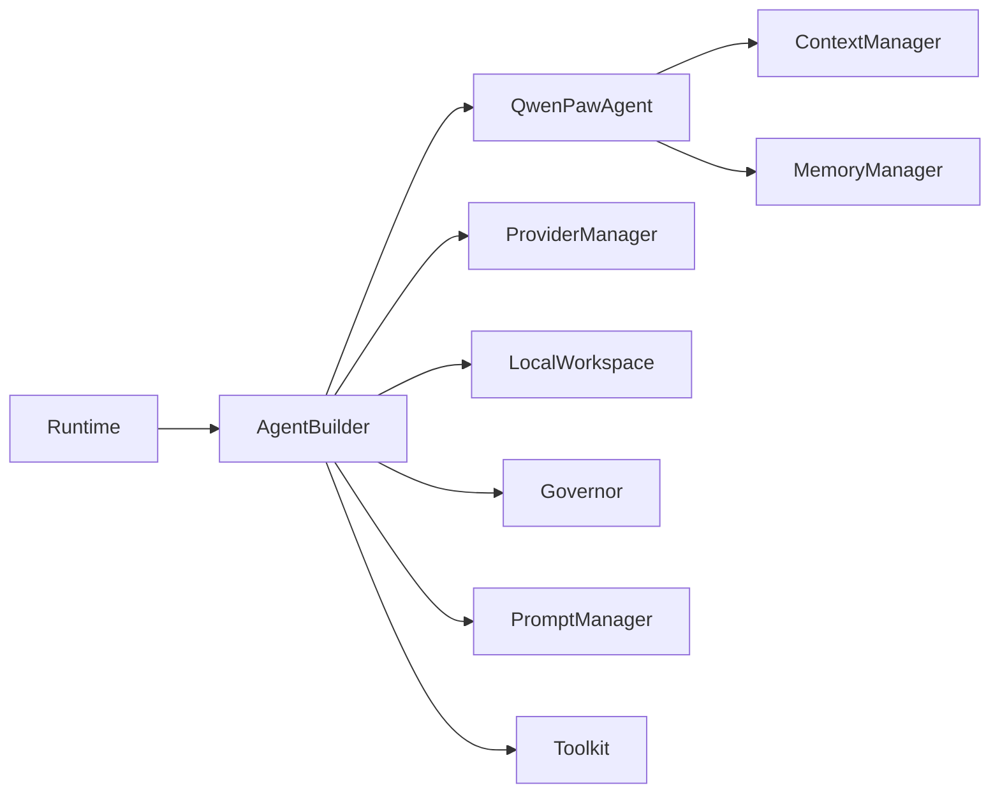

# Agent 构建器

<cite>
**本文引用的文件**
- [builder.py](file://tongtian-tauri/src/agent/runtime/builder.py)
- [runtime.py](file://tongtian-tauri/src/agent/runtime/runtime.py)
- [react_agent.py](file://tongtian-tauri/src/agent/agents/react_agent.py)
- [executor.py](file://tongtian-tauri/src/agent/runtime/executor.py)
- [config.py](file://tongtian-tauri/src/agent/config/config.py)
</cite>

## 目录
1. [简介](#简介)
2. [项目结构](#项目结构)
3. [核心组件](#核心组件)
4. [架构总览](#架构总览)
5. [详细组件分析](#详细组件分析)
6. [依赖关系分析](#依赖关系分析)
7. [性能考量](#性能考量)
8. [故障排查指南](#故障排查指南)
9. [结论](#结论)
10. [附录：扩展与示例](#附录：扩展与示例)

## 简介
本文件面向 AgentBuilder 的完整文档，聚焦“按请求构建 Agent”的全流程：依赖注入、配置加载、插件初始化、工具集装配、模型与格式化器选择、上下文策略、治理层（Governor）与安全策略、以及错误处理。同时说明如何基于不同的 agent_id 和 workspace 动态构建 Agent 实例，并给出扩展点与示例，帮助读者注册新 Agent 类型、传递配置参数、实现自定义构建步骤与依赖解析器。

## 项目结构
围绕 Agent 构建的关键代码集中在 runtime 层与 agents 层：
- runtime/builder.py：AgentBuilder，负责一次请求的 Agent 组装与依赖注入
- runtime/runtime.py：Runtime，编排 8 阶段生命周期，调用 AgentBuilder.build
- agents/react_agent.py：QwenPawAgent，接收外部注入的依赖并运行
- runtime/executor.py：AgentExecutor，驱动 reply_stream 并输出 SSE
- config/config.py：配置模型与加载逻辑（含 agent_id 校验等）

图表来源
- [runtime.py:32-110](file://tongtian-tauri/src/agent/runtime/runtime.py#L32-L110)
- [builder.py:28-110](file://tongtian-tauri/src/agent/runtime/builder.py#L28-L110)
- [executor.py:23-61](file://tongtian-tauri/src/agent/runtime/executor.py#L23-L61)
- [react_agent.py:59-146](file://tongtian-tauri/src/agent/agents/react_agent.py#L59-L146)
- [config.py:137-206](file://tongtian-tauri/src/agent/config/config.py#L137-L206)

章节来源
- [runtime.py:32-110](file://tongtian-tauri/src/agent/runtime/runtime.py#L32-L110)
- [builder.py:28-110](file://tongtian-tauri/src/agent/runtime/builder.py#L28-L110)
- [executor.py:23-61](file://tongtian-tauri/src/agent/runtime/executor.py#L23-L61)
- [react_agent.py:59-146](file://tongtian-tauri/src/agent/agents/react_agent.py#L59-L146)
- [config.py:137-206](file://tongtian-tauri/src/agent/config/config.py#L137-L206)

## 核心组件
- AgentBuilder：为每次请求构建一个完整的 QwenPawAgent，完成：
  - 从工作区加载工具集（list_tools），合并 extra_tools 与 memory_tools
  - 根据 request_context 应用子代理工具白名单
  - 解析有效技能目录（SKILL.md）
  - 初始化治理层（ResourceGovernor）并注入到工具包装中
  - 收集编码模式工具、视觉压缩恢复工具、Driver 工具与提示
  - 通过工厂创建模型与 formatter，必要时覆盖 model_slot
  - 构建 offloader、scroll 上下文策略（可选）
  - 生成系统提示（PromptManager）
  - 组装 middlewares、context_config、effective_skills 等
  - 最终构造 QwenPawAgent 并返回
- Runtime：8 阶段生命周期编排，固定步骤包括：
  - PRE_DISPATCH / POST_DISPATCH
  - PRE_AGENT_BUILD → 调用 AgentBuilder.build → POST_AGENT_BUILD
  - PRE_EXECUTE → 执行 AgentExecutor.run → POST_RESPONSE
  - ON_ERROR / FINALLY 钩子
- QwenPawAgent：接收外部注入的 model、toolkit、middlewares、context_manager 等，负责：
  - 注册技能元数据
  - 记忆工具注册与白名单过滤
  - 上下文压缩（可委托 ContextManager）
  - 媒体块处理与重试
  - 会话状态序列化/反序列化
- AgentExecutor：驱动 agent.reply_stream，心跳保活，事件转译为 Envelope

章节来源
- [builder.py:183-409](file://tongtian-tauri/src/agent/runtime/builder.py#L183-L409)
- [runtime.py:49-141](file://tongtian-tauri/src/agent/runtime/runtime.py#L49-L141)
- [react_agent.py:59-146](file://tongtian-tauri/src/agent/agents/react_agent.py#L59-L146)
- [executor.py:23-61](file://tongtian-tauri/src/agent/runtime/executor.py#L23-L61)

## 架构总览
下图展示一次请求从进入 Runtime 到 Agent 构建与执行的端到端流程，突出 AgentBuilder 在依赖注入中的关键作用。

图表来源
- [runtime.py:49-141](file://tongtian-tauri/src/agent/runtime/runtime.py#L49-L141)
- [builder.py:183-409](file://tongtian-tauri/src/agent/runtime/builder.py#L183-L409)
- [executor.py:36-61](file://tongtian-tauri/src/agent/runtime/executor.py#L36-L61)

## 详细组件分析

### AgentBuilder：依赖注入与装配
- 工具集装配
  - 从 ctx.workspace.local_workspace.list_tools 获取基础工具
  - 追加 extra_tools 与 memory_tools（后者会被 PolicyGuardedTool 包装）
  - 使用 apply_subagent_tool_whitelist 做最终白名单过滤
- 技能解析
  - 将 effective_skills 映射到包含 SKILL.md 的目录，供 Toolkit 加载
- 治理层
  - 异步初始化 ResourceGovernor，失败则降级（工具调用 fail-closed）
  - 注入到 local_workspace 以便 list_tools 包装工具
- 模型与格式化器
  - 通过 create_model_and_formatter 创建，支持 model_slot_override
  - 若存在 formatter，尝试注入到最内层模型对象
- 上下文策略
  - 可选 scroll 上下文管理；若 governor 不可用且不允许非沙箱回忆，回退原生上下文管理
- 系统提示
  - 优先使用 workspace.plugins.prompt_manager 构建，否则使用默认 PromptManager
- 中间件与运行配置
  - 组装 middlewares、context_config、effective_skills、governor 等
  - 计算最大迭代次数（resolve_max_iterations）
- 最终构造
  - 传入 name、model、system_prompt、toolkit、react_config、middlewares、agent_config、workspace_dir、request_context、memory_manager、offloader、context_config、context_manager、effective_skills、governor

图表来源
- [builder.py:183-409](file://tongtian-tauri/src/agent/runtime/builder.py#L183-L409)

章节来源
- [builder.py:42-109](file://tongtian-tauri/src/agent/runtime/builder.py#L42-L109)
- [builder.py:121-153](file://tongtian-tauri/src/agent/runtime/builder.py#L121-L153)
- [builder.py:154-179](file://tongtian-tauri/src/agent/runtime/builder.py#L154-L179)
- [builder.py:480-510](file://tongtian-tauri/src/agent/runtime/builder.py#L480-L510)
- [builder.py:455-477](file://tongtian-tauri/src/agent/runtime/builder.py#L455-L477)
- [builder.py:411-453](file://tongtian-tauri/src/agent/runtime/builder.py#L411-L453)

### Runtime：生命周期编排与构建触发
- 标准化请求与 HookContext 构建
- 8 阶段钩子：PRE_DISPATCH → POST_DISPATCH → PRE_AGENT_BUILD → 固定构建 → POST_AGENT_BUILD → PRE_EXECUTE → 固定执行 → POST_RESPONSE → ON_ERROR → FINALLY
- 固定构建步骤：创建 AgentBuilder(app_services)，调用 build(ctx)
- 固定执行步骤：AgentExecutor.run(input_msgs) 驱动 reply_stream

图表来源
- [runtime.py:49-141](file://tongtian-tauri/src/agent/runtime/runtime.py#L49-L141)
- [executor.py:36-61](file://tongtian-tauri/src/agent/runtime/executor.py#L36-L61)

章节来源
- [runtime.py:49-141](file://tongtian-tauri/src/agent/runtime/runtime.py#L49-L141)
- [runtime.py:466-489](file://tongtian-tauri/src/agent/runtime/runtime.py#L466-L489)

### QwenPawAgent：接收依赖并运行
- 构造函数接受所有依赖（model、toolkit、middlewares、context_manager、governor 等）
- 注册技能元数据与记忆工具，应用子代理工具白名单
- compress_context：优先委托 context_manager，否则走 AgentScope 原生压缩
- _call_model/_reasoning：媒体块处理、上下文溢出恢复、安全拒绝识别
- state_dict/load_state_dict：兼容 2.0 与 1.x 格式，持久化 scroll 状态
- close：关闭 governor、清理历史与过期产物

图表来源
- [react_agent.py:59-146](file://tongtian-tauri/src/agent/agents/react_agent.py#L59-L146)
- [react_agent.py:173-224](file://tongtian-tauri/src/agent/agents/react_agent.py#L173-L224)
- [react_agent.py:234-310](file://tongtian-tauri/src/agent/agents/react_agent.py#L234-L310)
- [react_agent.py:331-382](file://tongtian-tauri/src/agent/agents/react_agent.py#L331-L382)

章节来源
- [react_agent.py:59-146](file://tongtian-tauri/src/agent/agents/react_agent.py#L59-L146)
- [react_agent.py:173-224](file://tongtian-tauri/src/agent/agents/react_agent.py#L173-L224)
- [react_agent.py:234-310](file://tongtian-tauri/src/agent/agents/react_agent.py#L234-L310)
- [react_agent.py:331-382](file://tongtian-tauri/src/agent/agents/react_agent.py#L331-L382)

### 配置加载与 agent_id 解析
- agent_id 校验规则：长度、字符集、保留字、唯一性
- load_agent_config：按 agent_id 加载对应配置（由 builder 调用）
- Runtime._build_context：优先使用 request.agent_id，其次 workspace.agent_id，最后 default

章节来源
- [config.py:137-206](file://tongtian-tauri/src/agent/config/config.py#L137-L206)
- [runtime.py:466-489](file://tongtian-tauri/src/agent/runtime/runtime.py#L466-L489)
- [builder.py:205-221](file://tongtian-tauri/src/agent/runtime/builder.py#L205-L221)

## 依赖关系分析
- 耦合与内聚
  - AgentBuilder 高内聚地封装了依赖装配逻辑，降低 Agent 内部复杂度
  - Runtime 仅编排生命周期，不直接操作 Agent 细节
  - QwenPawAgent 完全依赖外部注入，避免内部硬依赖
- 外部依赖
  - ProviderManager 提供模型与 formatter
  - Workspace 提供工具集、技能、内存管理器、驱动管理器
  - Governance 提供资源与策略治理
- 潜在循环依赖
  - 通过延迟导入（TYPE_CHECKING 与函数内 import）避免循环

图表来源
- [runtime.py:49-141](file://tongtian-tauri/src/agent/runtime/runtime.py#L49-L141)
- [builder.py:183-409](file://tongtian-tauri/src/agent/runtime/builder.py#L183-L409)
- [react_agent.py:59-146](file://tongtian-tauri/src/agent/agents/react_agent.py#L59-L146)

章节来源
- [runtime.py:49-141](file://tongtian-tauri/src/agent/runtime/runtime.py#L49-L141)
- [builder.py:183-409](file://tongtian-tauri/src/agent/runtime/builder.py#L183-L409)
- [react_agent.py:59-146](file://tongtian-tauri/src/agent/agents/react_agent.py#L59-L146)

## 性能考量
- 工具集与技能解析仅在构建时进行，避免重复开销
- 治理层初始化失败会降级，保证可用性
- 上下文策略（scroll）按需启用，减少不必要的 I/O
- 心跳保活避免长空闲连接断开
- 媒体块与上下文溢出恢复仅在必要时触发，避免频繁重试

[本节为通用指导，无需特定文件引用]

## 故障排查指南
- 无活动模型
  - 现象：构建时报错“未配置活动模型”
  - 排查：检查 agent_config.active_model 与 ProviderManager 默认模型
- 治理层不可用
  - 现象：工具调用被 fail-closed
  - 排查：确认 workspace_dir 与 platform 支持，查看日志
- 子代理工具白名单
  - 现象：部分工具不可用
  - 排查：检查 request_context.subagent_allowed_tools 列表
- 上下文溢出
  - 现象：provider 返回 400 或上下文长度超限
  - 排查：确认 context_manager.recover_from_context_overflow 是否生效
- 取消保存
  - 现象：中断后状态丢失
  - 排查：确认 cancel-save 路径是否成功持久化

章节来源
- [builder.py:215-221](file://tongtian-tauri/src/agent/runtime/builder.py#L215-L221)
- [builder.py:480-510](file://tongtian-tauri/src/agent/runtime/builder.py#L480-L510)
- [builder.py:121-153](file://tongtian-tauri/src/agent/runtime/builder.py#L121-L153)
- [react_agent.py:504-563](file://tongtian-tauri/src/agent/agents/react_agent.py#L504-L563)
- [runtime.py:222-299](file://tongtian-tauri/src/agent/runtime/runtime.py#L222-L299)

## 结论
AgentBuilder 以“请求级装配”为核心，将配置、工具、模型、治理、上下文策略等依赖集中注入到 QwenPawAgent，配合 Runtime 的生命周期编排，形成可扩展、可观测、可恢复的 Agent 构建与执行体系。通过明确的扩展点与钩子机制，开发者可以灵活添加新的 Agent 类型、依赖解析器与初始化逻辑。

[本节为总结，无需特定文件引用]

## 附录：扩展与示例

### 如何注册新的 Agent 类型
- 在 Runtime 的固定构建步骤前，可通过 HookContext 注入自定义构建逻辑
- 在 AgentBuilder.build 中，依据 agent_id 与 workspace 动态选择不同构建分支
- 示例要点：
  - 读取 request.agent_id 与 workspace.agent_id
  - 加载对应 agent_config
  - 根据 agent_config.type 选择不同工具集与中间件
  - 构造并返回目标 Agent 实例

章节来源
- [runtime.py:466-489](file://tongtian-tauri/src/agent/runtime/runtime.py#L466-L489)
- [builder.py:205-221](file://tongtian-tauri/src/agent/runtime/builder.py#L205-L221)

### 配置参数传递
- 通过 request.request_context 向构建期传递参数（如 channel、user_id、subagent_allowed_tools）
- 通过 app_services 注入跨工作区共享服务（approval_coordinator、tool_coordinator）
- 示例要点：
  - 在 _build_request_context 中聚合必要字段
  - 在 build_toolkit 中使用这些字段控制工具白名单与行为

章节来源
- [builder.py:519-566](file://tongtian-tauri/src/agent/runtime/builder.py#L519-L566)
- [builder.py:42-109](file://tongtian-tauri/src/agent/runtime/builder.py#L42-L109)

### 自定义构建步骤与依赖解析器
- 扩展点：
  - HookRegistry 的 Phase.PRE_AGENT_BUILD / POST_AGENT_BUILD
  - AgentBuilder 的私有方法（如 _collect_*_tools、_build_middlewares）
- 依赖解析器：
  - 在 build_toolkit 中替换或增强 list_tools 的结果
  - 在 build_model 中注入自定义 formatter 或模型包装

章节来源
- [runtime.py:91-110](file://tongtian-tauri/src/agent/runtime/runtime.py#L91-L110)
- [builder.py:183-409](file://tongtian-tauri/src/agent/runtime/builder.py#L183-L409)

### 错误处理机制
- 构建期：无活动模型、治理层初始化失败、技能目录缺失
- 执行期：上下文溢出、媒体块不支持、provider 安全拒绝
- 取消与恢复：cancel-save 路径确保中断状态持久化

章节来源
- [builder.py:215-221](file://tongtian-tauri/src/agent/runtime/builder.py#L215-L221)
- [builder.py:480-510](file://tongtian-tauri/src/agent/runtime/builder.py#L480-L510)
- [react_agent.py:504-563](file://tongtian-tauri/src/agent/agents/react_agent.py#L504-L563)
- [runtime.py:222-299](file://tongtian-tauri/src/agent/runtime/runtime.py#L222-L299)