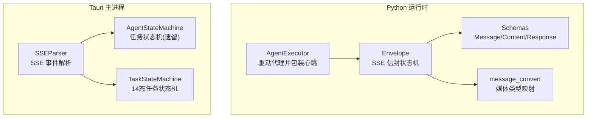
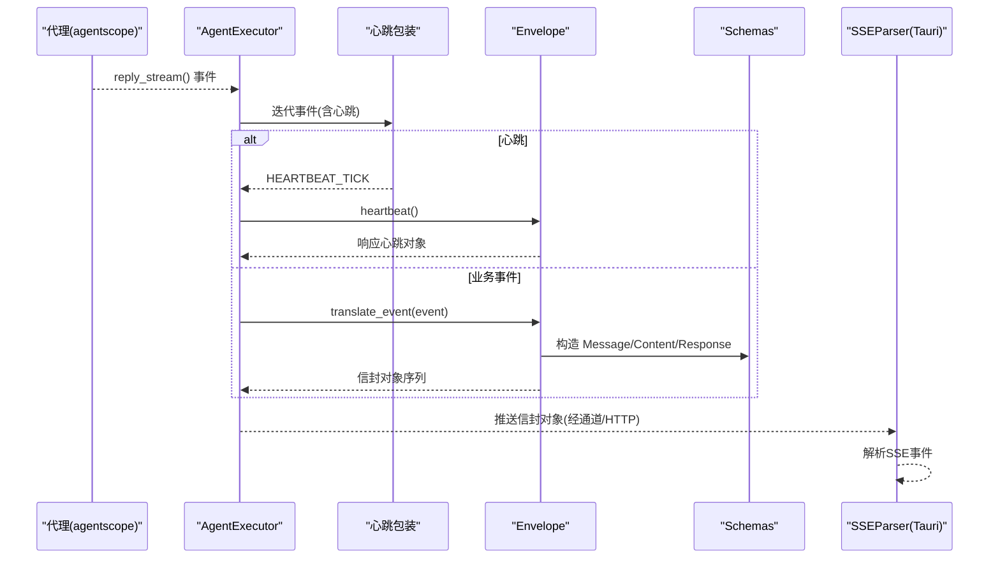
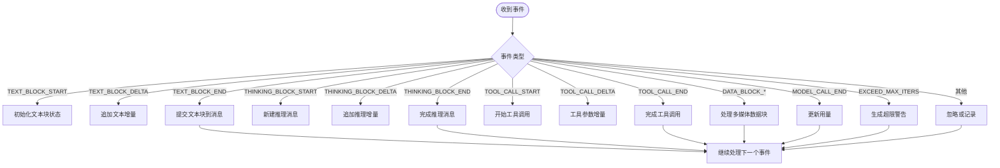
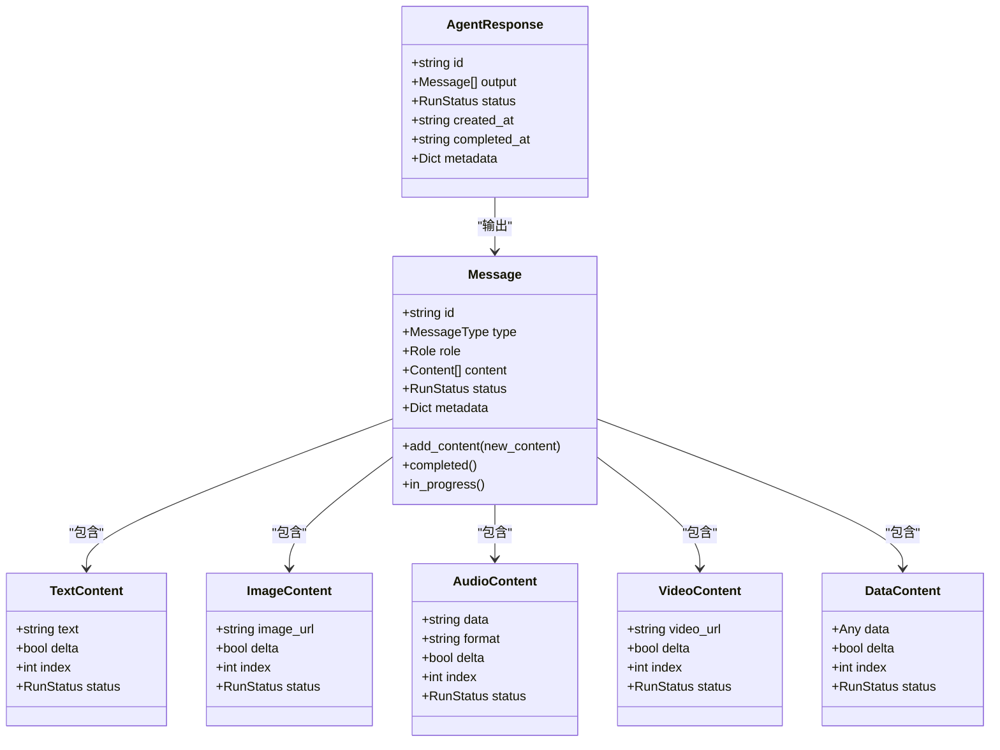
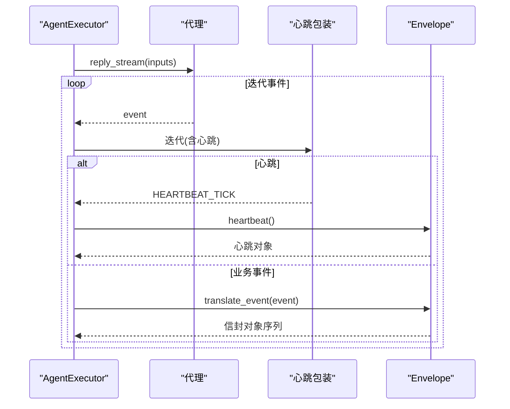
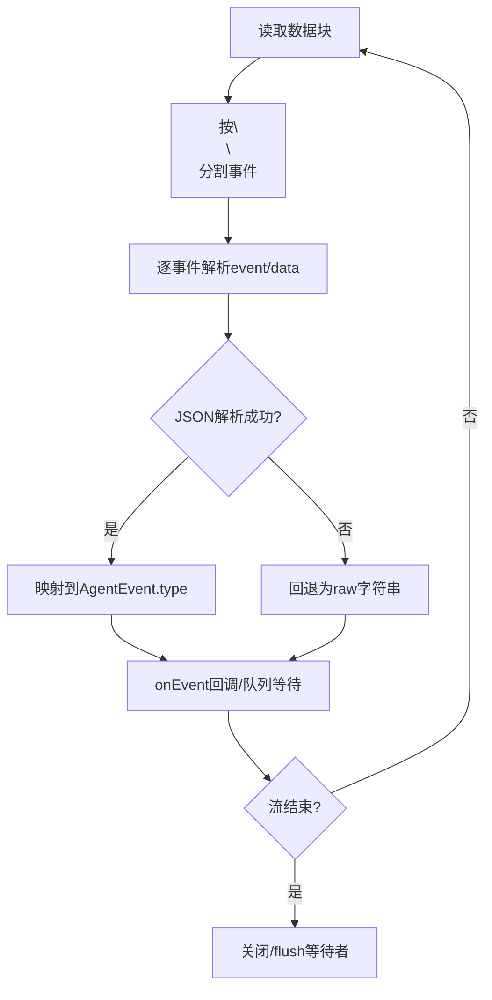
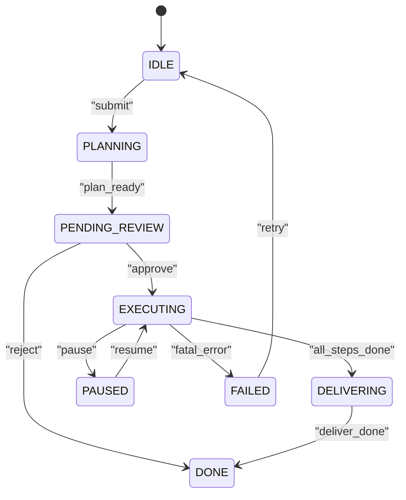
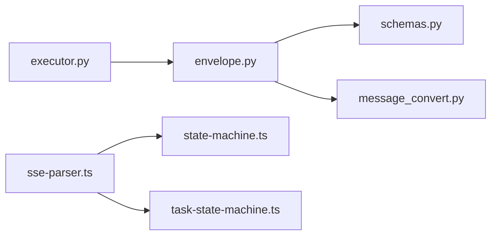

# 信封系统

<cite>
**本文引用的文件**
- [envelope.py](file://tongtian-tauri/src/agent/runtime/envelope.py)
- [schemas.py](file://tongtian-tauri/src/agent/schemas.py)
- [executor.py](file://tongtian-tauri/src/agent/runtime/executor.py)
- [message_convert.py](file://tongtian-tauri/src/agent/runtime/message_convert.py)
- [sse-parser.ts](file://tongtian-tauri/src/main/bridge/sse-parser.ts)
- [state-machine.ts](file://tongtian-tauri/src/main/agent/state-machine.ts)
- [task-state-machine.ts](file://tongtian-tauri/src/shared/task-state-machine.ts)
</cite>

## 目录
1. [简介](#简介)
2. [项目结构](#项目结构)
3. [核心组件](#核心组件)
4. [架构总览](#架构总览)
5. [详细组件分析](#详细组件分析)
6. [依赖关系分析](#依赖关系分析)
7. [性能考量](#性能考量)
8. [故障排查指南](#故障排查指南)
9. [结论](#结论)
10. [附录：扩展指南](#附录：扩展指南)

## 简介
本文件面向“信封系统”的完整技术文档，聚焦于 SSE（Server-Sent Events）状态机、消息封装、事件序列化与流式传输。内容涵盖：
- 信封的数据结构与生命周期管理（创建、更新、完成、取消）
- 状态转换规则与错误处理机制
- 持久化策略与恢复机制
- 扩展指南：新增信封类型、自定义事件格式、大对象传输

该系统的核心职责是将后端 AgentScope 的事件流转换为前端可消费的 SSE 信封序列，并在整个运行周期内维护响应与消息的状态一致性。

## 项目结构
围绕信封系统的关键代码分布在 Python 运行时与 Tauri 主进程之间：
- Python 侧负责事件翻译、信封构建、心跳保活与执行驱动
- Tauri 主进程提供 SSE 解析器，将上游事件流解析为统一事件模型
- 共享任务状态机定义跨端一致的任务生命周期

图表来源
- [executor.py:23-57](file://tongtian-tauri/src/agent/runtime/executor.py#L23-L57)
- [envelope.py:83-130](file://tongtian-tauri/src/agent/runtime/envelope.py#L83-L130)
- [schemas.py:199-274](file://tongtian-tauri/src/agent/schemas.py#L199-L274)
- [message_convert.py:27-38](file://tongtian-tauri/src/agent/runtime/message_convert.py#L27-L38)
- [sse-parser.ts:40-113](file://tongtian-tauri/src/main/bridge/sse-parser.ts#L40-L113)
- [state-machine.ts:79-160](file://tongtian-tauri/src/main/agent/state-machine.ts#L79-L160)
- [task-state-machine.ts:63-133](file://tongtian-tauri/src/shared/task-state-machine.ts#L63-L133)

章节来源
- [executor.py:23-57](file://tongtian-tauri/src/agent/runtime/executor.py#L23-L57)
- [envelope.py:83-130](file://tongtian-tauri/src/agent/runtime/envelope.py#L83-L130)
- [schemas.py:199-274](file://tongtian-tauri/src/agent/schemas.py#L199-L274)
- [sse-parser.ts:40-113](file://tongtian-tauri/src/main/bridge/sse-parser.ts#L40-L113)
- [state-machine.ts:79-160](file://tongtian-tauri/src/main/agent/state-machine.ts#L79-L160)
- [task-state-machine.ts:63-133](file://tongtian-tauri/src/shared/task-state-machine.ts#L63-L133)

## 核心组件
- Envelope：SSE 信封生成与状态机，维护单个请求的生命周期，将 AgentScope 事件转换为前端期望的响应与消息对象序列
- Schemas：定义 Message、Content、AgentRequest、AgentResponse 等信封协议数据结构
- AgentExecutor：驱动代理回复流，注入心跳，并将事件委托给 Envelope 进行翻译
- SSEParser：在 Tauri 主进程中解析 SSE 事件流，输出统一的 AgentEvent
- 任务状态机：定义任务从创建到归档的合法转移规则，供上层编排使用

章节来源
- [envelope.py:83-130](file://tongtian-tauri/src/agent/runtime/envelope.py#L83-L130)
- [schemas.py:199-274](file://tongtian-tauri/src/agent/schemas.py#L199-L274)
- [executor.py:23-57](file://tongtian-tauri/src/agent/runtime/executor.py#L23-L57)
- [sse-parser.ts:40-113](file://tongtian-tauri/src/main/bridge/sse-parser.ts#L40-L113)
- [task-state-machine.ts:63-133](file://tongtian-tauri/src/shared/task-state-machine.ts#L63-L133)

## 架构总览
下图展示了从代理事件到前端消费的整体流程：

图表来源
- [executor.py:36-57](file://tongtian-tauri/src/agent/runtime/executor.py#L36-L57)
- [envelope.py:148-154](file://tongtian-tauri/src/agent/runtime/envelope.py#L148-L154)
- [schemas.py:199-274](file://tongtian-tauri/src/agent/schemas.py#L199-L274)
- [sse-parser.ts:50-113](file://tongtian-tauri/src/main/bridge/sse-parser.ts#L50-L113)

## 详细组件分析

### Envelope：SSE 状态机与消息封装
- 生命周期
  - 创建：初始化 AgentResponse 与当前 Message，设置初始状态为 InProgress
  - 更新：根据事件类型追加文本块、推理块、工具调用与数据块
  - 完成：当工具调用结束或文本块结束时，标记消息为 Completed 并加入 response.output
  - 取消：通过 RunStatus.Cancelled 表达取消；具体触发由上层控制
- 事件翻译
  - 文本块：TEXT_BLOCK_START/Delta/END 增量拼接，最终写入 Message.content
  - 推理块：THINKING_BLOCK_* 独立 Reasoning 消息，支持交错插入
  - 工具调用：PLUGIN_CALL 与 PLUGIN_CALL_OUTPUT，参数与结果分块发送
  - 数据块：DATA_BLOCK_* 按媒体类型生成 Image/Audio/Video 内容
  - 用量统计：MODEL_CALL_END 更新 usage
  - 超限告警：EXCEED_MAX_ITERS 生成警告消息
- 元数据传播
  - 通过装饰器将源事件的 metadata 浅拷贝到输出对象，避免泄漏事件级扩展字段
- 序号与心跳
  - 每个输出对象附加 sequence_number，便于前端排序
  - heartbeat() 定期返回响应对象以维持连接活跃

图表来源
- [envelope.py:195-716](file://tongtian-tauri/src/agent/runtime/envelope.py#L195-L716)

章节来源
- [envelope.py:83-130](file://tongtian-tauri/src/agent/runtime/envelope.py#L83-L130)
- [envelope.py:148-154](file://tongtian-tauri/src/agent/runtime/envelope.py#L148-L154)
- [envelope.py:195-716](file://tongtian-tauri/src/agent/runtime/envelope.py#L195-L716)

### Schemas：信封数据结构
- Message：承载 content 列表，支持 in_progress()/completed() 方法
- Content 变体：Text/Image/Audio/Video/File/Data/Refusal，均包含 delta/index/status 等流式字段
- AgentRequest/AgentResponse：顶层请求与响应信封，output 为 Message 列表
- FunctionCall/FunctionCallOutput：嵌入 DataContent.data 的工具调用载荷

图表来源
- [schemas.py:86-131](file://tongtian-tauri/src/agent/schemas.py#L86-L131)
- [schemas.py:199-274](file://tongtian-tauri/src/agent/schemas.py#L199-L274)

章节来源
- [schemas.py:86-131](file://tongtian-tauri/src/agent/schemas.py#L86-L131)
- [schemas.py:199-274](file://tongtian-tauri/src/agent/schemas.py#L199-L274)

### AgentExecutor：执行驱动与心跳
- 驱动代理的 reply_stream 异步迭代
- 使用心跳包装器在空闲时发送心跳对象，防止连接超时
- 将每个事件委托给 Envelope.translate_event 进行翻译

图表来源
- [executor.py:36-57](file://tongtian-tauri/src/agent/runtime/executor.py#L36-L57)

章节来源
- [executor.py:23-57](file://tongtian-tauri/src/agent/runtime/executor.py#L23-L57)

### SSEParser：SSE 事件解析
- 基于 IncomingMessage 流式读取，按双换行分隔事件
- 解析 event/data 行，尝试 JSON 解析，失败则回退为原始字符串
- 将原始事件类型映射为内部 AgentEvent.type
- 提供 AsyncIterable 接口与 collectAll 收集能力

图表来源
- [sse-parser.ts:50-113](file://tongtian-tauri/src/main/bridge/sse-parser.ts#L50-L113)
- [sse-parser.ts:128-188](file://tongtian-tauri/src/main/bridge/sse-parser.ts#L128-L188)

章节来源
- [sse-parser.ts:40-113](file://tongtian-tauri/src/main/bridge/sse-parser.ts#L40-L113)
- [sse-parser.ts:128-188](file://tongtian-tauri/src/main/bridge/sse-parser.ts#L128-L188)

### 任务状态机：跨端一致的生命周期
- 主进程遗留状态机：定义 IDLE→PLANNING→PENDING_REVIEW→EXECUTING→DELIVERING→DONE 的简化流转
- 共享 14 态状态机：定义 35 条合法转移，覆盖重试、预算暂停、回滚、归档等复杂场景
- 用于上层编排与 UI 渲染可用操作

图表来源
- [state-machine.ts:31-63](file://tongtian-tauri/src/main/agent/state-machine.ts#L31-L63)
- [task-state-machine.ts:63-133](file://tongtian-tauri/src/shared/task-state-machine.ts#L63-L133)

章节来源
- [state-machine.ts:79-160](file://tongtian-tauri/src/main/agent/state-machine.ts#L79-L160)
- [task-state-machine.ts:147-223](file://tongtian-tauri/src/shared/task-state-machine.ts#L147-L223)

## 依赖关系分析
- Envelope 依赖 Schemas 提供的数据结构，以及 message_convert 的媒体类型映射
- AgentExecutor 依赖 Envelope 与心跳模块，驱动代理事件流
- SSEParser 独立于 Python 侧，仅依赖 Node HTTP 流与日志
- 任务状态机被上层逻辑引用，保证跨端一致的流转语义

图表来源
- [executor.py:23-57](file://tongtian-tauri/src/agent/runtime/executor.py#L23-L57)
- [envelope.py:83-130](file://tongtian-tauri/src/agent/runtime/envelope.py#L83-L130)
- [schemas.py:199-274](file://tongtian-tauri/src/agent/schemas.py#L199-L274)
- [message_convert.py:27-38](file://tongtian-tauri/src/agent/runtime/message_convert.py#L27-L38)
- [sse-parser.ts:40-113](file://tongtian-tauri/src/main/bridge/sse-parser.ts#L40-L113)
- [state-machine.ts:79-160](file://tongtian-tauri/src/main/agent/state-machine.ts#L79-L160)
- [task-state-machine.ts:63-133](file://tongtian-tauri/src/shared/task-state-machine.ts#L63-L133)

章节来源
- [executor.py:23-57](file://tongtian-tauri/src/agent/runtime/executor.py#L23-L57)
- [envelope.py:83-130](file://tongtian-tauri/src/agent/runtime/envelope.py#L83-L130)
- [schemas.py:199-274](file://tongtian-tauri/src/agent/schemas.py#L199-L274)
- [message_convert.py:27-38](file://tongtian-tauri/src/agent/runtime/message_convert.py#L27-L38)
- [sse-parser.ts:40-113](file://tongtian-tauri/src/main/bridge/sse-parser.ts#L40-L113)
- [state-machine.ts:79-160](file://tongtian-tauri/src/main/agent/state-machine.ts#L79-L160)
- [task-state-machine.ts:63-133](file://tongtian-tauri/src/shared/task-state-machine.ts#L63-L133)

## 性能考量
- 增量文本与推理块：采用 delta 模式减少重复传输，降低带宽与前端渲染压力
- 多媒体数据块：仅在 DATA_BLOCK_END 时发送完整 base64，避免中间态不可渲染
- 心跳保活：在长空闲期间周期性发送心跳对象，避免连接超时
- 序号标记：sequence_number 确保前端稳定排序，避免乱序导致的重排开销
- 元数据浅拷贝：避免深层复制带来的性能损耗，同时防止事件级扩展字段泄漏

[本节为通用指导，不直接分析具体文件]

## 故障排查指南
- 未知事件类型：SSEParser 会忽略未知事件类型并记录调试日志；检查上游事件映射
- JSON 解析失败：SSEParser 回退为 raw 字符串，建议检查数据格式与编码
- 工具调用参数为空：确认 TOOL_CALL_DELTA 是否按顺序到达；必要时在前端做去抖与合并
- 多媒体无法渲染：确认 DATA_BLOCK_END 携带完整 base64 与正确的 media_type；检查前端解码逻辑
- 连接中断：检查心跳间隔与网络稳定性；必要时调整 HEARTBEAT_INTERVAL_SECONDS
- 状态非法转移：使用任务状态机的 canTransition/transition 校验，捕获 IllegalTransitionError

章节来源
- [sse-parser.ts:164-188](file://tongtian-tauri/src/main/bridge/sse-parser.ts#L164-L188)
- [task-state-machine.ts:147-223](file://tongtian-tauri/src/shared/task-state-machine.ts#L147-L223)

## 结论
信封系统通过 Envelope 状态机将多模态事件流标准化为前端可消费的 SSE 序列，结合心跳保活与序号机制，保证了实时性与一致性。Schemas 定义了清晰的信封协议，SSEParser 提供了稳定的事件解析能力，任务状态机确保了跨端一致的流转语义。整体设计具备良好的可扩展性与健壮性，适合在多代理、多模态场景下持续演进。

[本节为总结，不直接分析具体文件]

## 附录：扩展指南

### 添加新的信封类型
- 在 Schemas 中新增 ContentType 与对应的 Content 子类（如 CustomContent），保持 delta/index/status 等流式字段
- 在 Envelope.translate_event 中增加对新 EventType 的处理分支，构造并 yield 新类型的信封对象
- 如需媒体类型映射，扩展 message_convert._media_type_to_block_type

章节来源
- [schemas.py:51-131](file://tongtian-tauri/src/agent/schemas.py#L51-L131)
- [envelope.py:195-716](file://tongtian-tauri/src/agent/runtime/envelope.py#L195-L716)
- [message_convert.py:27-38](file://tongtian-tauri/src/agent/runtime/message_convert.py#L27-L38)

### 自定义事件格式
- 在 SSEParser 中扩展 mapEventType，支持新的 event type 映射
- 若上游事件缺少 type，可在 parseEvent 中依据 data.type 推断
- 对异常数据保留 raw 字段以便调试

章节来源
- [sse-parser.ts:145-188](file://tongtian-tauri/src/main/bridge/sse-parser.ts#L145-L188)

### 处理大对象传输
- 使用 DATA_BLOCK_* 分块传输 base64，仅在 END 时发送完整数据，避免中间态不可渲染
- 对于超大对象，考虑分片上传与断点续传；在 Envelope 中维护 block_id 与累积状态
- 前端需实现增量解码与内存管理，避免 OOM

章节来源
- [envelope.py:593-656](file://tongtian-tauri/src/agent/runtime/envelope.py#L593-L656)

### 持久化策略与恢复机制
- 持久化时机
  - 文本块与推理块：在 TEXT_BLOCK_END/THINKING_BLOCK_END 时将完整内容写入 Message.content
  - 工具调用：在 TOOL_CALL_END/TOOL_RESULT_END 时提交最终内容与状态
  - 用量统计：在 MODEL_CALL_END 时更新 usage
- 恢复机制
  - 利用 sequence_number 与 Message.id 重建会话视图
  - 结合任务状态机的历史（getHistory）与终态判断（isTerminal）决定是否需要重试或归档
  - 对于中断的流，前端可基于最后收到的 envelope 重新建立连接并请求增量

章节来源
- [envelope.py:165-186](file://tongtian-tauri/src/agent/runtime/envelope.py#L165-L186)
- [envelope.py:341-364](file://tongtian-tauri/src/agent/runtime/envelope.py#L341-L364)
- [envelope.py:430-449](file://tongtian-tauri/src/agent/runtime/envelope.py#L430-L449)
- [envelope.py:558-591](file://tongtian-tauri/src/agent/runtime/envelope.py#L558-L591)
- [envelope.py:658-669](file://tongtian-tauri/src/agent/runtime/envelope.py#L658-L669)
- [task-state-machine.ts:135-139](file://tongtian-tauri/src/shared/task-state-machine.ts#L135-L139)
- [task-state-machine.ts:214-223](file://tongtian-tauri/src/shared/task-state-machine.ts#L214-L223)