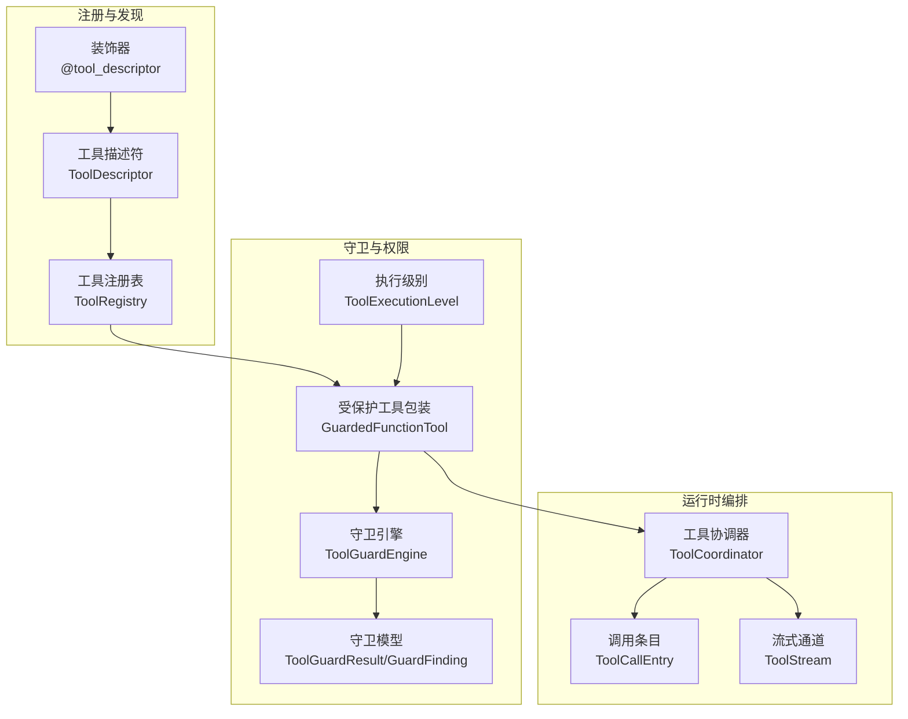
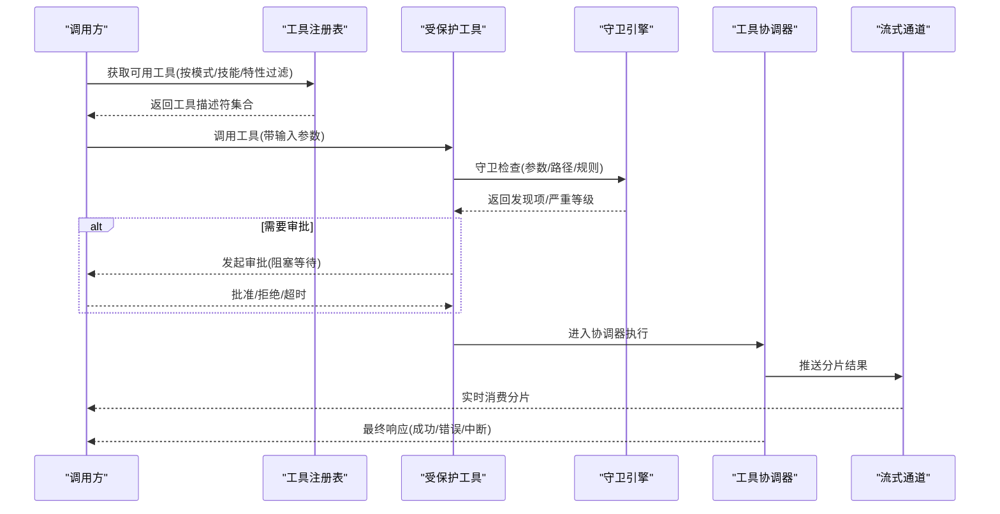
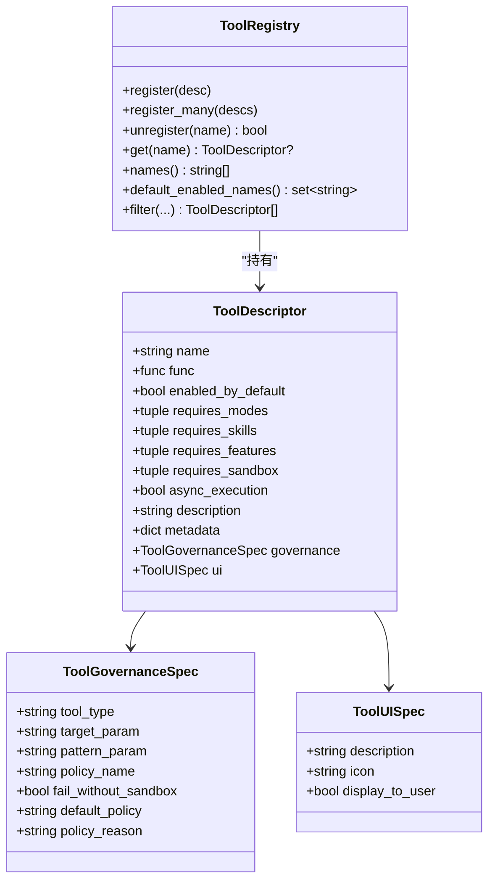
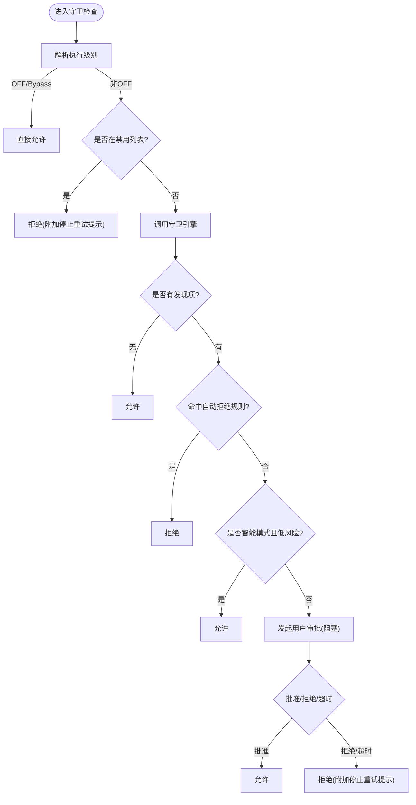
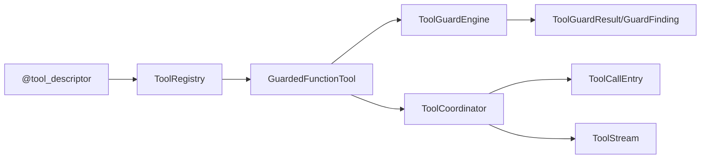

# 工具注册表

<cite>
**本文引用的文件**
- [tool_registry.py](file://tongtian-tauri/src/agent/runtime/tool_registry.py)
- [tool_guard.py](file://tongtian-tauri/src/agent/runtime/tool_guard.py)
- [_coordinator.py](file://tongtian-tauri/src/agent/tool_calls/_coordinator.py)
- [_entry.py](file://tongtian-tauri/src/agent/tool_calls/_entry.py)
- [_stream.py](file://tongtian-tauri/src/agent/tool_calls/_stream.py)
- [engine.py](file://tongtian-tauri/src/agent/security/tool_guard/engine.py)
- [models.py](file://tongtian-tauri/src/agent/security/tool_guard/models.py)
- [execution_level.py](file://tongtian-tauri/src/agent/security/tool_guard/execution_level.py)
</cite>

## 目录
1. [简介](#简介)
2. [项目结构](#项目结构)
3. [核心组件](#核心组件)
4. [架构总览](#架构总览)
5. [详细组件分析](#详细组件分析)
6. [依赖关系分析](#依赖关系分析)
7. [性能考量](#性能考量)
8. [故障排查指南](#故障排查指南)
9. [结论](#结论)
10. [附录：扩展与最佳实践](#附录扩展与最佳实践)

## 简介
本文件系统性说明“工具注册表”的机制与实现，覆盖工具的发现、元数据管理、权限控制、生命周期（加载、验证、卸载）、类型系统、参数校验、返回值处理，以及异步执行、调试与监控的最佳实践。读者可据此理解从工具声明到安全守卫、再到运行时编排与流式输出的完整链路。

## 项目结构
围绕工具注册与执行的关键模块分布如下：
- 工具注册与发现：基于装饰器的自动收集与按上下文过滤
- 工具守卫与权限：在调用前进行安全检查与审批决策
- 工具协调器：统一编排并发、超时、取消、后台迁移与结果聚合
- 流式输出：将工具运行中的分片结果广播给订阅者

图表来源
- [tool_registry.py:16-87](file://tongtian-tauri/src/agent/runtime/tool_registry.py#L16-L87)
- [tool_registry.py:216-312](file://tongtian-tauri/src/agent/runtime/tool_registry.py#L216-L312)
- [tool_guard.py:13-54](file://tongtian-tauri/src/agent/runtime/tool_guard.py#L13-L54)
- [engine.py:57-183](file://tongtian-tauri/src/agent/security/tool_guard/engine.py#L57-L183)
- [execution_level.py:15-80](file://tongtian-tauri/src/agent/security/tool_guard/execution_level.py#L15-L80)
- [_coordinator.py:49-84](file://tongtian-tauri/src/agent/tool_calls/_coordinator.py#L49-L84)
- [_entry.py:15-32](file://tongtian-tauri/src/agent/tool_calls/_entry.py#L15-L32)
- [_stream.py:12-71](file://tongtian-tauri/src/agent/tool_calls/_stream.py#L12-L71)

章节来源
- [tool_registry.py:16-87](file://tongtian-tauri/src/agent/runtime/tool_registry.py#L16-L87)
- [tool_registry.py:216-312](file://tongtian-tauri/src/agent/runtime/tool_registry.py#L216-L312)
- [tool_guard.py:13-54](file://tongtian-tauri/src/agent/runtime/tool_guard.py#L13-L54)
- [engine.py:57-183](file://tongtian-tauri/src/agent/security/tool_guard/engine.py#L57-L183)
- [_coordinator.py:49-84](file://tongtian-tauri/src/agent/tool_calls/_coordinator.py#L49-L84)
- [_entry.py:15-32](file://tongtian-tauri/src/agent/tool_calls/_entry.py#L15-L32)
- [_stream.py:12-71](file://tongtian-tauri/src/agent/tool_calls/_stream.py#L12-L71)

## 核心组件
- 工具描述符与注册表
  - ToolDescriptor：以声明方式描述工具名称、函数、默认启用、模式/技能/特性/沙箱需求、是否异步、描述、元数据、治理与UI展示等。
  - ToolRegistry：维护描述符集合，提供注册、批量注册、注销、查询、按上下文过滤（模式、技能、特性、白名单/黑名单）等能力。
  - @tool_descriptor：装饰器，将函数标记为工具并自动收集到全局列表，便于内置工具发现；同时解析治理与UI元数据。
- 工具守卫与权限
  - GuardedFunctionTool：对底层 FunctionTool 的动态子类化包装，每次调用前通过守卫引擎评估规则，结合执行级别决定允许、拒绝或请求用户审批。
  - ToolGuardEngine：编排多个守护器（文件路径、规则、Shell逃逸规避等），汇总发现项，支持配置化的受控/禁用工具集与自动拒绝规则。
  - 执行级别：STRICT/SMART/AUTO/OFF，控制是否需要审批及审批粒度。
- 运行时编排与流式输出
  - ToolCoordinator：统一管理所有进行中的工具调用，负责创建条目、超时/取消、前台转后台（offload）、完成回调、提示注入等。
  - ToolCallEntry：单个工具调用的运行时状态容器（上下文、流、最终响应、状态、后台任务等）。
  - ToolStream：无状态的扇出通知器，将工具产生的分片结果推送给所有订阅者。

章节来源
- [tool_registry.py:16-87](file://tongtian-tauri/src/agent/runtime/tool_registry.py#L16-L87)
- [tool_registry.py:137-180](file://tongtian-tauri/src/agent/runtime/tool_registry.py#L137-L180)
- [tool_registry.py:216-312](file://tongtian-tauri/src/agent/runtime/tool_registry.py#L216-L312)
- [tool_guard.py:13-54](file://tongtian-tauri/src/agent/runtime/tool_guard.py#L13-L54)
- [engine.py:57-183](file://tongtian-tauri/src/agent/security/tool_guard/engine.py#L57-L183)
- [execution_level.py:15-80](file://tongtian-tauri/src/agent/security/tool_guard/execution_level.py#L15-L80)
- [_coordinator.py:49-84](file://tongtian-tauri/src/agent/tool_calls/_coordinator.py#L49-L84)
- [_entry.py:15-32](file://tongtian-tauri/src/agent/tool_calls/_entry.py#L15-L32)
- [_stream.py:12-71](file://tongtian-tauri/src/agent/tool_calls/_stream.py#L12-L71)

## 架构总览
下图展示了从工具声明到执行与返回的端到端流程，包括守卫检查、审批、协调器编排与流式输出。

图表来源
- [tool_registry.py:137-180](file://tongtian-tauri/src/agent/runtime/tool_registry.py#L137-L180)
- [tool_guard.py:131-268](file://tongtian-tauri/src/agent/runtime/tool_guard.py#L131-L268)
- [engine.py:211-268](file://tongtian-tauri/src/agent/security/tool_guard/engine.py#L211-L268)
- [_coordinator.py:97-184](file://tongtian-tauri/src/agent/tool_calls/_coordinator.py#L97-L184)
- [_stream.py:37-56](file://tongtian-tauri/src/agent/tool_calls/_stream.py#L37-L56)

## 详细组件分析

### 工具注册与发现
- 工具描述符
  - 字段涵盖：名称、函数引用、默认启用、模式/技能/特性/沙箱需求、异步执行标志、描述、元数据、治理策略、UI展示信息。
  - 作用：集中表达工具的静态属性与策略，供注册表过滤与后续包装使用。
- 注册表
  - 提供注册、批量注册、注销、查询、默认启用名集合、包含判断、长度统计。
  - filter() 根据 active_modes、active_skills、enabled_features、allowed/denied 等条件筛选可用工具。
- 装饰器
  - 自动检测是否为协程函数以设置 async_execution。
  - 将治理与UI元数据打包进描述符，并将函数加入全局收集列表以便内置工具发现。
  - 内置工具限定于指定包名前缀，避免测试或插件工具混入。

图表来源
- [tool_registry.py:16-87](file://tongtian-tauri/src/agent/runtime/tool_registry.py#L16-L87)
- [tool_registry.py:89-180](file://tongtian-tauri/src/agent/runtime/tool_registry.py#L89-L180)

章节来源
- [tool_registry.py:16-87](file://tongtian-tauri/src/agent/runtime/tool_registry.py#L16-L87)
- [tool_registry.py:89-180](file://tongtian-tauri/src/agent/runtime/tool_registry.py#L89-L180)
- [tool_registry.py:216-312](file://tongtian-tauri/src/agent/runtime/tool_registry.py#L216-L312)

### 权限控制与守卫
- 执行级别
  - STRICT：所有工具均需审批。
  - SMART：低风险自动放行，中高风险需审批。
  - AUTO：仅受控工具需审批（兼容旧行为）。
  - OFF：完全关闭守卫。
- 守卫引擎
  - 默认守护器：共享安全、文件路径、规则、Shell逃逸规避。
  - 支持动态注册/注销守护器，重载规则，刷新受控/禁用工具集与自动拒绝规则。
  - guard() 遍历守护器，聚合发现项，记录耗时与失败守护器。
- 受保护工具
  - 动态继承 FunctionTool，注入 agent_id 与请求上下文。
  - 解析执行级别，必要时调用守卫引擎，依据发现项与级别决定 ALLOW/DENY/ASK。
  - ASK 通过审批服务创建待决请求并阻塞等待用户决策，超时则拒绝。

图表来源
- [tool_guard.py:73-107](file://tongtian-tauri/src/agent/runtime/tool_guard.py#L73-L107)
- [tool_guard.py:131-268](file://tongtian-tauri/src/agent/runtime/tool_guard.py#L131-L268)
- [engine.py:165-205](file://tongtian-tauri/src/agent/security/tool_guard/engine.py#L165-L205)
- [execution_level.py:51-80](file://tongtian-tauri/src/agent/security/tool_guard/execution_level.py#L51-L80)

章节来源
- [tool_guard.py:73-107](file://tongtian-tauri/src/agent/runtime/tool_guard.py#L73-L107)
- [tool_guard.py:131-268](file://tongtian-tauri/src/agent/runtime/tool_guard.py#L131-L268)
- [engine.py:57-183](file://tongtian-tauri/src/agent/security/tool_guard/engine.py#L57-L183)
- [execution_level.py:15-80](file://tongtian-tauri/src/agent/security/tool_guard/execution_level.py#L15-L80)

### 生命周期管理（加载、验证、卸载）
- 加载
  - 装饰器在导入时自动收集工具函数，内置工具可通过前缀过滤获取。
  - 注册表维护描述符映射，支持批量注册。
- 验证
  - 注册时校验类型与重复名称。
  - 守卫阶段对参数进行安全检查，结合执行级别决定是否放行或审批。
- 卸载
  - 支持按名称注销工具，返回是否成功。
  - 协调器在关闭时对所有进行中的调用发出取消信号，并等待优雅退出或强制终止。

章节来源
- [tool_registry.py:96-118](file://tongtian-tauri/src/agent/runtime/tool_registry.py#L96-L118)
- [tool_registry.py:196-208](file://tongtian-tauri/src/agent/runtime/tool_registry.py#L196-L208)
- [tool_guard.py:131-268](file://tongtian-tauri/src/agent/runtime/tool_guard.py#L131-L268)
- [_coordinator.py:535-549](file://tongtian-tauri/src/agent/tool_calls/_coordinator.py#L535-L549)

### 类型系统与参数/返回值处理
- 类型系统
  - 工具描述符承载工具的静态类型信息（名称、函数、元数据、治理与UI）。
  - 守卫模型定义严重等级、威胁分类、发现项与结果聚合。
- 参数处理
  - 守卫引擎接收工具名与参数字典，交由各守护器检查。
  - 协调器在执行前后可通过钩子修改输入/输出。
- 返回值处理
  - 协调器统一封装 ToolResponse，支持分片追加与最终响应闭合。
  - 错误与中断被标准化为特定状态，便于上层消费。

章节来源
- [tool_registry.py:16-87](file://tongtian-tauri/src/agent/runtime/tool_registry.py#L16-L87)
- [models.py:25-185](file://tongtian-tauri/src/agent/security/tool_guard/models.py#L25-L185)
- [_coordinator.py:641-693](file://tongtian-tauri/src/agent/tool_calls/_coordinator.py#L641-L693)

### 异步执行与流式输出
- 异步检测
  - 装饰器自动识别协程函数，设置 async_execution。
- 流式输出
  - ToolStream 作为无状态扇出通知器，支持添加/移除订阅者、追加分片、关闭发送哨兵。
  - 协调器在 _drain 中将 ToolChunk 写入流，并在错误或中断时关闭流。
- 后台迁移
  - 达到前台超时或用户主动操作时，协调器可将工具迁移至后台继续执行，并生成提示消息。

章节来源
- [tool_registry.py:216-312](file://tongtian-tauri/src/agent/runtime/tool_registry.py#L216-L312)
- [_coordinator.py:97-184](file://tongtian-tauri/src/agent/tool_calls/_coordinator.py#L97-L184)
- [_coordinator.py:641-693](file://tongtian-tauri/src/agent/tool_calls/_coordinator.py#L641-L693)
- [_stream.py:12-71](file://tongtian-tauri/src/agent/tool_calls/_stream.py#L12-L71)

## 依赖关系分析
- 组件耦合
  - 注册表依赖描述符与装饰器；守卫包装依赖执行级别与守卫引擎；协调器依赖条目与流。
- 外部依赖
  - 守卫引擎依赖配置与环境变量控制开关；协调器依赖 agentscope 的消息与工具类型。
- 潜在循环
  - 通过延迟导入与动态子类化避免在定义期强依赖 agentscope。

图表来源
- [tool_registry.py:216-312](file://tongtian-tauri/src/agent/runtime/tool_registry.py#L216-L312)
- [tool_guard.py:13-54](file://tongtian-tauri/src/agent/runtime/tool_guard.py#L13-L54)
- [engine.py:57-183](file://tongtian-tauri/src/agent/security/tool_guard/engine.py#L57-L183)
- [_coordinator.py:49-84](file://tongtian-tauri/src/agent/tool_calls/_coordinator.py#L49-L84)
- [_entry.py:15-32](file://tongtian-tauri/src/agent/tool_calls/_entry.py#L15-L32)
- [_stream.py:12-71](file://tongtian-tauri/src/agent/tool_calls/_stream.py#L12-L71)

章节来源
- [tool_registry.py:216-312](file://tongtian-tauri/src/agent/runtime/tool_registry.py#L216-L312)
- [tool_guard.py:13-54](file://tongtian-tauri/src/agent/runtime/tool_guard.py#L13-L54)
- [engine.py:57-183](file://tongtian-tauri/src/agent/security/tool_guard/engine.py#L57-L183)
- [_coordinator.py:49-84](file://tongtian-tauri/src/agent/tool_calls/_coordinator.py#L49-L84)

## 性能考量
- 守卫检查
  - 将可能阻塞的文件系统 I/O 放入线程池执行，避免阻塞事件循环。
  - 仅在需要时运行全部守护器，或通过 only_always_run 限制范围。
- 协调器
  - 使用 asyncio.Lock 序列化插入路径，读路径无锁；完成缓存限制大小与过期时间。
  - 前台/后台双超时（offload_deadline 与 kill_deadline）保障资源可控。
- 流式输出
  - 使用 copy-on-write 的订阅者列表，避免并发写入冲突。

[本节为通用性能建议，不直接分析具体文件]

## 故障排查指南
- 常见现象
  - 工具被永久拒绝：检查禁用列表与自动拒绝规则。
  - 审批超时：确认审批服务可用性与超时配置。
  - 后台任务未结束：检查 kill_deadline 与协调器关闭逻辑。
- 定位方法
  - 查看守卫日志与发现项摘要，确认命中规则与严重等级。
  - 通过协调器查询进行中的调用与状态，必要时延长前台等待或强制取消。
  - 关注流式通道是否已关闭，确认最终响应是否到达。

章节来源
- [tool_guard.py:188-268](file://tongtian-tauri/src/agent/runtime/tool_guard.py#L188-L268)
- [engine.py:165-205](file://tongtian-tauri/src/agent/security/tool_guard/engine.py#L165-L205)
- [_coordinator.py:370-487](file://tongtian-tauri/src/agent/tool_calls/_coordinator.py#L370-L487)
- [_coordinator.py:535-549](file://tongtian-tauri/src/agent/tool_calls/_coordinator.py#L535-L549)

## 结论
该工具注册体系通过声明式描述符与装饰器实现工具发现与元数据管理，借助守卫引擎与执行级别实现细粒度的权限控制，并由协调器统一编排生命周期、超时与流式输出。整体设计兼顾安全性、可扩展性与可观测性，适合在生产环境中部署与持续演进。

## 附录：扩展与最佳实践
- 注册新工具
  - 使用装饰器标注工具函数，填写必要元数据（名称、描述、治理策略、UI信息等）。
  - 如需自定义治理策略，确保 tool_type/policy_name/default_policy 等字段符合规范。
- 定义工具接口
  - 明确输入参数与返回值语义，配合守卫规则进行参数校验。
  - 若涉及敏感操作，设置 requires_sandbox 与 fail_without_sandbox。
- 实现工具守卫
  - 通过守护器扩展规则（如新增威胁类别或路径策略），并注册到守卫引擎。
  - 合理配置自动拒绝规则与受控工具集，平衡安全与可用性。
- 处理异步执行
  - 使用协程函数以获得自动异步检测；在守卫阶段避免阻塞 I/O。
  - 利用协调器的 offload 能力将长耗时任务转入后台，并通过流式输出反馈进度。
- 调试与监控
  - 开启守卫日志，观察发现项与严重等级；必要时调整执行级别。
  - 使用协调器的查询与干预 API 跟踪调用状态，必要时延长超时或取消。
  - 通过流式通道订阅工具输出，构建可视化面板与告警。

[本节为通用指导，不直接分析具体文件]