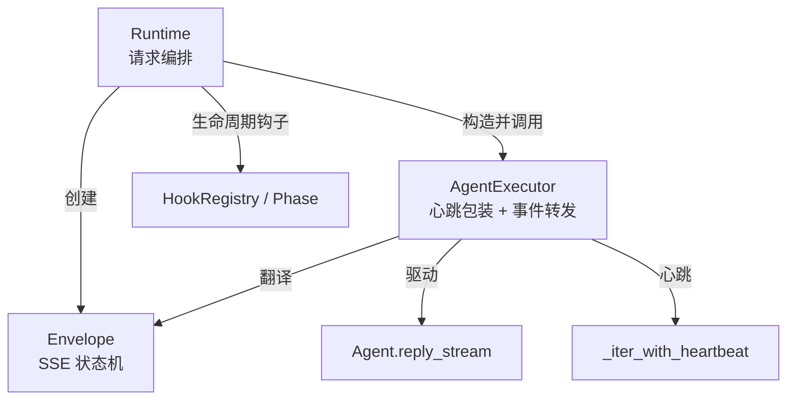
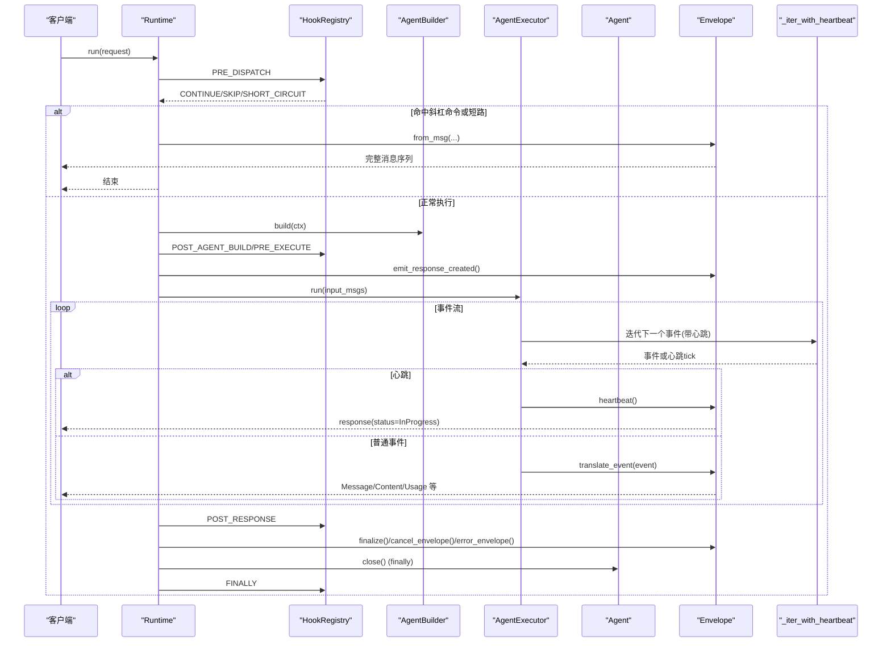
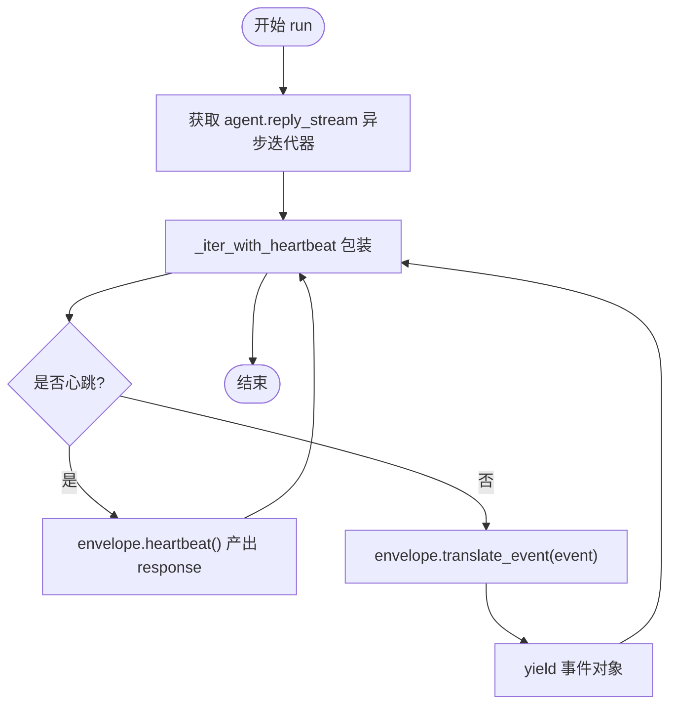
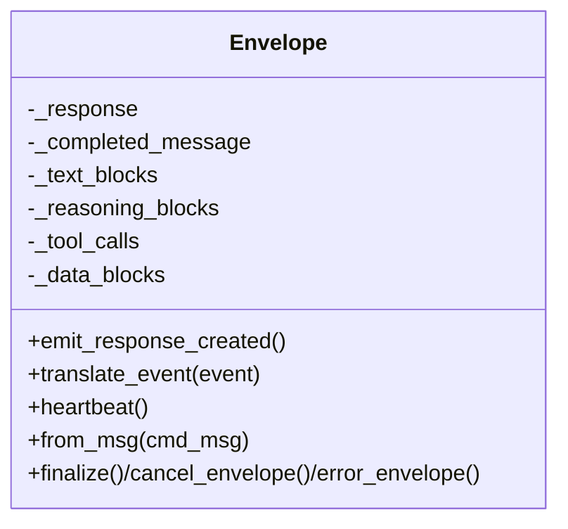
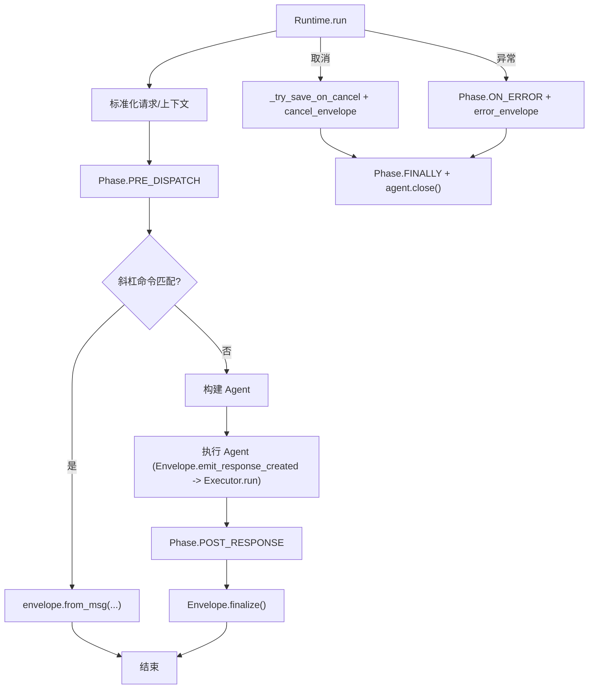
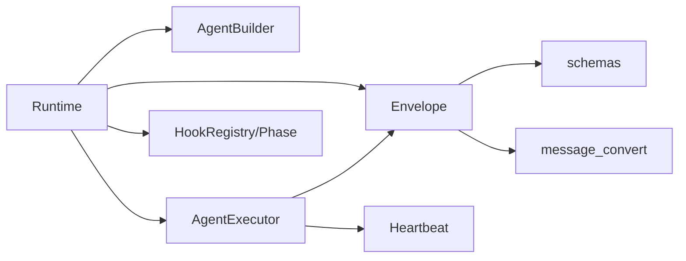

# 执行器

<cite>
**本文引用的文件**
- [executor.py](file://tongtian-tauri/src/agent/runtime/executor.py)
- [envelope.py](file://tongtian-tauri/src/agent/runtime/envelope.py)
- [heartbeat.py](file://tongtian-tauri/src/agent/runtime/heartbeat.py)
- [runtime.py](file://tongtian-tauri/src/agent/runtime/runtime.py)
- [phases.py](file://tongtian-tauri/src/agent/runtime/phases.py)
- [hooks.py](file://tongtian-tauri/src/agent/runtime/hooks.py)
- [constant.py](file://tongtian-tauri/src/agent/constant.py)
</cite>

## 目录
1. [简介](#简介)
2. [项目结构](#项目结构)
3. [核心组件](#核心组件)
4. [架构总览](#架构总览)
5. [详细组件分析](#详细组件分析)
6. [依赖关系分析](#依赖关系分析)
7. [性能与并发控制](#性能与并发控制)
8. [故障诊断与日志](#故障诊断与日志)
9. [使用示例与最佳实践](#使用示例与最佳实践)
10. [结论](#结论)

## 简介
本文件围绕 AgentExecutor 的执行流程，系统性说明心跳机制、响应流处理、错误恢复，以及与 Envelope 的协作（事件生成、状态同步、资源清理）。同时覆盖执行器的配置选项、性能优化策略、并发控制机制，并提供自定义执行策略、超时处理、集成外部监控的实践建议，以及日志记录与故障诊断方法。

## 项目结构
执行器位于 runtime 层，负责驱动 Agent 的 reply_stream，并通过 Envelope 将内部事件转换为前端 SSE 协议；Runtime 作为编排者，串联 Hook 阶段、构建与执行 Agent、最终化与清理。

图表来源
- [runtime.py:49-141](file://tongtian-tauri/src/agent/runtime/runtime.py#L49-L141)
- [executor.py:23-57](file://tongtian-tauri/src/agent/runtime/executor.py#L23-L57)
- [envelope.py:83-154](file://tongtian-tauri/src/agent/runtime/envelope.py#L83-L154)
- [heartbeat.py:11-41](file://tongtian-tauri/src/agent/runtime/heartbeat.py#L11-L41)
- [phases.py:28-38](file://tongtian-tauri/src/agent/runtime/phases.py#L28-L38)

章节来源
- [runtime.py:49-141](file://tongtian-tauri/src/agent/runtime/runtime.py#L49-L141)
- [executor.py:23-57](file://tongtian-tauri/src/agent/runtime/executor.py#L23-L57)
- [envelope.py:83-154](file://tongtian-tauri/src/agent/runtime/envelope.py#L83-L154)
- [heartbeat.py:11-41](file://tongtian-tauri/src/agent/runtime/heartbeat.py#L11-L41)
- [phases.py:28-38](file://tongtian-tauri/src/agent/runtime/phases.py#L28-L38)

## 核心组件
- AgentExecutor：驱动 Agent 的 reply_stream，使用心跳包装避免长空闲导致连接断开，并将每个事件交给 Envelope 翻译为 SSE 对象。
- Envelope：SSE 状态机，维护 response/message/块级内容，按事件类型输出正确的序列，支持心跳、错误、取消等。
- Runtime：八阶段编排，注入 Hook 扩展点，负责构建 Agent、执行、收尾与异常处理。
- Heartbeat：基于 asyncio.wait_for/shield 的心跳计时器，在空闲时产生心跳 tick。
- Phases/Hooks：定义固定阶段与可插拔钩子，支持短路、跳过 Agent、拓扑排序执行。

章节来源
- [executor.py:23-57](file://tongtian-tauri/src/agent/runtime/executor.py#L23-L57)
- [envelope.py:83-800](file://tongtian-tauri/src/agent/runtime/envelope.py#L83-L800)
- [runtime.py:49-206](file://tongtian-tauri/src/agent/runtime/runtime.py#L49-L206)
- [heartbeat.py:11-41](file://tongtian-tauri/src/agent/runtime/heartbeat.py#L11-L41)
- [phases.py:28-38](file://tongtian-tauri/src/agent/runtime/phases.py#L28-L38)
- [hooks.py:46-160](file://tongtian-tauri/src/agent/runtime/hooks.py#L46-L160)

## 架构总览
下图展示一次请求从进入 Runtime 到完成的生命周期，包括心跳、事件翻译、错误恢复与资源清理。

图表来源
- [runtime.py:49-206](file://tongtian-tauri/src/agent/runtime/runtime.py#L49-L206)
- [executor.py:36-57](file://tongtian-tauri/src/agent/runtime/executor.py#L36-L57)
- [envelope.py:148-154](file://tongtian-tauri/src/agent/runtime/envelope.py#L148-L154)
- [heartbeat.py:11-41](file://tongtian-tauri/src/agent/runtime/heartbeat.py#L11-L41)

## 详细组件分析

### AgentExecutor：心跳包装与事件转发
- 职责：持有 agent 与 envelope，驱动 agent.reply_stream，用 _iter_with_heartbeat 包裹以在空闲时发送心跳；收到心跳则调用 envelope.heartbeat()，否则调用 envelope.translate_event(event)。
- 关键点：
  - 心跳间隔由 HEARTBEAT_INTERVAL_SECONDS 控制，默认 25 秒，适合大多数代理审批等待场景。
  - 事件被统一交由 Envelope 翻译，保证前端协议一致性。
  - 每轮运行一个实例，不拥有 agent 生命周期。

图表来源
- [executor.py:36-57](file://tongtian-tauri/src/agent/runtime/executor.py#L36-L57)
- [heartbeat.py:11-41](file://tongtian-tauri/src/agent/runtime/heartbeat.py#L11-L41)

章节来源
- [executor.py:23-57](file://tongtian-tauri/src/agent/runtime/executor.py#L23-L57)
- [heartbeat.py:11-41](file://tongtian-tauri/src/agent/runtime/heartbeat.py#L11-L41)

### Envelope：SSE 状态机与事件翻译
- 职责：维护 response、当前 message、文本/思考/工具调用/数据块等状态，按事件类型输出正确的前端期望序列。
- 关键能力：
  - 文本块：TEXT_BLOCK_START/DATA/END，增量与终态拼接。
  - 思考块：THINKING_*，独立 reasoning message，必要时先完结前一个文本消息。
  - 工具调用：TOOL_CALL_* 与 TOOL_RESULT_*，分别输出调用与结果，支持文本与多模态数据块。
  - 数据块：DATA_BLOCK_*，聚合 base64 后一次性输出图像/音频/视频。
  - 用量统计：MODEL_CALL_END 更新 usage。
  - 特殊事件：EXCEED_MAX_ITERS 输出警告消息。
  - 心跳：heartbeat() 返回 response 以保持连接活跃。
  - 命令短路：from_msg() 直接输出完整消息。
  - 错误/取消：error_envelope/cancel_envelope（由 Runtime 调用）用于异常路径。

图表来源
- [envelope.py:83-800](file://tongtian-tauri/src/agent/runtime/envelope.py#L83-L800)

章节来源
- [envelope.py:83-800](file://tongtian-tauri/src/agent/runtime/envelope.py#L83-L800)

### Runtime：八阶段编排与错误恢复
- 职责：标准化请求、构建上下文、执行 Hook 阶段、构建 Agent、执行 Agent、最终化 Envelope、异常捕获与清理。
- 关键流程：
  - 阶段：PRE_DISPATCH → POST_DISPATCH → PRE_AGENT_BUILD → POST_AGENT_BUILD → PRE_EXECUTE → 执行 → POST_RESPONSE → ON_ERROR → FINALLY。
  - 短路/跳过：Hook 可 SHORT_CIRCUIT 或 SKIP_AGENT，不影响后续 FINALLY。
  - 错误恢复：捕获 CancelledError/KeyboardInterrupt 与普通异常，记录 ctx.error，运行 ON_ERROR，持久化中断状态，发出 cancel/error envelope，finally 中关闭 agent 并运行 FINALLY。
  - 取消保存：_try_save_on_cancel 将 Envelope 中的部分响应注入 agent 上下文，并补全未完成的工具调用，再保存会话状态。

图表来源
- [runtime.py:49-206](file://tongtian-tauri/src/agent/runtime/runtime.py#L49-L206)
- [phases.py:28-38](file://tongtian-tauri/src/agent/runtime/phases.py#L28-L38)

章节来源
- [runtime.py:49-206](file://tongtian-tauri/src/agent/runtime/runtime.py#L49-L206)
- [phases.py:28-38](file://tongtian-tauri/src/agent/runtime/phases.py#L28-L38)
- [hooks.py:46-160](file://tongtian-tauri/src/agent/runtime/hooks.py#L46-L160)

### Heartbeat：空闲保活
- 实现：使用 asyncio.ensure_future 启动 __anext__，并用 asyncio.shield 保护 wait_for 超时，确保底层迭代任务不被取消；超时则 yield 心跳 tick，直到有新事件或迭代结束。
- 作用：防止长时间无事件（如工具审批等待）导致前端连接超时。

章节来源
- [heartbeat.py:11-41](file://tongtian-tauri/src/agent/runtime/heartbeat.py#L11-L41)

## 依赖关系分析
- Runtime 依赖：
  - Envelope：事件序列化与状态管理。
  - AgentBuilder：构建 Agent。
  - AgentExecutor：执行 Agent 并包装心跳。
  - HookRegistry/Phase：可扩展生命周期。
- AgentExecutor 依赖：
  - Envelope：事件翻译。
  - Heartbeat：心跳包装。
- Envelope 依赖：
  - schemas：Message/TextContent/DataContent 等模型。
  - message_convert：媒体类型到块类型映射。
- 常量与配置：
  - constant.py：心跳默认间隔、LLM 并发/限流/重试等全局参数。

图表来源
- [runtime.py:22-27](file://tongtian-tauri/src/agent/runtime/runtime.py#L22-L27)
- [executor.py:13-18](file://tongtian-tauri/src/agent/runtime/executor.py#L13-L18)
- [envelope.py:20-21](file://tongtian-tauri/src/agent/runtime/envelope.py#L20-L21)
- [constant.py:319-381](file://tongtian-tauri/src/agent/constant.py#L319-L381)

章节来源
- [runtime.py:22-27](file://tongtian-tauri/src/agent/runtime/runtime.py#L22-L27)
- [executor.py:13-18](file://tongtian-tauri/src/agent/runtime/executor.py#L13-L18)
- [envelope.py:20-21](file://tongtian-tauri/src/agent/runtime/envelope.py#L20-L21)
- [constant.py:319-381](file://tongtian-tauri/src/agent/constant.py#L319-L381)

## 性能与并发控制
- 心跳间隔：HEARTBEAT_INTERVAL_SECONDS = 25s，适合多数场景；可通过环境变量或上层配置调整（若需定制可在 executor 层封装）。
- LLM 并发与限流：
  - LLM_MAX_CONCURRENT：最大并发调用数，默认 10，可按配额调优。
  - LLM_MAX_QPM：每分钟查询上限，滑动窗口限流，避免 429。
  - LLM_BACKOFF_BASE/CAP：指数退避基础与上限。
  - LLM_RATE_LIMIT_PAUSE/JITTER：遇到限流时的暂停与抖动，避免雪崩。
  - LLM_ACQUIRE_TIMEOUT：获取并发槽位的超时时间。
- 工具审批等待：
  - TOOL_GUARD_APPROVAL_TIMEOUT_SECONDS：审批超时。
  - TOOL_GUARD_APPROVAL_HEARTBEAT_INTERVAL：审批期间心跳间隔，保持连接。
- 自定义执行策略：
  - 通过 Hook 在 PRE_EXECUTE/POST_RESPONSE 注入上下文、注入提示、收集指标。
  - 使用 SHORT_CIRCUIT/SKIP_AGENT 快速路径或跳过 Agent。
- 资源清理：
  - finally 中关闭 agent，确保审计日志与策略刷新。
  - 取消路径下保存中断状态，避免丢失部分响应。

章节来源
- [constant.py:319-406](file://tongtian-tauri/src/agent/constant.py#L319-L406)
- [runtime.py:143-206](file://tongtian-tauri/src/agent/runtime/runtime.py#L143-L206)
- [hooks.py:46-160](file://tongtian-tauri/src/agent/runtime/hooks.py#L46-L160)

## 故障诊断与日志
- 日志位置：
  - Runtime 记录未处理异常、ON_ERROR 跳过原因、agent.close 失败等。
  - Envelope 对不支持的事件（如 HINT_BLOCK）记录警告。
  - Heartbeat 与 Executor 无额外日志，但可通过上层 logger 观察。
- 常见错误与定位：
  - 连接中断：检查心跳间隔与代理审批超时；确认前端/网关超时设置大于心跳间隔。
  - 工具调用未闭合：Runtime._close_dangling_tool_calls 会在取消保存时补齐 ToolResultBlock。
  - 超出最大迭代：Envelope 会输出 EXCEED_MAX_ITERS 警告消息。
  - 异常路径：Runtime 捕获异常并写入 ctx.error，触发 ON_ERROR 与 error_envelope。
- 调试建议：
  - 开启更细粒度日志级别（QWENPAW_LOG_LEVEL）。
  - 关注 Runtime 日志中的 session_id，便于追踪单次请求。
  - 使用 Hook 在关键阶段记录指标（耗时、事件计数、token 用量）。

章节来源
- [runtime.py:143-206](file://tongtian-tauri/src/agent/runtime/runtime.py#L143-L206)
- [envelope.py:702-715](file://tongtian-tauri/src/agent/runtime/envelope.py#L702-L715)
- [constant.py:241-242](file://tongtian-tauri/src/agent/constant.py#L241-L242)

## 使用示例与最佳实践

### 自定义执行策略
- 通过 Hook 在 PRE_EXECUTE 注入系统提示或上下文信息，影响 Agent 行为。
- 在 POST_RESPONSE 收集指标（如 token 用量、耗时），并上报监控系统。
- 使用 SHORT_CIRCUIT 快速返回预设消息（例如维护公告）。
- 使用 SKIP_AGENT 仅执行 Hook 逻辑而不运行 Agent（例如只写审计日志）。

章节来源
- [hooks.py:46-160](file://tongtian-tauri/src/agent/runtime/hooks.py#L46-L160)
- [runtime.py:62-137](file://tongtian-tauri/src/agent/runtime/runtime.py#L62-L137)

### 处理超时情况
- 审批超时：调整 TOOL_GUARD_APPROVAL_TIMEOUT_SECONDS，结合心跳间隔确保前端感知。
- LLM 调用超时：调整 LLM_ACQUIRE_TIMEOUT、LLM_MAX_RETRIES、LLM_BACKOFF_*。
- 整体请求超时：在上层（Tauri/HTTP）设置超时，配合 Runtime 的取消路径保存状态。

章节来源
- [constant.py:319-406](file://tongtian-tauri/src/agent/constant.py#L319-L406)
- [runtime.py:143-206](file://tongtian-tauri/src/agent/runtime/runtime.py#L143-L206)

### 集成外部监控系统
- 在 Hook 中记录：
  - 阶段耗时（PRE_EXECUTE 到 POST_RESPONSE）。
  - 事件数量（文本块、工具调用、结果）。
  - Token 用量（来自 Envelope 的 usage）。
- 上报方式：
  - 通过 app_services 或外部 SDK 上报指标。
  - 使用 extras 字段跨阶段传递上下文句柄，在 FINALLY 中统一上报。

章节来源
- [hooks.py:73-160](file://tongtian-tauri/src/agent/runtime/hooks.py#L73-L160)
- [envelope.py:658-669](file://tongtian-tauri/src/agent/runtime/envelope.py#L658-L669)

### 事件与状态同步要点
- 文本/思考/工具调用/数据块均通过 Envelope 的状态机维护，确保前端渲染顺序一致。
- 每次输出都带有 sequence_number，便于前端排序与去重。
- 工具调用与结果成对出现，取消路径会补齐缺失的结果。

章节来源
- [envelope.py:136-142](file://tongtian-tauri/src/agent/runtime/envelope.py#L136-L142)
- [envelope.py:366-591](file://tongtian-tauri/src/agent/runtime/envelope.py#L366-L591)
- [runtime.py:302-452](file://tongtian-tauri/src/agent/runtime/runtime.py#L302-L452)

## 结论
AgentExecutor 通过心跳包装与 Envelope 的状态机，实现了稳定、可观测、可扩展的 Agent 执行流程。Runtime 提供八阶段编排与完善的错误恢复与资源清理机制。借助常量配置与 Hook 体系，可以灵活调优性能、并发与监控，满足复杂生产环境需求。建议在部署中合理设置心跳与限流参数，利用 Hook 采集指标，并在异常路径下确保状态持久化与资源释放。