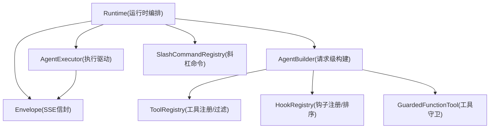
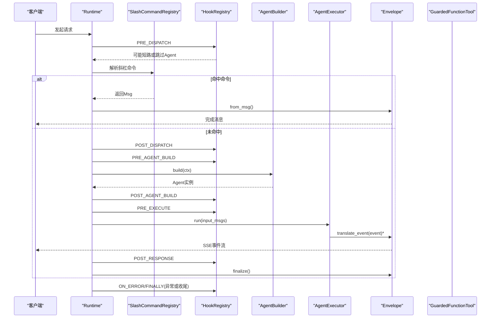
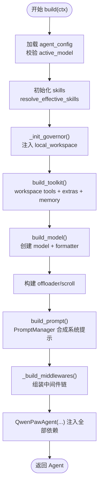
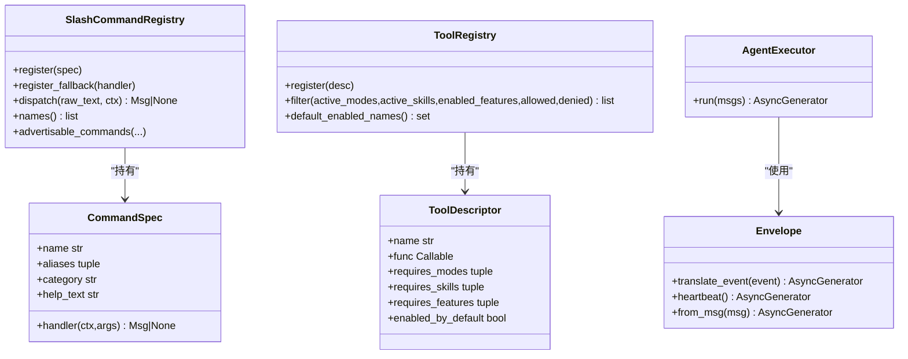
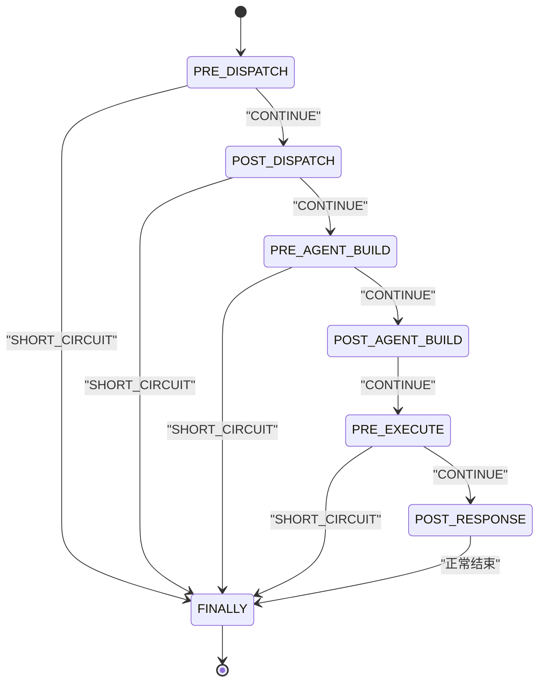
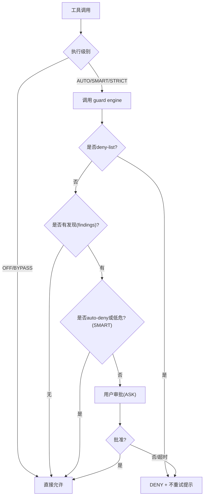
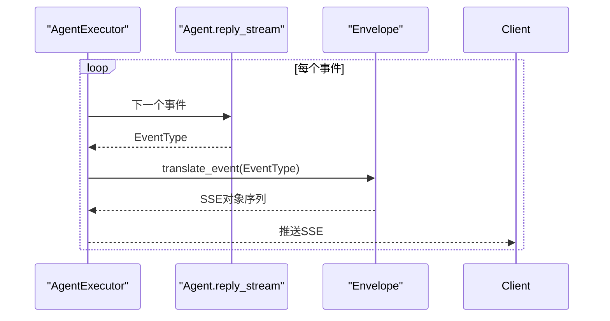
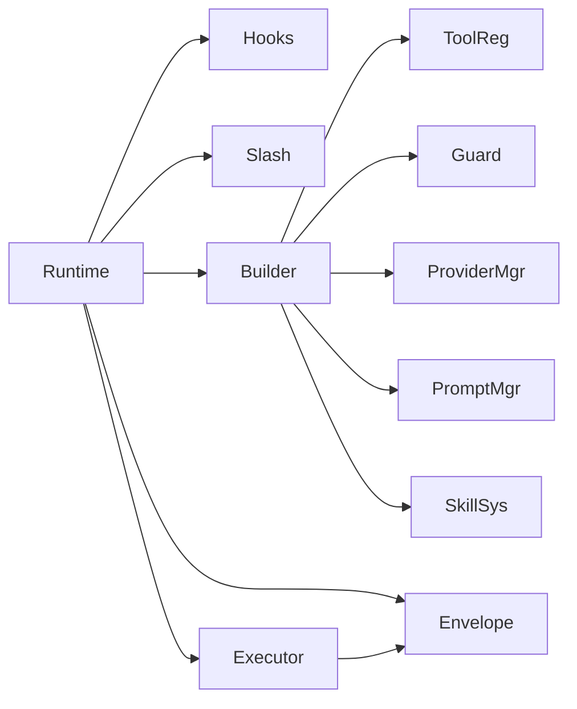

# 运行时引擎

<cite>
**本文引用的文件**   
- [builder.py](file://tongtian-tauri/src/agent/runtime/builder.py)
- [runtime.py](file://tongtian-tauri/src/agent/runtime/runtime.py)
- [hooks.py](file://tongtian-tauri/src/agent/runtime/hooks.py)
- [phases.py](file://tongtian-tauri/src/agent/runtime/phases.py)
- [envelope.py](file://tongtian-tauri/src/agent/runtime/envelope.py)
- [executor.py](file://tongtian-tauri/src/agent/runtime/executor.py)
- [tool_registry.py](file://tongtian-tauri/src/agent/runtime/tool_registry.py)
- [tool_guard.py](file://tongtian-tauri/src/agent/runtime/tool_guard.py)
- [slash_command_registry.py](file://tongtian-tauri/src/agent/runtime/slash_command_registry.py)
- [builtin_commands.py](file://tongtian-tauri/src/agent/runtime/builtin_commands.py)
</cite>

## 目录
1. [简介](#简介)
2. [项目结构](#项目结构)
3. [核心组件](#核心组件)
4. [架构总览](#架构总览)
5. [详细组件分析](#详细组件分析)
6. [依赖关系分析](#依赖关系分析)
7. [性能考量](#性能考量)
8. [故障排查指南](#故障排查指南)
9. [结论](#结论)
10. [附录：扩展指南](#附录扩展指南)

## 简介
本文件为“运行时引擎”的综合文档，聚焦 AgentBuilder 的构建流程（依赖注入、中间件链、钩子系统）、运行时环境管理（命令注册、工具注册、事件处理）、生命周期钩子与工具守卫机制，以及与外部系统的集成点。同时提供扩展指南，说明如何添加新的运行时组件、自定义钩子、以及扩展工具注册表。

## 项目结构
运行时引擎位于 Python 模块 runtime 下，围绕“请求编排 + 事件流式输出 + 工具治理 + 命令分发”四大主题组织代码：
- 编排层：Runtime（8阶段生命周期）
- 构建层：AgentBuilder（按请求装配 Agent、模型、工具、提示词、中间件）
- 执行层：AgentExecutor（心跳包装 + 事件转发）
- 事件层：Envelope（SSE 信封状态机）
- 钩子系统：HookBase/HookRegistry/Phase（生命周期钩子）
- 命令系统：SlashCommandRegistry + builtin_commands（斜杠命令统一入口）
- 工具系统：ToolRegistry + tool_descriptor（工具描述与过滤）+ GuardedFunctionTool（权限守卫）

图表来源
- [runtime.py:49-206](file://tongtian-tauri/src/agent/runtime/runtime.py#L49-L206)
- [builder.py:183-409](file://tongtian-tauri/src/agent/runtime/builder.py#L183-L409)
- [executor.py:36-58](file://tongtian-tauri/src/agent/runtime/executor.py#L36-L58)
- [envelope.py:148-154](file://tongtian-tauri/src/agent/runtime/envelope.py#L148-L154)
- [tool_registry.py:137-180](file://tongtian-tauri/src/agent/runtime/tool_registry.py#L137-L180)
- [tool_guard.py:131-268](file://tongtian-tauri/src/agent/runtime/tool_guard.py#L131-L268)
- [slash_command_registry.py:140-156](file://tongtian-tauri/src/agent/runtime/slash_command_registry.py#L140-L156)

章节来源
- [runtime.py:49-206](file://tongtian-tauri/src/agent/runtime/runtime.py#L49-L206)
- [builder.py:183-409](file://tongtian-tauri/src/agent/runtime/builder.py#L183-L409)

## 核心组件
- Runtime：单工作区请求编排器，定义 8 个阶段的生命周期，协调命令分发、Agent 构建与执行、错误与清理。
- AgentBuilder：按请求装配 Agent，注入模型、工具、提示词、中间件、上下文策略等。
- HookRegistry/Phase：生命周期钩子注册与拓扑排序，支持短路与跳过 Agent 行为。
- Envelope：SSE 信封状态机，将 AgentScope 事件转换为前端期望的流式对象。
- AgentExecutor：心跳包装与事件转发，保证长连接存活。
- ToolRegistry：工具描述与过滤，基于模式、技能、特性开关、白名单/黑名单选择工具。
- GuardedFunctionTool：工具调用前的权限检查（OFF/AUTO/SMART/STRICT），支持用户审批。
- SlashCommandRegistry：统一的斜杠命令入口，支持别名、分类、回退处理器。

章节来源
- [runtime.py:32-106](file://tongtian-tauri/src/agent/runtime/runtime.py#L32-L106)
- [builder.py:28-109](file://tongtian-tauri/src/agent/runtime/builder.py#L28-L109)
- [hooks.py:256-312](file://tongtian-tauri/src/agent/runtime/hooks.py#L256-L312)
- [phases.py:28-41](file://tongtian-tauri/src/agent/runtime/phases.py#L28-L41)
- [envelope.py:83-154](file://tongtian-tauri/src/agent/runtime/envelope.py#L83-L154)
- [executor.py:23-58](file://tongtian-tauri/src/agent/runtime/executor.py#L23-L58)
- [tool_registry.py:89-180](file://tongtian-tauri/src/agent/runtime/tool_registry.py#L89-L180)
- [tool_guard.py:13-268](file://tongtian-tauri/src/agent/runtime/tool_guard.py#L13-L268)
- [slash_command_registry.py:45-156](file://tongtian-tauri/src/agent/runtime/slash_command_registry.py#L45-L156)

## 架构总览
下图展示了单次请求从进入 Runtime 到 SSE 输出的完整链路，包括命令分发、钩子阶段、Agent 构建与执行、工具守卫与事件转换。

图表来源
- [runtime.py:49-206](file://tongtian-tauri/src/agent/runtime/runtime.py#L49-L206)
- [slash_command_registry.py:140-156](file://tongtian-tauri/src/agent/runtime/slash_command_registry.py#L140-L156)
- [hooks.py:293-312](file://tongtian-tauri/src/agent/runtime/hooks.py#L293-L312)
- [builder.py:183-409](file://tongtian-tauri/src/agent/runtime/builder.py#L183-L409)
- [executor.py:36-58](file://tongtian-tauri/src/agent/runtime/executor.py#L36-L58)
- [envelope.py:195-700](file://tongtian-tauri/src/agent/runtime/envelope.py#L195-L700)

## 详细组件分析

### AgentBuilder 构建流程（依赖注入、中间件链、钩子系统）
- 依赖注入
  - 从工作区 local_workspace.list_tools 获取工具集，追加 extra_tools 与 memory_tools（受 PolicyGuardedTool 保护）。
  - 通过 ProviderManager 获取活跃模型，并注入 formatter。
  - 收集编码模式工具、视觉压缩恢复工具、Driver 工具与提示词片段。
  - 构建 offloader、scroll 上下文策略（可选），并将 governor（资源治理）注入到 local_workspace。
- 中间件链
  - 在构建 Agent 时传入 middlewares（由 _build_middlewares 生成），用于包裹 Agent 的 reply 循环。
- 钩子系统
  - 构建前后可通过 PRE_AGENT_BUILD / POST_AGENT_BUILD 钩子进行上下文准备与注入。
  - 最终 Agent 构造包含 toolkit、system_prompt、react_config、context_manager、governor 等关键依赖。

图表来源
- [builder.py:183-409](file://tongtian-tauri/src/agent/runtime/builder.py#L183-L409)

章节来源
- [builder.py:42-109](file://tongtian-tauri/src/agent/runtime/builder.py#L42-L109)
- [builder.py:183-409](file://tongtian-tauri/src/agent/runtime/builder.py#L183-L409)

### 运行时环境管理（命令注册、工具注册、事件处理）
- 命令注册
  - SlashCommandRegistry 统一管理斜杠命令，支持别名、分类、帮助文本与回退处理器（如 /skill_name）。
  - builtin_commands 将 daemon/control/conversation/skill 四类命令统一适配为 CommandSpec。
- 工具注册
  - ToolRegistry 维护 ToolDescriptor，支持 requires_modes/skills/features、enabled_by_default、白名单/黑名单过滤。
  - tool_descriptor 装饰器自动收集内置工具函数，并附带治理与 UI 元数据。
- 事件处理
  - Envelope.translate_event 将 AgentScope 事件（文本、思考、工具调用、结果、数据块、用量等）转换为前端 SSE 对象。
  - AgentExecutor 以心跳间隔包装迭代，避免空闲断开。

图表来源
- [slash_command_registry.py:45-156](file://tongtian-tauri/src/agent/runtime/slash_command_registry.py#L45-L156)
- [tool_registry.py:89-180](file://tongtian-tauri/src/agent/runtime/tool_registry.py#L89-L180)
- [envelope.py:195-700](file://tongtian-tauri/src/agent/runtime/envelope.py#L195-L700)
- [executor.py:36-58](file://tongtian-tauri/src/agent/runtime/executor.py#L36-L58)

章节来源
- [slash_command_registry.py:45-156](file://tongtian-tauri/src/agent/runtime/slash_command_registry.py#L45-L156)
- [builtin_commands.py:656-672](file://tongtian-tauri/src/agent/runtime/builtin_commands.py#L656-L672)
- [tool_registry.py:196-312](file://tongtian-tauri/src/agent/runtime/tool_registry.py#L196-L312)
- [envelope.py:195-700](file://tongtian-tauri/src/agent/runtime/envelope.py#L195-L700)
- [executor.py:36-58](file://tongtian-tauri/src/agent/runtime/executor.py#L36-L58)

### 生命周期钩子与执行阶段
- Phase 枚举定义了 8 个固定阶段：PRE_DISPATCH、POST_DISPATCH、PRE_AGENT_BUILD、POST_AGENT_BUILD、PRE_EXECUTE、POST_RESPONSE、ON_ERROR、FINALLY。
- HookRegistry 对同一阶段的多个 Hook 进行拓扑排序（支持 before/after 约束与优先级），并支持 SHORT_CIRCUIT/SKIP_AGENT 语义。
- Runtime.run 在每个阶段调用 hooks.run，并根据返回值决定是否短路、跳过 Agent 或继续。

图表来源
- [phases.py:28-41](file://tongtian-tauri/src/agent/runtime/phases.py#L28-L41)
- [hooks.py:293-312](file://tongtian-tauri/src/agent/runtime/hooks.py#L293-L312)
- [runtime.py:62-141](file://tongtian-tauri/src/agent/runtime/runtime.py#L62-L141)

章节来源
- [phases.py:28-41](file://tongtian-tauri/src/agent/runtime/phases.py#L28-L41)
- [hooks.py:145-312](file://tongtian-tauri/src/agent/runtime/hooks.py#L145-L312)
- [runtime.py:62-141](file://tongtian-tauri/src/agent/runtime/runtime.py#L62-L141)

### 工具守卫机制（Tool Guard）
- GuardedFunctionTool 在每次工具调用前评估执行级别（OFF/AUTO/SMART/STRICT），结合 deny-list、guard rules、用户审批服务决定 ALLOW/DENY/ASK。
- ASK 模式通过 PendingApproval 阻塞等待用户批准，超时则 DENY。
- 拒绝消息附加“不要重试”的系统指令，防止模型反复尝试被拒的工具调用。

图表来源
- [tool_guard.py:131-268](file://tongtian-tauri/src/agent/runtime/tool_guard.py#L131-L268)
- [tool_guard.py:319-428](file://tongtian-tauri/src/agent/runtime/tool_guard.py#L319-L428)

章节来源
- [tool_guard.py:13-268](file://tongtian-tauri/src/agent/runtime/tool_guard.py#L13-L268)
- [tool_guard.py:319-428](file://tongtian-tauri/src/agent/runtime/tool_guard.py#L319-L428)

### 事件处理与 SSE 信封
- Envelope 维护 response/message 状态，翻译 TEXT/THINKING/TOOL_CALL/TOOL_RESULT/DATA_BLOCK/MODEL_CALL_END 等事件。
- 支持增量文本、推理块、工具调用参数与结果的分片传输，并在结束时合并为完整对象。
- 心跳机制确保长时间空闲时仍向客户端发送保活事件。

图表来源
- [executor.py:36-58](file://tongtian-tauri/src/agent/runtime/executor.py#L36-L58)
- [envelope.py:195-700](file://tongtian-tauri/src/agent/runtime/envelope.py#L195-L700)

章节来源
- [envelope.py:195-700](file://tongtian-tauri/src/agent/runtime/envelope.py#L195-L700)
- [executor.py:36-58](file://tongtian-tauri/src/agent/runtime/executor.py#L36-L58)

## 依赖关系分析
- Runtime 依赖 HookRegistry、SlashCommandRegistry、AgentBuilder、AgentExecutor、Envelope。
- AgentBuilder 依赖 ProviderManager、PromptManager、SkillSystem、Governor、Offloader、ScrollContext。
- ToolRegistry 与 tool_descriptor 共同维护工具描述与自动收集；GuardedFunctionTool 依赖 tool-guard 引擎与 ApprovalService。
- Envelope 依赖 AgentScope 事件类型与前端 Schema。

图表来源
- [runtime.py:49-206](file://tongtian-tauri/src/agent/runtime/runtime.py#L49-L206)
- [builder.py:183-409](file://tongtian-tauri/src/agent/runtime/builder.py#L183-L409)
- [tool_registry.py:89-180](file://tongtian-tauri/src/agent/runtime/tool_registry.py#L89-L180)
- [tool_guard.py:131-268](file://tongtian-tauri/src/agent/runtime/tool_guard.py#L131-L268)
- [envelope.py:195-700](file://tongtian-tauri/src/agent/runtime/envelope.py#L195-L700)

章节来源
- [runtime.py:49-206](file://tongtian-tauri/src/agent/runtime/runtime.py#L49-L206)
- [builder.py:183-409](file://tongtian-tauri/src/agent/runtime/builder.py#L183-L409)

## 性能考量
- 心跳保活：Executor 周期性发送心跳，避免长连接空闲断开。
- 事件批处理：Envelope 对 DATA_BLOCK 采用聚合后一次性输出，减少前端渲染压力。
- 工具守卫异步化：guard engine 调用通过线程池执行，避免同步 I/O 阻塞事件循环。
- 上下文策略：可选 scroll 上下文管理器与 offloader，降低大上下文内存占用。
- 钩子缓存：HookRegistry 对阶段内排序结果进行缓存，减少重复计算。

[本节为通用指导，无需特定文件引用]

## 故障排查指南
- 取消/中断保存：Runtime 在 CancelledError 或异常路径中，尽力将部分响应注入 Agent 上下文并持久化会话状态，确保中断轮次可恢复。
- 悬挂工具调用：Envelope 收集未完成工具调用的输出片段，在取消时补齐 ToolResultBlock，避免上下文不一致。
- 钩子循环检测：HookRegistry 在拓扑排序中发现循环会抛出 HookCycleError，便于快速定位配置问题。
- 工具守卫审批超时：当用户未在超时时间内响应，视为 DENY，并附带“不要重试”提示。

章节来源
- [runtime.py:222-299](file://tongtian-tauri/src/agent/runtime/runtime.py#L222-L299)
- [runtime.py:301-452](file://tongtian-tauri/src/agent/runtime/runtime.py#L301-L452)
- [hooks.py:168-253](file://tongtian-tauri/src/agent/runtime/hooks.py#L168-L253)
- [tool_guard.py:319-428](file://tongtian-tauri/src/agent/runtime/tool_guard.py#L319-L428)

## 结论
运行时引擎通过清晰的 8 阶段生命周期、灵活的钩子系统、强大的工具注册与守卫机制、以及稳定的 SSE 事件流，实现了高可扩展、高可控的 Agent 运行环境。AgentBuilder 负责按请求装配依赖，Runtime 负责编排与容错，Envelope/Executor 保障实时交互体验。

[本节为总结性内容，无需特定文件引用]

## 附录：扩展指南

### 添加新的运行时组件
- 在 Runtime 的相应阶段插入逻辑：
  - 若需影响命令分发或 Agent 构建，可在 PRE_DISPATCH/POST_DISPATCH/PRE_AGENT_BUILD 阶段通过 Hook 注入。
  - 若需影响执行前后，可在 PRE_EXECUTE/POST_RESPONSE 阶段操作。
- 参考现有 Hook 实现方式，继承 HookBase，设置 phase/name/priority 与 before/after 约束，并通过 HookRegistry.register 注册。

章节来源
- [phases.py:28-41](file://tongtian-tauri/src/agent/runtime/phases.py#L28-L41)
- [hooks.py:145-253](file://tongtian-tauri/src/agent/runtime/hooks.py#L145-L253)
- [runtime.py:62-141](file://tongtian-tauri/src/agent/runtime/runtime.py#L62-L141)

### 自定义钩子
- 定义 HookBase 子类，实现 async run(ctx) -> HookResult。
- 通过 HookAction.SHORT_CIRCUIT 或 SKIP_AGENT 控制流程。
- 使用 ctx.inject_context 动态注入系统提示，或使用 ctx.extras/mode_state 传递短期状态。

章节来源
- [hooks.py:54-138](file://tongtian-tauri/src/agent/runtime/hooks.py#L54-L138)
- [hooks.py:293-312](file://tongtian-tauri/src/agent/runtime/hooks.py#L293-L312)

### 扩展工具注册表
- 使用 @tool_descriptor 装饰工具函数，声明 name、requires_modes/skills/features、enabled_by_default、governance、ui 等元数据。
- 通过 ToolRegistry.filter 按当前请求上下文过滤工具集合。
- 如需动态注册/注销，可使用 register/unregister。

章节来源
- [tool_registry.py:216-312](file://tongtian-tauri/src/agent/runtime/tool_registry.py#L216-L312)
- [tool_registry.py:89-180](file://tongtian-tauri/src/agent/runtime/tool_registry.py#L89-L180)

### 集成命令系统
- 通过 SlashCommandRegistry.register 注册 CommandSpec，支持别名与分类。
- 使用 builtin_commands 提供的适配器快速接入 daemon/control/conversation/skill 四类命令。
- 可通过 register_fallback 实现 /skill_name 的动态解析。

章节来源
- [slash_command_registry.py:45-156](file://tongtian-tauri/src/agent/runtime/slash_command_registry.py#L45-L156)
- [builtin_commands.py:656-672](file://tongtian-tauri/src/agent/runtime/builtin_commands.py#L656-L672)

### 集成工具守卫
- 所有工具调用默认经过 GuardedFunctionTool 的权限检查。
- 根据执行级别与规则引擎决定放行、拒绝或请求用户审批。
- 可通过 request_context.approval_level 覆盖会话级审批级别。

章节来源
- [tool_guard.py:131-268](file://tongtian-tauri/src/agent/runtime/tool_guard.py#L131-L268)
- [tool_guard.py:319-428](file://tongtian-tauri/src/agent/runtime/tool_guard.py#L319-L428)