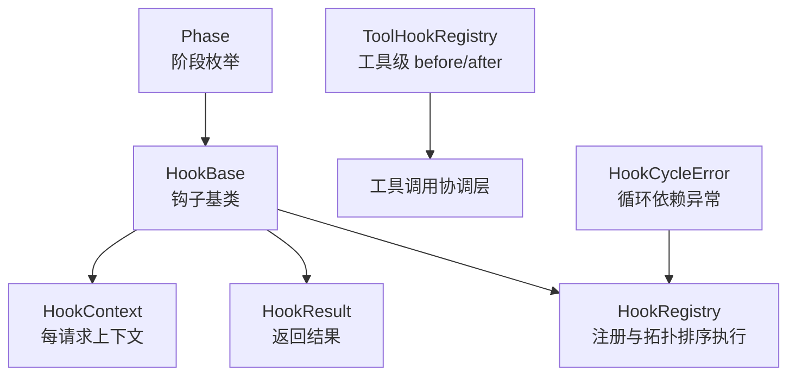
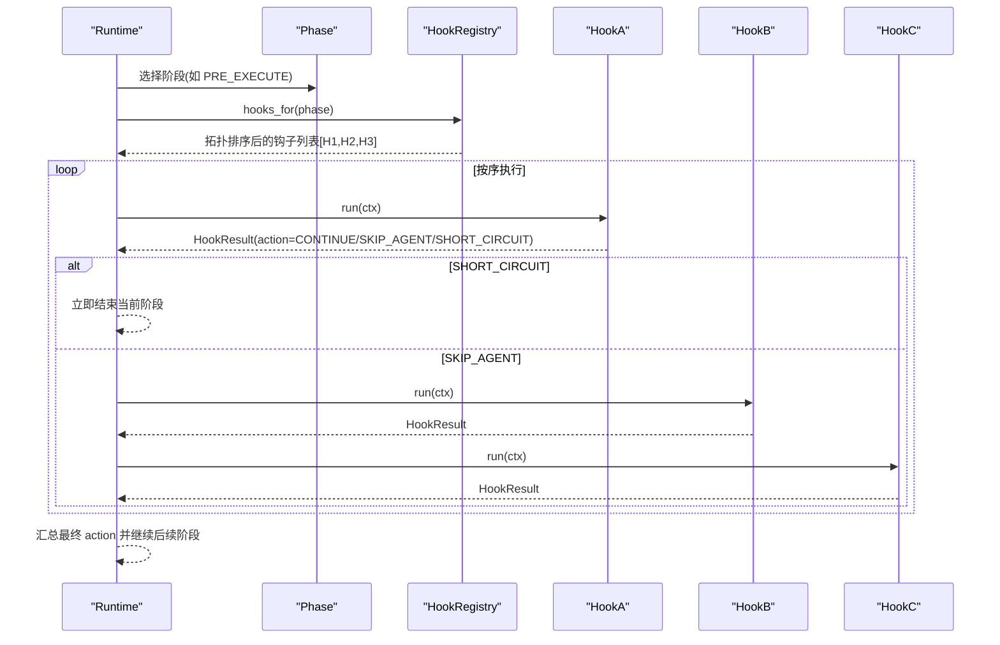
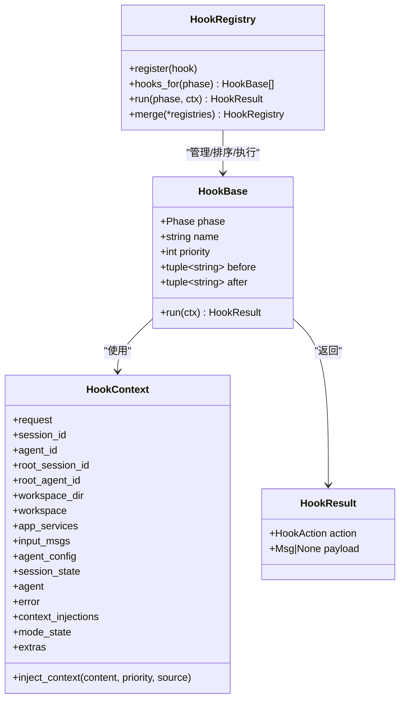
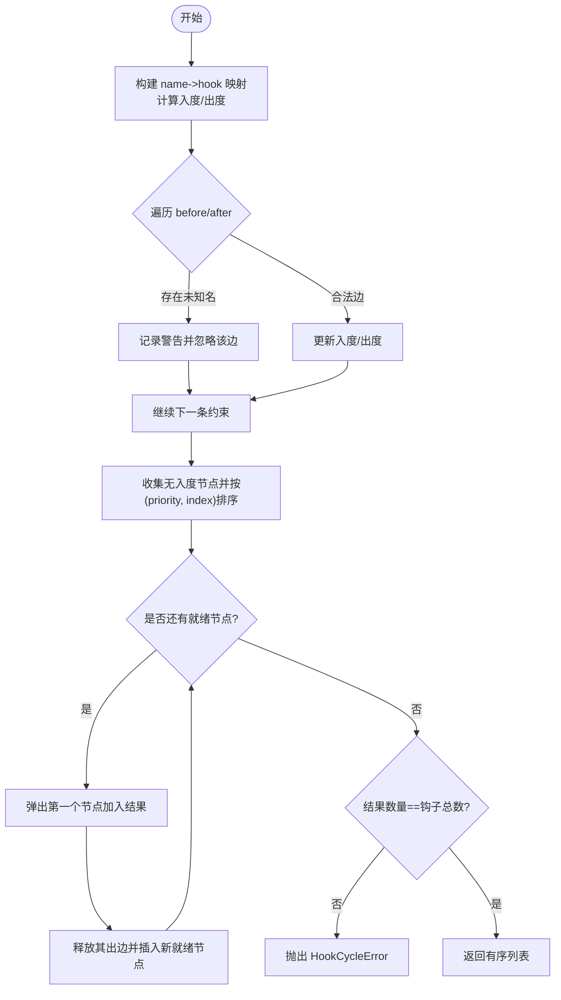
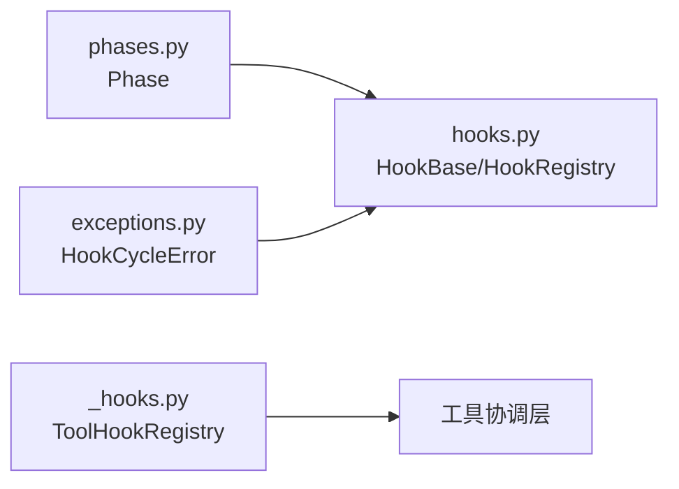

# 自定义钩子开发

<cite>
**本文引用的文件**
- [hooks.py](file://tongtian-tauri/src/agent/runtime/hooks.py)
- [phases.py](file://tongtian-tauri/src/agent/runtime/phases.py)
- [_hooks.py](file://tongtian-tauri/src/agent/tool_calls/_hooks.py)
- [exceptions.py](file://tongtian-tauri/src/agent/exceptions.py)
- [probe-hooks.py](file://.tools/probe-hooks.py)
</cite>

## 目录
1. [简介](#简介)
2. [项目结构](#项目结构)
3. [核心组件](#核心组件)
4. [架构总览](#架构总览)
5. [详细组件分析](#详细组件分析)
6. [依赖关系分析](#依赖关系分析)
7. [性能考量](#性能考量)
8. [故障排查指南](#故障排查指南)
9. [结论](#结论)
10. [附录](#附录)

## 简介
本指南面向需要在运行时扩展系统行为的开发者，详细说明如何基于 HookBase 实现自定义钩子：包括阶段 phase 的选择、name 唯一性、priority 优先级与 before/after 依赖声明；并覆盖异步处理、异常捕获、上下文操作与返回值设计。文档同时解释钩子的生命周期、错误处理与测试方法，并总结常见陷阱与解决方案。

## 项目结构
围绕“运行时编排层”的钩子系统由以下关键文件构成：
- 阶段枚举 Phase：定义请求生命周期的八个固定阶段点。
- 钩子基类与执行器：HookBase、HookContext、HookResult、HookRegistry。
- 工具调用前后钩子：ToolHookRegistry（针对具体工具的 before/after）。
- 异常类型：HookCycleError（用于循环依赖检测失败时快速失败）。
- 探针脚本：probe-hooks.py（用于打印支持的钩子类型）。

图表来源
- [phases.py:28-38](file://tongtian-tauri/src/agent/runtime/phases.py#L28-L38)
- [hooks.py:46-160](file://tongtian-tauri/src/agent/runtime/hooks.py#L46-L160)
- [hooks.py:256-327](file://tongtian-tauri/src/agent/runtime/hooks.py#L256-L327)
- [_hooks.py:20-77](file://tongtian-tauri/src/agent/tool_calls/_hooks.py#L20-L77)
- [exceptions.py:322-322](file://tongtian-tauri/src/agent/exceptions.py#L322-L322)

章节来源
- [phases.py:1-42](file://tongtian-tauri/src/agent/runtime/phases.py#L1-L42)
- [hooks.py:1-338](file://tongtian-tauri/src/agent/runtime/hooks.py#L1-L338)
- [_hooks.py:1-77](file://tongtian-tauri/src/agent/tool_calls/_hooks.py#L1-L77)
- [exceptions.py:322-322](file://tongtian-tauri/src/agent/exceptions.py#L322-L322)
- [probe-hooks.py:1-6](file://.tools/probe-hooks.py#L1-L6)

## 核心组件
- Phase：定义 PRE_DISPATCH、POST_DISPATCH、PRE_AGENT_BUILD、POST_AGENT_BUILD、PRE_EXECUTE、POST_RESPONSE、ON_ERROR、FINALLY 八个阶段点，作为钩子挂载的生命周期位置。
- HookBase：所有运行时钩子的基类，要求子类设置 phase、name，可选 priority、before、after，并实现异步 run(ctx) -> HookResult。
- HookContext：每个请求的上下文，包含会话/工作区/Agent 等只读信息，以及 input_msgs、session_state、mode_state、extras 等可跨阶段传递的状态容器，并提供 inject_context 注入动态上下文。
- HookResult：封装 action（CONTINUE、SHORT_CIRCUIT、SKIP_AGENT）和 payload（当 SHORT_CIRCUIT 时为 Msg 负载）。
- HookRegistry：按 phase 注册钩子，进行拓扑排序（尊重 before/after），缓存排序结果，顺序执行并处理短路/跳过代理行为。
- ToolHookRegistry：为具体工具注册 before/after 钩子及超时元数据，支持合并注册与注销。

章节来源
- [phases.py:28-38](file://tongtian-tauri/src/agent/runtime/phases.py#L28-L38)
- [hooks.py:46-160](file://tongtian-tauri/src/agent/runtime/hooks.py#L46-L160)
- [hooks.py:256-327](file://tongtian-tauri/src/agent/runtime/hooks.py#L256-L327)
- [_hooks.py:20-77](file://tongtian-tauri/src/agent/tool_calls/_hooks.py#L20-L77)

## 架构总览
下图展示了从请求进入运行时的阶段点到钩子执行的完整流程，以及 HookRegistry 如何依据 before/after 与 priority 决定执行顺序。

图表来源
- [hooks.py:168-253](file://tongtian-tauri/src/agent/runtime/hooks.py#L168-L253)
- [hooks.py:284-312](file://tongtian-tauri/src/agent/runtime/hooks.py#L284-L312)
- [phases.py:28-38](file://tongtian-tauri/src/agent/runtime/phases.py#L28-L38)

## 详细组件分析

### 钩子基类与生命周期
- 生命周期阶段：通过 Phase 枚举确定钩子挂载点，涵盖请求分发前/后、Agent 构建前后、执行前后、响应后、错误处理与清理。
- 钩子接口：继承 HookBase，必须提供 name（全局唯一）、phase（所属阶段），可选 priority（数值越小越先执行，作为并列排序的次级键）以及 before/after（字符串名称集合，表示与其他钩子的相对顺序约束）。
- 执行语义：
  - CONTINUE：继续下一个钩子或阶段。
  - SHORT_CIRCUIT：立即结束当前阶段，但仍会触发 ON_ERROR（如有）与 FINALLY。
  - SKIP_AGENT：标记跳过两个固定步骤（AgentBuilder.build 与 AgentExecutor.run），但当前阶段其余钩子仍会执行。

图表来源
- [hooks.py:46-160](file://tongtian-tauri/src/agent/runtime/hooks.py#L46-L160)
- [hooks.py:256-327](file://tongtian-tauri/src/agent/runtime/hooks.py#L256-L327)

章节来源
- [hooks.py:46-160](file://tongtian-tauri/src/agent/runtime/hooks.py#L46-L160)
- [hooks.py:256-327](file://tongtian-tauri/src/agent/runtime/hooks.py#L256-L327)

### 阶段与执行顺序（拓扑排序）
- 排序规则：
  - 首先根据 before/after 建立有向边，形成依赖图。
  - 使用拓扑排序生成执行序列，冲突时使用 (priority 升序, 注册索引升序) 打破平局，保证确定性。
  - 若检测到环，抛出 HookCycleError，启动期快速失败。
- 未识别名称：忽略警告但不影响其他钩子执行。

图表来源
- [hooks.py:168-253](file://tongtian-tauri/src/agent/runtime/hooks.py#L168-L253)
- [exceptions.py:322-322](file://tongtian-tauri/src/agent/exceptions.py#L322-L322)

章节来源
- [hooks.py:168-253](file://tongtian-tauri/src/agent/runtime/hooks.py#L168-L253)
- [exceptions.py:322-322](file://tongtian-tauri/src/agent/exceptions.py#L322-L322)

### 上下文 HookContext 的使用
- 只读字段：request、session_id、agent_id、workspace、app_services 等，供钩子读取。
- 可变状态：input_msgs、agent_config、session_state、agent、error、context_injections、mode_state、extras，用于跨阶段共享临时数据。
- 注入上下文：通过 inject_context(content, priority, source) 将动态提示注入到系统提醒中，priority 越低越靠前插入。

章节来源
- [hooks.py:74-138](file://tongtian-tauri/src/agent/runtime/hooks.py#L74-L138)

### 返回值 HookResult 与动作
- action：
  - CONTINUE：默认，继续执行。
  - SHORT_CIRCUIT：立即结束当前阶段，payload 应为 Msg，以便上层以 SSE 序列发出。
  - SKIP_AGENT：标记跳过两个固定步骤，当前阶段其余钩子仍执行。
- payload：仅在 SHORT_CIRCUIT 时有意义，且需符合 Msg 契约。

章节来源
- [hooks.py:46-66](file://tongtian-tauri/src/agent/runtime/hooks.py#L46-L66)

### 工具级钩子 ToolHookRegistry
- 用途：为单个工具注册 before/after 钩子，并可配置 default_timeout_secs 与 max_internal_timeout_secs 等超时元数据。
- 行为：多次注册同一工具会合并字段，仅显式传入的参数覆盖已有值；支持 unregister 与 get。

章节来源
- [_hooks.py:20-77](file://tongtian-tauri/src/agent/tool_calls/_hooks.py#L20-L77)

### 开发示例（概念性步骤）
以下为概念性步骤，不直接展示代码内容，请根据路径参考实现细节：
- 创建自定义钩子：
  - 继承 HookBase，设置 phase、name、priority、before/after。
  - 实现异步 run(ctx) -> HookResult，在 ctx 中读写状态，必要时注入上下文。
  - 参考路径：[hooks.py:145-160](file://tongtian-tauri/src/agent/runtime/hooks.py#L145-L160)
- 注册钩子：
  - 使用 HookRegistry.register(hook) 注册，或通过 merge 合并多个注册表。
  - 参考路径：[hooks.py:269-282](file://tongtian-tauri/src/agent/runtime/hooks.py#L269-L282)、[hooks.py:314-327](file://tongtian-tauri/src/agent/runtime/hooks.py#L314-L327)
- 工具级钩子：
  - 使用 ToolHookRegistry.register(tool_name, before=..., after=..., ...) 注册。
  - 参考路径：[_hooks.py:42-70](file://tongtian-tauri/src/agent/tool_calls/_hooks.py#L42-L70)
- 查询支持的钩子类型：
  - 使用探针脚本输出 ReActAgent.supported_hook_types。
  - 参考路径：[probe-hooks.py:1-6](file://.tools/probe-hooks.py#L1-L6)

章节来源
- [hooks.py:145-160](file://tongtian-tauri/src/agent/runtime/hooks.py#L145-L160)
- [hooks.py:269-327](file://tongtian-tauri/src/agent/runtime/hooks.py#L269-L327)
- [_hooks.py:42-70](file://tongtian-tauri/src/agent/tool_calls/_hooks.py#L42-L70)
- [probe-hooks.py:1-6](file://.tools/probe-hooks.py#L1-L6)

## 依赖关系分析
- 模块耦合：
  - HookRegistry 依赖 Phase 枚举与 _topo_sort 算法，负责排序与执行。
  - HookBase 依赖 HookContext 与 HookResult，定义统一接口。
  - ToolHookRegistry 独立于运行时钩子，服务于工具调用链。
  - 异常 HookCycleError 被 _topo_sort 抛出，确保循环依赖尽早失败。
- 外部依赖：
  - 运行时阶段由 phases.py 固定，避免随意扩展导致的不一致。
  - 工具钩子与工具协调层解耦，便于单独测试与替换。

图表来源
- [phases.py:28-38](file://tongtian-tauri/src/agent/runtime/phases.py#L28-L38)
- [hooks.py:168-327](file://tongtian-tauri/src/agent/runtime/hooks.py#L168-L327)
- [_hooks.py:20-77](file://tongtian-tauri/src/agent/tool_calls/_hooks.py#L20-L77)
- [exceptions.py:322-322](file://tongtian-tauri/src/agent/exceptions.py#L322-L322)

章节来源
- [hooks.py:168-327](file://tongtian-tauri/src/agent/runtime/hooks.py#L168-L327)
- [phases.py:28-38](file://tongtian-tauri/src/agent/runtime/phases.py#L28-L38)
- [_hooks.py:20-77](file://tongtian-tauri/src/agent/tool_calls/_hooks.py#L20-L77)
- [exceptions.py:322-322](file://tongtian-tauri/src/agent/exceptions.py#L322-L322)

## 性能考量
- 拓扑排序缓存：HookRegistry 对每个阶段的排序结果进行缓存，注册变更时失效对应缓存，减少重复计算。
- 短路优化：SHORT_CIRCUIT 可立即结束当前阶段，降低不必要的钩子执行开销。
- 优先级与稳定性：通过 (priority, 注册索引) 双键排序，保证稳定且可预测的执行顺序，避免抖动。
- 工具超时控制：ToolHookRegistry 支持最大内部超时限制，防止长时间阻塞。

章节来源
- [hooks.py:265-291](file://tongtian-tauri/src/agent/runtime/hooks.py#L265-L291)
- [hooks.py:293-312](file://tongtian-tauri/src/agent/runtime/hooks.py#L293-L312)
- [_hooks.py:20-34](file://tongtian-tauri/src/agent/tool_calls/_hooks.py#L20-L34)

## 故障排查指南
- 循环依赖：
  - 现象：启动时报错，提示检测到循环依赖。
  - 原因：before/after 形成环。
  - 解决：检查钩子间的依赖声明，消除环；优先使用 priority 调整顺序，必要时拆分逻辑。
  - 参考：[hooks.py:248-252](file://tongtian-tauri/src/agent/runtime/hooks.py#L248-L252)、[exceptions.py:322-322](file://tongtian-tauri/src/agent/exceptions.py#L322-L322)
- 名称冲突：
  - 现象：注册时报错 hook.name 必须为非空字符串。
  - 解决：确保 name 唯一且非空。
  - 参考：[hooks.py:275-276](file://tongtian-tauri/src/agent/runtime/hooks.py#L275-L276)
- 阶段非法：
  - 现象：注册时报错 phase 无效。
  - 解决：使用 phases.py 中定义的 Phase 枚举值。
  - 参考：[hooks.py:277-280](file://tongtian-tauri/src/agent/runtime/hooks.py#L277-L280)
- 未识别依赖名：
  - 现象：日志警告 before/after 引用了未注册的钩子名。
  - 解决：修正依赖名或确保目标钩子已注册。
  - 参考：[hooks.py:196-217](file://tongtian-tauri/src/agent/runtime/hooks.py#L196-L217)
- 异常传播：
  - 现象：钩子内抛出的异常会被传播至运行时 ON_ERROR 链。
  - 建议：在钩子内部捕获并转换为合适的 HookResult 或记录日志，避免中断整个流程。
  - 参考：[hooks.py:301-303](file://tongtian-tauri/src/agent/runtime/hooks.py#L301-L303)

章节来源
- [hooks.py:196-217](file://tongtian-tauri/src/agent/runtime/hooks.py#L196-L217)
- [hooks.py:248-252](file://tongtian-tauri/src/agent/runtime/hooks.py#L248-L252)
- [hooks.py:275-280](file://tongtian-tauri/src/agent/runtime/hooks.py#L275-L280)
- [hooks.py:301-303](file://tongtian-tauri/src/agent/runtime/hooks.py#L301-L303)
- [exceptions.py:322-322](file://tongtian-tauri/src/agent/exceptions.py#L322-L322)

## 结论
通过 HookBase 与 HookRegistry，系统提供了强大而稳定的运行时扩展机制。开发者只需关注 phase、name、priority 与 before/after 的正确配置，即可在不侵入核心逻辑的前提下实现横切能力。结合 HookContext 的上下文注入与 HookResult 的动作语义，可以灵活地控制执行流与输出。配合 ToolHookRegistry，还能对工具调用进行细粒度的前置/后置增强。遵循本文的最佳实践与排障指引，可有效避免常见陷阱，提升系统的可维护性与可扩展性。

## 附录
- 常用阶段说明：
  - PRE_DISPATCH：请求归一化，斜杠命令分发前。
  - POST_DISPATCH：斜杠命令分发完成但未匹配。
  - PRE_AGENT_BUILD：会话加载与构建前准备。
  - POST_AGENT_BUILD：Agent 构造完成，注入模式上下文。
  - PRE_EXECUTE：环境栈推入、提示刷新等执行前准备。
  - POST_RESPONSE：会话保存、定时任务写回等响应后处理。
  - ON_ERROR：异常规范化、取消信封。
  - FINALLY：幂等清理（关闭 MCP、重置 ContextVars）。
- 参考路径：[phases.py:28-38](file://tongtian-tauri/src/agent/runtime/phases.py#L28-L38)