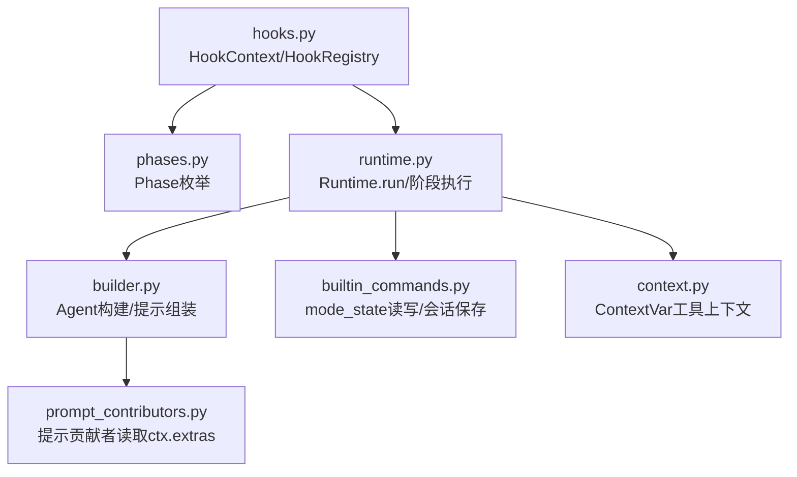
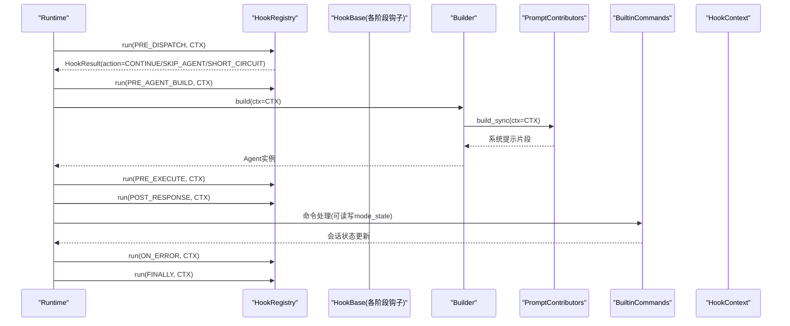
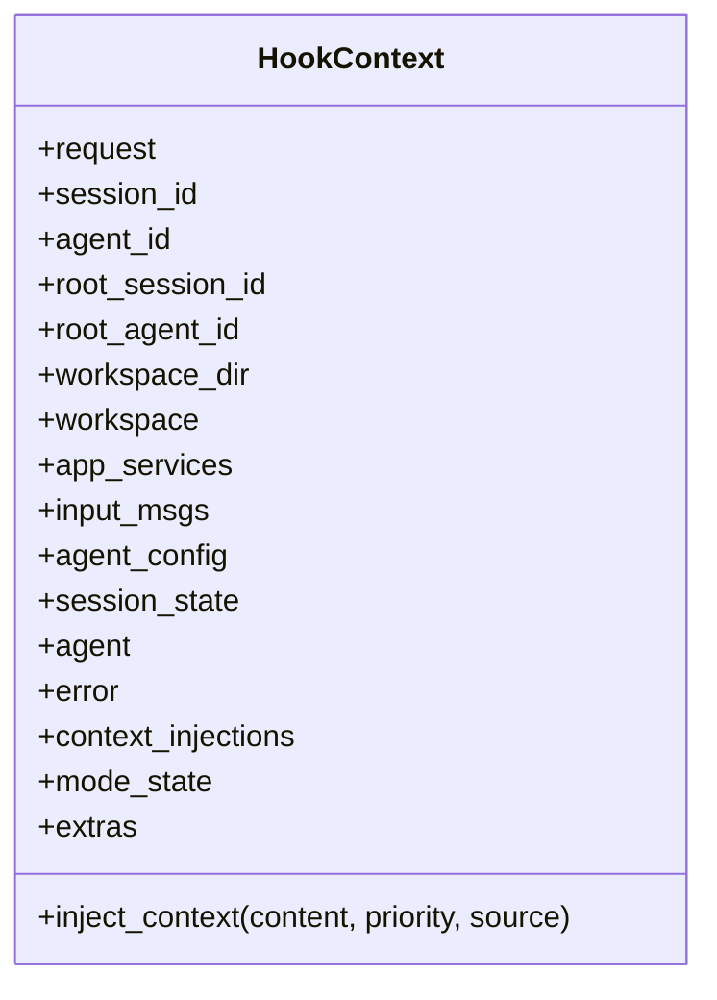
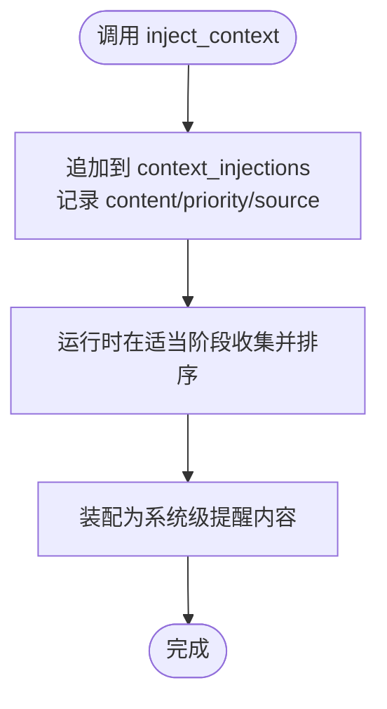
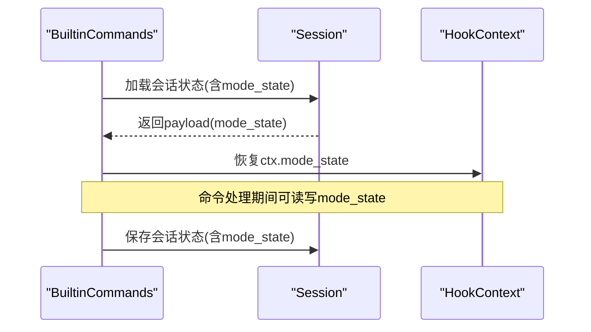
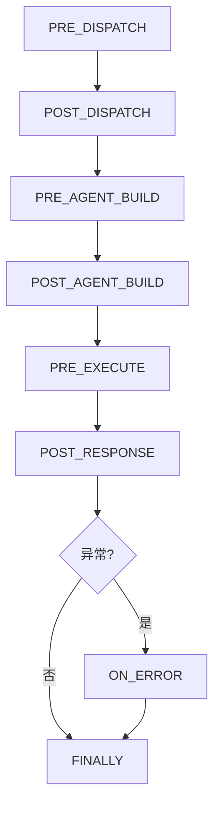
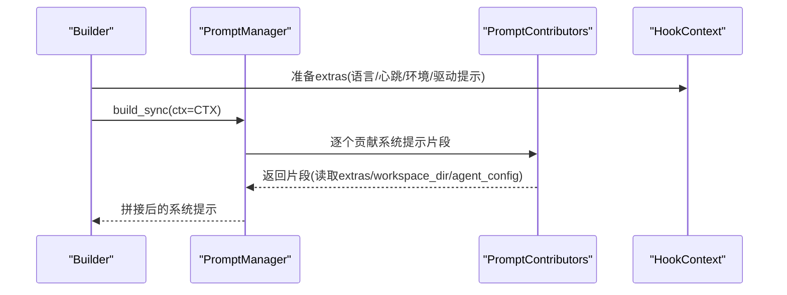
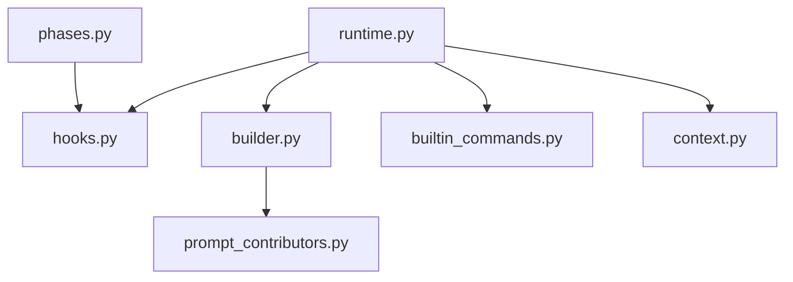

# 钩子上下文管理

<cite>
**本文引用的文件**
- [hooks.py](file://tongtian-tauri/src/agent/runtime/hooks.py)
- [phases.py](file://tongtian-tauri/src/agent/runtime/phases.py)
- [runtime.py](file://tongtian-tauri/src/agent/runtime/runtime.py)
- [builder.py](file://tongtian-tauri/src/agent/runtime/builder.py)
- [prompt_contributors.py](file://tongtian-tauri/src/agent/runtime/prompt_contributors.py)
- [builtin_commands.py](file://tongtian-tauri/src/agent/runtime/builtin_commands.py)
- [context.py](file://tongtian-tauri/src/agent/config/context.py)
</cite>

## 目录
1. [简介](#简介)
2. [项目结构](#项目结构)
3. [核心组件](#核心组件)
4. [架构总览](#架构总览)
5. [详细组件分析](#详细组件分析)
6. [依赖关系分析](#依赖关系分析)
7. [性能考虑](#性能考虑)
8. [故障排查指南](#故障排查指南)
9. [结论](#结论)
10. [附录](#附录)

## 简介
本文件围绕运行时“钩子系统”的上下文管理进行系统化说明，重点解释 HookContext 的数据结构设计、动态注入机制 context_injections、模式隔离 mode_state、临时数据 extras 的使用方式与最佳实践，并结合构建器 builder、提示词贡献者 prompt_contributors、命令处理 builtin_commands、运行时 runtime 以及配置上下文 context 等模块，给出端到端的数据流与调用时序。目标是帮助读者在不深入源码的情况下，也能准确理解并安全高效地使用钩子上下文。

## 项目结构
与钩子上下文相关的代码主要分布在以下模块：
- 运行时钩子抽象与注册：hooks.py、phases.py
- 运行时编排与生命周期：runtime.py
- Agent 构建与系统提示组装：builder.py、prompt_contributors.py
- 会话状态与模式状态持久化：builtin_commands.py
- 工具函数运行时的上下文变量：context.py

图示来源
- [hooks.py:73-137](file://tongtian-tauri/src/agent/runtime/hooks.py#L73-L137)
- [phases.py:28-41](file://tongtian-tauri/src/agent/runtime/phases.py#L28-L41)
- [runtime.py:200-221](file://tongtian-tauri/src/agent/runtime/runtime.py#L200-L221)
- [builder.py:411-453](file://tongtian-tauri/src/agent/runtime/builder.py#L411-L453)
- [prompt_contributors.py:8-17](file://tongtian-tauri/src/agent/runtime/prompt_contributors.py#L8-L17)
- [builtin_commands.py:360-371](file://tongtian-tauri/src/agent/runtime/builtin_commands.py#L360-L371)
- [context.py:18-41](file://tongtian-tauri/src/agent/config/context.py#L18-L41)

章节来源
- [hooks.py:73-137](file://tongtian-tauri/src/agent/runtime/hooks.py#L73-L137)
- [phases.py:28-41](file://tongtian-tauri/src/agent/runtime/phases.py#L28-L41)
- [runtime.py:200-221](file://tongtian-tauri/src/agent/runtime/runtime.py#L200-L221)
- [builder.py:411-453](file://tongtian-tauri/src/agent/runtime/builder.py#L411-L453)
- [prompt_contributors.py:8-17](file://tongtian-tauri/src/agent/runtime/prompt_contributors.py#L8-L17)
- [builtin_commands.py:360-371](file://tongtian-tauri/src/agent/runtime/builtin_commands.py#L360-L371)
- [context.py:18-41](file://tongtian-tauri/src/agent/config/context.py#L18-L41)

## 核心组件
- HookContext：每个请求级别的上下文对象，贯穿所有钩子阶段，承载身份标识、工作空间信息、运行时服务、可变状态、动态注入、模式隔离和临时数据。
- HookBase/HookResult/HookAction：钩子基类、返回结果与动作语义（继续、短路、跳过Agent）。
- HookRegistry：按 Phase 分组注册钩子，拓扑排序后顺序执行，支持合并多个注册表。
- Phase：定义八个固定阶段点，覆盖请求从预处理到清理的全生命周期。
- Runtime：在固定步骤（如 AgentBuilder.build、AgentExecutor.run）前后调度各阶段钩子，并在取消/错误时执行 ON_ERROR 与 FINALLY。
- Builder/PromptContributors：构建 Agent 与系统提示，通过 ctx.extras 传递运行时配置与提示增强信息。
- BuiltinCommands：会话命令处理中读写 mode_state，并与会话状态持久化联动。
- ContextVars：为工具函数提供跨调用的上下文变量（工作目录、会话ID、Shell超时等）。

章节来源
- [hooks.py:46-137](file://tongtian-tauri/src/agent/runtime/hooks.py#L46-L137)
- [hooks.py:145-327](file://tongtian-tauri/src/agent/runtime/hooks.py#L145-L327)
- [phases.py:28-41](file://tongtian-tauri/src/agent/runtime/phases.py#L28-L41)
- [runtime.py:200-221](file://tongtian-tauri/src/agent/runtime/runtime.py#L200-L221)
- [builder.py:411-453](file://tongtian-tauri/src/agent/runtime/builder.py#L411-L453)
- [prompt_contributors.py:8-17](file://tongtian-tauri/src/agent/runtime/prompt_contributors.py#L8-L17)
- [builtin_commands.py:360-371](file://tongtian-tauri/src/agent/runtime/builtin_commands.py#L360-L371)
- [context.py:18-41](file://tongtian-tauri/src/agent/config/context.py#L18-L41)

## 架构总览
下图展示了单次请求的生命周期中，Runtime 如何组织 Phase 与 HookContext，以及各组件之间的交互。

图示来源
- [runtime.py:200-221](file://tongtian-tauri/src/agent/runtime/runtime.py#L200-L221)
- [hooks.py:293-312](file://tongtian-tauri/src/agent/runtime/hooks.py#L293-L312)
- [builder.py:411-453](file://tongtian-tauri/src/agent/runtime/builder.py#L411-L453)
- [prompt_contributors.py:8-17](file://tongtian-tauri/src/agent/runtime/prompt_contributors.py#L8-L17)
- [builtin_commands.py:360-371](file://tongtian-tauri/src/agent/runtime/builtin_commands.py#L360-L371)

## 详细组件分析

### HookContext 数据结构与职责
- 身份标识与工作空间
  - request、session_id、agent_id、root_session_id、root_agent_id、workspace_dir：用于追踪请求来源、会话与代理身份，以及当前工作区路径。
  - workspace、app_services：只读容器，供钩子访问工作区与服务管理器。
- 每请求可变状态
  - input_msgs、agent_config、session_state、agent、error：在多个阶段逐步填充，驱动后续构建与执行逻辑。
- 动态注入与模式隔离
  - context_injections：收集运行时动态注入的系统提醒内容，后续由运行时装配到系统级提醒中。
  - mode_state：以模式名称为键的命名空间字典，实现不同模式（如 coding、mission）下的私有状态隔离。
  - extras：短生命周期、任意键值对的临时数据通道，常用于钩子对之间或构建阶段的参数透传。
- 辅助方法
  - inject_context(content, priority, source)：将文本注入到 context_injections，priority 越小越靠前插入，source 用于调试溯源。

图示来源
- [hooks.py:73-137](file://tongtian-tauri/src/agent/runtime/hooks.py#L73-L137)

章节来源
- [hooks.py:73-137](file://tongtian-tauri/src/agent/runtime/hooks.py#L73-L137)

### 动态注入机制 context_injections
- 注入时机：在任意阶段钩子中均可调用 ctx.inject_context(...)，将内容加入队列。
- 排序与装配：content 作为系统级提醒的一部分，后续由运行时在合适的阶段装配进系统提示，priority 控制插入顺序（数值越小越靠前），source 便于定位来源。
- 使用建议：仅注入必要且稳定的提示片段；避免重复注入；优先使用稳定字段而非 extras。

图示来源
- [hooks.py:113-137](file://tongtian-tauri/src/agent/runtime/hooks.py#L113-L137)

章节来源
- [hooks.py:113-137](file://tongtian-tauri/src/agent/runtime/hooks.py#L113-L137)

### 模式隔离 mode_state 与临时数据 extras
- mode_state
  - 作用：按模式名隔离状态，避免不同模式间互相污染。
  - 读写位置：命令处理流程会加载/保存 mode_state，确保跨调用一致性。
- extras
  - 作用：短生命周期、任意结构的临时数据通道，适合钩子对之间或构建期参数透传。
  - 典型用法：Builder 向 PromptContributors 传递语言、心跳开关、环境上下文、驱动提示提示等。

图示来源
- [builtin_commands.py:360-371](file://tongtian-tauri/src/agent/runtime/builtin_commands.py#L360-L371)
- [builtin_commands.py:423-425](file://tongtian-tauri/src/agent/runtime/builtin_commands.py#L423-L425)

章节来源
- [builtin_commands.py:360-371](file://tongtian-tauri/src/agent/runtime/builtin_commands.py#L360-L371)
- [builtin_commands.py:423-425](file://tongtian-tauri/src/agent/runtime/builtin_commands.py#L423-L425)

### 运行时阶段与钩子执行
- Phase 定义了八个固定阶段点，覆盖请求预处理、Agent 构建、执行、响应、错误与清理。
- HookRegistry 负责按阶段收集钩子、拓扑排序（尊重 before/after 约束）、顺序执行，并支持合并多个注册表。
- Runtime 在各阶段调用 HookRegistry.run，根据 HookResult.action 决定继续、短路或跳过 Agent 固定步骤。

图示来源
- [phases.py:28-41](file://tongtian-tauri/src/agent/runtime/phases.py#L28-L41)
- [hooks.py:293-312](file://tongtian-tauri/src/agent/runtime/hooks.py#L293-L312)

章节来源
- [phases.py:28-41](file://tongtian-tauri/src/agent/runtime/phases.py#L28-L41)
- [hooks.py:293-312](file://tongtian-tauri/src/agent/runtime/hooks.py#L293-L312)

### 提示词构建与 extras 的协作
- Builder 在构建 Agent 前准备模型、工具、中间件与系统提示。
- 系统提示通过 PromptManager 聚合多个 PromptContributor，它们从 ctx.extras 读取语言、心跳开关、环境上下文、驱动提示提示等。
- 若工作区插件提供了自定义 PromptManager，则优先使用；否则回退到默认贡献者集合。

图示来源
- [builder.py:411-453](file://tongtian-tauri/src/agent/runtime/builder.py#L411-L453)
- [prompt_contributors.py:8-17](file://tongtian-tauri/src/agent/runtime/prompt_contributors.py#L8-L17)

章节来源
- [builder.py:411-453](file://tongtian-tauri/src/agent/runtime/builder.py#L411-L453)
- [prompt_contributors.py:8-17](file://tongtian-tauri/src/agent/runtime/prompt_contributors.py#L8-L17)

### 工具函数上下文变量（ContextVars）
- 为工具函数提供跨调用的上下文变量，如当前工作目录、最近输出截断限制、Shell 命令超时与可执行文件、会话ID、Toolkit、AgentState 等。
- 这些变量由上层在合适时机设置，工具函数通过 getter 获取，保证多代理环境下相对路径解析与权限检查的正确性。

图示来源
- [context.py:18-41](file://tongtian-tauri/src/agent/config/context.py#L18-L41)
- [context.py:43-66](file://tongtian-tauri/src/agent/config/context.py#L43-L66)
- [context.py:68-91](file://tongtian-tauri/src/agent/config/context.py#L68-L91)
- [context.py:93-115](file://tongtian-tauri/src/agent/config/context.py#L93-L115)
- [context.py:117-140](file://tongtian-tauri/src/agent/config/context.py#L117-L140)
- [context.py:142-165](file://tongtian-tauri/src/agent/config/context.py#L142-L165)
- [context.py:167-193](file://tongtian-tauri/src/agent/config/context.py#L167-L193)

章节来源
- [context.py:18-41](file://tongtian-tauri/src/agent/config/context.py#L18-L41)
- [context.py:43-66](file://tongtian-tauri/src/agent/config/context.py#L43-L66)
- [context.py:68-91](file://tongtian-tauri/src/agent/config/context.py#L68-L91)
- [context.py:93-115](file://tongtian-tauri/src/agent/config/context.py#L93-L115)
- [context.py:117-140](file://tongtian-tauri/src/agent/config/context.py#L117-L140)
- [context.py:142-165](file://tongtian-tauri/src/agent/config/context.py#L142-L165)
- [context.py:167-193](file://tongtian-tauri/src/agent/config/context.py#L167-L193)

## 依赖关系分析
- hooks.py 依赖 phases.py 的阶段枚举，被 runtime.py 在生命周期中调用。
- runtime.py 协调 HookRegistry 与各阶段钩子，并在取消/错误时执行 ON_ERROR 与 FINALLY。
- builder.py 在构建 Agent 时读取 ctx.extras，并通过 PromptContributors 生成系统提示。
- builtin_commands.py 在命令处理中读写 mode_state，并与会话状态持久化协同。
- context.py 为工具函数提供跨调用上下文变量，不直接依赖钩子系统，但受运行时生命周期影响。

图示来源
- [phases.py:28-41](file://tongtian-tauri/src/agent/runtime/phases.py#L28-L41)
- [hooks.py:293-312](file://tongtian-tauri/src/agent/runtime/hooks.py#L293-L312)
- [runtime.py:200-221](file://tongtian-tauri/src/agent/runtime/runtime.py#L200-L221)
- [builder.py:411-453](file://tongtian-tauri/src/agent/runtime/builder.py#L411-L453)
- [prompt_contributors.py:8-17](file://tongtian-tauri/src/agent/runtime/prompt_contributors.py#L8-L17)
- [builtin_commands.py:360-371](file://tongtian-tauri/src/agent/runtime/builtin_commands.py#L360-L371)
- [context.py:18-41](file://tongtian-tauri/src/agent/config/context.py#L18-L41)

章节来源
- [hooks.py:293-312](file://tongtian-tauri/src/agent/runtime/hooks.py#L293-L312)
- [runtime.py:200-221](file://tongtian-tauri/src/agent/runtime/runtime.py#L200-L221)
- [builder.py:411-453](file://tongtian-tauri/src/agent/runtime/builder.py#L411-L453)
- [prompt_contributors.py:8-17](file://tongtian-tauri/src/agent/runtime/prompt_contributors.py#L8-L17)
- [builtin_commands.py:360-371](file://tongtian-tauri/src/agent/runtime/builtin_commands.py#L360-L371)
- [context.py:18-41](file://tongtian-tauri/src/agent/config/context.py#L18-L41)

## 性能考虑
- 钩子排序与缓存：HookRegistry 对每个阶段的钩子进行拓扑排序并缓存结果，避免重复计算；新增钩子会失效对应阶段缓存。
- 短路与会话保存：SHORT_CIRCUIT 可立即结束当前阶段，减少不必要开销；取消路径下采用异步保护与快照保存，降低丢失风险。
- 提示构建成本：PromptContributors 可能读取工作区文件，应尽量减少 I/O 次数与文件大小；必要时利用 extras 缓存计算结果。
- 上下文变量：ContextVars 设置/获取开销低，但应避免在高频路径中进行复杂操作；合理设置超时与截断限制，防止工具调用阻塞。
- 模式状态：mode_state 随会话持久化，注意其体积与序列化成本，仅存储必要数据。

[本节为通用指导，不直接分析具体文件]

## 故障排查指南
- 钩子循环依赖：当 before/after 声明形成环时，会在拓扑排序阶段抛出循环错误，需检查钩子间的依赖声明。
- 阶段未匹配：若某阶段无钩子注册，仍会正常推进；确认是否遗漏注册或注册到了错误的 Phase。
- 提示缺失：若系统提示未按预期生效，检查 ctx.extras 是否正确注入（如 language、heartbeat_enabled、env_context、driver_prompt_hints），以及工作区提示文件是否存在且可读。
- 模式状态丢失：确认命令处理流程是否正确加载/保存 mode_state，并确保会话存储可用。
- 工具上下文异常：检查 ContextVars 是否在正确时机设置（如工作目录、会话ID、Shell超时），并在工具函数中通过 getter 获取。

章节来源
- [hooks.py:168-253](file://tongtian-tauri/src/agent/runtime/hooks.py#L168-L253)
- [runtime.py:200-221](file://tongtian-tauri/src/agent/runtime/runtime.py#L200-L221)
- [builder.py:411-453](file://tongtian-tauri/src/agent/runtime/builder.py#L411-L453)
- [builtin_commands.py:360-371](file://tongtian-tauri/src/agent/runtime/builtin_commands.py#L360-L371)
- [context.py:18-41](file://tongtian-tauri/src/agent/config/context.py#L18-L41)

## 结论
HookContext 是钩子系统的关键纽带，集中承载了请求身份、工作空间、运行时服务与可变状态，并通过 context_injections、mode_state 与 extras 提供灵活而可控的动态扩展能力。结合 Phase 的固定阶段与 HookRegistry 的有序执行，Runtime 能够在复杂的多阶段流程中保持清晰的控制流与良好的可维护性。遵循本文的最佳实践与性能建议，可以在保证正确性的前提下，最大化系统的可扩展性与运行效率。

[本节为总结性内容，不直接分析具体文件]

## 附录
- 常用字段速查
  - 身份与工作空间：request、session_id、agent_id、root_session_id、root_agent_id、workspace_dir、workspace、app_services
  - 可变状态：input_msgs、agent_config、session_state、agent、error
  - 动态注入：context_injections（通过 inject_context 添加）
  - 模式隔离：mode_state（按模式名隔离）
  - 临时数据：extras（短生命周期键值对）
- 相关阶段参考
  - PRE_DISPATCH、POST_DISPATCH、PRE_AGENT_BUILD、POST_AGENT_BUILD、PRE_EXECUTE、POST_RESPONSE、ON_ERROR、FINALLY

[本节为补充信息，不直接分析具体文件]