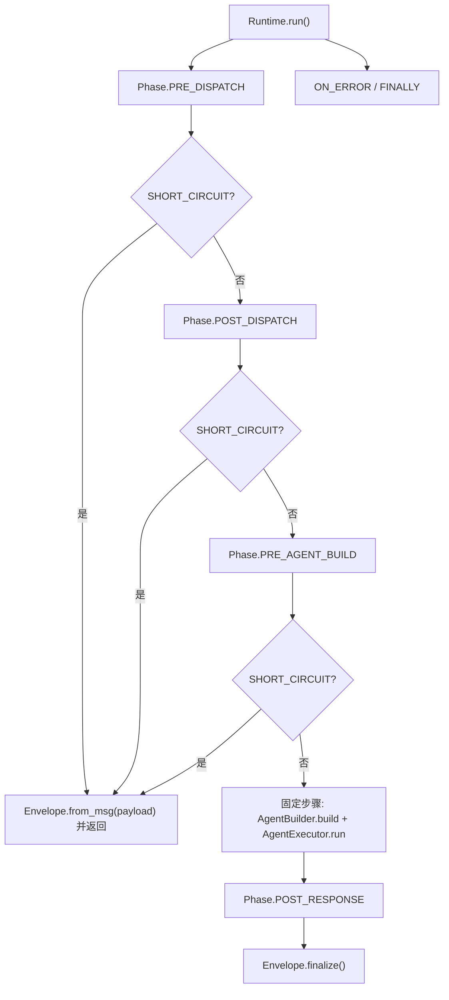
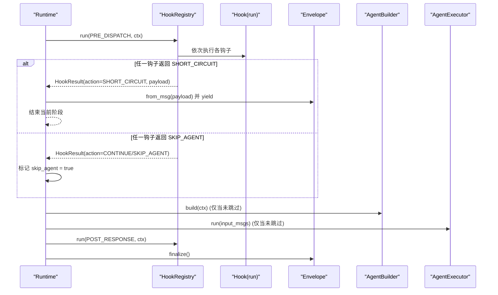
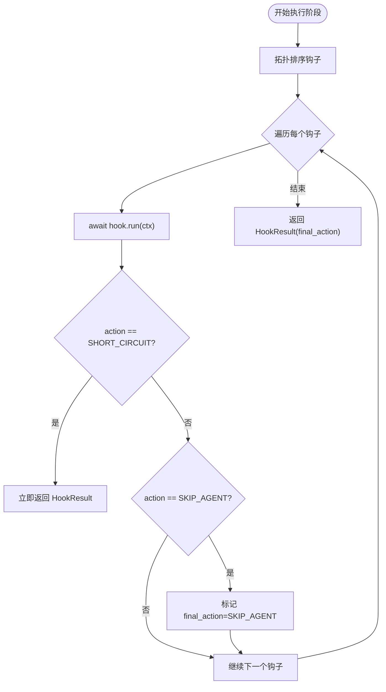
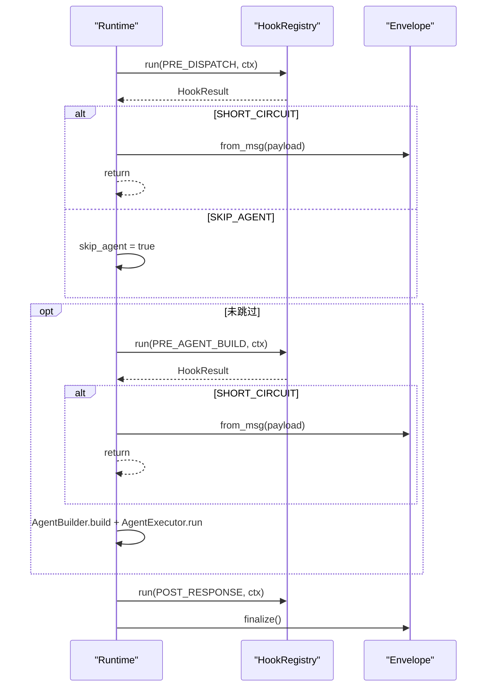
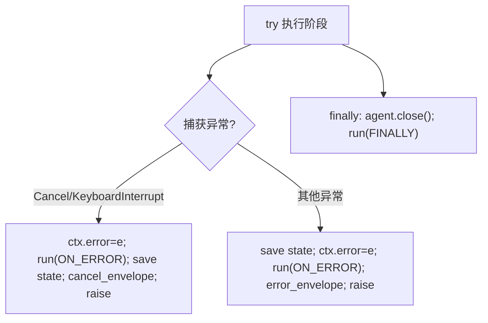
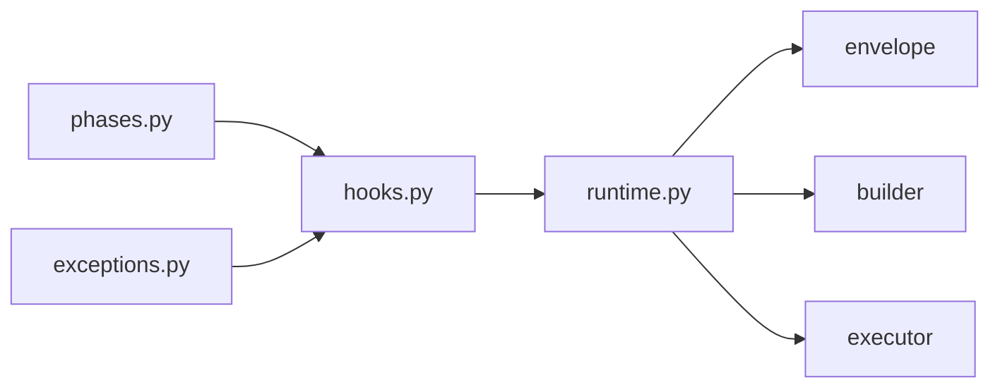

# 钩子动作控制

<cite>
**本文引用的文件**
- [hooks.py](file://tongtian-tauri/src/agent/runtime/hooks.py)
- [runtime.py](file://tongtian-tauri/src/agent/runtime/runtime.py)
- [phases.py](file://tongtian-tauri/src/agent/runtime/phases.py)
- [exceptions.py](file://tongtian-tauri/src/agent/exceptions.py)
</cite>

## 目录
1. [简介](#简介)
2. [项目结构](#项目结构)
3. [核心组件](#核心组件)
4. [架构总览](#架构总览)
5. [详细组件分析](#详细组件分析)
6. [依赖关系分析](#依赖关系分析)
7. [性能考量](#性能考量)
8. [故障排查指南](#故障排查指南)
9. [结论](#结论)
10. [附录：使用场景与示例指引](#附录使用场景与示例指引)

## 简介
本文件聚焦于运行时钩子系统对“动作控制”的语义与执行流程，深入解释三种 HookAction 的行为：CONTINUE（继续）、SHORT_CIRCUIT（短路）、SKIP_AGENT（跳过 Agent）。文档涵盖每种动作的执行流程、异常处理策略、与其他组件（Runtime、Envelope、AgentBuilder、AgentExecutor）的交互模式，并提供可操作的使用场景与代码片段路径指引。

## 项目结构
钩子动作控制位于运行时编排层，围绕 8 个固定阶段展开，由 Runtime 驱动，HookRegistry 负责按阶段注册、排序并执行钩子；HookBase/HookContext/HookResult/HookAction 提供统一的抽象与数据契约。

图表来源
- [runtime.py:49-141](file://tongtian-tauri/src/agent/runtime/runtime.py#L49-L141)
- [phases.py:28-38](file://tongtian-tauri/src/agent/runtime/phases.py#L28-L38)

章节来源
- [runtime.py:49-141](file://tongtian-tauri/src/agent/runtime/runtime.py#L49-L141)
- [phases.py:28-38](file://tongtian-tauri/src/agent/runtime/phases.py#L28-L38)

## 核心组件
- HookAction：定义三种动作语义（CONTINUE、SHORT_CIRCUIT、SKIP_AGENT）。
- HookResult：封装动作与可选 payload（当 SHORT_CIRCUIT 时携带 Msg，供 Envelope 直接发射 SSE）。
- HookContext：跨阶段的请求上下文，包含会话、工作区、输入消息、Agent 引用、错误等，以及注入上下文的能力。
- HookBase：钩子基类，声明 phase、name、优先级与 before/after 约束，实现 run(ctx)。
- HookRegistry：按 Phase 管理钩子，拓扑排序后顺序执行，聚合最终动作。
- Runtime：8 阶段编排器，根据 HookResult.action 决定短路或跳过 Agent 构建/执行。

章节来源
- [hooks.py:46-66](file://tongtian-tauri/src/agent/runtime/hooks.py#L46-L66)
- [hooks.py:73-138](file://tongtian-tauri/src/agent/runtime/hooks.py#L73-L138)
- [hooks.py:145-161](file://tongtian-tauri/src/agent/runtime/hooks.py#L145-L161)
- [hooks.py:256-327](file://tongtian-tauri/src/agent/runtime/hooks.py#L256-L327)
- [runtime.py:49-141](file://tongtian-tauri/src/agent/runtime/runtime.py#L49-L141)

## 架构总览
Runtime 在每个阶段调用 HookRegistry.run(phase, ctx)，并根据 HookResult.action 进行分支：
- SHORT_CIRCUIT：立即通过 Envelope 发射 payload 并结束当前阶段，后续阶段不再执行（但 ON_ERROR/FINALLY 仍会运行）。
- SKIP_AGENT：标记 skip_agent=true，跳过后续的“构建 Agent 与执行 Agent”两个固定步骤，但其他阶段继续执行。
- CONTINUE：默认行为，继续下一个阶段。

图表来源
- [runtime.py:62-141](file://tongtian-tauri/src/agent/runtime/runtime.py#L62-L141)
- [hooks.py:293-312](file://tongtian-tauri/src/agent/runtime/hooks.py#L293-L312)

章节来源
- [runtime.py:62-141](file://tongtian-tauri/src/agent/runtime/runtime.py#L62-L141)
- [hooks.py:293-312](file://tongtian-tauri/src/agent/runtime/hooks.py#L293-L312)

## 详细组件分析

### HookAction 与 HookResult 语义
- CONTINUE：默认值，表示继续执行下一个钩子或阶段。
- SHORT_CIRCUIT：立即终止当前阶段，Runtime 将 HookResult.payload（必须为 Msg）交给 Envelope 发射完整 SSE 序列，然后结束该阶段。
- SKIP_AGENT：粘性标记，即使后续钩子继续执行，最终结果也会携带 SKIP_AGENT，使 Runtime 跳过“构建 Agent 与执行 Agent”两个固定步骤。

注意：
- HookResult.payload 在 SHORT_CIRCUIT 时具有契约意义（Msg），否则会被信封层拒绝。
- SKIP_AGENT 不会阻止其它阶段执行，只影响固定步骤。

章节来源
- [hooks.py:46-66](file://tongtian-tauri/src/agent/runtime/hooks.py#L46-L66)
- [hooks.py:293-312](file://tongtian-tauri/src/agent/runtime/hooks.py#L293-L312)

### HookRegistry 执行与短路/跳过策略
- 拓扑排序：基于 before/after 与 priority 保证确定性执行顺序。
- 短路：一旦某个钩子返回 SHORT_CIRCUIT，立即返回该结果给 Runtime。
- 跳过：若任意钩子返回 SKIP_AGENT，则记录 final_action=SKIP_AGENT，继续执行后续钩子，但最终结果携带 SKIP_AGENT。
- 异常传播：钩子抛出的异常不被吞掉，沿 Runtime 的异常路径传播至 ON_ERROR。

图表来源
- [hooks.py:168-253](file://tongtian-tauri/src/agent/runtime/hooks.py#L168-L253)
- [hooks.py:293-312](file://tongtian-tauri/src/agent/runtime/hooks.py#L293-L312)

章节来源
- [hooks.py:168-253](file://tongtian-tauri/src/agent/runtime/hooks.py#L168-L253)
- [hooks.py:293-312](file://tongtian-tauri/src/agent/runtime/hooks.py#L293-L312)

### Runtime 编排与动作分支
- PRE_DISPATCH：请求归一化后的第一个阶段，适合做鉴权、限流、快速失败。
- POST_DISPATCH：斜杠命令分发结束后，若无匹配则进入后续阶段。
- PRE_AGENT_BUILD：构建 Agent 前，可做会话加载、环境准备。
- POST_AGENT_BUILD：Agent 已构建，可注入模式上下文。
- PRE_EXECUTE：执行前，可做提示刷新、环境变量入栈。
- POST_RESPONSE：响应完成后，可做持久化、定时任务写回。
- ON_ERROR：异常捕获后统一处理。
- FINALLY：幂等清理。

动作分支要点：
- 遇到 SHORT_CIRCUIT：通过 Envelope.from_msg(payload) 发射事件并结束当前阶段。
- 遇到 SKIP_AGENT：设置 skip_agent=true，跳过“构建 Agent 与执行 Agent”。
- 正常流程：完成所有阶段，最后 Envelope.finalize()。

图表来源
- [runtime.py:62-141](file://tongtian-tauri/src/agent/runtime/runtime.py#L62-L141)

章节来源
- [runtime.py:62-141](file://tongtian-tauri/src/agent/runtime/runtime.py#L62-L141)

### 异常处理策略
- 钩子内部异常：不吞异常，直接上抛到 Runtime。
- Runtime 捕获：
  - asyncio.CancelledError/KeyboardInterrupt：设置 ctx.error，尝试运行 ON_ERROR，保存中断状态，发送 cancel_envelope，再抛出。
  - 其他异常：记录日志，运行 ON_ERROR，构造 error_envelope 并重新抛出。
- finally：关闭 Agent（如支持 close），运行 FINALLY 钩子。

图表来源
- [runtime.py:143-206](file://tongtian-tauri/src/agent/runtime/runtime.py#L143-L206)

章节来源
- [runtime.py:143-206](file://tongtian-tauri/src/agent/runtime/runtime.py#L143-L206)

### 与外部组件的交互模式
- Envelope：SSE 状态机，负责从 Msg 生成事件流、错误事件、完成事件。
- AgentBuilder/AgentExecutor：仅在未跳过时执行，分别负责构建与运行 Agent。
- HookContext：贯穿全生命周期，承载输入消息、Agent 引用、错误、上下文注入等。

章节来源
- [runtime.py:22-27](file://tongtian-tauri/src/agent/runtime/runtime.py#L22-L27)
- [runtime.py:466-527](file://tongtian-tauri/src/agent/runtime/runtime.py#L466-L527)
- [hooks.py:73-138](file://tongtian-tauri/src/agent/runtime/hooks.py#L73-L138)

## 依赖关系分析
- hooks.py 依赖 phases.py（Phase 枚举）与 exceptions.py（HookCycleError）。
- runtime.py 依赖 hooks.py（HookAction/HookContext）、builder/executor/envelope/message_convert/phases。
- 耦合点：
  - Runtime 强依赖 HookResult.action 的语义约定。
  - HookRegistry 对 before/after/priority 的拓扑排序确保稳定性。
  - Envelope 对 SHORT_CIRCUIT 的 payload 类型有契约要求（Msg）。

图表来源
- [hooks.py:29-31](file://tongtian-tauri/src/agent/runtime/hooks.py#L29-L31)
- [runtime.py:22-27](file://tongtian-tauri/src/agent/runtime/runtime.py#L22-L27)

章节来源
- [hooks.py:29-31](file://tongtian-tauri/src/agent/runtime/hooks.py#L29-L31)
- [runtime.py:22-27](file://tongtian-tauri/src/agent/runtime/runtime.py#L22-L27)

## 性能考量
- 拓扑排序缓存：HookRegistry 对每个阶段的排序结果进行缓存，避免重复计算。
- 短路优化：SHORT_CIRCUIT 尽早结束阶段，减少不必要的后续阶段与 I/O。
- 跳过 Agent：SKIP_AGENT 避免昂贵的 Agent 构建与执行，适用于预检失败、缓存命中等场景。
- 异常路径最小化：ON_ERROR/FINALLY 尽量轻量，避免阻塞主流程。

[本节为通用指导，无需特定文件引用]

## 故障排查指南
- 钩子循环依赖：before/after 形成环时会抛出 HookCycleError，应在启动期修复配置。
- 钩子异常：若钩子抛出异常，Runtime 会进入 ON_ERROR 并发送错误信封；检查 ctx.error 与日志定位问题。
- SHORT_CIRCUIT payload 类型：必须为 Msg，否则信封层可能拒绝；确认 HookResult.payload 的类型与内容。
- SKIP_AGENT 未生效：确认在正确阶段返回 SKIP_AGENT，且未被后续逻辑覆盖；检查 Runtime 的 skip_agent 标志位流转。

章节来源
- [exceptions.py:322-330](file://tongtian-tauri/src/agent/exceptions.py#L322-L330)
- [runtime.py:143-206](file://tongtian-tauri/src/agent/runtime/runtime.py#L143-L206)
- [hooks.py:293-312](file://tongtian-tauri/src/agent/runtime/hooks.py#L293-L312)

## 结论
HookAction 提供了清晰、可控的运行时钩子控制语义：
- CONTINUE：默认推进流程。
- SHORT_CIRCUIT：快速失败或提前返回，结合 Envelope 直接输出结果。
- SKIP_AGENT：跳过 Agent 构建与执行，保留其它阶段能力（如审计、缓存、权限校验）。
配合 8 阶段编排与异常处理机制，可在不侵入核心业务的前提下实现灵活扩展与治理。

[本节为总结性内容，无需特定文件引用]

## 附录：使用场景与示例指引
以下为常见使用场景及对应代码片段路径，便于快速定位实现位置与参考用法：

- 快速失败（鉴权/配额不足）
  - 在 PRE_DISPATCH 或 POST_DISPATCH 中返回 SHORT_CIRCUIT，附带错误 Msg。
  - 参考路径：[runtime.py:62-88](file://tongtian-tauri/src/agent/runtime/runtime.py#L62-L88)

- 缓存命中直接返回
  - 在 PRE_AGENT_BUILD 或 PRE_EXECUTE 中返回 SHORT_CIRCUIT，附带成功 Msg。
  - 参考路径：[runtime.py:90-118](file://tongtian-tauri/src/agent/runtime/runtime.py#L90-L118)

- 跳过 Agent 执行（仅做预处理/审计）
  - 在任意前置阶段返回 SKIP_AGENT，跳过构建与执行，但仍执行 POST_RESPONSE 与 FINALLY。
  - 参考路径：[runtime.py:90-137](file://tongtian-tauri/src/agent/runtime/runtime.py#L90-L137)

- 钩子内注入动态上下文
  - 使用 HookContext.inject_context 收集系统级提醒，在适当阶段合并到输入消息。
  - 参考路径：[hooks.py:113-138](file://tongtian-tauri/src/agent/runtime/hooks.py#L113-L138), [runtime.py:491-527](file://tongtian-tauri/src/agent/runtime/runtime.py#L491-L527)

- 异常恢复与清理
  - 在 ON_ERROR 中规范化错误信息，在 FINALLY 中释放资源。
  - 参考路径：[runtime.py:143-206](file://tongtian-tauri/src/agent/runtime/runtime.py#L143-L206)

- 钩子排序与约束
  - 通过 before/after 与 priority 声明钩子间顺序，避免竞争条件。
  - 参考路径：[hooks.py:145-161](file://tongtian-tauri/src/agent/runtime/hooks.py#L145-L161), [hooks.py:168-253](file://tongtian-tauri/src/agent/runtime/hooks.py#L168-L253)

章节来源
- [runtime.py:62-137](file://tongtian-tauri/src/agent/runtime/runtime.py#L62-L137)
- [hooks.py:113-138](file://tongtian-tauri/src/agent/runtime/hooks.py#L113-L138)
- [hooks.py:145-161](file://tongtian-tauri/src/agent/runtime/hooks.py#L145-L161)
- [hooks.py:168-253](file://tongtian-tauri/src/agent/runtime/hooks.py#L168-L253)
- [runtime.py:491-527](file://tongtian-tauri/src/agent/runtime/runtime.py#L491-L527)
- [runtime.py:143-206](file://tongtian-tauri/src/agent/runtime/runtime.py#L143-L206)