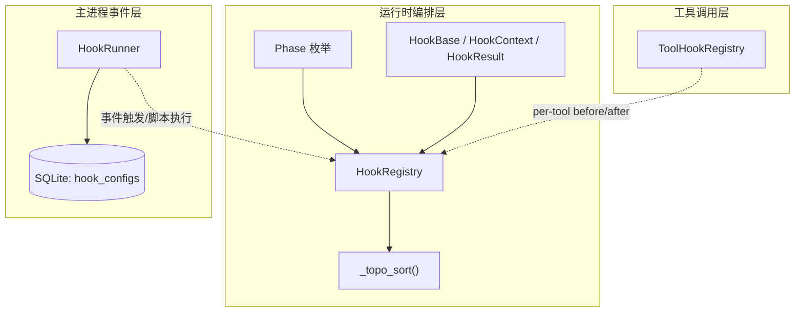
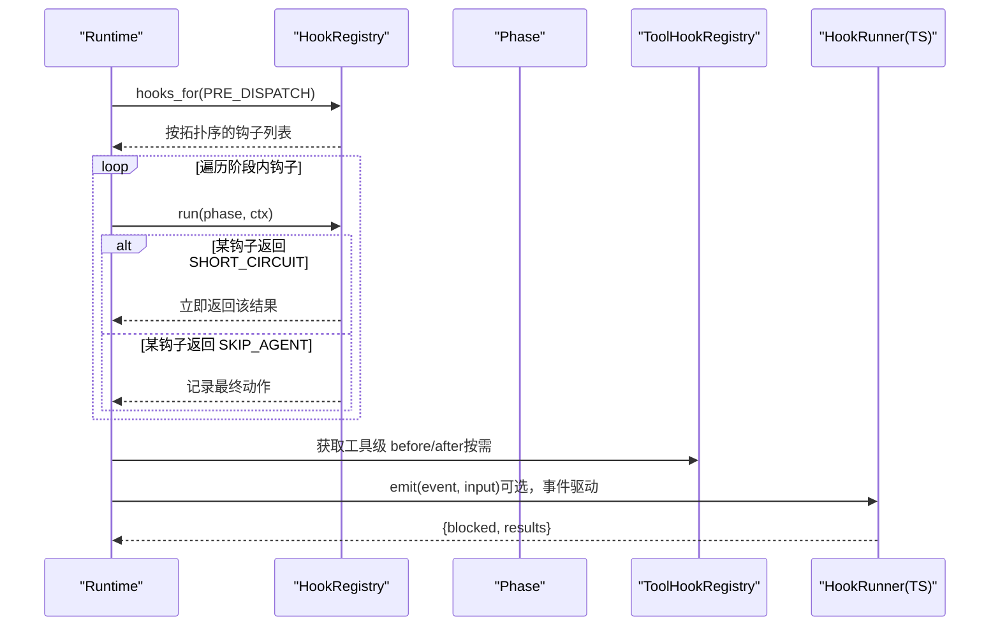
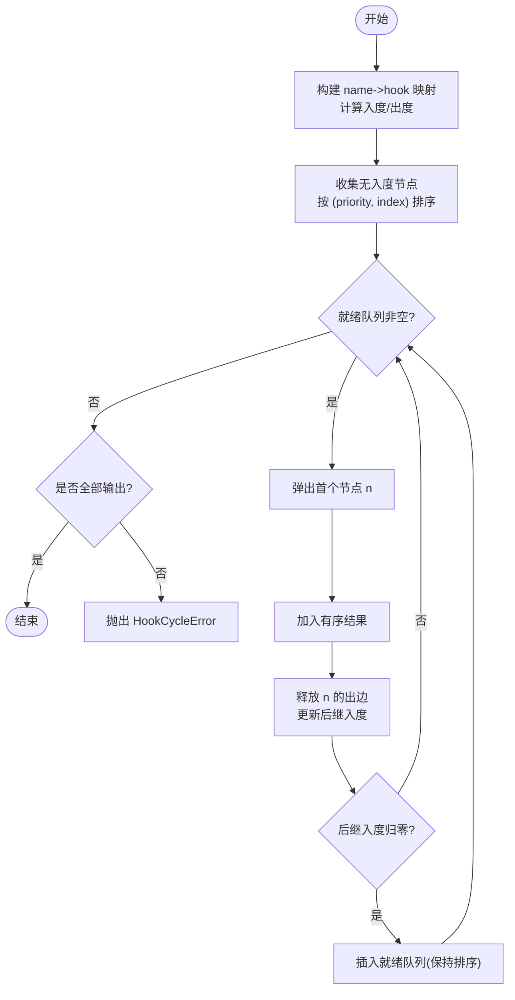
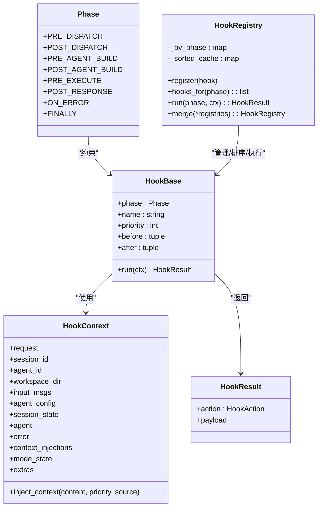
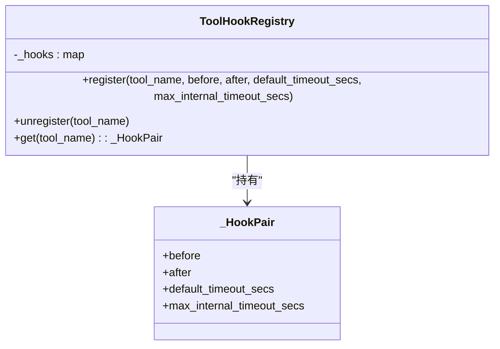
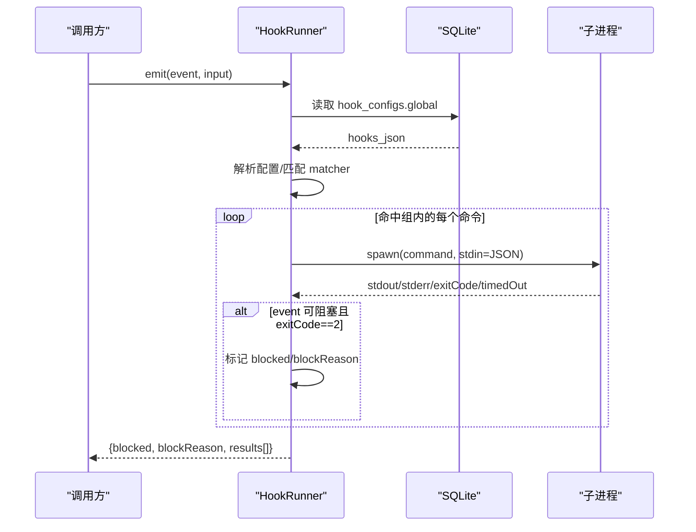
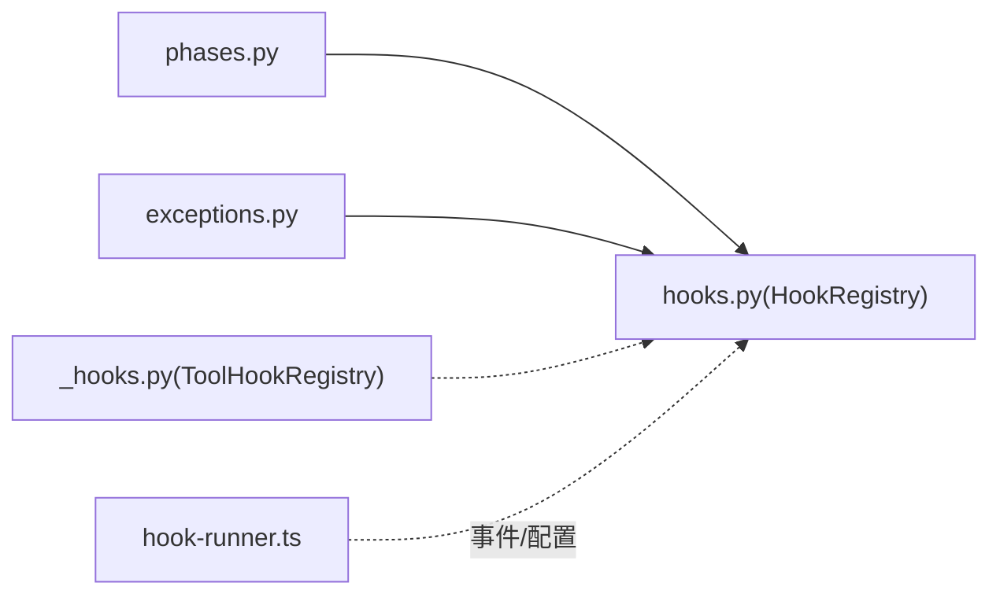

# 钩子注册与调度

<cite>
**本文引用的文件**
- [hooks.py](file://tongtian-tauri/src/agent/runtime/hooks.py)
- [phases.py](file://tongtian-tauri/src/agent/runtime/phases.py)
- [_hooks.py](file://tongtian-tauri/src/agent/tool_calls/_hooks.py)
- [hook-runner.ts](file://tongtian-tauri/src/main/hooks/hook-runner.ts)
- [exceptions.py](file://tongtian-tauri/src/agent/exceptions.py)
</cite>

## 目录
1. [简介](#简介)
2. [项目结构](#项目结构)
3. [核心组件](#核心组件)
4. [架构总览](#架构总览)
5. [详细组件分析](#详细组件分析)
6. [依赖关系分析](#依赖关系分析)
7. [性能考虑](#性能考虑)
8. [故障排查指南](#故障排查指南)
9. [结论](#结论)
10. [附录](#附录)

## 简介
本文件系统性说明钩子注册与调度系统的设计与实现，覆盖运行时 HookRegistry 的按阶段分组存储、拓扑排序算法、优先级控制、before/after 约束与循环检测、缓存策略；同时补充工具调用层的 per-tool before/after 钩子以及主进程侧的事件驱动 HookRunner（脚本化钩子）。文档还给出多工作空间合并与跨工作空间共享的实践建议、最佳实践、性能优化与调试方法。

## 项目结构
围绕钩子系统的关键代码分布在三层：
- 运行时编排层（Python）：定义阶段枚举、HookBase/HookContext/HookResult、HookRegistry 及拓扑排序。
- 工具调用层（Python）：为每个工具提供 before/after 钩子与超时元数据注册表。
- 主进程事件层（TypeScript）：基于数据库配置的 HookRunner，按事件匹配规则顺序执行外部命令脚本，支持阻塞语义与聚合结果。

图表来源
- [phases.py:28-39](file://tongtian-tauri/src/agent/runtime/phases.py#L28-L39)
- [hooks.py:145-327](file://tongtian-tauri/src/agent/runtime/hooks.py#L145-L327)
- [_hooks.py:20-77](file://tongtian-tauri/src/agent/tool_calls/_hooks.py#L20-L77)
- [hook-runner.ts:146-222](file://tongtian-tauri/src/main/hooks/hook-runner.ts#L146-L222)

章节来源
- [phases.py:1-42](file://tongtian-tauri/src/agent/runtime/phases.py#L1-L42)
- [hooks.py:1-338](file://tongtian-tauri/src/agent/runtime/hooks.py#L1-L338)
- [_hooks.py:1-77](file://tongtian-tauri/src/agent/tool_calls/_hooks.py#L1-L77)
- [hook-runner.ts:1-226](file://tongtian-tauri/src/main/hooks/hook-runner.ts#L1-L226)

## 核心组件
- Phase：固定八阶段点，覆盖请求生命周期（预处理、构建、执行、响应、错误、清理等），作为钩子的执行边界。
- HookBase/HookContext/HookResult：统一钩子抽象、每请求上下文与返回语义（继续、短路、跳过代理）。
- HookRegistry：按阶段分组存储、拓扑排序、缓存、串行执行、短路/跳过代理传播、多注册表合并。
- ToolHookRegistry：以工具名为键的 per-tool before/after 钩子与超时元数据注册表。
- HookRunner（TS）：从数据库加载配置，按事件名与 matcher 匹配，顺序执行外部命令脚本，支持阻塞语义与超时控制，并聚合结果。

章节来源
- [phases.py:28-39](file://tongtian-tauri/src/agent/runtime/phases.py#L28-L39)
- [hooks.py:46-160](file://tongtian-tauri/src/agent/runtime/hooks.py#L46-L160)
- [hooks.py:168-327](file://tongtian-tauri/src/agent/runtime/hooks.py#L168-L327)
- [_hooks.py:20-77](file://tongtian-tauri/src/agent/tool_calls/_hooks.py#L20-L77)
- [hook-runner.ts:25-37](file://tongtian-tauri/src/main/hooks/hook-runner.ts#L25-L37)
- [hook-runner.ts:146-222](file://tongtian-tauri/src/main/hooks/hook-runner.ts#L146-L222)

## 架构总览
下图展示“运行时编排层”在单次 Runtime.run() 中如何按阶段调度钩子，并与工具调用层、主进程事件层协同。

图表来源
- [hooks.py:284-312](file://tongtian-tauri/src/agent/runtime/hooks.py#L284-L312)
- [phases.py:28-39](file://tongtian-tauri/src/agent/runtime/phases.py#L28-L39)
- [_hooks.py:36-77](file://tongtian-tauri/src/agent/tool_calls/_hooks.py#L36-L77)
- [hook-runner.ts:182-216](file://tongtian-tauri/src/main/hooks/hook-runner.ts#L182-L216)

## 详细组件分析

### 运行时钩子：HookRegistry、Phase、拓扑排序与执行
- 阶段模型：Phase 定义了八个固定阶段点，用于将钩子组织到明确的生命周期位置。
- 钩子抽象：HookBase 声明 phase/name/priority/before/after；HookContext 携带请求与跨阶段可变状态；HookResult 表达 CONTINUE/SHORT_CIRCUIT/SKIP_AGENT。
- 拓扑排序：_topo_sort 根据 before/after 构建有向边，使用入度表与优先队列（按 priority、注册次序）稳定排序；未知名称仅告警不失败；若存在环则抛出 HookCycleError。
- 执行语义：run 按拓扑序依次执行；遇到 SHORT_CIRCUIT 立即返回；SKIP_AGENT 会累积并在阶段结束时传递；异常向上抛出由上层 ON_ERROR/FINALLY 处理。
- 缓存策略：按 phase 缓存排序结果，register 时失效对应 phase 缓存。
- 多工作空间合并：merge 将多个注册表按左到右顺序合并到新实例，便于跨工作空间共享与组合。

图表来源
- [hooks.py:168-253](file://tongtian-tauri/src/agent/runtime/hooks.py#L168-L253)
- [exceptions.py:322-331](file://tongtian-tauri/src/agent/exceptions.py#L322-L331)

图表来源
- [phases.py:28-39](file://tongtian-tauri/src/agent/runtime/phases.py#L28-L39)
- [hooks.py:46-160](file://tongtian-tauri/src/agent/runtime/hooks.py#L46-L160)
- [hooks.py:256-327](file://tongtian-tauri/src/agent/runtime/hooks.py#L256-L327)

章节来源
- [phases.py:1-42](file://tongtian-tauri/src/agent/runtime/phases.py#L1-L42)
- [hooks.py:46-160](file://tongtian-tauri/src/agent/runtime/hooks.py#L46-L160)
- [hooks.py:168-327](file://tongtian-tauri/src/agent/runtime/hooks.py#L168-L327)
- [exceptions.py:322-331](file://tongtian-tauri/src/agent/exceptions.py#L322-L331)

### 工具调用层：per-tool before/after 钩子
- ToolHookRegistry 维护 tool_name -> _HookPair 的映射，支持 before/after 回调与默认/最大内部超时秒数。
- 多次注册同一工具会合并字段，未显式传入的保留原值。
- 适合对单个工具调用进行细粒度拦截与资源清理。

图表来源
- [_hooks.py:20-77](file://tongtian-tauri/src/agent/tool_calls/_hooks.py#L20-L77)

章节来源
- [_hooks.py:1-77](file://tongtian-tauri/src/agent/tool_calls/_hooks.py#L1-L77)

### 主进程事件层：HookRunner（脚本化钩子）
- 配置读取：从 SQLite 的 hook_configs 表读取 JSON 配置，包含各事件的钩子组与匹配器。
- 事件触发：emit 按事件名查找配置组，依据 matcher 精确/多值/正则匹配目标字段，顺序执行 command 类型钩子。
- 脚本执行：通过子进程运行命令，stdin 传入 JSON，支持超时与平台相关终止；Windows 下杀进程树避免残留。
- 阻塞语义：特定事件（PreToolUse/Stop/SubagentStop）允许脚本返回 exit code 2 表示阻塞，并聚合 blocked/blockReason。
- 试运行：testRun 支持单独测试某个命令的执行结果。

图表来源
- [hook-runner.ts:156-178](file://tongtian-tauri/src/main/hooks/hook-runner.ts#L156-L178)
- [hook-runner.ts:182-216](file://tongtian-tauri/src/main/hooks/hook-runner.ts#L182-L216)
- [hook-runner.ts:99-142](file://tongtian-tauri/src/main/hooks/hook-runner.ts#L99-L142)

章节来源
- [hook-runner.ts:1-226](file://tongtian-tauri/src/main/hooks/hook-runner.ts#L1-L226)

## 依赖关系分析
- 运行时层依赖 Phase 枚举确定执行边界；HookRegistry 依赖 _topo_sort 完成排序与循环检测；HookContext 承载跨阶段状态。
- 工具调用层独立于运行时编排，但可与运行时钩子配合，形成“全局阶段钩子 + 工具级钩子”的双层拦截。
- 主进程 HookRunner 与 Python 层解耦，通过事件契约交互，适合扩展外部脚本生态。

图表来源
- [phases.py:28-39](file://tongtian-tauri/src/agent/runtime/phases.py#L28-L39)
- [hooks.py:168-327](file://tongtian-tauri/src/agent/runtime/hooks.py#L168-L327)
- [_hooks.py:36-77](file://tongtian-tauri/src/agent/tool_calls/_hooks.py#L36-L77)
- [hook-runner.ts:146-222](file://tongtian-tauri/src/main/hooks/hook-runner.ts#L146-L222)
- [exceptions.py:322-331](file://tongtian-tauri/src/agent/exceptions.py#L322-L331)

章节来源
- [hooks.py:168-327](file://tongtian-tauri/src/agent/runtime/hooks.py#L168-L327)
- [hook-runner.ts:146-222](file://tongtian-tauri/src/main/hooks/hook-runner.ts#L146-L222)

## 性能考虑
- 拓扑排序复杂度：O(V+E+VlogV)，其中 V 为钩子数量，E 为 before/after 约束边数；使用二分插入维持就绪队列有序，保证确定性。
- 缓存策略：按 phase 缓存排序结果，仅在 register 时失效；高频 run(phase) 场景显著降低重复排序开销。
- 短路优化：SHORT_CIRCUIT 立即中断当前阶段，减少不必要执行。
- 子进程执行：HookRunner 的命令执行带超时与平台化终止逻辑，避免僵尸进程；批量事件触发时应注意 I/O 与 CPU 占用。
- 建议：
  - 合理拆分钩子粒度，避免单钩子过重。
  - 谨慎使用大量 before/after 约束，减少图规模。
  - 对耗时操作采用异步或后台任务，避免阻塞主流程。
  - 对频繁触发的阶段（如 PRE_EXECUTE/POST_RESPONSE）尽量保持钩子轻量。

## 故障排查指南
- 循环检测失败：当 before/after 形成环时，_topo_sort 会在无法输出所有节点时抛出 HookCycleError。检查冲突的命名与约束，必要时移除冗余约束。
- 未知名称告警：引用了未注册的钩子名时仅警告并忽略该约束；确认名称拼写与注册顺序。
- 短路/跳过代理：若期望继续执行却被提前终止，检查是否有钩子返回 SHORT_CIRCUIT；如需跳过代理步骤，使用 SKIP_AGENT。
- 工具级超时：per-tool 钩子受 default/max 内部超时限制，超出将被拒绝或中止；调整超时参数或优化脚本。
- 脚本执行失败：HookRunner 返回 exitCode、stderr、timedOut；定位具体命令与输入 JSON，结合日志排查。
- 阻塞语义：仅 PreToolUse/Stop/SubagentStop 支持 exit code 2 阻塞；其他事件不会因该码而阻断。

章节来源
- [hooks.py:168-253](file://tongtian-tauri/src/agent/runtime/hooks.py#L168-L253)
- [exceptions.py:322-331](file://tongtian-tauri/src/agent/exceptions.py#L322-L331)
- [hook-runner.ts:25-37](file://tongtian-tauri/src/main/hooks/hook-runner.ts#L25-L37)
- [hook-runner.ts:99-142](file://tongtian-tauri/src/main/hooks/hook-runner.ts#L99-L142)

## 结论
本系统通过 Phase 划分生命周期、HookRegistry 实现按阶段分组与拓扑排序、严格的 before/after 约束与循环检测、以及按阶段的缓存策略，提供了稳定可控的运行时钩子调度能力。工具级钩子与主进程事件钩子分别满足细粒度与可扩展的外部集成需求。遵循本文的最佳实践与性能建议，可在保证正确性的前提下获得良好的扩展性与可维护性。

## 附录

### 最佳实践
- 钩子设计
  - 明确职责：每个钩子只做一件事，保持幂等与轻量。
  - 合理使用优先级：同阶段内用 priority 微调顺序，避免过度依赖 before/after。
  - 谨慎使用 before/after：仅在确有依赖时使用，避免复杂图结构。
- 注册与合并
  - 多工作空间：使用 HookRegistry.merge 将插件与工作空间钩子合并，确保命名唯一。
  - 跨工作空间共享：将通用钩子放入共享注册表，再 merge 到具体工作空间。
- 工具级钩子
  - 设置合理的默认与最大超时，防止长时间阻塞。
  - before/after 中避免重 I/O，必要时异步化。
- 脚本化钩子
  - 使用 matcher 精确匹配目标，避免误触发。
  - 控制超时与退出码，区分成功/阻塞/失败。
  - 集中日志输出，便于追踪。

### 调试方法
- 启用日志：关注 _topo_sort 的未知名称告警与 HookRunner 的执行日志。
- 最小复现：隔离单一阶段与少量钩子，逐步增加复杂度。
- 断点与打印：在 HookContext 注入点与 HookResult 返回处观察状态流转。
- 试运行：使用 HookRunner.testRun 单独验证命令行为。

### 多工作空间合并与跨工作空间共享
- 合并策略：HookRegistry.merge 按左到右注册顺序合并，后者优先覆盖同名钩子的相对位置（通过注册次序影响排序稳定性）。
- 共享模式：将公共钩子置于共享注册表，各工作空间再合并自身专属钩子，实现“基础能力 + 定制扩展”。
- 注意事项：合并前确保钩子命名唯一；before/after 引用需在同一合并后的图中可见。

章节来源
- [hooks.py:256-327](file://tongtian-tauri/src/agent/runtime/hooks.py#L256-L327)
- [hook-runner.ts:156-178](file://tongtian-tauri/src/main/hooks/hook-runner.ts#L156-L178)
- [hook-runner.ts:182-216](file://tongtian-tauri/src/main/hooks/hook-runner.ts#L182-L216)